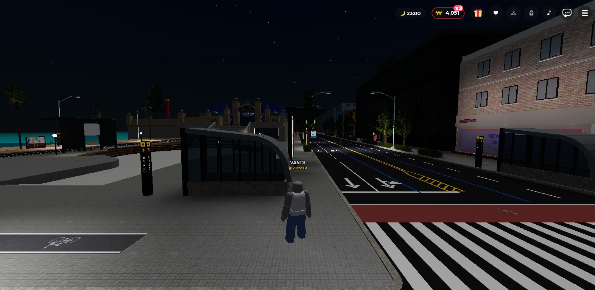

# 서울 야경 조사 — "밤에 무섭다" 의견 (2026-11-15)

## 1. 지금 게임의 밤 (Play, 23:00)

- Lighting: Brightness 3, Ambient / OutdoorAmbient 회색 (70, 70, 70), ExposureCompensation 0, Atmosphere Density 0.3 (Haze 0), Bloom / DepthOfField / SunRays. 켜진 조명 약 500개.
- 보이는 것: 하늘이 완전히 검고, 건물(가짜 고층 건물 포함)이 거의 검은 덩어리, 창문에 불이 없음. 가로등은 켜져 있지만 바닥에 빛 웅덩이가 약함. 길에 사람·차가 없음.
- 무서운 이유로 읽히는 것: 큰 검은 면(건물·하늘)이 화면 대부분, 사람이 사는 신호(창문 불빛, 가게 불빛)가 없음, 빛이 차갑고 약함.

## 2. 서울 야경의 특징 (조사)
- 따뜻한 빛: 서울 야경 명소 100선의 백색광은 대부분 2,500–3,500K, 그중 3,000–3,500K가 가장 많음(논문). 서울시도 "황금빛 조명"을 서울 밤거리의 분위기로 소개.
- 가로등: 서울시는 가로등을 LED로 바꾸고, 지역·노선마다 색온도를 다르게, 시간대·날씨에 맞춘 점·소등을 도입 중.
- 골목: 을지로·종로처럼 오래된 건물, 작은 간판, 가게 앞 테이블과 의자가 밤 풍경을 채움(생활감).
- 홍대: 네온과 간판이 많은 활기찬 골목. 강남(테헤란로): 고층 건물 창 불빛과 큰 도로의 현대적 야경. 청담동은 2025년 "빛의 거리" 조성.
- 상업 가로의 조명은 야간 경관 인식에 영향(보행가로 조명 연구). 큰 디지털 광고판은 너무 밝아 운전 방해 논란(2026) — 밝기는 적당히.
- 하늘: 도시의 빛 때문에 서울 밤하늘은 완전히 검지 않고 남색·주황빛이 돎(빛 공해 하늘).

## 3. 게임에 옮길 후보 (사용자가 고를 것)
1. 밤 하늘·주변광: 완전 검정 대신 짙은 남색 하늘, Ambient를 조금 푸르고 밝게, 도심 쪽 지평선에 주황빛.
2. 건물 창 불빛: 가짜 고층 건물·상가 창의 일부(랜덤 60~70 %)가 밤에 따뜻하게 켜짐(Neon 창 / SurfaceGui), 낮에는 꺼짐.
3. 가로등: 3,000K 정도의 따뜻한 빛, 바닥에 둥근 빛 웅덩이(SpotLight 범위·밝기 올림).
4. 가게 간판·쇼윈도: 1층 가게 간판과 유리창이 밤에 밝게(이미 있는 간판에 빛 추가).
5. 사람 기척: 밤에도 길에 NPC 몇 명, 버스·차 불빛.
6. 빛 번짐(Bloom) 살짝 올려 간판이 은은하게.

## 출처
- [서울시 미디어허브 — 서울색 찾기 여행 (2026)](https://mediahub.seoul.go.kr/archives/2016492)
- [서울시 미디어허브 — 가로등 100% LED로 (안전하고 매력적인 서울의 밤)](https://mediahub.seoul.go.kr/archives/2010080)
- [서울시 도시빛정책 (야경 명소 100선)](https://news.seoul.go.kr/citybuild/archives/tag/%ec%95%bc%ea%b2%bd%eb%aa%85%ec%86%8c-100%ec%84%a0)
- [The nocturnal characteristics of Seoul city: focused on light color (koreascience)](https://koreascience.or.kr/article/JAKO202421943288892.page?lang=en)
- [상업지역 보행가로 내 조명이 야간경관 인식에 미치는 영향 (koreascience)](https://koreascience.or.kr/article/JAKO201434438338583.page?lang=ko)
- [Korea Times — Large digital billboards in Seoul distract drivers at night (2026)](https://www.koreatimes.co.kr/southkorea/society/20260207/turn-it-off-large-digital-billboards-in-seoul-distract-drivers-at-night)
- [Asiae — Gangnam-gu "Cheongdamdong Light Street" (2025)](https://www.asiae.co.kr/en/article/2025121110313335627)
