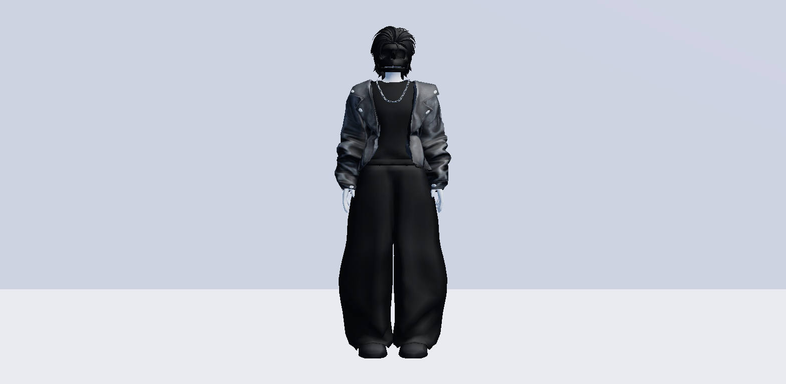
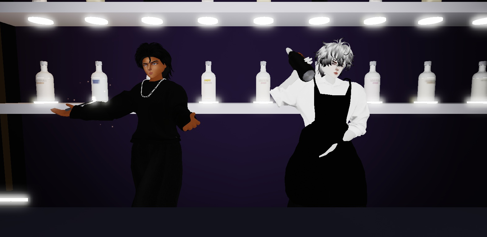

# Characters (NPC looks)

Built in Play from a HumanoidDescription (D-655). Recipe so it can be rebuilt:
`Players:GetHumanoidDescriptionFromOutfitId(body outfit)`, then set the head, classic
clothes, scales and `SetAccessories(list, true)` (rigid hair goes in the same list,
or SetAccessories drops it), then `Players:CreateHumanoidModelFromDescription(d, R15)`.

## Character A (user's pick 2026-10-31; for the bartender)

| Part | Asset |
|---|---|
| Body | bundle 93826326052944 가장 키가 큰 근육 베미맨 → outfit 5367685064154827 |
| Head | 119054363847542 블랙 스컬 헤드 (dynamic head) |
| Hair | 136998073184295 블랙 슬릭 백 울프 컷 헤어 |
| Layered, order 1 | 93816036884228 어깨 패드 (TShirt) |
| Layered, order 2 | 88241801880611 블랙 (Pants) |
| Layered, order 3 | 94019726091658 검은색 스웨터/은색 체인 (Sweater) |
| Layered, order 4 | 114076548170981 검은색 바이커 가죽 재킷 (Jacket) |
| Classic shirt / pants | 138090188090311 / 133566828283173 (클리어) |
| Scales | Height 1.05, BodyType 1, Proportion 1 (longest: user 2026-10-31), Width 1, Depth 1 |

Height with these scales: about 11.1 studs (9.0 at the default scales).

## Bartender (2026-10-31, D-661)

Character A's body, head (스컬), classic clear shirt/pants and scales, with:

| Part | Asset |
|---|---|
| Head | 110649251725469 (bundle 24649319209591 얼굴 없는 인형 머리, D-669; before: 112433260004346) |
| Hair | 137811933417350 지저분한 아이돌 웨이브 헤어 (back on, D-663) |
| Face accessory | none (masks taken off, D-668) |
| Layered 1 | 93816036884228 어깨 패드 (TShirt) |
| Layered 2 | 130442955983043 주름진 오피스 버튼업 셔츠 화이트 (TShirt) |
| Layered 3 | 88241801880611 블랙 (Pants) |
| Layered 4 | 12271645343 블랙 레스토랑 앞치마 (Jacket) |
| Pose | idle of animation pack 155758204354290 실감나는 남성 01 → animation 128667162266929 (D-671) |
| In hand | 스컬 앤 워터 bottle (DrinkService.heldBottle) |

## Item seller (D-663)

Character A without the biker jacket, with the bartender's face (head 110649251725469, D-669), dark bronze skin (105, 62, 36), the pose of emote 85369612310951 장엄한 소환 포즈 (animation 100249604916626) a black face mask 18991656628 and a lit hand sparkler (D-663..D-671).
