# Design Decisions

D-001 — Dedicated Fashion Studio를 만들지 않는다.  
Reason: spontaneous social flow를 끊기 때문. Catalog는 Main Social에서 계속 사용할 수 있어야 한다.

D-002 — Runway는 별도 Place로 검토한다.  
Reason: round-based server state가 Main Social과 다르다. Status: future candidate; current MVP dependency가 아니다.

D-003 — Club은 초기 소셜 경험의 핵심 공간으로 Main Social 내부에 둔다.  
Reason: 인구가 적을 때 별도 서버가 비어 보일 수 있고, 다른 공간과의 자연스러운 이동이 중요하다.

D-004 — Housing은 보류하며 현재 MVP 범위에서 제외한다.  
Reason: 집 외형/구조/가구/저장/방문은 별도 복잡도를 가지며 현재 핵심인 카탈로그 기반 아바타 꾸미기와 소셜 플레이를 검증하는 데 필수적이지 않다. 재검토 시 색·패턴 변경과 구조 편집·가구 배치를 분리한다.

D-005 — Current Outfit은 Roblox ownership과 다르다.  
Reason: 게임 내 임시 착용과 저장 코디는 Roblox 계정의 구매/소유권을 변경하지 않는다.

D-006 — Roblox 공식 API를 우선 사용한다.  
Reason: 지원 범위와 제한은 공식 문서 및 Studio 테스트로 검증한다.

D-007 — Building System과 Furniture Asset을 분리한다.  
Status: historical architecture decision for a possible future Housing system; it does not authorize Housing work in the current MVP.

D-008 — AI를 월드/에셋 제작에 활용하되 최종 품질과 gameplay는 직접 검수한다.

D-009 — SavedOutfits는 초기 최대 50개/사용자로 설정한다.  
Reason: product limit chosen for this game; it is not a Roblox platform recommendation. Unique outfitId is required even when names repeat.

D-010 — Partial restore skips only unavailable/unsupported Outfit entries.  
Reason: preserve the rest of the selected appearance and the original SavedOutfit. Do not delete or rewrite the saved record after partial restore.

D-011 — RunwayOutfit is temporary.  
Reason: after a future Runway round, ask explicitly whether to save the look; save only on affirmative confirmation.

D-012 — Current core priority is Catalog → Avatar Editor → SavedOutfits/Wardrobe → Club → Photo Spots → Playground interactions (revised 2026-10-19).  
Runway is a future candidate; Housing is deferred and furthest priority.

D-013 — Public photo gallery posting, likes, and public style-copy feed are out of current scope.  
Photo-taking and in-world inspection/manual catalog try-on are separate features.

D-013 — Plan Main Social as connected themed areas with local interactions.  
Reason: players should do something meaningful with their customized avatar in each area, not only use backdrops for photos. Status: concept plan; exact layout and implementation order remain subject to blockout and prototype testing.

D-014 — Dream Aquarium and Beach are proposed as connected spaces.  
Reason: underwater exploration should lead naturally to the surface and beach. A limited underwater duration/breath meter is a prototype candidate, not yet a final mechanic; test clear guidance, generous recovery and PC/mobile navigation.

D-015 — Fashion Week Backstage can be useful before Runway exists.  
Reason: use the dressing-room/green-room environment as a social exploration area first, then consider adding a portal when Runway is reprioritized. Camper, tent and building set design remain undecided until surrounding environment design.

D-016 — Whole-world art direction is undecided.  
Reason: Korean-inspired street/market details, American vintage, global pop-stage and fantasy elements should be compared via moodboards and blockout rather than assuming one theme has proven higher demand. No reliable comparative demand statistic has been established for this specific game concept.

D-017 — Separate whole-game development order from per-space construction order.
Reason: The game-wide sequence determines system dependencies and milestone priority; each space's document determines its local blockout, interaction, validation and art-polish sequence. Whole-map grayboxing can begin early without implementing every space in parallel.

D-018 — Korean-inspired visual details remain optional and undecided.
Reason: The user wants some Korean elements to be considered for selected spaces or as background details, but does not want a global Korean theme decided yet. Compare moodboards and graybox fit before promoting a motif to a space-level decision.

D-019 — SavedOutfits limit is 50 per user everywhere (2026-10-19).
Reason: user decision; earlier log entries that said 20 were errors and are corrected.

D-020 — Recent = every item successfully worn at least once in the session (2026-10-19).
Reason: user decision. An item worn and removed immediately stays in Recent. Viewing, search exposure, failed wear and Outfit restore do not add entries.

D-021 — Avatar Editor precedes SavedOutfits/Wardrobe and is free (2026-10-19).
Reason: players adjust accessories first and then save the adjusted look. VIP never gates editing or saving.

D-022 — Entry points (2026-10-19).
Compact catalog: ⚙ (Avatar Editor) and Wardrobe buttons follow 최근/인기/즐겨찾기/착용 중 in the discovery strip. ⚙ opens the expanded catalog in edit mode and reuses the existing avatar preview. Wardrobe shows a "save outfit" card plus saved outfits in the existing result-card layout.

D-023 — Recent is not persisted (2026-10-19).
Reason: user decision. Recent resets when the player leaves; it is never written to DataStore.

D-024 — Avatar Editor preview fallback (2026-10-19).
Preferred: client-only preview humanoid in the expanded catalog preview. If Studio testing shows that is not possible, use a server-built preview model visible only to that player. If that also fails, the KOYA approach is allowed: apply the draft to the live character while editing, and restore the confirmed baseline on Discard/close.

D-025 — Shoes are worn as a pair (2026-10-19).
Reason: user decision; Roblox sells shoes only as Shoes bundles. Wearing from a card puts on left + right together. The worn strip shows left and right as separate cards and each can be removed on its own. A new shoe replaces the shoe on the same side.

D-026 — Layer order is edited in the expanded worn strip (2026-10-19).
Reason: user decision, KOYA "의상 레이어" reference. Layered clothing is listed first, outermost (drawn on top) on the left, with a number badge; other worn items follow and are not draggable. Drag a layered card to a new position (mouse: move 6px; touch: hold 0.3s) → server `SetLayerOrder` (outermost first → WrapLayer.Order, higher = on top). New layered items get a default per-type order (shoes 2, pants 4, shorts 5, T-shirt 6, shirt 7, dress/skirt 8, sweater 9, jacket 10).

D-027 — Catalog button on the right of the top bar; phone compact = 1/4 width (2026-10-19).
Reason: user decision. Voice chat adds a top-bar button that covered the old left-anchored C button. On phones the minimized catalog covered half the screen and hid the avatar.

D-028 — Phone minimized catalog = 2/5 of screen width (2026-10-19, supersedes the 1/4 width in D-027).
Reason: user decision after testing; 1/4 was too small.

D-029 — Worn order everywhere (2026-10-19).
Worn strip and the 착용 중 card list share one order: layered clothing (outermost first, draggable) → other worn items → animation poses (innermost) → emotes (last). A layer drag in either view calls SetLayerOrder and both re-render from the same server snapshot.

D-030 — Favorites storage (2026-10-19).
In-game Favorites are stored per user in DataStore `FashionGamePlayerData` (key `u_<userId>`, field `favorites`, typed `{id, itemType Asset|Bundle, addedAt}`), cap 200 (configurable). Writes use UpdateAsync on autosave (60s), leave and server close. If the DataStore cannot load (e.g. Studio API access off) favorites work for the session only and the player is told.

D-031 — Avatar Editor scope follows official rules (2026-10-19).
Accessory adjust only for rule types (hat, face, neck, shoulder, front, back); body scales Height/Width/Head/Proportion/BodyType (no Depth); skin colours from BasicBodyColorsPalette; makeup order only. Limits are read from GetAvatarRules at runtime and enforced on the server.

D-032 — Wardrobe snapshot format (2026-10-19).
SavedOutfit = `{id (GUID), name (1–30 chars, trimmed, duplicates allowed), createdAt, snapshot}`. The snapshot is versioned (`v = 1`) and typed by section: `assets` (classic clothing, face, body parts, animations), `scales`, `colors` (hex), `accessories` (id, type, layered, order, puffiness, position/rotation/scale), `makeup` (id, type, order), `emotes` + `equipped`. It is built on the server from the applied description, so only Applied Avatar Editor values are saved. Outfit cards render a preview from the snapshot (not a screenshot).

D-033 — Wardrobe writes are confirmed before success (2026-10-19).
Save/delete write the DataStore immediately (UpdateAsync, 3 attempts; after an error, a fresh read checks whether the change landed). A failed write rolls the session change back and shows an error. When the DataStore is unavailable (Studio without API access, load failure) the Wardrobe works for the session and says so; it never overwrites stored data with an empty list.

D-034 — Restore replaces the whole look (2026-10-19).
Restore applies the saved description with ApplyDescriptionResetAsync inside the same per-player gate as wear/remove/editor Apply. Items that are not present afterwards are reported as skipped; the saved outfit is never changed. If the apply errors, the pre-restore look is re-applied.

D-035 — Catalog always reopens on the first screen (2026-10-19, updated 2026-10-20).
User decision: closing and reopening shows 전체/전체 in normal catalog mode with an empty keyword and default sort/filters, and always in the minimized layout (2026-10-20: previously the expanded/compact choice was kept).

D-036 — Animation preview plays once (2026-10-19).
User decision: wearing an animation or emote plays it once on the preview avatar, never looped. Catalog asset IDs are packages, so the server loads the package (InsertService) and returns the first clip, only for an animation the player is wearing. Mood animations are facial clips and do not play on the preview.

D-037 — Accessory axis guide and per-axis reset (2026-10-20).
User decision (KOYA reference): while an adjustable accessory is selected, the preview draws a ring per axis, a short axis line and a small x/y/z label, coloured x red / y green / z blue; the matching slider labels and fills use the same colours. Axes follow the body attachment the accessory is attached to. Each position/rotation slider has its own reset to 0, and size resets to 1. While the editor is open the preview clone always applies the draft (needed to locate the accessory part with GetAppliedInstance).

D-038 — ⚙ toggles the Avatar Editor; filter popup closes on outside press (2026-10-20).
User decision. Closing the editor with un-applied changes still asks Apply / Discard / keep editing.

D-039 — Body and head are worn as bundles (2026-10-20).
Roblox catalog search does not return wearable individual body parts, heads or classic faces (QA: Face search returns 0 even with off-sale). 전신 lists BodyParts bundles and 머리 lists DynamicHead bundles; the card's WEAR applies every supported part of the bundle in one apply (body parts, animations, accessories, makeup). WORN is decided by the bundle's core parts. Removing reverts each part to the one the character spawned with. 얼굴 shows "준비 중".

D-040 — Wear/Remove use typed identity (2026-10-20).
Clients send `{id, itemType = "Asset" | "Bundle"}`. Bare numbers are still accepted as Asset. Remove accepts Assets only (bundles are removed by their asset ids).

D-041 — Newest catalog request wins (2026-10-20).
A category/search click while a search or page is loading is no longer ignored; the older request's results are discarded (generation token).

D-042 — Outfit rename (2026-10-20).
Each outfit card has ✏️; rename keeps id, snapshot and date. Same name rules as save (1–30 chars, trimmed, duplicates allowed). The write is confirmed before success; a failed write rolls back.

D-043 — Club drinks are non-alcoholic; no private spaces (2026-10-20, confirmed by user 12:37).
Roblox content maturity: depicting alcohol makes an experience Restricted (age-verified 18+); romantic themes are 18+; social hangouts with private spaces (bedrooms, bathroom stalls, small tents) are age-verified 18+. Proposal: the club bar is a juice/mocktail counter, lounges/VIP/backstage are open (visible) areas. See `docs/03_CONTENT/REFERENCE_MASS_CLUB_ANALYSIS.md`.

D-044 — World layout option C (2026-10-20, approved by user 12:37; graybox test still required).
Hub (Central Plaza) + City Street loop + two anchors (Club north, Beach west), quiet Cafe south-west, Park east, Neon Rooftop stacked on the Club. Not final until the user approves and a graybox is tested. See `docs/02_WORLDS/MAIN_SOCIAL_LAYOUT_PROPOSAL.md`.

D-045 — Paid VIP area is allowed, with conditions (2026-10-20, user asked; conditions proposed).
A separate area that VIP Pass owners can enter is allowed. Conditions (Roblox content maturity: a private space is an enclosed space designed for personal/secluded activity — sleeping, changing clothes, bathing — for one or very few people):
1. Large and open, not a small room: a raised VIP balcony/deck in the Club that overlooks the dance floor and stage, visible from below (glass rail, open sides). Status is seen by others (MASS lesson).
2. No beds, bathrooms, changing rooms or small booths for one or two people inside it.
3. Access is checked on the server (GamePass ownership via MarketplaceService); non-owners are blocked by a server-side gate, never by a client-only check. A purchase in the session opens it without rejoining.
4. VIP gives a place and a view, not gameplay power over others (no kicking or blocking non-VIP players).
5. Non-VIP players get an equally good free view of the stage elsewhere; free Catalog/Wardrobe/Club features are unaffected.
Product price and benefits stay in MONETIZATION.md.

D-046 — Art direction: general modern city + one Hanok Village (2026-10-20, user decision).
The world looks like a general modern city (not a specific country). One district is a Hanok Village, placed south-east on the quiet side of the loop with its gate facing the street. Moodboard references and rules are in WORLD_STYLE.md. Housing's reserved plot moves east beyond the park.

D-047 — Graybox lives in a build script (2026-10-20).
Workspace geometry is not synced by Rojo, so the graybox is rebuilt from `tools/graybox/build_main_social_graybox.lua`. Layout changes are made in that script first, then run in Studio.

D-048 — Club dances are Roblox-made emotes (2026-10-20).
The MVP dance list uses only emotes created by Roblox (playable in any experience). Branded emotes (artists, films, TV) are excluded. 31 clips in two tabs: 댄스 / 포즈·응원.

D-049 — Dance state is server-owned, played by the dancer's client (2026-10-20).
The server sets character attributes DanceKey / DanceStart (server time) / DanceSpeed; the dancer's client plays the clip at the shared frame, and Animator replication shows it to others. 같이 추기 copies another dancer's key, start and speed, so both dance in sync. Tempo 0.5x–2.0x. Moving, jumping or sitting stops the dance.

D-050 — Club music is one shared playlist heard only in the club (2026-10-20).
Free Creator Store tracks from licensed distributors; one server-wide clock so everyone hears the same part; volume fades to zero within 45 studs outside the club zone; NOW PLAYING shows channel and title. No player-uploaded or broadcast music.

D-051 — Club is underground and rotated (2026-10-20, user decision).
Ground-level entrance facing the plaza → foyer → stairs down on the left (24 studs) → corridor → door → hall facing the DJ zone. VIP balcony north, lounge and juice bar south. Stairs have invisible ramps.

D-052 — DJ time is a consumable purchase, 30 minutes, one DJ per server (2026-10-20, length and price proposed).
Proposal: 30 min for 75 R$ (test 49–99). Current DJ buying again extends; others queue. Only the curated playlist can be played. Future DJ abilities register in DjService.Actions. See DJ_SYSTEM.md.

D-053 — Song requests when there is no DJ (2026-10-20).
Anyone may queue one song at a time (max 10 in the queue); requests play before the automatic playlist. When a DJ starts, open requests are cleared and only the DJ chooses.

D-054 — Drinks: bartender, bottles on tables, cups (2026-10-20, user decision).
Bartender menu: free 물/사이다/콜라, paid 환타 (6 R$ test product). A bottle is placed on a table with 모든 사람/친구만/나만; allowed players pour a cup; using the cup shows the drink motion with a gulp sound and removes the cup. Limits: 3 bottles carried, 2 cups, 6 cups per bottle, bottles cleared after 10 min or when the owner leaves. Brand names are test-only.

D-055 — Purchases go through MonetizationService (2026-10-20).
All Game Pass / Developer Product IDs live in MonetizationConfig. Receipts are granted once (PurchaseId recorded). ID 0 = not created yet: Studio shows a labelled test purchase, live servers grant nothing.

D-056 — 인생네컷 photo booth becomes the Stage 5 photo feature (2026-10-20, proposed).
See PHOTO_BOOTH.md. MVP free; paid frames/stickers/poses later.

(Restored 2026-10-21 from fb478f3; D-064/D-065 change parts of D-061–D-063.)

D-057 — Dancing keeps going while moving; dancing is club-only (2026-10-20, user decision; replaces the "moving stops the dance" part of D-049).
Walking and jumping no longer stop a dance. A dance ends with 멈추기, picking the same dance again, sitting, respawn, or leaving the club (1.5 s grace). The 💃 button shows only inside the club (hall + rooftop, parts tagged ClubInterior); the server rejects Start/Join outside.

D-058 — 같이 추기 is a live follow link (2026-10-20, user decision; MIDNIGHT PLAZA reference).
The follower copies the leader's dance and tempo on every change (also chains A→B→C; loops are refused). Touching the tempo, picking a dance, 해제 or 멈추기 ends the link (own dance). Players can tap/click another player in the club to open their card and 같이 추기; the panel's third tab lists nearby players.

D-059 — Map distances pulled in; Neon Rooftop is the club roof (2026-10-20, user decision).
Layout rev3: all distances in the LAYOUT table of the graybox script (re-tunable later). Spawn → club door 14.2 s → 11.1 s. The rooftop is the club building's roof (elevator pad by the red carpet), part of the club.

D-060 — 🎵 panel only for the DJ; DJ purchase moves the buyer to the booth (2026-10-20, user decision).
Non-DJs buy DJ time at the DJ zone gate. A new DJ (purchase or queued turn) is moved behind the booth at once. No-DJ song requests keep their server code but have no screen entry for now.

D-061 — DJ extension only with an empty queue; DJ zone for the DJ's guests (2026-10-20, user decision).
The current DJ can extend only while nobody waits (a racing purchase becomes a new queued turn, never lost). Besides the DJ, only players the DJ invites (🎵 panel 👥 초대 or the player card, max 6) can enter the DJ zone; invites end when the DJ changes.

D-062 — 같이 추기 해제 stops and waits; bottles keep their cups; LED pillars; quieter rooftop (2026-10-20, user decision).
해제 ends the link and stops the dance. Clearing your bottle with cups left returns a bottle tool with that count. Two round LED pillars beside the DJ zone show club-goers' avatar portraits in turn. Club music on the rooftop plays at 30 %.

D-063 — 인생네컷 photo booth P1 + group (2026-10-20, implements D-056 / PHOTO_BOOTH.md).
Server-owned sessions (booth, people, 8-shot clock, shot data); photos are stored as redraw data (outfit snapshot, stand-relative position, dance frame, props) in the player's album (max 30), redrawn client-side in ViewportFrames. MVP is free: 2 layouts, 3 join modes, 31 poses, 6 code-built props, 10 frames. Photo wall, stickers and paid packs come later.

D-064 — 인생네컷 rules + coin economy (2026-10-20, user decision; numbers proposed).
Album: 10 free slots (+10 per paid product). People stay inside the booth (invisible barrier) from start/join until they save or press 나가기; saving moves them out; poses stop after the last shot; ⏸ freezes the pose. Photos can be taken out as an inventory item and stuck on the photo wall (the print is used up; photos may overlap). Frames: 블랙/화이트 free, colours/pastels bought with coins, glossy/glitter Robux (Frame Pack). Coins: passive while active + activity bonuses, see ECONOMY.md.

D-065 — Club rev3: two floors, VIP-only 2nd floor around the edges (2026-10-20, user floor plan).
Hall floor -24, VIP floor -2, ceiling 36, rooftop deck 37. Centre open to the ceiling. DJ zone east with turntable console (click → DJ music window), LED wall, ceiling lasers (DJ 조명 on/off). Tables under the north VIP, bar under the south-east VIP, lounge south-west. Four round LED pillars at the atrium corners show club players, turning 360°. Neon edge on every stair step. Music: hall 1, corridor 0.45, stairs 0.12, outside silent. A DJ whose queued turn starts is asked OK / NO (NO passes the turn, no refund) instead of being moved.

D-066 — Fashion Week Backstage between the club and the 인생네컷 shop (2026-10-21).
Measured walk: spawn 13.1 s, photo shop 3.7 s, club door 7.9 s (the old west plot was 18.1 s from spawn). Open green room with mirrors, sofas, racks, FASHION WEEK photo wall; a "RUNWAY (준비 중)" arch leads to a future runway plot north of it. See FASHION_WEEK_BACKSTAGE.md §7.

D-067 — 📸 capture button: Roblox screenshot and 30 s video (2026-10-21, user request).
Top bar 📸 → 사진 / 동영상, using CaptureService (TakeScreenshotCaptureAsync, StartVideoCaptureAsync) and Roblox's own save prompt (Captures gallery). The 인생네컷 album button becomes 🖼.

D-068 — Cafe part-time job (2026-10-21, proposed, waiting for the user).
Short drink-making mini-game for players at the cafe counter; 6 coins per order, 15 a day at full pay; no authority over other players. See CAFE.md.

D-068 (update 2026-10-22) — Cafe part-time job: planned only, on hold (user). Reward draft: serve 4, clear table 2, 60 a day; replaces the 2026-10-21 proposal. Waits for the economy v2 balance. CAFE.md §9.

D-069 — Club rev4 layout from the user's 1F/2F plans (2026-10-22).
Hall level = 1F. Hall door in the middle of the corridor; the corridor ends at a red see-through VIP wall (neon VIP sign, same gate/purchase logic) with the VIP stair behind it; 2F is only the VIP U; centre, DJ zone and pillars open to the ceiling; south-west lounge → table zone; DJ deck turned to face the DJ; white chevron neon stairs. CLUB.md §17.

D-070 — LED pillars: two, floor to ceiling, twice as thick, live avatar (2026-10-22).
Panels show a live copy of the shown player (pose copied every frame). SurfaceGuis holding ViewportFrames live in PlayerGui (Adornee), because under a Workspace part they are not drawn.

D-071 — PARK rides on the shared clock (2026-10-22).
Ferris wheel (2 per gondola, board/leave near the bottom, 1st-person button), carousel (ride any horse), swings (+/− speed 0..5, max 35°), spring riders, slide (auto slide, "야호!"). Rides move on every client from GetServerTimeNow; the server only keeps seats. Open gondolas (no closed rooms). PARK.md §8.

D-072 — Three cafes with shared systems (2026-10-22).
Glasshouse (first, full test), Hanok fusion cafe, Sunset Beach kiosk. Shared order/seat/photo/job/building modules; differences are look, menu, mood. CAFE.md §8.

D-073 — Game name 오후 · OHU (2026-10-22).
OHU PHOTO / OHU CLUB / OHU CAFE; OHU as the shop name on signs. VISION.md.

D-074 — Economy v2 first test (2026-10-22).
1 coin per minute online regardless of activity, no first-login bonus, photo/dance/wall rewards off, no daily cap; XP (never spent, shown above the name) separate from the coin balance; test prices 30–60 / 60–120 / 120–180. Code still v1. ECONOMY.md.

D-075 — Beach: Terrain-water sea with real swimming, floating tubes (ride with E) and ducks, varied parasol groups with sittable chairs and mats, palms, ice cream truck (💰15 cones) (2026-10-22). BEACH.md §8.

D-076 — Shared snack/cafe system (SnackConfig/Service/Controller): counter prompt → menu → hand-held item → sip/lick, sit anywhere. First used by the ocean-view beach cafe (full-glass west wall, replaces the kiosk idea of D-072), the hanok cafe and the ice cream truck (2026-10-22). CAFE.md §10.

D-077 — Hanok village graybox from the user's references: flower walls, gate with cherry trees, stone alley, lotus pond with pavilion and arched bridge, fusion OHU 한옥카페 with persimmon courtyard, window-frame spot, stone-stair alley to a hill lookout (2026-10-22). HANOK_VILLAGE.md.

D-078 — XP: +1 per minute online, shown with the nickname above the head (2026-10-22). ECONOMY.md §6.

D-079 — 인생네컷: the host alone picks the 4 shots and the frame, others watch live; then everyone chooses copies (1 free, 💰20 each after, max 5) (2026-10-22). PHOTO_BOOTH.md §12.

D-080 — LED pillars show the live avatar from the front (camera-like), the picture scrolling around the pillar; Studio's negative test ids count as players (2026-10-22). CLUB.md §19.

D-081 — The 🏠 button may take a rider off the ferris wheel (or any ride) at any height (2026-10-22).

D-082 — Art assets from the Creator Store: show the user a shortlist first, place only after they choose (user, 2026-10-22). First temporary pick: Falling Blossom Cherry Tree for the hanok village. 야호 voice: audio 130278670102424 chosen by the user. Default play test = 2-player in phone emulation.

D-083 — XP locked (on hold), coins 1 per minute regardless of activity, no cap, activity bonuses off (user, 2026-10-22). Flags in EconomyConfig. ECONOMY.md §7.

D-084 — Graybox buildings are movable by the user in Studio; rebuilding a zone re-applies the user's moves (BuiltPivot), export_layout.lua copies them into LAYOUT_MOVES (2026-10-22). tools/graybox/LAYOUT.md.

D-085 — Product naming: SKU AREA-TYPE-NAME (PASS / DP); Roblox IDs are assigned by Roblox and only pasted in; list + add-item steps in PRODUCTS.md. IDs are registered after testing the basic items (user, 2026-10-22).

D-086 — Layout proposal v1 modelled on Hongdae around Hongik Univ. station: spawn in an underground station concourse; exits ① club street ② hanok village ③ Han-river beach ④ Gyeongui forest park → Yeonnam cafes → park rides; walking street (red road) with 인생네컷, playground square, fashion week. Waiting for the user's review (HONGDAE_LAYOUT.md).

Note — Club bottles: a sign "🍾 @username 테이블" shows above a table while that player's bought bottle is on it (user, 2026-10-22).

D-087 — Layout v2 by sun direction (user, 2026-10-22): in Roblox the sun rises at +X (east) and sets at -X (west), so north = +Z. Beach and beach cafe face the west sea (sunset); club north of the plaza with its entrance and neon toward the plaza, runway beside it; hanok village south-east with the gate facing south-east (morning sun); photo booth on the street east of the plaza. Applied temporarily in Studio (tools/graybox/hongdae_v1_temp.lua, revertible).

D-088 — Day/night cycle: DayNightController moves Lighting.ClockTime a little every frame from the shared server time (smooth, same sky for everyone). Live: 1 day = 20 min; Studio tests: 1 day = 1 min (DayNightConfig.TestInStudio). The user's earlier ServerScriptService day/night script is switched off in the place (renamed DayNight_old_꺼짐), since two scripts fight over the clock.

D-089 — Map orientation = the Studio top view the user draws on: screen up = -Z (north), right = +X (east). Sun east/west is unchanged (rises +X, sets -X over the sea). Layout v4 (user's drawing: roundabout with a lawn, asphalt roads, subway exits 1-4 at its corners, background buildings) was rebuilt north-south flipped after the user saw it upside down (user, 2026-10-22). Supersedes the 'north = +Z' note in D-087.

D-090 — Subway exits are pads: stepping on one asks '몇 번 출구로 가시겠습니까?' and moves the player next to the chosen exit (SubwayService, tag SubwayExit). Layout v4b: building sizes kept, gaps / road widths / roundabout at about 1/3 (user chose this over shrinking buildings, which would make them smaller than avatars). Hanok village gets a second (back) gate on the west; a background building between exit 2 and the village may become the prop shop (user, 2026-10-22).

D-091 — Streets follow the user's photo of 강남대로61길: big roads from the roundabout get 2 lanes + parking both sides with parked cars, raised sidewalks (0.6 step), crosswalks, utility poles, traffic lights; background buildings become high-rises of mixed height; a fake building that will get a function later is shown as a construction site (white hoarding with a blue line mural, crane, cones). The convenience store is a real building with automatic sliding doors and a counter (user, 2026-10-22).

D-092 — Beach cafe v2 follows the user's cafe video (Cafe Uijeongbu): a large glass box facing the west sea (90×90, 30 high, about 6× the old cafe) with a mezzanine, an indoor water pool with stepped seating (물멍), white sofas, grand piano, marble table, bakery and window bars; the west part stands on piles over the sea. Street details follow the user's Roblox city video: brick sidewalks with yellow tactile strips, street lamps, ground-floor shop signs, bus stop, club queue ropes / tent / neon, alley props; the convenience store gets a blue sign band, picnic tables and a half-lowered shutter (user, 2026-10-22).

D-093 — Layout v7 (user board + videos, 2026-10-22): the spawn roundabout becomes a 강남역-style crossroads; subway exits are real stair entrances coming up in the arrow direction, first spawn in front of exit 1; four bus stops teleport between each other (same picker, tag BusStop); the seafront copies 광안리 (road with a red lane, promenade with round pine planters, bollards, drains, 광안대교 in the sea); the hanok village west entrance is a 광화문 with a stone plaza, lawns and 해태, hills behind the village; the amusement park gets an Everland-style gate, ticket booth, info booth, perimeter wall and a round symbol plaza.

D-094 — Subway exits (user, 2026-10-22): the canopy slopes down toward the back; the pad is the landing at the bottom of the stairs (go down as if to the platform, arrive at the foot of the stairs and walk up). Cars = the 9 Creator Store designs the user approved (Genesis G80 Sport, G80, G70, KIA K7, Mercedes S500, Sports GT, Bloxai Voyage, Bord Bullet, Roat 500), one each, anchored with scripts and drive seats removed, 15 long (ServerStorage.Cars). Club entry bug: the ServerStorage map backup kept its VIP-region tags at the old position and threw players into the void — ClubAccessService only uses regions in Workspace, and the backup's tags are parked in the BackupTags attribute.

D-095 — DJ (user, 2026-10-22): the 🎵 top-bar button is removed; a '디제잉하기' prompt (E) at the turntable opens the music window (non-DJs see DJ purchase / requests) and, for the DJ, starts DJing (moved to the DJ spot, character attribute Djing; ends when they walk away or their time ends). While DJing every client poses the DJ with IKControls: right hand working the platter / mixer, left hand at the ear, head nodding (no animation asset). The DJ can pick a light colour (rainbow, magenta, UV purple, deep blue, cyan, red, green laser, white strobe; attribute ClubLightColor) besides lights on/off. On short (phone) screens the music window uses two columns so the song list is always visible.

D-096 — DJ visibility (user, 2026-10-22): on phones the DJ window is split into a left '디제잉' popup and a right '음악' popup so the DJ in the middle stays visible; a DJ lift raises the DJ so their waist meets the turntable (any body size, max 6); the big LED wall behind the booth shows club visuals and, during DJ time, the DJ live from the waist up (DJ can switch it off, attribute ClubDJScreen); the laptop moves to a side table at the crowd's left end.

D-097 — Club screens follow outfits (user, 2026-10-22): both round LED pillars show the same player (one shuffled order, 30 s each); the pillar and DJ LED wall copies are rebuilt ~0.4 s after the shown character's accessories/clothing/parts change (catalog try-on, wardrobe); the DJ lift now puts the DJ's hips (top of the upper legs) level with the turntable desk top (max 8). Popups start below the top-bar button row (TopBar.bottom()), also on phones where the Roblox inset is 0.
D-098 — One popup at a time (user, 2026-10-22): opening any window (catalog, album, 💃 dance, 🎵/DJ, 📸 menu, player card, photo wall picker, photo booth setup/result, snack menu, subway/bus picker, club shop window) closes the one that was open (`Popups.lua`: opened(name, close) / closed(name)). The catalog closes its avatar editor without asking. A photo booth shooting session itself is not closed.
D-099 — Cafe part-time job (user, 2026-10-22: "카페 알바 시스템 구현하자"; lifts the D-068 hold): the user's CAFE.md §9 draft — start/stop at the counter, player and NPC orders, make (2.5 s) → serve → clear the empty cup; serve 4 / clean 2 coins, 60 a day, server-checked; anti-farm gaps (same customer 2 min, one order per customer per 45 s). Beach cafe and hanok cafe. Details in CAFE.md §9.
D-100 — 알바 XP (user, 2026-10-22): part-time job XP is saved for good apart from the capped coins — 1 per serve, 1 per table cleared, no cap — in PlayerData `wallet.jobs.cafe = { xp, served, cleaned }`, as the base for job levels and level perks later.
D-101 — Club dress-code event (입뺀) (user, 2026-10-22): seasonal periods only (e.g. Christmas 12/23–12/25, KST), colours picked per event (two colours = either passes); a door guard checks one by one, greets or rejects ("드레스 코드가 맞지 않습니다." / "당신은 입뺀.") and bounces 3 studs back; inside, a 30 s warning that clears live when a matching item is put on, then out; VIP and DJ pass, a future club job gets its own staff entrance; 1-coin random colour item (catalog search, try-on only), re-roll for 1 coin; entry only, no reward. Item check = colour words in the item name/description. Built after the game is finished, together with the guard (the user makes the guard avatar). Spec: docs/01_SYSTEMS/CLUB_DRESS_CODE.md.
D-102 — Art direction (user, 2026-10-22): build every space as realistically as possible from the photos and videos the user sends (real places and venues), instead of choosing between Korean / global fantasy / pop-stage moodboards. References are kept in docs/04_ART/references/ with an index in docs/04_ART/REFERENCES.md; new ones are added there.
D-103 — Street dressing with real assets (user, 2026-10-22: realistic Creator Store assets for window facades, roads, Korean traffic lights, street lights, bus stops; sidewalks different from roads; round sidewalk corners; utility poles): tools/graybox/street_dress.lua dresses the whole street after hongdae_v1_temp.lua — asphalt MaterialVariant, grey paver sidewalks, granite curbs + tactile lines, rounded crossroads corners, Korean signal gantries, cobra-head street lights, modern bus shelters, grey concrete utility poles with wires, curtain-wall / office window textures. All scripts stripped from the inserted assets. Day/morning/night variants are not needed (the 24-hour cycle shows them).
D-104 — Street layout v7c (user, 2026-10-22, Seoul / Gwangalli photos): sidewalks = furniture strip + walkway (outer edge 47; the purple club street becomes sidewalk) with buildings set back (photo booth 12 north, club 6 north, hanok + Gwanghwamun 12 south, construction site / towers / store moved); yellow box junction with inward ticks; planting beds (granite frame, soil, shrubs, grass, a street tree in the middle); every other street light; thinner light poles, thicker utility poles; only the Genesis G70 / G80 car models; the beach 2.4 lower (sea 3 lower) with granite edge + wooden steps from the promenade.
D-105 — Hand edits of street props (user, 2026-10-22): the street containers are Folders so one click selects one prop; every generated prop (trees, shrubs, grass, planter beds, cars, street lights, utility poles, traffic lights, bus shelters) gets PropId (kind@x,z of where it was generated) + PropBase; tools/graybox/prop_save.lua records moves/deletes in ServerStorage.PropOverrides (and tools/graybox/prop_overrides.json), and both street scripts apply them on every rebuild. How-to: tools/graybox/LAYOUT.md.
D-106 — Subway entrance / bus stop from photos (user, 2026-10-22): subway exits get the curved-roof glass entrance (granite base, dark mullions, grey roof sweeping down to the base, yellow number pole); bus stops get the Seoul shelter (louvered glass roof, station header, two ad lightboxes + route map, glass bench) and a bus stop sign pole (green bus disc, black name panel, route board, 금연). The bus picker opens by clicking / tapping the sign (ClickDetector on the tagged BusStopSign) instead of stepping on a floor pad; subway exits keep the pad at the bottom of the stairs. Planting beds keep clear of bus stops; shrubs larger with stems sunk into the soil.
D-107 — Street cross-section from the 다산동 photo (user, 2026-10-22): road | granite curb | planting strip (beds 16 long, almost continuous, trees + shrubs, street lights at 29.5) | bike lane 31–35 (dark asphalt, white edges, bike symbols, broken at subway exits and bus stops) | sidewalk with grey rectangular pavers in a grid (texture 133933193561069, replaces the herringbone). The yellow tactile line along the sidewalk is removed. The bus stop sign is half size and stands at the curb on the road side.
D-108 — Beach / sign details (user, 2026-10-22): bus stop sign pole thinner and ending inside the (thicker) sign so it never shows in front of the panels, a thicker disc with a white bus icon filling it, the green 금연 plate removed; beach steps 3 tiers; promenade bollards and all beach / promenade trees are hand-editable props; every beach and promenade tree is the realistic fan palm (Creator Store 8626962700, Washingtonia) like the Gwangalli photo (the blocky graybox palms are parked in the hidden folder).
D-109 — Play area boundary (user, 2026-10-23, red line on the v7c map): invisible walls (150 high, CanQuery off so the camera passes) along the drawn polygon; outside, only what can be seen is built: a 기와 돌담 (granite plinth, cut-stone wall, dark tiled roof) around the east/south of the hanok village, fake shop buildings (stacked shop signs per floor, glass/stone facades) beyond the south road and north-east, the south road carrying on, and the beach / promenade / palms continuing north and south past the line.
D-110 — Boundary round 2 (user, 2026-10-23): the beach road is closed at z -300 (smaller play space between the beach and the park); the hanok village wall (granite base, red brick, slate coping) is continued along its north line to the east end of the map and along its west line south as a 돌담길 (replaces the giwa wall); the south road runs on to z 640 with trees, sidewalks and bike lane, shops set back on the beach side, an empty lot on the hanok side, the closing building removed; fake shops next to the club along the north road, and along the beach road south of the Glasshouse cafe; the beach steps continue to both ends.
D-111 — Official map (user, 2026-10-23): layout v7c with the boundary rounds (D-104..D-110) is the official map. The temporary script hongdae_v1_temp.lua becomes tools/graybox/build_hongdae_layout.lua (folder Workspace.Hongdae_Layout); the build order is graybox → layout → street_dress, with hand-edited props kept by prop_save.lua (tools/graybox/LAYOUT.md).
D-112 — Crossroads road markings by Korean rules (user, 2026-10-23, docs/04_ART/ROAD_MARKINGS.md): right-hand traffic (incoming lanes, arrows, stop line and cars on the right of each approach); crosswalks 12 wide (4 m); stop line 1.2 wide on the incoming half, 6 behind the crosswalk; white solid lane line (진로변경제한선) 40 before the stop line, dashed further out; arrows 9 behind the stop line and again 73 further; ◇ crosswalk-ahead marks 165 out on long roads; the median safety zone tapers into the double yellow centre line; one white dashed left-turn guide curve per approach that turns inside the junction centre (도로교통법 제25조), so opposite left turns do not cross. The box junction stays yellow (user photo).
D-113 — Street trees by Korean rules (user, 2026-10-23, docs/04_ART/STREET_TREES.md): trees 17.3 apart (≈ 5.9 m, rule 4–8 m), trunk 1 m from the curb (v 27), planting beds 4.4 wide (tree pit ≥ 1.5 m), first tree 4 m past the crosswalk, street lights in the bed gaps ≈ 3 m from trees and kept off subway exits, none at bus stops; the bike lane moves to v 29.2–33.2 to stay against the beds. The 직진·좌회전 arrow gets a proper left branch with its own head (the old detached bar). The user's two deletions move to the new ids (Tree@27,-170, Shrub@27,-173).
D-114 — Rules across the whole map (user, 2026-10-23): side streets get a single yellow solid centre line and stop lines; the seafront road a single yellow centre line, 12-wide crosswalks with stop lines, a T junction crosswalk + stop line at the west road, bike symbols on the red lane; promenade palms ≤ 8 m apart (23.5), clear of crosswalks, lamps halfway between palms (also past the boundary). The signal positions were checked against the Seoul signal installation guide (far side, right, 10–40 m past the stop line: ours 27.5 m) and kept; the asset's tan concrete foot is replaced by a flush steel base plate. Not changed, reported: lane width 2.7 m (< 3.0 m urban minimum). Beach facility and building rules are only reported (docs/04_ART/BEACH_RULES.md): lifeguard towers ≥ 3 m, showers / foot wash, changing rooms are proposals; building heights and setbacks already comply.
D-115 — 오후네컷 building (user photo 2026-10-23, docs/04_ART/PHOTO_BOOTH_BUILDING.md): the photo booth shop is a three-storey white-brick corner building on a granite plinth (whole zone 1.2 up, one step + invisible ramps), cut corner with pink-framed glass and an AutoDoor, pink-framed poster window on the north-road face, white tiles with four pill windows and a wooden deck on the east-road face, dark-framed windows above, roof parapet with railing. Shop name 오후네컷 / OHU4cuts with an aperture logo, sign style like the 인생네컷 sign (white raised letters, lavender sides). No beer signs (no alcohol). Booth labels say 오후네컷.
D-116 — Street fixes round 3 (user, 2026-10-23): one dark asphalt for every road (seafront road included); every sidewalk corner that points into a junction is rounded (T junction) and side-street mouths get concave rounded corners (CSG fillets); the seafront crosswalk moves right to the T junction edge; cars park along the curb (never at bus stops) in black / grey paint, and the G70 asset's duplicate second car is removed; street trees 8 m apart (the widest allowed) so buildings show; the signal foot is a dark steel base cover right under the pole (the collar no longer floats). 오후네컷: steps parallel to the cut corner, shop floor and plinth follow the corner, pill windows cut through the wall (CSG) with clear glass and a white rim, signs are 3D channel letters (white face, light grey sides, real shadows) for 오후네컷 / OHU4cuts with an aperture logo, the lavender SurfaceGui sign is gone. Lane width 3.0 m was only previewed (docs/04_ART/lane_width_compare_*.jpg), not applied.
D-117 — Bike lanes, beach facilities, birches (user, 2026-10-23): bike paths keep the pavement's own colour and are dark red (암적색) only where they meet crossings and junctions (자전거 이용시설 구조·시설 기준 제15조, 설치·관리 지침 2022); every crossroads crosswalk gets a 7-wide dark red 자전거횡단도 on its outer side (white side line on the far side only, stop line 6 behind it), linked to the sidewalk bike lanes; at the seafront T junction a crosswalk + bike crossing pair carries the west road's sidewalk bike lanes to the promenade-side bike lane (user photo). Street trees are the Creator Store birch pack (11351912067, scripts checked: none), six models mixed with varied size / turn, first tree 4 m past the bike crossing. Promenade palms removed (sand palms kept). Beach: 세족장 granite steps with taps + sticker + banner and a granite 음수대 (z -200..-180), blank rules board and map board (SignContent parts for the user's design), straw-parasol rest spots (brick pad, round table, two curved benches) replace the striped parasol groups. 오후네컷: ceiling 19 high, shop name one band lower over the doors, letters 1.0 deep. Development clock fixed at 14:00 (DayNightConfig.FixedClockTime = 14; set nil when the game is finished).
D-118 — Photo booth interior, black club, fixes (user, 2026-10-23): 오후네컷 interior from the user's interior photos — white grid-tile walls and grey-beige tile floor, a tiled booth wall with a mint arch per booth (curtain, PHOTO 01/02 plate), a photo machine in each booth (red base, white body, light panel and bars, LOOK HERE lens, screen, OHU band; its front stays behind CameraPoint so it never shows in photos, the old CameraProp is hidden), mint arch niches with white wire shelves of plush/hats (OHU 4 CUT PLAYGROUND), an Accessory arch with headbands, blue light boxes with neon tubes, pink notice posters, a bulb vanity mirror on a yellow acrylic table; the photo wall moves 2.3 south in front of the club wall that reached into the shop. Shop sign band lowered over the doors with the letters (0.8 deep), cornice at the old height. Club front black like the KING CLUB photos (cladding, louvres, black-framed windows, sign band OHU ♛ CLUB with a gold crown, gold portal and strips, iron fence; pink marquee hidden, rooftop rails/sign dark). Beach parasol groups back to the originals (straw spots dropped). No red bike paint on sidewalks (only the crossings on the road). Birch bark tinted brown (SurfaceAppearance.Color on the Overlay trunk meshes). Ceiling lights: plain panels + PointLights (Neon panels + Bloom washed the room out).
D-119 — Fixes round 5 (user, 2026-10-23): signals stand without the asset's concrete block (block removed, whole signal lowered 1 so the collar sits on the pavement); crosswalk spacing by 도로교통법 시행규칙 제11조 4호 (no crosswalk within 100 m on 집산·국지도로, 200 m elsewhere, of another one; junction crosswalks stay) → the seafront road keeps only the T junction pair and one crossing at z -400; the 오후네컷 brick starts right on the sign band (upper floors are a brick shell on the street faces, the shop ceiling stays high inside); promenade benches have the wooden top along the bench with two seats side by side; the club's red carpet, rope posts and queue ropes are removed (graybox ones parked in the hidden folder). The club photo wall (graybox PhotoWall + PhotoSpot) is a placeholder only, no script uses it.
D-120 — OH24 convenience store (user references 2026-10-23, docs/02_WORLDS/OH24_STORE.md): the convenience store is OH24, rebuilt from the references — GS25-like black stone front (OH white + 24 cyan logo, cyan light boxes, brown awning, full glass, auto door, diamond plate step, window bar with stools) and a full interior (tile floor, white grid ceiling with LED strips, teal band, 8 glass-door drink fridges, wall shelf, 3 double gondolas with end caps, counter with candy racks and a gift card / goods wall, warmer, open chilled case, ice cream chest, umbrella stand, mirror, promo poster). Goods come from Shared/OH24Products: fictional products (real brand packs are trademarks), each with an image slot for its own artwork; placeholders show colour + name until then. No tobacco or alcohol.
D-121 — OH24 v2 (user, 2026-10-23): the store grows into the empty land (x -146..-52, z 48..86) with wide aisles (5 gondolas 12 apart); the north, east and west street sides are all glass fronts with the same OH24 sign (light bars, logo, awning, step; door on the north); POS monitor turned to the cashier on the inner (east) side, customer display and card terminal on the customer side.
D-122 — OH24 v3 (user, 2026-10-23): the west side touches the 노래방 tower, so it is a plain wall (store x -126..-52) and the counter moves against it (staff between wall and counter); shelves hold one pack per product with wider gaps (727 packs, 1,442 parts, about half of v2).
D-123 — Performance (user, 2026-10-23): seafront curb drains removed (430 parts); OH24 shelf rows are one part + one picture each (OH24Products.ROW_IMAGES per category, placeholder tiles until designed): OH24 1,442 → 465 parts, 726 → 144 SurfaceGuis. Palm candidates P4 (6 parts) / P5 (3 parts) checked vs the current palm (67 parts); both carried hidden scripts (LightConfig etc.), stripped.
D-124 — Beach palms (user pick P4, 2026-10-23): California fan palm (Creator Store 130498222865089, 6 meshes, hidden scripts CoreTextureSystem/Script stripped) as ServerStorage.ArtAssets.PalmTreeP4 with the pivot at the trunk foot; each palm is placed by a raycast onto the sand and sunk 0.6 (the old palms floated 0.7–1). 14 palms: 938 → 84 parts.
D-125 — Bollards by rule (user, 2026-10-23): 111 stone bollards along the promenade → 9, only at the crosswalk curb drops where a car could enter (3 per crosswalk, 4.4 apart ≈ 1.5 m), 2.6 tall (80–100 cm), 0.5 wide (10–20 cm), plastic with a yellow reflective band (교통약자의 이동편의 증진법 시행규칙 기준: no stone, not in the middle of the walk). Streaming: with the default StreamOutBehavior (LowMemory) a smaller radius barely changes what a PC keeps (10–11k of 12k parts); set StreamOutBehavior = Opportunistic for the radius to unload far parts.
D-126 — Club / street edges (user, 2026-10-23): north, south and east roads run on to 1000 from the junction (past the play area: every other bed, bare beds, no lamps / bike symbols) with fake shop rows on their far sides, so no road end shows; the fake shops next to the club stand on the club's front line (x 48) against the sidewalk and run on to the map edge; the club moves 8 further north (CLUB_DZ -14) leaving a 6-stud alley to the 오후네컷 building; the club's photo wall, doorman box, white tent and clock board are gone; the rooftop lift is inside: the corridor right of the entrance runs on (the entry fill is cut back) to a steel lift car with a gold frame, an automatic door and the ElevatorPadUp on its floor (arrivals from the roof land in the corridor).
D-127 — Park gate, gaps, plans (user, 2026-10-23): the park's main gate is an ADVENTURELAND-style arch (two tall sandstone towers with carved panels, domes and gold spires, an arched band with the gold OHU LAND sign, lower outer towers with half arches, black iron fences); the 노래방 tower is 6 narrower so OH24 has a gap on its west side; the 소품샵 construction site moves to the empty lot east of the 오후네컷 building (x 116..156, z -96..-58). Plans (docs/04_ART/plans/plan_*.png) are drawn from the built map: export footprints in Edit mode, render with tools/graybox/render_plan.ps1.
D-128 — 오후네컷 front (user 2026-10-23): the west poster fills the face up to the sign band; inner door posts thinner than the outer frame; the outer frame has light panels tagged NightGlow (new NightGlowController: Neon + SurfaceLight from 18:00 to 06:00); the white sign band is taller (F+11.4..F+17.6) with the names at 2/3 size in its middle and a lavender neon halo behind every letter stroke; one wooden deck step (the old right-hand deck wood) runs along all three street faces instead of the granite ledge and two steps.
D-129 — 오후네컷 interior v2 (user plan + photos 2026-10-23): pink plaster walls (255,192,188) instead of white tiles, white tile floor with a grey diagonal grid, ceiling lights at 0.3 (ten lights at 1.2 blew the room out); west wall: two recessed arches (CSG), sky-blue inside with a lit rim, glass shelves of caps and plush, a pill mirror between them; booth wall: smaller gold-rimmed arches near each booth's north end, curtains gone; each booth now shoots north → south: CameraPoint on the north wall (photo machine there), Stand south of it facing it, Backdrop on the south wall, an ExitPoint outside the arch (PhotoBoothService.exitFor uses it); south wall: two arched make-up vanities between the capsule windows (white tiles, gold rim, bulb mirror, floating counter), pink liner with pill holes around the windows; a white oval table in the hall. Revert restores OrigSize and removes LayoutAdded parts.
D-130 — 오후네컷 booths together (user 2026-10-23): the PINK booth sits against the north wall and the WHITE booth right against the PINK one (no overlap; booth models move with TempOrig/TempDelta so revert puts them back); the pink booth wall moves to x 91.9..92.9, right against the booths' west side, and runs on to the south wall, closing off the leftover space behind the booths by the capsule windows (the window at x 101 is now inside it); the booth arches lose the gold frame and get a sky-blue lining inside the opening; the arches, exits and notices follow the booths.
D-131 — 오후네컷 interior round 3 (user 2026-10-23): no grid lines on the floor (they also ran out onto the deck); pink one tone lighter (255,208,204); the entrance wall is pink above the doors and the ceiling closes over the cut corner (brick showed); the south wall is a thick pink wall like the west one, cut through in the capsule-window shape, with an arched recess per make-up vanity (vanity inside, mirror lower and taller); live mirrors: parts tagged Mirror get a ViewportFrame (MirrorController, client) with the room and nearby characters copied at their mirror image and an off-axis camera at the eye, so players see themselves (pill mirror clipped by a rounded stroke mask); a third booth PhotoBooth_SKY (sky blue, BoothKey SKY) in the closed space behind the booths, a copy of WHITE 13.3 deep with camera / stand / backdrop closer (CamDZ / StandDZ / BackDZ / ArchDZ attributes), PHOTO 03 arch; each booth has a soft light under its ceiling.
D-132 — 오후네컷 interior round 4 (user 2026-10-23): the three booths are the same size (north wall to south wall split in three, 15.8 each, own 1-thick walls; SKY is a copy of WHITE) with floors flush with the lobby floor; booth arches 2/3 as wide (4.67); LED light-box signs PINK ROOM / WHITE ROOM / SKY ROOM (white rounded box, black letters) replace PHOTO 01-03; the capsule window by the sky booth is gone and the three windows and two vanities are spaced with equal gaps along the inside of the south wall (x 59.5..91.9); no gold rim on the vanity arches; the entrance frame (posts, mullions, head, door frames, night glow) is white; the pill mirror sits in a pill recess cut into the pink wall; the photo wall is centred on the north wall as seen inside (x 71.5); pink lightened to (255,218,214).
D-133 — 오후네컷 details (user 2026-10-23): vanity mirrors have 5 bulbs on each side like the top and bottom rows; MAKE UP is an LED box like the ROOM signs; LED boxes (ledSign helper) glow faintly (two translucent rounded halo layers on the wall + a weak SurfaceLight); the pill mirror fills its recess (4.4 x 10.4) and stands inside the pink wall, larger than the hole so the wall hides its edges (no corner mask), with the glowing frame moved onto the pink face around the recess; each booth arch's lining takes that booth's wall colour (pink / white / sky).
D-134 — 오후네컷 round 6 (user 2026-10-23, photo of a real 포토이즘-style lobby): walls bright pastel pink (255,204,222), smooth paint instead of plaster; glass bays with white frames like the entrance on both sides of it (west z -67..the corner, the poster shortened by that much; south x the corner..68, replacing the first capsule window and the vanity by the entrance; the other two windows stay for now); OHU4cuts 3D letters on the south sign band too; the hat niches move north (-91 / -73) and the pill mirror recess reaches the niche top (12.2 tall); vanity bulbs sit on the glass inside its edge (4 top, 4 bottom, 2 per side); the west deck ends on the building's north line.
D-135 — 오후네컷 round 7 (user sketch board 2026-10-23): the thick pink walls end in a slant where they meet the glass bays (pink wedges, 1.6 x 1.6); the bays are one pane each (no middle post) with thin white frames top and bottom (0.45); the wooden step runs in under the bays up to the glass like at the doors; the entrance's outer posts stand on the corners where the bays meet (sidelights widened to match); on the south wall the window, vanity, window left are spaced with equal gaps from the slanted end (x 69.6) to the booth wall; a 3D ◎오후네컷 sign over the photo wall; the pill mirror recess runs F+3..F+11.4 (8.4 tall), niches at z -91 / -74.5.
D-136 — 오후네컷 fixes (user 2026-10-23): every booth's east side (the shop's east wall) gets a lining in the booth colour (pink / white / sky); the flicker over the entrance was the white wall above the doors overlapping the frame head (same inner face): the wall now starts at F+11.4, and the cut-corner sign band runs a hair past the side bands; the entrance and bay frames rise to the sign band (posts 11.4 tall, heads end at F+11.4, the walls and pink liners above them start there).
D-137 — 오후네컷 entrance door (user sketch 2026-10-23): one sliding auto door instead of the two-leaf door; the doorway is on the left (west) between the corner post and one thin white post (s -1.25 along the cut corner), right of the post is fixed glass and the leaf (with its stiles, Panels 3) slides right behind it; the old mullions and sidelights are gone; door, post and fixed glass reach the frame head (F+10.2); a PUSH / 눌러주세요 button plate on the left post (looks only).
D-138 — 오후네컷 deck (user 2026-10-23): the wooden step stops at the glass (door line and both bays); none of it shows inside any more.
D-139 — 한옥 마을 entrance and wall (user plan + photos 2026-10-23): the village wall is a palace stone wall (granite plinth, beige stone, small tiled roof with eave and ridge; palaceWall helper, also for the wall extensions); the graybox wall runs are parked and rebuilt on the same lines. 광화문: one stone base with three round arches (CSG), red doors open inside them, a band of loopholes, dancheong bands, plaque 門化光 (right-to-left like the real one). In front, from the sidewalk (x 47) to the gate: a stone path (z 155.5..180.5) between two 월대-style stone balustrades (kerb, round rail, posts with ball caps, short balusters), lawns either side (z 90..153.5 and 182.5..246), and two 해태 on two-step plinths at the street end of the lawns facing the street. Night: warm uplight strips at the foot of the wall and the gate (NightGlow, NightRange/NightBrightness/NightAngle attributes) plus a warm gradient wash on the wall faces (new NightWash tag, shown after dark by NightGlowController); the pavilion is lit from the top of the base.
D-140 — 해태 (user photos of the 광화문 haetae, 2026-10-23): no free haetae on the Creator Store (one paid, \.99); the statues are an AI-generated mesh picked from five generations (lying low, head raised, grin, curly mane, scales, spiral swirls on shoulder and hip) stored as ServerStorage.ArtAssets.HaetaeAI (scaled 1.45, pivot = bottom centre facing the face, about 7.5 long and 6.1 tall); the place must be saved to keep it. Pedestal from the photos: base slab, two courses of big blocks with joints, a moulded tier, a frieze of round medallions, a top slab with a lotus band (granite). The haetae face the street at the street end of the lawns either side of the path.
D-141 — 한옥 마을 wall (user 2026-10-23): the stone pattern runs down to the ground; the plain granite base strip is gone (night uplight strip stays at the foot).
D-142 — 광화문 front yard (user plan 2026-10-23): a beige stone yard along the whole west wall line (x 68 to the wall, z 49..299); the path to the gate is as wide as the gate, with the railings on the gate's edges (z 145 / 191, from the sidewalk to the gate); two big lawns, the same width either side of the path, from the yard to the sidewalk; 해태 at the street corners of the lawns beside the path. The wall running south from the village corner bends once (at z 330, toward x 185 at z 700, like the 돌담길 photo), with a stone path on its street side.
D-143 — 기와 on the stone walls (user pick: candidate 2 made regular, 2026-10-23): instead of the AI mesh, an exact 8-stud module built from parts and merged into one UnionOperation at build time (giwaModule): per side 10 round cover tiles at 0.8 pitch, a 수막새 end cap with a raised centre on each, concave tile edges between them, 암막새 drip tiles with a round lower edge under the eave; a four-layer stacked flat ridge. Cloned along every palace wall run (a whole number of modules per run, stretched slightly to fit; 192 copies), CanCollide / CanTouch / CastShadow off, collision Box. Replaces the plain eave / tile wedge / ridge parts.
D-144 — 광화문 from the photos (user 2026-10-23): granite base with block joints split around the arches, a voussoir ring and a carved head on each arch, stone spouts, a white cornice and a dark brick band with white key-pattern panels and grilles (SurfaceGui), red posts and green walls on both storeys, painted dancheong bands (SurfaceGui cells), cover-tile rows on the roof slopes and two rows of green rafters with painted ends under the eaves (both merged templates cloned along the roofs, like the wall giwa), white ridges with dark end blocks, white gable ridges with five 잡상 each, the dark plaque 門化光 with a red frame on the upper storey face (it floated in front before). Front yard railings run only along the lawn edges (sidewalk to the stone yard), the yard side stays open. 오후네컷: the west sign band runs to the building's north edge.
D-145 — 광화문 round 2 (user board 2026-10-23): the stone base rises to the band (TOP = H + 4.6) and the brick band with panels sits right under the lower green box; no columns or rails: both storeys are plain green boxes wearing Textures cut from the user's photo (lower: bracket + dancheong band 84193721600355, upper: brackets + green panels 112062659381290; newly uploaded, they show once Roblox approves the images); everything above the lower box is lifted 1.6 so the box shows under the eave; roof tiles are short staggered courses with end caps (no long pole rows); the gate's night strip sits right at its foot. Railings follow the gate's outer edges (z 140 / 196) from the sidewalk to the gate: a merged 5-stud stone bay (kerb, post with stacked cap and knob, round top rail, two vase balusters) cloned along (lighter than a toolbox asset); lawns reach the railings and, with the stone yard, start at the north sidewalk edge (z 47, the 2-stud gap is gone); 해태 moved out to z 135 / 201. The NE junction signal in front of 오후네컷 is deleted through prop_overrides (Signal@13,-36).
D-146 — 광화문 round 3 (user board 2026-10-23): roof tiles are the wall giwa made bigger: rows of cover tiles from the 용마루 straight down to the eave (joint rings, 수막새 caps, 암막새 drips). Root cause of the wrong direction: a union takes the rotation of its first part, and the tile template began with a rotated cylinder, so the rows ran along the ridge and poked out past the gable ends; templates now start with an axis-aligned base. The 용마루 gets the wall giwa's stacked dark ridge tiles on its white sides. Railings stop at the stone yard (the part across the yard is gone). Wall / gate uplight strips are 0.02 tall and snapped onto the ground after the build (a hair above it): hidden by day, still glowing at night. The empty strip between the north sidewalk and the village wall foot (z 47..48.2, x 96.4..700) is paved.
D-147 — Round of fixes (user 2026-10-23): all four junction signals deleted (prop_overrides Signal@13,-36 / -13,36 / 36,13 / -36,-13); 광화문 moves onto the village wall line (x 90..104, the wall at x 97 meets the middle of its sides; wall runs clipped at the gate, no wall inside the arches) and gets a 우진각 hipped roof like the photos (body = CSG intersection of two gables, tile rows on all four slopes from the eave to the ridge or hip line, rafters all round, short 용마루 with stacked tiles and 취두, white hip ridges to the corners with 잡상), band panels and joints on the short sides; the graybox back gate (후문) on the inside and its label are parked; the terrain hills behind the village are no longer made; OH24 light bars run on to the logo (text keeps its place and size); subway exit 3 moves to (-37.8, -54.4) and comes up westward, facing the beach (exit geometry now works for any axis direction; sidewalk cut and ground hole moved).
D-148 — Fixes (user board 2026-10-23): no traffic signals at all: the layout no longer makes the graybox SignalPole / arm / heads (they showed once the Creator Store signals were deleted, which is why one came back in front of 오후네컷); no planting bed right in front of a subway exit (beds skipped up to 20 past a pit, both sides); exit 3 moves into the corner square away from the road (-58, -54.4, comes up westward, ground at y 0; exits now take a ground height); 광화문: a plain green body under the upper storey reaches down into the lower roof (nothing floats over the hip), stone spouts are blocks with a round hole (no ball), lawns reach to 8 short of the gate (railings with them).
D-149 — Fixes (user 2026-10-23): a stray AI haetae generation (finished late, dropped under the sea at x -730) deleted from the place; subway exit 3 sits 6 from both sidewalks in the corner square (-62.6, -57.2); 광화문 railings are Granite (carved-stone look); the 광화문 lawns are planted with terrain grass (waving blades; LawnTerrain attribute so revert clears it); crossroads corner squares get curbs on their two straight road edges, joined to the arc (arc curbs now sit inside the edge like the straight ones); the first spawn moves to the NW corner square (-78, -78) looking across the junction: 오후네컷 left, 광화문 ahead, OH24 right, the beach and park behind, exit 3 beside it.
D-150 — Subway exit 3's base has its back corner on the corner square's inner corner (-34.4, -47) (user: the space behind it looked too wide); the first spawn pad is hidden (transparent, decal off). Work log: WORKLOG.md stays the daily journal; docs/06_LOG/PROGRESS_BY_DATE.md is the short day-by-day summary.
D-151 — Subway exit sign pillar like the Seoul signs (user photo 2026-10-23): a dark slab 1.7 x 9.5 with, on both faces, the subway icon, the exit number, 출입구 / Entrance, 홍대입구 / Hongik Univ. / 弘大入口 / ホンデイック. Exit flicker fixed: pit wall tops sat in the pavement plane (now 0.03 lower), side bases overlapped the back block and the front frame face to face (now stop short), overlapping roof slabs had coincident faces (alternate width / thickness). Work log entries carry before / after screenshots in docs/06_LOG/images/<date>/.
D-152 — Exit sign pillars name where each exit leads (user 2026-10-23): 1 클럽 / Club / 俱樂部 / クラブ, 2 한옥 마을 / Hanok Village / 韓屋村 / ハノク村, 3 놀이공원 / Amusement Park / 遊樂公園 / 遊園地, 4 해변 / Beach / 海邊 / ビーチ; the icon is a one-colour subway pictogram (Creator Store decal 994265483, background removed, uploaded as 132112761852193) black on a yellow tile. '광안리 해변' is renamed '해변' everywhere (exit 4 and bus stop 4).
D-153 — Exit sign post like the photo (user 2026-10-23): a square post 1.15 x 1.15 x 10, all four faces the same: icon tile, big yellow number, tiny 출입구 / Entrance, the Korean name written top to bottom one syllable per line (한옥마을 without the space), tiny English / Hanja / Japanese.
D-154 — 광화문 lawns are sunken beds (user: the grass bulged): terrain heights snap to 4 studs, so terrain grass cannot sit at 0.45; the Ground part and the yard paving are cut at the two lawns (HOLES + split PlazaStone), the lawn parts are gone, grass fills one voxel layer (-4..0), a granite kerb rims each bed down into it, the 해태 stand on footings. Exit sign posts stand on the road side of the mouth, just past the opening.
D-155 — Subway pit walls: inner faces 0.03 into the pit (at exactly 3 they shared a plane with the cut edges of the ground and sidewalk around the hole and flickered, user video). Exit sign posts stand 3.6 past the mouth, 3.8 to the road side, clear of the entrance frame.
D-156 — Curbs rebuilt (user video 2026-10-23: flicker and gaps): causes were (1) the curb's outer face lay in the same plane as the sidewalk side face (x 24.0 = 24.0), (2) curbs overlapped at joints, (3) only the long sides of each sidewalk piece got a curb, so short ends facing the road (e.g. z -47..-50 beside exit 1) had none. Now every edge of every sidewalk piece is sampled every 0.5; where the road lies 1 outside it a run is recorded; runs are merged per line (one curb per run, none overlap) and stand 0.02 past the edge; arc curbs likewise. Check: 0 overlaps, 0 missing road-side edges on the map. Exit sign posts 7.2 past the mouth.
D-157 — (2026-10-24, user) the dark red band through the seafront T junction (BikeLaneRed) is gone; sidewalk corner rounding radius 8 → 2 (the curved piece's texture no longer shows as a separate pattern).
D-158 — (2026-10-24) Rounded sidewalk corners are one piece: the sidewalk is copied and its corner cut round with CSG (no 3-part rebuild, so the texture no longer shows seams). Seafront T junction by 도로교통법 시행규칙 별표 6: no centre line inside the junction (already so), two 좌회전 유도선 (white dashes, west road westbound → southbound lane, southbound → west road eastbound); no 정차금지지대 (meant for junctions that queue up).
D-159 — (2026-10-24) One bike symbol per bike crossing (main junction and seafront); seafront road bike-lane symbols every 80 instead of 40. Lane / centre lines ending at the crosswalks stay as they are: 도로교통법 시행규칙 별표 6 marks no lane or centre lines inside a junction (only 유도선).
D-160 — (2026-10-24) 광화문 green boxes use the user's brighter band image (docs/04_ART/references/gwanghwamun_pattern_v2.jpg, uploaded 99197837879339) on both storeys, tiled at the box height (272:31).
D-161 — (2026-10-24) Park perimeter wall in the gate's style (user photo of a gate tower, cut at the capital, no dome or relief): darker sandstone plinth, sandstone body with a block-joint texture (uploaded 88216016189617, docs/04_ART/references/park_blocks_texture.png, also on the gate towers), moulded cornice, stepped cap; the blue-roofed corner turrets become plain sandstone pillars (base, blocks, cornice, cap).
D-162 — (2026-10-24) Park ticket office and information booth in the gate's style: sandstone plinth and block walls (11.5 tall), arched windows in dark iron frames under the sign, stone sills, cornice and stepped cap, a dark sign band with gold letters, a small grey dome with a gold spire (no more blue pyramid roofs).
D-163 — (2026-10-24) Park gate: arch bands run 0.8 into the towers and are no deeper than the thinner tower (main 6.6 / 5.1) so no gap or overhang shows; corner wall pillars get the gate towers' drum, dome and gold spire; booth windows: the info booth has two small arches (one big arch's circle hung below the sill), arch frames and glass no longer share faces, the glass is opaque (two see-through layers drew a darker circle).
D-164 — (2026-10-24) Ticket office and information booth have one arched window each, centred, at most 6 wide (wider and the round top's circle shows below the sill).
D-165 — (2026-10-24) Ticket office and information booth stand out in the gate forecourt either side of the path (x -127 / -59, z -200), windows facing the path (user sketch). booth() takes a centre, facing, width and depth.
D-166 — (2026-10-24) The park opens later: until then it is closed like a real site — closed and padlocked gates, an invisible blocker over the gate, navy OHU LAND COMING SOON hoarding just inside, a black mesh site fence with signs in front, CLOSED cards in the booth windows, ride labels off. Remove the closure block in build_hongdae_layout.lua when the park opens.
D-167 — (2026-10-24) Booths as at real parks: ticket office in the forecourt, window to the street; information beside the right gate tower, window to the path. 3D channel letters 매표소 / 안내소 on the cornice (white faces lit at night by NightGlow, pink neon halo), thin projecting counter under the window.
D-168 — (2026-10-24) Terrain water only streams in near the player, so the sea looked cut off. A persistent OpenSea model (sea surface bands to x -4400, z ±4400, octagon hole round the aquarium dome) is always on. The beach curves round a bay in the north (circle C(-560,-330) R 292) to a wooded headland; sand, wet slope, grass, ellipsoid hills and round tree crowns are parts in the same persistent model.
D-169 — (2026-10-24) The park wall runs on from the park's NW corner across the closed north road to the beach (x -207) and north along the sand to z -1400; the road extension north of the park is removed and becomes park land.
D-170 — (2026-10-24) Booths back at the first sketch (forecourt, windows to the path). 3D letters 1.8 high inside the booth outline, no pink halo, depth 0.47 (2/3).
D-171 — (2026-10-24) The OHU LAND sign bends with the arch-top band behind it (14 segments, letters turned to the curve). The black mesh site fence and its signs are removed; closed gates and hoarding stay.
D-172 — (2026-10-24) The bay's north end is sand only, a spit to a point (user's white lines): no trees, hills or grass (about 540 sea parts instead of 1,300).
D-173 — (2026-10-24) The beach road ends at z -392 in a U-turn bulb (diameter 24, the usual 12 m car turning circle; no dead-end size found in the road rules), centre line stops before it, 유턴 노면표시 + 유턴 지시표지; paving beyond; the -400 crossing is gone. Wooden steps continue from z -400 to the wall, curving west and narrowing (7.5 to 2.5).
D-174 — (2026-10-24) Booths against the park wall either side of the gate (ticket x -143..-129, info -57..-45), windows south; windows set 0.6 into the wall (CSG cut, plain opaque pane, iron frame ring lining the cut and standing 0.25 proud); domes 0.85 x the booth's short side. OHU LAND sign tower face to tower face, 6.4 high; crest raised 1.2. Red promenade + narrow steps continue north along the park wall to z -1400; palms north of z -400 move out to x -236.
D-175 — (2026-10-24) Dream Aquarium removed (dome, floor, pier, photo spot, labels parked in the hidden folder; the sea filled back in; no hole in OpenSea). Booth sill top 0.06 above the cut floor (flicker). Gate sign back to the D-171 size.
D-176 — (2026-10-24) Pocket park (도시 속 작은 공원) on the lot in front of the park gate (x -150..-47, z -210..-47): granite walk on the gate axis, fountain plaza at z -132 with a cross walk, four curbed lawns with birches, shrubs and flower strips, 12 benches (PromptSeat), 12 low park lamps (NightGlow); the corner by subway exit 3 stays open.
D-177 — (2026-10-24) Club front: no gold strips; the louvres move down between the ground floor and the sign band as 3D slats (0.9 deep, tilted 30 degrees, on fins) to both ends and round the south corner; top-floor windows run end to end; the sign band runs end to end.
D-178 — (2026-10-24) Club north end column; 오후네컷 north brick wall + north parapet and rail, roof slab inset 0.05 (flicker); beach cafe H 38, mezzanine at FY+17, longer stair, entrance deck the full width to the promenade, terrace to the promenade, mezzanine inside the walls, no promenade lamp along the cafe.
D-179 — (2026-10-24) Beach cafe pool like the user's hotel-lobby photos: black bottom, dark water, 4 underwater lights with bubbling jets (tag WaterJet, WaterJetController: bobbing mound + expanding ripple rings, client only, within 140 studs), black stone blocks. Lighting: glowing ceiling panel over the pool (SurfaceLight), 6 warm ceiling spots, 15 downlights under the mezzanine, 6 amber paper floor lamps.
D-180 — (2026-10-24) Beach cafe walk-up coffee window on the street wall south of the door (z 32..48, sill FY+3.6, top FY+10): wooden frame and outside counter, 3 wooden bar stools, black wall lamps, COFFEE letters, a flowering vine over the wall, potted cactus and tree, ORDER HERE board, pendant lights inside.
D-181 — (2026-10-24) Beach cafe tidy: sign over the door, no vine, white window frame, no promenade benches along the cafe, two menu boards by the coffee window, cup shelf above it; pool: terrain water (filled by build_hongdae_layout, cleared on revert), no photo spots / lamps / blocks by it; stair glass along the slope at 3.4; ceiling panel centred along x over the whole ceiling, 12 spots in two even rows.
D-182 — (2026-10-24) Beach cafe: pendants centred over the counter space; stair glass from the first step to the mezzanine rail with square end posts; ceiling spots at CZ±33; glass mullions about every 12, evenly spaced, one flush corner post; pool lamps = 4 amber lamp columns in the water (jets, ripples and WaterJetController removed); COFFEE letters, wall lamps, potted cactus/tree and the sunset spot label removed.
D-183 — (2026-10-24) The promenade's wooden steps turn at the beach cafe and run west along the terrace's south edge to the sea end (terrace x0..-198); the promenade step probe ignores BeachStep parts. Pool lamps 1.4 high.
D-184 — (2026-10-24) Beach cafe counter from the user's photo (long white counter z 22..66 at x -229..-226 with pastry case, tills, queue posts; white BackCounter with machines and bottle shelves; 5 black menu boards high on the street wall). Staff zone behind the stairs (z 70..96 under the mezzanine) closed by white walls with a shut STAFF ONLY door, not enterable (no small private rooms).
D-185 — (2026-10-24) Beach cafe deck at the steps' top tread (FY-0.6), tiers 2-3 only to the beach edge (x -268), L-corner with the promenade steps (promenade chunk ends at z -4.2), piles under the deck over the sea. OpenSea surface parts at y -7 (4 under the water top) so the terrain water's waves show near the player.
D-186 — (2026-10-24) Beach cafe deck ring: deck (D 15.2) + two tiers on the south, west and north sides, L-corners into the promenade steps at z -4.2 and 126.2 (layout chunks cut there; layout edge only along z 16..106), piles 0.05 under the deck. Sunset pier, photo spot and frame moved to z 136; pier label removed.
D-187 — (2026-10-24) Replaces D-186's ring: plain raised wooden platforms south and north of the beach cafe, only over the beach (x -268..-198.7), no tiers round them, nothing over the sea, no piles; the promenade steps turn and stop at the platforms. Entrance deck in the same wood.
D-188 — (2026-10-24) Pocket park v2 from the user's landscape sketch, replacing D-176: paved plaza, round 3-step mound with seat ledge and sculpture at (-96,-128), curved wooden sofa deck NW, tiered wooden arc seats E, S-shaped deck walk SE, wicker chairs, 2 parasol tables, wide steps SW, shrub/birch beds on the edges, 7 park lamps.
D-189 — (2026-10-24) Pocket park plaza = a smooth hill, not steps (user): granite base 1.6 high (R 44), wedge-triangle dome (7 rings x 28 segments) rising to 4.2, granite coping, 3-step flights at 46/120/190/300 degrees; items sit at the dome height under them.
D-190 — (2026-10-24) Replaces D-189's hill: the pocket park's round plaza is sunk in three levels (r 44 -> -0.8, r 34 -> -1.6, r 20 -> -2.4, CSG rings), a 16-wide stair down from the gate side on the axis (z -190..-171); HOLES gets {-141,-192,-51,-83}; items sit at the level under them.
D-191 — (2026-10-24) Sunken plaza deeper: levels -2.5 / -3.3 / -4.1; the entrance stair is 5 steps of 0.5 on 2.25 treads (z -182.25..-171).
D-192 — (2026-10-24) CSG parts collide as a hull that fills their holes and a script cannot change CollisionFidelity: the pocket park's CSG paving/rings are CanCollide false and collide through invisible 1.5-wide row boxes (ParkCollide) shaped like the real cut. Walk extends 6 into the ring (no paving scraps). Verified by walking the character up and down.
D-193 — (2026-10-24) New seat tag TouchSeat (ClubService): no prompt; an invisible SitZone 1.6 tall over the seat sits whoever touches it (1.5 s grace after standing up, not during a cafe shift). Park tier seats are TouchSeat, sunk 0.2 under the tread at its front edge; west tiers run to x -110.5.
D-194 — (2026-10-24) Pocket park raised wooden deck (one 0.9 step, tier wood) per the user's outline: x -141..-110.5 from z -198 to the r 44 circle, curved edge along the circle; parasol set and lamps on it raised.
D-195 — (2026-10-24) Tier seats every 2 studs (people sit side by side); west arc seats only in the user's three zones (151-182, 189.5-208.5, 218-230.5 degrees), the rest is walkway; east arc seats along its whole length.
D-196 — (2026-10-24) East tiers moved from beside the mound (r 22-30) to the outer ring like the west (r 34.6-44.3, 297..367 degrees, flush on x -75.5), seat zones 314-335 and 342-362; tiers() takes arcs running either way.
D-198 — (2026-10-24) Sunken plaza in two levels: r 44..20 at -2.5, inner circle (r 20) at -3.3; tier line ends 0.03 short of the walk's cut faces (flicker).
D-199 — (2026-10-24) Pocket park south walk at -2.5 (x -102..-75, fillets r 6 to the circle) with a 4-step stair up to the paving at z -54; east stair (z -122.4..-114) from the paving into the ring. Paving cut with boxes/cylinders only (triangle cutters left slivers); CSG parts CanQuery false (raycasts hit their hulls). Spawn moved to (-62,-70).
D-200 — (2026-10-24) East side like the west: no east stair; east tiers flush on z -114 (tiers(a0, a1, r0, stop0, stop1, zones) with x/z stops); raised infill from the tier front corner curving to the walk's east edge; no walk fillets on either side.
D-201 — (2026-10-24) Planted strip between the pocket park and the east sidewalk (x -46.8..-35.5, z -214..-124 and -114..-59): shrubs, leafy Shrub models, grass tufts, flowers, birches; walk-through gap south of the bus shelter.
D-202 — (2026-10-24) Replaces D-201: the bare strip was sidewalk space. The north road's west sidewalk is widened to x -47 (the standard 23 width) along the pocket park (z -225..-54.2); the planted strip is removed.
D-203 — (2026-10-24) The amusement park's east wall (and its NE/SE corner pillars) stood on the north road's west sidewalk (x -47). The plain wall pieces either side of the gate are shortened by 4 and the gate, info booth and the pocket park's gate walk/stair/tiers/deck move 4 west (gate x -127..-67, main towers x -114.5..-79.5); the east wall is at x -51.3 so the corner pillar caps end at x -47.6. The playground (swings, slide) moves 10 west and the slide 5 more so nothing crosses the wall; the strip between the wall's plinth and the sidewalk is paved like the sidewalk.
D-204 — (2026-10-24) No step between the pocket park and the sidewalks: the whole pocket park is raised 0.52 so its top paving is at the sidewalk height (0.6), and that paving (and the raised infill) gets the sidewalks' paver look. The paving runs north to the amusement park wall's plinth (z -228.75; the gate plaza is gone). The row of tree pits along the east sidewalk is removed. Subway exit 3 stands at sidewalk level like the others (it was at ground 0), and its pit is cut out of the park paving and its collision rows (the paving had covered the top steps: a block showed at the top of the stair from inside). The hidden spawn's top is flush with the raised paving.
D-205 — (2026-10-24) Pocket park: the stairs and the sunken floors get the sidewalk pavers too; the long planting bed along the west edge (shrubs + birches) is removed; the inner circle (r 20) goes 0.5 deeper (top -3.28 after the raise). A 1.3 drop could not be walked up, so a 1.2-wide step ring (r 18.8..20) halfway down runs round its edge (two 0.65 steps).
D-206 — (2026-10-24) Pocket park: no step ring; the inner circle round the mound drops to -7 (before the 0.52 raise) as a pit for a future fountain, the mound stays at -3.8 on a stone plinth from the pit floor. The stairs and the sunken floors (ring, gate walk, south walk) are plain near-white grey concrete (no pavers); the top paving and the raised infill keep the pavers, now on their side walls too. Wood fillers cover the paving corner that showed grey at both tiers' ends on the gate walk. The parasol set on the raised deck is removed.
D-207 — (2026-10-24) Club inside: walls and floors (hall floor, shell walls, foyer, entry walls, corridor walls, VIP floors) in the black marble of the lift corridor (34,34,40, Marble). The starry canopies over the 2F lounges (a dark plate in the 2F's shape with neon stars) are removed. Flicker on the corridor wall and the hall's back wall: the ground's hole for the club had its edges on the walls' inner faces (the ground's side face shared the plane); the hole edges now run through the middle of the walls (HOLES club entry x 49..170, z -267..-106).
D-208 — (2026-10-24) Performance pass (PERFORMANCE.md §9). Fake building signs are Frames on one invisible ShopSignBoard per building (one SurfaceGui per building instead of one part + SurfaceGui per sign). The 오후네컷 3D sign strokes are merged by CSG into two solids per sign (Letters with their colours kept, LetterHalo neon). At the end of build_hongdae_layout and street_dress: CastShadow off for parts up to 4 studs, flat parts on the ground and invisible parts; CanTouch off for anchored parts that are not seats and carry no tags (touch logic lives on tagged parts, graybox gates and runtime sit zones). Club gate purchase windows (VIP / DJ) close when the player walks 14 studs away.
D-209 — (2026-10-24) Performance pass 2: in 광화문 the StoneJoint lines (368 parts) and the RoofTileRow unions (268) are merged into neighbourhood unions (60 / 30 per union, sorted by position), RenderFidelity Precise; 광화문 1,144 → 524 parts. Pocket park ParkCollide rows of the same height that follow each other with edges within 0.25 are merged into one box keeping the inner edges (352 → 231). Looks unchanged (before/after shots from the same cameras); collision walked.
D-210 — (2026-10-24) West side of the amusement park: the bare ground strip between the beach road's sidewalk (x -150) and the park wall's plinth (x -148.25) is paved like the sidewalk (z -478.6..-228.75), as on the east side. The invisible map boundary wall at x -151 (D-109) stays, so the strip is only looks (too narrow to walk into, as before).
D-211 — (2026-10-24) Birch trunks and branches drop their Overlay SurfaceAppearance (own colour + normal image per mesh) and use the built-in Wood material in bark brown (112,84,60), in foliage(); the leaves keep their one shared image. SurfaceAppearance 562 → 152, distinct images about 37 → 1.
D-212 — (2026-10-24) Reverted at the user's request (an upright-grain custom wood on the birch trunks looked worse); the trunks stay on the built-in Wood of D-211 and the MaterialVariant is removed from MaterialService.
D-213 — (2026-10-25) Club rooftop lift car looks like a lift with plain parts in the built-in Metal (no images, lighter than a picture): steel lining on both sides and on the inside of the front wall, a handrail along the back, a small button panel by the door (one lit button). 9 parts.
D-214 — (2026-10-25) The "▲ ROOFTOP" sign over the club lift door is removed; a call button panel (steel plate, ▲ lit / ▼ buttons with part chevrons) sits on the corridor wall to the right of the door. 7 parts, no images.
D-215 — (2026-10-25) Reverted at the user's request: the beach cafe entrance stays in the middle of the street wall (z 56..66), sign and STAFF ONLY door where they were.
D-216 — (2026-10-25) Beach cafe: the walk-up coffee window is closed (one plain wall south of the door) and its frame, outside counter shelf, cups, stools, ORDER HERE board and inside cup shelf are removed. The 1F floor and the mezzanine floor are ivory marble (240,232,214, built-in Marble).
D-217 — (2026-10-25) Beach cafe: the staff door and STAFF ONLY sign are removed; the order counter and the back counter (the 알바 work station with its start prompt) both run from the south wall (z 16.72) to z 55.7, clear of the street door (z 56..66). Espresso machines at z 26 / 46. The work lane is entered from its north end.
D-218 — (2026-10-25) Beach cafe pastry case: turned round (the glass panel on the staff side, the open lit shelves towards the room) and the black base, end frames and top are pale blue glass like the panel.
D-219 — (2026-10-25) Subway exit 4 (해변) is placed like exit 3: in the south-west corner square at its back edge (pit x -53..-35, z 41..47), coming up westwards toward the beach, its sign post on the road side. The old pit on the south road's west sidewalk is paved. The OH24 store moves 4 west as a whole (1.2 from the 노래방 tower), its front strip and a new strip on its east side (to x -47) are sidewalk. bigRoad skips sidewalk pieces of no width.
D-220 — (2026-10-25) The OH24 store moves 18 further south (x -130..-56, z 66..104), up to the Glasshouse cafe's terrace (z 105) and over the old lane to the seafront at z 98, which is removed. The ground round it is paved: in front (z 47..66), east side to x -47, the lane's old place west of it and the strip south of it.
D-221 — (2026-10-25) Beach cafe 1F layout v2 from the user's marked plan (docs/02_WORLDS/images/beach_cafe_1F_plan_v2_user.png): window bar z 19..79 with 12 stools; the 물멍 pool is a long channel x -282.5..-272.5, z 25..69 (terrain water moved), four lamps in a row; three small round tables with four single chairs at x -265.6; bakery tables moved west (x -250.8..-242.8); a lounge on four wooden steps rising eastwards (1 stud each, x -262..-234.8, z 70..96) with three bench + table sets per step and 4-stud aisles between the rows; the piano in the north-west corner (z 92..99); the staff zone gets a front wall at z 75.6 with a shut STAFF ONLY door. Sofas, the long marble table, the wooden pool tiers and the north planter are removed.
D-222 — (2026-10-25) Beach cafe: the grand piano stands on a three-step marble stage in the north-west glass corner (nested squares from the corner, 0.8 a step: to x -273 / z 80, x -276 / z 83, x -280 / z 86.5); piano and bench sit on the top step.
D-223 — (2026-10-25) Piano 3 closer to the sea glass (x -293..-287), its stage steps half as deep (to x -276.5 / z 83.25, -278 / 84.75, -280 / 86.5). The 노래방 fake tower west of OH24 moves 12 south (z 60..104), its back on the store's back line; the ground it left (z 47..60), the strip on its west side and the gap to the store are paved.
D-224 — (2026-10-25) The piano moves 6 further north into the glass corner on its stage (body z 98..105, bench z 95.6).
D-225 — (2026-10-25) The piano keeps the same gap (2.6) from the north glass as from the sea glass: body z 96..103, bench z 93.6.
D-226 — (2026-10-25) Sea rubber ducks use Creator Store duck 284286111 (user pick 4: one union, no images, the lightest of the candidates), scripts stripped, kept as ServerStorage.ArtAssets.PastelDuck (save the place); cloned per duck in zone 04 in pastel pink (255,178,196) / yellow (255,238,128), Plastic, no shadow (reference docs/04_ART/references/pastel_pool_ducks.webp). Drift unchanged (FloatDeco). Club 1F/2F plan images for the user's redesign: docs/01_SYSTEMS/images/club_plan_1F.png / club_plan_2F.png.
D-227 — (2026-10-25) Sea rubber ducks at 1/8 of the D-226 size (about 0.3-0.5 studs); the duck's CFrame is set again after parenting (a resized small union kept its old origin, so the drift moved it far away). Beach cafe 1F (current v2) and 2F mezzanine plan images: docs/02_WORLDS/images/beach_cafe_1F_plan.png, beach_cafe_2F_plan.png.

D-228 — (2026-10-25) Rubber ducks float on the real sea surface and can be pushed (user: "바다에 떠다니는 것처럼, 사람이 밀면 밀리고 파도 따라"). The sea top is y -4 (terrain water), not the Base y -2.4, so they hovered. ParkRidesController moves each FloatDeco on the client: water height from a raycast (retried until the sea streams in), pivot reset under the duck body (the tiny union sat 3.2 studs off its pivot, so rocking swung it up and down), a weak pull toward its old drift path (the waves), any character within 2.4 studs pushes it out and along with its speed, damping, bounce back toward Base when it reaches the sand, slow turn toward where it floats. No network: each client runs it from the characters it sees.

D-229 — (2026-10-25) Beach cafe 1F layout v3 from the user's edited plan (docs/02_WORLDS/images/beach_cafe_1F_plan_v3_user.png): two long bakery tables (8 x 33) where the counters were; the order counter turned across the room at z 76..79 right in front of the staff zone (pastry case west, tills east, customers order from the north), menu boards and ORDER & PICK UP sign moved onto the staff wall above it, queue posts removed; the 알바 work bench (BackCounter) along the north wall under the mezzanine (z 100.4..105.2); the stairs one straight flight along the staff wall (z 70 → 96, 16 steps) to a landing at the north glass that steps onto the mezzanine, glass rail on the lounge side; the lounge moved west to x -269 and down to the north glass with a fourth row; the piano stage fills the corner from z 86.5 with a block by the sea glass to z 79.9 and two 0.8 steps up from the east. Open: the work bench area is closed in (staff wall z 91.4, landing, outer walls), so the job counter cannot be reached yet.

D-230 — (2026-10-25) Beach cafe: the staff front wall and STAFF ONLY door behind the counter are removed; only a header strip (FY+10.2 up) stays to carry the menu boards and ORDER & PICK UP sign. The counter moved 4 out into the room (z 72..75). Bakery tables start at z 24.2 (was 20.6), further off the coffee bag wall. TEMPORARY: while the cafe interior is being built, the SpawnLocation sits just inside the cafe street door (-212, 61) facing the room (build_hongdae_layout.lua CAFE_WORK_SPAWN = true; set false when the cafe is done).

D-231 — (2026-10-25) Beach cafe counter: the header strip is only as tall as the menu boards (FY+12.3 up, boards and ORDER & PICK UP sign raised 2) and stands in line with the counter front (z 71.7); the cross wall at z 91.4 is gone, so the space behind the counter runs back to the 알바 work bench; one till (x -209.5), the pastry case moved east next to it (x -227..-213); the counter's west end cut back to x -229, leaving a 5-stud way behind it beside the stairs wall. Walked: door → gap → behind the counter → the work bench.

D-232 — (2026-10-25) Beach cafe counter: counter (z 70..73) and header moved out to the front end of the stairs wall (z 70); a 3-wide wall leg comes down from the header to the floor at the stairs end only; the counter's west end is flush with the pastry case (x -227), leaving a 4-stud way behind it; the stairs wall runs on to the north wall (the wooden end of the stair landing showed behind the counter), the landing stops at the wall with a lip over its top onto the mezzanine. Walked: door → way → work bench; stairs → landing → mezzanine.

D-233 — (2026-10-25) Beach cafe storeys 1/4 higher: 1F floor to mezzanine 17 → 21, mezzanine to roof 21 → 26, building height H 38 → 47. The stairs keep one stud a step (20 steps, 1.3 deep, same z 70..96 run). The counter header, menu boards and ORDER & PICK UP sign now hang from the mezzanine underside (MY-based), so they stay as they were. Walked: stairs → mezzanine, way → work bench.

D-234 — (2026-10-25) (1) Beach cafe 물멍 channel edges: the floor has a hole over the channel, a closed granite PoolBasin under the slab (whole 4-stud terrain cells, x -288..-268, z 20..72), terrain water one full cell layer (world y -4..0), so its surface sits 0.6 below the floor top and its ragged voxel edges stay hidden inside the slab/basin; a black frame (1.5-1.7 wide, 0.3 over the hole) and black liners round it; lamps stand on the basin. (2) No "앉기" prompt on any PromptSeat any more (ClubService): walking into a seat sits you (plain Seat), sitting stops a dance, a cafe-shift character is stood up. Checked: 0 SitPrompt, walking into a cafe chair sat the character.

D-235 — (2026-10-25) Beach cafe exterior from the user's reference (docs/04_ART/references/cafe_exterior_glow_slits.jpg): stone walls, roof edge, plinth and base in warm Limestone (214,200,176) with a thin cream lining inside; 24 very narrow glass slits (0.25) through the street and side walls in a staggered grid (three bands + one under the roof edge), pale glass by day, Neon glow after dark (NightGlow tag; NightGlowController now takes a NightColor attribute, here 255,232,205 — warmer Neon bloomed yellow-green). Floors (docs/04_ART/references/cafe_floor_tile.jpg): no marble; plain pale SmoothPlastic (228,221,208) with thin grout lines every 4 studs on 1F (round the channel hole) and the mezzanine (85 line parts); the piano stage plain too.

D-236 — (2026-10-25) Beach cafe from the user's marked 1F/2F plans (docs/02_WORLDS/images/beach_cafe_plan_v4_user.webp): the 물멍 channel 4.5 east and shorter (x -278..-268, z 25..60, 3 lamps; basin and terrain water moved to x -280..-264, z 20..64, the old water cleared); the small tables moved east with it (x -258); window bar shorter (z 19..63, 9 stools); plants: a pot in the south-west glass corner, a tall pot at the window bar's north end, a long planter between the piano stage and the lounge, a pot at the end of the 2F rail bar; 2F round tables replaced by three long marble tables by the street wall with six stools each on the wall side. Pool flicker: the lamp base discs sat on the basin floor (coplanar) — removed. Stairs and landing white. The glass rails (mezzanine, landing, stairs) 1.8 higher (5.2), frameless: no handrails or posts. On the 2F rail bar: a laptop with a coffee, a receipt with a buzzer and a coffee, a phone with a coffee, a book.

D-237 — (2026-10-25) Beach cafe seating made rounder from plain parts (no assets, no images: lighter than Creator Store furniture, which often carries textures and hidden scripts): every Seat is an invisible box (touch-sitting unchanged) under a visible round Fabric cushion; bar stools and 2F stools round; small-table chairs are tub chairs (round cushion + rolled back); the lounge benches are plush two-seat sofas (low base, two thick cushions, back with a rolled top, rolled arms). Window bar cut back at its south end (z 23.6, past the corner pot), its first stool removed (8 stools). Cafe parts 672 → 894. Checked: walking into a tub chair and a sofa sits the character.

D-238 — (2026-10-25) Beach cafe: (1) splash sounds in the 물멍 channel: an invisible SplashZone part (tag) over the water; PoolSplashController (client, every character it sees) plays a big splash when someone lands a jump in it and small splashy steps while they move (Pro Sound Effects 9117940837 / 9119293555). (2) Grand piano: a real keyboard (key bed, end blocks, 21 white + 15 black keys, fallboard), bench with four legs; sitting on the bench opens an on-screen two-octave keyboard (PianoController; tap/click, or PC keys Z–M/Q–U white, S D G H J/2 3 5 6 7 black); notes use one grand piano C4 sample (121396137137027) pitched by PlaybackSpeed, and go through the new RemoteEvent PianoNote to PianoService, which checks the bench and a 20 notes/s cap and passes them to the other players. (3) Small-table chairs: one round block from the floor to the seat (no black leg); tables moved next to the channel (x -262). (4) Work bench moved up behind the counter against a new staff wall at z 86 (bench z 81.2..86), menu boards high on that wall (seen under the header), ORDER & PICK UP stays on the header; a real hinged STAFF ONLY door at the wall's east end (unanchored door, HingeConstraint servo back to 0, ±100°, no-collide with the wall pieces): pushing opens it, it swings shut; a storeroom behind with three metal shelving units (boxes, bean sacks) and a ceiling light. Checked in Play: door opened to 72° walking through and closed; piano window opened on the bench, Z/Q played C4/C5; landing splash and 5 step splashes in the channel.

D-239 — (2026-10-25) (1) Cafe: the STAFF ONLY door on the stairs side (x -233.4..-228.4), the work bench east of it (x -226.6..-206.7), menu boards above the bench; the rolled chair backs at the small tables removed. (2) Club bigger (user: feedback from other clubs, "too cramped"): the side street east of the club is gone (paved over between the club and the background towers) and the club runs 19 longer east (graybox local north wall -270 → -289; ClubFacade cladding to x 190.2; ground hole to x 189); the north VIP lounge strip, 1F north tables, VIP rails/columns and regions follow the new wall; the DJ zone, LED wall, dance floor, LED pillars and laser trusses move to the middle of the longer hall (HZ -9.5, a post-shift of everything that section builds, Vector3 attributes too). Inside walls plain near-black (26,26,29) SmoothPlastic, floors stay black marble. Entrance stair white neon noses half as bright (grey) and the ▼ riser glow 3 → 1.5.

D-240 — (2026-10-25) Club layout from the user's marked 1F/2F plans (docs/01_SYSTEMS/images/club_plan_v2_user.png, references: pole on a round base, VIP U sofas). 1F: the round table groups are gone; six stadium-shaped two-step platforms (0.8 a step, pink neon lines under the step edges) out from the long walls with a standing drinks table on top (2 on the bar side, 4 on the far side); four dance poles on round chrome bases between them, prompt "봉 잡고 돌기": DancePoleController turns the player slowly round the pole with the Roblox "twirl" emote (a playful spin, nothing suggestive; jump lets go, 20 s max); the bar counter is an L (return towards the back wall at its north end); no neon dance floor (just the marble floor, the label gone too). 2F: the old sofa groups are replaced by four U booths along each long wall (dark grey channel-tufted sofa, black table with a thin white edge, DrinkTable, invisible seats), small warm wall lights with a PointLight between the booths; the strip at the VIP stair end is left open. Checked: platforms and poles in place (top view), the pole spin works (twirl playing, 1.9 from the pole), booths lit.

D-241 — (2026-10-25) Fixes from the mobile 2P test: (1) the east map boundary wall moved from x 177 to x 191 (it cut through the club that grew east, players could not reach the east VIP booths or platforms past x 176); (2) VIP booth tables smaller (7 x 3, base 4 x 1) so there is a walkway past them to the back seats (the 11 x 4.2 table left 0.9 to the side seats); (3) pool splash on other players' screens: their humanoid state does not reach this client, so a jump is also read from the vertical speed (|vy| > 4).

D-242 — (2026-10-25) Club: balcony columns removed, the dance poles stand where the columns by them were (x -30/0/30 at the north balcony edge, x -30 at the south) and reach up to the balcony floor; the balcony light line moved from the rail top down to the floor edge, lemon white (255,250,175); the hall floor and every club floor plain like the walls (no marble) with a red LED line along the floor edge of the hall (corridor floor lines red too); LED pillars R 8 → 10 and moved into the corners by the DJ zone; entrance stair noses (170) and ▼ glow (2) a little brighter than D-239; bar stools black. Cafe: 2F stools one round block from the floor to the seat. Beach bus stop (BusStop4) moved north to z 84, in front of the 노래방 tower.

D-243 — (2026-10-25) Club moving-head wash lights from the user's video (docs/04_ART/references/club_moving_head_ref.jpg): a black truss across the front of the DJ stage under the ceiling with five heads (yoke, round head, Neon lens; model tag ClubWash, AimY, Index, WorldPivot facing the floor). ClubLightsController turns each head every frame (30/s) towards a target sweeping over the dance floor (two patterns with the lasers, 12 s each), draws a wide soft Beam (2.2 → 16, fading) and a SpotLight pool (angle 30, brightness 14), colours pink/cyan/green/violet holding then fading every 4 s, or the DJ's light colour; off with the DJ's 💡 switch. Client only (no server cost); registration retries while the parts stream in.

D-244 — (2026-10-25) Start spawn moved from the cafe (CAFE_WORK_SPAWN false) to the sidewalk in front of the club door (38, -186), facing it. Club: VIP floors see-through dark glass (t 0.5); the wall lights between the 2F booths 4.2 higher; the hall floor-edge LED and the corridor lines lemon white like the balcony line; a lemon LED line along both sides from the street-level foyer down the entrance stairs (Beam-shaped slope part) to the corridor; dance-pole bases 2.2 high (round stages, prompt raised with them); the old ceiling laser trusses removed (the moving heads light the hall; ClubLaser has no emitters now).

D-245 — (2026-10-25) Club: VIP floors opaque again; dance-pole stages two round steps (10 and 6.4 wide, 1 stud each) with a lemon LED ring under each step edge, one pole (south) a pink Neon LED pole to try; bar LED moved right under the top's overhang (F+4.2..4.5) and run round the L's corner; the moving heads moved onto two trusses over the dance floor where the lasers hung (4 each, facing their own half, attribute Reach 16); the lasers moved to the stage-front truss (6 emitters, AimAt = a floor point in the hall they fan round), thinner (0.05→0.16), 2 beams each, 2.2x faster, pale white-violet like the user's video (docs/04_ART/references/club_laser_ref.jpg). Walked up the pole stage.

D-246 — (2026-10-25) Softer club beams (Roblox Beams cannot blur): each laser line gets a faint wider halo beam on the same attachments (0.35→0.9, transparency 0.88→0.96) and a more transparent core (0.3→0.6); each moving-head cone a wide faint halo (4.5→26) and a fainter core. DJ light speed: DjService.Actions.LightSpeed (x0.5 / x1 / x1.5 / x2, attribute ClubLightSpeed, reset to 1 for each DJ), a ⚡ cell after the colour swatches in the DJ panel cycles it; ClubLightsController runs the lasers and moving heads on their own clock advanced by speed, so changes are smooth.

D-247 — (2026-10-25) The soft halos of D-246 are taken back (user: the earlier look was better): lasers and moving-head beams as in D-245. DJ light speed now x0.5 / x1 / x1.5 / x2 / x3 / x4 / x5.

D-248 — (2026-10-25) Soft beam edges the way the user's reference game does it: a Beam Texture that is white in the middle and fades to clear across the width (docs/04_ART/textures/beam_soft.png, uploaded as rbxassetid://84224211906463, TextureMode Stretch) on the moving-head cones (width 3.2 → 24, core transparency 0.3/0.72/0.92) and the lasers (0.18 → 0.45). Lasers moved from the stage-front truss (removed) down to the front edge of the DJ stage and shoot up over the crowd to the ceiling (AimY = TOP-0.5, AimAt = ceiling point over the hall; the beam leaves the emitter's top face when it aims up).

D-249 — (2026-10-25) Beam texture direction fixed (user's comparison docs/04_ART/references/club_beam_blur_wish.webp): a Beam texture's image X runs ACROSS the beam, its Y along the length; the D-248 image faded along Y, so the beams faded along their length and only got brighter. New texture fades across X (rbxassetid://124403541087602, docs/04_ART/textures/beam_soft.png); moving-head widths 3 → 22 and transparency back to D-245 (0.45/0.82/0.95).

D-250 — (2026-10-25) Lasers: six emitters close together (2.4 apart) on a bar high on the wall behind the DJ zone (above the LED wall, TOP-3.2), fanning up and out over the hall to the ceiling (AimAt spread 3x wider than the row). DJ light speed applies to the lasers only (moving heads keep their own pace; DJ colours still apply to both). Moving heads sweep much wider so they reach the stage centre line and both walls (Reach 6 ± 22-24 across, ±40 along the truss), cones 3 → 30 wide, floor pools angle 42.

D-251 — (2026-10-25) Club: lasers on the back wall shoot DOWN onto the dance floor (AimY = F); all dance poles and both stage steps metal (the pink LED pole taken back); LED lines taken out along the entrance stairs (both sides, the foyer and the bottom landing) and across the hall door from the corridor. VIP booths get a neon sign each on the wall above (user reference docs/04_ART/references/club_vip_sign_ref.webp): a gold neon crown like the club sign's, a big pink "VIP" in neon script (Kalam, its own coarse SurfaceGui because TextSize stops at 100), the table owner's @username below, a red glow panel with a SurfaceLight behind. DrinkService.refreshTableSign writes the names through ObjectValue WallSign in the VIP table (blank when no bottle; no floating sign for VIP tables). Checked: placing a bottle wrote @cortis_ian on that booth's sign.

D-252 — (2026-10-25) Club: lemon LED round the street-level foyer floor (not the stairs); a second lemon line along the bottom edge of the balcony fronts; each 1F table platform's stadium outline goes on up the wall as two pink neon arches; dance-pole stages one wide round step (10 across, 2 high) with an LED ring; hall floor slightly glossy grey CeramicTiles (72,72,78, reflectance 0.12); lasers moved just above the LED wall and aimed at the 2F balcony rails across the hall, with a stronger fade along each line (0 → 0.45 → 0.9).

D-253 — (2026-10-25) Club: hall floor plain glossy grey (SmoothPlastic, reflectance 0.15) with 12-stud grout lines (3x3 of the CeramicTiles tiles); the neon arches over the 1F table platforms taller (top F+12) with the table owner's @username in pink neon inside each arch (ObjectValue WallSign on the RoundTable, same DrinkService path as the VIP signs); dance-pole stages 7 across, 3 high (players get on with the pole prompt); the bare west walls (below the balcony round the hall door, and above the balcony) get thin vertical LED bars every 4 studs (55, tag ClubWallBar) with a chase run by ClubLightsController (DJ colour or slow rainbow, off with the lights switch).

D-254 — (2026-10-25) Club floor tiles a third of D-253: 4-stud squares (grout lines every 4).

D-255 — (2026-10-25) Club entrance stairs from the user's video (docs/04_ART/references/club_stairs_ref.jpg, 홍대 hip-hop club): diamond-plate metal treads (no white nosings or ▼ chevrons; the riser helper stays for the VIP stair); dark-red panels on the stair-side wall faces with a pale graffiti Texture (docs/04_ART/textures/graffiti.png, rbxassetid://77520103793675, drawn by script); a red brick end wall at the bottom landing with a big yellow-gold neon heart (and a warm SurfaceLight); purple neon strips along the slope on both walls and up the landing corners; four dim red lights over the stairs. Walked down from the foyer to the landing.

D-256 — (2026-10-25) The D-255 stair design is taken back (stairs as in D-254: dark steps, grey neon nosings, ▼ risers). The graffiti texture is kept for later: docs/04_ART/textures/graffiti.png, uploaded as rbxassetid://77520103793675.

D-257 — (2026-10-25) Graffiti only on the entrance stair walls (user: keep the structure): five see-through carrier panels on the stair-side faces (hall wall, street wall either side of the door, the landing end wall) with the graffiti Texture (rbxassetid://77520103793675, transparency 0.15); walls, steps, nosings, ▼ risers and lights unchanged.

D-258 — (2026-10-25) The foyer wall seen from the street through the club door has no scribbles any more (the hall-wall graffiti stops at the top of the stairs, x -24); instead a pink graffiti "OHU CLUB" with an arrow pointing left down the stairs (Decal rbxassetid://118161419410572, docs/04_ART/textures/club_arrow_sign.png) on a 17 x 8.5 see-through panel in the door view.

D-259 — (2026-10-25) Stair graffiti fixed: no graffiti over the corridor passage at the foot of the stairs (the hall-wall panel covered the opening x -80..-64 below F+14; now x -64..-24 plus the wall above the passage only); a new graffiti image whose words all stay inside a margin (rbxassetid://124813811162354, docs/04_ART/textures/graffiti.png) and every panel fitted to whole tiles, so the graffiti ends cleanly instead of cutting letters (the arrow + OHU CLUB sign unchanged; the 4-wide foyer strip by the door dropped).

D-260 — (2026-10-25) D-259 taken back at the user's request: stair graffiti as in D-258 (first graffiti image, the original panels).

D-261 — (2026-10-25) Stair graffiti (D-258 image): the hall-side graffiti runs one tile further, to x -12 (two whole 34-stud tiles from x -80), just short of the arrow sign; no graffiti over the corridor passage at the foot of the stairs (x -80..-64 below F+14 is an opening people walk through into the corridor) — the upper panel covers only the wall above it, and the lower panel starting at x -64 is shifted 16 studs (OffsetStudsU) so the pattern runs on without a seam.

D-262 — (2026-10-25) Club lasers also travel down to the floor's far end by the entrance and back up to the balcony rails (attribute AimLow, ~8 s round trip, fan narrows near the floor). Dance pole stages lose their LED line; poles twice as thick (0.7).

D-263 — (2026-10-25) The hall LED wall bars were shifted 9.5 by the HZ pass (one stood in the dance hall door): built at zc-HZ so they sit on the fixed walls, clear of the door. VIP booth sign after the user's mock-up: black board in a thin deep-red neon frame, small gold crown, small white VIP, big white @nickname with a soft red glow (no pink glow wash).

D-264 — (2026-10-25) Club entry only at night (18:00–06:00 game clock, ~10 of every 20 real minutes); leaving is always free and players already inside stay. Off while the clock is fixed at 14:00 (enable together with FixedClockTime = nil). Spec: CLUB.md §20.

D-265 — (2026-10-25, proposal, awaiting the user) DJ 30 min priced from coin income: 💰100 (test 80–120) so a 1 h player who does the cafe job (≈120/day) can DJ once a day; Robux shortcut 25 R$ (was 75); no extending while someone queues, at most one extension. VIP stays a one-time permanent Game Pass (299 R$). DJ_SYSTEM.md §6.

D-266 — (2026-10-25) Laser up/down per beam instead of all at once; every 16 s it switches between criss-cross (every other beam goes the other way) and a wave running along the row of emitters (ClubLightsController).

D-267 — (2026-10-25, user) Club night entry details: night stays 18:00–06:00 (~10 real min). DJ time can only be bought / queued inside the club, so nobody outside by day can buy it. A queued DJ may leave; when their turn comes, even by day, the existing turn prompt brings them to the DJ zone (the only daytime way in). CLUB.md §20.

D-268 — (2026-10-25, user) DJ time is sold for Robux only (no coin price); 25 R$ per 30 min proposed. DJ_SYSTEM.md §6.6.

D-269 — (2026-10-25, proposal, awaiting the user) Club shop pricing from reference club games: exchange rule 1 R$ = 10 coins for items sold in both (tier-2 drinks 💰100–150 / 10–15 R$); drinks in 3 tiers (free / coins or Robux / Robux only 49·79·99 with a VIP-only drink); VIP 20% off (separate VIP-price products, shown as struck-through price); sparklers 15 / 49 / 99 R$; no coin packs (keeps the 1-coin dress-code draw out of the paid-random-item policy), no guard/crew passes. CLUB_SHOP_PRICING.md.

D-270 — (2026-10-25, user) Test with: 1 R$ = 10 coins (re-tune after Roblox price optimization), user's drink list (tier 1 free incl. orange soda / lemonade / blue ade; tier 2 💰100 / 10 R$ and energy drinks 💰150 / 15 R$; tier 3 Robux only, three cans 49 / 79 / 99), VIP 20% off, table sparkler 15 R$, sparkler bucket 49 R$ (VIP 39), DJ 25 R$. Add a coin x2 pass (199 R$ proposed) and a supporter shop with a ranking board (club: strip above the DJ LED wall; outside: location to discuss). Real brand names are replaced before release. CLUB_SHOP_PRICING.md.

D-271 — (2026-10-25, user) Drinks v2: water free; cider/cola 💰1; orange soda / lemonade / blue ade 💰3–5; tier 2 💰100 / 10 R$ (Ginger Brew, Monte Sparkling, French Lemonade, Golden Apple Sparkling) and 💰150 / 15 R$ energy drinks (Hot Boost, Green Claw, Blue Wing); tier 3 Robux only: Stack Hydro 49, Pastel Splash 79, Skull Can Water 99 (look of the reference brands, no real names). Stage cold spark 99 R$ / 2 min cooldown shows the buyer's name + filtered message at the top of every screen; supporter donations are game-wide and show the same banner. Coin x2 pass is permanent with no cooldown. Three rankings (donations, total spend, play time) with a hide-my-name option; outside: big LED on the tall building by OH24 (today's big spender), three boards at the park by the amusement park, beach sign = real safety notices; bus-stop ad boards that players buy (proposal). CLUB_SHOP_PRICING.md §4, §13.

D-272 — (2026-10-25, user) Orange soda / lemonade / blue ade 💰5. Add a 1-hour coin x2 boost for 25 R$ next to the permanent x2 pass (pass owners cannot stack it). Bus-stop ads: the 4 stops × 2 boards = 8 slots, 49 R$ / 24 h, 99 R$ / 3 days. VIP-only drink explained as a new VIP-only drink (proposal: Royal Crown Sparkling 59 R$), awaiting the user. All shop plans: CLUB_SHOP_PRICING.md §14, PRODUCTS.md §9.

D-273 — (2026-10-25, proposal) VIP-only drink: a Seoul craft soda in the style of On A Lark (small glass bottle, kraft label, gold crown sticker, 4 flavours) for 59 R$, VIP only; a Poppi-style bright can ("Bubble Pop") in tier 2 💰100 / 10 R$; skip the Olipop style (same kind as Poppi). Awaiting the user. CLUB_SHOP_PRICING.md §14.3.

D-274 — (2026-10-25, user) VIP-only drink = "골목 공방 소다" (Golmok Craft Soda, On A Lark style: small brown glass bottle, kraft label, gold crown sticker, 4 flavours) 59 R$, VIP only. Tier 2 adds "쨍팝" (Zzang Pop, Poppi style bright can, apple-cider-vinegar soda) 💰100 / 10 R$. No Olipop style. CLUB_SHOP_PRICING.md §14.4, PRODUCTS.md §9.

D-275 — (2026-10-25) Code: club drinks in 3 tiers with VIP discount (ClubConfig.Drinks tier/coins/product/vipProduct/vipOnly/variants, DrinkService coin orders + chosen variant for Robux grants, drink menu with tier sections, struck-through VIP prices, VIP lock). All product ids 0 (Studio test purchases). CLUB_SHOP_PRICING.md §15.

D-276 — (2026-10-25) Code: SparkleService (table sparkler 15 R$, sparkler bucket 49/39 R$ with 18 shared cans and 3 sparklers, stage cold spark 99/79 R$ with fountains + 2-minute server cooldown and a queue), supporter gifts 10..5,000 R$, server-filtered 30-character messages on a banner for everyone (BannerController, MessagePrompt), 💝 top-bar button. Drink menu fits under the top bar on phones. CLUB_SHOP_PRICING.md §16.

D-277 — (2026-10-25) Rankings: RankingService (support / total spend / today's spend KST / play minutes in OrderedDataStores, top 10 published every minute as the "Rankings" attribute; amounts only for support; hide-my-name toggle). Boards: a strip above the club LED wall, an L-shaped "오늘의 큰손" LED round the north-west corner of the tower next to OH24, three boards (support / spend / play time, top 5) on the east paving of the pocket park. CLUB_SHOP_PRICING.md §17.

D-278 — (2026-10-25) Coin x2: permanent pass CoinX2 (199 R$) and a 1-hour boost product CoinBoost1h (25 R$) counted only while online (wallet.boost seconds, adds up), both doubling time-online coins and the cafe job pay and cap; never more than x2; the boost is hidden for pass owners. Coin window from the 💰 pill with an x2 badge. CLUB_SHOP_PRICING.md §18.

D-279 — (2026-10-25) Bus stop ads: 8 panels (4 stops × 2), 24 h 49 R$ / 3 days 99 R$, a queue when taken, extend your own; the ad is the buyer's @username and avatar in their current outfit and a chosen pose frame (stored as outfit + dance clip + time, drawn per client with PhotoRender — no uploaded images); shared by all servers through the BusAds data store; owner can retake, the game owner can take an ad down. CLUB_SHOP_PRICING.md §19.

D-280 — (2026-10-25, user) "오늘의 큰손" moves from the tower's L screen to a block on the OH24 roof (back, east end); its four sides are one band where a title card and today's top 3 avatar cards (outfit saved at purchase in RankLooks, live outfit when online) run round the block without end, like the club LED pillars. CLUB_SHOP_PRICING.md §20.

D-281 — (2026-10-25, user) Likes / dislikes on the "오늘의 큰손" cards and the bus ads: a picture is replaced by the name when it has ≥ 5 dislikes and more dislikes than likes; one vote per person, not on your own, voters need 30 min of play time; votes belong to one picture version (retake / new outfit starts at 0); shared by all servers (LookVotes); the owner is told when hidden. VoteService. CLUB_SHOP_PRICING.md §21.

D-282 — (2026-10-25, user mock-up + reference photos) A tall dark-granite tower with vertical window slits on the OH24 store, and a big corner screen wrapping its north-east corner with a rounded corner; today's big spender cards run along it (east → corner → north) on a continuous colour wave. Replaces the roof block of D-280. CLUB_SHOP_PRICING.md §22.

D-283 — (2026-10-25, user plan) Club dance poles: five instead of four, in two rows moved in from the table platforms (two by the bar side, three by the table side incl. a new middle one); they stand in the open hall, so each pole has a metal cap on top.

D-284 — (2026-10-25, user) Dance poles run all the way up to the 2F ceiling (TOP), with a round mount plate there instead of the top cap.

D-285 — (2026-10-25, user) The tower over OH24 covers the whole store roof; its screen is taller (40) and wraps three sides in a ㄷ shape (east → north → west, two rounded corners); the 노래방 building next to it is lowered from 60 to 20 so the west screen shows from the beach.

D-286 — (2026-10-25, user) The OH24 tower screen moves up to the top of the tower (y 46..86), well clear of the store; the window slits run below it.

D-287 — (2026-10-25, user) The OH24 tower screen reaches down to half of the wall that was left below it: y 30..86 (56 tall); cards 30 studs wide.

D-288 — (2026-10-25, user) The foyer "OHU CLUB" arrow sign is half the size (8.5 × 4.25) and moved in to the end of the graffiti (x -11..-2.5, y 3..7.25) so it hardly shows from the street.

D-289 — (2026-10-25, user marks on two screenshots) White light strips round the passage at the foot of the club entry stairs: along its top edge (F+14) and down its east side, with a soft SurfaceLight into the opening.

D-290 — (2026-10-25, user) Club lift corridor: no foyer LED line across its end, a plain floor in the foyer's colour (no marble), no graffiti on the street wall next to it.

D-291 — (2026-10-25, user) The foyer's floor LED lines continue along both walls of the lift corridor up to the lift door.

D-292 — (2026-10-25, user) Club corridor: ceiling raised to the underside of the 2F floor (same as the hall's 1F), the dance hall door 18 tall (was 14); the corridor floor LED stops at the door; the pink door posts are plain pink with only the faces looking into the doorway glowing (neon strip + SurfaceLight).

D-293 — (2026-10-25, user) VIP gate glass and its red neon frame go up to the raised corridor ceiling (top fill removed); no "VIP" / "VIP 패스 · 2층 라운지" text on it (the purchase window still opens). The dance hall door posts are wall-coloured, only their doorway faces glow pink.

D-294 — (2026-10-25, user) The OH24 tower screen shows live supporters (last 6 gifts across servers: avatar, amount, name, filtered message, votes) instead of today's big spenders. Foyer sign reads "HERE" with the arrow (rbxassetid://110791212768581, docs/04_ART/textures/here_arrow.png). The floor LED lines continue along the foot of the dance hall door posts on both sides.

D-295 — (2026-10-25, user mock-up) VIP sign: smaller crown on a slightly lighter dark plate, "VIP" white on a small dark amber tag; a warm LED hidden under each VIP table top's edge shining down (faint strip + SurfaceLight + low PointLight) so only a soft glow shows. Dance pole stages are stepped (three 1-stud rings: Ø10, Ø8.5, Ø7 top) with 24 invisible wedge ramps all round; walked up from six directions.

D-296 — (2026-10-25, user) VIP sign: "VIP" white letters with no tag behind and a soft white glow (faint halo copies of the label + a small SurfaceLight), the @nickname in the same style (DrinkService keeps the "Halo" copies in step); the crown (club logo) a white-ish lemon with a yellow PointLight. The chasing LED wall bars continue along both long walls above the VIP signs (V+14..TOP-1.5, every 4 studs).

D-297 — (2026-10-25, user) VIP sign glows red for all three: the crown (red see-through neon outline behind it + red PointLight), "VIP" and the @nickname (red halo strokes, red SurfaceLight); the letters stay white, the crown lemon.

D-298 — (2026-10-25, user) "VIP" and the @nickname glow like the neon frame: a red copy of the text in a second SurfaceGui with Brightness 12 behind the white text (ZOffset), so the Bloom effect spreads it; DrinkService keeps the nickname's GlowGui copy in step. (Outline strokes alone did not glow.)

D-299 — (2026-10-25, user) The chasing LED wall bars also run on the 1F long walls below the balcony (every 4 studs, skipping the table platform arches; above the bar shelves on the bar side). The corridor at the foot of the stairs gets the same graffiti pattern on both walls (not over the hall door opening).

D-300 — (2026-10-25, user) Club waiting line: south of the door the black iron fence runs on along the wall to z -130, and a second fence line 5 studs out along the sidewalk makes a 5-wide queue lane to the door, with end posts and a "WAITING LINE · 줄 서는 곳" stand at the far end. Walked from the far end to the door.

D-301 — (2026-10-25, user) DJ panel: lights and lasers switch apart (DjService.Actions.Lasers, attribute ClubLasers, on for each new DJ; ClubLightsController lasers follow ClubLasers, the moving heads ClubLights). The laser ON/OFF button takes the old 📺 전광판 slot with the ⚡ speed cell right next to it (the speed only changes the lasers); 📺 전광판 moves next to 시간 연장 in the DJ row.

D-302 — (2026-10-25, user) Beach cafe: a 0.6-high step in front of the door (door width 10, the deck's depth 8) up to the cafe floor level, in the cafe floor's colour. Walked from the deck into the cafe.

D-303 — (2026-10-25, user mark) Beach cafe grand piano moves toward the middle of its stage (centre x -284.6, z 94.6) and turns 45° so it stands at a slant, the keyboard and bench facing the lounge diagonally; piano and bench turn together.

D-304 — (2026-10-25, user) The slanted cafe piano turned 180°: the bench is now on the stage steps' side.

D-305 — (2026-10-25, user mark) The slanted cafe piano moves up to the user's red line by the north glass (centre x -281.9, z 99.7).

D-306 — (2026-10-25, user's red outline) The white step at the cafe door is removed. The east entrance deck and the south and north terraces are raised one step (0.6) to the cafe floor, flush with the promenade, as one wooden platform in the beach-stair wood (WoodPlanks 120,88,62). The terrace on the south looks darker only because it lies in the building's shadow (the sun is in the north).

D-307 — (2026-10-25) Rebuilding only zone 04_Beach_Aquarium brings back the 14 blocky graybox palms and the old Dream Aquarium parts, because build_hongdae_layout normally parks them in ServerStorage.Hongdae_v1_HiddenParts. They were parked again and the stale duplicate copies removed. From now on, run tools/graybox/park_beach_hidden.lua after a zone-04-only rebuild; the scratchpad zone runner appends it automatically.

D-308 — (2026-10-25, user's red line + plant picks) The cafe's south stone wall comes one glass bay further west (to x -246.4) so the stairs inside are not seen through the glass; that glass bay and its corner mullion are gone, and the north side is unchanged. The cafe plants are now Creator Store assets with their scripts removed, kept in ServerStorage.ArtAssets: the three pots use CafePotPlant (pick 6, a white pot on black legs, with an invisible collider), and the long white planter holds soil plus 12 CafeGrass clumps (pick G1). If the assets are missing, the code falls back to the old part plants.

D-309 — (2026-10-26, user) The red book prop on the cafe's 2F window bar is removed.

D-310 — (2026-10-26, proposal, awaiting the user) Photo booth and cafe prices: extra photo copy 💰20 → 💰10, frames stay permanent unlocks (gray 💰120 → 💰50, pastels 💰200 → 💰100 each, Frame Pack 99 R$ = all 4 special frames); cafe menu in tiers — free (water, americano), 💰10 (latte, cappuccino, caramel macchiato, salt bread, bagel), 💰20 (tea, smoothie, frappuccino, ade, strawberry cream croissant, honey caramel bread), Robux (parfait 15 R$, whole cakes shared as 6 slices 25 R$ each). docs/01_SYSTEMS/CAFE_PHOTO_PRICING.md.

D-311 — (2026-10-26, user) Photo booth prices from D-310 applied: extra copy 💰10, gray 💰50, pastels 💰100 each, Frame Pack 99 R$. Frames stay permanent unlocks, and only the host's ownership is checked: the host's chosen frame is on everyone's copy. Cafe menu as D-310. Proposals added: OH24 convenience store snacks (💰1–4, coins only) and a 국밥집 near the club (💰20 a bowl, shared 수육 plate 19 R$; no alcohol, an open dining hall). CAFE_PHOTO_PRICING.md §5–8.

D-312 — (2026-10-26, user) Prices confirmed for the cafe menu (D-310), the OH24 convenience store snacks and the 국밥집 (D-311). Next: the user picks the 국밥집 site from candidates near the club.

D-313 — (2026-10-26, user) The game moves to a separate creator account: kr_ohu (user 11886390086), experience 10773060623, place 121328617525011 (published from the saved .rbxl; the old 오후 108570975325527 on the play account cortis_ian is no longer the working place). Assets uploaded by the old account are private there and fail to load. Re-uploaded as kr_ohu and replaced in code and in the place (138 references): subway icon 132112761852193 → 97602054536796, 광화문 band 99197837879339 → 75033296375109, park block texture 88216016189617 → 114128984500161, club soft beam 124403541087602 → 85294214717504, stair graffiti 77520103793675 → 70403975708044, HERE arrow 110791212768581 → 116851359357557. Still blocked: the AI haetae (mesh 126452092992983 + texture 90852182291972); the old account must share them with the new experience. Developer products are created on the new experience only.

D-314 — (2026-10-26, user: site A, 노포 style) 국밥집 "오후 돼지국밥" on the first lot north of the club, on the same sidewalk (x 48..78, z -300..-269, floor flush with the sidewalk at 0.6). It is a two-storey old building: a brick 2F with aluminium windows, and a 1F with a white box sign with red letters and a red "24시" tag, a vertical "국밥" sign at the club corner, an aluminium glass front with red vinyl menu letters, an open sliding door, a cauldron on a brick stove with steam, an AC unit and an A-frame "24시간 영업" sign. Inside is one open hall with tube lights, wood wainscot, 6 stainless tables with 24 red stools (Seats), kimchi/깍두기 jars, a water purifier, a SINCE 1985 poster, and a steel kitchen counter (tag GukbapCounter, the future order point) with stock pots, 뚝배기 stacks and the menu board (prices as D-311). Tables are tagged GukbapTable. 173 parts. The sign is lit with SurfaceGuis that ignore light plus a SurfaceLight, not Neon: Neon bloom washed the letters out at night. The play-area boundary goes out round the lot (x 59 → 78 for z -301..-265) both in build_hongdae_layout.lua and in the new tools/graybox/build_gukbap.lua (idempotent, LAYOUT.md step 3-1); the fake building on that lot is no longer generated.

D-315 — (2026-10-26, user) The 광화문 haetae pair is carved from parts in tools/graybox/build_haetae.lua; the old AI mesh is private to the old account, and new AI meshes kept coming out as upright Chinese lions. Following the photos (haetae_ref_01..11), each body lies low along the pedestal, parallel to the gate front, with its forward end toward the central path, and the head is turned 90° to look out at the street. The statue has thick pillar front legs with big paws and toes, folded hind legs, a big rump with a round spiral disc on each haunch and smaller swirls on the chest, a curly tail flat up the back, and curls down the neck. The head is broad: bulging stone eyes with drilled pupils, angry brows, a broad nose, a wide grin with stone teeth, two rings of mane curls, a crown bump and beard curls. Round shapes are MeshParts of the sphere mesh 1185246 (AssetService:CreateMeshPartAsync) stretched to size, because a SpecialMesh Sphere turns into an empty FileMesh (a box) when it has a texture. Scaled parts use a drawn scale texture (docs/04_ART/textures/haetae_scales.png, rbxassetid://75270171413664); the rest use Granite like the pedestal. The pedestals turned 90° to run along the body. 130 parts a statue. build_hongdae_layout no longer builds the haetae (LAYOUT.md step 3-2).

D-316 — (2026-10-26, user) The 광화문 haetae pair now uses the user's own Meshy model "Stone Guardian Lion" (CC0, made by the user's Meshy account; STL with 181,606 triangles). A quadric-error simplifier (scratchpad Simplify.cs, a port of Fast Quadric Mesh Simplification) reduced it to 18,000 triangles as OBJ, Y up, plus a mirrored copy for the other side, because meshes cannot be mirrored in Roblox (docs/04_ART/models/haetae_meshy_18k*.obj). The user imported both; they live in ServerStorage.ArtAssets as HaetaeMeshy / HaetaeMeshyMirror. build_haetae.lua scales them so the model's own base slab is 7.6 long, sits it on the pedestal, turns the head end toward the central path with the face to the street, and paints it Granite. It adds one invisible collision box and falls back to the carved statue (D-315) when the meshes are missing. 2 MeshParts for the pair instead of 260 parts.

D-317 — (2026-10-26, user) Ordering and eating at the cafes, the OH24 convenience store and the 국밥집, all through the shared SnackService / SnackConfig. Menus follow D-310..D-312. The beach cafe has the tiered menu (free / 💰10 / 💰20 / Robux parfait 15 R$ and three whole cakes 25 R$). The hanok cafe has its own themed tiers. OH24 sells 생수 💰1, ice bar / chips / choco snack / banana milk / soda / 삼각김밥 💰3, and 컵라면 💰4 through "계산하기" at the till. The 국밥집 has free water and 공깃밥, three 국밥 at 💰20, and 수육 19 R$ through "주문하기" at the kitchen counter. Each kind has its own hand-held shape (cup, cone, bar, bread, cake slice, 뚝배기 with spoon, rice bowl, cup noodle with chopsticks, bottle, snack bag, 삼각김밥, parfait glass, 수육 on chopsticks) and its own bite count (국밥 6, 컵라면 5). Shared Robux items (cakes, 수육) are put on the nearest same-floor table within 30 studs (tags CafeTable / GukbapTable / DrinkTable / SnackTable; OH24 window bars are SnackTable). Everyone takes a piece with "한 조각/점 먹기", the plate shows "남은 n" and is removed after 10 minutes; with no table near, a plate tool lets the buyer put it down. The menu groups items by price tier and scrolls on phones. Cafe job NPCs and the staff's order intercept only take free cups. MonetizationConfig gets 5 products (Cafe_Parfait, Cafe_CakeStrawberry/Tiramisu/Basque, Gukbap_Suyuk): 39 dashboard items in all.

D-318 — (2026-10-26, user photos of vintage lettering cakes) Whole cakes are 6 slices of one slice mesh. The user imported docs/04_ART/models/cake_slice.obj (a 60° sector, R 1, H 0.6, UV atlas: top circle / outer side / cut layers / bottom), kept as ServerStorage.ArtAssets.CakeSlice, with a texture per cake (docs/04_ART/textures/cake_*.png). Taking a piece removes that slice, so the gap shows the sponge and cream layers. The rim decoration rides on each slice: cream plus a cherry with a stem (vintage), or a strawberry. The vintage cake's lettering is removed with the first cut. A piece in the hand is the same slice mesh. The imported mesh is mirrored in X (its apex is at +X), so each slice is turned 180°; this was found in the 2P test when the slices made a star. Cake radius is 0.95 to fit the cafe's small tables. New menu item "빈티지 레터링 케이크" (Cafe_CakeVintage, 25 R$, one of 4 colours at random: pink / sky / teal / blue). The strawberry cream cake moves to the end of tier 2 for 💰100 or R$10 (two price buttons in the menu, like the club's tier-2 bottles; bought with coins at the counter it goes to the nearest same-floor table). Tiramisu and basque use the same slices. Dashboard products: 40.
Note (D-313 follow-up): the new place had Team Create (collaborative editing) on, so script edits stayed drafts and play tests ran old code; the user turned collaborative editing off on 2026-10-26.

D-319 — (2026-10-26, user) The developer account changed again. The new account is Vantablack_Dev (user 11887382096): experience 10773076711, place 89906407011275, published from the same place. kr_ohu's images (13: the 6 from D-313, the haetae scales, and the 7 cake atlases) were uploaded again as Vantablack_Dev and replaced in code and in the place (138 references). The old AI haetae (HaetaeAI) was removed from ArtAssets. The three imported meshes (HaetaeMeshy, HaetaeMeshyMirror, CakeSlice) must be imported again by the new account. Products are created on experience 10773076711.

D-320 — (2026-10-26) Night-only club entry is built (CLUB.md §20). There is no barrier at the door. ClubAccessService checks every 0.5 s: a player inside the club (ClubConfig.isInClub, the ClubInterior boxes) who has not got the ClubInside attribute is let in and flagged at night (18:00–06:00). By day they are put back on the sidewalk in front of the door, with the toast "🌙 클럽은 밤에 열려요 (18:00~06:00) · 오픈까지 약 n분". Players already inside keep the flag when day comes, and the flag is cleared when they leave, so leaving is always free. Teleports into the club follow the same rule. SendToDJBooth sets the flag (the DJ turn exception). DJ time can only be bought at the booth inside the club (the panel opens from the booth prompt). The clock is shared: DayNightConfig.clockNow / isFlowing / secondsUntil, also used by DayNightController. The rule is inactive while FixedClockTime pins the clock (it turns on by itself when it is set to nil). In Studio, ReplicatedStorage.FashionGame attribute ClockOverride sets the hour for tests. A new ClubDoorSignController shows "오픈까지 약 n분" over the door by day. Tested in Play: day teleport in → sent out; night → stays; day while inside → stays; walking through the door by day → turned back at the door.

D-321 — (2026-10-26, user photo of the 광안리 beach signs, docs/04_ART/references/beach_sign_gwangalli.webp) The beach signs get their faces, drawn as images by tools/art/beach_sign.ps1 and uploaded as Vantablack_Dev (rbxassetid://116491637433493 / 129295787028454). The guide map board (10.4 × 7.9 on two posts) reads "2026년 오후 해변 종합안내도". It has a map of our beach (sea, buoys and swimming zone, sand, promenade, cafe, tube rental, ice cream truck, foot wash, subway exit 4, 오후네컷), a legend and a north arrow; below that are the opening period and hours, six prohibited-item icons and the sea rules. The surfboard board (3.6 × 8.4 + round ends) shows "바다 이용 수칙" in a white title box, five rules and an orange bridge drawing. tools/graybox/build_beach_signs.lua builds both (LAYOUT.md step 3-3); build_hongdae_layout no longer does. The drawing scripts for the cakes and the signs are kept in tools/art/.

D-322 — (2026-10-26) Phone memory pass after the streaming settings (Workspace StreamOutBehavior Opportunistic, TargetRadius 384, MinRadius 128, set by the user). Measured in Studio solo Play at the spawn (PERFORMANCE.md §10). (1) The live screens (mirrors, LED pillars, DJ wall, bus ads) were already drawn only near the player and were nearly empty, so nothing was changed there. (2) The OH24 shelf rows were the biggest text source (99 SurfaceGuis, 1,286 TextLabels = 60% of the map's text). Each row is now one repeating Texture, an 8-stud tile per goods category (13 images, 512 × 128, drawn by tools/art/oh24_rows.ps1 from OH24Products and uploaded as Vantablack_Dev; OH24Products.ROW_IMAGES / ROW_TILE_STUDS; the builder's row() uses them). The parked cars' dashboard SurfaceGuis (21 guis, 152 labels, never seen) were removed. GUI memory 114 → about 90 MB; the row images added no measurable texture memory. (3) The 9 parked cars held 33 MB of the 76 MB mesh memory (two models with 197 unique meshes; fewer cars would not help). Meshes that rays from outside (15,000 per model, through the glass, not from below) never hit were removed from every G70/G80 in Workspace and ServerStorage.Cars (35 + 33 unique meshes, 421 parts); the full models are kept in ServerStorage.Cars_Full. Mesh memory 76 → 66 MB; the cars look the same from outside. Studio texture numbers vary between runs (83–122 MB with the same map), so phone F9 numbers are the real check.

D-323 — (2026-10-26, user photos of ice buckets) Club drinks get a table bucket per tier, proposal shown as a preview (Workspace._BucketPreview, a bench in the club 1F at x 82..98, z -200; delete after the decision). Tier 1: the bottle alone. Tier 2: a steel ice pail with ring handles, two bottles in ice. Tier 3: a glowing tinted tub in the drink colour with a black base and a raised back lip, three bottles. VIP pass owners: any drink comes in a gold-framed LED boat (four bottles of the drink). 골목 공방 소다 (VIP only): a bigger boat with six rainbow bottles, a gold arch, a glowing crest and sparkles. Bottles are soda bottles, never wine or champagne shapes (no alcohol). Built from plain parts by Services/DrinkBucket.lua (bucket 10–40 parts, one light, CastShadow off); neon uses deep colours because the club bloom turns light neon white. Not yet wired into DrinkService.placeBottle.

D-324 — (2026-10-26, user) The bucket look needs a real design pass (CLUB.md §21, planned); the D-323 buckets are used as the temporary look now: DrinkService.placeBottle builds the bucket for the tier (VIP pass owners: the VIP boat, 골목 공방 소다: the golmok boat) inside the placed bottle part, which becomes an invisible holder of the prompts and label; boats are scaled to 0.6, the pail and tub to 0.8. Tested in Play: water → bottle, 진저 브루 → steel pail, VIP → boat. The user's 40 Creator Dashboard IDs (PRODUCTS.md §7) are in MonetizationConfig with status live; Studio test buys (id 0 only) no longer apply, so Studio uses Roblox's own test purchase window, and Studio test players with negative ids cannot own passes (check in the next 2P test). Preview for the user: the club floors (Floor, Foyer, TablePlatform, VIP floors) and all DrinkTable tops get the bench pattern, dark Marble (20, 20, 24), set by hand in the place with the old look kept in attributes PrevMaterial / PrevColor (not yet in the build script).

D-325 — (2026-10-26, user phone test) (1) 국밥집 stools laid players flat: the Seat was the turned cylinder, and a Seat takes the sitter's up from its own axes. The stool top is now a plain cylinder with an invisible upright Seat block (StoolSeat) on it, facing the table (build_gukbap.lua, rebuilt in the place; checked: sitting upright, facing the table). (2) The club 1F round tables get the VIP table look: a thin white rim (RoundTableEdge, a 4.5 cylinder behind the 4.4 top) and a warm LED under the top (Neon disc at 0.92 transparency + SurfaceLight down + PointLight), in build_main_social_graybox.lua and added in the place. (3) The club floors are back to the original grey tile (grey SmoothPlastic + FloorGrout lines); table tops and the table platforms stay dark marble (preview, not in the build script yet). Phone memory categories showed 'counters are disabled' (needs the MicroProfiler on), so only textures 46 MB, terrain 12.5 MB and particles 5.4 MB were read.

D-326 — (2026-10-26, user phone test batch) Club: all floors, the table platforms, the 1F round and VIP table tops are dark marble (20, 20, 24) in build_main_social_graybox.lua (MARBLE_C), and the wall inside each pink outer arch gets a marble panel (ArchMarble: a box up to the arch centre + a disc); 02_Club rebuilt. Street (build_hongdae_layout.lua, full rebuild prop_save → layout → street_dress → gukbap → haetae → beach signs): bus stop 1 'OHU CLUB 앞' moved to z -183 (where the ranking boards stood), bus stop 3 to z 217.5 (its north end at the street light); the three ranking boards stand in a row north of subway exit 3 (x -51, z -97 / -83.5 / -70) with a screen on both faces (Face Left and Right); the 오후네컷 west sign is left-aligned with the poster frame (z -90.2); the red bike lane strip south of z 300 is gone; six fake buildings fill the empty land south of the hanok village (x 120..295, z 276, facing the village); 세족장: no taps on the lowest riser and an invisible FootWashZone; 음수대: taller (4.6), the sign higher (3.6) with room above, and a tap prompt '물 틀기' that shows a water stream and plays a sink sound for 3 s (FountainService, tag FountainTap). Sounds: PoolSplashController looks the zones up every time and also plays a foot-washing splash on the FootWashZone; the cafe pool SplashZone was too low (players walk on the water at FY+3.2), now FY+5. Eating (SnackService): every hand-held item goes in three bites from the top: the edible pieces are cut by thirds of their height (balls vanish when their centre is above the cut, soup and noodle surfaces sink instead), and each kind has a bite sound (gulp 9114171855, soup spoon 134676631229165, crunchy 137096768206416, soft 95249450082163, meat 128581689642546; stopped after a bite). Cafe job panel ends at 60 % of the screen height on phones so the move stick stays free. Proposals only (not built): photo booth movement on phones and the black 캡처 저장 image (ISSUES).

D-327 — (2026-10-26, user picks) Photo booth on phones: (1) while shooting the pose list ends at 55 % of the screen height (it scrolls) and the TouchGui (move stick) is lifted to DisplayOrder 41 over the photo gui (40), restored when shooting ends; the cafe job panel uses the same test (TouchGui enabled = the stick shows) instead of TouchEnabled, which is also true in Studio. (2) Every cut is captured from the real scene the moment the server says 'Shot': the panels, buttons, flash and the other ScreenGuis are hidden for one frame (the black frame around the window stays), CaptureService:CaptureScreenshot keeps the content id per cut, and '📸 캡처 저장' offers the picked cuts to the gallery in one PromptSaveCapturesToGallery (falls back to the old screenshot when there are none). Studio solo test: the session runs, the UI comes back after each cut, no errors; the gallery prompt needs a real phone (ISSUE-PHOTO-004/005).

D-328 — (2026-10-26, user phone test + mock-up docs/04_ART/references/booth_shoot_mockup_user.webp) The move stick was gone while shooting because the shoot screen disables every other ScreenGui, the TouchGui too: it is now left on. The shoot screen has no black background (the masks are empty frames that let touches through), leaving is an X next to the shot counter at the top, the pose and prop panels are short separate popups at the top on either side of the window (about three rows, they scroll), and the tip sits inside the bottom of the window, so both bottom corners are free for the stick and the jump button. Studio test: the stick and jump show, the character walks during shooting.

D-329 — (2026-10-26, user notes docs/04_ART/references/booth_shoot_notes_user.jpg + viewfinder_reference.jpg) Booth shoot screen v3: the photo window is a camera viewfinder: four rounded white corner brackets (one image, rbxassetid://115103629010894, drawn by tools/art/viewfinder_corner.ps1, turned per corner, sized 12 % of the window), a small centre cross and a blinking ● REC; the pose and prop popups use the shot counter's light pink with dark titles; a '🙂 정면 보기' button above the tip turns the player's character to face the camera where it stands (client PivotTo, replicated); the album button sits next to the X while shooting (the top-bar one hides). Tall avatars lost their heads: PhotoRender FOV 40 → 48 and every booth CameraPoint 0.8 higher (build_hongdae_layout F + 4.6, graybox 4.8; patched in the place: 5.4 → 6.2), the photos and the live window use the same camera.

D-330 — (2026-10-26, user phone test) Booths: 오후네컷 grew 6 east (W1 109.5 → 115.5) and the 소품샵 site starts at x 122 instead of 116; every booth now spans the booth wall to the east wall (21.5 wide instead of 16: floor, ceiling, north/south walls, backdrop and stand widened by fitBooth, camera at the new centre x 103.65). Each booth is one colour on every face (floor, walls, ceiling, backdrop, the east lining and a new west lining BoothLiningW with the arch cut out, no collision) in its own colour (PINK 255,150,190 / WHITE / SKY). PhotoRender's set has no side walls any more and a 44-wide backdrop and floor (the grey bars at both edges of every cut came from those walls). Shoot screen: pose/prop buttons light sky blue (205,235,250) with dark text, the chosen one pink with white text; the leave X has no background (two white rounded strokes like the viewfinder); no album button while shooting. Captures: every screen gui is off and the booth camera is set for the capture frame (the last cut caught the pick screen: the black 2/4 capture), the camera is restored after if shooting is over; the gallery shows the picked cuts in pick order. Photo wall: a tap position is in GUI space and now goes through ScreenPointToRay (it landed a top-bar height away; there never was a grid). Spawn: the sidewalk in front of 오후네컷 (38, -82) facing its poster window.

D-331 — (2026-10-26, user phone test) The '사진 찍기' / '같이 찍기' prompts were on each booth's Stand at 14 studs, so the next booth's prompt showed through the wall (the wider booths made it worse). The layout script puts an invisible PromptPoint in every booth at the photo machine's screen; PhotoBoothService puts the prompts there (10 studs, line of sight on; the Stand stays the fallback). Studio check: inside WHITE only 'WHITE 부스' shows. Photo wall: the PC flow works end to end (E on the wall → pick in the list → click: the photo lands where clicked, 0.25/0.40 asked, 0.26/0.40 drawn). Fixed: (1) with streaming the wall part is a new instance after walking away and back: the client now drops the old surface when the wall leaves Workspace and redraws its photos when a PhotoWall streams in (tested by taking the wall out and back: 1 → 0 → 1); (2) the wall keeps its photos across servers: DataStore PhotoWall_v1 key 'entries', loaded at start, saved 8 s after a post (UpdateAsync merging other servers' photos, newest 30 kept) and at shutdown. Studio has no DataStore access here, so persistence shows only in the live game.

D-332 — (2026-10-26, user) The booth prompts go on the photo machine itself: the layout script moves each PhotoMachine model into its booth model (LayoutAdded) and PhotoBoothService puts '사진 찍기' / '같이 찍기' on an attachment just in front of its MachineBody (10 studs, line of sight; the machine's face panels blocked the sight line to the body centre), replacing the invisible PromptPoint of D-331. The client finds the booth by walking up from the prompt. Studio check: by the PINK machine only 'PINK 부스 · 사진 찍기' shows, at the far end of the booth none (the WHITE machine behind the wall stays hidden).

D-333 — (2026-10-26, user) The club rooftop elevator has sounds (GrayboxElevator in build_main_social_graybox.lua, also patched into the place's script): stepping on a pad plays the doors closing (131248980151017 'Hyundai 2012 doors closing'), the ride takes 1.2 s (it is cancelled if the player steps off), and on arrival the other pad plays a ding (91728968749666 'Mitsubishi Elevator Chime - Up') and the doors opening (78753128620247). Studio check: street → rooftop played DoorClose, Ding, DoorOpen, all three loaded.

D-334 — (2026-10-26, user phone test) (1) Tubes: in the water the rider's swimming body drifted out of the ring between frames; while riding a FloatTube the rider's root is anchored at the seat (ParkRidesController, unanchored on leaving). Studio: seated, 0.02 studs from the ring centre. (2) Food can be put down on CafeTable / GukbapTable / SnackTable: a local '테이블에 놓기' prompt shows while food is in hand (SnackController); SnackService 'PutDown' keeps the tool aside (ServerStorage.PutDownFood) and stands a still copy on the table top toward the player; its owner picks it up again ('다시 들기', bites kept); gone after SnackConfig.PlateSeconds or when the owner leaves. Studio: 돼지국밥 put down, picked up with 3 bites left. (3) The dance panel sits on the left edge; with the move stick on screen it ends at 60 % of the height and scrolls. (4) Club tables: one '🍾 테이블' prompt per DrinkTable (TableMenuController); every prompt on the table and on what stands on it is drawn by nobody (Style Custom, its own unused key World0..95, AlwaysShow) and the menu lists the ones in reach (병 놓기, 불꽃, <drink> · 컵에 따르기, 내 병 · 치우기); a button runs that prompt. (5) The planter beds, shrubs and trees in front of the club bus stop are deleted (prop overrides, 18 in all). (6) Lemon floor LED along the end wall and the side wall of the floor at the foot of the club entry stairs only.
D-335 — (2026-10-26, user phone test) Tubes, 2nd fix: on phones the tube model arrived before its parts (streaming), the client moved only its pivot, and the ring then floated up to its Drift radius (5–10 studs) away from the rider. ParkRidesController now places each tube part from its offset in the server pose (taken when the part arrives) with BulkMoveTo, never by the pivot. Paddling (user): while riding, the move stick / WASD (Humanoid.MoveDirection) pushes the tube at ParkConfig.TubeSpeed 7 over water only (terrain water raycast), turning it to face the way it goes; the client sends ParkNotify "TubeDrive" 10 times a second, the server checks the step (≤ 25 studs) and keeps attributes Drive / DriveYaw, other clients glide to it; on leaving, Base moves so the drift circle carries on from that spot. Studio: rider 0.02 from the ring centre, paddled 17 studs, the tube stays where left.

D-336 — (2026-10-26, user) Club tables by touch (CLUB.md §22), replacing the table menu of D-334 and the 공개 범위 choice: no prompts on tables or bottles. TableTapController (new) reads taps (TouchTapInWorld, short mouse clicks) and raycasts: bottle in hand + tap a table → DrinkService "Place" (tier 1 without VIP on an edge slot; any bucket drink as one bucket in the middle, CenterSlot attachment; nothing more on a table with a bucket); tap a bucket → a cup in the hand; the owner taps a tier-1 bottle → back in the hand; tier-1 bottle in hand + tap elsewhere → "Swig" (drink from the bottle, 6 → 5 …, gone at 0); placed drinks show a small "n/6". Placed bucket drinks never come back. Sparklers and sparkler bucket sets are items now (SparkleService grants a Tool): hold a sparkler and tap a bottle/bucket → sparks 30 s; hold a set and tap a table → bucket + 3 cans + 3 sparklers. A new NPC "불꽃 판매원" stands 8 studs along the bar from the bartender (prompt "불꽃 · 아이템": sparkler, bucket set, stage cold spark; the cold spark left the drink menu). TableMenuController deleted. Studio: VIP boat placed in the middle (6/6), tap → cup (5/6), sparkler tap → sparks, tier-1 cola on an edge slot, tap → in hand, swig → 5/6.

D-337 — (2026-10-26, user) Beach cafe: automatic glass double door in the street doorway (z 56..66) sliding into the wall, with PUSH / 눌러주세요 buttons inside and out (looks only, like 오후네컷); window frames thinner (corner posts 0.4, mullions 0.16, transom 0.4); the stepped lounge tiers are 2 studs each (were 1) with 1-stud half steps in every aisle. AutoDoorController also takes SlideX / SlideZ (studs along the panel's own axis) so graybox doors survive zone moves (a world Slide offset would be moved like a point). Studio: the door opens at 6 studs, a walk up the aisle reached the top tier.

D-338 — (2026-10-26, user) Food: bread is bitten from one end (shorter by a third each bite: 1.00 → 0.67 → 0.33). 국밥 / 공깃밥 put down on a table stay there: the prompt is '떠먹기' (owner), a spoon with soup comes up to the mouth with the spoon sound, the soup sinks a step, the empty bowl goes; it is never picked up again, and a bowl left alone goes after 300 s (SOUP_SECONDS). Studio: three spoonfuls, bowl gone.

D-339 — (2026-10-26, user) Club: an entrance door (two black leaves with steel handles sliding into the street wall, AutoDoor SlideX, closed when nobody is near); the HERE arrow decal at 0.45 transparency; dance poles and mounts black; the moving wash spotlights 14 → 5 brightness (anyone in a beam turned glowing white). Dancing anywhere: the 💃 button always shows; outside the club only the dancer's own client plays the club track (level 0.6), so only the dancers hear it; 같이 추기 lists nearby dancers outside the club too.

D-340 — (2026-10-26, user) Streets: the three planter beds (with trees and shrubs), the G70 and the street light at the 광화문 bus stop deleted (prop overrides, 38 in all); the bike lane at that stop stops only under the shelter (208–228) instead of the old keep-clear stretch (212–250); the 노래방 tower next to OH24 starts at the store's front line (z 62.5, was 60). Sand footsteps: SandStepsController plays a sand step per stride for anyone on Sand near the camera and mutes the default footstep there (temporary sound 98912102275037). Beach guide map v2 (rbxassetid://86960782637506): drawn from world coordinates, north up like the Studio top view (the cafe now below the foot wash), with roads, pocket park, OH24, subway exits 3/4, 오후네컷, club and 현재 위치. Sound list for the user to pick sounds: docs/04_ART/SOUNDS.md.
D-341 — (2026-10-26, user) The 공개 범위 choice is back with the touch tables: a bottle in hand + a tap on a table opens '누가 마실 수 있게 할까요?' (모든 사람 / 친구만 / 나만; ClubShopController, asked by TableTapController through the BindableEvent ClubChooseVisibility), then DrinkService 'Place' with that visibility (required again). Someone not allowed who taps the bucket gets '<owner>님이 놓은 병이에요 (공개: …)'. Studio: water placed as 친구만 (Visibility friends).

D-342 — (2026-10-26, mobile 2P test) Found and fixed: (1) the server (ClubService) still refused dances outside the club ('춤은 클럽 안에서 출 수 있어요') and stopped them after OutsideGrace: the club check and the outside sweep are gone; 같이 추기 needs the two players within ClubConfig.JoinRadius instead of both in the club. (2) Wash spotlights still lit the phone player glowing cyan at 5: 2.5. Passed: tube ride and paddling seen by the other player (0.01–0.06 studs from the ring), 공개 범위 window fits the phone screen, '나만' bucket refused for the other player with the owner's name and given to the owner as a cup (6/6 → 5/6), the other player's sparkler on it seen by the owner, the club door opens for whoever is near on every screen, sand steps of one player heard by the other.

D-343 — (2026-10-26, user) The clock flows: DayNightConfig.FixedClockTime = nil, which also turns on the night-only club entry built in D-320 (18:00–06:00 game time; a live day is 20 minutes, so about 10 minutes open, 10 closed; anyone already inside stays). Studio tests run at the live speed now (TestInStudio = false: with the 1-minute test day the club opened and shut every 30 s); the FashionGame attribute ClockOverride still pins the hour for tests. All floating place / function labels are removed (user: '현재 장소들나 기능 표시해 놓은 텍스트들 다 지워'): label() in build_main_social_graybox.lua keeps only its invisible anchor part and label() in build_hongdae_layout.lua makes nothing (SHOW_LABELS = false in both brings them back); the existing BillboardGuis are deleted in the place. Kept: signs drawn on surfaces, player name tags, drink counts, the club door 'opens in n min' sign, toasts.

D-344 — (2026-10-26, user) The club entrance door (AutoDoor, attribute NightOnly) stays shut by day for people outside and still opens for anyone coming out from inside (on the far side from ClubConfig.NightEntry.ExitPosition): leaving is always free. Studio (ClockOverride): 14:00 outside → door shut, sent back to the sidewalk, sign '클럽은 밤에 열려요 · 오픈까지 약 4분'; 22:00 → walked in; turned 14:00 while inside → the door opened on the way out. The floating labels (D-343) were deleted in the place and saved; the live clock in Studio moved 19.39 → 19.45 in 3 s (20-minute day).

D-345 — (2026-10-26, user) Rebuilding only the 02_Club graybox zone (D-337..D-339 work) undid what build_hongdae_layout does to that zone: the red carpet, rope posts and photo wall were back, the rooftop lift pad was outside again and Foyer_E / Entry_Fill closed the corridor right of the entrance. Fixed by running the whole layout chain again (prop_save → build_hongdae_layout → street_dress → build_gukbap → build_haetae → build_beach_signs). Rule in CLAUDE.md: after any graybox zone rebuild, run the chain. Dance pole stepped bases black too (PoleBase, PoleStep). Checked in Studio: club front clean, ElevatorPadUp back in the lift car, walking out of the club from the hall up the stairs to the street works, the VIP stair gate stops a player without the VIP pass (toast + Roblox purchase window for pass 2053896389); the user walked through because their account owns the pass (Pass_VIP true).

D-346 — (2026-10-27, user asked for 50–90 players a server) NPC load test (tools/perf/npc_load_test.lua, PERFORMANCE.md §11): 50 / 90 avatars in three-layer clothing dancing in the club hall. PC frame cost render CPU 4.7 → 5.5 → 8.2 ms, GPU 3.0 → 3.4 → 6.2 ms, client physics 0.1 → 1.9 → 3.7 ms; memory hardly grows; server fine at 90. Reading for a mid-range phone (~4× slower): one room of 50 ≈ 30 fps, one room of 90 ≈ 20 fps. Direction: a 50–90 server is possible if people spread over the map and one room holds about 40–50 (club capacity / queue), with a smaller streaming radius so far avatars are not loaded; to confirm with a real-phone test.

D-347 — (2026-10-27, user) Ceiling heights: the club is the tallest (1F under the balcony 21, VIP 2F 38, open hall 60; the beach cafe: 1F under the mezzanine 20, 2F 26, open 47). Used buildings lower than that go to 21 like the club 1F: OH24 store H 14 → 21 (RISE = H - 14 moves the fascia, logo, light bars, awning, glass, mullions, stripes and the big-spender tower base up; ceiling lights reach further), 국밥집 1F 12 → 21 (glass up to the sign band, a glass transom over the door, the sign band stays 3.4 tall under the 2F, menu board kept its size), 오후네컷 ground floor 19 → 21. 한옥 마을 buildings stay low (traditional houses). The club door stands open all night (NightOnly: open at night, shut by day except for people coming out). Phone table placing: the tap also goes through the held bottle / sparkler (Tool.Activated with the mouse target) and tries both screen and viewport rays, one tap handled once. Sparkler bought but no item: in Studio a real product's receipt was left 'not processed' because Studio has no DataStore access; Studio now grants anyway (live servers unchanged; to check with a live purchase). Whole-map picture: docs/02_WORLDS/images/full_map_2026-10-27.png (tools/art/full_map.ps1).

D-348 — (2026-10-27, user: tall avatars could not get in or down) Doors grow with the floors: OH24 door 11.4 → 11.4 × H / 14 = 17.1 (DOOR_H), 국밥집 door 8.1 → 8.1 × H1 / 12 = 14.2 with the header and transom above it, 오후네컷 entrance frame, door (10.2 → 11.3), glass bays, bay hole and wall heads × (GF − F) / 19 (SC). Beach cafe a third higher (user: the high ceiling is what makes it): H 47 → 63, 1F 21 → 28 (2F 26 → 35), street door 10 → 13.3 (CDH) with the sign moved above it, glowing slit bands at a third / two thirds, ceiling light ranges 60. Subway exits: canopy 4 higher (RAISE) and the pit 6 deep instead of 8.6 (ten 0.6 steps, about 27° instead of 36°) with an invisible wedge ramp over the steps.

  D-348 checked in Studio (2026-10-27, after the map chain ran again step by step: the first combined run froze Studio and the half-built place was saved, the full chain rebuilt it): a player scaled to 11.1 studs tall walked through the OH24, 국밥집, 오후네컷 and beach cafe doors and down to the bottom of subway exit 1 (feet -4.8 on the ramp, roof 11) and back up; at normal size the cafe stairs up to the mezzanine (y 33) work.

D-349 — (2026-10-27, user: "현재까지 한 거 저장해 놓고 ... 언제든 돌이킬 수 있게") Safety net before layout v8: git tag backup/pre-layout-v8 (commit c7af4c2, pushed) and a copy of the whole map inside the place, ServerStorage.MapBackup_pre_layout_v8 (tools/graybox/map_backup.lua: "backup" / "restore" / "list"; restore moves the current map aside into ServerStorage.MapBroken_<time>, never deletes it; CollectionService tags of the copy are parked in the attribute BackupTags). Roblox version history is the third way back.

D-350 — (2026-10-27, user map with 11 changes, docs/06_LOG/images/2026-10-27/v8_user_map_request.jpg) Layout v8: club 24 north (CLUB_DZ -14 → -38; ClubConfig.NightEntry door / exit z -186 → -210); 오후네컷 east face 115.5 → 180 over the construction site and north face -98.5 → -115 (booths keep their size and place; a partition at x 115.5 and a new east hall with its own sliding door on the east road, a four-cut gallery wall, sofas and round tables; the lobby reaches the new north wall); 국밥집 as deep as the club is wide, x 48..193, z -375..-293 (32 tables, centred door, kitchen at the back; its boundary hack removed); OH24 store over the 노래방 tower's place and south over the old Glasshouse cafe, x -148..-56, z 66..210 (gondolas in two rows, an eat-in corner of 20 tables tagged SnackTable, the big-spender tower kept on the north part); the Glasshouse cafe (05_Cafe) and the runway behind the club (03_Rooftop_Backstage) are parked; 광화문 three times as big about its foot on the wall line, then 4 west so its back clears the village eaves (z 84..252, x 72..114; the cherry trees inside its footprint are parked), lawns (x 47..64), balustrades and 해태 (z 79 / 257) follow; bus shelters twice as big with two human-size benches, the sign past the bigger shelter; the amusement park's east wall runs on north along the north road to the map end; the play-area boundary redrawn round all of it.

D-351 — (2026-10-27, same request) Long shop blocks instead of the separate fake buildings and towers: N (x 48..130, z -1000..-385, north of the 국밥집), E (x 195..310, z -100..-48, east of 오후네컷), S (x -150..-56, z 215..985, south of OH24). Their street faces carry building-front images every ~40 studs (tools/art/shop_facades.ps1 draws 8 Hongdae-style fronts with stacked shop signs; uploaded as Decals 119555605786938, 100153499316339, 131791880332218, 81296451318379, 76461462810783, 86941239410625, 104806131921624, 134862143501130). The east towers, the alley, the 노래방 tower, the two towers by the old Glasshouse and the construction site are gone. The east-road and hanok south rows stay.

D-352 — (2026-10-27, same request) Beach cafe twice as big and moved south: the graybox lays the 90×90 cafe out as before, then stretches the plan 1.9× (heights unchanged) and moves it 215 south (x -372.5..-206, z 195..357). The shell (floors, walls, glass, ceiling, stairs, lounge tiers, pool rim) stretches; furniture keeps its size and moves with its spot (touching pieces as one group, groups by a wall keep their distance); the street door and the STAFF ONLY door keep their widths; decks keep their depth over the sand; piles under the sea part are laid again; the slanted stair glass is one pane. The 물멍 channel's terrain water follows the SplashZone; the promenade steps, lamps and benches leave a gap at the new place; parasols and palms fill the old place.

D-353 — (2026-10-27) v8 checks in Studio (single player; the 2-player phone test is the user's): every shop prompt present (cafe 주문하기 + 22 tables, OH24 계산하기 + 23, 국밥 주문하기 + 32), the pool holds water, all six auto doors open near a player, a normal and a 2.2× scaled avatar walk through the cafe, OH24, 국밥집, 오후네컷 corner and east-hall doors (the hall wall is a CSG union: it collided as a hull over the doorway, so it does not collide and invisible boxes do), the cafe stairs reach the mezzanine, the club opens at 22:00 and puts a day visitor back at (41, -210), bus stop landing spots are clear, no street prop stands inside a new building. Server parts 16,164 (budget 25,000).
D-354 — (2026-10-27, user, after v8) OH24 west side: the beach-road sidewalk is 23 wide like the big roads' (road edge -158 → store -135), the store narrower (x -135..-56), height kept; the big-spender tower now covers the whole store roof (z 66..210). Bus stop sign poles twice as big too; the ferris wheel twice as big on the same ground spot (Radius 26 → 52, revert scales it back). 국밥집 2F grown like the 1F (10 → 17.5, windows too). 광화문 turned 30° to face the 강남 crossing at the village's north-west corner (centre 158, 195; GATE_* in build_hongdae_layout), balustrades from its front corners out to the sidewalks, lawns outside them, 해태 on GuardianSpot parts (build_haetae reads them). The village is emptied for now (graybox 07 parked); its stone wall leaves the gate's ends in cubic Bézier curves along the user's red line, north-east to the z 49 line at x 300 and south-west down to the 돌담길 toward (185, 700); the hanok south fake row is gone; the boundary runs through the gate's middle. The facade images were sent to the user to remake (docs/04_ART/facades/, 640×960 = 40×60 studs).
D-355 — (2026-10-27, user) Club three storeys outside, taller than 오후네컷: the ceiling 36 → 64 (roof 65), and the height from the hall floor (-24) split evenly into the two storeys inside, 1F 44 and VIP 2F 44 (V -2 → 20; VMID = -2 is now the landing half way up). The VIP stair is two flights side by side with a divider (west one up to the landing, east one back up to the 2F over the corridor). The street door 12 → 18 (EDH) with the gold portal, the sign band and crown moved up above it; the front has floor bands at a third / two thirds, louvres on the ground floor and a run of windows on each upper floor. The old iron fences and waiting-line sign are gone: black stanchions with a red rope from the middle of the door out 5.5 and 37 north along the sidewalk (an invisible 7-high wall behind it: a 3.4 one was stepped over), three white pop-up tents over the line against the wall (user photos). OH24 gets a second door in the middle of its long east front; the street light in front of it is deleted (prop override Light@-20,138).
D-356 — (2026-10-27, user) The LED wall behind the DJ fills the taller hall (F+36 → F+68, LEDT), the lasers and the supporter strip move up above it. The beach cafe's long planter by the piano stage uses the street planters' shrub (ServerStorage.ArtAssets.Shrub, six, sunk like on the street) instead of the tall grass clumps (CafeGrass stays as the fallback).

D-357 — (2026-10-27, user: the LED wall was too full) The DJ zone stands on a raised stage (top F+8, DS) with three 2-stud steps across its whole front (cyan edge lines, an invisible ramp over the middle); console, speakers, DJ spot, gate (now at the stage edge) and region go up with it. The LED wall is cut down to F+54 (from the stage up); the supporter strip is centred between the LED wall and the ceiling, the lasers just above the wall.

D-358 — (2026-10-27, user photo of studio monitors) The DJ speakers are bigger (7.5 × 15 × 6.5) and drawn like the photo: matte black cabinet with rounded vertical edges, a tweeter (flange, ring, dome) near the top, a woofer (bezel, rubber surround, woven cone, dome cap) below, a bass port slot along the bottom, a low black stand; turned slightly toward the floor. The LED wall a little lower again (top F+46); the supporter strip stays centred between it and the ceiling.

D-359 — (2026-10-27, user) The supporter strip comes down half way toward the LED wall (centre (3 × LEDT + TOP) / 4). The speakers are decoration only (no sound or function; the club music plays by zone). A thin cyan neon ring round each woofer and tweeter rim.

D-360 — (2026-10-27, user, the taller club) The 1F pink platform arches go higher (centre F+12 → F+18, the owner name board with them); the standing tables on the platforms twice as big; the bar twice as high and deep from the back wall (counter 9 high, stools 4.4, bottles and shelves doubled, sign F+28) with its length kept (x 10..52, boxed in by the tables and the LED pillar); the VIP booths twice as big (three of 40 per long wall at x -44 / -3 / 38, signs and wall lights higher, VIP regions V+30, wall LED bars above the signs from V+28). A helper grown(GS, pivot, build) scales what a builder adds. Floor heights checked: 1F and VIP 2F are both 44; the 2F looked lower only from the wide-angle view.

D-361 — (2026-10-27, user) The rooftop lift and its corridor as high as the raised entrance: ceiling 12 → 18, car 17.4, door 9 → 14 and 7 → 10 wide (a 2.2× avatar is 8 across). The LED pillars show only the character: the name board under them is gone. Found while testing with a tall avatar: AutoDoorController measured the 3D distance to the door (a tall avatar's root is high: out of range) and a night door marked open before its panels streamed in never opened; it now uses the distance along the ground (and |dy| < 16) and re-applies the state when late panels arrive. The graybox lift script also checks the rider along the ground. Checked in Play with a 2.2× avatar at 22:00: street → club door → lift corridor → lift → roof (y 74); no pillar name boards.

D-362 — (2026-10-27, user) Club queue rope out to the bike lane's edge (x 34, the line 14 wide), the white tents removed. The three ranking boards move onto the paving by the pocket park's sunken plaza rim (x -68) with frames and posts in the deck wood. One deck wood for the whole map, (120, 88, 62) WoodPlanks: it was already on the beach steps and the beach cafe's decks / terraces / entrance deck; now also the pocket park's tiers, decks and walk walls (was 150, 98, 60), the 오후네컷 front deck (was 150, 112, 78) and the cafe lounge tiers (was 196, 150, 98). The big-spender tower over OH24 goes up 12 with its screen (screen 42..98, top 115): 21 between the screen and the store roof, the margin above the screen kept. 광화문: the pattern pictures show twice side by side on the long (front / back) faces, once on the short ends.

D-363 — (2026-10-27, user, club round) Queue rope back to x 41. Every floor LED line 0.12 wide, 0.25 high (foyer, corridor, lift corridor). VIP stair noses and riser chevrons red; its entrance a portal 20 high in the red neon frame with wall above; a red LED line on the half-way landing's edge; graffiti on the corridor walls round the stair and landing. No red glow round the VIP crown. VIP booths 4/3 of their first size (two thirds of the doubled), four per long wall again. 1F platform tables back to their first size. DJ: the steps run round both ends of the stage, the DJ gate stands at the foot of the steps (front and both ends). Bar counter, stools and bartender spot back to their first size, the bottle shelves stay doubled. The hall door 18 → 21 with a pink LED along its top. No cars on the roads (NO_CARS). Not done yet: the ranking boards (where the red line is) and the 'right wall' near the VIP stair (not found: the landing is walled on all four sides).

D-364 — (2026-10-27, user) Queue rope x 41 → 40. VIP stair entrance: the red neon portal covers the first flight only (x -80..-72.5) and is as high as the pink hall door (DH 21); beside it a solid wall with the corridor graffiti closes the space under the second flight (people walked into it). The half-way landing gets red floor lines along its three walls and a 'VIP' word with a neon arrow on its end wall pointing to the second flight. Thin LED rings on the dance pole stage edges. 광화문 two thirds of the 3× (GS 2, half length 56, depth 14), still turned to the crossing; walls, balustrades and 해태 follow. Map plan: docs/02_WORLDS/images/map_plan_v8_2026-10-27.png (tools/art/map_plan.ps1 from an Edit-mode top shot).

D-365 — (2026-10-27, user saw the red carpet and photo wall during a rebuild) They are not in the map: rebuilding 02_Club builds them for a moment and build_hongdae_layout parks them right after. But every zone rebuild left one more parked copy in ServerStorage.Hongdae_v1_HiddenParts (15 red carpets): the graybox zone() now deletes the parked pieces of the zone it rebuilds, and the 265 duplicates in the place were removed (497 kept).

D-366 — (2026-10-27, user: falling through the floor right inside the club) Cause: the graybox remembered a laid-out zone's position as a hand move and applied it again on each rebuild, so the club drifted 10.6 sideways and 3 up and a 6-wide gap opened behind the street door. Zones are never hand-moved (CLAUDE.md), so the graybox no longer remembers moves (KEEP_HAND_MOVES = false); the club is back in place. Found in the mobile 2P test (P1 tall 10.5, P2 small 3.1) and fixed: the three photo booth arches were shut (a cut union collides with its holes filled: the wall does not collide, invisible boxes in its shape do), a 6 × 1.5 hole at the pocket park plaza's south rim (ring rows used the row middle for the inner edge), the queue rope was collidable and tall avatars stood on it (now not collidable; the invisible 7-high block holds the line; applied at the next rebuild).

D-367 — (2026-10-27, user) The user's own facade pictures for slots 4 and 7 (docs/04_ART/facades/facade_4_user.png, facade_7_user.png; webp converted to PNG, uploaded as 72400340486961 / 133905773347734); the shop blocks use them wherever those slots come round. The queue rope fix (D-366) is now in the place.

D-368 — (2026-10-27, user map with notes) Play area = the user's red line: sea to x -415, beach to z -385, round the amusement park walls, north road to z -455 by shop block N, round the 국밥집, x 194 down to the east road, out to x 277 over the 광화문 yard and the empty village, south edge z 387. 국밥집 narrower on the >---< axis: x 48..158 (seven tables a row). Park rides spread over the park block (carousel -275, playground -332, flower tunnel -365, ferris wheel -414) instead of bunched at the gate. 광화문: the stone wall meets the middle of its side faces and curves gently away (south part bends back east to the edge, the straight 돌담길 run is gone); a lime lawn band runs along the wall's street side with a stone balustrade on its outer edge; the 해태 stand beside the balustrades at the gate's two ends; nothing right in front of the gate, people walk through; the yard paving reaches the play area edges; the square lawn beds and the hanok lane are gone. The lawn is Grass-material parts (a curved band of terrain grass cannot sit level with the paving: terrain snaps to 4-stud cells). Map plan with the red line: docs/02_WORLDS/images/map_plan_v8_2026-10-27.png.

D-369 — (2026-10-27, user marks on a screenshot) In front of 광화문: a path as wide as the gate between two stone balustrades from its front corners toward the streets (60 long or to the sidewalk), lime lawns outside them up to the wall (red areas), the 해태 beside each balustrade's street end (yellow box). The balustrades along the wall's lawn band are gone (they would stand in the new lawn); the band lawn stays.

D-370 — (2026-10-27, user) The south wall leaves the gate in a gentle bend to the south road's sidewalk and runs straight along it (x 52, WALL_S + WALL_S_END). The whole yard on the street side of the wall is lawn except the path in front of the gate (as wide as the gate, out to the sidewalk) and round the 해태: terrain grass (no parts, the lightest; waving blades), filled in 2-stud cells inside the yard polygon (sidewalk corner, along the east road, the north wall curve, the gate, the south wall curve, along the south road), a thin layer on the paving so it stands about 0.7 proud; revert clears it (attribute YardLawn). The lime part lawns are gone.

D-371 — (2026-10-27, user) The sidewalks there are the planned 23 (the lawn stopped 1.5 short of their edge): the lawn now starts right at the sidewalk edge (x / z 47). The balustrades run all the way to the sidewalk on a 6-wide granite kerb that covers the terrain grass's ragged edge along the path; the 해태 stand on the lawn beside the balustrades' street ends (the lawn no longer goes round them).

D-372 — (2026-10-27, user: the grass floated above the paving) The 광화문 yard lawn is planted below the walking level: the ground is cut over the yard (HOLES 47..277 × 47..387), the lawn is one terrain grass layer -4..0 (only the blades show), and the paving (0..0.3) is laid in 2-stud column runs on the cells that are not lawn (154 parts). The 해태 footings stand on the lawn.

D-373 — (2026-10-27, user) The granite kerb strip along the balustrades is gone on both sides (with the lawn below the paving it only showed as a grey band); the balustrades stand on the ground again and the lawn reaches them.

D-374 — (2026-10-27, user: walking/running sounded odd) Roblox's default footstep (RbxCharacterSounds "Running") is one plastic loop for every floor whose speed follows the walk speed. It is muted; FootstepsController (replaces SandStepsController) plays one Creator Store step per stride, picked by Humanoid.FloorMaterial: grass/ground/mud = grass rustle (4 takes), sand, wood/planks = wood, everything else = hard soles. Below speed 11 it is a softer walk, above a louder run; landing plays a 1.5× step. Jump, landing, falling, climbing and swimming keep Roblox's sounds. Photo booth: camera shutter on each shot + a beep on 3·2·1. Shops (OH24, cafes, stands): a scanner beep at the shop counter after a buy (SnackService PAY_SOUND). All ids and where to change them: docs/04_ART/SOUNDS.md.

D-375 — (2026-10-27, user) The user's facade pictures for slots 2 and 5 too (docs/04_ART/facades/facade_2_user.png, facade_5_user.png; webp → PNG, uploaded as 108505166753199 / 98845538068616). Applied in the place by swapping the 16 decals; build_hongdae_layout FACADES updated.

D-376 — (2026-10-27, user: people jump over it) The 광화문 / village stone wall is 12 high (was 8.4; a jump lifts the feet 7.2). PALACE_H in build_hongdae_layout.lua.

D-377 — (2026-10-27, user) The ferris wheel is back: the 2× scaling put its "ground" from a tilted bounding box and lifted it a little more on every rebuild (it stood at y 835). Now its lowest world point is put on the ground under the hub after every build (idempotent).

D-378 — (2026-10-27, user) 광화문's three doors are shut: two red leaves meeting at a dark seam in the middle of each arch, the round head filled with a red panel, gold studs (the village behind is empty).

D-379 — (2026-10-27, user) Pocket park: the wooden board by the pit (ParkDeckWalk) is gone; the pit round the mound holds terrain water 3 deep (r 15..20) with 12 jets from the rim arcing onto the mound plinth and a looped water sound (9120552550). Revert clears the water (attribute PitWater).

D-380 — (2026-10-27, user) The south shop block's beach-road face is on the OH24 store's line (x -150 → -135, 15 narrower); the strip is sidewalk like the store's (23 wide from the road edge).

D-381 — (2026-10-27, user) Catalog < > buttons (UndoBar.lua, beside expand/close): every avatar change that went through (wear, remove, bundle, body edit, wardrobe restore, layer order) keeps the look before it on the server (ServerMain runTracked, 30 steps); "Undo" puts it back, "Redo" forward. Player attributes AvatarUndo / AvatarRedo switch the buttons.

D-382 — (2026-10-27, user: the food / 국밥 spoon floated to the mouth with a straight arm) EatMotionController: while SnackService sets the character attribute Eating, every client bends the right arm with an IKControl so the hand brings the item to the mouth (R15; R6 keeps the old grip move). Driven from Heartbeat (RenderStepped and tweens stop while a Studio test window is in the background). The 국밥 spoon shows in the hand first, then goes up.

D-383 — (2026-10-27, user) Sounds: bus door opening at the stop you get off at, swimming strokes while a tube moves, auto doors opening / closing, cafe job start / end, drink making at the station, "감사합니다" from NPC customers (not player customers). Photo booth poses no longer play the dance music (DanceController mutes it while the character has the PhotoBooth attribute). IDs: docs/04_ART/SOUNDS.md 11h..11o.

D-384 — (2026-10-27, user) Cafe staff show "☕ 알바생" over the head (above the name tag) instead of the apron.

D-385 — (2026-10-27, user: "달리기 기능") SprintController: walk 16, run 26. Phone: the 🏃 button by the jump button switches running on/off (🚶 while on); PC: hold Ctrl (Shift is Roblox's shift lock here). FootstepsController counts 20+ as a run.
D-386 — (2026-10-27, user) Bus stops: a new stop "해변" on the beach road by the pocket park (-153, -128); the old 해변 stop by OH24 is now "카페", moved south onto the promenade in front of the beach cafe (-187.5, 276); the club stop moved north in front of the 국밥집 on the east sidewalk (31, -334), "OHU CLUB · 국밥집". Five stops now (BusAdService takes any number).

D-387 — (2026-10-27, user) Street lights on the south part of the beach road, both sides (cafe promenade and shop-block sidewalk), every 40 from z 232, clear of the bus stops.

D-388 — (2026-10-27, user) Beach cafe: piles only along the edges of the part over the sea (99 → 25), tops 2 under the floor (at FY-1 they met the pool's floor face and flickered in the 물멍 pool's corners); ceiling slats laid again at one even spacing after the stretch; the warm spots in two rows each side of the light panel (32, every other one with a SpotLight); a dark frame (GlassSill, 0.7 high) along the foot of the glass walls.

D-389 — (2026-10-27, user) The club's "밤에 열려요" sign: white text, half the size. The club logo (lemon neon crown + "OHU CLUB" with the red bloom halo, like the VIP signs) on the 2F west wall over the hall, on a dark plate in front of the LED bars.
D-390 — (2026-10-27, user picked option 2) The VIP stair is one straight flight the corridor's full width (14.2, was two 7-wide flights with a wall between): 44 steps of 1 on 1-stud treads from the gate north to a top landing at the 2F level (z NZ..-280.5 local), which opens east onto the north lounge. The VIP gate spans the whole corridor end. Fits in the club as it is (the 국밥집 did not have to shrink). Walked up, onto the lounge and back down in Play.

D-391 — (2026-10-27, user) 광화문: the doors in WoodPlanks (like the wooden stairs); an invisible wall on every palace wall run up to y 40 (PalaceWallBlock). Bus stops: no bed or tree within the sign's reach (footprint +13 past the sign, +3 behind the shelter); the club stop moved across the road to the park-side sidewalk (-31, -334); the cafe stop moved to the shop-block sidewalk (-153, 276). The stop header board is one line sized by studs (the default 800×600 canvas squashed it into three broken lines). Pocket park fountain: the plaza pass added the pit depth to the nozzles a second time (they sat under the floor): now built so they end just over the water at the rim; water up to 0.4 under the rim. Beach-road lamps on the promenade's own rhythm (every 70: z 196, 266, 336) and the shop side staggered (161, 231, 371), clear of the bus stops. The south face of shop block N (beside the 국밥집) shows the user's building-side picture (docs/04_ART/facades/side_2_user.png, 74889615901732).

D-392 — (2026-10-27, user) Club: the wall left over the corridor passage at the foot of the street stairs (the old F+14 top) is gone, the passage is open to the corridor ceiling and its LED line moved up there; the north VIP booth by the top of the straight VIP stair is gone (with its wall light); the 2F glass rails 4 → 6 high with an invisible wall up to V+12 over each (a tall avatar's root rides over a low rail); the 2F logo is the crown only (no text, no dark plate), the LED bars break off round it.
D-393 — (2026-10-27, user) Map: bus stop header text fills its board (name 80 % of the height, arrows 45 %); one long bench per shelter (seats every 2.6); the club front's street light and the beds either side of the door are gone (prop overrides), the beds on the opposite (park-side) sidewalk are back to the normal rhythm (their old overrides freed); graffiti on the street-stair walls up to the raised ceiling (EDH), none over the open passage; the 2F crown logo 5 → 12× (the LED bars break round it); the VIP way sign: "VIP" on top, the arrow under it at half size.

D-394 — (2026-10-27, user) Club shop: tier-1 drinks now stand on the table as the sparkler bucket's look (a shiny pail, ice, three cans in the drink colour); Sparkler5 (5 sparklers in one item); up to five sparklers burn in one bottle / bucket at once (the first in the middle, the rest round the rim); HandSparkler (60 s in the hand, fizzing, to dance with); Glowstick Game Pass (always in the backpack, a tap changes its colour). The item shop window takes two rows of buttons. New items have id 0 until the user creates them (PRODUCTS.md).

D-395 — (2026-10-27, user) Cold spark: no 2-minute cooldown; a purchase waits only while a show is running (about 11 s) and the buyer sees a big white countdown in the middle of the screen; the show has aerial shells (a rising trail, a coloured burst with a bang and a crackle, every 0.7 s, five at once at the end) on top of the fountains; the banner is bigger, solid, white with an outline and a pulsing frame. The DJ fires the show for free from the DJ panel (🎆, once every 90 s, its own banner).

D-396 — (2026-10-27, user) Badges over the head on their own billboard (the XP name tags are off): "VIP" white with a red neon outline for VIP pass owners, "DJ" white with a sky-blue one while DJing. Cafe staff: "알바생" in white with a green outline, no box, no cup icon; the shift starts / ends with a computer start-up / shut-down sound (Windows sounds from the Creator Store, docs/04_ART/SOUNDS.md 11m/11n).
D-397 — (2026-10-27, user) Club queue rope: posts every ~10 instead of ~5. The "밤에 열려요" sign: white letters, no box. Hand sparkler: comes unlit; holding it shows a "🔥 불 붙이기" button (HandSparklerController), which lights it; it burns down over 60 s (the grey stick shortens from the top, the sparks follow the tip) and nothing is left at the end. Pocket park: the curved sofa deck is gone, the three ranking boards stand there (beach side, x -134); a sixth bus stop "오후역" on the park's east sidewalk (-31, -82). Bus stop header: fixed text sizes (TextScaled stayed at its 8 px start on that board): name 24, arrows 16. The bed in front of the 국밥집 door is gone. During a cafe shift everyone moves quicker (walk 22, run 32). The DJ's laser speed button drives the moving heads and the LED wall bars too. VIP / DJ badges sit right over Roblox's own name display.
D-398 — (2026-10-27, user) VIP / DJ badges in Jura Bold (the user's pick from 12 samples). The 골목 공방 boat's six bottles take the bought flavour's colour (lavender / rose / omija / mulberry) instead of a fixed rainbow; the flavours already had their own bottle colours (쨍팝 3, 골목 공방 4). OH24 interior plan picture: docs/02_WORLDS/images/oh24_interior_plan_2026-10-27.png.

D-399 — (2026-10-27, user) Ids in: HandSparkler 3722845563, Sparkler5 3722845418, Glowstick pass 2058010619 (status live; MonetizationConfig + PRODUCTS.md).

D-400 — (2026-10-27, user's marked-up plan) OH24 interior rebuilt: one door in the north front (x -102 world, west of the deck), the east front all glass; glass-door cold cases along the whole west wall (fridges north, six freezer doors south); four double-sided gondolas left empty (goods later); an L counter in the south (the till, SnackShop OH24); a stepped wooden deck in the north-east corner with an L window bar (stools along the east glass), a microwave + hot-water station, a table for four and a plant. Gone: the eating corner, the old counter and goods wall, the ten stocked gondolas, the ice cream chest, the umbrella stand, the east door. Plans: docs/02_WORLDS/images/oh24_interior_plan_v2_2026-10-27.png, fourcuts_interior_plan_2026-10-27.png, beach_cafe_1F_plan / beach_cafe_2F_plan_2026-10-27.png.

D-401 — (2026-10-27, user) Furniture 1.5x outside the club: OH24 (deck table + stools, window bar + stools, gondolas), 국밥집 tables / stools / jars, 오후네컷 hall tables, stools and oval table, beach cafe tables, chairs, stools and window bar. New last chain step tools/graybox/scale_furniture.lua (FurnScaled attribute, runs once per build). Small groups (a table with its chairs) grow about their own centre on the floor; long ones (bars, gondolas, over 12 studs) keep length and place and only grow up and in thickness. Why 1.5: the furniture fit a ~5.5-stud avatar; players run from ~5.5 to ~10.5, and 1.5x fits ~8, the middle (an ideal for 10.5 alone would be ~1.85x). Glowstick: Grip turned 90° so it is held upright (the cylinder's axis is X).

D-402 — (2026-10-27, user's marked-up plan docs/02_WORLDS/images/fourcuts_interior_user_plan_2026-10-27.webp) 오후네컷 interior v3: the east hall is gone; the lobby takes the old booth column (booth wall FX 91.9 → 130) with a second photo wall (WallKey SHOP2) beside the first and a short pink fin between them; the three booths moved east and fill the old east hall from the north wall to the south wall (each ~48 x 20), walls and ceiling up to the lobby ceiling (21), arches 6 x 13.5 for tall avatars; the photo machine stays in the middle of each booth's north wall; booth camera 0.6 higher and PhotoRender FOV 48 → 56 (tall avatars lost their necks). Thick pink walls 1.6 → 3.2 (deeper prop niches); the make-up zone runs from the bay to the booth wall: window, vanity, window, vanity, window, vanity, window with equal gaps, vanities 8 wide (bigger bulb mirror, counter higher). A light pink drum table with the cafe pot plant and a light sky-blue ring bench (two arcs, 20 seats) in the middle of the lobby. The east hall door, its two pill windows, sofas, gallery and round tables are gone. Plan: docs/02_WORLDS/images/fourcuts_interior_plan_v2_2026-10-27.png.

D-403 — (2026-10-27, user) XP back on (EconomyConfig.XPEnabled true): 1 XP per minute online, saved (wallet.xp). The name tag over every avatar shows the player's id (player.Name) and "⭐ n XP" under it, set from the save at join; the VIP / DJ badge sits right on top of it (it floated alone before), the cafe staff tag above that (SizeOffset 2.05 → 2.6).

D-404 — (2026-10-27, user) 오후네컷 lobby, second pass: west wall niche · mirror · niche spread over the whole wall with equal gaps; south wall window · vanity · window · vanity · window with equal gaps, the pill cuts now go through the 3.2 pink wall (the 3-deep cut had left the windows shut), so they line up with the street-side capsule windows and stay open; the white oval table is gone; the pot plant on the round table at 1/5 size; the booth arches 6 from each booth's north end (the PINK arch hugged the lobby's north wall); the chunky 3D "◎오후네컷" letters over the photo wall are gone. Roblox draws Hangul in one fallback font whatever FontFace / weight is set (checked in Studio), so a light "오후네컷" sign will be an image: candidates in docs/04_ART/references/ohu4cuts_font_candidates_2026-10-27.png.

D-405 — (2026-10-27, user) "오후네컷" sign in font 11 (강원교육모두 Light), white, as an image (rbxassetid://130799628772055, source docs/04_ART/signs/ohu4cuts_sign_gangwon_light.png) on a 12 x 4.8 transparent board over each of the two photo walls.

D-406 — (2026-10-27, user's bottle sheet: docs/04_ART/references/club_bottles_menu / _list / _metallic_2026-10-27) Every club drink has its own bottle silhouette (new Shared/BottleShapes.lua, stacked cylinder slices, opaque so the seams do not show): PET like 삼다수 (물, ridged, blue label) and 칠성 사이다 (사이다, 콜라, 오렌지 소다, 레몬에이드, 블루에이드); a short round shoulder like 앱솔루트 (진저 브루, 몬테 스파클링 with a red star, 프렌치 레모네이드 with a wire top, 골든 애플); slim frosted like 쿠엘보 모히또 (쨍팝, 3 flavours); square like 잭다니엘 허니 (핫부스트, 그린 클로, 블루 윙); a long-necked barrel like 아그와 (스택 하이드로, now green); a frosted cylinder with an X like X레이티드 (파스텔 스플래시); a glossy teardrop like 타이쿠 (스컬 캔 워터, black, white skull); a metallic champagne shape like 아르망 드 브리냑 (골목 공방 소다, 4 flavour colours, a gold crown instead of their spade). No brand names, logos or text; the drinks stay sodas (D-043's "no champagne shapes" is overridden by the user's sheet). Used in every bucket (tier 1's pail now holds three of the drink's PET bottles instead of cans), the 골목 공방 boat and the bottle in the hand (the handle is invisible, the bottle welded on). Menu "look" texts updated. Showcase: docs/06_LOG/images/2026-10-27/club_bottles_showcase.png.

D-407 — (2026-10-27, user: "계단식으로 만들지 말고 곡선으로") Bottle shoulders, the 타이쿠 teardrop and the champagne neck are ellipsoids now (a block with a stretched SpecialMesh sphere) instead of stacked slices, so the outlines curve; fewer parts too (golmok boat about 100). Black glossy bottles reflect less (0.03). Shots: docs/06_LOG/images/2026-10-27/club_bottles_curved_top.png / _bottom.png.

D-408 — (2026-10-27, user: "편의점이랑 카페에서 파는 음식들도 래퍼런스 검색해서 보고 그대로 구현") Detailed hand-held models (new Services/FoodShapes.lua, notes in docs/04_ART/FOOD_REFERENCES.md) for the beach cafe foods (소금빵, 베이글, 딸기 크림 크루아상, 허니카라멜브레드, 딸기 파르페), the 한옥카페 foods (약과, 인절미 토스트) and all OH24 goods (생수, 바나나우유 jar, 탄산음료 캔, 아이스크림 바, 감자칩 bag, 초코 과자 box of sticks, 삼각김밥, 컵라면). SnackService uses them first, else the old kind shapes. Breads are eaten from the front end (EatAlong = "Z": a band per bite, pieces in front of the cut go); the rest top-down as before; containers (Bag, Box, Label, Lid, Glass, Cup...) stay. Cakes and drinks unchanged. Showcase: docs/06_LOG/images/2026-10-27/cafe_oh24_food_showcase.png.

D-409 — (2026-10-27, user picks from the Creator Store sheet docs/04_ART/references/food_store_candidates_2026-10-27.png) Hand-held foods use store meshes where the user picked one: bagel #7, croissant #8, 인절미 토스트 #17 (toast slice), 약과 #20 (cookie), 삼각김밥 #23, 감자칩 #32, 탄산음료 캔 #36, 아이스크림 바 #42, 초코 과자 #51 (#52 kept for a shelf display), all scripts stripped, kept in ServerStorage.ArtAssets.Foods (save the place); they shrink a little each bite (EatMode = "Scale"). 컵라면 and 바나나우유 are drawn like the user's photos (육개장 큰사발 / 바나나맛우유) with our own "오후" maker mark instead of the real logos: printed images wrapped round tapered bands of thin panels with Texture slices (FoodShapes.wrap; docs/04_ART/textures/cupnoodle_wrap / _lid / bananamilk_label.png). Store #29 / #31 cup noodles are the same mesh with scattered UVs (no label can go on it); #31 is a re-upload that hid scripts. #43 "water bottle" is a 참이슬 (soju) bottle: not used (no alcohol); water keeps the drawn PET. 소금빵 keeps the part model for now.

D-410 — (2026-10-27, user) 컵라면 is eaten with the chopsticks only: in the hand the cup moves to the left hand for the bite and the right hand brings the chopsticks with a bundle of noodles to the mouth; put on a table it stays there like 국밥 and "먹기" brings chopsticks and noodles up. 바나나우유: the lower cup half is shorter. 인절미 토스트 (#17) is laid flat in the hand. 생수 = the user's 삼다수 model (store 91166335357414). 소금빵 = an AI mesh (shio pan) made from the user's photo. Both kept in ServerStorage.ArtAssets.Foods.

D-411 — (2026-10-27, user's bottle sheet v2) Club drinks: one bottle shape per tier, every drink its own colour and printed label (docs/04_ART/textures/drinks/*.png, our own "OHU" names, no real brands). 물 = the 삼다수 model; tier 1 = the store can 435241125 (its body label replaced by our art, turned 90° because that can's label runs across its UVs); tier 2 = #11's flat flask (round sides, cork, paper label); tier 3 = #6's tall bottle (label band); VIP 골목 공방 = #13's long bottle with the foot a touch narrower (user sketch), gold foil, black label with a crown. #11 / #6 / #13 are re-uploads whose meshes no longer load (and carried hidden "Runtime"/"ScreenBuilder" scripts), so those three are rebuilt from parts and kept light (the 골목 공방 boat about 130 parts). Store models in ServerStorage.ArtAssets.Bottles / Foods (save the place).

D-412 — (2026-10-27, user picks) Glowstick = "Lightsaber RP Tool" by VentusWind78 (108523451): black grip in the hand, the tube neon in the picked colour (SparkleService). 국밥집 tissue boxes = restaurant sheet #3 retextured as wood by AI (ArtAssets.TissueBoxWood, build_gukbap). 국밥 in the hand: one store bowl per kind (#1 pork, #3 sundae, #4 beef); put on a table it shows the tray set #2 (rice, side dishes) instead (SnackService.putDown). Beach: parasol #24 and wooden deck chair #27 replace the drawn ones (seats stay, invisible), and the 12 parasol spots the user crossed out are gone (build_main_social_graybox REMOVED list; applied in the place without rebuilding the zone). Firework #6 (87997382978849) kept as a candidate with its scripts stripped; a frame sequence was captured (docs/04_ART/references/firework6_sequence.png). All store models in ServerStorage.ArtAssets: save the place.

D-413 — (2026-10-27, user) 국밥집 tables: bigger tops (3.8 x 5.8 before the 1.5x), stools further out, the kimchi / kkakdugi jars gone, the wooden block is now the wood tissue box (one per table). The tray set on the table is bigger, its bowl about as big as the one in the hand. Water is the 삼다수 bottle everywhere (cafes, 국밥집, OH24, club). Cafe and 국밥집 cup drinks use "Water in glass" by Toffyxaza_TH (9037824961, ArtAssets.Foods.WaterGlass) with the drink in its colour, going down a step per sip. 수육: flat uneven slices with a meat picture (docs/04_ART/textures/suyuk_slice.png) on a dark stoneware plate, one goes per bite; the slice in the hand has the same picture. Firework #6 noted for the amusement park (docs/02_WORLDS/PARK.md).

D-414 — (2026-10-27, user) Ice cream truck cones = "Ice Cream Cyan" (132154899864598), the scoop in each flavour's colour, chips on 민트초코. 공깃밥 = "rice" by Erulalikescat_alt (10211605951), retextured by AI to a grey steel bowl. 수육 plate redone like the photo: six flat slices in two rows leaning on each other, a pinker meat picture (119654785802449). The user's club bottle STL files (VIP / 스컬 앤 워터 / 앱솔루트 / 스택 하이드로 / 파스텔 스플래시, 18,600–29,600 triangles each, no colour or UVs) were simplified to about 2,000 triangles each as OBJ (docs/04_ART/models/bottles/*.obj, preview references/stl_bottles_2000tri.png); they need importing in Studio (3D Importer) before the club bottles can use them.

D-415 — (2026-10-27) The user imported the five simplified bottle OBJs into ServerStorage.ArtAssets.Bottles. Club bottles now use them (BottleShapes USER_MESH): tier 2 (8 drinks) = the 앱솔루트 bottle with a paper label on the front; 스택 하이드로 / 파스텔 스플래시 / 스컬 캔 워터 their own bottles with a wrapped label band; 골목 공방 (VIP) the VIP bottle with the gold-crown band. Colours per drink as before. The drawn shapes stay as the fallback when a model is missing.

D-416 — (2026-10-27, user photo of the metallic champagne set) 골목 공방 (VIP) bottle: no label band; a mirror-metal body in the flavour colour (레몬 라벤더 gold, 생강 장미 pink, 오미자 히비스커스 rose red, 오디 dark silver), a black foil over the neck, a metal collar with a small spade, a raised spade emblem on the front (metal relief parts + a picture with our "O" monogram, not their "A") and a bronze plate "Golmok Atelier · OHU RESERVE" (docs/04_ART/textures/drinks/vip_spade.png / vip_plate.png). Smoother bottle meshes with vertex normals were made (docs/04_ART/models/bottles/*_smooth.obj; VIP 4,000 triangles, others ~2,500); once imported as <name>_smooth they are used first.

D-416a — (2026-10-27) The user imported the five *_smooth bottle meshes into ServerStorage.ArtAssets.Bottles; the club bottles now use them (round shading, no facets). Shot: docs/06_LOG/images/2026-10-27/club_bottles_smooth.png.

D-417 — (2026-10-27, user, TEMPORARY) Club open all day for testing: ClubConfig.NightEntry.Enabled = false. Set it back to true when testing is done.

D-418 — (2026-10-27, user, TEMPORARY) Players start each session with at least 100 coins while testing: EconomyConfig.TestStartCoins = 100 (EconomyService tops the wallet up at join). Set it to nil when the game is finished.

D-419 — (2026-10-27, user) The 골목 공방 (VIP) bottle is 1.3x the size it was (USER_MESH height 2.52 → 3.28; BottleShapes.Height stays 2.52, so the bottle in the hand is 1.3x too). Shot: docs/06_LOG/images/2026-10-27/bottles_vip_13x.jpg.

D-420 — (2026-10-27, user photos, files named by drink) 파스텔 스플래시 and 스컬 캔 워터 bottles: the mouth and cap copy the user's bottle photos, the front label copies the user's can photos, with our own names (no brand names). 파스텔 스플래시 = frosted see-through body, a clear collar ring under a flat orange cap, a pastel coral label with colour splashes and a navy script "Pastel Splash" (docs/04_ART/textures/drinks/front_pastel_splash.png, 114648019526845). 스컬 캔 워터 = dark glossy bottle with a swing top (white stopper under a red seal, a wire bail from a neck ring over the top), a black label with a gold "SKULL & WATER" title and a gold skull (front_skull_water.png, 117082924870599). The labels wrap the front 150° only (BottleShapes arcLabel). No blackletter font on this PC: the title uses a heavy serif. Shot: bottles_pastel_skull.jpg.

D-421 — (2026-10-27, user) 수육 on the food showcase shows the shared plate with six slices (as it looks on a table) instead of the single slice held on chopsticks; SnackService.PlacePlate exported for that. The one slice in the hand is still how one piece is eaten. Shot: suyuk_plate_showcase.jpg.

D-422 — (2026-10-27, user photo of stage cold-spark fountains) Sparkler search: Creator Store "sparkler / cold spark / spark fountain / stage sparks" gave only hand sparklers, star sparkles or scripted fireworks (6 tried, scripts stripped, none spray upward like the photo). Two fountains were built from particles instead (a dark box with a nozzle: dense white-gold streaks going up 12–15 studs, glitter falling back; 7 = narrow column, 8 = wider fan). Test stage at y 400 in Workspace.SparkTEMP (place only). Shots: sparkler_candidates_all.jpg, sparkler_fountain_78.jpg. Waiting for the user's pick before it replaces the cold-spark fountains (SparkleService sparks()).

D-423 — (2026-10-27, user) Club bottles: no more new bottle shapes (the user's imported 3D bottles are final) and no label or cap parts (the wrapped bands looked thick; the caps added in D-420 are gone). The label, cap and foil are painted on the bottle mesh itself: the five bottle OBJs got cylindrical UVs (docs/04_ART/models/bottles/*_uv.obj, front at the middle of the picture, back-seam faces get u+1 copies) and each drink has one whole-bottle picture (docs/04_ART/textures/drinks/skins/skin_*.png, 1024², made by the scratchpad bottle_skins script; see-through pixels show the flavour colour). BottleShapes uses <mesh>_uv + SKIN[key] when the import is in ServerStorage.ArtAssets.Bottles, else the old labels. The VIP bottle keeps only its raised spade (foil, spade picture and plate are painted). Needs the user to import the five *_uv.obj files.

D-424 — (2026-10-27, user) Both fountains kept: SparkleService FOUNTAIN_STYLES column (7) and fan (8), models in ServerStorage.ArtAssets.SparkFountains (place only). The stage cold spark uses the fan (COLD_SPARK_STYLE = "fan"): stretched white-gold streaks plus falling glitter. The SparkTEMP test stage and the six store candidates were deleted.

D-423a — (2026-10-27) The user imported the five *_uv bottles (into Workspace; moved to ServerStorage.ArtAssets.Bottles). A plain TextureID drew the see-through parts black and the pictures mirrored, so: the pictures are flipped left-right and live in SurfaceAppearances (AlphaMode Overlay, the flavour colour shows through) in ServerStorage.ArtAssets.BottleSkins (place only; scripts cannot set ColorMap). The VIP skin has a metalness / roughness map (metal body, matte foil: vip_metalness.png / vip_roughness.png) and no painted spade (the raised one stays). Shots: bottles_painted_all.jpg, bottles_painted_close.jpg.

D-425 — (2026-10-27, user: the bottles look flipped, the back shows through, the mesh breaks) Checked the imported _uv meshes in Studio (EditableMesh): the Roblox importer turns an OBJ 180° round the up axis (the label at OBJ -Z ended at the back), and the simplified meshes were wound inside out (CW; Roblox draws CCW faces), with 13–146 more triangles turned the other way (the "broken" spots). So the front faces were culled and the inside of the back wall showed, label mirrored. New files docs/04_ART/models/bottles/*_fixed.obj: every face turned outward (CCW), outward smooth normals, UV front at OBJ +Z (Roblox -Z), pictures not flipped. BottleShapes uses <mesh>_fixed first. The user imports the five _fixed files.

D-426 — (2026-10-27, user) The other club bottles are 1.5x (tier 2 1.75 → 2.63, tier 3 2.16 → 3.24); the hand bottles grow the same. VIP picture redrawn from the user's photos (scratchpad vip_skin script → skins/skin_vip_golmok.png, 2048²): ribbed black foil with a scalloped edge, collar band with a small spade, a big embossed spade (raised rim, recessed field, shade and light) with an ornate O monogram, S-curl flourishes and leaf filigree, and an engraved bronze plate "Golmok Atelier / OHU RESERVE". It is drawn as light and shade over the flavour colour, so gold / pink / rose / silver all get it; the raised spade parts are gone.

D-425a — (2026-10-27) The user imported the five *_fixed bottles (moved from Workspace to ServerStorage.ArtAssets.Bottles; the inside-out *_uv ones deleted). Checked in Studio: every face outward, the front at u 0.5; in Play the bottles are solid, the labels read the right way, nothing shows through. VIP roughness raised (vip_roughness.png 50 → 115 grey) so the metal no longer mirrors the sky green / purple. Shots: bottles_fixed_all.jpg, bottles_fixed_vip.jpg.

D-427 — (2026-10-27, user) Gloss on every bottle: the tier 2 / 3 skins got a glossy roughness map (skins/glass_roughness.png, 81050507902362), the VIP keeps its metal maps. The club bar's three back-wall shelves (BarShelf) now hold the club bottles in every flavour, labels to the bar (new Services/BarShelfService.lua, started from ServerMain; it removes the graybox BarBottle blocks at start): bottom tier 2 (11 bottles), middle tier 3 (11), top VIP (11). Shot: club_bar_shelf_bottles.jpg. From the bar floor the top shelf shows mostly the necks (the shelves are high).

D-428 — (2026-10-27, user) Clean-up: the park food showcase script (ServerScriptService.FoodShowcaseTEMP) deleted; the sparkler test stage and store candidates were already gone (D-424); no other candidate models left in Workspace / ServerStorage. Kept on purpose: ArtAssets.FireworkCandidate6 (for the amusement park, D-413) and ArtAssets.SparkFountains (D-424). FOOD_DRINK_LIST.png redrawn from in-game line-up shots of every food and drink (scratchpad food_sheet.ps1) and the club rows of FOOD_DRINK_LIST.md updated.

D-429 — (2026-10-27, user) Club bar: the pink neon box over the shelves (BarSign) is gone (graybox script line removed, BarShelfService also removes it at start, and it was deleted in the place). A violet neon panel stands on the wall behind each shelf row with a soft light forward, so the bottles glow against it (white washed them out). Bottles glossier: glass skins roughness 45 → 14 grey (109490523970664), VIP 115 → 78 (92174675149916). Shot: bar_shelf_neon.jpg.

D-430 — (2026-10-27, user) No carry limit for guests: food, cups and bottles all go to the backpack (the newest one in the hand). The two-in-hand food limit (SnackConfig.MaxCarried) only counts for cafe part-time staff on shift (character attribute CafeJob); ClubConfig.MaxBottlesCarried / MaxCupsCarried = 99.

D-431 — (2026-10-27, user bug) A drink in the hand vanished on a body change in the catalog: ApplyDescriptionResetAsync with new arm/torso parts rebuilds the RightHand, the tool's grip weld is lost and it falls (reproduced in Play). AvatarService.applyKeepingTool puts the held tool in the backpack before every reset-apply and equips it again after; checked with the same body swap: the bottle stays in the hand.

D-432 — (2026-10-27, user) Beach cafe bakery tables: the picked breads (소금빵, 베이글, 크루아상, 식빵) on the 22 BreadTrays, one kind per tray, three side by side, no overlaps (new Services/BakeryDisplayService.lua; replaces the graybox Bread blocks at start). 수육: a slice from the plate is one bite (six bites a plate; SnackService oneBite). Shared plates and cakes sit on the real top of round tables (they used the cylinder's diameter and floated ~2 studs up). Hand sparkler checked: lit, it burns 60 s and is gone from the hand. Cafe / restaurant menu for the Creator Dashboard: docs/01_SYSTEMS/CAFE_MENU_DASHBOARD.md. Shots: cafe_bakery_breads.jpg, cake_on_round_table.jpg.

D-433 — (2026-10-27, user) Bar shelves: the violet wall panel (D-429) is gone; each bottle stands on a glowing warm-white puck (neon disc 1.3 wide) with a SpotLight shining up through the bottle, like bottle uplighting. Shot: bar_shelf_uplight.jpg.

D-434 — (2026-10-27, user) Bar shelf bottles only (not the ones sold or in the hand) are see-through (Transparency 0.35), and the same glowing puck hangs just above each bottle (0.4 over its top) shining down, so each bottle is lit from below and above. Shot: bar_shelf_up_down_light.jpg.

D-435 — (2026-10-27, user) Bar shelf bottles: transparency 0.1; the down lights sit on the underside of the board above each row (the top row got a slim canopy board, BarShelfCanopy, at the same spacing); the glass of each display bottle glows in its flavour colour: emissive copies of the bottle pictures (ServerStorage.ArtAssets.BottleSkinsGlow, EmissiveStrength 2, masks white on the glass, black on labels / caps: docs/04_ART/textures/drinks/skins/glow/, scratchpad glow_masks.ps1). Only the shelf bottles use them; bottles sold or in the hand are unchanged. Shot: bar_shelf_glow_bottles.jpg.

D-436 — (2026-10-27, user) Bar: the light pucks above and below the bottles are gone (the glass glow stays); a fourth board on top (BarShelfCanopy, same spacing) holds every club bottle, tier 2 / tier 3 / VIP mixed (every third one). Shot: bar_shelf_4rows.jpg.

D-437 — (2026-10-27, user before/after plan on top of beach_cafe_plan_1F_2F) Beach cafe interior v3, as a post-pass after scale_furniture: tools/graybox/cafe_layout_v3.lua (measured from the user's plan, 10-stud grid): window bar x -372.1..-367.4, z 208.7..293.8 with 11 stools 1.4x at x -364.2; plants 2x (1F at z 200 / 302.3, 2F at -251, 333.9); round tables by the channel 6.6 east (x -301.3, z 219.4 / 241.3 / 265), 1.3x, chairs further out; piano stage, piano, bench and planter 1.3x from the NW glass corner, the two sofa sets beside the planter removed; lounge tiers from z 306.6, five even rows (316.6 … 351.3) on all four tiers, tables 1.25x and 1.6 west, sofas 1.15x and 1 east (apart), new half steps in the aisles; bakery tables z 205.3..262 with 21 trays each; order counter and barista bench out to x -240.8 (pastry case at the west end); staff door 6.3 wide and 11 high; main entrance 14.6 wide (z 268.7..283.3, door leaves and SlideZ 1.46x, PUSH buttons moved); 2F rail bar 4.8 deep (z 200.5..327.6, raised with the 1.4x stools, things on it raised too), 17 stools; long tables 10 x 31 at x -224.1..-214.1 with 4 stools 1.4x each on the wall side; the slanted glass along the stairs replaced by a full wall (StairSideWall, floor to rail height). Checked from above in Play (1F / 2F) and walked: lounge aisles to the top tier (feet 8.6), stairs to the mezzanine (28.6), entrance, staff door. Backup: ServerStorage.BeachCafe_pre_v3. The first run also removed the round table tops by the channel (same x range and height as the lounge tier 2); fixed in the script (z > 286) and restored in the place. Shots: beach_cafe_v3_1F_top.jpg, beach_cafe_v3_2F_top.jpg.

D-438 — (2026-10-27, user) Bar: the light pucks under and over every bottle are back, on all four boards (a slim BarLightRail over the top board carries the top row's down lights). Bottles much glossier: glass skins roughness ~0 (87956311942730), VIP 38 grey (123538376941917), in BottleSkins and BottleSkinsGlow. Shot: bar_lights_back.jpg.

D-439 — (2026-10-27, user notes) Beach cafe v4, post-pass tools/graybox/cafe_layout_v4.lua after v3: neon light lines on the floor between the piano stage and the planter and between the lounge and a new planter along the lounge front (x -329.9 .. -270.5, z 301..305.2, shrubs from the first planter); lounge tiers 15 wide (x -329.9 .. -269.9), the protruding half steps removed and replaced by invisible wedge ramps in the aisles (walked: feet reach 8.6 on the top tier), two-seat sofas 1.3x longer, five rows (311.6 … 351.2), tables 4.2 in from each tier's west edge, sofas 1 in from the east edge; the pastry case shows cake slices (the cake slice mesh with the cake pictures) instead of blocks; every chair except the lounge sofas half as wide, same seat height (window bar and rail bar stools, tub chairs, 2F stools: 132 parts); the stair wall is glass above the mezzanine floor (StairSideGlass). Backup ServerStorage.BeachCafe_pre_v4. Shots: cafe_v4_lounge_top.jpg, cafe_v4_cake_case.jpg, cafe_v4_stools_half.jpg.

D-440 — (2026-10-27, user notes + GS25 photo, our own names) OH24 store post-pass tools/graybox/oh24_tweaks.lua: the 냉장 · 냉동 wall stretched to just under the ceiling (goods keep their shelf places), the drinks fridge, chilled case and gondolas 1/4 taller; window bars 4.7 deep like the cafe's, legs and stools moved in; microwave, hot water and their sign on the bar top; the corner deck cut at z 100 (south part gone), the east bar ends at z 95 and the stools past it are gone; the table set moved onto the deck (-76, 86) with its stools 1.2 further out; the cafe's pot plant (CafePotPlant) on the deck instead of the old pot; a second automatic door in the east front (z 127..135, a turned copy of the north door, Slide vectors turned, glass, kickplate and a mullion cut, door head); the north glass dressed: white slogan lettering, a red 호빵 · 어묵 판매중 banner, posters (이달의 행사 1+1 · 2+1, 신상품 도시락), stickers (택배 접수, ATM, 24시 영업); outside east of the north door: two stacks of teal plastic chairs, two folded round tables against the glass, blue/green crates stacked, a standing OH24 편의점 ← flag banner. Walked through both doors. Backup ServerStorage.OH24Store_pre_tweaks. Shots: oh24_deck_cut.jpg, oh24_cold_wall.jpg, oh24_front_dressing.jpg, oh24_east_door.jpg.

D-441 — (2026-10-27, user) OH24 front: the stacked chairs are now the Creator Store plastic chair "코발자가 만든 의자" by NotSomyeol (12183091511; scripts, Tool and touch parts stripped, one MeshPart kept as ServerStorage.ArtAssets.PlasticChair, teal), stacks of 5 and 4 nested 0.38 apart. Asset candidate sheet for cafe chairs/tables, sofas (cafe lounge, club VIP), bar stools and store props: docs/04_ART/references/furniture_store_candidates_2026-10-27.png (47, numbered). "20+ Minimal Pack - Furniture PBR" (Revbuilds, 133040661367300) is paid ($2.99): it cannot be inserted from here; the user buys it first if wanted. Our own backless bar stool from the user's photo (ServerStorage.ArtAssets.BarStoolOHU, 22 parts, pivot at the floor centre): a fabric pad on a slimmer shell, four thin metal legs splayed out to the floor, a foot ring of 16 segments; two preview copies stand outside OH24 (Workspace.BarStoolPreview, to be removed or placed when the user picks). Shots: bar_stool_ohu.jpg, oh24_plastic_chairs.jpg.

D-442 — (2026-10-27, user) The OHU backless bar stool top made thinner (pad 0.16, shell 0.12) with a 0.06 gap between them, and it replaces the stools at the club bar (8) and the beach cafe's 1F window bar (11): tools/graybox/stool_swap.lua (post-pass, last in the chain; the Seat parts stay, invisible, so sitting works: checked; old cushions / legs removed; template ServerStorage.ArtAssets.BarStoolOHU refreshed; the two previews outside OH24 removed). The 2F rail bar stools were left as they are. Shots: cafe_window_stools_ohu.jpg, club_bar_stools_ohu.jpg.

D-443 — (2026-10-27, user picks from furniture_store_candidates_2026-10-27.png) Stools: gap between pad and shell 0.06 → 0.14 (club too); the cafe 1F window bar stools half as tall (seat top 2.57 above the floor) and the 2F rail bar stools (17) replaced by the same stool at the same height; the Seat parts moved to the new tops (stool_swap.lua, StoolSwapV2). New post-pass tools/graybox/furniture_swap.lua (last in the chain): sofa #9 "[⭐] Couch Mesh Sofa Modern Chair" (137820014436987, one mesh, ServerStorage.ArtAssets.Sofa9) stretched to each footprint — the 20 beach cafe lounge sofas (own grey, facing the sea) and the club VIP booths (28 pieces: two along each back, one per side wing, dark 42,40,46; the old booth backs / seats / arms / tufts removed); the invisible Seat parts stay. OH24: microwave #32 "Sleek Kitchen Microwave" (9587284235, 2 parts; #35 has 88) on the bar in place of the drawn one; till #37 "Cash Register Mesh" (132242420463750, one mesh, light) on the counter instead of the POS monitor, keys to the staff side. Shots: cafe_lounge_sofa9.jpg, cafe_window_stools_low.jpg, club_vip_sofa9_dark.jpg, oh24_microwave32.jpg. Measured for the user: #43 vending machine 29 parts, #44 vending machine 24 parts with brand logos (Dr Pepper / Sprite / Coca-Cola: not usable as is), #45 ice cream freezer 95 parts, #47 ATM 20 parts.

D-444 — (2026-10-28, user: "카페에서 소금빵 구매 안 되던데") Buying worked from the middle of the beach cafe counter, but the counter is 34 long since cafe_layout_v3 (D-437) and its one order prompt sat in the middle with a 12-stud reach, so from the till end (or the pastry case end) no "주문하기" prompt appeared. SnackService: a long shop counter gets a prompt every ~12 studs (attachments along it), and the "near the counter" check measures to the nearest point of the counter instead of its centre. Checked in Play: from the till end the prompt shows (4.8 studs), the menu opens and 소금빵 comes into the hand, 💰10 taken.

D-445 — (2026-10-28, user + photo) Salt bread skin: our own isotropic colour + roughness maps (docs/04_ART/textures/props/saltbread_color.png / saltbread_rough.png, drawn by script: golden-brown crust with toasted mottling, butter gloss streaks, coarse salt crystals; works whatever the mesh UVs are) as a SurfaceAppearance on ServerStorage.ArtAssets.Foods.SaltBread (colour 76253355250314, roughness 106452491891598; the old TextureID is kept in the OldTexture attribute). The AI retexture tries (fast: blotchy green; quality: timed out) were dropped and their test copies removed. Shot: saltbread_tex_v1.jpg (first, darker colour).

D-446 — (2026-10-28, user) Post-pass tools/graybox/polish_1028.lua (after furniture_swap, idempotent) — beach cafe cake case 1.2 studs higher on a CaseRiser (all Case* parts and the cake slices moved). Shot: cake_case_raised.jpg.

D-447 — (2026-10-28, user: only the Ferris wheel should show) Amusement park hoarding (polish_1028): navy boards 28 high (y 2.4..30.4), 1.2 inside the west, east and south park walls and both north wall pieces, plus one behind the low entrance boards; hoarding_park.png (103972831630543) on both faces, two rows of 14. The carousel (top 26) and the playground are hidden; the Ferris wheel (top 117) shows. Shots: park_hoarding_top.jpg, park_hoarding_street.jpg.

D-448 — (2026-10-28, user + photo of a white slogan hoarding; our own words and drawing) Hanok village hoarding (polish_1028): white boards 24 high, 2.6 inside every HanokWallExtension stone wall (31 boards) and 17 behind the 광화문 gate stone; hoarding_hanok.png (83802572583834: "하나되는 홍대 함께하는 오후", a line-art gate, "공사 안내 · 한옥 마을 준비 중") on the street side, tiles 48 x 12 so the slogan row is the part above the 12-stud wall; the boards are built in order along each bent wall line and carry the picture on (OffsetStudsU), so the slogan does not restart on every short stone. Shot: hanok_hoarding.jpg.

D-449 — (2026-10-28, user: make them yourself if lighter) OH24 microwave and hot water dispenser drawn by us: the microwave is one Part + one Decal (microwave_front.png 126360038963034: white, black window, small 0:00 display top right, dials; was Microwave32, a union + part + decal), the hot water dispenser one Part + one Decal (hotwater_front.png 114931690219355: steel, small 98°C display, HOT sticker) + tap + drip tray (4 instances), 1 x 2.5 x 1.3 so it stays under the station sign. Shot: oh24_microwave_hotwater_v1.jpg (before the dispenser was made shorter).

D-450 — (2026-10-28, user red box: "카페 해변쪽 빈 프레임") Beach cafe sea skirt (polish_1028): the floor's sea (west) edge stopped at y -0.4 and the water is at -4, so the piles showed through an open band; CafeSeaSkirt panels in the plinth's colour and material from the floor down to -5 on the west side, and from the plinth (-2.4) down to -5 on the north and south sides. Shot: cafe_sea_skirt.jpg.

D-451 — (2026-10-28, user) Club VIP: the side-wing sofas (14 Sofa meshes, 7.2 long) and their 28 VIP_Sofa seats removed, the back sofas stay; smoked glass partitions (Glass, 0.55 transparent, 0.3 thick, a slim dark post on the open edge) between neighbouring booths, from the wall to 5 studs past the table, floor (20) to ceiling (64): 3 on the west row, 2 on the east row (folder 02_Club.VIP_Partitions). 오후네컷 lobby: the pink drum table down to radius 1.1 (the pot plant's size), both sky-blue ring benches 15° shorter at each end (arcs -60..60 and 120..240, 8 seats each); also changed in build_hongdae_layout.lua. Shots: vip_partitions.jpg, ohu_table_bench.jpg.

D-452 — (2026-10-28, user) Photo booth helpers in the pose panel: "🧎 허리 숙이기" (kneel: both knees down, the upper body upright, head to the front, for tall avatars) and "👟 키높이 발판" (a 2.6 x 2.2 x 2.6 block in the backdrop's colour, a little darker, appears under the feet and lifts the person, for short avatars). Name: Korean photo studios call this a "발판" or "키높이 발판" (스튜디오 촬영용 발판), so the button says 키높이 발판. Server actions "Kneel" / "Step" (PhotoBoothService, waiting or shooting only; state on the character as BoothKneel / BoothStep, the buttons turn pink while on); both are cleared at picking and when the person leaves. Shots keep them: entry.kn (kneeling) and entry.s = { x, y, z, width, height } (the step in stand space); PhotoRender draws the step block and the kneel. Shared/BoothPose.lua sets the joints' Transform after the animations every step (BoothPoseController for live characters, PhotoRender for photo rigs). Current avatars use AnimationConstraint joints, not Motor6D: BoothPose takes both. Checked in Play (PINK booth): kneeling on the step live and in the saved cut. Shots: booth_kneel_step_live.jpg, booth_kneel_side.jpg, booth_kneel_step_photo.jpg.
D-453 — (2026-10-28 (2), user photo of a construction site) The picture hoardings of D-447/D-448 replaced by construction netting (polish_1028.lua, `netting()`): an opaque teal sheet on scaffold pipes (net_teal.png 70770114906607, the pipes are drawn in the 8 x 8 tile) and a blue sheet above and 1.6 behind it (net_blue.png 97449992010330), Fabric, both faces. Park: teal 2.4..18.4, blue to 30.4, along the west / east / south walls, both north wall pieces and behind the entrance; the navy entrance boards stay. Hanok: teal 0..18, blue to 26, inside every stone wall and behind the gate, pipes carried on along the bent lines. Club VIP partitions now run from the wall to the table line only (x 66.6..75.2 / 179.3..187.9). Beach cafe lounge: sofas 1.2x in height and depth (back edge and floor kept, seats follow) — not in length: 1.2x longer sofas close the 2-stud aisles with the tier ramps (walked: the top tier is still reached, feet at 8.6); the 20 lounge tables 1.2 closer to their sofas. Texture sources: tools/art/netting.ps1.

D-454 — (2026-10-28 (2), user: the creases matter, salt only on the top middle) Salt bread skin baked from the mesh: an Edit-mode pass reads the mesh (AssetService:CreateEditableMeshAsync) and rasterises per UV texel the height, the concavity (smoothed over neighbours), the place along the length and the normal; tools/art/bread_bake.ps1 paints from that: golden-brown crust darker on top, pale torn crumb with fibres where the surface is concave (the creases, thresholds from the 86th..97th percentile of concavity), salt crystals only on the top middle and never in a crease, glossy crust / rough crumb in the roughness map. Colour 103040395746771, roughness 79051101988194 on ServerStorage.ArtAssets.Foods.SaltBread. Not yet checked on screen (the Play view was not drawn: Studio in the background).

D-455 — (2026-10-28 (2), user mock-ups "A · ITEM SHOP / B · DRINK ORDER") Club shop windows redrawn: new NeonShopUI module (dark navy glass panel, glowing edge, icon tile + title + subtitle, pill tabs, cards). 음료 주문 (cyan): tabs 기본 음료 / ⭐ 스페셜 / 💎 프리미엄 (the three tiers), two cards a row with a drawn drink (glass, liquid in the drink's colour, ice, straw), price, 🛒 주문 / 🪙 coins / R$ buttons, VIP note at the bottom. 클럽 아이템 상점 (magenta): tabs ✨ 불꽃 아이템 / 👑 VIP / 🎧 DJ; picture cards (스파클러, ×5, 버킷 세트 with a VIP price chip, 손 스파클러, 야광봉, 무대 콜드 스파크) with 구매하기, and slim rows for the DJ ticket and the VIP pass under every tab. The generic modal got the same edge and gradient. Club cups: drinking now bends the arm (EatMotionController IK, attribute Eating) and tilts the cup in the hand instead of floating the cup up (DrinkService sipUp; R6 keeps the old way); measured: hand–head 3.0 → 1.4 while drinking. Cup asset candidates for the user: docs/04_ART/references/club_cup_candidates_2026-10-28.png (12, numbered, brand-named ones left out).

D-456 — (2026-10-28 (2), user mock-up of the photo booth flow) Photo booth setup window in the mock-up's style: dark panel with a pink edge, pink camera tile + "촬영 방식을 선택해주세요" + one line, layout cards dark with a ✓ badge and a bright pink edge on the chosen one, "함께 촬영하기" with 👤 / 👥 / 🎉 mode buttons, yellow "다음으로". The other booth windows (shots, frames, copies, album) already use the dark + pink-edge boxes of the mock-up.
D-457 — (2026-10-28 (3), user) Club and booth fixes. Drink menu: every flavour is its own card ("쨍팝 딸기맛 / 라임맛 / 오렌지맛", "골목 공방 소다 레몬 라벤더맛" …, the old flavour window stays only as a fallback); one price per drink, the player's own: everyone sees the normal price, a VIP sees it struck through with the 20% price next to it (no second button), 골목 공방 소다 always shows the normal price struck through and its price; the buy buttons show only what is paid. Item shop: two tabs (✨ 불꽃 아이템 / 🎫 VIP · DJ 패스권), the pass tab has the two pass rows. Close buttons "X" (✕ did not draw). Photo booth: on a PC the pose and prop panels run the window's full height (🧎 허리 숙이기 / 👟 키높이 발판 are the 3rd and 4th buttons of 포즈). Sparklers: every stick thinner (0.04–0.05). Sparkler bucket set: a narrow foot and three wider rings toward the top, the ice under the rim, the three bottles leaning out 28°. Club cup: a clear plastic tumbler (stacked rings, wide top, narrow foot, the drink and ice inside, a rim) instead of the red box. VIP: a smoked-glass partition also before the first east booth, a light strip on every partition's open edge, light along the floor edge at the wall. Club foyer: the graffiti panel copied onto the bare east wall (polish_1028 §9).

D-458 — (2026-10-28 (3), user photos of cans and bottles) Drink pictures v2 (tools/art/drinks_v2.ps1, docs/04_ART/textures/drinks/v2/), in the photos' colours and layouts but with our own names and drawings — no brand names, logos or alcohol wording (house rule): cans 콜라 (red, white ribbon), 사이다 (green, pale diagonal band, sparkles instead of the star), 오렌지 (orange, navy block, orange slice), 레몬에이드 (yellow, lemons, green oval), 블루 레몬 에이드 (blue, big yellow name, lemon slices); the cans are drawn at a third of their old size (BottleShapes CAN_SCALE). Tier 2: the name printed straight on the coloured bottle like the photo set, colours matched to the names (진저 브루 peach, 몬테 lime, 프렌치 레모네이드 citron, 골든 애플 mandarin, 쨍팝 raspberry/lime/orange, 핫부스트 watermelon, 그린 클로 pear, 블루 윙 clear with blue print). Tier 3: 스택 하이드로 amber with a cream framed label, a bee, a neck label and a black cap; 파스텔 스플래시 frosted orange with a tall white serif "P", a little see-through with a warm light inside; 스컬 앤 워터 black with an orange lettered label and a gold line-art skull, the top in crinkled silver foil with a red tag. The shelf glow copies lost their old label masks (they drew dark boxes).
D-459 — (2026-10-28 (4), user) Ice bucket and cup from one store mesh: "Plastic Cup" 3478283525 (Artem_qwe, one MeshPart, no scripts) kept as ServerStorage.ArtAssets.ClubCup (clear, the club cup: a clear shell and a smaller copy as the drink, ice on top) and ServerStorage.ArtAssets.IceBucket (the same mesh stretched to 1.7 x 1.3 x 1.7, metal: a smooth pail instead of the stepped rings). Rejected: the halogen downlight set (dozens of unions and scripts) and the KFC bucket (a brand mascot relief). DrinkBucket.iceBucket: the pail, 18 see-through ice cubes heaped under the rim, three drinks leaning out 28° (cans at their full table size: BottleShapes.CanScale / isCan); glow "bottles" (a light in each drink's colour, default) or "ice" (neon ice) — both shown for the user to pick (bucket_glow_compare.jpg). Tier-1 drinks always get this bucket, VIP or not (it replaced the gold LED box for them); the sparkler bucket set uses it on the table and is held as the bucket itself (no box). DJ music panel in the shop's neon palette with the glowing edge. Photo booth poses: the booth mutes the club music at once and on Heartbeat too (a background window's RenderStepped had left the last volume playing). VIP: light along both wall feet of the stair landing and up the corner you face at the top.
D-460 — (2026-10-28 (5), user) The plain cup stays. Club foyer: the stair corridor's east wall (x 65.5, z -290..-234) gets a turned copy of the big west-wall graffiti (it was bare and dark); on the foyer's east wall the graffiti copy is gone and only the existing "HERE ←" sign (GraffitiSign) is left. Ice bucket: the pail bigger (1.9 high, 2.4 wide at the top), the cans keep their size and lean 18° out of the open top instead of through the sides; the ice glows (the user's pick) and sits in the lower half of the pail. Sparkler sticks black (in buckets, in the hand and the hand sparkler).
D-461 — (2026-10-28 (6), user can pictures) 콜라 and 레몬에이드 cans v3 in the layout of the user's pictures, but with our own words (their pictures carry real brand logos, which the house rule keeps out): 콜라 deep red with cold drops, a big tilted white brush-script name with a swoosh, an "OHU" round badge; 레몬에이드 yellow with drops, a tilted lemon-shaped label with a green edge ("Hongdae Lemonade"), two lemons with leaves. Ice bucket: brushed aluminium (Metal, 150,155,163, reflectance 0.6), the glowing ice up to about two thirds of the pail. Shot: bucket_aluminium_cans_v3.jpg.
D-462 — (2026-10-28 (7), user) The 콜라 can wears the user's own picture unchanged (their edit of a red soda can, 696 x 435, turned into the can texture: 131566950772099; source docs/04_ART/textures/drinks/edit/1단계_콜라_캔라벨_696x435.png). The user chose it over the house no-logo rule after being told it still looks like a real soda brand (it may be refused by Roblox moderation). The stair corridor graffiti on the east side cut to the part with wall behind it (z -274..-234, checked by raycasts): south of it the corridor is open and the picture floated in the air.
D-463 — (2026-10-28 (8), user line on a screenshot) Ice bucket: the glowing ice heaped up near the rim (0.66–0.88 of the pail height) and the cans standing on it (base at 0.75), so they stand well out of the bucket. Shot: bucket_cans_raised.jpg.

D-464 — (2026-10-28 (9), user) Ice bucket: bigger ice cubes (0.4–0.55, 12 of them) and every can in a bucket glows itself: neon rings in the drink's colour at its rim and foot and a light. Shot: bucket_neon_cans.jpg.

D-465 — (2026-10-28 (10), user) The five tier-1 cans wear the user's own pictures unchanged (696 x 435 each, turned into the can texture; sources docs/04_ART/textures/drinks/edit/1단계_*_캔라벨_696x435.png): 콜라 116474080865575, 사이다 130458611002819, 오렌지 95826488283368, 레몬에이드 102931817238693, 블루레몬에이드 112669399242284. The user chose them over the no-logo house rule (they keep real brand marks; moderation may refuse them). Ice bucket: one big glowing ice block filling the pail to 0.8 of its height instead of cubes; the cans' own neon rings removed. Not seen on screen yet: right after the upload Studio answered HTTP 403 for every asset and the DataStores (its login session), so the new pictures did not load.

D-466 — (2026-10-28 (11), after the account was suspended for copyright and Studio reinstalled) Recovery check of the place against today's list: the place was saved at about D-461 (salt bread skin, cake case, park/hanok netting, OH24 appliances, cafe skirt, VIP partitions and lights, 오후네컷, ClubCup / IceBucket meshes, bottle skins v2 all present); missing were the D-462 stair-graffiti cut and the D-463..D-465 bucket changes. All of today's scripts were re-synced from git and polish_1028 re-run (graffiti cut to 40 wide; ice bucket with one big glowing ice block, no can glow). Per the user, no can design picture is used any more: the can LABEL ids are gone and the store can's own print is cleared, so cans are plain metal in the drink colour until the user sends new pictures; every can picture (ours and the user's brand pictures) was deleted from docs/04_ART/textures/drinks, and the screenshots showing branded cans from docs/06_LOG/images/2026-10-28. Uploaded can pictures still on the account (to archive on the Creator Dashboard): 131566950772099, 116474080865575, 130458611002819, 95826488283368, 102931817238693, 112669399242284 (the user's brand pictures), 130650620847806, 72459622959612, 70964999671049, 117252216706966, 80978940776446, 130123035156472, 128064945367488 (ours, styled after brand cans).
D-467 — (2026-10-28 (12), user can pictures v2) Reviewed five new can pictures for brand risk after the copyright suspension. Applied (generic, no brand marks): 레몬에이드 140148508020865 and 블루레몬에이드 98521454520397. Held back: 오렌지 'PAMTA' (Fanta's lettering, blue shape and ® mark), 사이다 'Gusung' (the green star and name pun of a Korean cider brand), 콜라 'Ohu Feffer' (Dr Pepper's script and oval swoosh): those cans stay plain until changed. Shot: cans_lemonade_blueade_generic.jpg.

D-468 — (2026-10-28 (13), user) Bug: a tier-1 drink placed on a table was taken back on a tap instead of pouring a cup (since D-459 tier 1 always gets the ice bucket but was still placed as a single 'bottle'). Every placed drink is now a bucket (DrinkService place: isBucket = true): a tap pours a cup and the bucket stays; checked in Play: 레몬에이드 ordered, placed, tapped → cup in hand, 6 → 5 servings, bucket still on the table. Ice bucket: three clear square ice cubes (0.62, glass 0.25) on top in the gaps between the drinks. Cans: 사이다 'CIDER ohu' 107514929048340 and 오렌지 'OHU ORANGE' 101148624831861 applied (the user's revised pictures). 콜라 'Ohu Feffer' still held back (Dr Pepper's lettering and swoosh). Shots: lemonade_bucket_on_table.jpg, cans_cider_orange.jpg.

D-469 — (2026-10-28 (14), user) Bug: the ice cubes and the big ice were balls — the transparency had been passed in the shape argument of DrinkBucket.part. Now: three square see-through cubes (SmoothPlastic, 0.45) on top, and the big glowing ice a round block (cylinder) that fits the round pail (a square one stood out through its sides). 콜라 can: the user's 'OHU·Cola' picture 72164413902397. 스컬 앤 워터 bottle picture held back: its gold melting-skull drawing is the real brand's artwork. Shot: cola_bucket_square_ice.jpg.

D-470 — (2026-10-28 (15), user) Tier-3 bottle pictures from the user applied unchanged (BottleSkins and BottleSkinsGlow ColorMaps, place only): 스컬 앤 워터 138378110262120 (foil top, our lettering, a new skull drawing), 스택 하이드로 82967801247054, 파스텔 스플래시 128269309983345; sources docs/04_ART/textures/drinks/edit/3단계_*_병전체_1024.png. Bottle size in the hand (DrinkService giveBottle handScale): tier 2 ×0.5, 스택 하이드로 ×0.5, 스컬 앤 워터 ×0.85, 골목 공방 (VIP) ×1.1. Ice bucket top cubes 2/3 size (0.41), 50 % see-through. Shot: tier3_user_skins.jpg.

D-471 — (2026-10-28 (16), user) Bottle pictures revised by the user, applied unchanged: 그린 클로 124687666310365 (brushed metal cap band; white lettering on see-through, so the bottle colour shows), 스컬 앤 워터 134431123189380 (metal band over the foil), 스택 하이드로 102362527511706 (side columns of small print). 파스텔 스플래시 in the hand ×2/3 (DrinkService handScale). Shot: bottles_v10.jpg.

D-472 — (2026-10-28 (17), user) Tier-2 bottles (the bottle_absolut_tier2 mesh): body colour a very pale tint of the drink colour (65 % toward white), 30 % see-through, no reflectance, and a soft PointLight in the drink colour (brightness 0.8, range 3·scale+1) as the glow; the Neon material is not used because it would hide the printed picture. Shot: tier2_pale_glow.jpg.

D-473 — (2026-10-28 (18), user) Strong gloss on every drink: all 24 bottle SurfaceAppearances (BottleSkins + BottleSkinsGlow, place only) got a flat low-roughness map (gloss_rough.png, roughness ≈ 0.05: 124391310249668); cans Reflectance 0.35. Shot: bottles_gloss.jpg.

D-474 — (2026-10-28 (19), user) 스택 하이드로 picture revised (122826678308572, place skins) and 콜라 can picture revised (80320709245537). Bottle sizes in the hand: 스택 하이드로 ×0.7 (h 1.99, above tier 2's 1.43), 스컬 앤 워터 ×0.935 (110 % of before, h 2.66), 골목 공방 VIP ×1.43 (130 % of before, h 3.54). Sample of a clear bottle with a clear drink on 그린 클로 only: the glass 72 % see-through and pale, one cylinder of drink (Glass, 35 % see-through) up to the shoulder, a bright neon surface disc on top. Shot: green_claw_liquid_sample.jpg (left).

D-475 — (2026-10-28 (20), user: the picture should stay solid, only the empty parts see-through) All tier-2 bottles are now the D-474 sample: two shells — the glass mesh 72 % see-through with no picture, and a print shell (BottlePrint, 1 % larger, opaque) wearing a cut-out copy of the bottle picture (ServerStorage.ArtAssets.BottleSkinsCutout = BottleSkins with AlphaMode Transparency, place only), so printed pixels are solid and empty pixels show the glass; inside, the drink cylinder up to the shoulder, a bright surface disc and the soft light. Shot: tier2_clear_bottles_liquid.jpg.

D-476 — (2026-10-28 (21), user) 블루 윙 drink colour light blue (120,185,245). 파스텔 스플래시 sample in the same two-shell way as tier 2 (clear glass, cut-out print shell, drink inside); its drink thinner and lower (r × 0.7, up to 0.42 H) because the bottle narrows at the waist; the old frosted/warm-light look is used only when no cut-out picture exists. Shot (neutral light): pastel_bluewing_clear.jpg.

D-477 — (2026-10-28 (22), user) Clear bottles read thinner: the drink fills closer to the glass (tier 2 r × 0.93, up to 0.58 H, 30 % see-through), the glass 82 % see-through, the print shell only 0.4 % larger. 파스텔 스플래시: drink up to 0.58 H (r × 0.74) and deeper in colour (25 % toward dark orange, 12 % see-through). Shot: thin_glass_bottles.jpg.

D-478 — (2026-10-28 (23), user) Bottle pictures revised, applied unchanged to BottleSkins, BottleSkinsGlow and BottleSkinsCutout (place only): 파스텔 스플래시 112355101268100, 핫부스트 123296303472737, 골든 애플 100302718334363, 몬테 70523001372892, 블루 윙 70532431305336. 파스텔 drink higher: a narrower second piece above the waist up to 0.72 H, the surface disc on top of it. Shot: five_bottles_v12.jpg.

D-479 — (2026-10-28 (24), user) The D-478 extra pastel drink piece undone. Bottle pictures applied unchanged (BottleSkins/Glow/Cutout): 프렌치 레모네이드 122327543203887, 진저 브루 76605009021122, 쨍팝 87835427259339. Drink menu cards show the real drinks: the server builds one model per drink and flavour into ReplicatedStorage.FashionGame.DrinkPreviews (DrinkService buildPreviews: BottleShapes, cans at table size, lights removed; the clear bottles as one shell in the drink colour with the ordinary picture, since ViewportFrames draw see-through glass and cut-out pictures as nothing), and NeonShopUI.drinkCard shows it in a ViewportFrame (camera fits the taller of height and 1.5 × width). Shots: menu_real_bottles_tier2.jpg, menu_real_cans_tier1.jpg (cans before the wider fit).

D-480 — (2026-10-28 (25), user) Can pictures with smaller artwork, applied unchanged: 콜라 87045400958961, 오렌지 90617449326115, 블루에이드 118878708066695, 사이다 82757680393557, 레몬에이드 128320810253643. VIP drink cards (골목 공방) get a 3-px edge in the flavour's own colour running to gold and back, slowly turning (NeonShopUI). Bucket redesign started: the current six table looks shot (buckets_current.jpg) and a Creator Store candidate sheet (docs/04_ART/references/bucket_candidates_2026-10-28.png, 9) for the user to choose from. docs/04_ART/FOOD_DRINK_LIST.md club section rewritten with today's drinks and a picture (CLUB_DRINKS_2026-10-28.png). Shot: vip_card_outline.jpg.

D-481 — (2026-10-28 (26), user mock-up next to the cans) Bottle sizes in the world (BottleShapes USER_MESH heights; cans and tier 2 unchanged): 스택 하이드로 3.24 → 2.88 (×0.89), 파스텔 스플래시 3.24 → 3.47 (×1.07), 스컬 앤 워터 3.24 → 3.95 (×1.22), 골목 공방 VIP 3.28 → 4.76 (×1.45), ratios measured from the user's picture. Hand sizes kept as tuned (handScale divided by the same ratios; measured 2.00 / 1.91 / 2.66 / 3.54). Shot: drinks_resized.jpg.

D-482 — (2026-10-28 (27)) Bar shelf checked after D-481 (Play, raycasts): shelves 6 studs apart; clearance to the board above — tier 2 2.65, 파스텔 2.40, 스택 1.81, 스컬 1.33, VIP 0.52 (top 1.48 under the canopy at 2.0); VIP bottles 1.44 wide at 3.6 spacing, no overlap. No change needed. Shot: bar_shelf_resized.jpg.

D-483 — (2026-10-29, user) Table buckets per tier (DrinkBucket.build): tier 1 unchanged (aluminium ice bucket); tier 2 ("steel") = the same ice bucket in clear glass (iceBucket glass flag: Glass, 45 % see-through) with three of the drink's bottles; tier 3 ("acrylic") = the gold-framed LED boat, bigger (3.4 × 1.6 × 1.4), the rainbow glow blocks lowered to 28 % of the box height, 14 ice cubes at random angles on them (80 % see-through, faint neon: plain glass cubes vanished behind the clear box). VIP players still get the old "vip" boat until the VIP design is chosen. VIP bucket: concepts only, not built — docs/04_ART/references/vip_bucket_concepts.png (A round RGB tray with neon wings, B horseshoe tray with light bricks; 5 VIP bottles, 4 green lasers each; tools/art/vip_bucket_concept.ps1). Sparkler set: recommended to stay on the tier-2 glass bucket at 49 R$ (VIP 39) — see the WORKLOG note. Shots: 2026-10-29/buckets_tier1_2_3_day.jpg, buckets_tier1_2_3_night.jpg.
D-484 — (2026-10-29 (2), user) Tier-2 glass bucket built like the clear bottles: outer shell 62 % see-through, an inner shell (90 % wide, rim lower, floor raised) at 55 % so the wall and the thick base read as glass, and a bright lip of 16 small glass segments round the rim. VIP trays A and B built as samples (DrinkBucket.vipTray, not yet used when buying): A round dark tray with a 12-segment RGB neon ring, lit top, side light slats, front window, two neon ')' wings of three strips each; B horseshoe of dark blocks with arms, rows of yellow light bricks on the curved front corners, front window. Both: 5 VIP bottles in an arc (middle one taller), 4 green neon lasers (14 studs) leaning out from glowing dots. Shot: 2026-10-29/vip_A_B_glass_bucket.jpg (left glass bucket, middle B, right A).

D-485 — (2026-10-29 (3), user mock-up) VIP tray style C (DrinkBucket.vipTray 'C'): A's RGB ring, lit top and neon wings on a dark round base dressed like B — yellow light bricks on the two front corners (4 rows) and a warm front window with a light. The tray lasers (all styles) are now the club's DJ laser: a Beam with the soft-edge texture 129498465489506, width 0.18 → 0.45, fading 0 → 0.9 along 16 studs, from a glowing dot. Not yet used when buying. Shot: 2026-10-29/vip_tray_C.jpg.

D-486 — (2026-10-29 (4), user) VIP tray C: the coloured ring segments on the disc and the white front window removed; a white neon 'VIP' (BillboardGui, GothamBlack, pale-blue glow stroke, light) floats over the bottles. Tray lasers thinner (0.08 → 0.22) and a little fainter (0.3 → 0.95 along the beam). Shot: 2026-10-29/vip_tray_C_v2.jpg.

D-487 — (2026-10-29 (5), user) VIP tray C: the 'VIP' text is now white neon bars (parts, no BillboardGui, no glow border), mirrored in x so it reads from the tray front (-Z). The small dots under the lasers are invisible (laser holders only, no light). Sparkler set bucket (49 R$, VIP 39) is the tier-2 glass ice bucket with its 3 tier-2 bottles, on the table and in the hand. Shot: 2026-10-29/vip_tray_c_neon_set_glass.jpg.

D-488 — (2026-10-29 (6), user) VIP tray C is the real VIP bucket: DrinkBucket.build kinds 'vip' (VIP pass, tier 2/3 drinks) and 'golmok' now build vipTray 'C' with five of the bought drink's bottles (the old gold boats stay only as tier 3 'acrylic'). Wing neon strips 0.07 → 0.035, yellow light bricks 0.07 → 0.035 high. Shot: 2026-10-29/vip_tray_c_live.jpg (zzang_pop, skull_water, golmok).

D-489 — (2026-10-29 (7), user: '소문난돼지국밥 서면본점' interior, keep the enlarged size and the tissue boxes / food assets) 국밥집 inside rebuilt from the restaurant's public review photos (DiningCode; Naver was blocked): hangul-pattern wallpaper over a dark wood wainscot with a chair rail, two rows of handwritten guest notes along both long walls, a cornice pipe, a white menu board with a bowl picture and red prices (only the items really sold: 3 국밥 20 coins, 수육 R$19, free rice / kimchi), round downlights in a cream ceiling (one in three lit), wall fans, a TV, a standing aircon, a big plant, beige ceramic-tile floor, light wood tables on four black legs, wooden chairs with cream cushions (were red stools). Kept: hall size (H1 21, layout v8 lot), kitchen counter order point, pots, 뚝배기, tissue boxes (TissueBoxWood), GukbapTable tags, seats. Not copied: the shop's name/logo, the 20-seat private room (content rule), the alcohol menu. Images drawn by tools/art/gukbap_interior_textures.ps1 (wallpaper 116206010315485, notes 73936729248802, menu 134161469059836). Zone 1,325 parts (budget 1,500). scale_furniture grows 'Chair' too; chairs sit at HX + 1.0 so they are grouped with their table. Sitting checked in Play. Shots: 2026-10-29/gukbap_interior_hall.jpg, gukbap_interior_wall.jpg.

D-490 — (2026-10-29 (8), user) VIP tray only for VIP-only drinks (ClubConfig vipOnly, i.e. 골목 공방); a VIP buying any other drink gets that drink's own tier bucket (D-488 reverted in that part). Buckets sit in the exact middle of the table top in world terms (round tables are cylinders lying on their side: the old (0, slot Y, 0) centre slot and the PrimaryPart-axis bounding box pushed the tray off the middle and into the table) and turn their front to the club centre (middle of the box round the zone's drink tables, ~x 127 z -213), both rows and the VIP floor. Tray C v2: no lasers; two-step podium (3.3 / 2.85 wide, 0.55 a step) with two full yellow LED lines round each step (neon discs a hair wider than the step); a clear round glass case (r 1.35, 2.1 high, plastic 82 % see-through: Glass hid the ice) with a white rim and three full cyan LED rings round it (curved beams, the side wings joined up); bottles placed loosely at random (one near the middle, four round it, turned and leaning 3–9°); seven square ice cubes 35 % see-through; the VIP neon letters raised to clear the case. Checked in Play with real placement through ClubShop 'Place' (golmok on a round table, skull water by a VIP on a VIP table → acrylic). Shot: 2026-10-29/vip_tray_c_v2_glass.jpg.

D-491 — (2026-10-29 (9), user sketch) VIP tray C v3: one yellow LED line per step; the glass case goes round the whole podium from the table top (r = step 1 + 0.12, up to 2.1 over the podium), cyan rings and white rim on it; the top step is sunk 0.08 in the middle (lower body + a rim ring of 18 blocks) and the lit disc sits in the dip; eight ice cubes 0.45–0.6, 12 % see-through, in the gaps near the edge, with the user's ice picture on every face (docs/04_ART/textures/drinks/ice_texture.png, rbxassetid://123768039122634). Placed for real in Play. Shot: 2026-10-29/vip_tray_c_v3.jpg.

D-492 — (2026-10-29 (10), user sketch) Ice picture on every square ice cube of every bucket (iceSkin: tier 1/2 pail cubes, tier-3 boat cubes, VIP tray, the sparkler set). VIP tray C v4: the glass case is two shells like the clear tier-2 bottles (outer 80 % see-through, reflectance 0.3; inner 0.08 smaller and lower, 84 %; a white rim), so it reads as glass without dimming the LEDs much; the cyan rings round the glass are gone; instead a cyan halo behind the bottles: three upright arches (straight legs from the podium top, round tops at 4.2 / 4.6 / 5.0, half-widths 1.95–2.45, 0.6–0.96 behind the middle), curved beams, brightness 4. Shot: 2026-10-29/vip_tray_c_v4_halo.jpg.

D-493 — (2026-10-29 (11), user) Back to the VIP tray C of D-486..D-488 (neon VIP letters, side wings, yellow light bricks, five bottles in an arc); the glass-case version stays in the code as style 'C2' (D-490..D-492), unused. Changes on C: no lasers; the podium 0.35 higher (base 0.9 high, everything on it moved up, the light-brick rows spread over the taller side); seven textured ice cubes (12 % see-through) on the lit top, five in front of the bottles and two behind. Placed for real in Play. Shot: 2026-10-29/vip_tray_c_back.jpg.

D-494 — (2026-10-29 (12), user) VIP tray C: the biggest bucket now (placed at full size, was 0.8; the others stay 0.8–0.9); base 3.9 wide (was 3.2), lit top 3.4, wings moved out with it, bottles 1.2 apart (was 0.95); the yellow light bricks became four continuous yellow LED lines round the back (curved beams, brightness 6), open at the front, the open ends stepping back row by row (top row reaches furthest) so the cut reads as a slant; ice cubes half size (0.21–0.28), 20 % see-through, 13 of them (8 in front, 5 behind). Tier 3: the glow blocks are white neon only (no colours). Tier 2: the glass pail, its inner shell and rim are see-through plastic (70 / 75 %), not Glass: Glass showed the wall behind but hid the glowing ice, cubes and bottles inside. Shots: 2026-10-29/vip_tray_c_wide.jpg, tier2_glass_inside.jpg, tier3_white.jpg.

D-495 — (2026-10-29 (13), user) One ice cube for every bucket: the VIP tray cube (0.21–0.28, pale SmoothPlastic, 20 % see-through, the ice picture on every face; DrinkBucket iceCube). Tier 1/2 pails and the sparkler set: six of them on the ice block (were three 0.41 cubes); tier-3 boat: thirty (were fourteen 0.32–0.5 faint neon); VIP tray: twenty-nine (two rows in front with a second layer, a row behind). VIP tray cyan wings bigger: 2.7 high (was 1.9), bowing 0.6 out (0.4), 0.22 apart (0.16), 0.055 thick (0.035). A soft aura rises off the VIP podium: a smoke-texture ParticleEmitter on an invisible plate over the lit top, pale blue to warm white, 60 % see-through at its thickest, 10 a second, drifting up 0.5–0.9 a second. Shot: 2026-10-29/vip_tray_c_aura.jpg.

D-496 — (2026-10-29 (14), user plan + pictures) 국밥집 v2 (tools/graybox/build_gukbap.lua): the shell stays, the hall shrinks to x 48..134 × z -350..-293 with full-height inner walls (north z -350, east x 134); the strips behind them are empty (nothing in them) and the front of the north strip is plain wall. Door moved south to z -311..-303; an L-shaped wooden order counter with a marble top, till and '주문하는 곳' sign beside it (the SnackShop / Shop=Gukbap order point moved here). Kitchen in the north-east corner behind a steel pass counter (open 3.8–9) with a navy noren over the staff way in, range + stock pots along the east wall running into a small back room, a fridge; nine tables (3 north, 2 middle, 4 south); the user's menu picture twice (inner north wall, south wall) with the drinks column and the shop logo cut off (no alcohol, no real brand: docs/04_ART/textures/gukbap/menu_board.png, 80482796040073; the won prices are the picture's own); a closed door '관계자 외 출입금지' in the inner north wall; TV moved to x 113; standing aircon against the back-room wall with the cafe plant (ArtAssets.CafePotPlant) next to it. Outside: the user's '오후할매 돼지국밥' sign picture on a taller yellow band (129224182582173) and the vertical picture on the corner sign (83197994918392); two cauldrons 2.5x on brick stoves 14 apart, one 1.4x higher. 549 parts. Walked in and out of the new door in Play. Club: the hall door's pink neon faces are now two thin lines each (graybox + the live parts). DJ console: the laptop moved off its side table onto the desk between the end deck and the desk end, screen square to the DJ side; side table removed (graybox + live). VIP tray C: gold metal podium (the tier-3 boat's gold), bottles 1.5x, staggered front/back, the ice moved in front of them, VIP letters gold neon and raised. Shots: 2026-10-29/gukbap_v2_plan.jpg, gukbap_v2_hall.jpg, gukbap_v2_front.jpg, dj_laptop_moved.jpg, club_door_two_lines.jpg, vip_tray_gold.jpg.

D-497 — (2026-10-29 (15), user STL files + photos) 허니카라멜브레드 and 딸기 파르페 from the user's own 3D files. Both STLs are one closed shell each (78,292 / 63,366 triangles, Z up), so they are split into colour groups by height and distance from the middle (tools/art/StlTool.cs: bread = Plate / Bread / Cream; parfait = Stem (glass foot) / Sauce / Layer (the layers seen through the glass) / Berry / Cream / Wafer) and reduced by vertex clustering per group (coarser on flat parts): 5,360 and 5,458 triangles. Saved as docs/04_ART/models/HoneyBread.obj and StrawberryParfait.obj (+ .mtl colours), Y up, in studs. Studio scripts cannot upload meshes yet (AssetService.CreateAssetAsync 'not available yet'), so the user imports the two OBJ files with the 3D importer into ServerStorage.ArtAssets.Foods as HoneyBread / StrawberryParfait; FoodShapes then uses them (ASSET_FOODS: honeybread 1.1, parfait 1.25 studs, shrinking a little per bite); until then the old part models stay.

D-498 — (2026-10-29 (16), user) 국밥집: the sign band only over the hall glass (z -350..-293.2: 56.8 x 6.6 studs, ratio about 8.6 : 1; the user makes a picture of that shape, the old one sits in the middle until then); the counter's short arm runs right up to the front glass and carries the order point, the OH24 till (ArtAssets.Register37, keys to the staff side) and the '주문하는 곳' sign facing the door; both cauldrons 80 % (K 2.0) on stoves of the same height. Club 1F round tables: the white edge band is now a thin white neon line (4.46 wide, 0.06 high; graybox + live parts). Cafe drinks: americano / latte / caramel / cappuccino in one take-away cup ('Coffee Cup' by LittleWorlds 1471275477, one mesh: the lightest of the look-alikes of the user's 'Cup'; the exact one was not found by search), tea / smoothie / blue lemonade / frappe in the user's 'LIMEONADE' glass (R0bbie44321 9678353533, 12 parts; the only lighter look-alike had a lemon wheel and saved 3 parts), its two 'Liquid' parts in the drink colour; templates ServerStorage.ArtAssets.Foods.CoffeeCupToGo / IcedGlass (scripts, smoke and sounds stripped), FoodShapes ASSET_FOODS. Honey bread / parfait: the OBJ import came in as one merged grey mesh each (Roblox ignored the OBJ objects), so docs/04_ART/models/HoneyBread.gltf and StrawberryParfait.gltf were written (tools/art/json_to_gltf.ps1: one mesh + material colour per part, the parfait glass 45 % alpha) for the user to import again. Shots: 2026-10-29/cafe_drinks_cups.jpg, gukbap_counter_v3.jpg.

D-499 — (2026-10-29 (17), user) 국밥집: the side walls start behind the front walls (their faces met at the north-west corner and flickered); the north wall and the sign backing are brick like the 2F front; the front of the empty north strip is brick with a fake steel back door; the user's 1700 x 200 sign (99001432106647) on the hall band; stoves half as high, the north cauldron 2.5 nearer the other; the window letters raised to FY + 9.6..12.4; the A-frame stand sign is two boards leaning together; the counter smaller (long arm 8, short arm to x 58.4, till at x 53.6); four cafe plants 1.2x with the pot on the floor (the black stand sunk under it); a wall with wallpaper over the staff way above the noren. Honey bread / parfait: the glTF import kept the parts (HoneyBread: Plate / Bread / Cream; StrawberryParfait: 6 parts) and is in ServerStorage.ArtAssets.Foods with colours, the parfait glass 45 % see-through; FoodShapes uses them. Known: the decimated plate shows small holes. Shots: 2026-10-29/gukbap_v3_front.jpg, gukbap_v3_hall.jpg, gukbap_v3_plants.jpg, cafe_bread_parfait.jpg.

D-500 — (2026-10-29 (18), user) tools/graybox/polish_1029.lua (run last in the layout chain, after polish_1028; marks what it did with attribute Polish1029): beach cafe lounge a warm neon line at the foot of every step riser, the 20 lounge tables 1.5 nearer their sofas, every cafe table top marble; cafe window bar and mezzanine bar marble, their 28 stools replaced by copies of the club bar stool 0.8 lower (the seats moved down too); the 12 round seats at the pool tables (물멍존) hidden and covered by the same stool in white at the old seat height; club DJ laptop turned 45° toward the desk, screen 50 % see-through, DJ stage and steps diamond plate; OH24: the standing sign moved to the other side of the door (x -110, the arrow now points at the door), the right window's stickers (호빵·어묵, 이달의 행사, ATM, 택배) onto the left window, the stacked chairs turned round, the hot water dispenser 2x, the 4 window stools -> white club stools. Honey bread / parfait 'like the photos': the plate holes were the thin plate squeezed by the reduction (not a flipped mesh); the plate is reduced less (3,863) and drawn from both sides; both foods are now textured glTF files (tools/art/FoodGltf.cs): the parfait projected straight onto the user's photo (alignment checked: docs/04_ART/textures/drinks/parfait_overlay.png), the bread on a painted atlas (tools/art/food_textures.ps1: cut grid and caramel drizzle on top, drips on the sides, caramel round the plate, cinnamon on the cream). They need importing again (Studio scripts cannot use EditableMesh in Play or upload meshes). Shots: 2026-10-29/cafe_lounge_leds.jpg, oh24_front_v2.jpg, cafe_windowbar_stools.jpg.

D-501 — (2026-10-29 (19), user) OH24 front: the two folded round tables (FoldedTableTop) deleted; the stacked chairs and the crates moved 22 to the right of the door (as seen from the street, -x), the standing sign past them at x -121 (polish_1029). Shot: 2026-10-29/oh24_front_v3.jpg.

D-502 — (2026-10-29 (20), user) OH24: the ATM and 택배 접수 stickers side by side over the 신상품 도시락 poster (x -93 / -95.2, y 9.4); the 전자레인지 · 온수 sign raised to 0.9 over the bigger hot water dispenser (y 12.9). polish_1029. Shots: 2026-10-29/oh24_stickers.jpg, oh24_hotwater_sign.jpg.

D-503 — (2026-10-29 (21), user) OH24 호빵·어묵 banner moved to the east glass (the 광화문 side, x -55.75, z 99), text facing the street (on the glass's outer face: a SurfaceGui behind Glass material does not draw). Cafe: the lounge step LEDs thinner (0.06 x 0.05) and set into the risers; the long planter 1.2 nearer the lounge, the short planter 0.56 nearer the piano stage, with their soil, bushes and shrubs (polish_1029). Shots: 2026-10-29/oh24_banner_east.jpg, cafe_lounge_planters.jpg.

D-504 — (2026-10-29 (22), user) Honey bread / parfait: the textured glTF import is in ServerStorage.ArtAssets.Foods (photo-projected parfait, painted bread atlas), checked on a table in Play. Cafe (polish_1029): the floor light lines by the planters removed, a soft neon glow set under every planter (planter lifted 0.06, warm SurfaceLight); the stair's tall side wall and its top glass removed, a clear glass railing with a metal handrail follows the steps and the landing; the 12 mezzanine table seats -> white club stools; the coffee-bag wall shelf removed. Tube candidates (Creator Store, free): docs/04_ART/references/tube_candidates_2026-10-29.jpg, waiting for the user's pick (D-082). Shots: 2026-10-29/cafe_foods_textured.jpg, cafe_stair_glass.jpg.

D-505 — (2026-10-29 (23), user) Club lift closed for now (polish_1029 step 6): the lift door's AutoDoor tag removed (attribute ClosedTemp; tag it again to reopen) and an A-frame stand sign 2x the 국밥집 one (4.4 x 7.2 boards) with the user's 작업중 · 접근금지 picture (124812779262419) 4 studs before the door; walked into it in Play, stopped at the sign. Parfait glass foot: untextured white, 50 % see-through (set on ArtAssets.Foods.StrawberryParfait.Stem). Honey bread: the round part over the loaf up to z 34 is bread (was cream), the plate plain (no caramel); new docs/04_ART/models/HoneyBread.gltf to import again. Tube candidates checked in Studio: one-part, no-script ones are #10 mint (1 mesh), #9 red (1 union), #12 lifebuoy, #5 flamingo, #7 mat; #1/#2/#4/#8/#11 carry scripts. Shot: 2026-10-29/club_lift_closed.jpg.

D-506 — (2026-10-29 (24), user) Club lift stand sign 70 % (3.1 x 5.0 boards). Beach tubes: the 7 FloatTube rings (10 parts each) are now one mesh each, candidate #10 'Pool float' by Acoldness2 (ServerStorage.ArtAssets.TubeMint), 4.4 across (polish_1029 step 7; 63 parts fewer). Honey bread groups fixed: the loaf goes down to the plate (below z 10.3 only what lies outside the loaf's square is plate), the dome over it is cream; side check docs/04_ART/textures/drinks/honeybread_groups_side.png; new HoneyBread.gltf to import again. Load: map 15,907 server parts, 50 / 90 dancing NPCs in the club keep the server at 0.08 / 0.27 ms heartbeat; keep the server at 30 players (40 if spread out), PERFORMANCE.md §12. Shot: 2026-10-29/npc_load_50.jpg.

D-507 — (2026-10-29 (25), user photo docs/04_ART/references/icebox_bucket_ref.png) New bucket design sample, not wired to purchases: DrinkBucket.iceBox — a 4.4 x 2.0 x 1.3 box of clear rippled ice (four slabs, the ice picture tiled on them, 55 % see-through) on a black glossy base with 'OHU' in white neon bars on the front, a white neon floor with a light inside, 26 ice cubes, ten bottles in two rows (sample: 골목 공방 생강 장미). 53 parts. Honey bread re-import moved into ServerStorage.ArtAssets.Foods. Shot: 2026-10-29/icebox_sample_rose.jpg.

D-508 — (2026-10-29 (26), user) Ice box sample v2: 4.8 x 2.2 (bigger than the tier-3 boat at its placed size), five bottles stood loosely like the other buckets (spread along the box, off the line, turned, leaning 3-9°, the middle one a little bigger), 60 ice cubes in two layers, a soft aura rising out of the box (like the VIP tray). 83 parts. Still a sample, not wired to purchases. Shot: 2026-10-29/icebox_sample_v2.jpg (tier-3 boat beside it for size).

D-509 — (2026-10-29 (27), user) Ice box sample v3: a white neon block at the bottom (0.28 of the box height, like the tier-3 boat's glow), 110 ice cubes in three layers over it up to near the rim, the bottles standing on the glow. 133 parts. Lineup shot with the tier-3 boat (placed 0.9) and the VIP tray C: 2026-10-29/bucket_lineup_t3_vip_icebox.jpg.

D-510 — (2026-10-29 (28), user) Ice box sample v4: bottles 1.5x like the VIP tray's; 55 ice cubes (was 110) 1.3x bigger (iceCube takes a size factor now), three layers. 78 parts. Lineup: 2026-10-29/bucket_lineup_v2.jpg.

D-511 — (2026-10-29 (29), user: why does the tier-3 boat glow and the ice box not?) The ice box's glow block was behind 55 %-see-through walls with the ice picture at 40 % and under the ice: the walls are now 70 % see-through (picture 55 %), the glow block's light 10 / 2.6 (was 7 / 1.6), and a light is set under the base: the box sits 0.1 up on a neon plate a little bigger than the base with a light, so it glows out onto the table. Lineup: 2026-10-29/bucket_lineup_v3.jpg.

D-512 — (2026-10-29 (30), user) Ice box: walls 1.3 -> 1.8 high, the glow block 0.42 of that (0.76, was 0.36), the ice and the bottles start on top of it so they rise with it; wall colour lightness 80 % (HSV value 0.8, 70 % see-through). Lineup: 2026-10-29/bucket_lineup_v4.jpg.

D-513 — (2026-10-29 (31), user) Ice box: the textured ice walls replaced by the tier-3 boat's clear box (one SmoothPlastic block, (200,215,255), 70 % see-through); the light under the base thinner (0.04); a thin white neon line round the top edge of the black base; a gold neon 'VIP' over the bottles like the VIP tray's. Lineup: 2026-10-29/bucket_lineup_v5.jpg.

D-514 — (2026-10-29 (32), user) Ice box: black base 0.42 -> 0.8 high; the clear box as wide as the base (out to its edge); the ice one layer lying on the glow block (34 cubes) instead of heaped between the bottles; the VIP sign 1 higher, clear of the bottle tops. Shot: 2026-10-29/icebox_sample_v7.jpg.

D-515 — (2026-10-29 (33), user) Ice box: the glow block fills the widened clear box (L + 0.2 x W + 0.2) and is a little lower (0.36 of the box height, was 0.42); the aura stronger and pink-lilac (35 % see-through at its thickest, 22 a second, 1.2 -> 3.4 big, lives 3-4.2 s), starting from the top of the glow block. Shot: 2026-10-29/icebox_sample_v8.jpg.

D-516 — (2026-10-29 (34), user) Ice box VIP sign white neon (was gold). Lineup tier-3 / VIP tray / ice box: 2026-10-29/bucket_lineup_v6.jpg.

D-517 — (2026-10-29 (35), user: try it in game) The ice box is live for one drink only: 골목 공방 · 생강 장미 (golmok variant 'rose') is placed as DrinkBucket kind 'icebox' (full size, centred, facing the club centre); the other three flavours keep the VIP tray C. Checked in Play through ClubShop 'Place' on a 1F round table. Known: the box (5.1 wide) is wider than the round table top (4.4). Shot: 2026-10-29/icebox_on_table.jpg.

D-518 — (2026-10-29 (36), user) Names: VIP bucket 1 = the gold tray (vipTray 'C', kinds 'vip'/'golmok', kept in the code); VIP bucket 2 = the ice box ('icebox'). Every VIP-only drink (all four 골목 공방 flavours) now comes in VIP bucket 2 (DrinkService kindFor), the rose-only try-out removed. The ice box aura a third less (15 a second, was 22; 57 % see-through at its thickest, was 35 %). Checked in Play with 오미자 히비스커스 on a round table. Shot: 2026-10-29/vip_bucket2_omija.jpg.

D-519 — (2026-10-29 (37), user) Strawberry parfait 1.5x in the hand (FoodShapes ASSET_FOODS parfait 1.25 -> 1.875 studs tall).

D-520 — (2026-10-29 (38), user) Footsteps on every floor except sand and water use the user's sound 132221529613537 (FootstepsController SETS.ground; the grass / wood / hard sets are gone); sand keeps 98912102275037, water keeps Roblox's swim sounds. SOUNDS.md 11a.

D-521 — (2026-10-30, user) Footsteps on every floor except sand and water go back to Roblox's own sound (RbxCharacterSounds "Running", rbxasset://sounds/action_footsteps_plastic.mp3); FootstepsController now mutes that loop only on sand and plays the sand steps there. 132221529613537 is no longer used (replaces D-520). SOUNDS.md 11a.

D-522 — (2026-10-30, user: a sound for every feature and small action) New Shared/SoundConfig + client Sfx / SfxController: button click (not piano keys), popup open, prompt pop, error, purchase / banner chime, coin up / down, sit and outfit rustle for every character, teleport sweep (+ 3 s of a train after the subway), glass clink when a club bottle / bucket lands (DrinkService), and ambience by camera position (waves by distance to the shore x -280, birds in parks / hanok village, indoor walla in cafes / 국밥집 / OH24 / 오후네컷, soft street hum elsewhere, off in the club). Roblox UI pack and Pro Sound Effects where possible. SOUNDS.md §3.

D-523 — (2026-10-30 (2), user list) Sound clean-up: no prompt pop, no popup whoosh (the photo-end 'zing', subway pad), no coin up/down sounds, no indoor crowd ambience; no button clicks in the shop counter menu (only the till ding stays); no sweep on subway trips (train clip kept for now). Waves 70 % quieter, birds and street at half. New: coffee sip (9119949556), soup without bowl scraping (140514526743537), other meat chewing (135174197196705), bus air brake (109083794861112), auto door plays only its first 0.45 s. 수육 (share plate) now goes to the backpack; the buyer clicks next to a table to put it down. Swim / water jump / sand step sounds already existed. SOUNDS.md §3.

D-524 — (2026-10-30, user mock-up '1. 포토부스 진입') 오후네컷 booth entrances: each arch moved to the middle of its booth's lobby wall (az = booth centre z), dressed with a pink neon tube round the arch + a pink glow light, a neon camera outline + PHOTO BOOTH above the room sign, a neon heart and a pot plant (CafePotPlant 0.85) on its north side. Each booth has an EntrancePrompt part in the lobby with a second '사진 찍기' PhotoPrompt (10 studs); PhotoBoothService.near also accepts 12 studs from it, and starting moves the player in to the Stand. The arch is on the side wall, 25 studs from the camera axis: the photo shows only the backdrop, so the camera did not need to move. oh24_tweaks.lua: a comment had swallowed a poster call (it never parsed), fixed.
D-525 — (2026-10-30, user) Coffee sip twice as loud (SnackService: Sip Volume 1.4 for coffee keys, other food 0.7); beach waves halved again (SfxController MAX.waves 0.165 → 0.0825).
D-526 — (2026-10-30, user: 클럽·국밥집 정류장에서 카페가 안 뜸) The bus/subway picker listed only the pads streamed in on the client; the 카페 stop (z 294) is 650 studs from the club stop. SubwayService now sends the full list (pads inside Workspace only) with SubwayNotify 'Open'; SubwayController uses it and falls back to its own scan. Tested: club stop shows 1–6, riding to 4 lands at the cafe.
D-527 — (2026-10-30, user screenshot) Beach deck chairs face the sea: the store model BeachChairWood has its front on -Z, so it stood sideways to the water; build_main_social_graybox.lua turns it 90° more (the invisible seat already faced -X). Applied in place to the 5 chairs in the place (same turn about the pivot).
D-528 — (2026-10-30, user photos docs/04_ART/references/ohu4cut_floor_octagon_tile.jpg, ohu4cut_room_arch_curtain.jpg) 오후네컷 lobby floor: white octagon tiles with navy dots on a 45° grid, drawn as one image (docs/04_ART/textures/ohu4cut_octagon_tile.png, rbxassetid://89770610218248, 2 tiles per 7 studs) laid as a Texture on the three ShopFloor parts (SmoothPlastic, no new parts). Booth arches: a white pleated curtain = 11 Fabric cylinders per arch, each cut to the arch line (33 parts, no collision / shadow / query / touch, walk-through). Lighter options offered to the user: a pleat image on one arch-shaped panel (2 parts per arch, flat look), or fewer, wider columns.
D-529 — (2026-10-30, user: '주름 그림 한 장으로 수정하자' + pleat image) Booth arch curtains: the 11 cylinders per arch (D-528) replaced by ONE thin panel per arch with the user's pleat image (docs/04_ART/textures/ohu4cut_curtain_pleats.jpg, rbxassetid://83669025652747) as a Decal on both sides; the panel stands in the middle of the wall and runs up to the arch top, so the wall hides its square corners (a box + half disc showed a seam). 33 parts → 3. Floor: texture offsets anchor the pattern to world coordinates so the three ShopFloor pieces join seamlessly; the 45° cut-corner piece uses a second image drawn square (ohu4cut_octagon_tile_axis.png, rbxassetid://105871181301997). Booth StudioFloor raised +0.005 → +0.03 (the tiled lobby floor flickered through). Top-down plan shot: docs/06_LOG/images/2026-10-30/ohu4cut_plan_topdown.jpg.
D-530 — (2026-10-30, user plan docs/04_ART/references/ohu4cut_plan_v3_2026-10-30.webp + booth photo ohu4cut_booth_inside_ref.webp) 오후네컷 interior v3 (build_hongdae_layout.lua): ball-pit STUDIO in the NW corner (balls = one CSG solid with a ball image texture rbxassetid://118880934009851 + 70 loose balls, low padded walk-in rim on a gentle quarter curve, mint band, STUDIO bulb sign, bathtub + bear, towel ladder, owl stool, cushions, 2 round lamps); north wall thick with the photo wall in an arched recess (PhotoWall 30 → 26 wide to fit; the second wall SHOP2 removed) and the props niches + pill mirror moved from the west wall to the corridor; ring bench turned 30° (BenchTurn attribute, polish_1028 reads it); one vanity + one capsule window removed; a gentle S-curved wall (10 pieces + round joints) from the south wall (x 105) to the rooms' front wall closes the SE corner; SKY (x 131..158.5) and PINK (159.5..179) rooms behind a front wall at z -80 with arched curtained doors (curtain panel larger than the door inside the wall); WHITE room upstairs (2F over the corridor's east end, x 151.5..179, floor GF+0.4) with its door on the corridor's east wall (pink surround) and an inner arched door. Rooms per the booth photo: walls in the room colour, tiled band + steel trim (not on the backdrop wall), terrazzo floor (rbxassetid://89400480701314), beige ceiling, dome cameras, step stools, notice; same camera / stand distances as before. PhotoBoothService: the 사진 찍기 / 같이 찍기 prompts sit only at each door (EntrancePrompt), none on the machine; starting moves you onto the Stand (WHITE: up to 2F), leaving back to the door. New FloorChangeFade.client.lua: a 0.6 s black fade when a player jumps a floor in one step. Tested in Play: doors / ball pit / corridor walkable, curve wall blocks, WHITE start → 2F stand, leave → ground. OhuFourCuts 746 → 872 parts.
D-531 — (2026-10-30, user screenshot) SKY and PINK rooms the same size (23.5 wide each: x 131..154.5 | 155.5..179), each door 7.5 from its room's west wall (137.5, 162); light boxes / notices shifted west to fit. The fins either side of the photo wall are white pillars 3 wide, 2.5 proud of the north wall (the white boxes on the user's plan).
D-532 — (2026-10-30, user) 오후네컷 west wall: the thick pink wall (PinkWallW, built for the props niches) and its slanted end by the glass bay removed; only the outer wall stays, with a thin pink liner inside (z NIN..WBAY). The ball-pit studio now reaches the outer wall (PX0 = W0 + 1.1, 3.2 wider).
D-533 — (2026-10-30, user screenshot) Photo wall recess: as tall as the props niches (13.5) and a rounded rectangle (top corners r 3; new roundRect / roundRim helpers) instead of the tall arch. The PhotoWall part is invisible (OrigTransparency kept for revert) with its photo face (Back) just off the sky-blue back, so the photos look stuck on the blue wall; the 오후네컷 sign moved to the pink wall over the recess.
D-534 — (2026-10-30, user: 조명 선 더 얇게) The white neon outlines round the photo wall recess, the props niches and the pill mirror: 0.18 → 0.08 thick, hugging the opening's edge.
D-535 — (2026-10-30, user) (1) A second photo wall on the curved wall's middle (layout script): an invisible PhotoWall 14 x 8 (centre F + 9) flat on the S curve's inflection (within 0.1 of the wall), photo face toward the lobby, WallKey SHOP2 (the old second wall's photos come back); nothing new to see, photos only. (2) A booth in use keeps its door button: '사용 중 / <host Name> 님 촬영 중'; pressing it says '<Name> 님이 사진을 찍고 있어요. 기다려 주세요.' (client), same text when walking in or starting; while a 모두와 / 친구와 session waits, '같이 찍기' shows instead and joining moves you inside (unchanged; no joining after the shooting starts). (3) The host can send people out while waiting or shooting: BoothKickController.client.lua (a list at the top, 내보내기, press twice) → PhotoBoothService 'Kick' (host only; the person leaves the booth and their figure leaves the shots already taken; they get '<host> 님이 촬영에서 내보냈어요.'). Tested in Play (1 player): button states for all / solo; kick needs a 2P test.
D-536 — (2026-10-30, user screenshot + photo docs/04_ART/references/ohu4cut_ballpit_studio_ref.png) Ball-pit studio: out to the white pillar (east side x 85.6 → 90.5); the rim is a chunky ledge 2.8 high, 1.6 wide in small pink mosaic tiles (texture rbxassetid://139383694604230, docs/04_ART/textures/ohu4cut_pink_mosaic.png), balls up to F + 2.2 (still walk-in), the tub sunk in the balls; the owl stool replaced by the cafe pot plant (ArtAssets.CafePotPlant 0.7).
D-537 — (2026-10-30, user screenshots + photo ohu4cut_wavy_mirror_ref.webp) Ball pit: clear of the white pillar (east edge 0.4 + half the ledge inside it); the tiled ledge as high as the mint band (4.5) and the balls just under it; the mint ends where the ledge ends; mosaic tiles 1.25x (3 → 3.75 studs). New wavy floor mirror leaning 8° on the west wall south of the ball pit: plush sky-blue frame (a wavy board from strips, one union, + outer / inner tubes of 60-point cylinders, unions) and a live mirror (MirrorController) masked to the wave by an image (MaskImage attribute, new in MirrorController; rbxassetid://71592937226897, docs/04_ART/textures/ohu4cut_wavy_mirror_mask.png). No outside 3D work needed.
D-538 — (2026-10-30, user screenshots + ohu4cut_photo_neon_ref.png) The corridor's end wall either side of the WHITE door: light sky blue liner. Props niches: no text; a round neon ceiling light (+ spot light) at each arch's top. Over the photo wall recess: 'PhOTO' in neon tube letters (SurfaceGui, white-pink core + violet-pink glow, a pink point light) in place of the 오후네컷 image sign. PhotoBoothService (Studio only): three sample photos from the first player's outfit on the walls (2 on SHOP, 1 on SHOP2), marked test and never saved (saveWall skips them).
D-539 — (2026-10-30, user) Ball pit balls a step lower (rim - 1.6). Studio sample photos go to the album + backpack (3 photo items, topped up to three) instead of onto the walls (Studio data store is session-only). Door decorations: no neon camera + PHOTO BOOTH any more; WHITE ROOM without 2F. MAKE UP sign on the wall over the vanity arch. Props: four niches (7.5 wide, three hats a shelf), two either side of the pill mirror, one even gap between all and at the east end; the first niche as far from the white pillar as the photo wall's recess (2.25). The user's Meshy wavy mirror STL checked: binary, 70,488 triangles, frame only (no glass), 20 x 3.9 x 50 units; preview docs/06_LOG/images/2026-10-30/meshy_ripple_mirror_preview.png.
D-540 — (2026-10-30, user screenshots + booth plan docs/04_ART/references/ohu4cut_booth_plan_v4.png) Arched doors: no pink neon tube / glow; the openings' inside faces light sky blue (DOOR_LINING, also the WHITE room's inner door). Both photo walls get the booth doors' LED light box reading PHOTO (ledSign moved up so the photo walls can use it). Booth insides, the same in all three rooms: no tiled band / trim (plain walls in the room colour), step stools along the west side, a bag table by the east wall at the back, a 'don't forget your things' notice low on the west wall at the back, the machine 2.4 deep (was 1.4). Meshy mirror STL reduced by vertex clustering (scratchpad Decimate.cs): 70,488 → 12,116 triangles (3.8 x 9.4 x 0.7 studs), saved as docs/04_ART/models/ohu4cut_wavy_mirror_frame.obj; an EditableMesh MeshPart built fine in Studio, but scripts cannot upload meshes yet (CreateAssetAsync not available) and EditableMesh content is not saved with the place, so the OBJ has to go through the Studio 3D Importer once.
D-541 — (2026-10-30, user screenshots + storefront photo docs/04_ART/references/insaengnecut_storefront_sign_ref.webp) Ring bench 80% (R 8.4..11.2, same seat height) moved with the table to (106, -75) toward the curved wall; the table wider (r 1.5, TableRadius attribute read by polish_1028); two pots sunk into it (legs hidden), the second 1.3x. Ball-pit ladder twice the size; STUDIO in raised 3D gold letters (sign3d + new S/T/D/I glyphs). Storefront signs: strokes half as thick, pink letters with a warm backlight (sign3d style param). Entrance frame light lines 0.5 → 0.2. Booths (all three the same): the machine on the east wall looking west, the backdrop on the west wall, the stand 3.7 off it (camera ~20.6 from the backdrop as before); the bag table against the east wall beside the machine, the 'don't forget your things' paper on the wall over it, the step stools in front of it; the WHITE room as wide as the others (x 155.5..179) with its inner door on the north wall. Tested a SKY shoot in Play. Mesh: further reductions 5,150 / 3,139 triangles; 5,150 keeps the shape (docs/04_ART/models/ohu4cut_wavy_mirror_frame_5k.obj), 3,139 loses the double roll.
D-542 — (2026-10-30, user plan docs/04_ART/references/ohu4cut_booth_plan_v4b.png re-read; notices docs/04_ART/signs/booth_notice_*.png) Booth insides (all three): the machine against the east wall at 65% of the depth (the camera there, looking west), the stand 3.7 off the west backdrop on that line (12 wide); the two step stools on the west side at 38% / 78% (they show in the photo, either side of the people); the bag table south of the machine against the east wall (85%); notices as image decals: lost property low on the south wall's west part (rbxassetid://138883528902216), no food on the north wall by the door (78018379686965), props back in place over the bag table (139036991327491). Mirror OBJ: the STL → Roblox axis swap (Z up → Y up) mirrored the mesh and left the faces inside out (signed volume negative); both OBJs rewritten with the winding reversed (volume +4.7), to be imported again.
D-543 — (2026-10-30, user screenshots) Three round pendant lamps over the lobby round the bench (like the studio's). Bench + table back toward the room's middle (98, -78). Table pots sunk only by the planter's legs (0.21 of its height; 0.38 buried the pot); the second pot 1.6x. Recess backs of the photo wall and the props niches in the corridor end wall's light sky blue (200, 232, 245). Booth notices: the three side by side on the east wall south of the machine over the bag table; the user's '오후네컷 이용 유의사항 안내문 4' (docs/04_ART/signs/booth_notice_rules.png, rbxassetid://93525306527293) north of the machine.
D-544 — (2026-10-30, user mock-ups) Lobby pendants nearer the south wall (z -56.5). The wall between / beside the SKY and PINK doors becomes the notice wall (blue light boxes and paper notes gone): 이용 방법 east of the PINK door (lobby_notice_howto.png, rbxassetid://112162136769164), the big 이용 유의사항 by the PINK door (lobby_notice_rules_big.png, 118073148133977), 소품 정리 over 섭취금지 by the SKY door; no heart / plant at the PINK door. Booths: the machine twice as wide and tall (depth and the camera unchanged), the bag table twice the size (6 x 6.4, 5.6 high), camera line at 62% of the depth; notices bigger as in the mock-up: rules sheet north of the machine (6.2 x 9), 소품 정리 over the table with lost property under it, 섭취금지 on the south wall near the east corner. Shoot checked in the PINK room.
D-545 — (2026-10-30, user) Ball-pit ladder 2/3 (of the doubled size). The three lobby pendants removed. Lobby notices 2/3 size; no neon hearts by the doors. Booths: machine and bag table 2/3 of the doubled size (S = 4/3, table 4 x 4.27, 3.7 high), rules sheet 2/3, 소품 / 섭취금지 as big as the lost-property notice (3.4 wide), the lost-property notice kept. Copies step: choose 1장 or 2장 (PhotoConfig.MaxCopies 5 → 2), then 🖨 프린트하기 finishes (PhotoCopiesPanel; choosing alone does nothing) — checked on the client.
D-546 — (2026-10-30, user) Two more ceiling lights over the light sky walls by the WHITE door. Lobby notices lowered (bottoms at F + 4.8) and the gap between the big rules sheet and the 소품 / 섭취금지 column narrowed (~1.2). Booths: the bag table as deep as the machine (front lined up) running to the south wall; 섭취금지 on the east wall beside the lost-property notice; machine top / bottom grey (was red), LOOK HERE over the lens, the outlet no longer neon. Wavy mirror: the user's re-imported 5k mesh (rbxassetid://107916482965066) kept as ServerStorage.ArtAssets.WavyMirrorFrame (the inside-out first import and the 12k import deleted); the layout leans it on the wall, the live mirror behind its hole with a mask from the mesh's hole (docs/04_ART/textures/ohu4cut_wavy_mirror_hole_mask.png, rbxassetid://113926684920607). Copies step restored (< N > up to 5, MaxCopies 5); the count shows above ('N장 · 무료 / 추가'), the button reads 🖨 프린트하기. Full shoot checked: the 8 shots show only the backdrop colour and the people (PhotoRender draws no room parts).
D-547 — (2026-10-30, user) Ball pit: the bathtub + bear and the two face cushions removed; four Creator Store plush toys placed at random on the balls (Teddy Bear plush 958847878, Monkey Plush Toy 890379456, Purple Teddy 11135603355, Seal Plush 94312762162531; in ServerStorage.ArtAssets.PitPlush*, the seal's 2 scripts stripped; teddy / monkey come untextured: tinted). Wavy mirror: the Meshy mesh read angular; now one plump soft tube (balls 1.5 across, 1/8 apart, ~115 parts) along a wavy outline with a back board and a plain rectangular live mirror inside the tube (WavyMirrorFrame mesh removed from ArtAssets). Subway exit pads invisible (Transparency 1), still working.
D-548 — (2026-10-30, user screenshot + UI mock-up docs/04_ART/references/photo_ui_redesign_2026-10-30.png) Ball pit: brown teddy and monkey gone; the purple teddy and the seal face the room; a pink copy of the teddy lying on its back and a blue copy of the seal in the freed spots (fixed spots, face direction per mesh). Photo flow UI (new module PhotoFlowUI.lua): every window gets the pink icon square + left-aligned title / subtitle; pick: a divider, 선택 완료 under the strip; frame: full-width tabs, each frame shown as a card with the picked shots in it, five to a row, more rows scroll; copies: finished strip left, panel right; saved: compact card with sparkles, pink check, '사진이 저장되었어요!' / '내 앨범에서 확인할 수 있어요', three buttons in a row (캡처 저장 / 내 앨범 / 닫기); strip footer only 'OHU'. 사진첩 → 내 앨범: cards with date + time and a trash button, a confirm dialog before deleting (also in the viewer), 전체 삭제 at the top with its own confirm (PlayerDataService.DeleteAllPhotos, PhotoBoothService 'DeleteAllPhotos', prints in the backpack go too). GetAlbum no longer throttled (the reload right after a delete was refused).
D-549 — (2026-10-30, user) Shooting screen in the same look as the other photo windows: the 포즈 / 소품 panels and the shot counter black with a pink edge (titles yellow), the pose / prop buttons dark cards with white text (the chosen one pink); the host's 내보내기 list too (BoothKickController).
D-550 — (2026-10-30, user) Wavy mirror 1.3x (moved 0.6 south, clear of the ball-pit ledge). Frame step: padding round the frame cards and shorter cards, so the chosen card's pink edge no longer touches the tabs. Ten pastel frames (+ 피치, 코랄, 세이지, 아쿠아, 크림; 100 coins each). Glossy / glitter frames: the drawn gradient and ✦ stars removed; the plain frame colour with an animated light sweep (one Heartbeat for all), glitter adds 28 twinkling dots; the photos and the OHU footer sit above the shimmer (ZIndex 2).
D-551 — (2026-10-30, user) Studio sample photos: four, one per 특별한 frame (글로시 네온, 글로시 핑크, 반짝이 골드, 반짝이 실버), in the album and all four in the backpack.
D-552 — (2026-10-30, user) Curved-wall photo wall only where the wall stays within 0.05 behind / 0.4 in front of the flat photo plane (sampled from the curve, 0.4 margin each end): 14 → 12.1 wide, recentred, the PHOTO box over its middle; photos posted at both edges stay whole. Gloss / glitter shimmer could not be seen: the weak-keyed tables let Roblox drop the GUI wrappers (nothing moved) and the band sat under the photos; now plain tables cleaned when the strip goes, a moving bright band on the strip's own UIGradient (colours the frame only), glitter = 26 twinkling, turning glints placed only on the frame border. New 특별한 sticker frames (프레임 팩): 강아지 🐶🦴🐾, 고양이 🐱🐟🐾, 하트 💖💕💗, 별 ⭐🌟✨, 꽃 🌸🌼🌷 — pastel frame, a sticker on a corner of each photo and two by OHU.
D-553 — (2026-10-30, user asked for a Chiikawa frame: declined as a copyrighted character; agreed alternatives) An original shop mascot '몽이' (round white face, small ears with pink insides, dot / smiling eyes, blush, ω mouth; drawn in code: docs/04_ART/textures/mascot_mongi.png 139448598693468, mascot_mongi_smile.png 102428635231665) and two 특별한 sticker frames: 몽이 (pink, 몽이 x2 + 💗) and 햄찌·토끼 (cream, 🐹 🐰 🍙). Sticker frames accept image ids as stickers; sticker size follows the photo cell (2x2 stickers were too big).
D-554 — (2026-10-30, user) Every 특별한 frame gets a neon outline: four UIStroke layers (wide soft halo → thin bright core, thickness from the strip's width, the halo breathing on the shared Heartbeat), colour = the frame's own hue brightened or its 'neon' field. New 블랙 네온 frame (black, hot pink neon, 프레임 팩) to judge the effect.
D-555 — (2026-10-30, user) Studio sample photos: one per 특별한 frame (all 12, read from PhotoConfig), all in the backpack named after the frame; the album takes them up to its room (10), the last two are backpack-only.
D-556 — (2026-10-30, user) Wavy mirror 5 studs further south (zc -78.2). Studio sample photos switched off (the frames are settled). Frame line-up fixed: docs/01_SYSTEMS/PHOTO_FRAMES.md — the 12 특별한 frames are sold through the one existing game pass FramePack (2052036510, R); on the Creator Dashboard only its name / description (/ icon, price if wanted) change: '프레임 팩 (특별한 프레임 12종)'; coin frames need no dashboard entry. MonetizationConfig + PRODUCTS.md updated.
D-557 — (2026-10-30, user) Frame Pack price R$ 99 → 149 (MonetizationConfig, PRODUCTS.md, PHOTO_FRAMES.md; the dashboard price must be changed to match). Wavy mirror tube 18% thinner.
D-558 — (2026-10-30, user) Wavy mirror tube thinner again (0.82 → 0.68 of the 1.3x size).
D-559 — (2026-10-30, user: 더 얇게, 마디 없애기) Wavy mirror tube 0.55 of the 1.3x size; the centre line is a stadium (wavy sides fading into round half-circle ends: no end knobs) and the tube is short cylinders with a ball in each joint (no bead ridges, ~250 parts); back board in the same stadium shape; glass kept inside the tube.
D-560 — (2026-10-30, user screenshot: the lobby tiles flickered through the booth floor) The tiled lobby floor no longer runs under the SKY / PINK rooms (split at the booth wall FX + 1 and the rooms' front wall z -79); an untextured base sits lower under the rooms' own floors. Same part count (+2), the flicker gone; walking in / out of the SKY door checked.
D-561 — (2026-10-30, user) Photo saved screen: the card's background colour removed, the button row moved down by half the gap under it. Button click sound off (SfxController BUTTON_CLICKS = false). Auto door sound a third (0.45 → 0.15). Subway pit sign: '발판을 밟으면 출구 선택' replaced by a down arrow. 수육 held in the hand: a dark stoneware plate with six textured slices (welded to an invisible grip) instead of a plain box.

D-562 — (2026-10-30, user screenshots) 세족장 flag moved to the steps' other end (beside them, z zs - 3.5, no longer in front). OH24 east auto door fitted to the glass grid: it fills exactly one mullion bay (z 123.92..130.96, 7.04 wide; the leaves scaled 0.88 with their slide), the mullion at 130.96 is kept, the door head spans mullion to mullion.
D-563 — (2026-10-30, user screenshots + another game's boards as reference) Cafe stools: scale_furniture grew the legs of polish_1029's club stool copies 1.5x (their legs are also named 'Leg'), so they poked through the seats; copies are skipped now and the 52 grown ones rebuilt. 🏠: no sweep sound (HudController marks the jump, SfxController skips it; the bus keeps it). Grass footsteps: 'footstep grass 1..4' on Grass / LeafyGrass, Roblox's loop muted there. 🎒 bag button in the top bar (InventoryController): every backpack item as its real model, tap to hold / put away. Item shop cards show the real items (FashionGame.ItemPreviews, built by SparkleService: table sparkler, x5, glass bucket set, hand sparkler, glowstick); the glowstick's 🪄 (not in the Roblox font) is 🌟. Club LED strip: welcome lines ('WELCOME TO OHU CLUB', 'OHU CLUB에 오신 것을 환영합니다', 'TONIGHT · LIVE DJ', ...) while nobody has given. Tower LED screen: OHU ads on a dark screen while nobody has given; a stage cold spark shows the buyer's name, @id and message there for the 30 s show. Park boards: 3 → 2, 레벨 순위표 (XP, OrderedDataStore RankXP) and 기부 순위표 (gifts with 기부하기 buttons), top 50 each with avatars, auto-scrolling; longer see-through LED panes with a neon edge instead of the wooden frames; 큰손 / play time no longer shown. Cold spark: the banner texts had ZIndex 1 under the banner's 5 (the message never showed); now white neon text; the show is 30 s (was 10), said in the shop line and the product descriptions.
D-564 — (2026-10-30, user screenshots + mock-ups) 오후네컷 corner sign letters half as deep (0.8 → 0.4) and no yellow halo behind (sign3d halo = false). First spawn moved to the corner square in front of subway exit 3's canopy (-30, -36), facing the pocket park / park gate. On-screen message (BannerController): a full-width strip, black at 40 %, a thin red LED line above and below, white text with a red outer glow, flowing right to left for the whole show (cold spark 30 s, gift 15 s; speed from screen width / text width / time, always on screen); gift text '○○님이 N R$ 기부하셨습니다.' + message. Tower LED screen: the cold spark card is wide (96 studs) with the user's pink firework (rbxassetid://111289615885616, docs/04_ART/textures/firework_pink.png) bursting three times, the message rising up in white with a red glow, @id under it, all flowing round the building. Back alley between 오후네컷 and shop block E (x 180..194, z -50..-100): concrete floor with a drain and puddles, AC units on brackets, yellow gas pipe and meters, meter cabinet, CCTV notice, drain pipes, wall lamps, concrete pole with transformer and sagging wires, a vertical '옷수선' sign, recycling bins, rubbish bags, crates, styrofoam planters, a cone (reference: Unsplash Clark Gu alley). 공깃밥 eat sound 113253562957164. Park boards: no foot, floating higher (3.4..14.4), thinner neon edge, square more see-through screen, no inner rounded line, titles text only. Beach mat / ice box candidates shown (docs/04_ART/references/candidates_beach_mat_icebox.png), waiting for the user's pick.
D-565 — (2026-10-30, user) Park ranking boards: the neon edge white instead of pink.
D-566 — (2026-10-30, user 2P test screenshots) Shop: 스파클러 x5 shows the same picture as one. Club strip lines 0.4 → 0.12 (graybox + polish_1029 6b). Stage cold spark fountains reach the top of the LED wall (fan speed 22 → 42, life 1.5-2.1 s, checked in Play). DJ zone sweep: a seated player is stood up before being moved out; with no DJ the message is 'DJ 시간이 끝나서 DJ 존에서 내려왔어요' (the sweep itself worked in a Play test). Name tag: rebuilt whenever the character gets a new Head (an outfit swapped the Head and the id + XP tag went with it); VIP / DJ badges half size. Top bar order left to right: 💰, 💝, C, 🎒, 🖼, 💃, 🏠 (C joins TopBar, order 4); the 📸 capture button hidden. Ferris wheel turned about its hub to face the first spawn. Park boards higher (6.2..17.2), screen 0.68 see-through, 기부하기 buttons black with white text and edge. Parfait bite = the crunchy bread clip; bagel and 소금빵 bites at half volume; 공깃밥 clip 113253562957164 confirmed loading. 오후네컷: the east wall stops behind the south wall (coplanar corner faces flickered), the south white band runs to the east line (+0.05); side signs at the far ends of their bands (west face north end, south face corner end); niche hats and plush in pastels. Club lift: an invisible wall across the doorway, car side walls solid (walk test stopped at z -185.8). 국밥집 chair candidates: docs/04_ART/references/candidates_gukbap_chair.png (ServerStorage.ChairCandidates); the user's 'Modern Chair' (@sheltoncreeper) not found by search, id asked.
D-567 — (2026-10-30, user screenshots + 4 building pictures) 국밥집 chairs: candidate C4 ('Стул', TimaYT_2022, 2 meshes; ServerStorage.ArtAssets.GukbapChairC4, back on -X) with an invisible collision block; the zone went 580 → 436 parts. DJ zone cold spark: the middle fountain out (the other four stay put), spread 10 → 20 and a fade from 30 % of the life (wider and fainter toward the top). Fake buildings: new pictures facade_9 / 10 (bhc + 설농탕 halves, 115092286598069 / 110896225910943), facade_11 (plain glass side, 103277497995975), facade_12 (grey tiled side, 72442433508204), docs/04_ART/facades. Block N road face from the 국밥집 north: 노리터 (4, 7), a taller bhc building of its own (84 high, 9 | 10, side 11 south, 12 north), PLAY HERO (2, 5). The first east-road fake building (x 330) replaced by the other 노리터 half (facade 4, as high as block E; the tall grey tower gone). shopBlock takes per-panel pictures (panelTex). Back alley: the separate concrete floor removed (street paving runs on), an invisible stop at z -78 (walk test stopped at -77.4), a building back wall with windows closing the far end. 오후네컷: south deck to the building line; brick, floor band and parapet 0.03-0.06 past the east end (their ends shared the plane with the ceiling / roof). 국밥집: ceiling inside the walls (its edge flickered as a line across the front), back wall inside the side walls, the north front wall one piece up to the 2F wall (the seam with the sign backing).
D-568 — (2026-10-30, user screenshots) A test chair left by the 3번 출구 (chair-direction check of D-567) removed. The free-standing back-alley end wall (D-567) gone; the open land east of the club closed on the club's east line instead (x 190 from z -128 to -100, then to block E's corner): the back alley and the gap between 오후네컷 and the club both end at a building side. Both gaps (오후네컷-club, 국밥집-north block) paved as sidewalks (walk(), the same pattern); the 국밥집 gap closed at x 130 by a wall in the 국밥집's brick.
D-569 — (2026-10-30, user pictures) Facades 1, 3, 6 replaced by the user's own (facade_1_user / _3_user / _6_user.png, 82874826300770 / 100132644185665 / 88158426718188; every panel using those slots changes). On the block beside the OH24 store (beach road face) the first three panels from the store are 3 | 1 | 6 side by side, so their signs run on (휴대|폰성지, 부대찌개 … 있|습니다).
D-570 — (2026-10-30, user screenshot) The 3 | 1 | 6 row also on the east face of the block beside OH24 (the road by the store's east front), where it read 1 | 6 | 3; left to right there is south to north, so panels 3, 2, 1 = facades 3, 1, 6. The beach-road face keeps 3 | 1 | 6 from D-569.
D-571 — (2026-10-30, user screenshots + references) New pass tools/graybox/polish_1030.lua, last in the layout chain; its assets in ServerStorage.NewAssets1030 (scripts stripped: the mat and the ice bin carried fake 'Runtime' / 'ScreenBuilder' scripts). Beach: the parasol spots' mats are the M1 blanket mesh (109208469498541) tinted in 8 colours on the old slab's footprint (slab hidden, sit seats kept); the ice boxes alternate the green 'Rec Royale Loot Box' cooler (9461294854, SonicEnderZ) and the B1 bin (102987011191032). Facades: block S beach-road face panels 16..13 = 7 | 4 | 9 | 10 (across from the beach cafe), its narrow north face in the gap by OH24 = facade_11. Beach cafe counter: the pastry case's riser gone (the case on the counter), tiers 1.75 apart (were 1.0), cakes moved with their tiers, case top raised; the header over the counter down to y 16.6; ORDER & PICK UP on one line (15 x 1.1, text scaled, darker) on the header over the menu boards; the five menu boards x -240..-209, y 10.2..15.4 (were 16 wide, 3.1 tall); the till = Register37 (the 국밥집 / OH24 one); work bench: two 'Coffee Machine' (12520208389, Ashbashthesmash, x1.45, front to the staff) in place of the box machines and grinders, paper cup towers, lid stacks, a tray of pitchers, syrup bottles with pumps; two acrylic menu stands on the counter facing the customers (OHU CAFE MENU / SIGNATURE, the game's own menu).
D-572 — (2026-10-30, user screenshots + photos) VIP-only drink renamed 골목 공방 소다 → 메종 드 루미에르 (an original name in the spirit of its metallic-champagne reference; non-alcoholic; ClubConfig + MonetizationConfig name / description; the dashboard product name to change too). Sidewalk added between block S's east face and the east sidewalk (x -56..-47, z 214..1000, was bare ground). Beach cafe: big 3D OHU CAFE channel letters over the street door (sign3d with new C/A/F/E glyphs, H 4.6, warm halo, letters NightGlow); the street light in front of the door deleted and the one north of bus stop 4 moved up to the shelter (prop overrides Light@-189,266 delete, Light@-158,231 moved to z 257.5; prop_overrides.json); a wooden A-frame with O / H / U in white where the light stood. OH24 closed for now: both doors lose AutoDoor (stay shut, walk test stopped at the door) and carry a paper note '죄송합니다. 잠시 \
D-573 — (2026-10-30, user screenshots) Sidewalk over the 1-stud bare strip under block S's north face by OH24 (x -135..-56, z 214..215). Beach cafe: the black CafeSign box over the door removed (polish_1030), the OHU CAFE letters spaced wider (sign3d st.gap 0.36, was 0.16); the O/H/U A-frame moved onto the entrance deck by the wall, left of the door from the road (-203.4, 288). A straight-down plan of OH24 (camera FOV 2 from far above, roof / tower hidden, fog off): docs/02_WORLDS/images/oh24_plan_topdown.png.
D-574 — (2026-10-30, user plan docs/02_WORLDS/images/oh24_plan_user_1030.webp) OH24 made smaller inside the same building (polish_1030 §10): the store is x -104.7..-56, z 66..145.7, closed by two white inner walls to the ceiling; the wall fridges moved onto the new west wall and cut to z 80..128; Gondola1-3 moved to (-93.6, 89), (-93.6, 111.5), (-76.5, 112) with their goods, Gondola4 removed; the counter L moved south of the east door (x -104.7..-64.8, z 131..141.7) with the till / scanner / screen; the north door replaced by glass (the east door is the store's); everything else in the unused part removed (store 1,051 → 667 instances). Picture faces for the outside (1F, sidewalk 0.6 to roof 21.6 = 21 high): north face west part x -135..-104.7 = 30.3 x 21; west face z 66..210 = 144 x 21 (the OHU PIZZA front stands on z 84..200); east face south part z 146.3..210 = 63.7 x 21; south wall z 210 = 79 x 21 (5 studs from block S, whose north face is 79 x 60). Shot: 2026-10-30/d574_oh24_smaller_topdown.jpg.
D-575 — (2026-10-30, user audio files) 국밥 bites use the user's three clips at random, never the same twice in a row (SnackService GUKBAP_CLIPS, both the spoonful at the table and a held bowl). Converted m4a → mp3 (Roblox does not take m4a): docs/04_ART/sounds/gukbap_eat_1..3.mp3. Waiting for the user to upload them on Vantablack_Dev and send the ids; until then the old clip plays.
D-576 — (2026-10-30, user uploads on Vantablack_Dev, all checked to load in Studio) 국밥 bites: 98804537108952 / 105506248237925 / 115770485617090 at random (the spoonful's sound now on the head so the 1.7 s clip is not cut; a held bowl's clip is not stopped early). Cafe coffees and water: 77555451916623 '마시다' (volume 0.9). Sparklers: 130757939540849 '거품 이는 것' (47 s, looped) on the hand sparkler and on every table / bucket sparkler while it burns (random start, volume 0.3). Bus arrival: 115752329348560 '버스가 도착합니다' at the stop (SubwayService), the client sweep skipped for bus trips. Also fixed: CatalogController still called the removed positionOpenButton (D-566), which stopped the script at start (catalog, worn items) — removed.
D-577 — (2026-10-30, user) Stage cold spark: the shells' bang (75191072171555) and crackle (85890781320627) removed; the whole show plays the user's sparkler clip 130757939540849 looped (volume 1, heard to 180 studs) for its 30 s. Checked in Play: the only sound in the show is that clip. Hand sparkler and table / bucket sparklers already use it (D-576).
D-578 — (2026-10-30, user screenshot) OHU CAFE also down the beach cafe's south side wall (z 195, facing -z), the same 3D night-glow letters as over the door, one per row (5.6 apart, a gap between the words) near the street end (x -213.5, y 56 down to about 19).
D-579 — (2026-10-30, user) The vertical OHU CAFE on the cafe's side wall half size (letter height 4.6 → 2.3) and wider apart (3.9 per row, 1.6 between letters; word gap 2.4), top at y 50, x -212.
D-580 — (2026-10-30, user) The vertical OHU CAFE on the cafe's side wall raised by half the room over the O (+6.2: first letter at y 56.2, the O's top at 56.5 under the wall top 63.6).
D-581 — (2026-10-30, user screenshot) OH24 north front: a second black pier like the corner one at x -106.4..-104.5 (on the old door mullion line); the inner west wall moved into it (x -106.1..-105.5, store inner face WX -105.5). The sign laid out again between the two piers (x -104.5..-57.6, 46.9 wide) and centred: OH24 logo in the middle (x -88.05..-74.05), Lifestyle Platform bar east of it, the other bar west of it now reads 오후점 (was 홍대점); the old west bar over the unused part is gone (it is that bar, shortened).
D-582 — (2026-10-30, user screenshots) OH24 awnings end at the new piers (north: x -104.5..-57; east: z 67..145.05). East face done like the north: a black pier at z 145.05..146.95 (x -56..-55.6, on the inner south wall's line), the sign laid out between the north corner and that pier (z 66.85..145.05) and centred — OH24 logo z 98.95..112.95, 오후점 bar north of it (was 남부대로점), Lifestyle Platform bar south of it.
D-583 — (2026-10-30, user screenshots) Back alley opened (the invisible stop removed; walk test from z -55 reached -107, into the gap by the club) and cleared of ground clutter (drain strip, puddles, bins, bags, crates, planters, cone, the two ground ACs; 29 parts) — polish_1030 §11. Paving in the 오후네컷–club gap up to the 오후네컷 north wall (a 0.4 strip of bare ground showed). 오후네컷 south face east of x 115: the ground floor covered in the 2F brick, with a door made like a big 2F window (7 x 12, dark frame, glass, mullion, handles; looks only); the deck and the white sign band end at x 115; the alley (east) wall in the same brick (polish_1030 §12). The boxed wall of the first screenshot (block E's alley face) already shows facade_8 — asked the user.
D-584 — (2026-10-30, user picture) facade_8 is now the user's grey tiled side with windows (docs/04_ART/facades/facade_8_user.png; Roblox gave it the same id as facade_12, 72442433508204, the same picture). FACADES[8] replaced: the alley face of block E and the other slot-8 panels (6 panels with this picture now).
D-585 — (2026-10-30, user screenshots) 오후네컷 SE corner (x 180, z -47.5) flickered where the tiled wall's end, its collider and the alley wall met: a thin brick strip wraps the corner just proud of both faces. Where the wooden deck was (x 115..180) a step of the same shape (1.6 high, 2.6 deep) in the sidewalk's paving (colour 176,172,166 + paver tile 133933193561069, 7 x 7, top / front / end), out to the building's corner line.
D-586 — (2026-10-30, user screenshots) Back alley: the bare strip along block E's wall paved (x 192.5..195, z -100..-47). The paved step continues round 오후네컷's SE corner along its alley wall (x 180.06..182.66, z -115..-44.9, 1.6 high, paver texture on top / sides) and ends at the alley's inner end (the NE corner); the meter cabinet raised onto it. The NE corner (plaster north wall's end in the alley wall's plane) flickered: a thin brick strip there too.
D-587 — (2026-10-30, user screen recording) On grass every 4th step squeaked: the 4 grass takes play in turn and take 1 (129956418693357) is about twice as loud with a sharp tone (AudioAnalyzer peak 0.32 vs 0.12–0.17). Grass now uses takes 2..4 only.
D-588 — (2026-10-30, user phone shots) Ranking boards down by half the room under them (paving 0.6: bottom 6.2 → 3.4, top 17.2 → 14.4). The 기부하기 buttons 44 apart and 36 tall (were 48 / 40): R$ 5,000 ran into the note at the bottom.
D-589 — (2026-10-30, user asked about planting rules) Street beds follow D-104/STREET_TREES.md: 15 long every 23.5 (8 m), tree in the middle, none at bus stops or subway exits. The gap at the club came from the user's own deletes (Bed@27,-197 / -220 and their trees, prop_overrides.json). Filled without trees: two copies of the bare bed at z -173.5 with its shrubs at z -190 and -229, either side of the gold door frame (z -220.8..-199.2), each touching the next bed (polish_1030 step 13, folder Hongdae_Layout.ClubBedFill; no PropId).
D-590 — (2026-10-30, user phone shots) Beach cafe: the till (Register37) 1.5x on the counter; the two bench coffee machines turned to face the staff (−z; the yaw π/2 had turned their side to them) and set back on the bench; the 11 window bar stools higher: seat top 1.2 under the bar top (was 2.6), legs longer, foot ring and sit seat raised with them (polish_1030 step 13, sets the final pose so it can run again).
D-591 — (2026-10-30, user phone shots) The 알바 시작 prompt showed on the order counter, and the server then said to start at the work bench, where no prompt showed: with streaming the phone did not have BackCounter yet when it made the prompt, so it hung on the counter. The server now writes the bench box on each counter (attributes StationCF / StationSize) and the prompt's attachment is moved over the bench from that every frame.
D-592 — (2026-10-30, user phone shot) Mirrors showed avatars without their layered clothes (jacket): the copy lost its joints and AccessoryRigidConstraint, and parts placed one by one do not wrap layered clothes. The mirror copy now keeps its joints like the photo booth copies: its root at the mirror image of the real root, each joint posed from the joint on the other side, mirrored across the body (left / right swapped, like a real mirror).
D-593 — (2026-10-30, user phone shot) Photo booth: ⏸ 멈춤 / ▶ 계속 moved out of the pose list to beside 🙂 정면 보기 under the picture (two 120-wide buttons side by side).D-594 — (2026-10-30, user screenshots) Ranking boards into the plaza on the line of the park lamp at (-112, -66), which is removed (build_hongdae_layout park lamp list). Each board 24 wide (was 17.2): the left 27 % shows the 1st place — 👑 1위, their look in this game (RankingService sends the look "o" with row 1 of support / level; drawn with PhotoRender in a ViewportFrame, camera closer than the booth's), else their Roblox avatar picture, the name under it. The pair stands inside the paving: level z -95.5..-71.5, 기부 z -69.5..-45.5. In Studio the existing parts were moved / stretched to the same result (no full chain run).
D-595 — (2026-10-30, user picks) Sounds: cafe coffee / water 1481574895 ("Water Gulp/Drink Sound"), 국밥 140514526743537 ("Sipping"), both Creator Store (SOUNDS.md).D-596 — (2026-10-30, user phone shots) Beach: rubber ducks 1.5x (still on their float line); the 7 float tubes (the flat ring on the sea the user asked about) each in their own colour (pink, yellow, mint, orange, lavender, sky, coral); the mats → candidate M4 (Creator Store 8757577421, pink / white checker). M4 is 144 parts a mat, so it is kept only as the reference (ServerStorage.NewAssets1030.BeachMatM4) and each mat is one thin part with the same checker as a texture (rbxassetid://95227698695436, docs/04_ART/references/beach_mat_m4_checker.png, 8 squares across). polish_1030 step 14. Folded parasol candidates: docs/04_ART/references/candidates_parasol_folded.png (only P2 is a closed patio parasol).D-597 — (2026-10-30, user) Mats → candidate M6 (Creator Store 123301850001093, red gingham picnic blanket, one part). It hid a malicious script (Runtime + ScreenBuilder with a fake GUI): everything but the part and its pictures removed, kept clean as ServerStorage.NewAssets1030.BeachMatM6. The mats are one thin Fabric part with the gingham picture (rbxassetid://158549481) on top (polish_1030 step 14). Folded parasols removed: the "closed" beach spots (4) are no longer built (build_main_social_graybox) and were deleted in the place.D-598 — (2026-10-30, user) Top bar in two groups. Left, starting right after Roblox's own buttons (GuiService.TopbarInset.Min.X, so it moves when the voice chat button comes and goes): 🏠, catalog, 🎒, 🖼, then 💃 (not in the user's list, kept at the end of the left group). Right, ending at the right edge: 💰 coins, 💝. TopBar.lua maps each order number to a side and place. The catalog button shows a white clothes hanger (rbxassetid://101447482547271, docs/04_ART/references/icon_hanger.png) instead of "C".D-599 — (2026-10-30, user) Top bar: the 🏠 back-to-spawn button removed (HudController); the dance button shows 🎵 instead of 💃; 내 앨범 removed — the 🖼 button is gone and the 🎒 bag has two tabs, 소지품 and 사진. The 사진 tab lists the saved photos (GetAlbum; a card each with date and 🗑, 🗑 전체 삭제 at the top); tapping one opens the photo viewer of PhotoBoothController (via the new BagSignals module) with 🤚 손에 들기 (TakeOut + hold), 📸 캡처 저장, 삭제, 닫기. After a shoot the result button is "🎒 가방에서 보기" (opens the 사진 tab) and the note says the photos are in the bag. Left group now: catalog, 🎒, 🎵.D-600 — (2026-10-30, user screenshots) Ranking boards back toward the road to x -126 (from -112); the portrait's 👑 dropped ("1위"). OH24 corner (polish_1030 step 15): the stacked chairs, crates, OH24 stand banner and the papers on the north glass moved to the east face between the door and the south pier (z 131..144); "호빵 · 어묵 판매중" from the east glass to the north glass's east end (x -79..-61). The empty shop west of the store (north face x -134..-106): its two lights off, a dark lining inside (floor, ceiling, back at z 90, sides), the store's lettering off its glass, and 임대문의 papers on the glass like the user's photo (임 대 in red, 문 의 in black, one sheet each, taped; two small blue-edged notes "임대문의 / 오후부동산", a made-up agency). Papers are on the glass's outer face: behind Glass the writing did not show. Pizza: the flower post removed; the plain wall between the corner and the entrance (z 66.4..83.6) became a second pizza bay (white band with OHU PIZZA, marble base "FRESH · HOT · BY THE SLICE", glass with mullions, sill, red awning).D-601 — (2026-10-30, user pick) Cafe job start and end: one clean "ding", Creator Store "Bell Ding" 106268193751411, at half volume (0.3; the old start/stop sounds were at 0.6). The club song the user sent (74296429076880, their upload "AUDIO_REMIX_BOY_GROUP_ATEEZ_BAD") is not added: Roblox removed it for a Terms of Use violation (it does not load) and it is a remix of a real group's song (copyright).
D-602 — (2026-10-30, user mock-up) Top bar like the user's home screen picture: the left group (hanger, bag, note) as white icons in one dark pill right after Roblox's own buttons (TopBar draws the pill, TopBar.icon puts an icon in a button); on the right the gold ₩ coin left of a dark pill with the amount in white (100,000 style, a thin dark red edge, the x2 badge as before) and a dark round button with two hands holding a heart (gifts). Every coin amount shows the same gold ₩ coin picture: CoinIcons.client.lua swaps each 💰 in any text (screens and the world's signs, several lines too) for a gap with the picture in it, so the scripts keep writing 💰. The icons are our own drawings (tools/dev/icons/draw_icons.ps1, docs/04_ART/icons; the user's reference pictures carry stock-site watermarks, so they are not used): coin 88375483293732, bag 108591525755832, note 117729188473618, give 92507739080371, hanger 101447482547271 (Icons.lua).D-603 — (2026-10-30, user screenshot) The top bar buttons sat 5 px higher than Roblox's own: Roblox's hang 12 px from the top of the bar, not in its middle, so ours now do too (centre = inset top + 12 + size / 2; TopBar.bottom likewise; checked: 12..56 px in a 58 px bar). The coin pill's red edge shows only for VIP (Pass_VIP), brighter red.
D-604 — (2026-10-30, user screenshot) The 임대문의 papers moved from the north-west room to the empty room south of the store on the east face (glass z 147..208, one sheet per pane: 임 z 176.7, 대 169.7, 문 162.6, 의 155.6, 임대 문의 149.5, notes under 대 and 임대 문의); that room got the dark lining too (x -80..-56.2). The north-west room keeps its lights off, without papers. The user's second song id 114854502576056 ("AUDIO_REMIX__AT_BAD", the same remix renamed) is also removed by Roblox for a Terms of Use violation: not added.
D-605 — (2026-10-30, user) DJ sound controls, a row under the DJ tools: 🔊 고음 x2 and 🔈 저음 x2 (toggles: +6 dB, twice the amplitude, on the high / low band of an EqualizerSoundEffect on everyone's club music) and ⏩ 속도 (tap to cycle x0.5, 0.75, 1, 1.25, 1.5, 1.75, 2; the music's PlaybackSpeed, so the pitch moves with it). Server: Music remote actions MusicSpeed / MusicTreble / MusicBass (DJ only), attributes ClubMusicSpeed / ClubMusicTreble / ClubMusicBass; a speed change moves ClubTrackStart so the place in the song stays and the song ends sooner or later (trackEnds); all back to normal when the DJ changes or ends. Clients play at (now - start) x speed. The colour row now counts the 🎆 cell (it wrapped over the list title).
D-606 — (2026-10-30, user: for their own listening) Club playlist track 12 "Gangnam Style (Studio 전용)" (118684794101503, the user's upload "video_to_mp3_1030_1802", EDM): marked studioOnly, so ClubConfig drops it on live servers (RunService:IsStudio false) and only Studio plays it. The game has no licence for this commercial song; it must not go live, and the upload itself may be removed by Roblox like the two remixes before.
D-607 — (2026-10-30, user) The Studio-only block (D-606) removed: track 12 "Gangnam Style" (118684794101503) is in the playlist everywhere; the user says the audio is not the original song. It did not play in Studio because Roblox has not approved the asset ("Asset is not approved for the requester" in the output), not because of the block; it will play once Roblox approves it.
D-608 — (2026-10-30, user screenshot) Pizza front at the OH24 sign's height: the white band y 14.6..20.6 → 20..27 (the store's fascia height), the awnings up 5.4; the windows, mullions and the entrance recess run up to y 20 (a dark glass transom over the door). Between the store and the pizza corner (north face x -135.5..-106.4) the band carries on in front of the black fascia (OHU PIZZA · SLICE BY THE SEA.) with a red awning over the glass. polish_1030 step 16.
D-609 — (2026-10-30, user screenshot) Under the north pizza band (x -135.4..-106.4) the store's black frame and glass are gone (corner pier, mullions, glass, kickplate) and the pizza wall continues there as on its west front: marble base (FRESH · HOT · BY THE SLICE, big PIZZA), glass up to y 20 with five light mullions, a sill. The store's own pier at x -105.45 stays. polish_1030 step 17.
D-610 — (2026-10-30, user screenshots) Beach promenade benches (BenchBase + PromenadeBench, build_hongdae_layout) and the ice cream truck at the beach entrance (build_main_social_graybox zone 04) removed; deleted in the place too. Pizza corner joined (polish_1030 step 18): the west corner bay's band, base, glass and sill run north to the north wall's outer face, and the two awnings run past the corner to each other's outer edge.
D-611 — (2026-10-30, user: the speed works but treble / bass are not heard) The boosts were on but +6 dB on one band is hardly heard. Now the boosted band at the effect's most, +10 dB, and the other band -8 dB (treble: high +10 / low -8; bass: low +10 / high -8; both: high and low +10, mid -8). ClubConfig.BoostDb 10, CutDb 8.
D-612 — (2026-10-30, user) The DJ's treble / bass boosts replaced by the pitch: 🔽 피치 (shows the value) / 🔼 피치 step x0.5, 0.75, 1, 1.25, 1.5, 1.75, 2 (ClubConfig.MusicPitches, Music action MusicPitch, attribute ClubMusicPitch, back to 1 when the DJ changes). The pitch is the one heard, apart from the speed: a PitchShiftSoundEffect with octave = pitch / speed (kept to 0.5..2, the effect's range; off at 1). Checked: speed 1.5 + pitch 0.75 → octave 0.5.
D-613 — (2026-10-30, user: no music before a DJ, it should be random) Without a DJ the club now picks a random song each time (not the one just played; was: random first, then in order). The server loads each song once before playing it and skips songs that cannot play (track 12 is not approved by Roblox yet and played as almost two minutes of silence); a failed song is tried again after 10 minutes. A DJ choosing such a song gets "이 곡은 아직 재생할 수 없어요. (로블록스 승인 전)". Checked in Studio: tracks 1..11 playable, 12 not; a song plays with no DJ.
D-614 — (2026-10-30, user) Four fake-building pictures swapped for the user's cleaned-up versions (phone numbers blurred, window papers plain): facade 1 (몸짱한약손 / 폰성지 / 부대찌개) 76291257130037, 3 (삼동산 / 휴대폰) 139940847407607, 6 (서울올림피아약국 / 모랑광사장) 74544890923170, 9 (bhc / 신신, left half) 129957945484608; docs/04_ART/facades/ updated. 21 pictures replaced in the place; all four load.
D-615 — (2026-10-30, user phone shots) Subway pit signs: white text only, "승강장" over a plain ↓ (the 🚇 icon and the blue ⬇ emoji box gone; build_hongdae_layout + the 4 signs in the place). Beach cafe upstairs (polish_1030 step 19): the 17 rail-bar stools (MezzBar) raised like the window bar ones (seat top 1.2 under the bar); the 12 stools at the three long tables (x -219) replaced by the lounge sofa, two per table facing it, each with its two sit seats; the tables down to the lounge tables' height (3.9 over the floor). Top bar: the coin pill 2/3 of its size (TopBar attribute Scale), the left pill, the coin pill and the gift button at 50 % background transparency.
D-616 — (2026-10-30, user STL + photos) Cake models from the user's 3D files: reference photos saved in docs/04_ART/references/cakes/ (딸기생크림, 빈티지레터링, 티라미수, 바스크치즈). First the vintage lettering cake (docs/04_ART/models/source/vintage_lettering_cake.stl: one closed shell, 466,560 triangles, Z up, faces point out: signed volume +162,915). Split into 22 colour groups (tools/art/CakeTool.cs VintageGroup): board, pink sticker, light blue cake wall and top, cream rosettes, white middle and bottom piping, blue scroll piping (the outermost bottom band), red cherries (balls found by a Hough search: 6 on the rosettes + the pairs on the side) with dark red stems, white pearls and dots, a pink and a purple flower round the two big pearls, the letters (top faces white / yellow for the name / white, their walls red like the photo's outline), sprinkles in five colours. The old grid reduction folded thin parts over (board, wall) and cracked between colours, so a new quadric edge-collapse reducer (tools/art/Qem.cs): no collapse that turns a face over or makes a sliver, group borders kept by side planes (no cracks), the letters / flowers / pearls / stems weighted to keep their shape. 20,000 triangles, checked: faces still point out (+162,635). Written as docs/04_ART/models/VintageLetteringCake.gltf (3 studs across, Y up, one mesh + plain colour per group) for the user to import into ServerStorage.ArtAssets.Foods (Studio scripts cannot upload meshes). Views: docs/04_ART/textures/cakes/vintage_groups_full.png, vintage_groups_20k.png.
D-617 — (2026-10-30) The user imported VintageLetteringCake.gltf (it landed in Workspace). The import kept the 22 group MeshParts but dropped the plain colours, so they are set by part name (CakeTool.VintageColors), anchored, no collision / touch / query, sprinkles and stems without shadows; moved to ServerStorage.ArtAssets.Foods.VintageLetteringCake with its bottom centre at the origin (3.0 x 1.75 x 3.06 studs). Shot: 2026-10-30/vintage_cake_studio_d617.jpg. Next for later cakes: set the colours the same way after the import.
D-618 — (2026-10-30, user screenshots) Vintage lettering cake as the real model everywhere. tools/art/CakeCut.cs cuts the 20k model into 6 slices (cuts at 40°, 100°, … picked to pass between the rosettes), each closed by its cut faces showing the inside (sponge, a cream line, a red jam line, the blue icing shell 1.6 thick under the wall and top, cut cream / rosettes) and a foot underneath; the board + sticker stay whole as "Board" with a disc under the cake; all coloured from one 8x8 palette texture (the importer drops plain material colours). Written to docs/04_ART/models/VintageLetteringCakeSliced.gltf for the user to import as ServerStorage.ArtAssets.Foods.VintageLetteringCakeSliced. SnackService: with that model, the table plate is the model (board as the plate), each "한 조각 먹기" removes the next slice so the neighbours' cut faces show; the slice in the hand is that very slice (cut faces and all) on the paper plate; the bought cake in the hand is the whole cake, not the pink box. Without the model it falls back to the old slices. Pastry case: the column nearest the till (3 cakes, one per tier) is the vintage cake (ArtAssets.Foods.VintageLetteringCake, polish_1030 step 20). The order menu already sells it (cake_vintage). Preview: docs/04_ART/textures/cakes/vintage_sliced_preview.png. Not seen in Play yet: Studio's 3D view rendered white in captures this time.
D-619 — (2026-10-30) The user imported VintageLetteringCakeSliced.gltf: 7 MeshParts (Board, Slice1..6) with the palette texture kept (118554761840043); part colours set white so the texture shows true; moved to ServerStorage.ArtAssets.Foods. Checked in Play with the table placement copied from placePlate (two slices taken): the layers show on the cut faces; the case holds the vintage cake on its first column. The paid path itself (Robux product with a real id) cannot be bought in Studio.
D-620 — (2026-10-30, user) Cafe job: a cup a worker may clear has the same outline as a waiting customer (Highlight ClearMark). NPC thanks: 104374771321764 (Creator Store, a short voice found under "ooh", 2.0 s) at 0.45 instead of "감사합니다"; no sound while a drink is made (the coffee pot is gone). Club tier-2 bucket (steel) 1.5x with the VIP ice box's aura at half strength (half the rate, half as bright, a little smaller). One game day = 30 minutes (was 20); the club's night-only entry is on again (18:00..06:00 = 15 real minutes each day; checked in Play: at 12:00 a player in the hall is put out at the door, at 22:00 stays). Spoon candidates: docs/04_ART/references/candidates_spoon.png. Drinks on club tables (answer, unchanged): a placed bottle / bucket is cleared after ClubConfig.BottleLifetime 600 s or when its owner leaves the server; walking away from the table does not clear it.
D-621 — (2026-10-30, user) 국밥 spoon: candidate S4 (Creator Store 14841373331, an accessory; its mesh 14841300709 made a clean MeshPart ServerStorage.ArtAssets.SpoonS4Mesh), 0.9 long, the bowl up and its hollow toward +Z, a thin oval of soup in it (checked in Play). Upstairs cafe: three sofas a long table (the middle one added, the others moved to -L/3 and +L/3). Order bubbles over customers: smaller (max 15 px), no box, black letters with a white edge. Rubber ducks 1.6x again (polish_1030 step 21). Float tubes bump: a drifting tube that touches another (closer than 4.3) is pushed off at 9 studs/s slowing down (BumpVel / BumpAt read by ParkConfig.floatCFrame, folded into Base after 3 s); a paddled tube bounces on its rider's side. Club wash beams and spotlights 50 % stronger (beam opacity x1.5, SpotLight 2.5 → 3.75).
D-622 — (2026-10-30, user) Cafe job start / end sound: 96559812135664 at 0.4 (was 106268193751411). Club playlist +3 (POP): "454" 106212382564790 (62 s), "MY MIND" 73122606824515 (61 s), "빨강빨강" 140226618879694 (186 s). Drinks placed on club tables stay by tier: tier 1 10 min, tier 2 20 min, tier 3 30 min, VIP 1 hour (ClubConfig.bottleLifetime, used by DrinkService); still cleared when the owner leaves the server.
D-623 — (2026-10-30, user) Club guard pass (docs/01_SYSTEMS/GUARD.md): game pass "Guard" 클럽 가드 이용권 199 R$ (id 0 until the user makes it). A guard wears a GUARD badge (black plate, white heavy letters, red edge, above the VIP / DJ tags). Inside the club a guard can press 🛡 클럽 밖으로 안내 on another player's card: the target is put at the club door and cannot come back for 60 s (attribute GuardOutUntil, ClubAccessService). No handcuffs or holding (bullying risk): club only for both, never the DJ or another guard, 30 s between uses by a guard, a target at most once in 5 minutes, every use logged "[Guard]". Checked in Play: test buy → badge shows; the show-out needs a 2-player test. LED wall (DJ ZONE): three live neon shows drawn with GUI frames, taking turns every 20 s with a fade and following the music level and the DJ light colours: NEON EQ (28 mirrored bars with peak caps), LASERS (14 beams in three fans that sweep and blink), STROBE (neon frames rushing out, flashes on the beat) — LEDVisuals.lua, in DJScreenController instead of the plain bars. Images: images/2026-10-30/led_show1_eq.jpg, led_show2_lasers.jpg, led_show3_strobe.jpg.
D-624 — (2026-10-30, user mock-up rev 2) Top bar: all our buttons at the top right, [₩ coins] [♥ give] [⋯ more], and ⋯ opens a narrow dark pill below itself with catalog (hanger), bag (backpack) and dance (note); using a menu button closes it. Sizes measured on the user's mock-up against Roblox's own 44 px buttons (mock-up 68 px = 44): round buttons 38 → 25 px (0.57 of before, a little more than half, not 2/3), coin pill 70 × 28 → 45 × 18 (was 80 × 29), coin icon 22 → 14 px, menu pill 37 × 125 → 24 × 81 with 24 px rows and 13 px icons, x2 badge 17 × 11; gaps coin icon–pill 7, pill–♥ 12, ♥–⋯ 6; row top 4 px below Roblox's buttons, 19 px from the right edge (the old row sat 47 px in). Icons cut from the user's sheet as white PNGs (docs/04_ART/icons/icon_heart / dots / hanger / backpack / note.png, Icons.lua). The left pill is gone. Guard pass prepared for the dashboard: name, description, 199 R$ and icon docs/04_ART/icons/pass_guard.png (PRODUCTS.md §7). LED wall shows now take turns every 12 s (was 20).
D-625 — (2026-10-30, user) Loading screen (src/ReplicatedFirst/LoadingScreen.client.lua; the Rojo project now maps ReplicatedFirst): three shots of our map (beach cafe at 17:18, OHU CLUB DJ stage at night, 오후네컷 hall; docs/04_ART/loading/) dissolve slowly into each other (7 s each, 2.2 s fade), each with a title, a line about the place and a TIP. Lights hang from the top and swing: warm cream cones swaying slowly over the cafe (warm wash), neon pink / cyan / violet cones sweeping fast and changing colour on the beat in the club, pastel cones with floating hearts and glints over 오후네컷 (soft cone texture docs/04_ART/loading/beam.png). Progress bar, 건너뛰기 once loaded; closes when the game is loaded and it has been up 8 s (40 s at most). Plain Frames faded by hand: three full-screen CanvasGroups did not all draw (the club scene kept the booth picture). Workspace attribute HoldLoading keeps it up for checking in Studio (never save the place with it).
D-626 — (2026-10-30, user phone test) Tube paddling motion: while a tube moves, its rider's arms take turns in a crawl stroke (reach forward, dip just under the sea surface, pull back along the side, lift out; 1.1 s a stroke) with a little splash off the hand in the water — IKControls on every client (TubePaddleMotion.client.lua; own tube: the move stick, other riders: the tube's Drive attribute changed in the last 0.35 s), eased in and out in 0.25 s. Checked in Play: both arms at weight 1 while paddling, hands loop forward / down / back / up, removed when stopped. Cafe job: clearing cups does pay (checked in Play: +2 coins, x2 = +4); past the day's cap it now says so ("테이블 정리 완료! (오늘 알바 코인은 다 받았어요)") instead of nothing, and the "오늘 n / 60" count shows the doubled cap with coin x2 (it read 120 / 60). Order bubbles: no icon, in quotes — “물 주세요.”, “아메리카노 주세요.”, “맛있어요!” (bubble 230 px wide). Sea lines: thin water skins (terrain water, occupancy 0.1, in the y 0..4 cell layer at z 46 and z 78, x -286..-262) left at the edges of the half-cell air fills where the old cafe pool was; cleared in the place, and build_hongdae_layout.lua now clears that layer after the fills.
D-627 — (2026-10-30, user) Cafe job: the "making" sound is back (Coffee Pot 2, 9113846434 at 0.7, at the work bench when [만들기] starts; D-620 had taken it out by mistake — the user meant the sound when a drink is handed over). Checked in Play: the sound plays at BeachCafe.BackCounter, no load error. Guard pass live: the user made it on the dashboard as "가드 패스" (named like "VIP 패스"), 199 R$, id 2062319135 (MonetizationConfig.GamePasses.Guard, status live; the shop row and messages say 가드 패스).
D-628 — (2026-10-30, user) Studio tests start with no glowstick in the backpack: the creator account owns its own passes, so SparkleService gave it every test. In Studio the glowstick is only given when the player attribute StudioGlowstick is true; live servers, the pass and the shop item are unchanged (checked in Play: Pass_Glowstick true, backpack empty; with the attribute the glowstick comes). Found on the way: MonetizationService's PromptGamePassPurchaseFinished handler named its argument "purchased", hiding the purchased() function, so every pass bought in game errored there and its spend never reached the rankings / recent supporters; renamed to wasPurchased.
D-629 — (2026-10-30, user) DJ sound steps: speed x0.25..x2 by 0.05 (36 steps), pitch x0.5..x2 by 0.1 (16 steps), ClubConfig.MusicSpeeds / MusicPitches built by steps(); speed now has − / + buttons like the pitch (the − buttons show the value: − 피치 x1.3, − 속도 x0.25), an old value between steps goes to the nearest one (ClubConfig.nearestStep). The heard pitch stays the DJ's pitch at any speed: pitch / speed reaches 0.125..8 now (pitch x2 at speed x0.25 = x8), so three PitchShiftSoundEffects in a row (each 0.5..2). Checked in Play: 36 / 16 steps, buttons read − 피치 x1.3 / − 속도 x0.25, effects 2 × 2 × 2 = 8 at speed 0.25 pitch 2.
D-630 — (2026-10-30, user) LED wall: only two shows now, taking turns every 12 s — the neon EQ and the wall's first look (24 plain bars from the bottom, as before D-623); the laser and strobe shows are gone (too much to watch). The user's three songs 454 / MY MIND / 빨강빨강 play at x0.5 as their normal speed: Playlist baseSpeed = 0.5, ClubConfig.trackRate(track, djSpeed) = base × DJ speed for the client's PlaybackSpeed and the server's song clock (end time, speed changes keep the place); tempo and pitch both go down like a record played slower; the DJ's speed / pitch steps work on top (x1 = the song's normal x0.5). Checked in Play: 454 plays at PlaybackSpeed 0.5 (1.5 s in after 3 s), LED shows EQ + Bars.
D-631 — (2026-10-30, user) DJ pause: ⏸ 일시정지 / ▶ 다시 재생 first in the DJ's sound row. Server (ClubService.setPaused): ClubMusicPaused + ClubMusicPausedAt (seconds into the audio), the song clock stands still (trackEnds far away) and plays on from there (ClubTrackStart moved); a new song, or the DJ ending, plays on; speed changes while stopped count from where it plays on. Clients pause the music at that point and the banner reads ⏸ PAUSED. Found on the way: MusicSpeed / MusicPitch were not DJ-only; now Pause, MusicSpeed and MusicPitch are DJ-only like Play / Skip / Queue. Cafe NPC customers by the game clock (CafeJobConfig.NpcHours / npcRate): 10:00-15:00 every 18 s as before, 15:00-21:00 half as often (36 s), 21:00-10:00 none; starting a shift in the closed hours says so. Checked in Play: paused → music stopped at 10.0 s, button ▶ 다시 재생; resumed → playing from 10 s; npcRate 9h 0 / 12h 1 / 16h 0.5 / 21.5h 0. The DJ button itself could not be pressed in Studio (the DJ product has a real id).
D-632 — (2026-10-30, user, from the other game's club video) Club dance floor rings: every 1.25 s a ring starts at a spot on the dance floor in front of the DJ stage (x 104..152, z -250..-158, the floor's own 4-stud tiles) and grows at 22 studs/s for 3.2 s; each tile it passes lights up in the ring's neon colour (red-pink, pink, cyan, violet) and fades. ClubFloorFX.client.lua: one see-through sheet just above the floor with a SurfaceGui of 276 tile frames (a gap so the grout shows); all clients draw the same rings (beats from GetServerTimeNow, spots seeded with the beat number); only near the club, off while the DJ has the music paused. (On a Top face the gui's x runs along world -Z: measured with a corner marker.) Checked in Play from above and from the floor: images/2026-10-30/club_floor_rings*.jpg.
D-633 — (2026-10-30, user) Creator Dashboard icons for every product so far (none had an image): 44 PNGs, 512×512, docs/04_ART/dashboard_icons/<code key>.png with the upload list (README.md: type, name, id, price, file) and a contact sheet _sheet.jpg. Our own vector drawings (tools/art/icons/dashboard_icons.html, one icon per URL hash; render_icons.ps1 renders them with headless Chrome): theme backgrounds by group (club purple, VIP gold, cafe pink, 국밥 beige, coin violet, support pink → gold by amount, city teal, photo lilac), the subject in the middle (passes are cut round), short badges (24시간 / 3일 / 1시간 / 30분 / x5 / 12종 / amounts), a gold VIP tag on the VIP-price products. Studio renders of the real items were tried first and dropped: the Studio window gave ~600×280 captures and the bottles came out washed. Drink_Fanta (retired) has none.
D-634 — (2026-10-31, user) Top bar 1.5x (too small on phones): round buttons 25 → 38 px, coin pill 45 × 18 → 68 × 27 (text 16), menu pill 36 wide with 36 px rows and 20 px icons, x2 badge 26 × 16, gaps 9 / 18; the row now sits on the centre line of Roblox's own buttons. The ⋯ button is a ☰ of three white bars drawn with frames (the dots were hard to see). A game clock left of the coins (HudController ClockPill, TopBar order 11, same dark pill 80 × 27): ☀ / 🌙 (night = 18:00-06:00, the club's hours) and the time in 10-minute steps from Lighting.ClockTime. TopBar attribute GapLeft: the space left of a button (the coin pill keeps 42 px for its ₩ coin). Checked in Play: 🌙 02:20 | ₩ 100 x2 | ♥ | ☰, menu opens below ☰.
D-635 — (2026-10-31, user phone shots) Role badges in one row at the VIP letters' size (13 px): 알바생 (white, green outline) · GUARD (black plate, red edge) · VIP · DJ, all in NameTagService's OHURoleTag (150 × 13, over the name tag); the 알바생 tag comes from the character attribute CafeJob (CafeJobService no longer makes its own 110 × 30 billboard) and the GUARD tag's own 78 × 22 billboard is gone (removed if found). Checked in Play: 알바생 [GUARD] VIP side by side, nothing overlaps. VIP zone: a white floor light strip along the east wall foot from the stair landing to the first glass wall (x 187.6, z -274..-244.8; polish_1028), where the line broke. 국밥집 till (Register37) 1.5x like the cafe's (build_gukbap.lua, bottom kept on the counter). Cafe upstairs: a second row of six ceiling discs with warm spot lights over the back-wall tables (x -214, z 206..346, brightness 1; polish_1030 step 22) — the ends were dark.
D-636 — (2026-10-31, user mock-up) Picture order windows for the cafes (BeachCafe, HanokCafe: pastel pink, like the photo booth) and the 국밥집 (hanji with a red band): ShopMenuUI.lua, opened by SnackController for the shops in SnackMenuArt.ShopTheme (OH24 and the ice cream truck keep the list). Header band with the shop's picture, name and a line; category tabs (cafe 음료 / 디저트, 국밥집 국밥 / 곁들임); a grid of picture cards with name and price (gold coin drawn, Robux as R\$); the picked item large on the right with its line, price, a - n + count (up to the 2 you can carry, coin and free items) and the buy button (two buttons for coins-or-Robux items); the player's coins bottom left; status line under the cards. Drawn at 680 × 380, scaled to the screen. 30 menu pictures + 2 header pictures are our own drawings (dashboard_icons.html menu_* keys, transparent; docs/04_ART/menu_icons/; 256 px uploads in SnackMenuArt.Icons with one-line descriptions). Prices draw their own coin picture (CoinIcons' 💰 swap lands off its gap inside a UIScale). Checked in Play: cafe drinks / desserts (cake shows 100 coins · R\$ 10 and two buttons), 국밥집 window, buying 돼지국밥 took 20 coins and put the bowl in hand.
D-637 — (2026-10-31, user, after comparing other club games) Guard pass 199 → 399 R$ (above VIP 299; other clubs 399 and 1450; fewer guards about) and DJ 30분 25 → 49 R$ (one booth per server: while the queue is full the same number of turns sell, about twice the takings). MonetizationConfig prices (the shop rows read them), PRODUCTS.md, GUARD.md, CLUB_SHOP_PRICING.md. The user changes the two prices on the Creator Dashboard (pass 2062319135, product 3722464534). Planned for later, docs only: a permanent DJ title by number of paid DJ turns (5 / 20 / 50 → DJ ROOKIE / RESIDENT DJ / HEADLINER, DJ_SYSTEM.md §7).
D-638 — (2026-10-31, user screenshots) Club floor light lines at the foot of the entry stairs looked cut: the club's wall-foot line (FloorLED, z -274) and the corridor lines (CorridorNeon_E z -275, CorridorNeon_W z -290) stopped at x 66.5, a stud short of the passage door post (PassageLight, x 65.35); they now run on to it (build_main_social_graybox.lua, changed in the place too). DJ desk: the plain white front panel (DJ_Console.DeskLogo) is a dark glass screen with the LED wall's neon EQ on it (DJScreenController: SurfaceGui in PlayerGui on the panel's floor side, LEDVisuals single mode = EQ only, taller bars from a lower middle line; built once the desk has streamed in). Guard 399 / DJ 49 now also in the Studio place. Checked in Play: stair foot lines meet the post; the desk shows the EQ in the light colours.
D-639 — (2026-10-31, user) The cafe and 국밥집 order windows now use the club shop's frame (NeonShopUI, like 음료 주문 / 클럽 아이템 상점): the dark navy window with a glowing edge (rose pink for the cafes, warm orange for the 국밥집), the icon in a square tile, title and line, pill tabs on top (음료 / 디저트, 국밥 / 곁들임), two cards a row with the real item in a little 3D window, name, price and 주문 / R\$ buttons (coins-or-Robux items get both), and a note line at the bottom (how it works, 알바생 on duty, what just happened). Real items: SnackService builds FashionGame.FoodPreviews (what you get in the hand; the whole cake for cakes) - the asset foods are laid out under the map for three frames so their welds place them, then anchored; glass made plain (ViewportFrames drop see-through glass); attribute PreviewAngle makes NeonShopUI look down on flat foods (cakes 35°, plates 40°, bowls 32°). ShopMenuUI rewritten on NeonShopUI (the pastel D-636 window and its drawn pictures are no longer used in game; the drawings stay in docs/04_ART/menu_icons). Checked in Play: cafe drinks / desserts with the real cups, bottle, parfait, vintage and tiramisu cakes; 국밥집 bowls; ordering 돼지국밥 took 20 coins, bowl in hand, note shows the message.
D-640 — (2026-10-31, user) Cafe and 국밥집 order windows bright: the club frame repainted warm beige (ShopMenuUI.paintLight: beige gradient, cream cards with a sand edge, dark brown names, deep gold prices, cream tabs / note / close); the accent edge, picked tab and buttons stay rose pink (cafes) / orange (국밥집); repainted after every tab switch. Club passes drawn as club entry wristbands (user's photos): a Tyvek band looped round with the name printed big (VIP gold, GUARD black with red, DJ purple-pink with cyan), OHU CLUB · ADMIT ONE, a serial number, a QR square and the snap end, with the crown / shield / headphones above. Dashboard icons VIP.png, Guard.png, DJ.png redrawn (dashboard_icons.html BANDS; DJ keeps its 30분 badge); the club shop's pass rows show the same bands (NeonShopUI.wideRow takes an image id: rbxassetid 129430152122263 VIP / 115722704339141 Guard / 87530429290561 DJ). Checked in Play: the cafe window in beige; the pass rows with the bands.
D-641 — (2026-10-31, user) Club playlist: Gangnam Style, 454, MY MIND and 빨강빨강 taken out; ten of the user's own uploads in (113497657842744, 100033043291152, 131058655527940, 103905057186427, 106119256110919, 140111630417316, 106804146862342, 78832462526893, 125479000346000, 74181572220193), all POP at x0.5 as their normal speed (baseSpeed 0.5), lengths 44-70 s measured in Studio (all loaded, i.e. approved). The uploads are named video_to_mp3_… on Roblox: shown as OHU Mix 01-10 until the user gives titles. 21 tracks now.
D-642 — (2026-10-31, user) The ☰ menu below the top bar 1.5x: pill 36 → 54 wide, rows 36 → 54, icons 20 → 29 px; its right edge lines up with ☰'s (it is wider than ☰ now and was cut off at the screen edge when centred). Checked in Play.
D-643 — (2026-10-31, user) The ☰ menu back to 36 px (54 was too big) and darker instead: background 85 % opaque (was 50 %) with a thin white edge, icons 60 % of the row (22 px). Donate heart 0.5 → 0.6 of its button. Guard pass: guards may enter the club at any hour (ClubAccessService lets Pass_Guard in while the night entry keeps others out; checked in Play at 12:00: guard stays in, a player without the pass is put out). GUARD.md updated.
D-644 — (2026-10-31, user, before the soft launch) The three cakes whose 3D design is not final (딸기생크림, 티라미수, 바스크 치즈) are locked: SnackConfig comingSoon = true; the order window shows a veil over the picture, 🔒 개발 중이에요 and a grey 🔒 준비 중 button that only says so; SnackService refuses the order (coins) as well. The vintage lettering cake stays on sale. Checked in Play. Pre-launch check in the place: no ClockOverride / HoldLoading / HoldClockTime left, FixedClockTime nil (30-minute days), only Drink_Fanta (retired) has no product id, HttpEnabled off, 15,652 parts.
D-645 — (2026-10-31, user) Club door glows inside while the club is open (ClubDoorSignController): a faint violet neon haze 12 studs inside the doorway (breathing slowly), a violet point light filling the foyer and a soft spot light spilling out of the door onto the sidewalk; all off by day. DJ screen: the pitch and speed buttons are gone, only ⏸ 일시정지 stays (full row; the hidden buttons and server actions are kept). Checked in Play at 21:00.
D-646 — (2026-10-31, user) The club's night-only door opens by day for guards only (AutoDoorController: a player with Pass_Guard near the door counts like at night; anyone slipping in behind is put back out by ClubAccessService). Checked in Play at 12:00: with the pass the panels slide open and the character walks in (x 42 → 57); without it they stay shut.
D-647 — (2026-10-31, user) Four of the new uploads named and played at their own speed (x1, no baseSpeed): OHU Mix 02 → LOVE LOVE LOVE · EPIC HIGH, Mix 04 → LOVE ATTACK · RESCENE, Mix 07 → MY MIND, Mix 10 → 404 (New Era) · KiiiKiii. The other six stay OHU Mix at x0.5. DJ sound row: ⏸ 일시정지 + 속도 − / + again (pitch stays hidden). Checked in Play: MY MIND plays at PlaybackSpeed 1; the row shows pause and speed.
D-648 — (2026-10-31, user) All ten new uploads play as recorded (x1, no baseSpeed). Titles: Mix 01 SAN FRANCISCO · DOM DOLLA, 03 TANI TANI · TANI, 06 CASH OUT, 08 PLAIN JANE · A\ FERG (with D-647's four); Mix 05 and 09 still unnamed.
D-649 — (2026-10-31, user) All ten new club songs back at x0.5 (baseSpeed 0.5); OHU Mix 09 → PUMP IT UP (Mix 05 still unnamed). Bakery boards: the toasts (laid flat) floated half their height because a model's bounding box keeps its own axes; BakeryDisplayService now sets every bread's lowest part on the board (checked in Play: salt bread, bagel, croissant and toast bottoms all at the board top 4.50).
D-650 — (2026-10-31, user) OHU Mix 05 → GRIT X DIET COKE (all ten new songs named now, x0.5).
D-651 — (2026-10-31) Mobile 2P test (server + Player1/Player2, 801×413 phone view): no script errors on server or clients. Passed: top bar and the menu button; clock; club at 21:00 with floor rings and role badges seen by the other player; guard shows Player2 out (to the door, 60 s block, back in refused, toast shown; a second use outside the club refused); club item shop on a phone; cafe job (P1 on duty, P2's free order shows the quoted bubble, make, serve, drink in P2's hand, +4 coins); coin drinks still go straight to the hand; order windows show the real items after a moment's load; tube paddling arms seen by the other player; photo booth setup on a phone. Fixed: the menu stayed open over windows (Popups.onOpened closes it; the club drink menu and item shop now register with Popups); the cafe / gukbap window sat an inset too low on phones (SnackGui IgnoreGuiInset); the photo booth close button showed an empty box (now X). These three need a sync after the test stops.

## D-652 (2026-10-31) 합친 뒤 모바일 2인 재테스트
catalog-ui-redesign(D-651까지)으로 2인 폰 테스트. 가드 출입, 카페 알바, 잠긴 케이크, 메뉴 자동 닫기, 주문창 위치, 역할 태그 모두 정상. 코드 변경 없음.

## D-654 (2026-10-31) DJ ⏪ 역재생
Roblox Sound / AudioPlayer는 PlaybackSpeed를 음수로 못 한다(0으로 바뀜, Studio에서 확인). 그래서 곡마다 거꾸로 뒤집은 음원을 따로 올려 `reverseId`로 넣는다(ClubConfig.Track). DJ 패널 소리 줄에 ⏪ 역재생 / ▶ 정방향 버튼(DJ만). 서버는 ClubMusicReverse 속성을 켜고, 시계를 "length − 지금 위치"로 뒤집어 같은 지점부터 거꾸로 나오게 한다(일시정지 중이면 ClubMusicPausedAt도 뒤집음). 새 곡·DJ 교대 때는 정방향으로 돌아간다. 역재생 음원 끝 = 곡의 처음 → 다음 곡. reverseId가 없는 곡은 버튼이 흐리고 "아직 역재생 음원이 없어요." 안내. 현재 reverseId는 아직 0곡(원본 음원 파일 필요).

## D-655 (2026-10-31) 캐릭터 A (바텐더용) + MANIAC 추가
사용자가 고른 아이템 9개로 캐릭터 A를 HumanoidDescription으로 만들었다. 체형은 베미맨 번들, 헤드는 스컬 다이나믹 헤드, 레이어드 옷 4벌, 클래식 옷은 투명. 체형은 "제일 길쭉하게"로 Height 1.05, BodyType 1, Proportion 1 → 키 9.0 → 약 11.1 스터드. 조립법과 아이템 id는 docs/04_ART/characters/CHARACTERS.md에 있다. 아직 Play에서만 만들었고 저장한 모델은 없다(바텐더 NPC로 확정되면 저장한다).
클럽 플레이리스트에 "MANIAC · Stray Kids"(111304415353887, 184초)를 원래 속도(x1)로 추가했다. 22곡이 됐다.

## D-656 (2026-10-31) 클럽 바텐더 = 캐릭터 A
NpcLooks 모듈(Shared/NpcLooks.lua)에 캐릭터 A 조립법을 넣었다. DrinkService.spawnStaff는 look 키를 받아 그 옷차림으로 NPC를 만든다(못 불러오면 예전 단색 NPC). 몸 크기는 Workspace에서만 적용돼서, 루트 파트만 고정하고 바에 세운 뒤 ApplyDescription을 한 번 더 하고 발을 바닥에 맞춘다(키 11.1). 옷차림을 웹에서 불러오느라 시간이 걸리므로 바텐더 생성은 task.spawn으로 돌린다. 불꽃 판매원은 아직 예전 NPC 그대로.

## D-657 (2026-10-31) DJ 역재생 취소
사용자 요청으로 D-654(⏪ 역재생 버튼, reverseId, ClubMusicReverse)를 git revert로 되돌렸다. MANIAC 곡과 바텐더(D-655/D-656)는 그대로다.

## D-658 (2026-10-31) 바텐더 자세 + 손 스파클러
사용자가 준 92480837999507은 번들이 아니라 감정 표현(이모트, AssetType 61) "벽 마른 아우라 농장 자세"다. 이 이모트 안의 애니메이션(85700383015225, 2.3초)을 NpcLooks.CharacterA.pose로 넣어 계속 반복 재생한다. 오른손에는 불이 붙은 손 스파클러를 든다(holds = "sparkler": DrinkService.heldSparkler. 상점 손 스파클러와 같은 모양이지만 타서 줄어들지 않고 소리도 없음. 불꽃 파티클과 작은 빛 포함). Studio Play에서 도구가 오른손에 붙고 자세가 재생되는 것을 확인했다.

## D-659 (2026-10-31) 불꽃 판매원도 캐릭터 A
바 옆 불꽃 판매원(ItemSeller)도 바텐더와 같은 캐릭터 A로 바꿨다. 옷, 키 11.1, 아우라 농장 자세, 손 스파클러까지 같다. 머리 위 이름(바텐더 / 불꽃 판매원)과 버튼(음료 주문 / 불꽃 · 아이템)은 그대로다.

## D-660 (2026-10-31) 바텐더만 따로: 재킷 빼고 음료병, BANG BANG 추가
불꽃 판매원은 캐릭터 A 그대로 두고, 바텐더만 NpcLooks.Bartender로 바꿨다. 캐릭터 A에서 바이커 재킷을 빼고, 손에는 스파클러 대신 음료병(스컬 앤 워터 모양, DrinkService.heldBottle: 상점 병과 같은 모양, 마시거나 내려놓을 수 없음)을 든다. 사용자가 새 상의와 앞치마로 준 id(92480837999507)는 둘 다 아우라 농장 자세 이모트(AssetType 61)라서 옷으로 입힐 수 없다. 올바른 id를 받으면 넣는다.
클럽 곡 "BANG BANG · IVE"(126421508146335, 원래 길이 352초)를 baseSpeed 2, volume 10으로 추가했다(23곡). 곡마다 따로 볼륨을 정할 수 있게 Track.volume을 새로 만들었다(없으면 MusicVolume 0.55). Studio에서 속도 2.00, 볼륨 10.00으로 재생되는 것을 확인했다.

## D-661 (2026-10-31) 바텐더 옷·헤어·포즈 확정
바텐더(NpcLooks.Bartender): 스웨터 대신 흰 버튼업 셔츠(130442955983043), 재킷 대신 블랙 레스토랑 앞치마(12271645343), 헤어는 지저분한 아이돌 웨이브 헤어(137811933417350), 포즈는 이모트 94499750241713(애니메이션 126073867043223). 손에는 음료병 그대로. 몸·스컬 헤드·바지·크기는 캐릭터 A와 같다(키 11.3). 불꽃 판매원은 캐릭터 A 그대로.

## D-662 (2026-10-31) 바텐더 헤어 빼고 마스크
바텐더의 웨이브 헤어(137811933417350)를 빼고, 얼굴 액세서리 마스크(97755745317658)를 씌웠다. NpcLooks Look에 extras(고정 액세서리 목록)를 새로 만들었다. 키 10.8.

## D-663 (2026-10-31) 바텐더 얼굴·헤어, 불꽃 판매원 자세
바텐더: 헤어(137811933417350) 다시 씌우고, 얼굴은 다이나믹 헤드 번들 142347556296633 안의 헤드 112433260004346(스컬 대신 사람 얼굴), 마스크(97755745317658)는 그대로. 불꽃 판매원: NpcLooks.ItemSeller(캐릭터 A + 이모트 85369612310951 "장엄한 소환 포즈", 애니메이션 100249604916626). 키는 바텐더 11.2, 판매원 11.1.

## D-664 (2026-10-31) 바텐더 마스크 교체
바텐더 얼굴 액세서리를 97755745317658에서 12897844075(마스크, 입가를 가리는 마스크)로 바꿨다.

## D-665 (2026-10-31) 클럽 입구 보라 판 삭제 + 문 안쪽 조명선, 판매원 재킷 삭제
클럽이 열릴 때 문 안에 켜지던 반투명 보라 판(ClubDoorSignController Haze)을 없앴다. 안쪽 빛(PointLight)과 인도 쪽 빛은 보이지 않는 파트로 옮겨 그대로 둔다. 문 구멍(서쪽 벽 x 48..50, z -218..-202, 높이 18)의 양옆과 위 안쪽 면에 보라 네온선을 넣었다. 면마다 두 줄(x 48.3 / 49.7, 미닫이 문짝이 지나가는 x 49는 피함)로 총 6개, 클럽이 열려 있을 때만 켠다. 불꽃 판매원(NpcLooks.ItemSeller)은 바이커 재킷을 뺐다.

## D-666 (2026-10-31) 클럽 입구 조명선을 금색 문틀 바깥으로
문 안쪽 검은 면의 보라 네온선 6개를 빼고, 금색 문틀(GoldJamb/GoldLintel) 앞면(x 45.75)의 바깥 테두리를 따라 얇은(0.1) 노란 네온선 3개(양옆과 위)를 넣었다. 클럽이 열려 있을 때만 켜진다.

## D-667 (2026-10-31) 불꽃 판매원 구릿빛 피부
NpcLooks Look에 skin(모든 신체 부위 색)을 새로 만들고, 불꽃 판매원을 구릿빛(150, 95, 58)으로 했다. 스컬 헤드는 원래 검은 텍스처라 머리 색은 그대로 보인다.

## D-668 (2026-10-31) 바 직원 얼굴 통일, 마스크 삭제, 판매원 피부 더 어둡게
바텐더의 마스크를 뺐다. 불꽃 판매원 얼굴도 바텐더와 같은 헤드 112433260004346(번들 142347556296633)으로 바꿔 스컬이 없어졌다. 판매원 피부는 더 어두운 구릿빛(105, 62, 36).

## D-669 (2026-10-31) 바 직원 얼굴 = 얼굴 없는 인형 머리
바텐더와 불꽃 판매원 얼굴을 번들 24649319209591(얼굴 없는 인형 머리) 안의 다이나믹 헤드 110649251725469로 바꿨다. 판매원은 바텐더 얼굴을 그대로 따라간다(seller.head = Bartender.head).

## D-670 (2026-10-31) BANG BANG 피치 0.5
곡마다 PitchShiftSoundEffect 옥타브를 따로 줄 수 있게 Track.octave를 새로 만들었다(DanceController syncPitch: DJ 피치/속도 계산에 곱함, 곡이 바뀔 때도 다시 계산). BANG BANG · IVE(126421508146335) = PlaybackSpeed 2, Volume 10, Octave 0.5. Studio에서 이 곡일 때 속도 2.00 / 볼륨 10.00 / DJPitch1 0.5(켜짐), 다른 곡으로 바뀌면 1.00 / 0.55 / 꺼짐으로 돌아가는 것을 확인했다.

## D-671 (2026-10-31) 바텐더 자리·포즈, 불꽃 판매원 마스크
바텐더를 바 오른쪽(사용자 표시)으로 옮겼다: BartenderSpot 기준 바를 따라 -12(z -178 → -190). 음료 주문 버튼도 같이 옮겨진다. 메뉴는 BartenderSpot에서 22 이상 멀어지면 닫히는데, 바텐더 앞은 약 14 거리라 괜찮다. 바텐더 포즈 155758204354290은 애니메이션 팩 번들(실감나는 남성 01)이라, 그 안의 Idle Animation(114822686413694)의 Animation1 = 128667162266929를 쓴다. 불꽃 판매원은 얼굴 가면(검정) 18991656628을 쓴다.

## D-672 (2026-10-31) BANG BANG 볼륨 20
Roblox Sound.Volume은 최대 10이라 20을 넣으면 10으로 잘린다(Studio 확인). DanceController 음악 Sound에 EqualizerSoundEffect TrackBoost를 달아, 곡 볼륨이 10을 넘으면 Volume 10 + 모든 대역 20·log10(볼륨/10) dB(최대 +10)로 채운다. BANG BANG = volume 20 → Volume 10 + 6.02 dB(2배 크기). 다른 곡에서는 꺼진다(확인).

## D-673 (2026-10-31) 쓰지 않는 흔적 정리 (Studio 플레이스)
지움: Workspace에 남아 있던 분홍 머리 AI 아바타(썸네일용 세 번째 캐릭터가 늦게 들어온 것, 건물 지붕 위), Workspace 바로 아래의 사운드 3개(야호, A quiet evening walk + 발소리 3개, eat_bread: 코드는 사운드 id로 재생해서 이 인스턴스는 안 씀), ServerStorage.ThumbRigs(썸네일 촬영 캐릭터), ChairCandidates(의자 후보, 이미 골랐음), C43_Water(물병 후보), Cars_Full(Cars와 같은 9대 복사본), Graybox_Backup_Before_Hongdae(옛 백업, MapBackup_pre_layout_v8이 대신함). 모두 코드와 도구 스크립트에서 이름으로 찾는 곳이 없다(grep 확인).
남김: 문서에 되돌리기로 적힌 백업(BeachCafe_pre_v3/v4, OH24Store_pre_tweaks, MapBackup_pre_layout_v8, Hongdae_v1_HiddenParts), 빌드 스크립트가 쓰는 BaseplateTemplate, FallingBlossomCherryTree, Cars, ArtAssets, NewAssets1030, PropRegistry/PropOverrides.
지운 뒤 Play 시작 시 오류 없음(DataStore 경고는 Studio 전용). 되돌리기: Studio Ctrl+Z (기록 이름 "Cleanup leftovers D-673"), 또는 저장 전 닫기.

## D-674 (2026-11-01) MANIAC 삭제
클럽 플레이리스트에서 MANIAC · Stray Kids(111304415353887)를 뺐다(22곡). 역재생(PlaybackSpeed -1)은 Roblox에서 0으로 바뀌어 안 된다.

## D-675 (2026-11-01) DJ 믹서: 속도·볼륨·피치(옥타브) − / +
DJ 패널 소리 줄을 4줄로 바꿨다: ⏸ 일시정지 한 줄 + "− 값 +" 세 줄(속도, 볼륨, 피치). 값은 Sound에 실제로 들어가는 숫자다(곡 자체 설정 × DJ 단계).
- 속도(PlaybackSpeed): DJ 배수 x0.25..x2, 0.05 간격(ClubMusicSpeed).
- 볼륨(Volume): 새 DJ 배수 0..x2, 0.1 간격(ClubMusicVolume, ClubConfig.MusicVolumes, 서버 액션 "MusicVolume", DJ만). 10을 넘으면 D-672의 이퀄라이저로 채운다.
- 피치(PitchShift Octave): DJ 배수 x0.5..x2, 0.1 간격(ClubMusicPitch). 이제 옥타브 자체다(곡 자체 옥타브와 곱함). 예전처럼 속도에 맞춰 보정(pitch / speed)하지 않는다.
DJ가 바뀌면 셋 다 x1로 돌아간다. 음수는 불가: Roblox가 PlaybackSpeed·Volume 음수를 0으로, Octave는 0.5 아래를 0.5로 바꾼다(효과 3개를 이어 0.125..8까지).
Studio 확인: BANG BANG에서 속도 x0.5 / 볼륨 x0.5 / 피치 x1.6 → 패널 "속도 1.00 · 볼륨 10.0 · 피치 0.80", Sound PlaybackSpeed 1, Volume 10, Octave 0.8. DJ가 아니면 서버가 "DJ만 할 수 있어요."로 거절.

## D-676 (2026-11-01) DJ 믹서 x5까지
DJ 속도 x0.25..x5(0.05 간격), 피치 x0.5..x5(0.1), 볼륨 0..x5(0.1). 피치는 PitchShift 3개를 이어 최대 8까지라 x5는 그대로 들린다. 볼륨은 실제 값이 10을 넘으면 이퀄라이저로 채우는데 최대 +10dB(약 31.6)에서 멈춘다(BANG BANG 20 × 5 = 100은 31.6처럼 들림).

## D-677 (2026-11-01) 10곡 x0.5 + 피치 2, DJ 믹서 삭제, DJ 한 줄 정리
- 사용자 업로드 10곡(SAN FRANCISCO … 404)은 baseSpeed 0.5에 octave 2를 더했다. 속도는 반이고 음높이는 원래대로다. Studio 확인: SAN FRANCISCO 재생 시 PlaybackSpeed 0.50, PitchShift 2.00.
- DJ 패널에서 속도·볼륨·피치 −/+ 줄(D-675/D-676)을 지웠다. 서버 액션(MusicSpeed/MusicPitch/MusicVolume)은 DJ 전용으로 남아 있지만 버튼이 없어 쓰이지 않는다. DJ가 바뀔 때마다 x1로 돌아간다.
- DJ 패널의 한 줄: [📺 전광판 ON/OFF] [⏸ 일시정지] [🎆 무대 스파클러]. 전광판 버튼은 시간 연장 옆에서, 🎆는 조명 색 칸 끝에서 이 줄로 옮겼다. 시간 연장 버튼은 DJ 줄에 혼자 남는다.

## D-678 (2026-11-01) 새 곡 추가 (임시 제목)
클럽 곡 128410308180471(76초, 원래 속도)을 임시 제목 "새벽 한시반 (임시 제목)"(업로드 이름)으로 추가했다(23곡). 진짜 제목은 사용자가 알려 주면 바꾼다.

## D-679 (2026-11-01) DJ 태그는 DJ 차례 내내
사용자: DJ 아이디 위에 DJ가 안 뜬다. 원인: DJ 태그가 턴테이블에서 '디제잉하기' 중(캐릭터 Djing, 자리에서 5스터드 안)일 때만 켜졌다. 이제 DJ 차례인 동안(FashionGame ClubDJ = 그 사람 id) 어디서든 켜지고, 차례가 끝나면 꺼진다(ClubDJ 변경 시 모두 다시 계산). Studio 확인: 전 false → DJ 중 true → 끝난 뒤 false.

## D-680 (2026-11-01) 턴테이블 랩 값을 오후 클럽에 그대로
테스트 장소 "테스트"(86558282086977)의 턴테이블 랩(tools/test_places/turntable_lab)에서 사용자가 귀로 맞춘 곡별 값을 오후 클럽 음악에 똑같이 적용한다.
- ClubConfig.Track.lab = { speed, tempo, volume, boost, octave, low, mid, high, humHz, hissHz, gate, engine }. lab이 있으면 baseSpeed / volume / octave 대신 쓴다(옛 값은 지움, length는 그대로).
- ClubConfig.labEffective(lab) = 랩 effective(): PlaybackSpeed = min(speed × tempo, 20), 옥타브 = clamp(octave ÷ (PlaybackSpeed / speed), 1/32, 32). ClubConfig.octaveParts = 랩 octaveParts(0.5~2면 1개, 아니면 n = ceil(|log2|)개 최대 5, 같은 크기로 나눔).
- trackRate: lab 곡 = lab PlaybackSpeed × DJ 속도(서버 곡 시간 계산도 같이).
- DanceController: DJPitch 효과 3 → 5개. lab 곡은 lab 옥타브 × DJ 음높이를 octaveParts로 나눔(1이면 모두 끔). lab 없는 곡은 예전처럼 3개까지만 0.5~2로 채움.
- 볼륨: Sound.Volume = min(lab.volume × DJ 볼륨 × 구역 레벨, 10), boost는 ClubMusic 전용 SoundGroup(SoundService.ClubMusicBoost).Volume. lab 곡에는 TrackBoost EQ(10 넘으면 dB 올리기)를 쓰지 않는다.
- EQ: LabEQ(EqualizerSoundEffect, Priority 10, 랩과 같음)에 low/mid/high, 셋 다 0이면 끔. lab 없는 곡은 끔.
- engine = "sound"라 humHz / hissHz / gate는 기록만(랩에서도 안 들림).
반영(랩 DataStore TurntableLabSettings "v1"): 11곡 = SAN FRANCISCO, LOVE LOVE LOVE, TANI TANI, LOVE ATTACK, GRIT X DIET COKE, CASH OUT, MY MIND, PLAIN JANE, PUMP IT UP, 404, BANG BANG. 플레이리스트에 없는 106367625479063은 넣지 않았다(사용자에게 물어봄).
확인(Studio 오후, Hall, DJ x1): 랩 공식으로 계산한 값과 오후 실제 Sound 값이 같다. SAN FRANCISCO 0.5 / 2.0 / 2.2 / 1 / EQ 3,0,-24.5. LOVE LOVE LOVE 0.5 / 2.0 / 2.3 / 1 / EQ -6,4,2. BANG BANG 2.0 / 0.5 / 10 / 2.5 / EQ 끔. lab 없는 EDM Club Night는 1.0 / 효과 끔 / 0.55 / 1 / EQ 끔(예전과 같음). 콘솔 오류 없음.

## D-681 (2026-11-01) Love 119 추가, 소원을 말해 봐 삭제
랩 곡 106367625479063을 "Love 119 · RIIZE"(58초)로 랩 값 그대로 추가: speed 0.5, tempo 0.65, volume 10, boost 2.5, octave 1, EQ 0/10/10(humHz 60, hissHz 3900, gate -54는 기록만). 오후 확인: PlaybackSpeed 0.325, PitchShift 1.538(1개), Volume 10, SoundGroup 2.5, EQ 0/10/10 켜짐(랩 공식과 같음). 임시 제목으로 넣었던 128410308180471(소원을 말해 봐 · 소녀시대)은 뺐다. 23곡.

## D-682 (2026-11-01) 게임 페이지 설명과 이미지 계획
사용자가 보낸 앱 화면(방랑자 시리즈 아바타, 코야 댄스, 미드나이트 플라자, 별별 노래방 페이지)을 보고 docs/00_PROJECT/STORE_PAGE.md를 썼다: 참고 아바타 스타일 정리, 게임 페이지 한 줄 소개와 설명(패션, 밤 클럽 DJ, 카페 알바, 오후네컷, 해변 등, 음료는 무알코올), 아이콘 1 + 썸네일 3 계획. 방랑자 시리즈 아바타는 웹 카탈로그와 Studio 검색에 안 나와서, 이미지는 사용자가 아바타 링크를 주면 게임 안에서 입혀 찍는다.

## D-683 (2026-11-01) 게임 아이콘·썸네일 v2 (마켓플레이스 아바타)
사용자가 보낸 아바타 공유 링크 9개는 로그인해야 아이템 번호가 나와서, 공유 페이지의 공식 렌더(og:image, 720 크기 = 480×720 투명 PNG)를 받아 여백을 잘라 썼다. 클럽·카페·오후네컷 장면(로딩 화면 이미지, 살짝 흐리게) 위에 캐릭터를 올리고 D-653과 같은 제목 스타일로 아이콘 1 + 썸네일 3을 만들었다(docs/04_ART/thumbnails/ohu_v2_*.png). 게임에서 같은 옷을 입고 찍은 화면은 아니고, 플레이어가 카탈로그에서 입어 볼 수 있는 아이템이다.

## D-684 (2026-11-01) 곡 장르·제목 정리, 게임 안 아바타로 썸네일 테스트
- 사용자 표대로: 업로드 10곡 = 장르 EDM, 제목 "OHU Mix 01 · SAN FRANCISCO / DOM DOLLA" … "OHU Mix 10 · 404 (New Era) / KiiiKiii". BANG BANG / IVE, Love 119 / RIIZE = 장르 K-POP. 표의 "SAN FRANDISCO", "EPIC HIGHT"는 오타로 보고 SAN FRANCISCO, EPIC HIGH로 썼다. 장르 수: EDM 14, POP 4, HIP-HOP 3, K-POP 2.
- 썸네일 테스트: 바텐더(아이템 id로 만든 NpcLooks.Bartender)를 Play에서 초록 벽 앞에 세워 찍고(옷 로딩에 몇 초 걸림), 초록을 지워 투명 PNG로 만들어(looks/bartender_ingame_trim.png) 마켓플레이스 렌더 둘 사이에 넣었다(ohu_v2_bartender.png). 아이템 id만 있으면 게임 안 아바타도 레퍼런스처럼 쓸 수 있다.

## D-685 (2026-11-01) K-POP 5곡 추가 (Love 119와 같은 설정)
BAD / ATEEZ(89023892900416, 77초), Lemon Tang / 하츠투하츠(99550529874718, 81초), Catch Catch / 최예나(100968974338230, 92초), Get A Guitar / RIIZE(100035331158760, 80초), Bubble Pop / HyunA(117125823291884, 107초). lab 값은 Love 119와 같다(speed 0.5, tempo 0.65, volume 10, boost 2.5, EQ 0/10/10). 28곡. Studio 확인(Bubble Pop): PlaybackSpeed 0.325, PitchShift 1.538, Volume 10, SoundGroup 2.5, EQ 켜짐.

## D-686 (2026-11-01) EDM 10곡 제목에서 OHU Mix 번호 빼기
사용자: 표시 이름만. 제목에서 "OHU Mix 01 · "…"OHU Mix 10 · "을 지웠다(예: SAN FRANCISCO / DOM DOLLA). 장르는 EDM 그대로.

## D-687 (2026-11-01) K-POP 5곡 랩 값 따로 반영
사용자가 붙여 준 랩 값: BAD, Catch Catch, Get A Guitar, Bubble Pop = speed 1, tempo 0.5, volume 10, boost 3, octave 1, EQ 0/10/10. Lemon Tang = 같고 boost 2.5. 실제 값: PlaybackSpeed 0.5, PitchShift 2.0, Volume 10, SoundGroup 3 (Lemon Tang 2.5), EQ 0/10/10.

## D-688 (2026-11-01) 불꽃 판매원 포즈 = 바텐더 포즈
불꽃 판매원(NpcLooks.ItemSeller)도 바텐더와 같은 포즈(애니메이션 팩 실감나는 남성 01 대기, 128667162266929)를 쓴다. 판매원은 바텐더 포즈를 그대로 따라간다(seller.pose = Bartender.pose). 손 스파클러는 그대로.

## D-689 (2026-11-01) 곡 안무 따라하기 (Bubble Pop 첫 조각)
ClubConfig.Track.choreo = 곡 안무 애니메이션 목록. 항목은 id(앞 조각이 끝나는 곳부터) 또는 { id = .., at = 초 }(노래 시작 후 그 초부터, 클럽에서 들리는 시간). 새 ChoreoController.client.lua: choreo가 있는 곡이 나오고 플레이어가 클럽 안에 있으면 화면 아래 가운데 "💃 안무 따라하기" 버튼. 누르면 노래 시간에 맞춰 조각을 차례로 재생(자기 Animator라 모두에게 보임, 우선순위 Action2). 춤 시간 = (지금 − 곡 시작) × DJ 속도(안무는 게임 속 속도에 맞춰 만듦), 일시정지면 멈춤, 0.3초 넘게 어긋나면 맞춤. 다시 누르기, 곡 바뀜, 클럽 밖, 걷기, 춤 메뉴 춤 시작이면 멈춤. 조각 사이·마지막 뒤에는 가만히 선다.
Bubble Pop(117125823291884) choreo = { 100736920067826 }(13.4초). Studio 확인: 버튼이 보이고, 노래 7.7초에 춤 7.58초, 13.4초 뒤 끝남.

## D-690 (2026-11-01) Bubble Pop 안무 두 번째 조각
choreo = { 100736920067826 (13.4초), 133384041896194 (14.0초) }. 사용자 방식 1: 조각을 앞 조각이 끝난 곳부터 이어 땀. Studio 확인: 노래 13.4초에 첫 조각이 끝나고 두 번째가 0초부터 시작(노래 14.4초 = 두 번째 1.05초, 22.6초 = 9.20초). 두 번째 조각은 노래 27.4초까지.

## D-691 (2026-11-01) Bubble Pop 안무 3~6번째 조각
choreo에 83466816721074(13.2초), 133279932519664(14.5초), 106558407160210(14.33초), 80189218624271(14.8초)를 이어 붙였다. 6조각 = 노래(클럽에서 들리는 시간) 0~84.2초. 곡 전체는 약 214초(107초 × 0.5배속)라 그 뒤로는 가만히 선다. Studio 확인: 27.4 / 40.6 / 55.1 / 69.4초 경계마다 다음 조각이 0초부터 이어지고 84.2초에 끝남.

## D-692 (2026-11-01) Bubble Pop 안무 7~11번째 조각
choreo에 74977996210534(15.27초), 128213782788357(14.4초), 133713883432071(14.97초), 79851078896686(12.37초), 85867632664929(6.37초)를 이어 붙였다. 11조각 = 노래 0~147.6초(클럽에서 들리는 시간; 곡 전체 약 213초). Studio 확인: 84.2 / 99.5 / 113.9 / 128.8 / 141.2초 경계마다 다음 조각이 0초부터 이어지고 147.6초에 끝남.

## D-693 (2026-11-01) 🧪 Bubble Pop 틀기 테스트 버튼
클럽 안에서 DJ가 아니어도 Bubble Pop을 바로 트는 테스트 버튼(ChoreoController "🧪 테스트: Bubble Pop 틀기", 안무 버튼 위). 서버 액션 Music "TestChoreoSong". 실제 휴대폰에서도 보이도록(사용자 요청) Studio와, 라이브 서버에서는 게임 주인 계정(Vantablack_Dev, CreatorId 11887382096)에게만 보이고 동작한다(ClubConfig.canTestChoreo, 서버도 같은 검사). 끄기: ClubConfig.TestChoreoButton = false (공개 전에 끄기). Studio 확인: 버튼 → 곡이 Bubble Pop으로 바뀌고 안무 버튼이 뜸.

## D-694 (2026-11-01) 클럽 버튼 줄: 춤 · 노래 신청 · 스킵 투표
클럽 안에 들어가면 화면 오른쪽 가운데에 동그란 버튼 3개(ClubQuickBar.client.lua): 💃 춤(춤 창), 🎵 신청(음악 창: 지금까지는 턴테이블 '디제잉하기'로만 열렸음; DJ가 없으면 누구나 한 번에 한 곡 신청, 대기열 최대 10곡), ⏭ 스킵(DJ가 있으면 숨김). 창끼리는 UiBus(BindableEvent OpenDance / OpenMusic)로 연다.
스킵 투표(ClubService "VoteSkip"): 클럽 안 사람만, 한 곡에 한 표, 다시 누르면 취소. 필요한 표 = ClubConfig.skipVotesNeeded(클럽 안 인원) = 절반 올림, 2명 이상이면 최소 2표(혼자면 1표). 예: 2명→2, 3명→2, 5명→3, 10명→5. 표는 클럽을 나가면 빠지고 새 곡이면 0부터(ClubSkipVotes "표/필요"). Studio 확인: 혼자 스킵 → 다음 곡, 춤 버튼 → 춤 창, 신청 버튼 → 음악 창, 신청 → 대기열 1번.

## D-695 (2026-11-01) 노래 제목 줄 양옆에 목록 · 스킵
사용자 그림대로: 클럽 안에서 상단 NOW PLAYING 줄 왼쪽에 ≡(곡 목록·신청 창), 오른쪽에 ›(스킵 투표, 표가 있으면 옆에 n/m). 아이콘은 흰 막대로 그림(≡ 세 줄, › 두 줄). 오른쪽 가운데에는 💃 춤만 남김. NOW PLAYING 배경 투명도 0.35 → 0.62. 버튼은 제목 줄과 같은 ScreenGui(FashionDanceGui)에 두고, 위치는 제목 줄 AbsolutePosition + 상단 여백으로 맞춘다.

## D-696 (2026-11-01) 놀이공원 부지 32 올리기
사용자: 놀이공원 부지를 클럽 높이(길에서 약 65)의 반만큼 올리고, 버스정류장까지는 평지, 그 뒤부터 오르막, 가운데 계단은 더 가파르게. tools/graybox/park_raise.lua(레이아웃 체인 맨 끝, LAYOUT.md 3-13): 담 안(x -152.5..-46.5, z -482..-224)과 문 앞 부스·글자(z -215까지)의 부품 1,000여 개를 +32(ParkRaised 속성), 그 아래 돌 단(ParkPlatform), 문 앞 단 z -229..-216, 포켓 파크 북쪽 끝(z -197, 원형 광장 내려가는 계단 끝)에서 문 앞 단까지 1스터드 계단 32단(깊이 0.59, 약 59도) + 양옆 잔디 경사(ParkBank) + 계단 옆 돌 턱. 포켓 파크와 버스정류장은 그대로(평지). 되돌리기: park_raise "undo". Studio Play 확인: 계단으로 문 앞 단(발 높이 32.1)까지 올라가고 내려옴, 잔디 경사도 올라감.

## D-697 (2026-11-01) 놀이공원 높이 절반 + 긴 계단
사용자: 높이를 절반으로, 계단을 길게(빨간 선부터, 그 북쪽의 원형 광장 계단까지 포함), 완만하게. park_raise.lua: RAISE 32 → 16. 계단은 원형 광장 산책로(y -2)의 z -172(빨간 선)부터 문 앞 단(z -216, y 16)까지 1스터드 18단, 한 단 깊이 2.44(약 22도). 광장의 옛 북쪽 계단 5개는 ParkRaise.HiddenOld로 옮김(undo 때 돌아감). 잔디 경사는 나무 데크 북쪽 z -201부터. 놀이공원은 북쪽으로 옮기지 않아도 공간이 됐다. 적용: undo(32) 후 raise(16). Studio Play 확인: 광장(-2)에서 계단으로 문 앞 단(16.1)까지 올라가고 다시 내려옴.

## D-698 (2026-11-01) 놀이공원 앞 평평한 부지, 계단 난간, 북쪽 담도 올리기
- 잔디 경사 대신 문 앞 평평한 부지(ParkForecourt, 높이 16, z -201..-216, 계단 양옆). 앞쪽 가장자리에 난간(위·중간 막대, 4스터드 간격 기둥, 높이 3.5) + 보이지 않는 충돌 벽(Play 시험에서 캐릭터가 얇은 난간을 넘어 떨어져서 추가).
- 계단 양옆 난간: 계단 디딤면보다 3.5 높이(사용자: 계단보다 높게), 위·중간 손잡이 + 기둥.
- 캐릭터가 가지 못하지만 길에서 보이는 북쪽 끝 놀이공원 담(x -211..-46.5, z -1400..-470: 담·기둥·ParkGround)도 +16, 아래에 돌 받침(ParkPlatformNorth). 올린 부품 합계 1,135개.
Studio Play 확인: 계단으로 문 앞 단(16.1)까지 올라감, 부지 앞 가장자리 난간에서 멈춤(16.8, z -201), 북쪽 담이 길 끝까지 올라가 보임.

## D-699 (2026-11-01) 난간 대신 돌벽, 큰길 인도 잇기
- 사용자: 난간 완전 삭제, 벽 프레임을 높이기. 난간 막대·기둥·보이지 않는 벽을 모두 없애고, 계단 양옆 돌벽(ParkStairWall)을 디딤면보다 3.5 높게(아래 상자 + 위 쐐기), 문 앞 부지 앞쪽 가장자리에 높이 3.5 돌 난간벽(ParkForecourtParapet).
- 큰길(동쪽) 인도가 z -479에서 끝나 그 북쪽에 놀이공원 돌 받침과 인도 사이 맨땅(폭 12.5)이 있었다: 같은 인도를 복제해 맵 끝(z -1400)까지 이음(ParkSidewalkNorth, x -46.5..-34).
Studio Play 확인: 부지 앞 가장자리에서 멈춤(16.1, z -203), 계단으로 문 앞 단(16.1) 도착, 인도가 북쪽 끝까지 이어짐.

## D-700 (2026-11-01) 놀이공원 북쪽 25 이동, 계단 끝에 벽, 데크 채우기
- 사용자: 데크 채우기, 놀이공원 앞 부지가 사라짐 → 놀이공원을 북쪽으로 더 이동, 계단 끝나는 곳에 맞춰 벽 이동(양쪽), 남는 땅은 데크.
- park_raise.lua: 올리는 부품 모두 북쪽(-Z)으로 25 이동(속성 ParkShift, undo가 되돌림). 돌 단(ParkPlatform)과 문 앞 포장을 계단 끝(z -216)까지 넓혀 문 앞 광장(z -216..-254)을 만듦.
- 문 앞 부지 앞 블록 대신 계단 끝 선(z -216)에 양쪽 돌 난간벽(ParkPlazaParapet, 높이 3.5). 계단 옆 남는 땅(z -200..-216)과 서쪽 띠(x -152.5..-141, z -172..-200)는 포켓 공원과 같은 나무 데크(ParkDeckFill, 윗면 1.5).
- 폰은 벽에 걸으면 자동 점프(약 7)해 3.5 벽을 넘어서: 난간벽과 계단 옆 돌벽 위에 투명 차단막(ParkWallBlocker, 높이 10, CanQuery false).
Studio Play 확인: 계단으로 광장(16.1) 도착, 광장 양쪽 가장자리에서 멈춤(z -218), 계단 옆으로 못 넘어감, 데크 1.5.

## D-701 (2026-11-01) 놀이공원 북쪽 25 더, 데크 선 맞춤, 동쪽 벽
- 사용자: 북쪽으로 25 더, 데크는 원래 데크 선에 맞추고 중간 빈 곳 채우기, 동쪽 데크 삭제, 동쪽 벽을 입구 앞 벽 높이에 맞추기.
- SHIFT 50: 문 앞 광장이 z -216..-274. 놀이공원 앞을 막던 투명 맵 경계벽(MapBoundary, z -229)도 북쪽으로 50 이동(안 옮기면 광장 중간에서 막힘).
- 데크: 서쪽만, 포켓 공원 위 데크의 서쪽 선(x -141)부터 계단까지, z -196부터 시작해 원래 데크와 이어짐(윗면 1.48로 겹침 깜빡임 없음). 그 서쪽 띠와 동쪽(데크 삭제)은 인도 포장(ParkFillPaving, 0.6).
- 광장 양옆(x -152.5 / -46.5)에도 문 앞과 같은 높이 3.5 돌 난간벽 + 투명 차단막: 동쪽 길에서 보면 돌벽 위 선이 한 높이로 이어짐.
Studio Play 확인: 계단→광장→정문 앞(z -277)까지 걸어감, 광장 동·서 가장자리에서 멈춤, 데크 이음매 통과.

## D-702 (2026-11-01) 벽 이음매, 양옆 벽 끝까지, 놀이기구 위치 복구, 음원 2곡
- 사용자: 계단 옆 벽과 광장 앞 벽이 만나는 모서리 홈 없애기, 서쪽·동쪽 벽을 입구 앞 벽 높이 선에 맞추기, 놀이공원 이동 후 틀어진 기구 위치 확인·수정(밖으로 튀어나오지 않게), 음원 2곡 추가.
- 모서리: 계단 옆 돌벽 끝을 난간벽 두께(1.2)만큼 더 이어 붙임.
- 광장 양옆 돌 난간벽(높이 3.5)을 놀이공원 옆면 전체(z -216..-532)로 늘림: 길에서 보면 돌벽 윗선이 한 높이.
- 놀이기구 원인: PrimaryPart 없는 모델의 WorldPivot은 부품을 옮겨도 그대로라, ParkRidesController가 회전부(Rotor)·그네 의자를 옛 피벗 기준으로 돌려 회전목마 등이 남쪽 아래로 튐. park_raise가 옮긴 부품의 조상 모델 피벗도 같이 옮김(속성 ParkPivotRaised/ParkPivotShift, undo 지원).
- 대관람차 윗부분 24개 부품이 z -482 북쪽이라 안 옮겨졌음: 놀이기구 태그(ParkWheel/Carousel/Swing/Spring) 모델은 통째로 이동. 대관람차 바퀴(지름 130)가 북쪽 벽돌담(z -524) 밖으로 나가서 대관람차·발판·경사로·라벨은 34 덜 북쪽으로(WHEEL_PULL). 06_Park_Playground 모든 모델이 벽돌담 안(x -147..-52, z -524..-279) 확인.
- 음원(K-POP): 139326796173276 "피치 후 증폭", 88451163103580 "증폭 후 피치" (67 s), lab speed 1 / tempo 0.5 / volume 10 / boost 1 / octave 0.5 / EQ 0 / 0 / 0.

## D-703 (2026-11-01) 클럽 버튼·상단 바 정리, 새 코인 아이콘
- 사용자: 춤 버튼 아이콘을 메뉴의 ♪ 아이콘으로, 위치는 왼쪽. 노래 리스트(≡)·스킵(›)을 노래 제목 프레임 안으로. 오른쪽 위 ☰ 막대 세 개를 같은 굵기로(가운데가 얇았음). 시계 배경 삭제, 흰 글자 + 진한 검은 외곽 광선. 코인 아이콘을 보내 준 ₩ 이미지로.
- ClubQuickBar: 춤 버튼 왼쪽 가장자리(x 10), 아이콘 Icons.note. ≡ / › 를 NowPlaying 배너 안 양 끝(지름 24)에 넣고 배너 UIPadding 12 → 34. 투표 수 배지는 배너 오른쪽 밖.
- TopBar ☰: 막대를 정수 픽셀(굵기 3, 간격 5) 한 상자 안에 배치(비율 크기라 가운데 막대가 반올림으로 얇아졌음).
- HudController 시계: 배경 없음, 검은 UIStroke 2 + 뒤에 같은 글자에 넓은 반투명 검은 테(4.5, 0.45)로 광선.
- Icons.coin = 125376576385689 (docs/04_ART/icons/coin_won_v2.png, Vantablack_Dev 업로드). 모든 💰 자리(CoinIcons)와 코인 알약이 같이 바뀜.

## D-704 (2026-11-01) 클럽 버튼 배경, 테스트 버튼 끄기, 시계 원래대로, 코인 아이콘 v3
- 사용자: ≡ / › 배경 삭제, 춤 버튼 배경을 반투명 검정으로, 아래 테스트 버튼 삭제, 시계는 D-703 이전으로 복구, 코인 아이콘은 보내 준 ₩ 선 그림 참고.
- ClubQuickBar: ≡ / › 원·테두리 없이 흰 표시만. 춤 버튼 배경 검정 투명도 0.5.
- ClubConfig.TestChoreoButton = false (Bubble Pop 테스트 버튼, 서버 "TestChoreoSong"도 같이 막힘).
- 시계: 어두운 알약 배경으로 되돌림(D-703의 광선 취소).
- 코인: 보내 준 흑백 ₩(바깥 굵은 원 + 안쪽 얇은 원 + 굵은 ₩)을 금색(255,214,0)으로 칠하고 진한 갈색 테(7 px)를 둘러 밝은·어두운 배경 모두에서 보이게, 256 px (docs/04_ART/icons/coin_won_v3.png, 81001660486697).
- 헤어 위치 조절 막대는 아직 만들지 않음(대기 중).

## D-705 (2026-11-01) 헤어 위치 조절, 코인 칸 ₩, ☰ 작게, 춤 버튼 분홍 테
- 사용자: 코인 아이콘 가운데 ₩만 잘라 외곽선 없이 코인 칸 앞에, ☰ 막대 살짝 작게(세로 줄이기), 춤 버튼은 음표 크게·테두리 분홍, 헤어 위치 조절 기능 만들기.
- 코인 칸: ₩ 마크만(docs/04_ART/icons/coin_won_mark.png, Icons.won 71526225179744)을 알약 안 왼쪽에(알약 너비 68 → 84, 왼쪽 여백 26). 다른 곳의 💰 아이콘은 그대로 v3.
- ☰: 막대 3 px 간격 5 → 3, 너비 48 % → 42 %.
- 춤 버튼: ♪ 60 % 크기 가운데, "춤" 글자 없앰, 테두리 분홍(255,70,170) 2 px.
- 헤어 위치: Roblox 규칙(GetAvatarRules AccessoryRefinementTypes)에 헤어가 없고, ApplyDescription은 헤어의 Position을 저장만 하고 움직이지 않음(Studio 확인). 그래서 직접 옮김: 헤어 Handle의 Attachment(AccessoryRigidConstraint의 Attachment0)를 오프셋의 역으로 바꾸면 머리 부착점 기준으로 헤어가 움직임(Shared/HairFit).
  - 아바타 꾸미기 › 장신구 조정 › 헤어 카드: 위치 x/y/z ±0.6, 회전 x/y/z ±25°(크기는 없음). 미리보기도 같이 움직임(뷰포트는 물리가 없어 제약을 끄고 Handle을 직접 배치).
  - 적용 → 서버 AvatarService.ApplyEdit가 범위 안으로 자르고 HairFitService가 wallet.hair(헤어 asset id별)에 저장 → 다음 접속에도 유지. 옷을 바꾸거나 다시 태어나도 HairFitService가 다시 맞춤(새 장신구, 또는 엔진이 부착점을 되돌린 경우 감지).
Studio Play 확인: 막대로 y +0.38 → 미리보기 이동, 적용 후 실제 캐릭터 헤어 +0.38, 다른 ApplyDescription·리스폰 후에도 유지, 오류 없음.

## D-706 (2026-11-01) 꾸미기 미리보기 헤어 위치 원래대로, 미리보기 멀리
- 사용자: 아바타 꾸미기에 들어가면 조절 안 했는데도 미리보기 헤어가 실제(그냥 입었을 때)와 다른 자리(아래·앞)에 뜸. 아바타가 너무 크게 보임.
- 원인: HairFit이 미리보기(뷰포트) 헤어를 두 부착점으로 다시 계산해 놓았는데, Roblox가 놓은 자리와 달랐음. 고침: Roblox가 놓은 Handle 자리를 기억(HairFitPlaced)해서, 0이면 그대로 두고, 값이 있으면 그 자리에서 머리 부착점 기준으로만 옮김.
- CatalogController: 아바타 꾸미기가 열려 있을 때 미리보기 카메라 거리 x1.12 → x1.75(카탈로그 미리보기는 그대로).
Studio Play 확인: 실제 헤어 위치(머리 기준 y 0.383)와 미리보기 위치 같음, 발끝까지 여유 있게 보임.

## D-707 (2026-11-01) 전광판 노래 제목, 장신구 실시간 미리보기, 미리보기 표정
- 사용자: DJ 뒤 전광판에 평소(DJ 화면이 아닐 때) 재생 중인 노래 제목. 장신구 위치 조절 때 미리보기가 실시간으로 움직이게. 조절 화면의 아바타와 실제 아바타 생김새가 다름: 원인 찾아 고치기.
- 전광판(DJScreenController): DJ 모습이 안 나올 때 OHU CLUB 로고(조금 위로) 아래에 "♪ NOW PLAYING · 장르"(일시정지면 ⏸ PAUSED)와 곡 제목. 제목은 스피커 사이 폭(62 %).
- 생김새 차이 원인: 실제 캐릭터는 다이내믹 헤드에 Animate 스크립트의 mood(표정) 애니메이션 114302219876492가 돌아 웃는 얼굴인데, 미리보기 복사본은 스크립트를 지우면서 그 애니메이션도 같이 없어져 무표정이었음. 고침(CatalogController): 스크립트를 지우기 전에 Animate.mood의 Animation을 꺼내 두고 복사본 Animator로 반복 재생. 장신구 자리는 Studio에서 실제와 미리보기가 같음을 확인(헤어 y 0.383, 선글라스 y 0.184 / z -0.135).
- 실시간 미리보기(AvatarEditor._nudgePreview): 막대를 움직이는 즉시 현재 미리보기 복사본에서 선택한 장신구를 "복사본을 만들 때 값과 지금 값의 차이"만큼 몸 부착점 기준으로 옮김(HairFit.preview 공용). 헤어는 HairFit.apply로 바로. 정확한 모양은 0.35 초 뒤 다시 만든 복사본이 보여 줌(전에는 0.12 초마다 다시 만들기만 해서 끌 때 늦게 따라옴).

## D-708 (2026-11-01) 노란 띠에 노래 제목, 순위표 아바타, 꾸미기 줌, 새 음원 8곡
- 사용자: 큰 전광판의 노래 제목 삭제 → 위 노란 작은 전광판(clubStrip)에 재생 중 노래 제목이 흘러가게. 순위표 아바타 기준 설명 + 배경 없이 아바타만 + 실시간 말고 순위에 들어간 순간의 모습. 아바타 편집에 들어가면 처음엔 실제와 같다가 곧 캐릭터 크기가 바뀜: 원인 찾아 고치기. K-POP 8곡 등록.
- 전광판: D-707의 큰 LED 벽 노래 줄을 없애고 로고 원래 자리. RankingBoards의 노란 띠 맨 앞에 "♪ NOW PLAYING · 제목"(일시정지면 ⏸ PAUSED), 곡이 바뀔 때 갱신. 띠의 ✦ 글자가 폰트에 없어 네모로 보여 ✨로 바꿈.
- 순위표 아바타 기준: 기부 순위·레벨 순위의 1위, OH24 오늘의 큰손 상위 3명, 최근 후원 카드. 지금까지는 그 사람이 서버에 있으면 순위표를 갱신할 때마다(1분) 현재 모습을 다시 찍었음(그래서 실시간). 이제 RankingService.lookOf는 저장된 모습(구매·후원하는 순간 saveLook으로 저장)만 쓰고, 저장이 없는 사람(레벨 순위)은 처음 순위에 오를 때 한 번 찍어 그대로 씀. PhotoRender에 clear 옵션(뒷벽·바닥 없음, 투명 뷰포트)을 만들어 순위표 두 곳에 적용, 뷰포트 배경도 투명.
- 꾸미기 크기 변화 원인: 편집을 열면 미리보기를 초안 설명으로 다시 만드는데(ApplyDescriptionResetAsync), 그 직후에는 다시 만든 몸 부품이 아직 제자리가 아니라 박스가 6.7 대신 5.9로 재져 카메라가 가까워졌음(거리 20.9 → 16.4). 고침(CatalogController): 다시 만든 경우 두 프레임 뒤에 재고, 장신구를 빼고 몸 부품만으로 재며(머리 위 0.8 여유), 미리보기 칸 크기가 바뀔 때도 거리를 다시 계산. Studio: 편집을 연 뒤 3 초 동안 거리 20.9 그대로.
- 음원(K-POP, 모두 lab speed 1 / tempo 0.5 / volume 10 / boost 1 / octave 0.5 / EQ 0): 에이티즈-BAD 134942349436280(51 s), 소녀시대-소원을 말해봐(Genie) 128270208751659(76 s), 현아-Bubble Pop 76388700698178(71 s, 안무 그대로 옮김), RIIZE-Get A Guitar 91762270038050(54 s), RIIZE-Love 119 119473981131981(58 s), YENA-Catch Catch 80583279340768(61 s), Hearts2Hearts-Lemon Tang 97032815457241(54 s), aespa-Lemonade 132067415333401(62 s). 같은 곡의 이전 업로드 6개는 뺌(ID는 ClubConfig 주석). 안무 테스트 버튼은 soundId 대신 안무가 있는 곡을 찾음.

## D-709 (2026-11-01) 모든 장신구 위치·회전·크기를 게임이 직접, 실시간 미리보기, 플레이리스트 9곡
- 사용자: 헤어 크기도 조절. 장신구 크기 조절이 지금이 한계인지(더 크게·작게). 위치·회전·크기 모두 실시간으로 보이게. 앞의 음원 다 지우고 9곡만.
- 한계 답: 지금까지 헤어 말고 장신구는 Roblox 공식 조정(GetAvatarRules 범위, 크기 약 0.9..1.1)이라 그 이상은 Roblox가 막았음. 그래서 D-705 헤어 방식(HairFit)을 모든 비레이어 장신구로 넓힘: 위치 ±1, 회전 ±45°, 크기 0.5x..2x(새로 추가). 크기는 Handle(과 SpecialMesh) 크기와 Handle 안 부착점 위치를 같이 키워, 몸 부착점을 중심으로 커짐.
- 저장: wallet.hair[assetId] = { px, py, pz, rx, ry, rz, s } (이전 6개 값도 읽음, s = 1). HairFitService가 Roblox가 Handle 크기를 다시 바꾸면(몸 크기 변경 등) 그 크기를 새 기준으로 잡고 다시 맞춤.
- AvatarEditor: 모든 장신구 카드가 이 조절(위치·회전·크기)을 씀. 막대를 움직이면 미리보기 복사본을 다시 만들지 않고 그 자리에서 바로 옮기고·돌리고·키움(_changed(true)), 축 안내도 따라옴. 초기화는 예전 Roblox 공식 값도 0으로.
- Studio 확인: 선글라스 y +0.3 / 1.6x, 헤어 1.3x 적용 → 실제 캐릭터와 미리보기의 위치·크기가 같음, 크기 막대를 0.85x로 끌자 미리보기가 즉시 바뀜, 오류 없음.
- 플레이리스트: 이전 곡 전부(처음 11곡, EDM 10곡, BANG BANG, 이전 K-POP, 테스트 2곡) 빼고 9곡만, 모두 lab speed 1 / tempo 0.5 / volume 10 / boost 1 / octave 0.5 / EQ 0: ATEEZ-BAD, 소녀시대-소원을 말해봐(Genie), 현아-Bubble Pop(안무), RIIZE-Get A Guitar, RIIZE-Love 119, YENA-Catch Catch, Hearts2Hearts-Lemon Tang, aespa-Lemonade, IVE-Mirror(139326796173276, 67 s).

## D-710 (2026-11-01) 모바일 2P 테스트 통과, catalog-ui-redesign에 머지
- 사용자: "모바일 2P 테스트하고 머지해". Studio 2인 테스트(서버 + Player1/Player2, 둘 다 폰 화면·터치), 최신 코드(플레이리스트 9곡, HairFit 크기 0.5~2) 확인.
- 클럽(밤 입장 규칙 때문에 테스트에서는 ClubInside를 켜고 입장): 스킵 투표 필요 수 2명, Player1 투표 1/2 → Player2 투표로 다음 곡(5 → 6). 폰 화면에 ≡ / › 가 제목 안, ♪ 춤 버튼 왼쪽, ₩ 코인 칸 정상.
- 새 Bubble Pop(76388700698178, 속도 0.5)에서 "💃 안무 따라하기" 버튼이 뜨고 누르면 안무 구간 재생.
- 장신구: Player1 헤어 1.5x · y +0.2 적용 → Player2 화면에서도 같은 크기·위치.
- 놀이공원: Player2가 계단으로 문 앞 광장(높이 16, z -249)까지 걸어감.
- 오류: 서버·두 클라이언트 모두 없음(Studio 데이터스토어 안내 제외).
- feat/turntable-lab-1101(feat/dj-reverse-1031 포함)을 catalog-ui-redesign에 fast-forward 머지(D-653..D-710).

## D-711 (2026-11-01) 국밥 상점 수육 사진 교체
- 사용자: 게임 안에서 찍은 수육 접시 사진으로 상점 사진 바꾸기.
- SnackMenuArt.suyuk = 123327521135180 (docs/04_ART/shop_photos/gukbap_suyuk_top_square.png, 위에서 찍은 512×512, Vantablack_Dev 업로드). 이전 86722270080544.
- (D-711 고침) 주문 창 카드는 SnackMenuArt.Icons가 아니라 FoodPreviews의 3D 모델을 그리고 있어서 사진이 안 바뀌었음. SnackMenuArt.Photos(게임에서 찍은 사진)를 새로 두고, 있으면 ShopMenuUI가 카드의 그림 자리에 그 사진(ImageLabel, Crop)을 씀: suyuk = 123327521135180. Icons의 suyuk은 원래 값으로 되돌림. Studio Play: 국밥집 곁들임 탭의 수육 카드에 사진이 뜸.
- (D-711, 2) 사용자: 가운데 투명한 네모가 뭔지, 누끼 딴 사진으로. 네모는 사진이 없을 때 그리는 기본 컵 그림(NeonShopUI drinkIcon의 Glass)이 사진 위로 비친 것: 사진이 있으면 그 칸의 컵 그림을 숨기고 칸 배경만 둠. 사진은 접시만 타원으로 오려 낸 투명 배경 PNG(docs/04_ART/shop_photos/gukbap_suyuk_cutout.png, 98888580171981), ScaleType Fit. Studio Play에서 확인.

## D-712 (2026-11-01) 첫 접속 튜토리얼, 순위표 옆 안내원 NPC(무물)
- 사용자: 처음 접속한 사람에게 어디에 뭐가 있는지 알려 주는 튜토리얼(스킵 가능). 순위표 옆에 NPC를 세워 무슨 기능이 어디 있는지 물어보는 기능.
- Shared/GuideConfig: 장소 10곳(광장, 클럽, 오후네컷, 국밥집, OH24, 비치 카페, 해변, 광화문·한옥, OHU LAND, 순위표·안내원 — 이름·한 줄 설명·위치·카메라 시점), 투어 순서, 질문 13개(답 + 보여 줄 장소, 마지막은 "동네 둘러보기 다시 보기").
- 튜토리얼(GuideController): 아래 카드(장소 이름·설명·n/11, [건너뛰기] [다음 ▶]), 단계마다 카메라가 그 장소로 날아감(RequestStreamAroundAsync로 먼저 불러옴), 마지막 "준비 끝!" 후 카메라가 돌아옴. 끝내거나 건너뛰면 서버 GuideService가 wallet.tutorial = true로 저장 → 다음 접속부터 안 나옴(속성 TutorialDone).
- 안내원(GuideService): 바텐더 모습(NpcLooks.Guide, 손에 아무것도 없음)으로 기부·레벨 순위표 사이(-121, -70.5)에 서고, 머리 위 ? 표시, 프롬프트 "무엇이든 물어보세요". 질문을 누르면 답 + [👀 보여 주기](카메라가 4초 그 장소를 보여 주고 돌아옴) / [📍 길 안내](장소 위에 이름·남은 거리 표시 + 플레이어에서 그곳까지 주황 빛줄기, 도착하거나 90초 뒤 사라짐).
- Studio Play: 처음 접속 시 카드 뜸, 11단계 모두 넘김(장소 화면 확인, OH24·광화문은 eye 시점 지정), 건너뛰기 → TutorialDone true, 안내원 창·답·길 안내(비치 카페 355m) 동작, 오류 없음.

## D-713 (2026-11-01) 토끼 안내원(구역 안 돌아다니기), 처음 안내 단계별 팁
- 사용자: 안내원 NPC 새로(신체 170950066963813), 표시한 구역 안에서만 돌아다니게. 처음 안내: 장소 소개 뒤 화면 버튼 설명, 카탈로그·가방·춤 버튼을 처음 누르면 설명, 국밥집 계산대·클럽·카페·알바 시작 때 설명, 모두 건너뛰기 가능. 질문: 내가 놓은 국밥을 남도 먹을 수 있나?
- 안내원: 번들 170950066963813 "노란색 귀여운 토끼"의 착장 4205246513673697 + 토끼 헤어 119121044324572(NpcLooks.Guide). 기부 순위표 앞 광장의 상자 x -123..-106, z -64..-48(큰길 인도 z -45 전) 안에서 무작위 지점으로 걷고(속도 5, 기본 걷기 애니메이션) 몇 초 쉼. 10 스터드 안에 사람이 오면 멈춰 그 사람을 봄. 밀려 나가면 구역 안으로 돌아옴.
- Coach.lua(새): 카드(제목·설명·n/m, [건너뛰기] [다음 ▶])와 가리키는 대상 둘레의 주황 깜빡이 테. 대상이 화면 아래쪽이면 카드는 위로. 끝내거나 건너뛰면 서버에 저장(wallet.tips[key], 원격 Guide "TipSeen", 속성 TipsSeen) → 다시 안 나옴. 한 번에 하나씩.
- GuideTips.lua(새) 팁: hud(장소 투어를 끝까지 보면: 왼쪽 위 Roblox 버튼, 시계·하루 30분·클럽 밤 18~06시, ₩ 소지금, ♥ 후원, ☰ → 옷걸이·가방·춤, 메뉴를 열어서 가리킴), catalog(검색·카테고리 옆으로 밀기·세부 카테고리·빠른 메뉴·WEAR/★·필터·미리보기·⚙ 편집·▣ 옷장 저장·착용 중·되돌리기), bag, dance(곡에 맞춰·고르기·속도·같이 추기·멈추기), gukbap(주문 창 처음), club(처음 입장: ♪ 버튼·≡/›·바텐더·병을 테이블에·버킷·불꽃 판매원·DJ), cafe(카운터 28 스터드 안: 주문·케이크 나눠 먹기·알바), job(알바 시작: 주문 목록·만들기·서빙·정리·한도·끝내기).
- 국밥 답: 테이블에 놓은 국밥은 놓은 사람만 떠먹음(SnackService putDown 프롬프트가 owner만). 수육·케이크만 공유. 안내원 질문에 추가, "처음 안내 다시 보기"는 팁도 모두 다시(TipsReset).
- TopBar.button(order) 추가. Coach 테: AbsolutePosition은 IgnoreGuiInset과 상관없이 위 바 높이를 빼고 나와서 GuiInset을 더함.
- Studio Play: 토끼가 구역 안에서 걸음(-112.9,-62.8 → -110.3,-51.6 → -115.7,-61.5), 가까이 가면 멈추고 봄. 투어 끝 → hud 9단계(시계·메뉴 옷걸이 테 확인), 카탈로그 열면 catalog 12단계(카테고리 테), 건너뛰기 저장, 클럽 입장 시 club(♪ 테), 오류 없음.

## D-714 (2026-11-01) 안내 중 화면 어둡게 + 버튼 확대 강조
- 사용자: 투어 마지막 "준비 끝!" 장면에서 화면 전체를 어둡게, 안내 카드와 오른쪽 위 메뉴 버튼만 밝게, 버튼을 잠깐 키웠다 줄이며 강조. 이후 버튼 설명마다 같은 효과.
- Spotlight.lua(새): DisplayOrder 39 ScreenGui의 검은 판 네 장(투명도 0.45)이 대상 둘레에 구멍을 남김(카드는 40·45 gui라 밝게). 대상 GuiObject에 UIScale을 넣어 1 → 1.3 → 1(Back 이징)로 한 번 튐. Coach의 대상 계산(rectOf)도 이쪽으로 옮김.
- 투어 마지막 카드: Spotlight.set(메뉴 버튼). Coach: 각 단계의 대상(시계·코인·후원·메뉴·옷걸이·가방·춤, 카탈로그·춤 창 요소, 클럽 ♪ 등)에 같은 효과, 대상 없는 단계는 어둡게 하지 않음.
- 폰트에 없는 ☰ / ≡ 글자(네모로 보임)를 "메뉴 버튼(줄 세 개)", "목록 버튼(줄 세 개)"으로 바꿈.
Studio Play: 마지막 카드에서 메뉴 버튼만 밝음, hud 소지금 단계에서 코인 칸만 밝고 커짐.

## D-715 (2026-11-01) 안내 문구, 확대 유지, 장소 안내 카메라 이동, 오후네컷 안내, 알바·튜브 버그
- 사용자: 투어 첫 문구 "안녕하세요. 오후에 오신 것을 환영합니다.", "보내요" → "보내세요", 마지막 카드는 "준비 끝 · 즐거운 시간 보내세요." 다음은 바로 메뉴 버튼 설명. 설명 중엔 확대된 채로, 다음을 누르면 작아지기. 오후네컷 첫 입장 안내(E 키로 사진, 포토월에 붙이기). 클럽 등 모든 기능 설명 때 그곳으로 카메라 이동(바텐더 확대, 테이블로 이동하며 설명). 폰에서 '알바 중' 칸이 작아 목록을 드래그해야 한다는 설명. 버그: 알바 중 튜브를 타면 안 움직이고, 알바를 끝내도 튜브에서 안 내려짐.
- 문구: GuideConfig spawn "👋 오후 · 안녕하세요. 오후에 오신 것을 환영합니다. …", TutorialEnd "준비 끝 · 즐거운 시간 보내세요.", 버튼 "다음 ▶" → hud가 메뉴 버튼(→ 옷걸이·가방·춤)부터 시작, 그다음 Roblox 버튼·시계·소지금·후원.
- Spotlight: 대상이 1.3배로 커진 채 유지, 다음 단계에서 줄어듦.
- Coach 단계에 camera(CFrame 함수) 추가: 그 단계 동안 카메라가 날아가고(1.2 s), 카메라 없는 단계·끝에서는 돌아옴. 오후네컷 안에서 첫 비행 직후 카메라가 플레이어로 돌아가는 일이 있어 단계 동안 Scriptable을 붙잡음. 건너뛴 장소 안내가 서버 저장 전에 다시 뜨던 것도 막음(doneHere).
- 장소 안내 카메라: 국밥집(계산대 → 테이블 → 수육), 클럽(DJ → 바텐더 전신 → 둥근 테이블 2단계 → 불꽃 판매원 → DJ), 카페(카운터 → 1층 테이블 → 카운터 안 작업대), 알바(작업대 → 테이블 서빙·정리 → 카운터), 오후네컷 새 안내 photo(로비 → 포토부스 쪽 → 포토월; 건물 안에 들어오면). 태그 물체는 부품·모델 모두(포토부스는 모델).
- 알바 안내에 "📱 폰에서는: 알바 중 칸이 작게 보여 목록을 위아래로 끌어 확인" 추가.
- 버그 원인: CafeJobController가 알바 중 Seated 상태를 꺼서 튜브(좌석)에 앉지 못한 채 탑승 처리됨. ParkRideService.board가 알바 중이면 거절("알바 중에는 탈 수 없어요…"), CafeJobService.startWork는 앉아 있거나 타는 중이면 거절.
Studio Play: 첫 문구 확인, 클럽 바텐더·테이블 카메라, 오후네컷 안내 카메라, 오류 없음.

## D-716 (2026-11-01) 안내 카드에 토끼, 버튼 옆 카드, DJ 안내, 기부 배너 정리
- 사용자: 안내원 머리 위 ? 절반. 튜토리얼 배경 투명도 50. 버튼 설명 때 문구 창을 버튼 근처에. 왼쪽에 안내원이 말하는 것처럼. 마지막에 "더 궁금한 점은 공원 순위표 앞에 있는 나에게 찾아와!". DJ 턴테이블 누르면 턴테이블 설명. 기부 배너: 글씨를 아래 줄 크기로, 네온 효과·어두운 배경·위아래 빨간 선 삭제, 빨간 외곽선만.
- ? 표시 46 → 23 px(GuideService).
- 투어 카드·Coach 카드 BackgroundTransparency 0.5, 글자는 오른쪽으로 비켜 왼쪽 위 모서리에 토끼(GuideSpeaker.lua: 서버가 ReplicatedStorage.FashionGame.GuidePortrait로 둔 안내원 정지 복사본을 ViewportFrame에).
- Coach 카드: 대상 버튼이 화면 위쪽이면 그 아래, 아래쪽이면 그 위, 가로는 버튼 쪽으로(화면 안).
- hud 마지막 단계 "🐰 언제든 물어봐! · 더 궁금한 점은 공원 순위표 앞에 있는 나에게 찾아와!"(카메라가 안내원 구역으로).
- dj 안내(DJ 창 처음 열 때): DJ 창, DJ 되기·대기, 곡 고르기, 속도·조명, 전광판·불꽃.
- BannerController: 배경 투명, LED 선 삭제, 뒤의 번지는 글자 숨김, 흰 글자 + 빨간 외곽선 2, 두 줄 모두 20.
Studio Play: 카드 위 토끼, 메뉴 버튼 바로 아래 카드, 배너 확인, 오류 없음.

## D-717 (2026-11-01) 안내 카드 검정·큰 글씨·토끼 옆 상반신, 이동음, 노래 검색 등
- 사용자: 설명 문구보다 버튼이 더 눈에 띔 → 문구 크게. 안내원을 카드 왼쪽 박스에 상반신·손 흔들기로. 장소 안내 카메라 이동 때 "슈웅" 소리. 튜토리얼 중 배경 소리 크게. 카드 배경 검정 반투명, 글씨 흰색. 클럽의 "안무 따라하기" 버튼 삭제. DJ 턴테이블 안내는 DJ 시간을 가진 사람에게만. 노래 검색 기능. 오후네컷 "사진 찍기" 앵글은 보내 준 사진처럼(포토월 벽에 가려 보이지 않았음). 알바 안내에서 튜브 문구 빼기.
- 카드(투어·Coach): 검정 0.35 투명, 흰 글씨, 제목 24/22, 설명 20/19 Bold, 건너뛰기 버튼 어두운 회색. 카드는 오른쪽으로 비켜(왼쪽 150 px) 그 자리에 토끼(GuideSpeaker: 카드 왼쪽 밖, 아래 선 맞춤, 몸 상자 위쪽 3/4만, WorldModel에서 R15 wave 507770239 반복).
- 이동음: 카메라가 날아갈 때 Sfx "teleport"(Roblox_UI_Sweep). 배경 소리(파도·새·거리) 투어·안내 동안 2.5배(로컬 속성 GuideActive).
- ChoreoController 버튼 숨김(코드는 둠). dj 안내 조건 FashionGame.ClubDJ == 나.
- ClubMusicController: 노래 목록 위 "🔍 노래 검색" 칸, 제목·장르에 글자가 들어간 곡만 표시(입력할 때마다 갱신).
- 오후네컷 사진 찍기 카메라 (150, 13, -112) → PINK/SKY ROOM 문 벽(z -80).
Studio Play: 검정 카드·토끼, 사진 찍기 앵글 확인, 오류 없음. 노래 검색·DJ 안내 조건은 화면 확인 못 함.

## D-718 (2026-11-01) 안내 UI 시안대로, 포토월 표시, 댄스봉 단상, 소리
- 사용자: 댄스봉 단상 밝은 회색 + DJ존 패턴. 튜토리얼 UI를 시안대로. 이동음 후보. 새·거리 소리가 안 들려 파도에 맞추기. 편의점도 오픈 준비 중. "즐거운 시간 보내세요" 대신 버튼 설명 예고. 버튼 설명 중 위쪽이 덜 어두운 부분. 카드가 아래 가운데에 잠깐 떴다가 이동. 사진 찍기 앵글 더 가까이. 포토월 두 곳을 네모로 표시. 음원 목록·보정값(D-709 그대로라 변경 없음).
- 댄스봉: build_main_social_graybox.lua PoleBase/PoleStep 색 (190,192,198) DiamondPlate(DJ_Step와 같은 무늬), Studio 부품 15개에 같은 값 적용.
- 카드(투어·Coach): 글만 담고 높이 122/116, "건너뛰기 >" 작은 꼬리표는 카드 오른쪽 위 밖, "다음 ▶" 작은 주황 버튼은 오른쪽 아래 밖(시안). 투어 마지막 카드 "📱 화면 버튼 · 동네 소개는 여기까지예요! 이제 화면에 있는 버튼들을 하나씩 알려 드릴게요."
- Spotlight: 네 장 판 대신 구멍 프레임의 큰 검은 바깥 UIStroke 하나로(위쪽 밝은 띠 없음).
- Coach: 단계마다 카드를 숨겼다가 자리를 잡은 뒤 보임(아래 가운데 깜빡임 없음). 메뉴 단계(옷걸이·가방)는 끝날 때 메뉴 닫힘.
- mark: 단계에 세계 물체 주황 SelectionBox. 오후네컷 안내 4단계: 로비 → 사진 찍기(150,11,-99로 더 가까이) → 포토월 ①(홀) → 포토월 ②, 사진이 붙는 면(Face 속성) 앞에서.
- 소리: SoundConfig.Ui.whoosh(지금은 Roblox_UI_Sweep, 후보 5개 주석), 카메라 비행에 사용. 배경 MAX birds 0.175 → 0.45, city 0.09 → 0.3.
- GuideConfig: OH24 "(준비 중)", 음식 질문 답에 OH24 준비 중.
Studio Play: 시안 카드·버튼 옆 카드·균일한 어둡기·포토월 두 곳 표시 확인, 오류 없음.

## D-719 (2026-11-01) 2P 가드 테스트, 투어 중 팁 겹침 수정
- 2P 테스트(Player1에 Pass_Guard를 서버에서 켬, 진짜 패스는 id가 있어 Studio 구매 불가): 머리 위 GUARD, 클럽 안 Player2 카드의 "🛡 클럽 밖으로 안내" 버튼, 안내 → 문 앞 보도(41,4.8,-211)로, GuardOutUntil 60초, 다시 넣어도 바로 밖으로(ClubAccessService). 통과.
- 버그: 투어 중 클럽에 들어가면 투어 카드와 클럽 팁이 겹쳐 보임. Coach.hold: 투어 중엔 팁을 띄우지 않고(장소 팁은 몇 초마다 다시 확인하니 투어 뒤에 나옴), 투어가 시작할 때 떠 있던 팁은 본 것으로 치지 않고 닫음(Coach.finishNow).

## D-720 (2026-11-01) Studio 테스트용 패스 주기
- 사용자: 가드 테스트를 직접 해 보게 Player1에게 가드 권한. 진짜 id가 있는 패스는 Studio에서 못 사니, ServerScriptService 속성 StudioPasses("Guard:-1" 식, 키:UserId)로 Studio에서만 패스를 줌(MonetizationService.studioGrant, 라이브 서버에서는 무시). 지금 값 "Guard:-1".

## D-721 (2026-11-01) 메뉴 버튼 없애고 버튼을 위 줄에
- 사용자: ☰ 안의 카탈로그·인벤토리·춤 버튼을 밖으로, 기부(♥) 뒤에 차례로, 크기는 ♥ 기준. 화면이 좁아 Roblox 왼쪽 위 버튼과 겹치게 되면 아래 줄로.
- TopBar: [시계] [₩] [♥] [옷걸이] [가방] [♪], ☰ 숨김. 세 버튼은 ♥와 같은 38 px 어두운 원형(투명도 0.5), 아이콘 0.6. 왼쪽 끝이 TopbarInset.Min.X + 8을 넘으면 남은 버튼은 오른쪽부터 둘째 줄(38 + 8 px 아래), TopBar.bottom()은 마지막 줄 아래.
- 안내: 화면 버튼 안내에서 ☰ 단계 삭제(옷걸이부터), 투어 마지막 카드는 옷걸이 버튼을 강조, 안내원 답의 "메뉴 버튼(줄 세 개)" 문구 고침.

## D-722 (2026-11-01) 가드: 들기·내려놓기와 수갑
- 사용자: 플레이어를 누르면 가드가 손으로 들고 있는 모습, 들고 클럽 밖에서 내려놓으면 내쫓기, 밖에 있는 사람을 들고 들어올 수도. 1분 입장 금지는 따로 수갑 기능, 수갑 찬 사람은 아이디 앞에 수갑 아이콘.
- GuardService: Carry/Drop/Cuff. 12칸 안, DJ·다른 가드 제외. 들기: 대상 부품 Massless·CanCollide 끔, PlatformStand, 가드 HumanoidRootPart에 Weld(팔 위에 가로로 누운 자세, 얼굴 위), 30초 지나면 저절로 내려놓음, 리셋·죽음·나감에도 풀림. 내려놓기: 가드 앞 3칸에 세움, 클럽 안이면 ClubInside(데리고 들어온 사람은 낮에도 머무름), 클럽 안에서 들고 나와 밖에 내려놓으면 양쪽에 알림. 수갑: GuardOutUntil 60초 + Cuffed, 기존 쿨타임(가드 30초, 대상 5분).
- ClubAccessService: 들린 사람(CarriedBy)은 옮기지 않음, 들려서 들어오면 ClubInside.
- NameTagService: Cuffed 동안 아이디 앞 "⛓ ".
- DanceController 카드: 가드는 클럽 밖에서도 근처 사람 카드(같이 추기 숨김), [🫳 들기 / ⬇ 내려놓기] [⛓ 수갑 (1분)].
- GuardController(새 LocalScript): 들고 있는 가드의 팔을 앞으로(Motor6D.Transform, 모든 화면), 들린 사람은 못 걸음, 가드 화면 아래 "⬇ ○○ 내려놓기" 버튼.

## D-723 (2026-11-01) 클럽 9곡 보정값 변경
- 사용자: 9곡 모두 lab = { speed = 1, tempo = 0.35, volume = 10, boost = 2, octave = 0.5, low = -6, mid = 0.5, high = -7, engine = "sound" }. ClubConfig.Playlist 9곡에 똑같이 적용(곡 목록은 그대로).

## D-724 (2026-11-01) DJ 줄 버튼 순서
- 사용자: DJ 턴테이블 창의 전광판 ON과 일시정지 자리 바꾸기. 이제 [⏸ 일시정지] [📺 전광판 ON] [🎆 무대 스파클러] (ClubMusicController LayoutOrder).

## D-725 (2026-11-01) 💬 의견 보내기
- 사용자: 개선 사항·불만·의견 받을 기능. 초반엔 많이 듣고 싶음(안내원까지 안 갈 수도).
- 세 군데서 열림: 위 줄 맨 오른쪽 💬 버튼(FeedbackConfig.TopButton, 나중에 false로 숨김), 안내원 질문 "💬 불편한 점·바라는 점 보내기"(✏️ 의견 쓰기), 이번 접속 20분 뒤 한 번만 💬 버튼을 가리키는 팁(tip feedbackAsk, 투어를 본 사람만).
- 창(Feedback.lua): 🐞 버그 / 💡 개선 / 😤 불만 / 💬 기타, 300자, 보내기. 한 사람 90초에 한 번.
- FeedbackService: DataStore Feedback_v1(아이디·종류·글·시간·위치) + OrderedDataStore FeedbackTimes, 서버 출력에도 남김. 게임 주인(CreatorId, Studio에선 누구나)은 같은 창에 📥 받은 의견(최신 60개, Roblox 필터 거친 글, ✔ 처리로 목록에서 뺌). Studio에선 저장소 대신 세션 안에만.

## D-726 (2026-11-01) Get A Guitar 안무 자동
- 사용자: Get A Guitar 안무 초반 6개(119819611123433, 97097804325917, 119200924904137, 77403973851668, 73939357849033, 137390866303201) 순서대로, 곡이 나오면 자동으로 따라 춤.
- ClubConfig: 곡에 choreo + autoChoreo = true. ChoreoController: autoChoreo 곡이 나오는 동안 클럽 안에서 서 있으면(걷기·앉기·들림·춤 메뉴 춤 아님) 저절로 따라 춤, 걸으면 멈추고 다시 서면 이어서(곡 시간에 맞춰). Studio Play: 곡 시작 42초에 5번째 동작 재생 확인, 불러오기 실패 없음.

## D-727 (2026-11-01) 클럽 9곡 tempo 0.335
- 사용자: Get A Guitar를 2분 40초로(음원 53.55초 ÷ 0.335 ≈ 160초), 다른 곡도 0.335. 9곡 lab.tempo 0.35 → 0.335(나머지 값 그대로).

## D-728 (2026-11-01) Get A Guitar 안무 20개
- 사용자: 안무 14개를 이어 붙여 모두 20개. ClubConfig Get A Guitar choreo 20개. Studio Play: 20개 모두 불러옴, 합계 162.1초(음원은 0.335배로 159.9초, 곡은 설정 길이 54 ÷ 0.335 + 1 ≈ 162.2초에 넘어감).

## D-729 (2026-11-01) 노래 제목 띠가 화면 가운데, 클럽 안내 끝난 뒤 방향
- 사용자: 클럽 안내를 건너뛰면 엘리베이터를 보고 있음 → 반대 방향. 재생 중인 노래 띠가 화면 가운데 뜨는 이유 찾아서 고치기.
- 원인: 시작 순간 화면 폭이 아직 1 px이라 TopBar(D-721 두 줄 기능)가 버튼마다 줄을 바꿔 TopBar.bottom()이 약 330 px. DanceController가 그때 띠 위치를 정하고 다시 안 정함.
- 고침: TopBar는 폭 300 px 미만이면 줄을 안 바꿈, 줄 높이가 바뀌면 TopBar.BottomChanged, DanceController가 받아서 다시 배치. Studio Play: 띠 y 4(위쪽).
- Coach.run(key, list, turn): 클럽 안내는 끝나거나 건너뛰면 카메라가 캐릭터 둘레로 반 바퀴(마지막 화면이 보던 쪽의 반대). Studio: 입구에서 건너뛰기 → 길 쪽을 봄.

## D-730 (2026-11-01) 클럽 왼쪽 ♪ 버튼 삭제
- 사용자: 왼쪽 춤 버튼 삭제. ClubQuickBar에서 ♪ 버튼을 없앰(노래 띠의 ≡·›는 그대로). 춤은 위 줄 ♪로. 클럽 안내의 ♪ 단계는 위 줄 ♪를 가리키고, 화면 버튼 안내·안내원 답의 '왼쪽 ♪' 문구 고침.

## D-731 (2026-11-01) 병째 마시기, 회수 불가 문구, 카탈로그 크게 보기 안내, 안무 곡 🎵
- 사용자: 테이블이 아닌 곳을 눌러 병째 마시기가 안 됨. 놓을 때 "한 번 테이블에 놓은 음료는 회수할 수 없어요." 추가. 카탈로그 안내에서 미리보기 전에 최대화 버튼부터 설명하고 크게 연 뒤 설명, 끝나면 닫기. 안무 있는 노래에 음표 표시.
- 병째 마시기: 클라이언트(TableTapController)가 VIP는 병째 마시기를 막고 있었음(옛 규칙, 서버는 2026-10-28부터 1단계는 VIP도 병). 이제 들고 있는 음료면 서버에 묻고, 버킷 음료는 서버가 "테이블에 올려" 답. Studio: VIP로 물 6/6 → 5/6.
- 놓기 창 설명과 클럽 안내 문구에 회수 불가 추가, "내가 놓은 병을 누르면 다시 손에" 문구 삭제(2026-10-28부터 놓은 음료는 모두 버킷).
- 카탈로그 안내 13단계: 필터 뒤 "↗ 크게 보기"(↗ 버튼 표시), 미리보기 단계에서 크게 열고, 끝나거나 건너뛰면 닫음. CatalogController는 ↗의 속성 Want(true/false)로 열고 닫음, Coach.run(..., onEnd).
- ClubConfig.showTitle: autoChoreo 곡 이름 뒤 🎵(지금 Get A Guitar; Bubble Pop 옛 안무는 저장만 되어 있고 안 춤). 노래 띠·DJ 창 목록·지금 곡·예약 목록.

## D-732 (2026-11-01) 1단계 음료는 캔
- 사용자: 클럽 바 1단계 캔 음료가 아이템 칸에 '병'으로 뜸 → 캔. DrinkService.containerName: 1단계 '캔 · 물 (6/6)', 2단계 이상 '병'. 받을 때 알림 '물 캔을 받았어요!', 툴팁 '캔째 마시기'(VIP 조건 없앰), 클럽 안내 문구도 캔. Studio Play: 물 주문 → '캔 · 물 (6/6)'.

## D-733 (2026-11-01) DJ 턴테이블 EDM 효과
- 사용자: 기존 노래를 틀고 버튼·슬라이더로 EDM처럼 바꾸는 기능.
- 노래를 다시 편곡하는 대신 효과를 얹음, 클럽 안 모두에게 같게(FashionGame 속성 ClubEdm, JSON).
- DJ 창(EdmPanel, 조명 색 아래): [🥁 킥] [💓 펌핑] [🚀 드롭] / [🌀 플랜저] [🔁 에코] [👆 박자 BPM] / 🎚 필터 슬라이더, 🔊 베이스 슬라이더. 폰에선 제목 없이 낮은 줄, 조명 색은 한 줄(8개).
- EdmController(모든 화면): 필터 = EQ 중·고음 깎기(로우패스), 베이스 = EQ 저음, 플랜저, 에코(반 박자), 펌핑 = 곡의 SoundGroup 위 EdmPump 그룹 볼륨이 박자마다 꺼졌다 올라옴, 킥(박자)·하이햇(엇박) 한 번씩 재생. 드롭: 16박 빌드업(저음 점점 빠짐, 상승음, 하이햇 4·8·16분음표), 박자에 맞춘 드롭(큰 킥, 저음 복귀, 32박 동안 킥·펌핑).
- 박자: EdmConfig.Bpm(BAD 124, Love 119 99, Lemonade 128; songbpm/Tunebat), 없으면 120, DJ가 👆 박자를 4번 이상 두드리면 그 곡 동안 BPM·박자 위치를 바꿈.
- 소리: 킥 1837831484(APM), 하이햇 140468458870544, 상승음 1843490542(APM); 후보는 EdmConfig 주석.
- EdmService: DjService.Actions.Edm(DJ만), 새 곡이면 탭 박자·드롭만 지움, DJ가 바뀌면 처음부터.
- Studio 테스트용: ServerScriptService 속성 StudioDJ(UserId 목록)면 들어올 때 DJ 시간(라이브에선 무시). 지금 "11887382096,-1".
- Studio Play: 효과·드럼 켜짐, 드롭 8.5초 빌드업 → 상승음, 저음 -12 → 드롭 뒤 +5.4, 펌핑 동작. 소리는 직접 못 들음.

## D-734 (2026-11-01) EDM 줄이기, 킥 빠르기, 배속, ? 설명, 음원 부스트 x2
- 사용자: 박자·플랜저·필터·베이스 삭제. 드롭 진행 중 한 번 더 누르면 꺼짐. 음악 배속 추가. 킥은 ON/OFF + 옆 슬라이더로 빠르기. 턴테이블 창 X 옆 ?로 버튼 설명 창. 음악이 작음 → 부스트 2배.
- EdmPanel: [🥁 킥 ON/OFF] ━━●━━ 140 BPM / [💓 펌핑] [🚀 드롭] [🔁 에코] [⏩ x1]. 슬라이더 60~180 BPM(처음엔 곡 박자), ⏩는 x0.75 → 1 → 1.25 → 1.5 → 2(기존 MusicSpeed).
- EdmService: kick·pump·echo·bpm·drop(진행 중이면 끔). EdmController: 필터·플랜저 효과 삭제, 저음 EQ는 빌드업·드롭에만, 드롭을 끄면 상승음도 멈춤.
- DjHelp: ? 버튼 → "턴테이블 버튼 설명" 창(DJ·조명·EDM·곡 칸마다 설명).
- ClubConfig 9곡 lab.boost 2 → 4.
- Studio Play: 드롭 → 다시 누르면 dropAt 지워지고 상승음 멈춤, 배속 x1.25 적용, 킥 140 BPM, 그룹 볼륨 4, ? 창 표시.

## D-735 (2026-11-01) EDM 버튼 + 속도·볼륨 슬라이더, 부스트 6
- 사용자: 킥·펌핑·드롭·에코 삭제. 전체 음원 부스트 6. EDM 버튼(ON/OFF) + EDM 속도 슬라이더, 노래 속도 슬라이더, 볼륨 슬라이더. 나중에 EDM 음원 id를 주면 EDM 버튼이 그 음원을 틀게, 지금은 임시로 Get A Guitar. ?의 설명서에서 삭제한 것들 빼기.
- EdmPanel: [🎛 EDM ON/OFF] ━●━ x1.00 / 🎵 노래 속도 ━●━ x1.00(0.5~2, MusicSpeed) / 🔊 볼륨 ━●━ x1.0(0~3, MusicVolume).
- EDM ON: 클럽 모두 노래 대신 EdmConfig.Track(지금 Get A Guitar, lab 값 그대로)이 반복 재생, 노래는 밑에서 계속 흘러가고 OFF면 돌아옴. EdmService 상태 on·speed·pos·at(속도를 바꿔도 이어서).
- 볼륨: SoundGroup은 10에서 멈춰(부스트 6 × 볼륨 2 = 10) EdmController가 그 위 그룹(EdmSongMute / EdmVolume)에 DJ 볼륨을 곱함.
- ClubConfig 9곡 boost 4 → 6. DjHelp에서 킥·펌핑·드롭·에코·배속 빼고 EDM·EDM 속도·노래 속도·볼륨 설명.
- Studio Play: EDM ON → 노래 그룹 0, EDM 재생(0.335배속), 속도 1.5 → 0.502, 노래 속도 1.2·볼륨 2(6 × 2 = 12배) 적용, OFF → 노래 복귀.

## D-736 (2026-11-01) EDM은 노래와 함께, 슬라이더 초기화
- 사용자: EDM을 누르면 EDM 음원만이 아니라 지금 노래와 동시에. 슬라이더 초기화 버튼.
- EdmController: EDM ON이어도 노래를 끄지 않음(겹쳐 재생). EdmPanel: 첫 줄 [🎛 EDM] [🔄 초기화](EDM 속도·노래 속도·볼륨 모두 x1), 아래 ⚡ EDM 속도 / 🎵 노래 속도 / 🔊 볼륨. ↺는 글꼴에 없어 네모로 보여 🔄. DjHelp 문구 고침.
- Studio Play: EDM ON에서 노래·EDM 둘 다 재생, 초기화 → speed 1·노래 속도 1·볼륨 1.

## D-737 (2026-11-02) 턴테이블 창 버튼 배치, 안내 확대 방향
- 사용자: 턴테이블 안내에서 창이 왼쪽 기준으로 커져 오른쪽이 가려짐 → 오른쪽 기준. 버튼 배치 전·후 사진대로, 일시정지·건너뛰기 줄과 조명·레이저 줄 사이, 조명 색과 EDM 사이 얇은 선. 모바일도 같게.
- ClubMusicController: 오른쪽에 붙는 창은 AnchorPoint (1, 0)(Spotlight의 UIScale이 왼쪽으로 커짐); 폰은 왼쪽 창이라 그대로.
- 줄: [⏸ 일시정지] [⏭ 건너뛰기] [📺 전광판 ON] [👥 초대] / 선 / [💡 조명 ON] [✳ 레이저 ON ⚡x1] [🎆 무대 스파클러] / 조명 색 / 선 / [🎛 EDM] [🔄 초기화] / 슬라이더. 볼륨 이름 "🔊 노래 볼륨"(사진대로).
- 고친 것: 🔄 초기화 줄의 주석이 TextColor3까지 가려 글자가 어두웠음.
- Studio Play: 안내 중 창이 화면 안에서 왼쪽으로 커짐, 배치·선 확인. 폰 화면은 못 봄.

## D-738 (2026-11-02) 모바일 2P 테스트, 고친 것 3개
- 모바일 2P(폰 801×413, Player1 가드 + Studio DJ): 위 줄 한 줄, 노래 띠 위쪽, DJ 창 폰 배치 모두 보임, EDM ON이 Player2에게도(노래와 함께, 볼륨 1.5), Get A Guitar 자동 안무(Player2), 가드 들기(팔 앞으로, ⬇ 내려놓기 버튼) → 클럽 밖으로 → 내려놓기(밖으로 안내 로그), 수갑(⛓ Player2, 다시 들어가도 밖, 30초 쿨타임), 의견 보내기. 스크립트 오류 없음.
- 고침: 내려놓은 사람이 2초 동안 옆으로 누워 있음 → GuardController가 CarriedBy가 지워지면 바로 세우고 GettingUp. 들고 있는 가드가 자동 안무를 춤 → ChoreoController가 Carrying/CarriedBy면 안 춤. 폰에서 노래 띠의 ≡가 DJ 창의 ?·X를 가림 → 폰에서 DJ 창이 열려 있으면 노래 띠 숨김(창에 곡 제목이 있음).

## D-739 (2026-11-02) 클럽 노래는 Roblox 기본(라이선스) 음악만
- 사용자: 클럽 노래 목록을 로블록스 기본 노래들로만, 다른 것 빼기.
- ClubConfig.Playlist: K-POP 업로드 9곡을 모두 빼고, Creator Store에서 Roblox가 제공하는 DistrokidOfficial 음악 12곡(모두 불러오기 확인, 길이 측정): K-Pop Party 135361546383974, K-pop Cute Crush 121416896999522, K-Pop Uprising 72966738276299, Push & Pull (밀당의 고수) 132502088493185, Secret Party 75682100037866, Luminous Dance 123336690588412, LIGHT UP THE NIGHT 102534983754242, RUN THE NIGHT 123336998544849, ECHOES OF THE BASS 134070050316863, Disco Inferno 87243738678545, Festival Fever 136228548293465, Euphoria Dance 76814968175069. 원래 속도라 lab은 볼륨만(boost 2, DJ 🔊로 더 올림). Bubble Pop·Get A Guitar 안무도 함께 빠짐.
- EdmConfig.Track: Get A Guitar → ECHOES OF THE BASS(사용자의 EDM 음원이 올 때까지).
- Studio Play: 12곡, 지금 곡 재생(x1), EDM 겹쳐 재생 확인.
- (D-739 덧붙임) 뺀 K-POP 9곡·보정값·BPM·안무 id·EDM 임시 음원은 docs/04_ART/OLD_CLUB_PLAYLIST.md에 보관(되돌릴 Lua 포함).

## D-740 (2026-11-02) 썸네일 모델 아바타 11명
- 사용자: 아이템 목록 사진 11장(한 장 = 한 명이 입은 것)으로 아이템을 찾아 아바타 11명.
- 찾기: 게임 안 카탈로그 검색(AvatarEditorService)은 한국어 이름으로는 잘 안 나와서, 이름을 영어로 되돌려 검색 + 가격을 정확히 맞추고, 돌아온 한국어 이름을 사진 이름과 비교(1.6초 간격, 빠르면 HTTP 429). 목록: tools/thumbnail/avatars.lua (못 찾은 것 missing: A06 "Y2K" 검은 곰 60, A08 플란넬 오프숄더 재킷 65, A09 "문신" ×3 — 같은 이름이 수십 개). 이모트·애니메이션 팩은 정지 사진이라 뺌.
- tools/thumbnail/build_avatars.lua(Edit 모드): 몸 번들의 코디를 바탕, 나머지는 종류대로(몸·머리, 얼굴, 클래식 옷, 장신구·레이어드). 결과 ServerStorage.ThumbnailAvatars(A01~A11, 게임엔 안 보임; 쓸 때 Workspace로).
- 몸 번들이 없는 아바타는 기본 블록 몸(사진 속 아바타들도 블록 몸).

## D-741 (2026-11-02) 런칭 체크리스트
- 사용자: 머지 → 런칭 체크리스트 → 메인 썸네일 순서로 진행. docs/00_PROJECT/LAUNCH_CHECKLIST.md(코드 확인 끝, Studio·대시보드·썸네일·라이브 확인 할 일). dashboard_icons/README.md 가격 고침(가드 399, DJ 49).

## D-742 (2026-11-02) 메인 썸네일 시안
- 클럽 댄스 플로어(DJ 부스 앞)에 모델 4명(A10 고딕, A06 고양이 헬멧, A01 파스텔, A03 블랙핑크), 클럽 춤 애니메이션, 밤 + 조명·레이저, LED 벽은 비주얼라이저, 얼굴 쪽 보조 조명(Play 중에만). tools/thumbnail/compose_thumb.ps1: 1920×1080, 위아래 어둡게, '오후' 핑크 네온 + 'OHU · CLUB & FASHION' 시안 + '춤추고 · 꾸미고 · 같이 놀자!'. 스크립트는 BOM 있는 UTF-8(PowerShell 5.1이 한글을 깨뜨림), 글자 경로 FillMode Winding(겹친 획 구멍). 첫 시안은 폰 화면 크기 촬영이라 흐림 → 큰 화면으로 다시 찍을 예정. docs/04_ART/thumbnails/.

## D-743 (2026-11-02) 썸네일은 AI 일러스트로
- 사용자: 레퍼런스 썸네일은 실제 플레이 화면이 아니라 AI로 만든 것. ChatGPT에 시킬 프롬프트를 만들어 달라. docs/04_ART/thumbnails/CHATGPT_PROMPTS.md: 메인(클럽, 모델 4명 옷 묘사), 패션, 오후네컷, 아이콘. 글자는 넣지 않게 하고 로고·문구는 compose_thumb.ps1로 올림. Studio 촬영 시안(D-742)은 보관만.

## D-744 (2026-11-02) 실제 브랜드 간판 → 가짜 이름
- 사용자: 런칭 전에 실제 브랜드를 가짜 이름으로.
- 가짜 건물 사진 6장(tools/art/debrand_facades.ps1 → docs/04_ART/facades/*_nobrand.png, 업로드): facade 2 PLAYSTATION → VR GAME (103525678252089), 4 ABC-MART·나이키·아디다스·뉴발란스·반스 → OHU SHOES / SNEAKERS · BOOTS (77355424821151), 7 JUNO HAIR·ABC-MART → OHU HAIR·OHU SHOES (81168164295826), 9 bhc·신선(설농탕) → OHU CHICKEN·오후설 (132058337151806), 10 BEER·세계맥주(술) → SODA · PLATE, 설농탕 → 렁탕 (95649203947356), 11 bhc 난간 글자 지움 (106495261705537). 플레이스 Decal 30개 교체(Workspace + ServerStorage 백업).
- 글자 간판: GS25 편의점 → OH24 편의점, 하나투어 → 오후투어, ZERO 전자담배 → ZERO 폰케이스(전자담배는 연령 문제). TextLabel 211개(백업 포함). build_hongdae_layout.lua·shop_facades.ps1도 같게(치킨 & 호프 → 치킨 & 콜라).

## D-745 (2026-11-02) 클럽 음원은 기본 설정, 사용자 보정값은 숨겨 둠
- 사용자: 클럽 음원 설정 기본으로, 예전 내 음원용 설정값은 숨겨 놓기(나중에 씀). ClubConfig.Playlist 12곡 lab 제거(원래 속도, ClubConfig.MusicVolume 0.55, DJ 🔊 슬라이더는 그대로). 사용자 보정값은 ClubConfig.SavedLabs.userUpload(어느 곡도 안 씀; 곡에 lab = ClubConfig.SavedLabs.userUpload로 되살림). EdmConfig.Track boost 2 → 1. Studio Play: 곡 x1·볼륨 0.55, EDM도 같게.

## D-746 (2026-11-02) 아메리카노 5코인, 알바 안내에서 알바생 표시 보여 주기
- 사용자: 카페 아메리카노 5코인. 튜토리얼 '이제 카페 직원이에요'에서 닉네임 위 알바생을 보여 주기. SnackConfig: 아이스 아메리카노 무료 → 💰 5(새 칸). GuideTips JOB 1단계: 카메라가 카운터 손님 쪽에서 내 얼굴·이름표(알바생 배지)를 비춤, 문구 '머리 위 닉네임 위에 알바생'. Studio Play 확인.

## D-747 (2026-11-02) 투어 뒤 안내 이어서, 길 안내 취소
- 사용자: 투어 끝난 뒤에 안내가 이어서 뜨게. 안내원 길 안내를 잘못 눌렀을 때 위의 장소 문구를 누르면 취소.
- Coach: 투어 중 들어온 안내는 버리지 않고 대기열에 넣었다가 투어가 끝나면(hold false) 바로 띄움. 대기열에서 그사이 이미 본 안내는 건너뛰고 다음 것(runNext; 전에는 본 안내 하나가 뒤의 알바 안내까지 막았음).
- GuideController 길 안내 표지: TextButton, PlayerGui의 BillboardGui(Adornee = 목적지; Workspace의 BillboardGui는 누를 수 없음), '✕ 눌러서 길 안내 취소' 한 줄, 누르면 선·표지·도착점 삭제. LightInfluence 0(기본 1이라 밤에 검게 보임).
- Studio Play: 투어 중 알바 시작 → 투어 건너뛰자 알바 안내 1/7, 클럽 길 안내 표지 누르자 선·표지 사라짐.
- (D-747 덧붙임, 사용자) 길 안내 표지의 '✕ 눌러서 길 안내 취소' 문구는 빼고 누르면 취소되는 기능만 남김(표지 크기 원래대로).

## D-748 (2026-11-02) 라이브 폰: 밤에 클럽 문이 안 열림
- 사용자: 폰 기부 → 순위표 올라감 확인. 밤인데 클럽 문이 안 열림. Studio(22:55)에서는 문 패널 4개가 열린 상태로 정상. 추정 원인: 라이브 스트리밍에서 문 패널이 범위 밖으로 나갔다 돌아오면 새 파트가 되는데, AutoDoorController는 예전 파트를 움직이고 있었음(개수는 같아서 다시 찾지 않음). 고침: 목록의 패널이 모델 안에 없으면 다시 찾고 열림 상태를 다시 적용.
- (D-748 덧붙임) 사용자: 그때 시계 21:00(열려 있어야 할 시간). ClubAccessService가 AutoDoor 모델을 ModelStreamingMode Persistent로(항상 로드, 패널이 바뀌지 않음). Studio Play 21:00: 문 3개 Persistent, 클럽 문 열림.

## D-749 (2026-11-02) 안내원 머리 위 물음표 삭제
- 사용자 요청. GuideService에서 GuideMark(주황 ? 원) 만들지 않음.

## D-750 (2026-11-02) 불꽃 판매원 위치 이동
- 사용자 요청(라이브 폰 스크린샷에 동그라미). 바 옆(BartenderSpot +8, 월드 76,-170) → 1층 북쪽 벽, VIP 계단 복도 문(x 110~124) 오른쪽 월드 약 (128, -270), 홀(남쪽)을 봄.
- ClubConfig.ItemSellerOffset(BartenderSpot 기준 CFrame)을 DrinkService·ClubShopController·GuideTips가 함께 씀. 아이템 창은 판매원 기준 22, 바 메뉴는 바 기준 22에서 닫힘. 클럽 안내 '불꽃 판매원' 카메라와 문구("VIP 계단 복도 문 옆")도 바꿈.
- Studio Play: 판매원 (128,-270) 남쪽을 봄, 프롬프트로 아이템 창 열림, 40 떨어지면 닫힘.
- 모바일 2P: 판매원 안내 카메라를 조금 위로(18 앞, 5 위, 머리 위 1.5를 봄): 폰에서 머리가 상단 바에 가렸음. 2P 통과 후 사용자 요청대로 catalog-ui-redesign에 머지.

## D-751 (2026-11-02) 맵 가운데를 가로지르던 투명 경계벽
- 사용자(라이브 폰): 클럽 앞 인도·찻길·오후네컷 안에 투명 벽이 있는 것처럼 못 지나감. 포토부스는 못 들어가고, 클럽은 놀이공원 쪽 인도로 돌아가야 들어감.
- 원인: MapBoundary의 경계벽 하나(공원 동쪽 선 x -51.3, z -279 … -455)가 돌아가고 내려앉아(중심 50.6, 15.5, -149.3, 방향 -0.67/-0.74) (-27,-233)에서 (128,-65)까지 맵을 비스듬히 가로지름. 누가 돌렸는지는 기록에 없음.
- 고침: 그 벽을 x -51.3, z -279 … -455(길이 178, 중심 y 55)에 다시 세움. park_raise.lua(레이아웃 체인 마지막)가 매번 실행될 때 똑바르지 않거나 y 55가 아닌 경계벽을 이 자리로 되돌림.
- Studio Play: 예전 선을 다섯 곳에서 가로질러 걸음(오후네컷 쪽, 클럽 앞 인도·찻길): 모두 통과(한 곳은 진짜 건물 벽 ClubLift.EntryFillRest).

## D-752 (2026-11-02) 테이블은 한 사람당 하나
- 사용자 요청. 이미 어느 테이블에 자기 음료 버킷(PlacedBottle)이나 스파클러 버킷(SparklerBucket)이 있으면 다른 테이블에 놓을 수 없음: "테이블은 한 사람이 하나만 잡을 수 있어요. 지금 테이블의 버킷이 비거나 치워진 뒤에 다른 테이블을 쓸 수 있어요."
- DrinkService.OwnTable / OneTableMessage, placeBottle과 SparkleService 버킷 세트 놓기에서 확인. 클럽 안내 🍾 문구에 한 줄 추가.
- Studio Play: 물 캔을 테이블1에 놓음 → 테이블2 거절 → 테이블1 버킷 6잔 비움 → 테이블2 놓기 성공.
- (D-751 덧붙임) 같은 벽이 같은 날 한 번 더 움직였음(-413, -6, -5, 물 높이). Studio 3D 화면에서 클릭으로 끌린 것으로 보임: 경계벽 14개 모두 Locked(선택·끌기 안 됨). build_hongdae_layout과 park_raise가 Locked로 만들고 되돌림.

## D-753 (2026-11-02) 바다의 네모 (옛 돔 자리)
- 사용자 요청(Studio 사진에 빨간 네모). 옛 돔 자리(x -414 … -322, z -196 … -104)의 물이 y -3까지 채워져 바다(나머지는 y -4)보다 1 높았음: y -4 … 0 층에 물 0.25가 남아 네모로 보임.
- 고침: 그 층의 물을 비움(카페 물멍 풀은 그대로). build_hongdae_layout의 FillBlock을 높이 12(y -16 … -4)로.
- 멀리 보이는 밝은 물 → 짙은 파랑 바뀜은 엔진이 먼 물을 그리는 방식(가까운 물만 모래 바닥이 비침)이라 남음.

## D-754 (2026-11-02) 오픈 기념 코인: 첫 접속 때 한 번 100
- 사용자: "오픈 기간에만 첫 접속 시 100 코인". 그동안은 테스트 값(D-418 TestStartCoins)이라 100 아래인 사람을 접속할 때마다 100으로 채웠음(다 쓰고 다시 들어오면 또 100).
- EconomyConfig.WelcomeCoins = 100: 처음 한 번 +100, wallet.welcome에 기록, 8초 뒤 "🎉 오픈 기념 100 코인을 드렸어요!". 오픈 기간이 끝나면 nil(LAUNCH_CHECKLIST.md, ECONOMY.md §12).
- Studio Play: 코인 100, 알림 뜸.

## D-755 (2026-11-02) 사용자 K-POP 음원 29곡 다시 추가
- 사용자 요청: "음원도 추가해라, 설정값은 마지막으로 저장해 놨던 값으로 다 적용". 로블록스 음악 12곡 뒤에 29곡: 예전 9곡(Bubble Pop 안무, Get A Guitar 자동 안무 🎵 그대로) + 새 20곡.
- 모두 lab = ClubConfig.SavedLabs.userUpload(속도 1, 템포 0.335, 볼륨 10, 부스트 6, 옥타브 0.5, 저 -6 / 중 0.5 / 고 -7). length는 Studio에서 불러 잰 x1 길이(들리는 길이 = ÷ 0.335).
- Studio Play: 곡 수 41, A2O LITE-NEON 재생 → 속도 0.335, 볼륨 10, EQ·피치 효과 붙음.
- 설정값 메모: 사용자가 붙여 준 lab(템포 0.35, 부스트 2)은 그 뒤 템포 0.335(Get A Guitar 2분 40초에 맞춘 값)와 전체 부스트 6으로 바뀐 값이 마지막. 새 20곡에도 그 값(UP) 적용.

## D-756 (2026-11-02) 안무 표시 🎵를 제목 앞에, 더 작게
- 사용자 요청. ClubConfig.showTitle(track, textSize): `🎵 제목`(리치 텍스트, 제목·닉네임은 &<> 이스케이프). 상단 노래 배너, DJ 창 지금 곡·곡 목록·다음 곡 라벨에 RichText.
- Studio Play: 배너 "♪ NOW PLAYING · K-POP · 🎵RIIZE-Get A Guitar"(🎵 9px, 글자 13px).

## D-757 (2026-11-02) PC DJ 창도 노래 목록을 따로
- 사용자 요청: 모바일처럼 PC도. DJ 창(🎧 디제잉)은 왼쪽 위, 노래 목록 창(🎵 음악: 검색·곡 목록·다음 곡)은 오른쪽 위. PC의 디제잉 창은 들어 있는 만큼만 높이. 폰은 그대로.
- 음원·설정값 정리 문서: docs/04_ART/CLUB_PLAYLIST.md (41곡, 저장 값 UP, 랩용 soundId 표).
- Studio Play(PC 화면): 디제잉 340×374 왼쪽, 목록 340×560 오른쪽.

## D-758 (2026-11-02) 오픈 기념 코인 100 → 50
- 사용자: "100 줘서 불러도 아직 안무도 없어서 미끼 상품이 없음". EconomyConfig.WelcomeCoins = 50. LAUNCH_CHECKLIST, ECONOMY.md §12도 50으로.
- Studio Play: 코인 50, "🎉 오픈 기념 50 코인을 드렸어요!".

## D-759 (2026-11-02) EDM 음원 3개
- 사용자 업로드 3곡: EDM 1 = 119641572301610 (66초), EDM 2 = 129472912679102 (325초), EDM 3 = 86899466245520 (373초). 기본 소리(템포 1, 부스트 1). 예전 EDM 곡 ECHOES OF THE BASS는 뺌.
- EdmConfig.Tracks, ClubEdm 상태에 track 번호. DJ 창: [🎛 EDM 1][🎛 EDM 2][🎛 EDM 3][🔄 초기화] 한 줄. 한 번에 하나, 켜진 버튼 분홍, 다른 번호 누르면 바뀜(처음부터), 켜진 걸 다시 누르면 꺼짐. ? 도움말 문구도.
- Studio Play: 2 → 3 → 끔 → 1 순서로 해당 곡만 재생, 버튼으로 EDM 3 바꾸기 확인.

## D-760 (2026-11-03) 오픈 코인이 접속할 때마다 나가던 문제
- 사용자(라이브): 접속할 때마다 50 코인. 원인: PlayerDataService.sanitizeWallet이 불러올 때 모르는 칸을 버려서 wallet.welcome이 매번 없어짐(저장은 됐음). Wallet 타입과 sanitizeWallet에 welcome 추가.
- 이미 받은 기록이 지워진 사람은 다음 접속에 한 번 더 받고, 그 뒤로는 안 받음. Studio는 저장소가 막혀 있어 라이브에서 확인 필요.

## D-761 (2026-11-03) 버스 정류장 E 프롬프트
- 사용자(라이브 폰): 표지판이 높아서(y 11) 작은 캐릭터는 못 누름. 표지판 아래 땅에서 3 높이에 Attachment + ProximityPrompt "버스 타기"(거리 10), 누르면 정류장 창. 표지판 누르기도 그대로.
- 이동(Go) 거리 확인을 땅 기준(가로 12, 세로 16 이내)으로: 3D 거리로는 작은 캐릭터가 12를 넘을 수 있었음.
- Studio Play: 다가가면 "버스 타기" 뜸, 눌러서 창 열림, 1번 정류장으로 이동.

## D-762 (2026-11-03) 음악 창에 지금 나오는 곡
- 사용자 요청. 🎵 음악 창(노래 목록) 머리 아래 "♪ 지금: 곡 제목"(🎵 안무 표시 포함). 목록 제목·검색·목록을 18 아래로.
- Studio Play(PC): "♪ 지금: K-Pop Party".

## D-763 (2026-11-03) DJ 안내의 노래 목록 확대가 오른쪽 밖으로
- 사용자 스크린샷: '곡 고르기' 단계에서 오른쪽 음악 창이 화면 밖으로 커짐. D-757로 창을 둘로 나누면서 오른쪽 창의 AnchorPoint가 (0,0)이었음. 음악 창을 오른쪽 위 모서리 기준(AnchorPoint (1,0), 위치 1,-12)으로: Spotlight가 왼쪽으로 키움.
- Studio Play: 3/5 단계에서 목록 창 오른쪽 끝 650 < 화면 662, 1.3배.

## D-764 (2026-11-03) EDM 볼륨
- 사용자 요청. DJ 창 ⚡ EDM 속도 아래 🔉 EDM 볼륨(x0~x3, 0.1 단위), EDM 곡만. ClubEdm.volume, EdmService k "volume", EdmController는 노래 볼륨 × EDM 볼륨. 🔄 초기화와 ? 도움말에도. 폰에서는 EDM 줄 높이 20, 간격 2.
- Studio Play: volume 2.5 → EdmVolume 그룹 2.5.

## D-765 (2026-11-03) 사용자 업로드 설정값: 부스트 3, 음색 보정 없음
- 사용자: `lab = { speed = 1, tempo = 0.335, volume = 10, boost = 3, octave = 0.5, low = 0, mid = 0, high = 0, engine = "sound" }`. ClubConfig.SavedLabs.userUpload를 이 값으로 → 업로드 29곡 모두 적용(그전: 부스트 6, 저 -6 / 중 0.5 / 고 -7). docs/04_ART/CLUB_PLAYLIST.md도.
- Studio Play: CORTIS-REDRED 속도 0.335, 볼륨 10, 부스트 그룹 3, EQ 꺼짐.

## D-766 (2026-11-03) 곡별 설정값 10곡, IOI-갑자기 새 음원
- 사용자 값을 곡마다 `lab = { ... }`로 넣음(나머지 19곡은 UP 그대로): ATEEZ-BAD 템포 0.333 부스트 2.5, 소원을 말해봐 0.334/2.5 (저 -5 중 2), Bubble Pop 0.333/2.5 (-6/0.5/-7), Get A Guitar·Love 119 0.333/3 (-7/-3/1.5), Catch Catch 0.34/3 (-13/2.5/4), Lemon Tang 0.333/3 (-3/2/0), Lemonade 0.333/3 (-11/0/-2.5), Mirror 0.332/3 (-10.5/5/4.5), IOI-갑자기 0.333/2.4 (-9.5/6/0).
- IOI-갑자기 soundId 82649881602599 → 73546697163709 (길이 65초 그대로). docs/04_ART/CLUB_PLAYLIST.md.
## D-767 (2026-11-03) 업로드 음원 16곡 삭제
- 사용자 요청으로 ClubConfig.Playlist에서 뺌: TAEYEON-만찬가, IU-이 별로부터, CORTIS-REDRED, BIG Naughty-노스탈지아, BIGBANG-BiiiG, BOYNEXTDOOR-ANIMAL, RESCENE-LOVE-ATTACK, LUMIN-88, 헤이즈-빈틈을 채워 준 너에게, LUMIN-HIDE, MY:RAKL-오색 낙원, Darla Jean-Dam Da Dee, 머무르-꿈꾸던 어른이 되었나요, IVE-Looks Can Kill, NMIXX-긴 소원, NCT WISH-I SPY.
- 남은 곡: 로블록스 12 + 업로드 13 = 25곡. 테스트 장소(턴테이블 랩) 코드는 손대지 않음. docs/04_ART/CLUB_PLAYLIST.md.
## D-768 (2026-11-03) 업로드 2곡 추가: NMIXX-긴 소원, NCT WISH-I SPY
- 새 음원 107782871991364 (66.7초 → 3:20), 90694654380166 (61.7초 → 3:05). 템포 = 원래 길이 ÷ 들리는 길이 = 둘 다 0.333. 부스트 3, 저/중/고 -3/2/0 (사용자). 목록 27곡.
## D-769 (2026-11-03) 의견 접수 문구 1초 카드
- 사용자 요청: 의견이 잘 보내지면 "소중한 의견이 잘 접수되었어요. 고마워요! 💛"를 의견 창 가운데 주황 카드로 1초 띄움(Feedback.lua SentCard; 문구는 FeedbackService). 실패 문구는 전처럼 아래 글자 수 자리에.
- EDM 버튼은 D-736부터 노래와 같이 나옴: Studio Play에서 긴 소원(ClubMusic, 부스트 3)과 EDM 1(EdmMusic1)이 함께 재생되는 것 확인. 코드 변경 없음.
## D-770 (2026-11-03) 클럽 테이블: 나가도 3분 남김
- 테이블 주인이 게임을 나가면 병(PlacedBottle)과 불꽃 버킷(SparklerBucket)을 바로 치우지 않고 ClubConfig.TableKeepSeconds = 180초 뒤에 치움. 그 안에 다시 들어오면 그대로 자기 테이블(같은 UserId). 사용자 "2분? 3분?" → 3분으로 정함(재접속 로딩 여유), 숫자 하나로 바꿀 수 있음.

## D-771 (2026-11-03) 재접속 시 마지막 착장
- 아바타를 바꿀 때마다(입기·벗기·번들·편집·코디 불러오기·되돌리기) 지금 모습을 OutfitSnapshot으로 wallet.look에 저장(PlayerDataService.SetLook, sanitizeWallet이 look 유지). 캐릭터가 로드될 때마다(재접속, 리스폰) wallet.look을 다시 입힘(ServerMain watchAppearance).
- Studio Play: 헤어 입고 리스폰 → 같은 헤어. 재접속은 Studio에서 DataStore가 막혀 라이브에서 확인 필요.

## D-772 (2026-11-03) 카페 알바 정리
- 알바생이 있으면 Robux 메뉴를 뺀 모든 메뉴(코인 메뉴, 빵 포함)가 알바생 주문으로 감. 코인은 주문할 때 냄; 카페를 떠나 주문이 취소되면 돌려줌(EconomyService.Refund). 전에는 무료 음료만 주문으로 가서 얼그레이 티(20코인)는 바로 받았음.
- 손님 NPC 빈도 반: NpcEverySeconds 18 → 36.
- 알바 중 작업대 프롬프트는 "만들기"만(알바 끝내기 프롬프트 숨김; 끝내기는 주문 목록 버튼 또는 카페 밖으로).
- 서빙 안 된 NPC 손님이 떠나기 5초 전부터 말풍선에 "⏳ 5…1" (CafeJobConfig.LeaveCountdown).
- 질문 답: NPC 손님이 있어도 플레이어 주문은 받음(NPC 수와 무관). 같은 플레이어는 45초에 한 번(PlayerOrderGap), 그 사이 주문은 바로 받음.
## D-773 (2026-11-03) "친구만" 병·버킷: 나중에 친구 된 사람도
- DrinkService.isFriend가 "친구 아님"을 5분 기억해서, 병을 놓은 뒤 친구 추가한 사람이 5분 동안 못 따랐음. 이제 "친구"는 5분, "아님"은 5초만 기억하고, "아님"이면 주인의 친구 목록(GetFriendsAsync)을 새로 받아 한 번 더 확인. Studio 테스트 계정은 친구가 될 수 없어 라이브에서 확인.

## D-774 (2026-11-03) 튜토리얼: Roblox 기본 버튼 설명 삭제, 마지막 말 존댓말
- 화면 버튼 안내에서 "왼쪽 위 · Roblox 버튼" 단계 삭제. 마지막 카드 "🐰 언제든 물어봐! … 나에게 찾아와!" → "🐰 언제든 물어보세요! 더 궁금한 점은 공원 순위표 앞에 있는 저에게 찾아와 주세요!".

## D-775 (2026-11-03) 연속 출석 보상
- 매일(한국 시간 자정 기준) 처음 들어오면 연속 일수에 따라 10 · 20 · 30 · 40 · 50 · 60 · 100 코인(7일째 100). 7일 뒤 다시 1일째부터(매주 반복), 하루 빠지면 1일째부터. EconomyConfig.StreakCoins / StreakUtcOffsetHours = 9, wallet.streak = { day, n }. 접속 중 자정을 넘기면 1분 안에 다음 날 보상. 알림: "📅 연속 출석 n일째! k 코인을 드렸어요."
- 4~6일째 금액(40·50·60)은 사용자 말("10, 20, 30 해서 7일차 100")에서 10씩 늘린 값으로 정함.
- Studio Play: 첫 접속 50(오픈 선물) 뒤 1일째 +10 → 60.
## D-776 (2026-11-03) 노래 배너: 제목만
- 클럽 노래 배너 "♪ NOW PLAYING · K-POP · 제목" → "♪ 제목" (일시정지 "⏸ 제목"). DanceController.

## D-777 (2026-11-03) OH24 타워 전광판: 아래로 늘리고 광고 · 아바타 · 한마디 순서
- 전광판 아래 끝 y 42 → 34.5 (편의점 간판 위 27과의 빈 벽 15의 절반). build_hongdae_layout SY0.
- 카드 순서(후원자가 있을 때, 최근 5명 각각): 광고 이미지 → 아바타 + 아래 아이디 → "@아이디" + “한마디” → 아바타 + 아래 아이디 → 다음 광고 …. 광고 = 사용자 이미지(docs/04_ART/ads/led_ad_ohu_1103.png, rbxassetid://78452328820553, Studio 업로드), 화면 높이에 맞춘 16:9 폭. 아바타 카드에서 R$ 금액·👍👎 숫자 뺌(화면을 누르면 좋아요/싫어요 창은 그대로). "💝 실시간 후원" 제목 카드 없앰. 후원자가 없으면 광고 → OHU 홍보 카드들. 카드 폭이 달라서 카드마다 시작 위치(at)와 폭(w)을 갖게 바꿈.
- Studio Play(가짜 후원 1건): 광고, @아이디+한마디, 아바타+아이디가 차례로 흐름.

## D-778 (2026-11-03) 피자집 천막 모서리
- 서쪽·북쪽 천막이 서로의 바깥 끝까지 지나쳐 겹쳐 있었음(polish_1030 18). 23단계: 각 천막을 벽 모서리에서 끊고, 위 모서리→바깥 아래 모서리 대각선까지 얇은 직각삼각형 두 개(WedgePart)로 채워 모임지붕처럼.
- 주의(이번 실수): polish_1030을 혼자 다시 돌리면 7~17단계가 Hongdae_Layout에 한 번 더 적용돼 OH24가 망가짐 → 체인 전체(prop_save → build_hongdae_layout → … → park_raise)를 다시 돌려 복구. 그래프박스 스크립트는 항상 체인째 돌릴 것.
## D-779 (2026-11-03) 새 업로드 8곡 ("다섯시…분1102")
- 에셋 이름(1102 뺀 것)과 사용자 표의 세 번째 칸을 맞춰 붙임: 사십칠분 A2O LITE-NEON 97511700575810, 사십팔분 SOYEON-퇴사할게여 96358497474432, 사십구분 ILLIT-체포하겠어 139044453511745(이 셋은 예전 음원 대신), 오십이분 RESCENE-LOVE-ATTACK 71873496902418, 오십육분 MY:RAKL-오색 낙원 108027306922001, 오십칠분 Darla Jean-Dam Da Dee 78077595750886, 오십팔분 머무르-꿈꾸던 어른이 되었나요 120160897793669, 오십구분 IVE-Looks Can Kill 135553051649506.
- 템포 = Studio에서 잰 x1 길이 ÷ 표의 길이(0.332~0.335), 부스트 3, 저/중/고 -3/2/0. 목록 32곡.
- 표에 이름이 없는 두 개는 넣지 않음: 다섯시오십일분 135579922291985(65.1초), 다섯시오십오분 101545378733403(54.8초; 길이로 보면 LUMIN-88(2:44)일 수 있음).
## D-780 (2026-11-03) 카페 메뉴 이름: 딸기 크림 크루아상 → 크루아상
- SnackConfig croissant name, 카페 메뉴 스탠드 글자(polish_1030 + 장소 안 스탠드 직접), 메뉴·가격 문서. 손에 드는 모양(딸기·크림 사이)은 그대로.
## D-781 (2026-11-03) 티라미수 · 바스크 치즈 · 딸기생크림 케이크 3D (빈티지 레터링과 같은 방법)
- 사용자 Meshy STL 3개(docs/04_ART/models/source/{tiramisu,basque,strawberry}_cake_meshy.stl; 145k / 114k / 161k 삼각형, 닫힌 껍질, 면 바깥쪽 OK, 높이 50).
- 색 나누기(tools/art/CakeKinds.cs, 사진 docs/04_ART/references/cakes/): 티라미수 = 크럼 바닥 · 흰 마스카포네 벽 · 코코아 윗면 두 톤 · 금색 장식(글자 없음) · 금박 2; 바스크 = 캐러멜 윗면 · 탄 테두리 · 탄 옆면(정면/꺾인 면 두 톤) · 접힌 곳 크림색; 딸기 = 크림색 받침판 · 흰 크림 케이크 · 크림 방울 고리(Balls로 찾은 고리 중심 0.5, 5.5 반지름 38.5) · 딸기 6개(중심 6곳) · 타임 잎 · 가운데 빈 카드(글자 없음).
- CakeCut이 케이크 종류(CakeKinds.Kind: 그룹·색·통째로 남길 부품·받침 높이·단면 색·자를 위치 기준)를 받게 넓힘(빈티지 결과는 그대로). 2만 삼각형(Qem) → 크림 장식이 적은 각도에서 6조각, 단면: 티라미수 크럼·마스카포네·커피 시트·코코아, 바스크 커스터드 + 겉 탄 껍질, 딸기 크림 코팅·시트 2단·딸기 단면 2줄. 받침판 없는 두 케이크는 케이크만 한 원판(접시)을 Board로.
- 결과: docs/04_ART/models/TiramisuCakeSliced.gltf, BasqueCheesecakeSliced.gltf, StrawberryCreamCakeSliced.gltf (폭 3 스터드), 미리보기 docs/04_ART/textures/cakes/*_sliced_preview.png. 다시 만들기: tools/art/cake_cut.ps1 -Kind <kind> -Width 3.0.
- SnackService.CAKE_MODELS에 세 모델 이름 연결. 사용자가 Studio에서 gltf 세 개를 가져오면(스크립트로는 메시를 올릴 수 없음) 색 흰색·ArtAssets.Foods로 옮기고 comingSoon 해제.- (D-781 이어서) 사용자가 gltf 세 개를 가져옴: 부품 흰색(팔레트 그림 83498327092454 / 95289368989120 / 102722040238954), 고정·충돌 없음, 바닥 가운데를 원점에 두고 ServerStorage.ArtAssets.Foods로(3.11×1.10 / 3.12×1.14 / 3.00×1.37). SnackConfig에서 세 케이크 comingSoon 해제(판매 시작). Studio Play: 세 케이크 카페 테이블에, 딸기·티라미수 '한 조각 먹기' → 손에 한 조각, 남은 5조각, 빠진 자리에 단면(시트·딸기 층). 오류 없음. 장소 저장 필요(모델은 장소에만 있음).

## D-782 (2026-11-03) 새 업로드 5곡 ("여섯시…분1102")
- 여섯시사분 IU-이 별로부터 96396723842714 (75.0초→3:45, 템포 0.333), 여섯시오분 CORTIS-REDRED 125703446596781 (54.4→2:43, 0.333), 여섯시육분 BIG Naughty-노스탈지아 116539470869444 (65.0→3:15, 0.333), 여섯시칠분 BIGBANG-BiiiG 113809029583519 (54.8→2:44, 0.334), 여섯시팔분 BOYNEXTDOOR-ANIMAL 130804487358433 (47.6→2:44, 0.290). 부스트 3, -3/2/0. 목록 37곡.
- 여섯시이분 TAEYEON-만찬가 103785084548518은 Studio에서 안 불러와짐(대시보드 아이콘도 다름: 승인 전/거절로 보임) → 안 넣음. 여섯시·여섯시일분은 이미 있음(NMIXX, NCT WISH).
## D-783 (2026-11-03) 전광판 광고 하나 · 딸기 씨 · 티라미수 금색 · 빈티지 30 R$ · 밤 광안대교
- OH24 전광판: 후원자가 없을 때 그림 광고만(OHU 글자 광고 PROMOS 삭제).
- 딸기생크림: 딸기 표면에 노란 씨 점(CakeKinds.Seed: 1.8 칸 셋 중 하나, 반지름 0.6), 2.4만 삼각형으로 다시 자름 → StrawberryCreamCakeSliced.gltf 다시 가져오기 필요.
- 티라미수: 금색 장식·금박 칸을 코코아색으로(그룹은 남겨 팔레트 칸 위치 유지). 새 팔레트 rbxassetid://78663185078812를 장소 안 모델 7부품 TextureID에 바로 적용(다시 가져오기 불필요).
- 빈티지 레터링 케이크 25 → 30 R$(MonetizationConfig; 대시보드 상품 가격도 30으로 바꿔야 함), 카페 메뉴 맨 끝으로.
- 밤에 광안대교 안 보임: 두 가지. (1) 해변에서 570 떨어져 폰 스트리밍 범위 밖 → 다리 부품을 GwanganBridge 모델(ModelStreamingMode Persistent)로 묶음, 케이블 0.8 → 1.6, 탑 다리마다 보라 네온 줄(build_hongdae_layout). (2) 장소의 Atmosphere(밀도 0.3)가 밤에 먼 네온을 덮음(0.08·0.02에서도 탑 윗부분 사라짐) → DayNightController가 20:00~05:00 밀도 0, 19~20시·5~6시에 서서히.
- Studio Play: 밤 22시 해변에서 다리 전체(케이블·탑) 보임, 티라미수 금색 얼룩 없음.
## D-784 (2026-11-03) 광안대교 삭제 · 밤 안개 원래대로 · 딸기 씨 검은색
- 사용자: 안개 복구, 다리는 흔적 없이 삭제(데이터). DayNightController를 D-783 전으로 되돌림(Atmosphere 밀도 0.3 그대로). build_hongdae_layout에서 광안대교 블록 전부 삭제, 장소의 GwanganBridge(64부품) 삭제.
- 딸기 씨 색 검은색(34, 24, 20)으로 StrawberryCreamCakeSliced.gltf 다시 만듦(다시 가져오기 필요). 케이크 팔레트 4장 docs/04_ART/textures/cakes/palettes/.
- 안 쓰는 흔적 조사 결과는 사용자에게 보고하고 승인 뒤 삭제(D-785).
## D-785 (2026-11-03) 안 쓰는 에셋 정리 (1차)
- 사용자 확인 후 삭제: ServerStorage.ArtAssets의 OfficeFacade, ApartmentFacade, TexGlassTeal, TexGlassBlue, TexConcreteGrid, TexOfficeBand, TexOfficeBlue(그림이 불러와지지 않음), GrassTuft, StreetTree, PalmTreeReal, FireworkCandidate6, SparkFountains, PlasticChair, PitPlushTeddy, PitPlushMonkey, NewAssets1030.BeachMatM4. 스크립트에서 쓰는 곳 없음 확인.
- 보류: 백업 MapBackup_pre_layout_v8 / BeachCafe_pre_v3·v4 / OH24Store_pre_tweaks(사용자가 PC 저장 뒤), RBX_ANIMSAVES, 오후네컷 맵 밖 라벨 2, 투명 부품 A9(카페 원통 쿠션 12, 해변 옛 돗자리·줄무늬, 편의점 바 스툴 속 원통 다리 4: 사진 docs/06_LOG/images/2026-11-03/cleanup/).
- 놀이공원 담 북쪽 기둥(z -1155)은 쓰는 것(해변 따라 이어지는 담).
## D-786 (2026-11-03) 안 쓰는 블록 · 백업 삭제 (2차)
- 사용자 확인: 기능은 그대로, 안 쓰는 블록만. 장소에서 삭제: 카페 테이블 둘레 투명 원통 쿠션 ChairCushion 12, 해변 옛 돗자리 Mat·MatStripe 18, 편의점 창가 투명 원통 다리 StoolLeg 4. 앉는 자리(CafeChair·WindowStool Seat, 투명)와 새 스툴은 남김.
- 스크립트도 숨기기 → 지우기: polish_1029(카페 수영장 테이블 쿠션, 편의점 창가 다리: 높이만 읽고 Destroy), polish_1030 14단계(새 돗자리를 놓은 뒤 옛 돗자리 Destroy). 다음 재빌드에도 안 생김.
- ServerStorage 백업 삭제: BeachCafe_pre_v3, BeachCafe_pre_v4, OH24Store_pre_tweaks (MapBackup_pre_layout_v8은 이미 없었음). 되돌리기는 이제 git의 스크립트로만.
- Studio Play: 카페 수영장 테이블 의자·편의점 창가 스툴에 앉기 OK, 오류 없음.
## D-787 (2026-11-03) 대시보드 아이콘 누끼
- 그림 아이콘 6개(VIP·가드·DJ·코인 x2·프레임 팩·야광봉)를 투명 배경으로 다시 렌더링(dashboard_icons.html `#Key:clear`, render_icons.ps1 -Clear). 케이크 4개는 게임 속 모델을 검은/밝은 배경에서 찍어 차이로 투명도 계산(tools/art/Matte.cs). docs/04_ART/dashboard_icons/nobg/. 딸기 케이크는 검은 씨 모델을 가져오기 전이라 씨 없는 모델로 찍음(가져온 뒤 다시).
## D-788 (2026-11-03) 가드 카드 버튼 아이콘 삭제
- 사용자 스크린샷(🫳가 폰에서 네모로 나옴): 상대 카드의 "🫳 들기" / "⬇ 내려놓기" / "⛓ 수갑 (1분)" → "들기" / "내려놓기" / "수갑 (1분)". DanceController.
## D-789 (2026-11-03) 알바 중에는 어디서도 주문 못 함
- SnackService.buy: 캐릭터에 CafeJob이 있으면 "알바 중에는 주문할 수 없어요. 알바를 끝낸 뒤 주문해 주세요." (카페·편의점·국밥집·아이스크림 트럭 등 모든 가게). CafeJobController: 알바 중에는 모든 가게의 주문 프롬프트(SnackPrompt, SnackPromptSpot 아래 것까지) 끄고, 끝나면 다시 켬. 전에는 자기 카페 카운터 바로 아래 프롬프트만 찾아서, 비치 카페처럼 SnackPromptSpot 아래 있는 것은 안 꺼졌음.
- Studio Play: 알바 중 OH24 4 / 국밥집 1 / 비치 카페 3개 모두 꺼짐, 주문 요청도 거절, 알바 끝내면 다시 켜짐.
## D-790 (2026-11-03) 가방 아이템: 재접속·리스폰 뒤에도 그대로
- 사용자: 다 먹은 게 아니면 재접속 때 그 상태 그대로. 새 BagService: 각 서비스가 BagEntries / BagRestore를 가짐.
  - SnackService: 음식·음료(남은 입 Bites, 케이크 조각 Piece + SliceTexture/SliceModel/SliceName), 테이블에 내려놓은 음식(PutDownFood의 KeptBy), 손에 든 케이크·수육 접시(Plate).
  - DrinkService: 병(Bottle, Variant, 남은 잔 Servings), 컵(Cup). SparkleService: 안 붙인 스파클러(Count), 스파클러 버킷, 손 스파클러.
  - 안 남기는 것: 알바 주문 음료(CafeOrder), 사진(사진첩에 있음), 야광봉(패스가 매번 줌), 불붙은 스파클러.
- 저장: PlayerDataService.OnBeforeSave에서 wallet.bag(최대 30개, 단순 값만; sanitizeWallet이 유지) → 자동 저장·나갈 때 저장. Play에서 잰 것: 나갈 때(PlayerRemoving)는 캐릭터와 손에 든 도구가 이미 없음 → 2초마다 적어 둔 목록을 씀. 리스폰: CharacterRemoving 때는 가방이 이미 비어 있음 → 쓰러질 때(Died) 적어 둠. 테이블 음식 정리(SnackService PlayerRemoving)는 저장 뒤로 미룸(task.defer).
- 되돌려 주기: 방문의 첫 스폰에 저장 목록, 쓰러진 뒤엔 그때 목록. 첫 스폰 전에는 새 목록을 쓰지 않음(기다리는 아이템을 지우지 않게).
- Studio Play: 7종(카페라테 2입 남음, 빈티지 조각, 티라미수 접시, 몬테 병 4/6, 컵, 스파클러 ×3, 손 스파클러)을 들고 쓰러짐 → 같은 상태로 돌아옴. 내보내기(Kick) 때 저장 목록에 손에 든 카페라테까지 7개. 실제 재접속은 Studio에 저장소가 없어 라이브에서 확인. 먹다 만 음식의 모양은 새것처럼 보이고 남은 입 수만 그대로.
## D-791 (2026-11-03) 딸기 케이크 검은 씨 모델 교체 · 아이콘 다시
- 사용자가 StrawberryCreamCakeSliced.gltf(검은 씨, 팔레트 71838454225558)를 가져옴(두 번 들어와 하나 삭제). 흰색·고정·충돌 없음, 바닥 가운데 원점 → ServerStorage.ArtAssets.Foods(예전 씨 없는 모델 삭제). Play에서 검은 씨 보임. 아이콘 nobg/Cafe_CakeStrawberry.png를 같은 4장 방식(Matte.cs)으로 다시.
## D-792 (2026-11-03) 전광판 카드 겹침
- 사용자 라이브 스크린샷: 후원자가 여럿이면 카드(광고 114 + 아바타 30 + 한마디 40 + 아바타 30, 후원자마다)의 합이 전광판 길이(약 358)보다 길어서 간격이 음수가 되어 카드가 겹침. 이제 간격은 최소 CARD_GAP 8, 줄이 전광판보다 길면 전광판 끝을 지나 한 바퀴(cycle) 돌아 다시 들어옴. RankingBoards.
- Studio Play(후원 3건): 아바타 · @아이디 한마디 · 아바타 · 광고가 간격을 두고 흐름.
- 재시작 뒤 확인(2026-11-03): 401 오류로 저장이 안 돼 Studio에 RankingBoards가 예전 코드였음 → 다시 넣음. 나머지 스크립트 123개와 장소 변경(케이크 모델·텍스처, 지운 에셋·백업·다리·투명 부품)은 그대로였음.

## D-793 (2026-11-03) 업로드 15곡 랩 값
- 사용자가 보낸 값 그대로 ClubConfig에: RIIZE-Get A Guitar 부스트 5, RIIZE-Love 119 부스트 4.05 (저 -7 / 중 -3 / 고 1.5 그대로), ILLIT-체포하겠어 저 -1.5, RESCENE-LOVE-ATTACK 저 -11, BOYNEXTDOOR-ANIMAL 템포 0.29 → 0.335, 나머지 10곡은 부스트 3에 음색 보정 0/0/0. docs/04_ART/CLUB_PLAYLIST.md 표와 LAB 블록도 맞춤.

## D-794 (2026-11-03) IU-이 별로부터 삭제
- 사용자 요청: 클럽 플레이리스트에서 IU-이 별로부터(96396723842714)를 뺌. 36곡 = 로블록스 12 + 업로드 24. ClubConfig, CLUB_PLAYLIST.md(번호 33~36 당김). 턴테이블 랩(테스트 장소 코드)은 건드리지 않음.

## D-795 (2026-11-03) A2O LITE-NEON 안무
- 사용자 요청: NEON 시작에 안무 93593911357942("네온 테스트 1", Vantablack_Dev, 16.2초). ClubConfig에 choreo = { 93593911357942 }, autoChoreo = true → 클럽에서 가만히 서 있으면 곡 시작부터 16초 동안 자동으로 춤추고, 곡 제목 앞에 🎵.
- Studio Play: 클럽 안에서 DJ로 NEON 재생 → 3초 뒤 안무가 3.1/16.2초 위치에서 재생 중(곡 시간과 맞음).

## D-796 (2026-11-03) NEON 안무 다시 뺌
- 사용자: "네온 안무 삭제해.. 안된다". D-795의 choreo / autoChoreo를 ClubConfig에서 뺌 (NEON은 다시 안무 없음, 🎵 없음).

## D-797 (2026-11-03) 아이디 대신 닉네임
- 사용자: "게임 속 플레이어들 아이디 말고 닉네임으로 뜨게 해 줘". 화면에 player.Name(@아이디)이 나오던 곳을 DisplayName(닉네임)으로, "@"도 뺌:
  - 머리 위 이름표 (NameTagService)
  - 클럽 테이블 주인 표지판 (DrinkService OwnerName)
  - 콜드 스파크 / DJ 불꽃 / 후원 배너 아래 줄 (BannerController, SparkleService): 메시지가 있으면 닉네임, 없으면 💝 후원 감사합니다 / 🎆 / ✨
  - OH24 전광판 스파크 카드와 후원 한마디 카드 (RankingBoards)
  - 버스 정류장 광고판 (BusAdService/Controller): 새 광고는 닉네임 저장, 예전 광고는 그 사람이 서버에 있으면 닉네임
  - 인생네컷 "○○ 님 촬영 중" / 내보내기 안내 / 내보내기 목록 (PhotoBoothService/Controller, BoothKickController)
  - 랭킹: 서버에 없는 사람도 UserService로 닉네임 (실패하면 예전처럼 아이디)
  - 문구: 버스 광고 상품 설명·싫어요 안내의 "아이디" → "닉네임"
- 그대로 둔 것: 플레이어 카드(닉네임 크게 + 작은 @아이디), 피드백 받은편지함·서버 로그(운영용 아이디).

## D-798 (2026-11-03) 안무가 끝난 자리에서 이어 추기
- 사용자: Get A Guitar 19.20초쯤 "앞에 서 있는 상태로 이어서 춰야 하는데 저 자세로 뒤로 훅 빠지거든".
- 원인: 안무 조각마다 엉덩이(LowerTorso)가 루트에서 시작해서 춤추며 이동한 곳에서 끝남(2번 97097804325917은 약 11.6스터드 앞, 이 아바타 크기로는 약 9.6). 다음 조각이 다시 루트에서 시작해서 뒤로 튐.
- 사용자 선택: "모든 경계에서 이어 추기". ChoreoController: 조각이 끝나면 루트를 엉덩이가 간 곳으로 옮기고(다음 조각의 시작 자세만큼 빼서, 키프레임에서 읽음) 다음 조각을 페이드 없이 시작. 끝 위치는 캐릭터에서 잼(애니메이터가 이동을 아바타 크기에 맞게 줄임). 클럽 밖이나 벽 너머(충돌 있는 파트)로 가면 옮기지 않음. 걷기·곡 바뀜·클럽 나감으로 멈출 때도 그 자리에 남음.
- 조각 맞추기는 Heartbeat 0.1초마다에서 매 프레임 PreAnimation으로. 노래보다 조금 먼저 끝나는 조각은 마지막 자세로 잠깐 멈춤(그대로 끝나면 한 프레임 루트로 돌아가 보임).
- 새 아바타의 Root 관절은 Motor6D가 아니라 AnimationConstraint: 둘 다 읽음.
- Studio Play(혼자): 0~115초 동안 엉덩이 프레임 이동 0.5스터드 넘는 것 0개, 19.6초에 루트가 앞 위치로 옮겨짐. Get A Guitar 한 곡 동안 처음 자리에서 최대 약 20스터드 이동.

## D-799 (2026-11-03) 착용 중: 전신 번들 · 아이템 자세히 보기 · 장바구니
- 사용자: "착용 중에 바디도 보여 줘 신체 > 전신에 있는 거 / 해당 아이템 칸 누르면 아이템 자세히 보기 창 … 풀 네임, 그림 더 크게, 장바구니 구매 버튼".
- 착용 중 목록: 입고 있는 전신(BodyParts) · 머리(DynamicHead) · 신발(Shoes) 번들을 부위 6개 대신 번들 카드 하나로 보여 줌 (신체 > 전신 필터에서도 나옴, WORN 버튼으로 벗기). 서버 스냅숏에는 에셋 id만 있어서 번들은 이번 접속의 최근 목록과 ★ 즐겨찾기에서 찾음 → 재접속 뒤 처음 입은 상태처럼 최근·즐겨찾기에 없는 번들은 부위로 보임.
- 착용 중 카드 그림을 한 번 누르면(두 번 = 즐겨찾기, 0.5초 기다림) / 크게 보기 왼쪽 착용 목록 그림을 누르면 자세히 보기 창 (새 모듈 ItemDetail.lua, CatalogController는 local 200개 한도라 모듈로): 큰 그림, 전체 이름(줄바꿈), 종류 · 만든 사람, 가격, [구매 R$ n] (MarketplaceService PromptPurchase / PromptBundlePurchase), [🛒 담기 / 빼기], [장바구니 보기 (n)].
- 장바구니 창: 담은 아이템 목록(그림 누르면 자세히, 빼기), 합계, [모두 구매] = PromptBulkPurchase (최대 20개, 안 되면 첫 아이템 구매 창), [비우기]. 산 아이템은 장바구니에서 빠짐. 장바구니는 이번 접속 동안만.
- 판매하지 않는 아이템(가격 없음)은 구매·담기 막음.
- (D-799 이어서) 사용자: "체형 조절하고 나오면 카탈로그에 검색창 사라짐" → 아바타 편집을 열 때 숨기는 것 중 검색창만 다시 보이게 하는 코드가 없었음. 편집을 닫을 때 searchBox.Visible = true (CatalogController.updateCatalogLayout).
- Play 테스트: 편집 → 체형 탭 → ⚙로 닫기 → 검색창 보임. 착용 중 카드 누르기 → 자세히 보기 창(이름, 큰 그림 356px, MoodAnimation · Roblox, 판매하지 않는 아이템 → 구매 불가). 모자 2개 담기 → 장바구니 2개 · R$ 180. 닫기 글자 ✕가 네모로 나와서 ×로.
- PromptBulkPurchase는 서버에서만 됨("Can only be called on the server") → 모두 구매는 TryOnItem "BuyMany"로 서버가 엶 (20개까지, id 검사).
- 구매 창이 "AllowThirdPartySales has blocked the purchase prompt"로 막힘: 다른 사람이 만든 아이템을 팔려면 게임 설정 > 보안 > Allow Third Party Sales(Workspace.AllowThirdPartySales)를 켜야 함. 사용자에게 켜 달라고 함.

## D-800 (2026-11-03) 모든 아이템 칸에 자세히 보기 · 🛒 장바구니 버튼
- 사용자: 실제 게임에서 구매 창까지 뜸(누르지 않음). "착용 중 아이템 칸 눌렀을 때만 뜨는 자세히 보는 창 모든 아이템 칸 다 적용해 / 별도의 장바구니 버튼 추가해".
- 카탈로그·인기·최근·즐겨찾기·착용 중·번들 내용의 모든 아이템 카드: 그림을 한 번 누르면(0.5초 뒤, 두 번 = ★) 자세히 보기.
- 카탈로그 위쪽 ↗ 왼쪽에 🛒 버튼 (담은 개수 빨간 배지) → 장바구니 창. CatalogController는 local 한도라 itemDetail 표 하나에 버튼·배지·open을 담음; ItemDetail.onChanged(개수).
- Play: 카탈로그 첫 카드(니트 스웨터 - 블랙, 무료) 누르기 → 자세히 보기 → 🛒 담기 → 배지 1 → 🛒 버튼 → 장바구니 1개.

## D-801 (2026-11-03) 출석 도장 카드
- 사용자: "7일 동안 코인 주는 거 7칸 자리 위클리처럼 만들어서 도장 찍어 주는 애니메이션 … 첫 접속 기념 코인은 그 위에 띄우고, 엑스 눌러야 창 꺼지게".
- 출석 토스트·오픈 기념 토스트 대신 카드 하나 (AttendanceController.client.lua, 서버 EconomyService.claimStreak → ClubNotify "Attendance" { day, fresh, coins, welcome }). 접속 8초 뒤.
- 7칸(1~6일 + 7일 금색, StreakCoins 10..60 / 100): 지난 날은 빨간 "출석" 도장, 오늘 칸은 분홍 테두리, 도장이 크게 흐릿하게 떨어져 제자리에 찍히고(0.28초) 칸이 튕김 + 성공 소리. "오늘 +N 코인 받았어요!".
- 첫 접속이면 맨 위에 분홍 띠 "🎉 첫 접속 기념 선물 ₩ +50". 오늘 이미 도장을 받았으면 첫 접속 선물이 있을 때만 카드가 뜸.
- × 버튼으로만 닫힘(뒤 배경을 눌러도 안 닫힘). 첫 방문 투어(45) 위에 뜸(50).
- Play: 첫 접속 카드(선물 +50, 1일 도장, 코인 60) · 서버에서 4일째 카드 보내 보기 · ×로 닫기.

## D-802 (2026-11-03) 안무는 제자리에서 (D-798 대신)
- 사용자: "33초쯤에 화면이 이동하네. 1분 5~7초 앞뒤로도 화면 움직임. 1분 13초에는 화면 움직이면서 아예 캐릭터가 뒤를 돌아버리네. … 앵글 움직이는 부분 다 고쳐".
- 원인: D-798이 조각 경계마다 루트(HumanoidRootPart)를 엉덩이 자리로 옮겨서 카메라가 따라감. 34.2초(4→5), 65.5·66.8초(7→8, 8→9), 73.1초(9→10: 9번 끝 몸 방향 -75°, 10번 시작 +33°라서 루트가 108° 돎).
- 바꾼 것: 루트는 그대로 두고, 안무 애니메이션이 재생되는 동안 엉덩이 관절(LowerTorso Root, Motor6D 또는 AnimationConstraint)의 앞뒤·좌우 이동을 매 프레임(PreSimulation) 0으로. 위아래와 회전은 그대로. 이 클라이언트에 보이는 모든 플레이어에게 적용(다른 사람 애니메이션도 각자 화면에서 재생되므로). 19.6초 뒤로 튐도 이동이 없어서 생기지 않음.
- 조각 사이 페이드 0.15 → 0.25초(9→10 108° 방향 차이를 부드럽게). 노래보다 먼저 끝나는 조각은 마지막 자세로 기다림(D-798에서 유지).
- Studio Play(혼자) 곡 전체: 루트 이동 0, 루트 방향 0°, 카메라 이동 0, 엉덩이가 루트에서 최대 0.19스터드, 프레임당 엉덩이 이동 최대 0.03.

## D-803 (2026-11-03) 출석 시스템 삭제
- 사용자: "출석 삭제해 버려 시스템 아예 삭제해 주지 말자". 출석 코인(D-775)과 도장 카드(D-801)를 통째로 뺌: EconomyConfig.StreakCoins / StreakUtcOffsetHours, EconomyService claimStreak · 자정 지급, StreakDay 속성, wallet.streak(저장돼 있던 값은 읽을 때 버림), AttendanceController.client.lua.
- 첫 접속 기념 코인(WelcomeCoins 50)은 그대로, 예전처럼 8초 뒤 알림 글.
- Play: 코인 50(선물만), StreakDay 없음, 카드 없음, 오류 0.

## D-804 (2026-11-03) Get A Guitar 1:10부터 3초 안무 삭제
- 사용자: "1분 10초부터 3초 안무 삭제."
- 70초는 9번 96742563282745(66.83~73.13초) 가운데. 안무 항목에 `stop`(노래 몇 초에 멈춤) 추가: `{ id = 96742563282745, stop = 70 }`. 70초부터 서 있다가 10번이 원래 시간(73.13초)에 시작해서 뒤는 노래와 그대로 맞음.
- Play(혼자, ClubTrackStart를 64초 앞으로): 9번 70.0초에 멈춤(0.3초 페이드), 10번 73.13초 시작.

## D-805 (2026-11-03) RIIZE 두 곡 부스트 3
- 사용자: "겟어기타랑 love119 볼륨 부스터 5에서 3으로". Get A Guitar 5 → 3, Love 119 4.05 → 3 (ClubConfig, CLUB_PLAYLIST.md).

## D-806 (2026-11-03) 안무 조각 이음새 맞추기 약속 · 검사 스크립트
- 사용자: "앞으로도 안무 조각으로 이어서 붙일 거라 앞 액션id의 끝부분과 뒤에 붙는 id의 앞부분 위치 동일하게 자연스럽게 이어지도록. 처음 id 넣어서 안무 넣을 때부터 이 부분까지 보정해서 작업하기로 하자."
- 작업 방식 문서: `docs/01_SYSTEMS/CHOREOGRAPHY.md` (약속, 넣기 전 검사, 고치는 방법, 코드가 하는 일, 테스트 순서).
- 검사 스크립트 `tools/choreo/choreo_check.lua`: 조각별 길이·시간표·엉덩이 이동/높이/방향, 이음새별 방향·높이·관절 차이, 기준 넘으면 `!!`. Get A Guitar로 실행해 시간표가 Play에서 잰 값과 같음을 확인.

## D-807 (2026-11-03) Get A Guitar 이음새 맞추기 (blend)
- 사용자: "응 이음새도 맞춰" (D-806 검사에서 `!!` 13곳).
- 안무 항목에 `blend`(초) 추가: 앞 조각의 마지막 자세에서 이 조각의 첫 자세로 그 시간 동안 섞여 넘어감(기본 0.25). ChoreoController가 Stop/Play 페이드에 씀. choreo_check.lua가 이음새마다 값을 제안(방향 120°/초, 관절 90°/초, 높이 1/초, 0.25~1초).
- Get A Guitar: 2번 0.7, 3번 0.45, 5번 0.45, 6번 0.7, 7번 0.45, 8번 0.8, 9번 0.4, 10번 0.4(9번이 70초에 멈춰 서 있는 자세에서 넘어가므로 제안 0.9보다 짧게), 11번 0.7, 12번 0.45, 13번 0.4, 15번 0.55, 20번 0.45.
- Play(혼자) 49.93초 5→6: 6번 무게가 0.67초에 걸쳐 0 → 1, 이음새에서 몸통이 튀지 않음.

## D-808 (2026-11-03) Get A Guitar 1:10 3초 잘라 붙이기 (D-804 고침)
- 사용자: "3초 삭제하라는 의미가 안무 삭제하고 그냥 세워 두라는 게 아니라 3초 안무 자르고 뒤에 거 붙이라는 거. 뒤에 안무 3초 빨리 시작하라는 거."
- 9번은 그대로 70초에 멈추고(stop = 70), 10번을 `at = 70`으로 바로 이어 붙임. 10번부터 끝까지 3.13초 빨리 시작(9번이 원래 73.13초까지라서 3초가 아니라 3.13초).
- 70초의 9번 자세 → 10번 첫 자세: 방향 47°, 높이 0.67, 관절 63° 차이 → 10번 blend 0.7.
- Play(혼자): 70.0초에 9번 → 10번 섞임(0.7초), 11번 79.5초 시작(예전 82.6초).

## D-809 (2026-11-03) A2O LITE-NEON 안무 22개 · 자동 🎵
- 사용자: NEON에 안무 20개 id, 그다음 "7번 대신 아래 아이디 순서대로 넣고 다음으로 8번 이어지게 해 줘"(114466589507598, 84027575690735, 100410498984971), 이음새는 "A로 진행"(blend).
- 곡은 ClubConfig의 NEON(97511700575810)에 넣음. 사용자가 적은 74555169365877은 플레이리스트에 없음.
- 22개, 모두 앞 조각이 끝나는 곳에서 이어짐, 0:00~3:40.2(곡 3:42). autoChoreo = true.
- choreo_check: 이음새 21곳 중 19곳 `!!`, 제안한 blend 그대로(0.42~1초). 큰 곳: 7→8 방향 173° · 관절 135°, 2→3 방향 106°, 17→18 / 18→19 / 19→20 관절 104~125°(모두 blend 1). 5→6, 21→22는 문제 없음.
- Play(혼자) 77~94초: 7번 → 8번 82.5초, 9번 88.7초에 제때 시작. 루트·카메라 이동 0, 엉덩이가 루트에서 최대 0.18.

## D-810 (2026-11-03) Get A Guitar 1:10 3초 → 2초 잘라 붙이기 (D-808 되돌림)
- 사용자: "3초 잘랐던 거 복구하고 2초만 잘라서 붙여".
- 안무 항목에 `from`(애니메이션 몇 초부터 시작) 추가. 9번을 70초에 멈추고(stop = 70), 같은 9번을 `at = 70, from = 5.17`로 다시 넣어 노래 72초 자리의 동작부터 이어 춤. 10번부터는 원래보다 2초 빨리(71.13초).
- 섞임: 9번 3.17초 → 5.17초 자세는 방향 87°, 관절 83° 차이라 blend 0.9. 9번 끝 → 10번 첫 자세 108° 차이(D-806 검사)라 10번 blend 0.9.
- choreo_check.lua도 `from`을 반영(시간표 길이, 첫 자세). `stop`이 있는 조각의 이음새는 아직 애니메이션 끝 자세로 비교함.
- Play(혼자): 70.06초 9번(3.24초) → 9번(5.25초), 71.23초 → 10번, 80.68초 → 11번(예전 82.6초). 루트 이동 0.

## D-811 (2026-11-03) 안무 미세 떨림 보정 (ChoreoSmooth)
- 사용자: "안무가 미세하게 바들바들 떨리는 부분 보정할 수 있어? 이거 보정하다가 멀쩡한 안무까지 수정하지 말고".
- 원인: 안무 조각이 초당 24 키프레임 캡처라 관절이 작은 각도로 앞뒤로 흔들림(키프레임 지그재그). Get A Guitar 20조각에서 연속 지그재그 2,818곳.
- 먼저 해 본 것(안 씀): One Euro 필터(실시간 저주파 필터). 떨림은 줄지만 빠른 손동작이 최대 24° 늦게 따라와서(보정 없이 두 번 잰 차이는 3°) 멀쩡한 동작이 바뀜.
- 쓴 방법: 새 모듈 `ChoreoSmooth`(StarterPlayerScripts/FashionGame)가 애니메이션 키프레임을 한 번 읽어, 관절이 작은 각도(8° 미만)로 뒤집히는 곳 중 바로 옆에서도 뒤집히는 곳(앞뒤로 왔다 갔다)만 이웃 쪽으로 1/4·1/2·1/4로 다듬음(4회). 한 번만 꺾이는 곳(박자에 맞춘 진짜 동작의 끝)은 그대로. 재생 중에는 그 차이만 관절에 곱함(조각 무게만큼). 미리 아는 키프레임이라 지연 없음.
- 설정: `ClubConfig.ChoreoSmoothing = { maxStep = 8, passes = 4 }`(nil이면 끔). 모든 안무 곡(Get A Guitar, NEON, Bubble Pop)에 적용. Studio에서만 FashionGame 속성 `ChoreoSmoothingOff`로 끄고 비교 가능.
- 키프레임: 지그재그 2,818 → 0, 한 번 꺾이는 곳 6,012 → 6,474(지그재그가 풀려 생긴 것), 가장 크게 바뀐 키프레임 3.5°.
- Play(혼자) 1번 조각 2~8초, 8부위: 화면 지그재그 16 → 8, 진짜 꺾임 60 → 61, 보정 전후 동작 차이 평균 0.07°(보정 없이 두 번 잰 차이와 같음).

## D-812 (2026-11-03) 안무 작업 방식: 미세 떨림 보정 기본, 조각 안 큰 이동은 그대로
- 사용자: "작업 방식에 미세한 떨림 보정 추가하고 (안무 수정하지 않는 선에서) 한 액션 ID 안에서의 큰 이동은 그냥 두는 것으로. 춤 동선일 수도 있음."
- CHOREOGRAPHY.md §1 약속에 추가: 떨림 보정은 연달아 앞뒤로 왔다 갔다 하는 작은 떨림만(ChoreoSmooth, D-811), 동작을 늦추거나 둥글게 하는 보정은 안 씀, 바꿀 때는 끄고·켜고 비교해 측정 오차 수준인지 보고. 한 조각 안의 큰 이동·회전은 결함으로 보지 않고 고치지 않음, 고치는 것은 조각 사이 이음새와 미세 떨림뿐.
- 같은 문서의 항목 형식 줄에서 깨진 글자(`at` → 제어 문자) 바로잡음.

## D-813 (2026-11-03) 안무 동선: 조각이 끝난 자리에서 다음 조각 시작 (루트 모션)
- 사용자: "한 조각 안에서 3걸음 걸어나가서 끝났으면 다음 조각은 3걸음 걸어나간 그 위치에서 시작하면 되잖아" (D-812: 조각 안의 큰 이동은 춤 동선일 수 있음).
- ChoreoController `moveAlong`: 안무를 추는 본인 클라이언트가 매 프레임 각 조각의 엉덩이 이동(키프레임, ChoreoSmooth.hips)만큼 HumanoidRootPart를 옮김(조각 무게만큼, 섞이는 동안 두 조각 이동을 함께). 엉덩이 자체 이동은 전처럼 지움(D-802) → 몸은 루트 위, 루트가 동선을 따라감. 이음새에서 순간 이동 없음, 카메라는 부드럽게 따라감, 몸 방향은 옮기지 않음(D-798의 뒤돌기 없음). 클럽 밖·벽(충돌 파트, 1.5스터드 앞까지) 쪽이면 그 프레임은 안 옮김. 아바타 크기에 맞춘 이동 비율은 실제 관절에서 잼(기본 0.85).
- Play(혼자) Get A Guitar 0~150초: 프레임당 엉덩이·카메라 이동 최대 0.18스터드(튐 없음), 엉덩이가 루트에서 최대 0.19, 루트 방향 0°. 동선 누적: 20초 앞 8.6, 80초 (-13.7, -18.6), 133초 (-14, -27) — 곡 끝에는 댄스 플로어를 지나 뒤쪽 폴 무대 옆(스크린샷 d813_dance_path_end.jpg), 클럽 안.

## D-814 (2026-11-03) 안무 동선 그대로, 카메라는 고정
- 사용자: "그대로 두기 / 카메라 움직이지 말기" (D-813 동선이 곡 동안 약 30스터드 이동하는 것에 대해).
- 동선은 그대로(플로어 제한·쏠림 빼기 안 함). 안무를 따라 추기 시작하면 카메라가 춤을 시작한 자리의 보이지 않는 기준점(Camera 아래 ChoreoCameraAnchor, 루트 + 1.5)을 보게 함 → 캐릭터가 동선대로 멀어져도 카메라는 그대로, 돌리기·확대는 됨. 춤이 멈추면(걷기, 곡 바뀜, 클럽 나감) 다시 Humanoid를 따라감. 리스폰하면 기준점 지움.
- Play(혼자): 0~24초 캐릭터 8.6스터드 이동, 카메라 이동 0.00. 곡을 바꾸면 카메라 대상이 Humanoid로 돌아오고 기준점 0개.

## D-815 (2026-11-03) 안무 중 카메라는 평소대로 (D-814 되돌림)
- 사용자: "카메라는 그냥 건들지 마 플레이어가 움직이면 움직이는 거고 원래 평소의 카메라로 둬".
- ChoreoController에서 카메라 기준점(ChoreoCameraAnchor) 코드 삭제. 안무 코드는 카메라를 전혀 건드리지 않음 → Roblox 기본 카메라가 캐릭터를 따라감. 동선(D-813)은 그대로.
- Play(혼자) 0~22초: 카메라 대상 Humanoid, 캐릭터 8.3 이동 = 카메라 8.3 이동, 프레임당 최대 0.16(튐 없음).

## D-816 (2026-11-03) 착용 중에 전신 부위별 카드
- 사용자: 신체 > 전신을 입으면 왼쪽 아래 착용 목록처럼 "착용 중 눌렀을 때 보이는 아이템 칸에도 부위별로 … 부위별로 즐겨찾기 … 해당 부위만 착용".
- 착용 중 목록: 전신 번들 카드(D-799) 뒤에 그 번들의 부위(머리·몸통·팔·다리)를 하나씩 보여 줌 (D-799에서 숨기던 것을 되돌림). 신체 > 전신 필터에서도 부위가 나옴(착용 중·즐겨찾기·최근).
- 부위 카드: 그림 두 번 = ★ 즐겨찾기, WORN/WEAR = 그 부위만 벗기/입기 (부위 에셋은 원래 하나씩 입을 수 있음: AvatarService BODY_PART_PROPERTIES), 한 번 = 자세히 보기.

## D-817 (2026-11-03) 안무 동선의 쏠림 빼기 (시험)
- 사용자: "쏠림만 빼기: 조각 안의 동선은 그대로 살리고, 곡 전체로 쌓이는 한쪽 쏠림만 천천히 빼서 플로어 가운데 근처를 오가게 합니다. 이걸로 한번 보자".
- ChoreoController `moveAlong`: 춤을 시작한 자리(following.home)에서 벗어난 만큼을 매 프레임 dt / ChoreoDriftReturn씩 되돌림(`ClubConfig.ChoreoDriftReturn = 8`초, nil이면 끔). 몇 초짜리 조각 안 동선은 거의 그대로, 곡 전체로 쌓이는 쏠림만 빠짐. 카메라는 평소대로(D-815).
- Play(혼자) 0~45초: 시작 자리에서 가장 멀리 6.2스터드(쏠림 빼기 전 48초에 13.8), 19초에 5.2 → 44초 2.4로 돌아옴. 45초 뒤 구간은 Play가 중간에 멈춰서 못 잼.
- 곡 전체 다시 확인(사용자: "45초 뒤 구간까지 다시 확인해"): 0~40초 최대 6.2(20초), 45~92초 최대 5.5(74초), 98~143초 최대 4.3(104초)·128초엔 0.2까지 돌아옴, 140~163초는 140초 자리에서 최대 1.7, 곡 끝 155~163초 시작 자리에서 2~3. 클럽 밖으로 나간 프레임 0. 프레임당 엉덩이 이동은 보통 0.17 이하, 더 큰 것(0.46·0.49·0.82)은 화면이 멈칫한 프레임(0.06~0.84초)에서만.
- Play (D-816): Vemi Man 전신 WEAR → 착용 중(신체 > 전신) = 번들 카드 + 몸통·오른팔·왼다리·왼팔·오른다리 5장(머리는 처음 머리와 같아서 안 나옴). 왼팔 그림 두 번 → ★. 왼팔 WORN → 왼팔만 처음 팔(4637119437)로, 몸통은 그대로. 즐겨찾기(신체 > 전신)에 왼팔 1장 → WEAR → 왼팔 124587861805410만 다시 입음.

## D-818 (2026-11-03) 착용 중 전신 부위에 머리도
- 사용자: 전신 바디에 머리가 있으면 왼쪽 착용 목록에는 머리가 뜨는데 오른쪽 큰 아이템 칸에는 안 뜸. 원인: 전신의 머리는 DynamicHead 에셋이라 신체 > 전신 필터(D-816, 몸통·팔·다리만)에서 걸러짐 → DynamicHead / Head도 통과.
- Play: Vemi Man 전신 → 착용 중(신체 > 전신) 7장 = 번들 + 머리(139838605473363 DynamicHead) + 몸통 · 오른팔 · 왼다리 · 왼팔 · 오른다리, 왼쪽 착용 목록과 같은 부위.

## D-819 (2026-11-03) 아바타 미리보기 확대 · 장신구 조정을 캐릭터에 바로
- 사용자: 왼쪽 미리보기 "캐릭터 확대 축소할 수 있어야 함", 장신구 상세 조절하면 "실시간으로 캐릭터에 아이템 위치 바뀌는 거 바로 적용해서 보이도록".
- 미리보기: 휴대폰은 두 손가락 벌리기 = 확대 / 오므리기 = 축소(한 손가락은 그대로 돌리기), PC는 마우스 휠(원래 있음). 가장 가까이를 0.45 → 0.25로, 가까이 갈수록 보는 곳이 머리 쪽으로 올라감(머리카락·모자 맞추기).
- 장신구 조정(머리카락·고정 장신구, HairFit): 막대를 움직이는 동안 미리보기뿐 아니라 내 진짜 캐릭터에도 바로 적용(내 화면에서만; 적용을 눌러야 저장되고 다른 사람에게도 보임). 취소·편집 닫기 = 저장된 위치로 되돌림.
- Play: 파인애플 머리 Y +0.60 → 진짜 캐릭터 HairAttachment -0.789 → -1.389(0.6 위), 취소 → -0.789. 휠 확대 → 카메라 거리 15.9 → 4.1, 머리와 머리카락이 꽉 차게.
- 두 손가락 확대는 Studio에서 터치를 흉내 낼 수 없어 휴대폰에서 확인 필요.

## D-820 (2026-11-03) 클럽 레이저 바닥까지 · 파도
- 사용자: "레이저 지금 댄스 플로어까지 안 오게 고정해 놨는데 플로어까지 내려오도록, 화려하게 파도 타기처럼". 전에는 끝이 2층 난간 높이(22.5)와 입구 쪽 벽 끝(z -282) 사이만 오감.
- DJ 벽 위 레이저 12줄(AimLow가 있는 것)의 끝이 이제 댄스 플로어 바닥(-24)에 닿음. 12초마다 번갈아: 앞뒤 파도(줄마다 한 박자씩 늦게, 파도 꼭대기는 먼 벽을 타고 올라감) / 좌우 파도. 색은 줄마다 한 칸씩 다른 무지개가 흐름(DJ가 색을 고르면 그 색). 끝 쪽 폭 0.45 → 0.8, 끝이 덜 흐려짐.
- Play(밤 22시, 클럽 입구 쪽에서): 12줄 모두 바닥 -24에 닿음, 사진 d820_laser_floor_wave.jpg.
- 락커룸 자리 계산(코드 변경 없음, 사용자에게 보고): 1층·2층은 빈 곳이 댄스 플로어와 통로뿐. 옥상(RooftopDeck y 65, 160 × 139)이 무대(40 × 24)와 엘리베이터 도착 자리 말고 거의 비어 있음(6스터드 칸 456개).

## D-821 (2026-11-03) 클럽 별관: 락커룸 · VIP 계단실 · 넓은 문 · 엘리베이터 끝으로
- 사용자 계획 그림(docs/06_LOG/images/2026-11-03/d821_user_plan.webp, 위에서 본 배치 전후): 엘리베이터 복도 끝으로, VIP 계단을 밖으로(티 안 나게 안과 같은 벽), 클럽 입구 맞은편에 락커룸, 길가 문 가로 2배. 확인: 맵 경계 넓히기 OK, 길가 금색 문 16 → 32, 락커룸 문은 그림 위치(옛 VIP 계단 시작 자리).
- 길가 문 16 → 32(그레이박스 ED = 16, 문짝 미끄러짐 15.9), 금색 문틀·간판 폭 22 → 38(build_hongdae_layout DZ0/DZ1).
- 엘리베이터: 차가 엘리베이터 복도 남쪽 끝(옛 막힌 칸 끝, z -139..-130)으로, 복도가 그만큼 길어짐(아래·위는 막힌 어두운 칸). '작업중' 안내판과 막이 벽은 차 문 앞을 따라감(polish_1029).
- VIP 계단: 복도 안 계단(140 부품)을 빼고 클럽 동쪽 벽 밖 계단실로(x 190..248, z -292..-255): 복도 끝 벽에 빨간 VIP 유리문, 44칸 직선 계단이 동쪽으로 올라가 꼭대기 넓은 단에서 돌아 2층 통로로 서쪽, 클럽 동쪽 벽의 문으로 북쪽 VIP 라운지에 도착. 안쪽은 클럽처럼 검은 벽 + 낙서 + 빨간 계단 코 + ▼, 밖은 클럽 외벽과 같은 검은 마감. 옛 계단 자리는 2층 VIP 바닥 + 복도 천장. VIP 구역 상자와 나가는 곳도 옮김.
- 락커룸: 복도 북쪽 벽(x 138..158)에 흰 빛 문틀 + LOCKER ROOM 간판, 국밥집 동쪽 끝 아래 땅 밑(x 136..249, z -382..-292, 바닥 -24, 높이 21). 하얀 벽·나무 바닥·천장 조명판 12개(밝게), 락커(북쪽·동쪽 벽, 문 그림), 서쪽 벽 전신 라이브 거울 4개(Mirror 태그), 남쪽 할리우드 화장대 3개(전구) + 의자, 벤치 6쌍, 러그, 화분. 열린 한 방(작은 닫힌 방 없음).
- 땅(Ground 16 두께)과 인도를 그만큼 뚫고, 락커룸 위 경계벽은 땅 위(y 0)부터 → 길 위는 그대로 막힘. 경계는 계단실 둘레로(x 194 → 249, z -299..-253).
- 새 체인 끝 스크립트 tools/graybox/club_locker_1103.lua(Hongdae_Layout.ClubAnnex, 343 부품, 조명 30). 클럽 구역 1,682 → 1,542, 맵 전체 15,852.
- 테스트(Play): VIP 문 → 계단 → 꼭대기 → 2층 통로 → 라운지 걸어서 끝까지(발 높이 20), 복도 ↔ 락커룸 문 양쪽, 사진 d821_*.jpg.

## D-822 (2026-11-03) 게임 주인에게 DJ 시간
- 사용자: "Vantablack_Dev한테 dj 권도 줄 수 있음? vip 산 적 없는데 있네". VIP·가드는 게임 패스라 Roblox가 게임 주인에게 자기 게임의 패스를 모두 준 것(UserOwnsGamePassAsync = true). DJ는 살 때마다 시간을 주는 개발자 상품이라 따로 없음.
- 실제 서버에서 게임 주인(game.CreatorId)이 들어오면 3초 뒤 DJ 시간 1회(DJMinutes 30분)를 줌(DjService, Studio의 StudioDJ와 같은 방식). 다른 DJ가 있으면 대기열에 들어감. Studio에서는 확인할 수 없어 게시 후 실제 게임에서 확인.

## D-823 (2026-11-03) 스킵 투표: 한 명이 나가면 바로 넘어감
- 사용자: 둘이 있을 때 한 명이 스킵 투표를 누르고 다른 한 명이 안 누르고 나가면 숫자는 1/1인데 곡이 그대로. 원인: 투표 수는 2초마다 다시 세지만 넘기는 판단은 투표 버튼을 누를 때만 했음. 이제 2초마다 다시 셀 때 표가 모자라지 않으면(DJ가 없을 때) 다음 곡으로 넘어감(ClubService.runPlaylist).

## D-824 (2026-11-03) 클럽 별관 다듬기
- 사용자(스크린샷 8장): 길가 문은 노란 조명선에 맞는 원래 크기로 되돌리고(16, 금색 문틀 22), 넓히라던 것은 클럽 안 홀 문 → 홀 문 14 → 28(길 쪽으로, 그레이박스 HD1 -211 → -197: 벽·문틀·분홍 빛·바닥선·낙서·안내).
- 락커룸: 복도에서 바로 열지 않고 짧은 통로(x 132.5..146.5, 클럽처럼 어두운 낙서 벽, 천장 빛, 바닥선) 끝에 문(흰 빛 문틀 + LOCKER ROOM 간판), 복도 쪽에는 "LOCKER ROOM ↑". 방은 사용자 그림대로 x 131.6..231, z -365..-313. 가운데 벤치 삭제, 락커는 사용자 락커 사진(docs/04_ART/references/locker_ref_1103.png, rbxassetid://117301508454056, 3 × 2 칸)을 북쪽·동쪽 벽에 이어 붙임(높이 14).
- 옛 VIP 계단 자리 2층 벽 밑에 조명선(VIP_FloorEdgeLight_Old, x 67..179.6). VIP 2층 바닥 투명도 30 %. 옛 "VIP →" 표시와 새 계단실 "VIP ←" 표시 삭제.
- VIP 계단실: 층고 36 → 60, 꼭대기 단 11 → 20(계단실 x 257까지, 경계 259), 단 둘레 바닥에 흰 조명선, 계단 꼭대기와 2층 라운지 문에 문 크기만 한 빨간 조명 틀.
- 레이저: 파도 꼭대기가 바닥(-24)부터 2층 벽 높이(AimY + 20 ≈ 42)까지(앞뒤 파도 sin², 좌우 파도는 양 끝에서 벽을 타고 올라감).
- 테스트(Play): 계단 꼭대기 → 넓은 단 → 라운지(발 높이 20), 통로 → 락커룸 → 복도, 사진 d824_*.jpg.

## D-825 (2026-11-03) 춤추는 동안 카메라 고정 (회전·확대는 됨)
- 사용자: "춤 출 때 카메라 고정해 줘. 고정되어 있으나 플레이어가 회전하고 확대 축소할 수 있음. 플레이어가 회전하고 확대 축소해 놓은 앵글로 고정되어 있어야 함" (D-815에서 "카메라 건들지 마"로 되돌렸던 고정을 다시, 이번엔 사용자가 원함).
- ChoreoController holdCamera: 따라 추기 시작하면 카메라가 그 자리의 보이지 않는 기준점(Camera 아래 ChoreoCameraAnchor)을 봄. 기준점 높이는 그 순간 Roblox 카메라가 보던 곳(Camera.Focus)이라 시작할 때 화면이 안 움직임. 회전·확대는 Roblox 기본 조작 그대로, 맞춘 각도·거리 유지. 춤이 멈추면(걷기·곡 바뀜·클럽 나감) 기준점이 0.4초 동안 캐릭터 쪽으로 미끄러진 뒤 다시 캐릭터를 따라감. 리스폰하면 기준점 지움.
- Play(혼자): 시작할 때 카메라 이동 0, 0~21초 캐릭터 4.9 이동·카메라 0, 곡을 바꾸면 0.4초에 캐릭터로 돌아감(프레임당 최대 0.57), 기준점 0개. 회전·확대 조작은 MCP로 입력할 수 없어 사용자 확인.

## D-826 (2026-11-03) IVE-Looks Can Kill 안무 앞부분 7개 · 자동 🎵
- 사용자: "IVE_LooksCanKill 안무 추가 더 있으나 앞부분만 넣음. 추후에 추가하겠음." id 7개.
- 0:00~0:41.3(곡 3:13), 그 뒤는 안무 없이 평소대로. autoChoreo = true(NEON과 같이).
- choreo_check: 이음새 6곳 모두 `!!`, NEON처럼 제안한 blend 그대로(0.31~1초). 큰 곳: 3→4 방향 67°, 6→7 관절 122°.
- 다음 조각은 7번(120841071882545) 끝 자세(방향 127°)에서 이어 붙이므로 그때도 choreo_check로 7→8을 본다.
- Play(혼자) 3~44초: 1~7번이 4.0 / 5.7 / 7.6 / 18.5 / 26.4 / 31.5 / 35.8초에 제때 시작, 41.3초 뒤 안무 끝. 루트가 춤 동선을 따라 움직이는 것은 D-813 / D-817(편집 세션) 동작이고, 엉덩이는 루트에서 최대 0.18.
## D-827 (2026-11-03) 클럽 별관 다듬기 2
- 사용자(스크린샷 16장). 홀 문: 원래 벽의 띠 조명 두 줄을 문 자리에서 끊고(WallLEDBar), 문을 층고 끝까지 뚫음(그레이박스 HDH = V-1-F, Corridor_DoorTop·문 위 낙서 삭제).
- 락커룸 통로: 천장 조명 삭제(번쩍거림 원인), 바닥을 클럽 벽 두께까지 이어 끊김 없앰, 바닥선 이어짐. 통로 끝 방 문은 천장까지 뚫고 짙은 회색 반투명 유리 자동문(AutoDoor, 두 짝, 투명도 0.35)으로 밝은 방 빛을 줄임. 위쪽 LOCKER ROOM 박스 삭제. 복도 벽에 흰 빛 테두리 상자 안 "LOCKER ROOM  →".
- 락커룸 안: 거울·화장대·의자·카페트·바닥 선·락커 위 글씨 모두 삭제(흔적 없음). 락커는 천장 가까이(20.3), 사진 두 줄.
- VIP 계단실: 계단 꼭대기 빨간 네모 조명 삭제, 라운지 문 높이 20, 문 자리(노란 선 안)의 2층 바닥 조명선을 끊음. VIP ZONE 바닥 투명도 80 %.
- 길가 문: 클럽 안에서 볼 때 문 둘레에 흰 조명선(StreetDoorLight). 엘리베이터 앞 "작업중" 간판을 문에서 9 앞으로(polish_1029).
- 테스트(Play, 밤): 사진 d827_*.jpg. 자동문은 다가가면 열림(클라이언트 x 129.2 / 149.8), 멀면 닫힘.
## D-828 (2026-11-03) 클럽 별관 다듬기 3
- 사용자(스크린샷 5장). 락커룸 안내판: 사진의 빨간 상자 크기로 작게(4 × 1.3, 통로 왼쪽 눈높이 F+6), 네온 테두리 없이 회색 판에 검은 글씨 "LOCKER ROOM  →".
- VIP 계단: 복도 끝 계단 문 위에 빨간 네온 글씨 "VIP"와 아래 ▼, 계단 꼭대기 끝 벽에 "VIP  →"(2층 라운지로 돌아가는 통로 쪽).
- VIP ZONE 2층 바닥 투명도 80 % → 10 %.
- 길가 문 안쪽: 문틀 조명에서 엘리베이터 복도 바닥선까지 4 끊겨 있던 벽 밑 조명선을 이음(z -202..-198).
- 홀 문 기둥: 기둥(두께 1.5)이 벽(두께 1)보다 두꺼워 벽이 두 겹처럼 보이고 바닥선이 0.25씩 꺾였음. 기둥을 벽 두께로 줄이고(한 겹), 바닥선을 벽 선과 같은 줄로 곧게 잇고, 기둥 끝면에도 선을 둘러 이어지게(그레이박스).
- 테스트: 클럽 구역 다시 짓고 체인 전체 + club_locker_1103, Play에서 부품 위치·크기·투명도 확인. Studio 창 화면 캡처가 하얗게만 나와 사진은 없음(사용자 확인 필요).
## D-829 (2026-11-03) 장바구니: 입은 옷 모두 담기 · 코디 저장
- 사용자: "코디 저장 버튼이랑 전체 장바구니 만들어". 장바구니 창(카탈로그 🛒) 위에 두 버튼.
- 👗 입은 옷 모두 담기: 서버에서 지금 입은 목록을 다시 받고(GetCurrent), 입은 전신·머리·신발 번들은 번들 하나로(그 부품은 빼고, 착용 중과 같음), 나머지 아이템을 장바구니에 담음. 이미 가진 것은 서버가 확인해 빼고(TryOnItem "Owned": PlayerOwnsAsset / PlayerOwnsBundle), 판매 안 하는 것도 빠짐. 알림: "N개 담았어요 · 가진 아이템 N개 · 판매 안 함 N개".
- 💾 코디 저장: 지금 캐릭터 모습(Humanoid:GetAppliedDescription)을 Roblox 계정의 코디로 저장(AvatarEditorService:PromptCreateOutfit, Roblox 창에서 이름을 정하고 확인). 저장되면 Roblox 홈페이지 아바타 > 코디에 생김. 실패하면 "안 산 아이템이 있으면 먼저 구매" 안내.
- Play(혼자): 다 가진 옷 → 0개 · 가진 아이템 5개. 안 가진 머리(R$60)를 입고 → 1개 담김(장바구니 1개 · R$ 60). 코디 저장은 오류 없이 Roblox 창을 부름(창은 캡처에 안 보여 실제 게임에서 확인; 안 산 아이템이 섞였을 때 어떻게 저장되는지도 실제 게임에서 확인).
## D-830 (2026-11-03) 놀이공원이 맵 체인을 돌릴 때마다 움직이던 문제
- 사용자(스크린샷): 대관람차가 담 밖 해변 쪽에 서 있고, 앞 광장(포켓 파크)에 분홍·노란 원판이 보임.
- 원인: park_raise(체인 마지막 단계)는 놀이공원 부품을 16 올리고 50 북쪽으로 옮기면서 구역과 놀이기구 모델의 기준점(pivot)도 옮기고 "ParkPivotRaised" 표시를 남김. build_hongdae_layout은 매번 Hongdae_Layout을 새로 지어 "이미 올림" 표시가 사라지지만, 놀이공원 구역(06)은 다시 짓지 않고 옮기기만 함. 그래서 체인을 돌릴 때마다 부품이 또 16 올라가고 50 북쪽으로 갔고(기준점은 표시 때문에 그대로), 담 밖으로 밀려난 부품은 그 뒤로 엉뚱한 곳(해변 쪽, 광장 밑)에 남음. 오늘 클럽 작업으로 체인을 여러 번 돌려 눈에 띄게 됨.
- 수정: build_hongdae_layout의 revert가 맨 먼저 놀이공원을 park_raise "undo"처럼 내림(부품, 놀이기구·구역 기준점, 표시 지움). 그래서 park_raise는 늘 처음 상태에서 한 번만 올림. park_raise는 이미 올린 부품은 건너뜀(안전장치).
- 복구: 놀이공원 구역(06)을 새로 짓고 체인 전체 두 번. 두 번째 뒤에도 대관람차 중심(-100, 86.3, -430), 회전목마(-118, 16, -326)와 기준점, 구역 부품 z -464..-305가 똑같음.
- 다른 곳: 놀이공원 올림 표시가 있던 것은 06 구역과 Hongdae_Layout(매번 새로 지음)뿐. 다른 구역 기준점은 모두 제자리. 광장의 원판은 06 구역 부품이 밀려난 것이라 새로 지으며 없어짐.
## D-831 (2026-11-03) 대관람차·회전목마 멈춤 · 클럽 설명은 물어보고
- 사용자: "회전목마 계속 돌아가서 서버에 영향 끼치면 임시로 멈춰 놓고 나중에 움직일 수 있게 조치". 놀이기구는 서버가 돌리지 않음(각 플레이어 화면에서 서버 시계로 계산, 근처에 있을 때만). 서버 부담은 없지만 근처에서 매 프레임 비용이 있어 멈춤: ParkConfig.RidesRunning = false(대관람차·회전목마). 다시 돌리려면 true로 바꾸거나, 실제 서버에서 ReplicatedStorage.FashionGame 속성 ParkRidesRunning = true. 멈춘 동안 두 놀이기구는 탈 수 없음("지금은 운행하지 않아요"). 그네·스프링·미끄럼틀·튜브는 그대로.
- 사용자: "클럽 들어갈 때 튜토리얼 띄우는 거 삭제. 클럽 들어가면 중앙 하단에 클럽에 대한 설명 듣기 예/아니오 만들어서 예 누른 사람만 진행." 클럽 설명(Coach "club")이 저절로 시작하지 않음. 클럽에 들어서면 화면 아래 가운데 "🎧 클럽 설명 들을래요?" [예] [아니오], 예만 설명 시작. 접속마다 한 번 묻고, 설명을 한 번 들으면 다시 묻지 않음. 클럽을 나가면 카드가 사라짐.
- Play(혼자): 클럽 들어가니 카드 → 예 → "🎧 OHU CLUB 1 / 8". 회전목마 말 위치 그대로.
## D-832 (2026-11-03) 카페·국밥집 설명도 먼저 물어보기
- 사용자: "카페랑 국밥집도 설명 듣겠냐는 질문 먼저 하고 예만 진행". 클럽(D-831)과 같은 카드를 셋이 같이 씀(GuideTips ask/unask): 해변 카페 카운터 가까이(28) 가면 "☕ 카페 설명 들을래요?", 국밥집 주문 창이 열리면 "🍲 국밥집 설명 들을래요?". 예만 설명, 아니오는 이번 접속 동안 다시 안 물음, 들으면 다시 안 물음. 카페에서 멀어지거나(34) 국밥 창을 닫으면 카드가 사라짐.
- 카드 자리: 화면 맨 아래 가운데(1, -16). 위(-200)에 두니 짧은 폰 화면에서 국밥 창 제목을 가렸음.
- Play(혼자): 카페 → 카드 → 아니오 → 사라짐. 국밥 창 → 카드 → 예 → "🍲 오후 돼지국밥 1 / 3".
## D-834 (2026-11-03) 락커룸에서도 클럽 노래 · 국밥집은 조용히
- 사용자: "락커룸에서도 노래 들리게 해. 국밥집에서는 안 들리게 하고."
- 클럽 노래 크기는 ClubZone 상자(홀·복도·계단·옥상)로 정하고 상자 밖 6까지 줄어들며 들림(DanceController musicLevel). 락커룸·통로는 상자가 없어 조용했고, 국밥집은 클럽 복도·계단 상자 바로 옆이라 남쪽 벽 쪽에서 작게 들렸음.
- ClubConfig.ExtraZones: 락커룸+통로 상자(x 130..232.6, y -24..-3, z -366.6..-289.9), 크기 Locker 0.5(복도 0.45와 비슷). ClubConfig.QuietBoxes: 국밥집(x 39..159, y -2..46, z -377..-291) 안에서는 클럽 노래 0(바로 밑 락커룸 천장이 -3이라 -2부터). EDM도 같은 크기를 따름.
- Play(혼자, 밤): 락커룸 0.275, 클럽 복도 0.248, 국밥집 남쪽 벽 앞 0.
- (Studio의 ClubConfig는 다른 세션의 IVE 안무(D-833, feat/choreo-ive-1103)가 들어 있어 통째로 바꾸지 않고 이 부분만 끼워 넣음.)
## D-835 (2026-11-03) 춤 창의 🎵 안무 버튼: 켠 사람만 곡에 맞춰 안무
- 사용자: "춤 팝업에 안무 버튼 추가해서 그거 눌러야 안무 있는 노래 나올 때 곡에 맞춰 안무 추는 걸로 하자".
- 춤 창 맨 윗줄(멈추기 왼쪽)에 "🎵 안무" 켜기/끄기(켜면 분홍 "🎵 안무 ON", 처음엔 꺼짐, 이번 접속 동안 유지; LocalPlayer 속성 ChoreoOn). 켠 사람은 안무가 있는 모든 곡에서 클럽 안에 서 있으면 곡에 맞춰 안무(예전 autoChoreo 곡만 저절로 추던 것 대신). 끄면 바로 멈춤. 걷기·메뉴 춤·곡 바뀜에 멈추고 서면 다시 시작하는 것은 그대로(ChoreoController).
- 함께 고침: 클럽 질문 카드(D-831)가 첫 접속 투어 카드 위에 겹쳐 떴음. 투어나 다른 설명이 떠 있으면 묻지 않고(Coach.isBusy), 떠 있던 질문은 내렸다가 투어가 끝나면 다시 물음.
- Play(혼자, 밤, Get A Guitar): 꺼짐 → 안무 0, 켬 → 안무 1, 다시 끔 → 멈춤. 투어 중 질문 없음, 투어 건너뛰니 질문.
## D-836 (2026-11-03) NPC 머리 위 글씨 없애기 · 순위표에서 두 계정 빼기
- 사용자: "불꽃판매원 바텐더 안내원 캐릭터 위에 글씨나 표시 지워줘 그냥 캐릭터만 둬". 머리 위 이름은 Roblox가 Humanoid.DisplayName을 보여 주던 것: DisplayDistanceType None, 체력 막대도 AlwaysOff(DrinkService 바텐더·불꽃 판매원, GuideService 안내원). 다가가면 뜨는 주문·질문 버튼(ProximityPrompt)은 그대로.
- 사용자: "현재 순위표에 kr_ohu랑 Arrrrall 지워 줘". RankingService EXCLUDED_NAMES(kr_ohu 11886390086, Arrrrall 11931560912): 계정 이름이나 닉네임이 같으면 모든 순위표(기부·레벨·오늘의 큰손)와 실시간 후원 화면에서 빠짐. 데이터 저장소의 기록은 지우지 않음(되돌리려면 목록에서 빼면 됨). 실제 서버에서만 확인 가능(Studio는 데이터 저장소가 꺼져 있음).
- Play: 세 NPC 머리 위 표시 없음, 두 이름의 계정 id 찾기 확인.
## D-837 (2026-11-03) 💃 안무 버튼을 노래 칸으로
- 사용자: "안무 버튼 춤에서 빼고 중앙 상단에 플레이 중인 노래 보여 주는 칸에 추가해 줘 어디 넣는 게 좋을까". 리스트(≡) 바로 뒤에 💃(ClubQuickBar): 왼쪽은 내가 쓰는 것(노래 목록·안무), 오른쪽 ›는 모두의 스킵 투표로 나눔. 켜면 분홍 원, 노래 칸 아래 "💃 안무 켜짐: 안무 있는 노래에 맞춰 춰요" / "💃 안무 꺼짐". 노래 칸 왼쪽 여백 34 → 62. 춤 창의 🎵 안무 버튼은 뺌. 동작은 D-835 그대로(ChoreoOn).
- Play: ≡ 뒤 💃 → 켜짐, Get A Guitar 안무 1.

## D-838 (2026-11-03) 옷장에 Roblox 코디
- 사용자: 코디 저장(💾)으로 Roblox 계정에 저장한 코디를 게임에서 불러오기 → "응 추가하고".
- 옷장 첫 줄에 "☁️ Roblox 코디" 카드(현재 코디 저장 옆). 누르면 Roblox가 처음 한 번 "아바타 목록 보기" 허락을 물음(AvatarEditorService:PromptAllowInventoryReadAccess), 허락하면 계정 코디 목록(GetOutfits, 아바타 코디, 최대 100개)을 사진(rbxthumb Outfit)·이름·입기로 보여 줌. "← 내 옷장" 카드로 돌아감. 입기 = TryOnItem "WearRobloxOutfit"(서버가 Players:GetHumanoidDescriptionFromOutfitId로 읽어 옷장 복원과 같은 RestoreSnapshot으로 입힘, 못 입는 아이템은 빼고 알림).
- Play: WearRobloxOutfit(코디 4205246513673697) → 입힘, 빠진 것 0. 허락 없이 GetOutfits는 Roblox가 막음(예상대로) → 허락 창과 목록은 실제 게임에서 확인.
## D-839 (2026-11-03) 노래 칸 🎵 = 안무 버튼 · 안무 자동 따라하기
- 사용자: "음표 두 개 중 하나가 안무 있을 때만 뜨는 거 아니야? 그 음표를 안무 버튼으로 하자. 노래 시작하면 자동으로 안무 따라 추다가 안무 버튼 누르면 원래 추던 춤 있으면 추던 춤으로 돌아가고 멈춰 있었으면 멈춰 있는 걸로. 그리고 안무 자동으로 따라하기 on/off 넣자. 이걸 춤 리스트에 넣자. 상단에."
- 안무 있는 곡은 노래 칸 제목 앞 ♪ 대신 누를 수 있는 🎵(ClubQuickBar, 제목 바로 앞에 붙음). 안무 추는 동안 분홍 원. D-837의 💃 버튼은 뺌, 노래 칸 왼쪽 여백 다시 34.
- 자동 따라하기(LocalPlayer 속성 ChoreoAuto, 처음 켜짐): 안무 곡이 시작되면 메뉴 춤을 추고 있어도 안무로 바뀜(그 춤은 기억). 🎵를 누르면 멈추고 기억한 춤으로 돌아감(같이 추기는 그 사람에게 다시 붙음), 없으면 서 있음. 그 곡 동안은 다시 저절로 시작하지 않음(🎵로 다시 시작). 곡 중간에 메뉴에서 다른 춤을 고르면 그 곡 동안은 그 춤. 걷다 서면 다시 시작하는 것은 그대로.
- 춤 창 맨 윗줄(멈추기 왼쪽)에 "🎵 자동 ON / OFF". 끄면 곡이 시작해도 저절로 안 추고 🎵를 누를 때만.
- 고친 것: 메뉴 춤을 멈춘 직후 그 춤 표시(DanceKey)가 잠깐 남아 안무가 곧바로 꺼지던 것(2초 기다림).
- Play(혼자, 밤): 메뉴 춤(break) 중 Get A Guitar 시작 → 안무, 🎵 → break로 돌아감, 다시 🎵 → 안무. 자동 OFF로 새 곡 → 안 춤.
- (같은 폴더에서 안무 세션이 D-840을 작업 중: ChoreoController의 turnFixes/turnHips, ChoreoSmooth, ClubConfig.ChoreoFixes는 그 세션이 따로 커밋.)

## D-840 (2026-11-03) IVE 2:22 오른팔 떨림 · 2:29~2:30 뒤돌기를 부드러운 턴으로
- 사용자: "2:22초에 오른쪽 팔 바들바들 떠는 거 수정 / 2:29-2:30 뒤도는 거 부드럽게 턴하는 애니메이션으로 수정(전체 길이랑 춤추는 타이밍은 변경되면 안 됨. 시간 안에 턴하는 걸로)".
- 조각별 고침 표 `ClubConfig.ChoreoFixes`(애니메이션 id → 고침) 추가. 곡 목록 줄은 안 건드림.
  - `steady = { from, to, parts }`: 그 관절들의 키프레임을 구간 안에서 강하게 다듬음(1/4·1/2·1/4, 4회, 양 끝 0.15초 섞기). ChoreoSmooth가 보정값에 더함. IVE 25번(134968782013343) 3.1~4.1초 = 노래 2:21.6~2:22.6, RightUpperArm/RightLowerArm/RightHand.
  - `turn = 초`: 그 조각 시작 후 그 시간 동안 엉덩이 방향을 ChoreoController.turnHips가 직접 정함 — 앞 조각이 끝난 방향에서, 앞 조각이 돌던 방향으로 이어 돌아 이 조각 방향에 맞춤(부드러운 시작·끝). 섞기(blend)로는 거의 반대 방향 두 자세 사이에서 몸이 한 프레임에 홱 뒤집힘. IVE 27번(88317170211079) `turn = 1`(그 조각 blend 1초와 같음).
- 원인(턴): 26번이 2:28.8~2:30.4에 뒤로 돌아 끝나고 27번은 앞을 보고 시작(166°). 섞는 1초 동안 왔던 방향으로 32° 되돌아가다 2:31.1~2:31.3에 한 프레임 83° 뒤집힘.
- Play(혼자, 노래 시간 건너뛰기, Studio 스위치 ChoreoSmoothingOff로 끄고 비교): 턴 — 한 프레임 최대 82.9° → 8.9°, 같은 방향으로 계속 돌아 2:31.9에 정면, 길이·타이밍 그대로. 오른팔 — 앞뒤 꺾임 1번(5°) → 0, 구간 안 최대 7.9° 바뀜, 구간 밖 1.4°(측정 오차 0.5~0.7°).
- ChoreoSmooth에 facing / endFacing(엉덩이 방향, 180° 넘어도 이어서 셈) 추가. Studio 스위치 ChoreoSmoothingOff는 이 고침도 끔.
- 측정 메모: 상체 방향을 오일러 각도로 읽으면 기울 때 가짜 튐(초당 4,700°)이 나옴. 방향은 LookVector로 잼.
## D-841 (2026-11-03) 안무 음표: 흰 음표 아이콘, 켜지면 파란색
- 사용자: "음표 원래 있던 파란 음표로 수정해 켜져 있으면 파란색 꺼져 있으면 흰색으로" → "흰색 음표 아이콘 만들어서 그걸 넣고 누르면 거기 색을 넣어.. 배경 깔지 마".
- 노래 칸의 안무 버튼(D-839)을 이모지 🎵(색을 못 바꿈)와 분홍 원 대신 ≡ › 처럼 작은 도형으로 그린 ♫ 아이콘으로(음표 머리 둘, 기둥 둘, 꼬리 하나). 배경 없음. 안무 추는 중 = 파란색(90, 175, 255), 아니면 흰색.
- 2인 테스트(D-839 상태): 둘 다 Get A Guitar에 저절로 안무, Player1 🎵 → break로 돌아감, Player2는 계속, 서로 보임, 오류 없음. 혼자 Play: 켜짐 파랑 / 꺼짐 흰색 사진.
## D-842 (2026-11-03) 노래 칸: 안무 없는 곡은 음표 없이 · 안무 음표 2/3
- 사용자(스크린샷 2장): "다른 곡에는 음표 삭제", "안무 음표 크기 2/3로 줄이기".
- 안무 없는 곡은 노래 칸에 제목만(♪ 뺌, 일시정지는 ⏸ 그대로). 안무 음표 아이콘 22 → 15.
- Play: K-Pop Party "제목만", Get A Guitar 작은 파란 ♫ + 제목.

## D-843 (2026-11-03) 안무의 세세한 움직임 모두 반영 (척추·가슴·쇄골 → R15)
- 사용자: "앞으로는 고개나 세세한 움직임 모두 읽고 넣어 손가락이나 발 같은 부분 움직임도 있으면 모두 반영해 덜덜 떨리는 모션 아니면".
- 확인(4곡 85조각 키프레임): 모든 조각에 고개 있음(평균 범위 61°, 화면에서도 곡마다 59~82° 움직임). 손가락 키는 없음. 표준 R15에 없는 관절이 들어 있어 그동안 버려졌음: 쇄골 Left/RightClavicle(평균 범위 40°), 척추 Spine(11°), 가슴 Chest(16°), 발가락 Left/RightToeBase(13~14°). 뼈대: UpperTorso → Spine → Chest → (Clavicle → UpperArm …, Head).
- ChoreoSmooth.retarget + ChoreoController.smoothJoints: 척추×가슴 회전을 허리(Waist, UpperTorso) 뒤에 곱함(팔·고개도 따라감), 각 쇄골 회전을 어깨(UpperArm) 앞에 곱함. 떨림 보정 뒤 값 사용. 발가락은 R15에 관절이 없어 못 넣음(발 전체에 합치면 발이 틀어짐). `ClubConfig.ChoreoRetarget = true`(false면 끔), Studio 스위치 FashionGame `ChoreoRetargetOff`.
- Play(IVE 3번 조각, 노래 7.6~18.5초, 켜고/끄고 비교): 위팔·손 방향 평균 25~28°(최대 47°), 상체·고개 평균 7°(최대 14°) 바뀜, 측정 오차 2° 이하. 같은 순간 비교 사진 d843_retarget_off/on: 켜면 팔꿈치가 더 높이 들림, 꺾임 없음. 어깨 위치가 들리는 것까지는 R15로 표현 못 함(방향만).

## D-844 (2026-11-03) ATEEZ-BAD 안무 23조각
- 사용자: "BAD 안무 추가" + 23개 id(22번 id가 두 번 → "70571634425422 이게 23번임"). 11번은 "1.3로 해".
- 검사(choreo_check): 22곳 중 19곳 `!!` → blend(제안값, 짧은 조각은 길이의 절반까지: 6번 1 → 0.85). 관절: 모든 조각에 Spine·Chest·Clavicle(D-843 자동 반영)·ToeBase(못 넣음), 그 밖의 새 관절 없음.
- 몸 방향 차이 큰 이음새: 5(166°)·10(118°)·12(141°)·17(161°)번에 ChoreoFixes turn(10은 0.99, 나머지 1). 10·11은 섞기만 하면 한 프레임에 61°·172° 뒤집혔음.
- 11번 조각(135462564673113)은 처음 1.3초가 제자리로 약 200° 도는 동작 → `from = 1.3`(사용자 결정), 앞 조각과 차이 5°, blend 0.45. 그 뒤 안무가 1.3초 앞당겨짐.
- Play(🎵 켜고, 노래 시간 건너뛰기): 조각 모두 제때 바뀜, 엉덩이-루트 0.16 이하, 1:05 한 프레임 최대 8°(전 172°), turn 구간 한 프레임 최대 22°(1:09 12번은 약 300°를 1초에 돎). 남은 것: 22번 조각 안 2:28.9쯤 0.1초에 약 170° 뒤집히는 키(조각 자체, 그대로 둠). 안무 전체 158.9초 > 곡 약 153초라 23번은 곡 끝에서 잘림.

## D-845 첫 접속 튜토리얼 투어 삭제 (2026-11-03)
- 사용자: "튜토리얼 삭제해라 정신 사납다". 처음 접속하면 카메라가 동네를 도는 투어와 그 뒤 화면 버튼 안내(hud)를 없앰. 안내원 FAQ의 "처음 안내 다시 보기"도 뺌.
- 남긴 것: 클럽·카페·국밥집에서 먼저 예/아니오를 묻는 설명, 카탈로그·가방·춤 등 처음 열 때 팁, 안내원 FAQ(보여 주기·길 안내).
- 의견 보내기 권유는 투어를 본 뒤에만 나왔는데, 이제 접속 후 시간만 봄. 서버의 wallet.tutorial / TutorialDone은 그대로(쓰지 않음).

## D-846 락커룸도 클럽 안 (2026-11-03)
- 사용자: "락커룸에서도 노래 들리고 춤추고 노래 선택할 수 있게 해 클럽 안에서 하는 기능 다 가능하게 해". ClubConfig.isInClub이 ExtraZones의 Locker 상자(x 130..232.6, y -24..-3, z -366.6..-289.9)도 클럽으로 봄.
- 그래서 락커룸에서도: 노래 칸·목록(노래 예약)·스킵 투표·안무 음표/자동 안무·클럽 춤 맞춤·클럽 인원 수(스킵 과반, 클럽 화면). 음악 크기는 D-834대로 Locker 0.5.

## D-847 ATEEZ-BAD 4·5·6번 조각 교체 (2026-11-03)
- 사용자: 새로 캡처한 id "4: 128919651219199 / 5: 82580725724862 / 6: 102168077584280 … 자연스럽게 이어지도록". 길이가 옛 조각과 같아서(1.87 / 6.70 / 1.70초) 노래 타이밍은 그대로.
- 이음새(choreo_check 방식): 3→4 방향 73°·관절 81° → blend 0.9, 4→5 관절 33° → 0.37, 5→6 관절 53° → 0.59, 6→7 관절 37° → 7번 blend 0.87 → 0.41. 큰 방향 차이(90° 넘음)가 없어서 turn은 안 넣음. 옛 5번(92835143638207)의 turn은 지움.
- 영상: centercut 4·5번은 검은 "ARN" 상의 멤버, 6번은 검은 민소매 멤버로 다시 뽑음(사용자 사진). 21.mp4는 사용자가 준 영상을 좌우 반전해 바꿈.

## D-848 안무 조각에 가슴 튕김 더하기 (2026-11-03)
- 사용자: "21번은 가슴을 더 앞으로 크게 튕겼으면 좋겠는데" + 참고 영상. 캡처(82346668311878)에는 영상의 가슴 튕김 4번(1.5 / 2.47 / 3.43 / 4.4초, 영상의 빨간 표시)이 3° 안으로만 남아 있었음.
- ClubConfig.ChoreoFixes에 `pops = { at, push, arch }`: 그 시각마다 가슴(UpperTorso)이 push 스터드 앞으로, arch도 뒤로 젖히고 목은 반대로 돌려 머리는 그대로. 0.07초에 나가고 0.3초에 돌아옴(ChoreoSmooth.pop). 21번: push 0.4, arch 3(처음 0.25 / 7은 뒤로 젖히는 것처럼 보여서 바꿈).
- Studio 스위치 ChoreoSmoothingOff로 끄고 켜서 비교.

## D-849 클럽 노래 재생바 (2026-11-03)
- 사용자: "나오고 있는 노래 재생바 넣어 줘 재생바에서 노래 부분 선택할 수 있게". 노래 칸 바로 아래 얇은 막대(분홍 채움) + 들은 시간 / 전체 시간(DJ 속도·곡 tempo 반영한 들리는 길이).
- 구간 이동: 사용자 선택 "DJ·주인만 모두에게". 지금 DJ, 게임 주인(CreatorId), Studio 테스트만 막대를 누르거나 끌어서 옮김(ClubConfig.canSeek, ClubService "Seek" 0..0.98). 클럽 전체 노래·안무가 같이 옮겨감. 일시정지 중이면 멈춘 위치(ClubMusicPausedAt)만 바뀜. 다른 사람은 보기만(동그라미 손잡이 없음).
- 안내 한 줄(토스트)은 재생바 아래로 내림.

## D-850 튜토리얼·처음 팁 전부 삭제 (2026-11-03)
- 사용자: "튜토리얼 싹 다 없애". D-845(투어)에 이어 처음 팁 전부(카탈로그·가방·춤·DJ·국밥집·클럽·카페·알바·오후네컷·의견 권유)와 클럽·카페·국밥집의 예/아니오 질문도 삭제. 모듈 Coach / GuideTips / Spotlight / GuideSpeaker 삭제(Studio에서도).
- 남김: 안내원 NPC의 "무엇이든 물어보세요" 창(누를 때만 열림). 서버 GuideService의 TipSeen / wallet.tips는 그대로(쓰지 않음).

## D-851 네온 초반 떨림 · 21번 가슴 튕김 더 크게 (2026-11-03)
- 사용자: "네온 초반에 바들바들 떠는 거 수정해 줘". NEON 1·2·3번(0:00~0:37)은 짧게 왔다 갔다 하는 흔들림(0.1~0.2초에 2~10°, 초당 4~8번)이 다른 곡 조각의 2배(1번 초당 7.1번, ATEEZ 3번)였음. 기존 정리(D-811)는 매 키프레임 번갈아 꺾이는 것만 잡아서 남아 있었음.
- ChoreoFixes `calm = true` + ClubConfig.ChoreoCalm { maxSwing 10, maxLen 4, passes 6, cap 5 }: 짧고 작은 흔들림 둘 사이의 꺾이는 점을 양옆 두 키프레임을 잇는 선 쪽으로 당김. 원래 캡처에서 5° 넘게는 안 바꿈. 1번 118 → 51, 2번 46 → 32, 3번 90 → 62. 엉덩이(LowerTorso)는 안 건드림.
- 사용자: "가슴 더 튕기게 해 줘 눈에 확 보이게". 21번 pops push 0.4 → 0.7, arch 3 → 2, 돌아오는 시간 0.3 → 0.4초(`back`). Play: 1.5초에 가슴이 엉덩이보다 0.69 스터드 앞(끄면 0.02).

## D-852 NEON 네 군데 손보기 (2026-11-03)
- 0:05~0:06 (1번 조각 4.83~6.04초): 사용자 "처음 나오는 자세에서 두 번째 나오는 같은 자세 끝날 때까지 고정". ChoreoFixes `hold = { from, to }`: from의 자세로 멈춰 있다가 to부터 이어 춤. 노래 타이밍은 그대로, 풀릴 때 0.25초 동안 잡고 있던 자세에서 부드럽게 넘어감.
- 0:53 (5번 조각 7.85~9.45초): "이 자세로 잠시 머무는데 이때 떨림 삭제". steady를 온몸에(parts 없음 = 온몸) passes 8.
- 1:22 (7→8번): "한 바퀴 도는 게 매끄럽지 않음". 7번은 회전 중 한 키프레임에 94°를 돌고 느려졌다가, 8번이 1초 섞이면서 회전이 멈칫했음. 7번 `spin = { from 8.47, to 8.97 }`(그 사이를 고르게, 천천히 시작해 빠르게 끝), 끝 자세에서 기다리는 동안에도 회전은 계속. 8번 `turn = 0.85, turnEase = "out"`(앞 회전 속도로 이어 돌다 천천히 멈춤), 8번 blend 1 → 0.85(턴과 같게).
- 2:31 (17번 조각 0.4~2.8초): "다리가 진동함 … 저 자세로 뒤로 빠지는데 저 자리에 고정". 다리·발 steady passes 8 + `still = { from, to }`(그 구간에는 몸 이동과 드리프트 되돌리기 없음).

## D-853 ATEEZ-BAD 21번 가슴: 앞+위로 (2026-11-03)
- 사용자: "1초에 한 번씩 가슴 앞으로 위로 튀어나오게 수정 / 자세는 뒤에 나오는 자세일 때"(한 팔을 가슴 앞에 가로로 든 자세, 조각 1.25~4.75초) + 화살표 그림(가슴이 앞과 위로).
- pops에 `lift`(위로) 추가: push 0.5, lift 0.2, arch 8(가슴이 들림, 머리는 그대로), 돌아오는 0.4초. 시각은 그대로 1.5 / 2.47 / 3.43 / 4.4초(참고 영상의 박자, 약 0.96초 간격 = 1초에 한 번).
- Play 1.5초: 가슴이 엉덩이 기준 앞으로 0.44, 위로 0.17 스터드, 8° 들림(끄면 0.02 / 0 / -2°).

## D-854 21번 가슴 튕김: 참고 영상 남자의 순간과 모양 (2026-11-03)
- 사용자: "영상 속 남자가 가슴 튕기는 순간 분석하여 적용" (바탕화면 1103.mp4, 8.27초, 검은 민소매 남자). D-848 / D-853은 같은 이름의 이전 영상(여자, 21.mp4로 바꾼 것)의 표시를 썼음.
- 분석: 자세 인식 + 가슴/엉덩이 영역 움직임 비교. 남자는 1.77 / 2.77 / 3.80 / 4.87초에 한 프레임 만에 가슴이 위로 튀고, 다음 튕김까지 고르게 내려옴(1초에 한 번).
- 시간 맞추기: 팔을 가로로 드는 순간(남자 약 1.4초, 조각 약 1.2초)과 다리 벌리는 순간(남자 약 6.9초, 조각 6.65초)으로 보면 남자 영상이 0.22초 늦음 → 조각 기준 1.55 / 2.55 / 3.58 / 4.63초. 조각을 캡처한 ATEEZ 원본도 2.54 / 3.57 / 4.57초에 상체가 늘어남.
- pops: at 위 4개, push 0.5, lift 0.2, arch 8, `out` 0.05초(튀어나옴), `back` 0.85초 + `sink`(고르게 내려옴). Play: 1.55 / 2.55 / 3.58 / 4.63에 가슴이 0.42~0.43 스터드 앞으로 튀고 0.85초 동안 0으로 내려옴.

## D-855 21번 조각: 캡처가 놓친 팔 자세와 고개를 덮어씌움 (2026-11-03)
- 사용자가 "영상이랑 플레이 속 캐릭터 액션이랑 똑같아?" 물어서 같은 순간을 나란히 찍어 비교(images/2026-11-03/d854_compare.jpg): 튕김 시점은 같지만 팔 자세(영상은 아래팔을 가슴 앞에 수평으로 가로지름)와 고개(뒤로 젖힘)가 캡처에 없었음. 사용자: "보정"(다시 캡처 대신).
- 조각은 영상의 좌우 반전이라 가로지르는 팔은 오른팔(옆으로 뻗는 왼팔은 캡처가 이미 영상대로).
- ChoreoFixes `pose = { from, to, ease, keys = {{ t, set = { [부위] = {x, y, z} } }}, add }`: 그 구간 동안 관절을 키 자세로(키 사이는 부드럽게, 처음과 끝 0.3초에 섞임), add는 그 위에 더함. 쇄골 옮기기(D-843) 다음에 적용해서 어깨 전체가 이 자세.
- 21번: 1.15~4.75초, 오른 어깨/팔꿈치 1.3·2.6초 가슴 높이 → 3.4초 조금 아래 → 4.3초 허리 높이(각도는 Studio에서 아바타 관절로 손 위치를 맞춰 계산), 고개 뒤로 14°.
- 비교(images/2026-11-03/d855_pose_compare.jpg, 영상은 좌우 반전): 네 순간 모두 가로지른 팔과 젖힌 고개가 영상과 같은 모양.

## D-856 21번: 큰·작은 가슴 튕김 세 번, 손 펴기 (2026-11-03)
- 사용자: "큰 가슴 튕김->작은 가슴 튕김 … 세 번은 반복 … 영상 다시 나노 단위로 보고 구현해 봐 / 큰 가슴 튕김 잘했다 거기에서 살짝 덜 튕겨서 작은 가슴 튕김", "손 모양도 영상처럼 펴서 맞춰".
- 영상 다시 분석(반복 프레임 빼고 168장, 4배 키워 자세 인식 + 가슴/엉덩이 움직임): 큰 튕김 1.77 / 2.77 / 3.80초, 그 사이 작은 튕김 2.37 / 3.25 / 4.30초(큰 것의 반 박자 뒤). 조각 기준(−0.22초) 1.55 / 2.15 / 2.55 / 3.03 / 3.58 / 4.08. 4.87초(옛 네 번째)는 손을 허리로 옮기는 동작이라 뺌.
- pops `sizes`(튕김마다 크기): 큰 1, 작은 0.6. `sink`이면 각 튕김은 다음 튕김 시작 전에 다 내려옴. Play(가슴이 엉덩이보다 앞, 스터드): 1.56 0.42 → 2.16 0.25 → 2.56 0.41 → 3.06 0.25 → 3.61 0.39 → 4.11 0.25.
- 손: pose 키에 RightHand(손목)를 넣어 손이 아래팔과 일자, 넓은 면이 위로(손목 비틀기 −45 / −25 / −5°, 키마다 Studio에서 손의 넓은 면이 위를 보도록 계산; 2.3초 0.96, 3.8초 0.85, 4.3초 1.0).

## D-857 D-856 취소 (2026-11-04)
- 사용자: 화면 녹화(락커룸, ATEEZ-BAD)와 함께 "지금 작업한 거 취소해 봐 / 꿈쩍도 안 하는데". D-856(큰·작은 튕김 6번, 손 펴기)을 코드에서 되돌림 → D-855 상태(큰 튕김 4번 1.55 / 2.55 / 3.58 / 4.63, 팔 가로지르기, 고개 젖힘).
- 녹화를 확대해 보니 그 실행에서는 가슴 튕김·고개·팔 보정이 전혀 보이지 않았음. 같은 시각 Studio Play(이 세션)에서는 1.55초에 가슴이 0.43 스터드 앞으로 나와서, 사용자가 실행한 쪽에 보정 코드가 안 들어갔을 가능성(출시된 게임, 저장 전 다른 Studio 창 등)을 확인 중. 옷 바꾸기(ApplyDescription, 색·크기)로 관절이 바뀌는 문제는 아니었음.

## D-858 안무 보정이 옷(몸) 바꾼 뒤 사라지던 문제 (2026-11-04)
- 사용자 녹화(Studio Play, 락커룸)에서 오늘 넣은 보정(가슴 튕김, 팔, 고개)이 하나도 안 보였음. 원인: ChoreoController가 춤추는 사람의 관절 목록을 처음 한 번만 읽어 두는데, 옷장·저장된 룩으로 몸(체형) 부위가 바뀌면 관절이 새로 만들어져서 그 뒤 보정이 전부 없어진 옛 관절로 감(D-811부터 모든 떨림 정리·쇄골 옮기기·튕김·자세 보정이 해당).
- 재현: 춤추는 중 ApplyDescription으로 몸 부위를 바꾸면 21번 1.55초 가슴 0.43 → 0.05. 고침: 관절 하나라도 캐릭터 밖이면 다시 읽음. 고친 뒤 같은 재현에서 0.38(몸 비율이 달라서), 오른손 가슴 앞.

## D-859 D-856 다시 넣음 (2026-11-04)
- 사용자: D-858 뒤 녹화를 보고 "굿 아주 좋아요 / 큰 튕김 작은 튕김 작업 다시 하고". D-857(취소)을 되돌려 D-856(큰·작은 튕김 6번, 손 펴기)을 다시 넣음. Play: 1.6 0.39 → 2.2 0.23 → 2.6 0.38 → 3.1 0.23 → 3.6 0.41 → 4.1 0.26.
- 사용자: "원인 찾아서 수정한 부분 데이터 저장해 놓고 실수 반복하지 않도록 해" → docs/01_SYSTEMS/CHOREOGRAPHY.md에 규칙 추가(관절을 잡아 두지 말 것, 옷·몸을 바꾼 뒤에도 테스트), 기억에도 저장.

## D-860 21번 다리: 영상처럼 나란히 (2026-11-04)
- 사용자: "다리 부분도 동영상 분석해서 똑같이 구현해 왜 벌어지는 거임".
- 영상(4배 확대 자세 인식, 발목 사이 ÷ 엉덩이 폭, 조각 시간 = 영상 − 0.22초): 팔 가로지르기 1.5~4.7초는 약 0.75~1.1 → 게임 0.9~1.0으로 이미 비슷. 손 허리 짚기 5.0~6.5초는 영상 1.04 / 1.08 / 1.08 / 1.39 / 1.35 / 1.32 / 1.51, 두 발 나란히 → 게임은 1.29~1.76이고 왼발이 0.8~1.0스터드 앞(캡처 때문에 벌어짐).
- pose를 여러 구간 목록으로, 키마다 `add`를 둘 수 있게(D-860). 21번 4.85~6.62초: 엉덩이 관절을 안쪽으로(z 4~5.5°) 모으고 앞뒤를 맞춤(x 2.6~10.4°, 다리 2.6스터드 기준).
- Play: 5.0 1.09 / 5.25 1.05 / 5.5 1.07 / 5.75 1.19 / 6.0 1.32 / 6.25 1.43 / 6.5 1.65, 앞뒤 차이 −0.1(전 −0.9). 춤추는 중 몸을 블록으로 바꾼 뒤에도(D-858 규칙) 같은 보정과 가슴 튕김이 나옴.

## D-861 ATEEZ-BAD 조각을 영상 시간에 맞춤 (2026-11-04)
- 사용자: 새 연습 영상(3ZO5F5wUmBg, 미러)과 함께 "21번 안무가 영상보다 빠르게 나와서 노래랑 타이밍이 안 맞아 … 약 3초".
- 노래와 영상 맞추기: Studio에서 게임 노래(134942349436280)를 원래 속도로 틀어 PlaybackLoudness를 0.05초마다 기록 → 들리는 시간(÷0.333)으로 바꿔 두 영상의 소리 크기와 맞춤. 원래 영상(6MtXkcmdu5E, 조각을 자른 영상)은 노래보다 0.16초 늦고, 새 영상은 0.15초 빠름(상관 0.86 / 0.85).
- 원인: 조각을 이어 붙이기만 해서, 캡처가 클립보다 조금씩 짧은 것(조각마다 0.03~0.1초)과 11번이 앞 1.3초를 건너뛴 것이 쌓임. 21번 2.47초, 23번 2.59초, 1~10번도 0.07~0.52초 이르게 나왔음.
- 고침: 23조각 모두 `at` = 클립 시작(ATEEZ_BAD_centercut/clips.json) − 0.16초(1번은 from 0.16, 11번은 클립 시작 + 1.3). 다음 조각 `at`까지 1.5초 이하로 비면 앞 조각의 마지막 자세를 유지(ChoreoController, 대기 자세로 떨어지지 않게; 11번 앞은 1.37초 비어 있음).
- Play: 10 / 11 / 12 / 13번이 62.78 / 67.25 / 70.95 / 73.02초(정한 시각 +0.01)에 시작, 빈 구간에 대기 자세 없음.

## D-862 21번: 새 영상 남자와 프레임 단위로 맞춤 (2026-11-04)
- 사용자: "영상 속 어떤 사람의 움직임과 … 맞는지 찾아낸 다음 정확하게 분석해서 수정 … 움직임이 작은 건 영상처럼 확실한 액션으로 … 팔, 다리, 고개".
- 맞는 사람: 새 영상(좌우 반전) 가운데 검은 민소매·베이지 카고바지 남자(바탕화면 1103.mp4와 같은 사람). 조각 시간 = 영상 시간 − 136.49초(노래 맞춤 D-861). 133.5~146초를 60fps·1920px로 잘라 자세 인식(yolo11m-pose), 그 사람을 프레임마다 따라감.
- 팔: 가로지른 팔의 손목이 1.35초 어깨 높이 → 4.0초 벨트(엉덩이 위 몸통 길이 1.13 → 0.34), 팔꿈치는 옆으로 높이(처음엔 어깨 높이). 키 6개(1.35 / 2.0 / 2.5 / 3.0 / 3.5 / 4.0초)를 팔꿈치·손 위치로 각도 풀이(이 아바타 관절로 계산, 키끼리 각도가 이어지게). Play 손 높이 0.78 / 0.76 / 0.69 / 0.59 / 0.45 / 0.37 (영상 0.87 / 0.76 / 0.67 / 0.54 / 0.45 / 0.34).
- 다리: D-860이 틀렸음(작은 1103 영상에서 발목을 잘못 읽음). 원본 해상도로는 손 허리 짚기(5.0~6.6초)에 발 1.5 → 2.0~2.1 엉덩이 폭으로 넓게, 무릎 밖으로, 엉덩이가 몸통의 약 1/3 내려가는 넓은 스쿼트. 다리 관절을 그 스쿼트로(발목이 바닥에 닿게 풀이), 발은 수평, 엉덩이 내리기(pose 키 `move`, D-862 새 기능), 고개는 다시 내려옴. 6.78초에 캡처의 런지로 넘김.
- Play: 발 1.50 / 1.65 / 1.98 / 2.08 / 2.17(영상 1.53 / 1.59 / 2.03 / 2.04 / 2.09), 엉덩이 높이 −21%(영상 −21%), 발 높이 서 있을 때와 0.05 이내. 춤추는 중 블록 몸으로 바꿔도 같은 보정(D-858 규칙).
- 비교 사진: images/2026-11-04/d862_compare.jpg (위 영상, 아래 게임; 1.6 / 2.5 / 3.6 / 4.1 / 5.6 / 6.3초).

## D-863 메인 제목 폰트 = 베이글 팻 원 (2026-11-04)
- 사용자: 비교 페이지(https://claude.ai/artifact/KVhkPZuEbGQMbuq9nHSbmp)에서 "1번으로 하자" → Bagel Fat One (Google Fonts, SIL OFL 1.1, 상업적 사용 가능). 파일: docs/04_ART/fonts/BagelFatOne-Regular.ttf + BagelFatOne-OFL.txt.
- 쓰는 곳: 썸네일·아이콘·로고·표지판 등 이미지로 만드는 제목 글씨. 사용자 요청대로 아주 두껍게(글자색 테두리로 굵힘) + 필요하면 진한 외곽선.
- 게임 화면 글씨: 로블록스 폰트는 한글 글리프가 없어 한글은 로블록스 기본 한글 글꼴로 나옴 → 화면 UI는 그대로, 이미지 글씨에만 이 폰트.
- 썸네일은 GPT가 글씨 없는 그림, 글씨는 이 폰트로 얹음(AI 이미지는 한글이 깨짐).

## D-863 BAD: 가만히 서 있는 구간에서 미끄러지지 않게 (2026-11-04)
- 사용자: 녹화와 함께 "56초에 가만히 서 있는데 이동하는 거 … 1분 6초 … 이런 동작 전부 확인한 후 삭제. 가만히 서 있는 걸로".
- 원인 두 가지: (1) 캡처의 엉덩이 이동(9번 9.5~10초에 영상은 서 있는데 0.5초에 0.6~1.6스터드), (2) 처음 자리로 되돌아가기(D-817)가 서 있을 때도 움직임(1:05.9~1:07.2, 11번 앞 자세 유지 중 0.5초에 0.2스터드).
- 고침: 원래 영상(tracks.json)에서 23조각 담당자가 서 있는 구간(엉덩이·발 0.12 몸 높이/초 미만, 0.6초 이상)을 찾아 ChoreoFixes `still` 목록으로(16조각, 36구간). 되돌아가기는 춤이 이동하는 만큼만(1스터드/초에서 전부, 서 있으면 0) — 모든 곡에 적용.
- Play(0.5초마다 몸 이동): 56.0 0.03, 56.5 0.09(전 0.63 / 0.87), 64.0~67.0 0.00(전 0.20~0.28), 53~55초처럼 영상에서도 이동하는 곳은 그대로 0.9~1.7. 춤추는 중 몸을 바꿔도 같음.
- 편집 규칙 정리: docs/01_SYSTEMS/CHOREOGRAPHY.md §9.

## D-867 안무 작업 규칙 모음과 기본 작업 (2026-11-04)
- 사용자: "앞에 내가 지시했던 것들도 규칙으로 기록해 놓고 앞으로 내가 안무 영상이랑 제목 주면 알아서 지금 작업한 것처럼 자세하고 정확하게 분석해서 수정하는 걸로 하자".
- docs/01_SYSTEMS/CHOREOGRAPHY.md §10(지금까지의 사용자 지시 21개를 규칙으로, 결정 번호와 함께), §11(영상 + 제목을 받으면 묻지 않고 하는 8단계 작업, 조각을 나눈 centercut 기준). 기억(choreo-editing-rules)에도 저장.

## D-864 썸네일·게임 속 게임명을 베이글 팻 원으로 (2026-11-04)
- 사용자: GPT 썸네일 7장 + "전부 편집해 줘. 게임 속 게임명 들어가는 부분도 해당 폰트로 전부 수정해."
- 썸네일: 원본 docs/04_ART/thumbnails/gpt_1104/ (a~f), 결과 gpt_1104/out/*.png. tools/art/thumb_title.py가 GPT 글씨(OHU / Fashion Social / Dress · Dance · Make Friends / 오후에서, 친구들과 함께해요! / 지금 바로 플레이!)를 흐림으로 지우고 같은 자리에 베이글 팻 원(두껍게 + 보라 외곽선 + 입체 그림자 + 빛)으로 다시 씀. 버튼은 원래 버튼 위 글씨만 바꿈(▶는 그림, 폰트에 없음). 글씨 없던 b·c에는 하늘에 작은 로고. 가게 간판·카드 글씨(OHU CLUB, OHU CAFE, KOREA MAP)는 그대로.
- 게임 속: 로블록스에 이 폰트가 없어 이미지로(docs/04_ART/logo/, Vantablack_Dev로 올림): ohu_logo_ko 89459266377304 = 로딩 화면 "OHU 오후" (Roblox 버튼 아래 y 40), ohu_flat_white 99009405125272 = 사진 띠 아래 "OHU"(PhotoRender, 액자 글씨색으로 물들임) + 오후네컷 사진기 띠 "OHU" 3곳(build_hongdae_layout + Studio에 직접 반영), ohu_logo 85817349421333 = 예비.
- 그대로 둔 것: 건물 간판(OHU CLUB/CAFE/PIZZA 등 가게 이름), 버스 정류장 기본 광고 "만나서 반가워요 OHU 오후!", VIP 얼음 상자 네온 OHU.

## D-865 로고 O H U 글자 간격 (2026-11-04)
- 사용자: "O H U 알파벳 사이 간격 둬 로고 이미지 작업 먼저 하자". thumb_title.py에 tracking(글자 사이 여백, 폰트 크기 비율). 외곽선 없는 흰 로고 0.12, 외곽선 로고는 외곽선끼리 붙지 않게 0.12 + 2×(굵기+외곽선) = 0.29. "OHU 오후"는 OHU만 띄우고 오후는 그대로.
- 새 이미지(Vantablack_Dev): ohu_logo_ko 114136423299963(로딩 화면), ohu_flat_white 130117721200299(사진 띠·사진기 띠), ohu_logo 128372612449739(예비). D-864 id는 안 씀. 미리보기: docs/04_ART/logo/preview_sheet.jpg. 썸네일 글씨는 아직 이전 간격.

## D-866 기본 로고 = 효과 없는 흰색 (2026-11-04)
- 사용자: "제일 아래 흰색을 기본으로 정함. 오후네컷 프레임 아래 … 사이즈 2/3로 축소. 로딩 화면에 로고 아무 효과 없는 흰색 로고로 수정."
- 기본 로고 = docs/04_ART/logo/ohu_flat_white.png(베이글 팻 원, 외곽선·그림자·빛 없음, O H U 간격 0.12). 로딩 화면: 새 ohu_flat_white_ko.png "OHU 오후" 110827249306569 (높이 화면의 0.1, y 44). 사진 띠 아래 OHU: 높이 2/3(최대 20 → 13 px).

## D-868 NEON: 영상 무대에 맞춰 3.4초 앞당김, 떨림 정리 (2026-11-04)
- 사용자: 엠카운트다운 무대 직캠(n9HYtcN6W4w, 1080p, 237.6초)과 함께 "네온 안무 수정". §11 순서로 진행.
- 조각과 영상: 22조각의 팔다리 각도(키프레임)를 영상 속 멤버들(자세 인식, 프레임마다 중앙값)과 맞춰 보니 조각은 이 영상의 시간 그대로 잘려 있음(조각 시간 = 영상 시간 + 0.07~0.6초, 뒤로 갈수록 캡처가 클립보다 짧아서). 예: 7번 끝 회전 = 영상 82.3초에 멤버들이 돌아서는 순간.
- 노래와 영상: 영상은 노래보다 약 3.4초 늦게 시작(노래 음악 218.2초에 끝, 영상 음악 221.7초에 끝; 노래를 클럽 속도로 틀어 0.02초마다 PlaybackLoudness 기록). 게임 안무의 동작 강세는 노래 박자와 3.3~3.9초 늦을 때 가장 잘 맞음 → 지금까지 안무가 3.4초 늦게 나왔음. 무대 현장 음향이라 소리끼리 바로 맞추기는 안 됨(상관 0.1~0.17).
- 고침: 22조각 `at` = 영상 속 시작 − 3.4초(1번은 앞 3.33초 서 있는 부분을 from으로 건너뜀). 짧은 떨림이 1초에 5.5번 넘는 14조각(5, 6, 7, 9, 11, 12, 13, 14, 16, 17, 18, 20, 21, 22)에 calm 추가(다른 곡 조각은 약 3번).
- Play: 1번 노래 0.17초에 애니 3.46초, 7번 76.6초에 6.42, 8번 79.62초, 9번 85.98초 시작. 7→8 회전이 프레임마다 5~12°로 이어짐(79.20에 한 프레임 멈춤). 춤추는 중 몸을 바꾼 뒤에도 같은 구간 최대 9.9°/프레임.
- 못 한 것: 무대 전체를 넓게 찍고 카메라가 움직이는 영상이라 멤버가 작고(약 200px) 위치가 계속 바뀜 → 서 있는 구간(이동 막기)과 팔다리 크기 비교는 이 영상으로 믿을 만하게 못 잼.- (번호: 다른 세션이 같은 때 D-864·D-865를 써서, 규칙 모음은 D-867, NEON은 D-868로 바꿈.)

## D-869 NEON: 3.4초 앞당김 되돌림, 1번 조각 처음부터 (2026-11-04)
- 사용자: "서 있는 앞 3.3초 이거 안무임 다시 추가해서 수정해".
- 다시 잼: 무대 소리의 킥(40~180 Hz) 시작점을 30초 창마다 노래와 맞추니 후보가 한 마디(약 1.85초)씩 떨어져 여러 개(앞부분 1.2~1.4 / 3.0 / 4.9초, 중간 0.8 / 2.65 / 4.5초) → 소리로는 몇 마디 차이인지 못 정함. D-868의 3.4초(노래 끝 위치 + 약한 강세 맞춤)는 앞 3.3초가 음악에 맞춘 안무라는 사용자 말과 맞지 않아 되돌림.
- 고침: 사용자가 처음 맞춘 시작(영상 0초 = 노래 0초, 1번 조각 통째로)을 그대로 두고, 조각마다 캡처가 클립보다 짧아서 쌓인 차이(0~0.53초, 팔다리 각도 맞춤으로 찾은 값)만 `at`으로 맞춤. D-868의 떨림 정리(calm 14조각)는 그대로.
- Play: 1번이 노래 0.12초에 애니 0.14초(처음부터), 7 / 8 / 9번 73.56 / 82.95 / 89.30초, 7→8 회전 프레임당 1~9°.

## D-870 NEON 2초 앞당김 (2026-11-04)
- 사용자: "3.3 아니었나 봐 앞에 2초 앞당기기". 22조각 `at` 모두 −2초, 1번은 from 2(애니 2초부터). D-869의 조각별 작은 차이 맞춤과 떨림 정리는 그대로.
- Play: 노래 0.12초에 1번이 애니 2.13초.

## D-867 대표 로고 확정 (2026-11-04)
- 사용자가 고른 것: 위에 OHU(베이글 팻 원, O H U 간격은 D-865 외곽선 간격의 반), 아래 작게 오후(주아, OHU의 0.36 크기)를 U 오른쪽 끝에 맞춤. 대표 색 = 노을 그라데이션 #FFB36B → #FF6F91 → #7A5CFF (O 주황 → H 핑크 → U 보라).
- 두 가지(투명 PNG): docs/04_ART/logo/ohu_main_white.png = 외곽선 없는 흰 글자(기본), ohu_main_outline.png = 흰 글자 + 그라데이션 외곽선, 오후는 그라데이션 색. 만드는 스크립트 tools/art/brand_logo.py, 폰트 docs/04_ART/fonts/Jua-Regular.ttf (OFL).
- 썸네일 제목(G3, 빛 있는 것) = brand/S3R_G3.png. 게임 안·썸네일 적용은 다음 단계.

## D-868 게임 안 로고 = 대표 로고 (2026-11-04)
- 사용자: "게임 안 로고만 적용해" (썸네일은 그대로, D-864/D-865 글씨).
- 로딩 화면: ohu_main_white.png(OHU 위, 오후 아래 오른쪽) 127760136983798, 화면 높이 0.17. 사진 띠 아래·오후네컷 사진기 띠: ohu_white.png(OHU만, 대표 로고와 같은 글자 간격) 123273373911553. tools/art/brand_logo.py가 ohu_main_white/outline/glow/ohu_white를 만듦(glow의 오후에는 흰 테두리).
- Studio에 반영(스크립트 2개 + 사진기 띠 3곳). Play 화면 확인은 못 함.

## D-869 OH24 전광판 광고 5장 (2026-11-04)
- 사용자: "건물 전광판에 광고 이 이미지들 나오게 등록해 놔" (이미지 5장). docs/04_ART/ads/led_ad_1104_1..5.png(1024×576)로 줄여 Vantablack_Dev로 올림: 92462708040474, 138884522241895, 73336631845014, 81500696359134, 92240796702277.
- RankingBoards: 광고 카드가 나올 때마다 다음 광고(1→5→1). D-777 광고 78452328820553은 더 안 씀.

## D-870 공원 광장 분수 삭제 (2026-11-04)
- 사용자: "광장에 가운데 분수 아예 삭제해 버리고 그냥 빈땅으로 둬. 바닥 패턴은 주변 땅에 맞춰서".
- build_hongdae_layout: LEVELS 한 단(r 44, -2.5)만, 가운데 구덩이·둔덕·조형물·지형 물·분수 물줄기·물소리 삭제. 원은 통째 원반(유니언)으로, 바닥(ParkLevel)에도 보도 패턴(133933193561069, 7×7)과 보도 색. 계단만 밝은 콘크리트. 충돌 줄은 원반 전체.
- 해변 음수대(FountainTap 등)는 그대로.
## D-871 IVE-Looks Can Kill: 연습 영상에 맞춰 시작 시각 · 서 있기 · 떨림 (2026-11-04)
- 사용자: 연습 영상(LvRTCcTPgsY, 미러, 2160p 60fps)만 보냄 → §11 기본 작업.
- 이 브랜치에는 7조각(D-826)만 있었음 → Studio·feat/choreo-ive-1103의 32조각(D-833)을 넣고 그대로 고침.
- 노래와 영상: 노래(tempo 0.333)의 PlaybackLoudness와 영상 소리를 비교(연습실 음원이라 믿을 만함). 처음 0.00초, 2:45에 0.15초 차이. 0.333이 1/3보다 0.1 % 느려서 생김 → `at` = 영상 시각 × 1.001.
- 조각과 영상: 8~32번은 클립 9~33번과 길이가 같음(차이 0.02~0.05초). 팔다리 각도 맞추기로도 클립 시작 ±0.1초. 25번 클립(0.52초) = 24번 조각.
  1~7번은 지금 클립보다 먼저 잘린 것이라 각도 맞추기로 자리를 찾음: 0 / 5.8 / 7.6 / 18.63 / 26.53 / 31.7 / 36.0초(이어 붙인 자리보다 0.07~0.17초 늦음).
- 고친 것 1(시간): 이어 붙이면 캡처가 클립보다 짧아서 8번이 1.3초, 32번이 2.0초 일찍 나왔음 → 32조각 모두 `at`. 7→8 사이 1.1초는 마지막 자세 유지(D-861).
- 고친 것 2(서 있기): 조각을 자른 멤버(clips.json id, stitch)가 영상에서 서 있는데(0.12 몸 높이/초 미만, 0.6초 이상) 조각이 엉덩이를 0.3스터드 넘게 옮기는 구간 → 26조각에 `still`. 예: 19번 0~0.8초에 1.9스터드 앞으로, 32번 1~5.8초 끝 자세.
- 고친 것 3(떨림): 0.3초 안에 1~10°로 왔다 갔다 하는 횟수가 1초에 7번 안팎인 12조각(2, 5, 6, 13, 15, 16, 21, 23, 24, 27, 31, 32; 다른 곡 조각은 대부분 1~4번)에 `calm`. 25번 steady, 27번 turn은 그대로 둠.
- 그대로 둔 것: 팔 높이 차이(7, 8, 28, 32번 등)는 2D 영상에서 카메라 쪽으로 뻗은 팔이 수직처럼 보이는 탓이 커서 확실하지 않음 → `pose`로 바꾸지 않음.
- Play: 1~32번이 모두 `at`에 맞게 시작(측정 차이 0.02초 안, 32번 188.35초, 194.4초에 끝). 19번 서 있는 구간 0~0.8초·3.6~5.4초 이동 0.00. 112.7초(19번 춤추는 중)에 몸을 블록으로 바꿔도 이어서 춤.
- 비교 사진: images/2026-11-04/d871_ive_compare.jpg(왼쪽 영상 좌우 반전, 오른쪽 Play. 0:50 · 2:00 · 3:10).

## D-872 재생바 앞 일시정지/재생 버튼 (2026-11-04)
- 사용자: "클럽 안에서 재생바 앞에 일시정지, 재생 버튼 넣어 줘". ClubQuickBar: 재생바 왼쪽에 흰 버튼(재생 중 ❚❚, 멈춤 중 ►). 누르면 ClubService "Pause". 보이는 사람·쓸 수 있는 사람은 재생바 구간 이동과 같음(ClubConfig.canSeek: 지금 DJ, 게임 주인, Studio). 클럽 전체 노래가 같이 멈춤.
- 노래 칸 제목 앞 "⏸ "는 뺌(버튼이 상태를 보여 주고, 안무 음표와 겹쳤음).

## D-873 NEON: 10초 돌려차기, 50초 멈춤, 1:15 0.5초 늦춤 (2026-11-04)
- 사용자: "네온 안무 수정 / 시간은 재생바 기준임 / 10초 돌려차기 하는 동작으로 수정 / 50초 가만히 있기 / 1:15 0.5초 빠름". 재생바 시각 = 무대 영상 시각 − 2초(D-870).
- 10초: 영상 12.4~13.4초에 오른쪽 멤버가 한 바퀴 돌며 다리를 엉덩이 높이로 참. 1번 조각(12.33~13.42초)은 뒤로 반쯤 돌았다가 반대로 되돌아오고, 차는 대신 쪼그려 앉았음(엉덩이 1.1스터드 내려감).
  → `spin`에 `turns`(한 바퀴 더함)·`ease = "both"`(부드럽게 시작·끝)를 새로 만들어 한 방향으로 한 바퀴. `pose` 12.72~13.42초: 왼다리 접기 → 엉덩이 높이로 뻗기 → 접어 내리기, 디딤발은 곧게, 엉덩이는 서 있는 높이(`move`, 애니메이터가 이동을 몸 크기에 맞춰 줄이므로 0.8배), 상체 15° 세움.
- 50초: 영상에서 멤버들이 낮은 자세로 재생바 49.75~52.1초 동안 멈춤. 5번 조각은 51.6초에 일어나기 시작해서 0.5초 일찍 풀렸음 → `hold` 7.9~9.95초(52.0초까지).
- 1:15: 7번 조각을 0.5초 늦춤(72.06). 7번 끝 회전이 8번 `turn`으로 이어지도록 8번도 함께 늦춤(81.03). 영상 팔다리 각도로는 7번 전체가 한결같이 맞아서 조각 전체를 옮김. 6번 끝에서 0.5초 마지막 자세 유지.
- Play: 10.3~11.4초 한 방향으로 326° 회전, 11.0초 왼발 바닥에서 2.8 높이·앞으로 2.2, 디딤발 0.27~0.54(평소 높이). 50.1~52.0초 위치·관절 변화 0, 52.0초에 일어남. 7번 72.04초·8번 81.01초 시작, 7→8 회전 프레임당 17° 이하.
  차는 순간에 몸을 블록으로 바꿔도 같은 자세(왼발 2.41, 디딤발 0.21).
- 사진: images/2026-11-04/d873_neon_kick.jpg(왼쪽 영상 13.0초, 오른쪽 Play 11.03초).

## D-874 흰 로고 테두리 없앰, 광장 바닥 계단 색 (2026-11-04)
- 사용자: "테두리 뭐야 못생겼어" — 흰 로고 PNG의 투명 부분이 검은색이라 Roblox가 줄일 때 글자 둘레에 어두운 테두리가 생김. brand_logo.py solid_white: 모든 픽셀을 흰색으로, 투명도만 남김. 새 id: ohu_main_white 105006870705482(로딩 화면), ohu_white 115835243531131(사진 띠·사진기 띠).
- 사용자: "광장 중앙에 아래에 있는 땅은 계단이랑 같은 컬러로" — 공원 원형 바닥(ParkLevel)을 계단과 같은 밝은 콘크리트(224,224,220), 보도 패턴 없음. build_hongdae_layout 수정, Studio는 색만 직접 바꿈(체인 결과와 같음).

## D-875 NEON: 회전 다듬기, 1초 허리 숙이기, 1:11 느린 재생, 7번부터 시간 맞춤 (2026-11-04)
- 사용자: "한바퀴 도는 동작은 제 시간 안에 매끄럽게 … 1:25 전후 / 1초에 허리 숙이는 거 더 아래로 / 1:11 그냥 멈추지 말고 앞뒤 프레임을 느리게 재생 / 0.5초 느리게 한 거 0.5초 더 느리게 / 3:22초쯤은 2초 정도 안무가 먼저 나옴 안무 영상 보고 타이밍 다시 확인 후 수정".
- 시간(1:15, 3:22): 노래와 무대 영상 소리를 20초 구간마다 맞춰 보니 영상 = 게임 + 1.15초(1:00) → 0.95(1:40) → 0.8(2:25) → 0.55(3:10). 게임 노래(tempo 0.332)가 0.4 % 느리게 흘러서, 모든 조각을 "영상 시각 − 2초"에 두면 뒤로 갈수록 일찍 나옴. 조각은 영상의 제자리(팔다리 각도 차이 0.03~0.1초)라 원인은 시계 차이.
  → 7번부터 `at` = 영상 시각 − (1.40 − 0.0045 × 영상 시각). 7·8번은 요청대로 +1.0초(72.56, 81.53), 21번(3:21.8)은 +1.52초(203.32), 22번 210.95. 앞 1~6번은 그대로.
- 1:11: 6번 끝과 7번 시작 사이 1초 멈춤 → 조각 항목에 `slowIn` / `slowOut = { 초, 늘릴 시간 }`을 새로 만듦(ChoreoController). 6번 마지막 1.5초와 7번 처음 1.5초를 0.75배속으로 틀어 1초를 채움.
- 1초 허리: 영상 3.0초에 멤버들이 머리카락이 앞으로 넘어갈 만큼 숙임, 조각은 24°만 숙임 → 1번 `pose` 2.75~3.9초 허리(UpperTorso) 최대 40° 더 숙임.
- 1:25 회전: 8번 조각 3.2~3.9초 한 바퀴(왼쪽) 중 −140°에서 멈칫했다가 한 키프레임에 160° 튐 → `spin` 3.2~4.15초, `turns = -1`, `ease = "both"`.
- Play: 1.05초 가슴 60°(전 24°), 머리 1.5 내려감. 70.06~72.06초 6번 0.75배속, 72.06~74.06초 7번 0.75배속, 그 뒤 1배속(멈춤 없음). 84.73~85.68초 한 방향 −356°, 프레임당 최대 10.6°(몸을 블록으로 바꾼 뒤), 끝에서 튐 없음. 21번 203.31초, 22번 210.93초 시작.

## D-876 안무·음악 타이밍이 어긋나는 원인 연구와 예방 (2026-11-04)
- 사용자: "왜 안무랑 음악 타이밍이 안 맞는 상황이 발생하는지 연구 후 앞으로 작업할 때 같은 오류 발생하지 않게 보완할 방법 모색".
- 찾은 원인(자세히: CHOREOGRAPHY.md §12): ① 업로드 곡은 원곡의 정확히 3배속 파일(IVE 64.33초 × 3 = 193.0초, NEON 73.77 × 3 = 221.3초)인데 클럽은 귀로 맞춘 템포(0.332~0.34)로 틀고, 안무는 실제 시간으로 흘렀음 → 템포 × 3 ≠ 1만큼 곡 내내 벌어짐(NEON 측정 0.45 %/계산 0.4 %, IVE 0.09 %/0.1 %). ② 조각 이어 붙이기(캡처가 클립보다 짧음). ③ 노래·영상 시작 차이. ④ 직캠 현장 음향(한 마디 간격의 여러 답). ⑤ 다른 컷의 조각. ⑥ 조각 사이 빈 시간. ⑦ 음악 시작 지연(Studio에서 재 보니 일정하게 0.1초 늦고 더 벌어지지는 않음; 음악은 처음에만 맞추고 다시 맞추지 않음).
- 코드: 안무 시계 = 원곡 초. `ClubConfig.songRate(track, dj)` = 템포 × 파일 속도(`ClubConfig.UploadSpeed` 3, 곡에 `fileSpeed`로 바꿀 수 있음). ChoreoController는 그 시계로 조각을 고르고 춤도 그 속도로 틂(NEON ×0.996). 그 플레이어의 ClubMusic 실제 위치를 부드럽게 따라감(0.5초 넘게 튀면 바로).
- 데이터: BAD · Get A Guitar · NEON · IVE의 `at`/`stop`을 원곡 초로 바꿈(× 0.999 / 0.996). 실제로 나오는 시각은 그대로(Play: NEON 21번 203.38초, 22번 211.01초; IVE 9번 들리는 노래 46.34초, 10번 57.06초, 춤 ×0.999). NEON 7번부터는 이제 모두 "영상 − 1.39초"로 한 값.
- 도구: `tools/choreo/sync/record_loudness.lua`(Play Client, 원곡 초로 소리 크기 기록), `tools/choreo/sync/align_song_video.py`(20초 구간별 차이 + 직선 맞춤, 흐르면 `!!`), `tools/choreo/choreo_timing_check.lua`(Studio Edit: NO_AT / GAP / OVERLAP / PAST / CLOCK).
- 점검 결과: Get A Guitar 19곳 NO_AT(뒤로 갈수록 일찍 나올 수 있음, 영상으로 `at` 필요), Bubble Pop 10곳(자동 안무 꺼짐), BAD 마지막 조각이 노래보다 7.6초 김(정보). NEON · IVE 문제 없음.
- 규칙: CHOREOGRAPHY.md §12(원인 표, 작업 순서 6단계), §9.1의 1·7·9번을 새 방식으로 고침.
- (추가) 사용자: "언제 원인 파악하고 대책 찾은 거 기록해 놓고 앞으로 작업시 테스트 사항에 추가해" → CHOREOGRAPHY.md §12에 날짜별 기록 표(D-861 → D-876), §9.4-5에 타이밍 테스트 a~e(점검 도구 · 노래↔영상 구간 차이 · 들리는 노래 기준 시작 시각 0.05초 · 춤 속도 = songRate · 2P 두 화면 같은 위치), §11의 확인 단계에 넣음.

## D-877 순위표를 놀이공원 계단 옆 벽으로 (2026-11-04)
- 사용자: "순위표 놀이공원 올라가는 계단 옆 벽으로 위치 이동" (계단 양옆 벽 빨간 박스). build_hongdae_layout RankingBoards: 놀이공원 받침(ParkPlatform) 남쪽 벽 z -216 앞(0.25), 레벨 x -133.5(계단 서쪽 벽), 기부 x -63(동쪽 벽), 높이 3.4..14.4 그대로, 광장 쪽(+Z, Face Back) 한 면만. park_raise 구역(z < -224) 밖이라 안 움직임.
- 안내원 NPC는 예전 순위표 자리 앞 그대로(GuideConfig.Npc).

## D-878 RIIZE-Get A Guitar: 연습 영상으로 21조각 시간 맞춤 (2026-11-04)
- 사용자: 연습 영상 주소(u_u21u8zIIs, 2:41, 2160p)와 "받아서 겟어기타 안무 수정해". 받은 파일: D:\Roblox\영상\RIIZE_GetAGuitar_practice_u_u21u8zIIs.mp4. 조각은 이 영상과 좌우가 반대(반전해서 맞으면 평균 차이 32°, 그대로 38°).
- 노래 ↔ 영상(D-876 도구, 처음 실제 사용): 영상 = 노래 + 0.05~0.10초, 곡 내내 같음(흐름 +0.036 %, 16구간). → `at` = 영상 속 시작 − 0.08초.
- 조각 위치(팔다리 각도, 1080p 30fps 자세 인식): 영상 속 시작을 이으면 조각 길이가 영상 구간과 0.1초 안으로 맞음. 이어 붙인 지금은 대부분 0.3~0.6초 일찍, 1번 1.05초 일찍.
  5번(15.73초)의 마지막 2.4초가 6번 시작과 같은 동작(캡처 겹침) → 6~9번이 약 2초 늦었음. 사용자가 1:10에서 2초 잘라 낸 것(D-810)이 이걸 귀로 맞춘 것이라 그 자름은 그대로 둠.
- 고침: 21조각 모두 `at`. 5번 `stop` 47.92(6번 시작). 7→8 사이 영상 1.2초는 캡처에 없음 → 7번 `slowOut {1.5, 0.6}` + 8번 `slowIn {1, 0.6}`. 9번 앞부분(stop 69.29) → 9번 뒷부분(70.18) 사이 0.89초 → 뒷부분 `slowIn {1, 0.89}`. 멈춤 없음.
- ChoreoController: 들리는 음악 따라가기가 새 곡 첫 측정값에서 바로 시작(전엔 0에서 천천히 다가가 곡 처음 조각이 0.11초 늦었음), 음악이 막 시작해 TimePosition 0일 때는 안 읽음.
- 타이밍 테스트(§9.4-5): a 점검 도구 Get A Guitar `ok`. b 구간별 차이 한 값(+0.05~0.10). c 들리는 노래 기준 시작: 1번 0.36(at 0.42), 2번 10.16(10.19), 3번 19.93(19.95), 5번 34.56(34.59), 6번 47.90(47.92), 7번 53.64(53.65), 9번 66.17(66.19), 11번 71.25(71.28), 20번 149.43(149.48), 21번 156.59(156.61). d 춤 속도 ×1.00, 느린 구간 ×0.65~0.75 / ×0.53, 멈춤 없음. 152초에 몸을 블록으로 바꿔도 이어서 춤. e(2P)는 머지 전 테스트에서.
- 사진: images/2026-11-04/d878_gag_compare.jpg(왼쪽 영상 50.58초 좌우 반전, 오른쪽 Play 50.5초).
- 못 한 것: 서 있는 구간(`still`)·떨림(`calm`) 분석은 이 영상의 조각별 담당 멤버를 몰라 하지 않음.

## D-879 CORTIS-REDRED 안무 24조각 (2026-11-04)
- 사용자: 연습 영상(u_vusNeo6xI, 미러, 2160p 60fps) + "안무 추가 REDRED" + 24개 id(74457262116826 … 114253650075143). §11 기본 작업.
- 조각 ↔ 클립: 24조각 길이가 centercut 클립 1~24번과 0.05초 안으로 같음(D:\Roblox\영상\CORTIS_REDRED_centercut). 관절: Spine·Chest·Clavicle(자동 반영)·ToeBase(못 넣음) 말고 새 관절 없음.
- 노래 ↔ 영상(record_loudness + align_song_video): 영상 = 노래 + 0.40초, 20구간 모두 같은 값(흐름 0.000 %). → `at` = 클립 시작 − 0.40. 1번은 `from = 0.4`(at 0).
- 이음새(choreo_check): 23곳 중 17곳 `!!` → blend 제안값(짧은 조각은 길이 절반까지: 19번 1 → 0.53). 몸 방향 차이 101°(3→4) · 173°(19→20) · 171°(20→21)에 `turn`. 2→3(90°)은 turn이 앞 조각이 돌던 쪽으로 270°를 돌아서 빼고 섞기만.
  19·20·21번은 서로 다른 멤버의 클립이라 방향이 뒤 → 앞 → 뒤로 바뀜(영상 확인). 129.2초에 0.07초 사이 89° 꺾임 하나 남음.
- 서 있기(영상 tracks.json, 엉덩이·발 0.12 몸 높이/초 미만 0.6초 이상, tools/choreo/sync/still_from_video.py): 1번 0.12~3.12(조각은 0.4부터), 7번 6.07~6.97, 11번 6.57~7.87 · 8.73~9.83, 12번 10.32~11.17, 24번 4.6~8.92초 → `still`.
- 타이밍 테스트(§9.4-5): a 점검 도구 REDRED 문제 없음(마지막 조각이 곡 길이 설정 54 × 3 = 162초보다 0.75초 넘음, 실제 곡은 54.4 × 3 = 163.2초라 정보). b 구간 차이 한 값(+0.40). c 들리는 노래 기준으로 조각이 바뀌는 순간(weight 0.5): 2번 7.07(at 6.67 + blend 절반 0.36), 3번 10.52(10.13 + 0.38), 4번 18.92(18.5 + 0.42), 5번 20.99(20.7 + 0.24), 6번 23.42(23.13 + 0.22), 18번 125.95, 20번 129.37, 21번 131.50, 22번 134.37. d 춤 속도 ×0.999, 멈춤 없음. 24번 서 있는 구간(158.3~162.9초) 0.5초마다 이동 0.00.
- 춤추는 중 몸 바꾸기(D-858): 129.0초에 Torso·팔·다리를 0으로 → 21번 turn(131.4~134.0초) 엉덩이 방향이 바꾸기 전과 1~3° 안.
- 사진: images/2026-11-04/d879_redred_compare.jpg(왼쪽 클립, 오른쪽 Play. 0:50 · 1:40 · 2:30). 영상이 미러라 팔 방향은 좌우가 반대(겟어기타와 같음).

## D-880 모든 안무: 다리는 서 있는데 몸이 미끄러지는 곳을 찾아 막음 (2026-11-04)
- 사용자: "네온 2:51 제자리에 서서 오른쪽팔을 뻗는 안무인데 위치가 왔다갔다 함. 이렇게 다리에 움직임 없는데 위치 변동 있는 부분 2:51초 외 전체적으로 스캔 후 모두 잡아내서 수정. 안무 있는 곡 모두 해당."
- 찾는 법(tools/choreo/choreo_slide_check.lua): 조각 키프레임의 다리 관절로 R15 몸의 두 발 위치를 계산(ChoreoController처럼 루트 고정). 0.5초 안에 두 발 사이 간격(스탠스)이 0.25스터드 안으로 그대로이고, 어느 발도 0.2 넘게 안 들리는데, 두 발이 함께 0.4 넘게 가거나 0.5 넘게 왔다갔다하면 = 걸음 없이 미끄러짐.
  처음에 엉덩이 이동 · 다리 각도로 찾으니 캡처의 다리 흔들림 때문에 안 맞았고, 발이 안 들린 것만 보면 춤 동작(발 끌기)까지 걸려서 스탠스 조건을 더함. NEON 2:51 = 18번 5.7~6.9초(두 발이 0.4씩 같이 왔다갔다).
- 결과: 6곡 120곳(BAD 19, Bubble Pop 17, Get A Guitar 15, NEON 22, IVE 30, REDRED 19) → `ClubConfig.ChoreoSlideStill`(조각 id별 구간), 파일 로드 때 ChoreoFixes `still`에 더함. 다시 돌리면 0곳.
- Play: NEON 재생바 171.2~172.5초 몸 이동 0(전 0.4씩 왔다갔다).

## D-881 남은 떨림 자동 정리 + NEON 2:30~2:31 (2026-11-04)
- 사용자: "네온 2:33에 벌벌 떠는 움직임 있음. 이 부분 인지한 후 다른 부분에도 이런 달달 떨림 발견해서 떨림 수정."
- 찾기: ChoreoSmooth를 Edit에서 불러 정리 뒤 키프레임으로 셈(관절 축마다 2~25° 되돌기가 0.2초 안 간격, 0.5초에 몇 번). 보통 춤은 3~6번, 8번 이상이 6곡 481구간(대부분 손·손목). NEON 2:33 근처는 Play에서 2:30~2:31.5 손·팔·고개가 0.5초에 5~7번.
- 고침: ChoreoSmooth.shaky + `ClubConfig.ChoreoShake`(count 8 / 0.5초, 그 관절 그 구간만 steady처럼 다듬고 원래보다 최대 8°까지만). 정리 뒤 8번 이상 481 → 9구간. 보정 크기 50 % 0°, 90 % 0.9°, 99 % 7.4°, 최대 13°(처음 cap 없이 37.9° → cap 8).
  NEON 17번 steady를 다리만 → 온몸(0.4~2.7초, passes 8).
- Play: NEON 2:29.5~2:32.5 떨림 0.5초에 0번(전 4~7번), 같은 구간 동작 범위는 그대로(왼팔 114~135°, 고개 69°).

## D-882 회전 3곳 매끄럽게: IVE 2:19 · 2:33, Get A Guitar 1:54 (2026-11-04)
- 사용자: "룩스앤킬 2:19-2:20 버벅거리는데 속도 조절해서 시간 선 바뀌는 것 없이 해당 시간 안에서 매끄럽게 반바퀴 도는 걸로 정돈 / 2:33 한바퀴 도는 거 매끄럽게 수정", "겟어기타 1:54 한바퀴 도는 거 매끄럽게 수정".
- IVE 2:19(23번): 캡처는 50°쯤 돌았다 돌아옴(−78 → −140 → −86). 영상에서는 등을 지나 2:20에 같은 방향으로 돌아옴 → `spin` 0.3~1.49초 `turns = -1`, ease both, blend 0.76 → 0.3(spin은 조각이 혼자 돌 때만 들어감). Play: 재생바 138.6~139.9초 한 방향 한 바퀴, 프레임당 최대 9°. 반바퀴만 돌면 다음 조각과 등을 진 채로 이어져서 한 바퀴로 함(사용자 확인 필요).
- IVE 2:33(26 → 27): 26번이 137° 돌고 0.4초 멈춘 뒤 27번 turn이 정지에서 다시 195°. → 26번 `spin` 4.84~6.76초(27번 시작까지 멈춤 없이), 27번 turn 1.5초 + `turnEase = "out"`, blend 1.5. Play: 150.6~155.5초 프레임당 12° 넘는 곳 0, 한 바퀴(364°).
- Get A Guitar 1:54(15번): 16.4~16.6초 한 키프레임에 157° 튐 → `spin` 16.07~17.15초 ease both. Play: 113.4~114.5초 한 방향 338°, 끊김 없음.

## D-883 안무 움직임 테스트 항목 (2026-11-04)
- 사용자: "지금 작업한 내용 기록해 놓고 앞으로 안무 추가할 때 테스트할 사항으로 저장해".
- CHOREOGRAPHY.md §9.4-6(필수, a~g): 미끄러짐(choreo_slide_check 결과 비어 있음, still 구간 이동 0), 영상 서 있기(still_from_video.py), 떨림(정리 뒤 키프레임 셈 + 짚은 곳 Play 전·후 횟수와 동작 범위), 회전(Root yaw 프레임 기록: 한 방향, 프레임당 각도, 총 각도, 구간 안 끝남, turn 먼 쪽 확인, spin은 blend 확인), 100° 넘는 이음새 뒤집힘, 앞·중간·끝 비교 사진, 춤추는 중 몸 바꾸기. 측정 메모(15fps 창, 건너뛴 직후 튐). §11 7단계에 5(타이밍)·6(움직임) 모두 하라고 적음.
- 기억: choreo-motion-tests.

## D-884 CORTIS-REDRED 1:12~1:15 허리 숙인 채 떨림 정리 (2026-11-04)
- 사용자: "1:13 허리 숙이고 바들바들 떠는 거 수정" → "레드레드야".
- 11번 조각(131666628776868, 65.27초~): 영상(클립 11, 좌우 반전)에서 멤버가 허리를 숙이고 두 번 가만히 있음(클립 6.6~7.8초, 8.6~9.8초). 캡처는 숙이며 자리 잡는 동안 관절마다 0.5초에 3~7번 작게 되돌아감(ChoreoShake 기준 8번 미만이라 안 걸렸음). 그 뒤는 캡처도 스스로 멈춰 있음.
- 고침: 그 조각 `steady` 두 구간(조각 6.5~7.0초, 8.5~9.6초, passes 8, 온몸). 멈춰 있는 부분까지 덮으면 오히려 느린 흔들림이 생겨서(시험해 봄) 자리 잡는 구간만. `steady`와 `hold`가 여러 구간 목록을 받게 함(ChoreoSmooth, ChoreoController).
- Play(초당 60번 기록, 매끄러운 경로에서 벗어난 최대 각도 / 13관절 합): 1:12.0~12.5 1.28° / 9.5° → 0.57° / 4.1°, 1:14.0~14.5 4.42° / 24.6° → 0.92° / 5.3°, 1:14.5~15.0 3.82° / 26.8° → 1.22° / 8.3°. 숙인 각도 95~108° 그대로, 일어나는 동작(1:13.0~13.5, 1:15.0~)의 움직임 크기 그대로. 춤추는 중 몸을 블록으로 바꾼 뒤 1:13.9~1:15.0 1.06° / 0.55°.
- 같이 본 것: Get A Guitar · NEON 1:13은 이 방법으로 떨림 없음(관절 되돌기 0.25초에 0~6번).
## D-885 EDM 버튼 음원 3개 교체 (2026-11-04)
- 사용자: "턴테이블에 edm 음원 변경 1: 95158960995959 2: 85427648559465 3:137443947685209". EdmConfig.Tracks (283 s / 335 s / 301 s, Studio에서 길이 확인). 이전: 119641572301610, 129472912679102, 86899466245520.

## D-886 클럽 문 옆 화단에 나무 (2026-11-04)
- 사용자: "나무 심기" (문 남쪽 화단 가운데 빈자리, z -190). polish_1030 단계 13(ClubBedFill)에서 같은 줄(x 27) 가장 가까운 가로수(자작나무, Tree@27,-150) 복사본을 z -190에. Studio에는 같은 작업을 직접 적용(체인 결과와 같음).

## D-887 이어 붙인 노래(joined songs) 커밋 (2026-11-05)
- 메인 작업 폴더에 커밋 안 된 채 있던 작업(턴테이블 실험실 / 사용자 쪽, JOINED_SONGS_HANDOFF.md): 한 곡을 여러 음원 조각으로 올려 한 곡처럼 트는 Shared/JoinedSongPlayer, Track.joined { parts, segLen, tail, total, lead }, DanceController / ChoreoController / DJScreenController가 JoinedTime·JoinedLoudness로 위치·음량을 읽음, IU-이 별로부터(Unknown Planet) 8조각 추가, tools/audio/split_for_crossfade.ps1.
- 사용자: "해당 파일 변경된 거 적용해" → Studio에 넣자 클럽 음악이 멈춤: ClubConfig.isJoined가 불리는데 정의가 없었음 → 추가(fileSpeed 위). Play: 일반 곡 재생, 37번(IU) 조각 이어 재생, 오류 없음. 사용자 "오류 없다 커밋해".

## D-888 ClubConfig 나누기 (2026-11-05)
- 사용자: "클럽 콘피드에 춤, 노래, 술 아이템 다 같이 있는데 … 나누는 게 좋지 않을까?" → "아랄 음원 작업 끝나면 나눠". 성능 문제는 아니고(한 번 읽는 75 KB 표), 여러 세션·사용자가 한 파일을 고쳐 덮어쓰기·오류 번짐 위험 때문.
- Shared/ClubChoreo(안무 보정 표: ChoreoFixes 등), ClubDances(춤 메뉴·템포), ClubPlaylist(Track/Lab/Joined 타입, SavedLabs, Playlist; 아랄 음원은 이 파일 끝), ClubDrinks(음료·병·가격·Visibility·findDrink). ClubConfig는 1026 → 317줄, 네 파일을 require해 필드를 하나씩 다시 내보냄(ClubConfig.Playlist 등 그대로, 타입도 export type으로 이어짐). 다른 스크립트는 안 바꿈.
- 검사: 나누기 전후 ClubConfig 표 깊은 비교(62개 키) 차이 0, 함수 7개 같은 결과. Play: 음악·춤·이어 붙인 노래(37번)·음료 18 / 춤 31 / 곡 37 정상. 사용자가 고친 IU 제목·채널(K-POP, 닫는 괄호)도 ClubPlaylist에 반영. 만든 스크립트 tools/dev/split_clubconfig_1105.py(한 번 쓰는 용).

## D-893 로딩 화면 로고 영문만 (2026-11-05)
- 사용자: "로딩 화면 왼쪽 상단 로고에서 한글 삭제 영문만". LoadingScreen 로고를 ohu_main_white(OHU 위 + 오후) 105006870705482 → ohu_white(OHU만, 테두리 고친 흰색) 115835243531131로. 글자 크기는 그대로: 상자 높이 0.17 → 0.105(= 0.17 × 490 / 791), 비율 1477 / 490.

## D-895 BAD 가슴 튕김 반 박자 빠르게 (2026-11-05)
- 사용자: "bad 가슴 튕기는 안무 반박자만 빠르게 들어가자". ATEEZ-BAD 21번 조각(82346668311878, 2:16.5부터)의 가슴 튕김 6번(큰/작은 번갈아, 약 0.5 s = 한 박자 간격)을 모두 0.25 s 앞당김: 1.55 / 2.15 / 2.55 / 3.03 / 3.58 / 4.08 → 1.30 / 1.90 / 2.30 / 2.78 / 3.33 / 3.83 (Shared/ClubChoreo.lua pops.at). 조각 시작(`at`)·팔 자세·나머지 조각은 그대로.
- Play(Studio 1인, 2:14부터): UpperTorso가 앞으로 튀는 순간 애니메이션 1.28 / 1.89 / 2.28 / 2.77 / 3.32 / 3.82 s, 값과 일치.
## D-889 아랄 음원 칸: IU 곡 제목·채널, 음원 목록 문서 4번 칸 (2026-11-05)
- ClubPlaylist.lua(D-888 전엔 ClubConfig.lua) 끝 "★★★아랄 음원 추가★★★" 칸 = 사용자가 직접 넣는 업로드 곡 자리(아랄 음원 세션이 확인·Studio에서 재생·기록·커밋). 37번 IU-이 별로부터: 제목 끝 ")" 빠짐, 채널 "…" → 사용자가 고침("고쳤어"): channel "K-POP", title "IU-이 별로부터(Unknown Planet)" (D-888 나누기에 같이 들어감). soundId·length 225.05·joined 8조각 그대로.
- 고친 뒤 Play(나누기 전 Studio): 37번 재생, 1→2조각 32~34초 크로스페이드, 36번 일반 곡 재생, 스크립트 오류 없음. docs/04_ART/CLUB_PLAYLIST.md에 "4. 아랄 음원 칸" 표.

## D-890 CORTIS-REDRED를 이어 붙인 노래로 (2026-11-05)
- 사용자가 ClubPlaylist.lua에서 직접 바꿈: 예전 54초 파일(125703446596781)을 tempo 0.333으로 느리게 틀던 것 → 원래 속도 6조각 joined { parts = 130916906404688, 85038963263138, 130407813233363, 123026326509483, 126050230993754, 74528960992238; segLen 30, tail 4, total 163, lead 0 }, length 163, lab tempo 1 / boost 2 / octave 1. 안무(D-879 24조각, 원곡 초)는 그대로.
- 확인: 조각 길이 34 / 34 / 34 / 34 / 34 / 13초(30×5 + 13 = 163). 처음엔 2·3번이 같은 id(85038963263138)라 물어봄 → 사용자가 3번을 130407813233363으로 고침("고쳤어").
- Play(클럽 홀): 33번 재생, 60초 이음새 32~34초에서 크로스페이드(음량 10 → 0, 0 → 10), 150초 이음새 다음 조각 시작, 안무 조각 116978800280311(at 57.6)이 제때 시작, 게임 스크립트 오류 없음. 클럽 밖에선 음량 0(원래 그럼).

## D-891 이어 붙인 곡 boost 10 넘게 (2026-11-05)
- 사용자: "boost 20은 안 돼?" → "응 부스트 10으로 하고 사운드그룹 하나 더 겹쳐줘". SoundGroup.Volume은 10에서 멈춤: 이어 붙인 곡은 조각마다 SoundGroup(ClipABoost/ClipBBoost)에 boost를 넣어 10이 끝이었음.
- DanceController: 이어 붙인 곡이고 boost > 10이면 그 위 그룹 ClubMusicBoost(labGroup, 그동안 1 고정)에 boost ÷ 10(최대 10). 조각 그룹은 그대로 boost(Roblox가 10에서 자름). 들리는 배수 = 조각 그룹 × labGroup: 20 = 10 × 2, 최대 100. boost 10 이하는 전과 같음.
- Play 확인: 36번을 Studio에서만 잠깐 boost 20으로 → labGroup 2, ClipABoost 10, ClipBBoost 10. 37번 IU(boost 1) labGroup 1, 35번 일반 업로드(boost 3) labGroup 3(전과 같음). 확인 뒤 Studio ClubPlaylist는 원래 값으로.
- 같이 본 것: 이어 붙인 ANIMAL 첫 조각 99795651324027이 이번 Play에선 "Asset is not approved for the requester"(앞 Play에선 불러와졌음): 새로 올린 음원은 Roblox 검토 중 막혔다 풀렸다 할 수 있음.

## D-892 노래마다 두 번째 SoundGroup 값 boost2 (2026-11-05)
- 사용자: "노래마다 개별 설정할 수 있게 고쳐" (D-891은 boost가 10을 넘을 때 자동으로 나눔). Track.lab.boost2 = 노래마다 적는 두 번째 그룹 값(0..10). 들리는 배수 = boost × boost2. 안 적으면 1, 이어 붙인 곡에서 boost > 10이면 boost ÷ 10(D-891 그대로).
- DanceController: 새 그룹 ClubMusicBoost2를 ClubMusicBoost(labGroup) 위에 둠. 일반 업로드 곡 labGroup = boost(전과 같음), 이어 붙인 곡 labGroup = 1(조각 그룹이 boost), ClubMusicBoost2 = boost2. EdmController hookGroup: ClubMusic의 그룹을 바로 옮기던 것 → 그 그룹 줄의 맨 위(ClubMusicBoost2)를 DJ 음량 그룹 EdmSongMute 밑에 (줄이 끊기지 않게). ClubPlaylist Lab 타입에 boost2.
- Play 확인(Studio에서만 잠깐 35번 boost2 2, 37번 boost2 3): 그룹 줄 ClubMusic → ClubMusicBoost → ClubMusicBoost2 → EdmSongMute. 35번(일반 업로드, boost 3) ClubMusicBoost 3 · Boost2 2, ClubMusic 재생. 37번 IU(이어 붙인 곡, boost 1) 조각 그룹 1 · ClubMusicBoost 1 · Boost2 3, ClipA 재생. 확인 뒤 Studio ClubPlaylist 원래 값으로.
- 같이 본 것: 33번 REDRED 새 첫 조각 129068801900804도 이번 Play에선 "Asset is not approved for the requester"(앞 Play에선 불러와졌음). 새로 올린 음원이 처음엔 되다가 막힘: Roblox 검토(저작권 포함) 중이거나 거절됐을 수 있음.

## D-894 CORTIS-REDRED 예전 54초 파일로 되돌림, 음원 추가 칸 이름 (2026-11-05)
- 사용자가 ClubPlaylist.lua에서 여러 번 시험(제목 test-REDRED, 매번 "업로드해" → Studio에 넣고 Play): D-890 6조각(130916906404688…) → 새 6조각(89700374029423…, Play에서 5개 "Asset is not approved for the requester") → 54초 2조각 tempo 0.5 / 0.333(72105637204397, 113147306415829; joined는 fileSpeed 1이라 안무가 약 40초 늦음, 원곡 3배 파일이면 fileSpeed = 3 필요) → x1 6조각(130020173958370…, 129068801900804…; 처음엔 되다가 다음 Play에서 첫 조각 not approved) → 예전 파일.
- 정한 값: soundId 125703446596781(54.35초 파일, 원곡 3배), length 163 → 54.35(사용자 "length 54.35로 고쳐서"; 163이면 서버가 163 ÷ 0.333 ≈ 490초 기다려 노래 뒤 약 5분 반 조용), lab tempo 0.333 / boost 3 / octave 0.5 / low -3 / mid 2 / engine sound, 제목 CORTIS-REDRED(사용자 "CORTIS-REDRED로 바꿔"), 안무 D-879 그대로.
- Play(클럽 홀): 재생, 원곡 57.6초 조각 116978800280311 제때(파일 19.2초), 끝나면 1초 안에 다음 곡, PitchShift 1.5(octave ÷ tempo), 오류 없음.
- 표시 주석 "★★★아랄 음원 추가★★★" → "★★★음원 추가★★★"(사용자). 빈 줄 하나 정리. 시험한 새 음원들(ANIMAL 99795651324027… 포함)은 처음 불러와지다 다음 Play에서 막힘: Roblox 검토(저작권 포함) 결과를 Creator Dashboard에서 확인할 것.

## D-896 무대 카메라 🎥 (ATEEZ-BAD 첫 곡) (2026-11-05)
- 사용자: "음원 등록->안무 등록 작업까지 마친 후 무대 영상 보내주면 분석해서 카메라 무빙 구현", 영상 youtube R9hv2cLYK-w(SBS 인기가요 2026-06-28 BAD), "무대 영상은 노래 시작 전에 앞에 시간이 더 있어서 … 시작 지점 맞춘 다음". 찍는 대상: 사용자 선택 "나 자신".
- 시작 지점: Studio Play에서 게임 곡 소리 크기 기록(record_loudness, 0~160초) ↔ 영상 소리, 넓게 찾기(tools/choreo/stagecam/align_wide.py): **영상 = 노래 + 12.15초**, 10초 구간 14개 모두 +12.150(기울기 0, 편집 없는 곡 전체). Play 비교로 안무도 같은 순간 같은 동작(4.7초 손가락, 39.4초 바스트 등).
- 컷: 화면 차이(cuts.py) 95개 + 흐림 휙 넘김(soft_cuts.py) 확인 + 0.25초 사진 띠(strips.py)와 컷마다 처음·가운데·끝 사진(shots.py: YOLO 자세로 사람 크기, ORB로 줌·팬·롤)을 눈으로 읽어 노래 0~153.6초에 샷 97개. 샷마다 크기(close/bust/waist/knee/full/wide/xwide) · yaw(정면 0, 측면 ±) · pitch(+ 부감, - 앙각) · roll(기울임) · to(끝 상태 = 줌/궤도/크레인) · move(샷 안에서 움직이는 구간) · ease.
- 코드: `Shared/ClubCamera.lua`(곡 soundId별 샷 목록, shotAt / view), `StageCameraController.client.lua`(켜져 있고 + 클럽 안 + 샷 있는 곡이 나올 때만 Scriptable 카메라, 노래 시각은 ChoreoController와 같은 원곡 초 + 들리는 음악 따라가기, 끄면 CameraType · FieldOfView 그대로 돌려줌, 피사체는 그대로 둠(안무 카메라 고정 D-825와 같이 씀)). 정면 = 춤 시작 때 루트 방향(가슴은 안무 안에서 돎: BAD 인트로는 뒤돌아 시작, 무대와 같음). 크기는 아바타 키(발~머리 꼭대기, 컷마다 잼)에 맞춰 늘림(기준 5.5), 겨냥 높이 = 몸 비율. 폰 위쪽 노래 칸이 머리를 가리지 않게 화면 중심을 프레임 높이의 0.15 위로(UI_LIFT). 벽: 보이는 파트면 CanCollide 꺼져 있어도 그 앞으로 당기고 렌즈를 넓혀 크기 유지.
- 버튼: 노래 칸 제목 뒤 흰 🎥(카메라 모양 도형, 켜면 파랑, ♫와 같은 방식), 누르면 "🎥 무대 카메라 켬/끔" 알림. LocalPlayer 속성 StageCamera, UiBus.StageCamTap.
- 비교: docs/06_LOG/images/2026-11-05/stagecam_bad_compare.jpg(4.70 / 13.80 / 39.42 / 56.00 / 105.70 / 144.40초). 56초 크레인이 늦게 내려와 move {0, 0.45} "out"으로 고침.
- 시험 위치: 클럽 무대는 지하(바닥 y -24, 예: 118, -19, -205). (118.5, 70, -210)은 클럽 지붕 위(벽 없음).
## D-898 무대 카메라 두 번째 곡 A2O LITE-NEON, 롱테이크 키프레임, 장애물 부드럽게 (2026-11-05)
- 사용자가 무대 영상 youtube pKvx_bN74j4(MBC 쇼! 음악중심 2026-10-24 NEON, 8분 04초)를 보냄. 앞 절반(0~224초)이 방송 편집본, 뒤 절반은 무대 전체 고정 카메라 → 앞 절반으로 만듦.
- 시작 지점: 게임 곡 소리(0~223초, 0.1초 칸) ↔ 영상 → 영상 = 노래 + 1.00초, 21구간 모두 같음(편집 없음). 뒤 절반에서 같은 노래가 다시 나오는 후보(+235초)도 보임.
- 이 무대는 컷이 적고 대부분 스테디캠 롱테이크(멤버 사이를 돌며 밀고 빠짐) → `ClubCamera.take({ {t, size, yaw=, pitch=, roll=}, ... })` 키프레임(0.5초 사진 띠로 읽음)을 이어 움직이는 샷으로 바꿈, `cont = true`(컷 아님: 겨냥이 튀지 않고 이어짐). `ClubCamera.join`으로 일반 샷과 섞음. NEON 샷 334개(하드컷 66개 + 키프레임).
- 장애물: 롱테이크에서 기둥·무대 단이 끼면 카메라가 한 프레임에 11 스터드 튐 → 얇은 것(바닥에서 3 스터드 미만 기둥, 두 방향 1 스터드 미만 막대·레이저)은 지나쳐 찍고, 벽까지 거리는 부드럽게(들어올 때 빠르게, 나갈 때 천천히, 컷에서는 바로). 30초 롱테이크 측정: 1.5 스터드 넘는 한 프레임 이동 4번(하드컷 1 + 0.4초 빠른 빼기 3), 최대 6.7.
- soft_cuts.py에 영상 시작 차이·곡 길이 인자.
- 비교: docs/06_LOG/images/2026-11-05/stagecam_neon_compare.jpg(16.33 / 29.09 / 58.70 / 136.61 / 217.39초).
## D-899 무대 카메라 세 번째 곡 IVE-Looks Can Kill (뮤직뱅크 원테이크) (2026-11-05)
- 사용자가 무대 영상 youtube d7s-2eLvT8Q(KBS 뮤직뱅크 2026-10-23 원테이크 4K 보너스, 4분)를 보냄. 영상 = 노래 + 1.60초(0.1초 칸, 18구간 모두 1.60~1.65, 기울기 0.008 %).
- 컷이 하나도 없는 원테이크: 가슴 높이 스테디캠이 멤버 사이를 오가며 박자에 맞춰 들어가고 빠짐. 화면 차이로 찾은 '컷' 13개는 조명 바뀜. 0.5초 사진 띠로 크기가 바뀌는 순간 181개를 키프레임으로 적어 한 take로.
- `ClubCamera.take(keys, ease)`: ease "linear"이면 키프레임마다 멈추지 않고 일정하게 미끄러짐(원테이크용). 30초 측정: 1.5 스터드 넘는 한 프레임 이동 2번(빠른 들어가기, 최대 1.9).
- 비교: docs/06_LOG/images/2026-11-05/stagecam_lck_compare.jpg(6.0 / 28.0 / 79.0 / 188.4초; 28·79초는 무대와 같이 등을 보임).
## D-900 무대 카메라 네 번째 곡 RIIZE-Get A Guitar, 가까운 샷은 머리 따라가기 (2026-11-05)
- 사용자: "겟어기타" + youtube EXRHfIvmPIQ(KBS 뮤직뱅크 2023-09-08, KBS WORLD TV). 영상 = 노래 + 3.88초(15구간 모두 같음).
- 하드컷 55개(크레인 높은 왼쪽 와이드, 핸드헬드 클로즈업, 앞쪽 낮은 풀샷) → 샷 95개(take 이어 붙임). `ClubCamera.join`: take의 마지막 키프레임과 다음 컷이 같은 시각이면 컷만 남김(길이 0인 샷 없음).
- 비교에서 80~87초 바스트/크레인 순서가 바뀐 것을 찾아 고침.
- StageCameraController: 바스트보다 가까운 샷(프레임 4 스터드 아래)은 겨냥을 몸통 대신 머리 쪽으로(옆·높이 모두, 바스트 이하는 머리만): 몸을 숙이거나 기울이는 춤에서 얼굴이 화면 밖으로 나가던 것.
- 비교: docs/06_LOG/images/2026-11-05/stagecam_gag_compare.jpg(8.2 / 86.2 / 88.3초).

## D-901 업로드 곡 23개 소리 값 + 새 곡 이무진-그대 잠시 내게 (2026-11-05)
- 사용자: "음원 설정값 변경. 템포는 유지." ATEEZ-BAD … BOYNEXTDOOR-ANIMAL 23곡(NCT WISH-I SPY, IU 이어 붙인 곡은 목록에 없어서 그대로): volume 10, boost 10, boost2 10, octave 0.5, low -40, mid -25(IOI-갑자기만 -20), high -40, engine sound. tempo는 곡마다 원래 값 그대로.
- 새 곡 129938231085858 "새벽네시사십사분"(업로드 이름, Vantablack_Dev): 파일 82.42초, 들리는 길이 4:07 = 247초 → tempo 82.42 ÷ 247 = 0.334, 나머지 값은 위와 같음. ★★★음원 추가★★★ 구역 끝에 넣음. 사용자: "새벽네시사십사분 제목 변경 > 이무진-그대 잠시 내게" → 제목 이무진-그대 잠시 내게.

## D-905 곡 목록 긴 제목은 점 없이 잘리게 (2026-11-05)
- 사용자: "노래 제목 길어서 점으로 보이는 거 노래 제목 그냥 잘리게 넣어" (스크린샷: 지금 나오는 RESCENE-LOVE-ATTACK 줄이 🎵…만 보임). ClubMusicController 곡 줄 글자: TextTruncate AtEnd → None + ClipsDescendants, 칸 끝에서 그냥 잘림.
## D-902 무대 카메라 다섯 번째 곡 CORTIS-REDRED (2026-11-05)
- 사용자: "레드레드" + youtube rREZviPAdM8(Mnet 엠카운트다운 2026-04-23 첫 무대, 3분 29초). 앞 34초는 소개.
- 시작 지점: 비트가 고르게 반복돼 소리로는 답이 2초 간격으로 갈림(+32.5 / +34.5, 15구간 중 14구간이 +34.5). 사용자 규칙대로 안무로 결정: 노래의 조용한 구간 121.8초에 게임 캐릭터는 가만히 서 있고, 영상은 +34.5(156.3초)에서 서서 노래(+32.5면 빠르게 춤추는 중), 45.1초 웅크린 자세도 +34.5와 같음 → **영상 = 노래 + 34.5초**.
- 빠른 편집(박자마다 컷, 빨강/초록 화면 색은 조명이지 컷 아님): 0.5초 사진 띠로 샷 136개(`cutList`: 위에서 내려다보는 횡단보도 샷 pitch 45~50 포함).
- 비교: docs/06_LOG/images/2026-11-05/stagecam_redred_compare.jpg(45.1 · 121.8초는 시작 지점 확인용 보통 카메라 자세 비교, 30.8 · 130.0초는 무대 카메라).

## D-897 소녀시대-소원을 말해봐(Genie) 안무 26조각 (2026-11-05)
- 사용자: "Genie" + id 26개(Genie1..26, 모두 Vantablack_Dev). 처음 목록은 18·19번이 같은 id(124091598492660 = Genie18)라, 사용자가 19번 = 98754942494305로 고침.
- 영상: 미러 커버 영상 HrWrWtWPMUU(`D:\Roblox\오후\영상\SNSD_Genie_centercut`, 클립 26개 = 조각 26개, 길이는 조각이 클립보다 0.03~0.08초 짧음).
- 시간: 게임 곡 소리 크기(record_loudness, 0~229초) ↔ 영상 소리. align_song_video.py는 한 마디 간격으로 답이 갈려 "unclear"였고, 10초 구간 상호상관을 넓게(−20~+5초) 찾으니 노래 15~210초 구간 40개 모두 **영상 = 노래 − 13.55초**(기울기 0). 영상이 노래 전주 13.55초를 잘라 낸 편집본이라 −2초 범위만 찾는 도구로는 안 나왔음. 노래 쉼(153.75초) ↔ 영상 쉼(140.20초)도 같은 차이.
- `at` = 클립 시작 + 13.55(1번 13.82 … 26번 210.11). `blend` = choreo_check 제안값(0.28~1). 100°가 넘는 이음새 없음(가장 큰 8→9 91°).
- `still`: 영상 서 있기(still_from_video.py) 1번 0.1~5.44, 2번 4.04~5.54, 3번 0.83~1.5 / 1.77~3.17, 5번 0.1~4.97. 미끄러짐(choreo_slide_check) 15조각 26곳 → ChoreoSlideStill, 다시 돌리면 0.
- 떨림: ChoreoShake 기준(0.5초에 8번) 원본부터 0구간(조각당 되돌기 최대 7번; 같은 세기로 NEON 17 원본은 22번). 고칠 것 없음.
- 확인(Play, 15fps 백그라운드 창): 조각 시작 = 들리는 노래 위치와 `at` 차이 −0.01~−0.03초(1~5, 8, 9, 22~26번). 8→9 회전 한 방향, 22→23 프레임당 최대 8.5°(15fps). 11번 still 구간 0.5초마다 몸 이동 0.000(끝 경계 0.02/0.07). 춤추는 중 몸 바꾸기(Torso·팔·다리 0): 150초 회전 177.7° → 177.7°. 타이밍 점검 Genie ok.
- 비교 사진(왼쪽 미러 영상, 오른쪽 Play; 노래 30 / 100 / 205초): docs/06_LOG/images/2026-11-05/d897_genie_compare.jpg. 30초 양손 허리, 205초 뒤돌아 양손 허리 같음.
- 브랜치 feat/genie-choreo-1105(작업 폴더 D:\Roblox\OHU-wt-genie, catalog-ui-redesign ad05d78에서). 남은 것: 모바일 2P 테스트, 사용자 승인 후 머지.

## D-903 RESCENE-LOVE-ATTACK 안무 27조각 (2026-11-05)
- 사용자: "loveattack" + id 27개(LoveAttack1..27, 모두 Vantablack_Dev, 길이가 클립보다 0.03~0.08초 짧음).
- 영상: 미러 연습 영상 nXDQPm_HnFc(`D:\Roblox\오후\영상\RESCENE_LoveAttack_centercut`, 클립 27개).
- 시간: 게임 곡 소리 크기(0~184초) ↔ 영상 소리, 10초 구간 상호상관: **영상 = 노래 + 0.45초**(구간 35개 중 대부분 +0.45, 마지막 170초 상관 0.96). `at` = 클립 시작 − 0.45, 1번은 클립이 0초에서 시작해 `from = 0.45`(REDRED 1번과 같은 방식).
- `blend` = choreo_check 제안값(0.34~1). 큰 방향 차이: 1→2 99°, 10→11 91°, 8→9 / 23→24 74°.
- `still`: 영상 서 있기 1번 0.13~1.2, 8번 4.77~5.6. 미끄러짐 15조각 26곳 → ChoreoSlideStill, 다시 돌리면 0.
- 떨림: 원본 51구간(조각 하나 한 관절 0.5초에 최대 14번) → ChoreoShake 정리 뒤 2구간.
- 확인(Play, 60fps): 조각 시작 = 들리는 노래 위치와 `at` 차이 −0.01~−0.08초(1~8, 10~12, 25~27번). 10→11 회전 한 방향, 프레임당 최대 2.7°. 26번 still 0.5초마다 몸 이동 0.000~0.011. 춤추는 중 몸 바꾸기: 회전 37.2° → 37.2°, 오른 어깨 X·Y 0.1° 안, Z 40.6° → 48.3°(팔 부품이 바뀐 만큼 로블록스가 팔 각도를 맞춤; 보정은 그대로 들어감). 타이밍 점검 LOVE-ATTACK ok.
- 비교 사진(왼쪽 미러 영상, 오른쪽 Play; 노래 20 / 90 / 175초): docs/06_LOG/images/2026-11-05/d903_loveattack_compare.jpg.
- Studio: 다른 세션(음량 값)이 ClubPlaylist를 바꿔 둔 상태라 통째로 넣지 않고 LOVE-ATTACK 줄에 안무만, ClubChoreo에 still만 끼워 넣음(§9.5).
- 브랜치 feat/loveattack-choreo-1105(Genie 브랜치 위). 남은 것: 모바일 2P 테스트, 사용자 승인 후 머지.

## D-904 무대 카메라 여섯 번째 곡 소녀시대-소원을 말해봐(Genie) (2026-11-05)
- 사용자: "소원을말해봐" + youtube z3RTc-8J3CU(MBC 쇼! 음악중심 2009-07-18, 옥상 헬기장 무대, MBCkpop).
- 시작 지점: 게임 곡 소리(0~229초) ↔ 영상 → **영상 = 노래 − 14.8초**(영상이 노래 앞부분 14.8초를 빼고 시작; 21구간 중 17구간 −14.80, 나머지는 한 박 옆 후보). 2인 테스트에서 안무로 확인: 노래 28.2초에 게임 캐릭터가 모자에 손을 대는 경례 자세 = 무대 같은 순간(영상 13.4초)의 같은 동작, 컷 29.8초(목록)에 두 화면 29.88/29.89초.
- 비교: docs/06_LOG/images/2026-11-05/stagecam_genie_compare.jpg(28.2 / 65.3초, 바스트 샷).
- 샷 108개(`videoCuts`: 영상 시각으로 적고 차이를 빼서 노래 시각으로). 영상에 없는 노래 앞 14.8초는 옥상 전체를 높이서 보는 샷. 헬기장 위 크레인·헬기 샷(pitch 35~80), 다리 낮은 샷(pitch −12), 끝은 크레인이 위로 빠져 도시까지.
- 브랜치는 Genie 안무가 머지된 catalog-ui-redesign(2febb29) 위.

## D-908 무대 카메라 일곱 번째 곡 RESCENE-LOVE-ATTACK (2026-11-05)
- 사용자: "러브어택" + youtube Hv1wQ6nlpNE(SBS 인기가요 2024-09-01).
- 시작 지점: 게임 곡 소리(0~181.6초) ↔ 영상 → **영상 = 노래 + 1.9초**(17구간 모두 +1.90). 안무로 확인: 노래 57.7초 두 손을 얼굴 옆에 펼친 자세 = 무대 같은 순간.
- 컷 69개 + 0.5초 사진 띠로 샷 144개(`videoCuts`, 영상 초로 적음).
- Studio 넣기: Studio Assistant가 이제 localhost(8766) HTTP를 막아서, 이번 곡 블록만 execute_luau로 `return ClubCamera` 앞에 끼워 넣음(바이트 수 브랜치와 같음 45,649).
- 비교: docs/06_LOG/images/2026-11-05/stagecam_loveattack_compare.jpg(57.7초 바스트 · 106.6초 무릎 위).
## D-906 지금 나오는 노래 띠: 왼쪽 가운데 + 접기 −/+ (2026-11-05)
- 사용자: "재생 중인 노래 보여 주는 거 왼쪽 중앙 정렬로 옮기고 +, - 표시로 보이게 펼쳤다가 감췄다가 할 수 있게 해 줘 캐릭터 가린다."
- DanceController: NowPlaying 띠를 화면 위 가운데 → 왼쪽 끝, 세로 가운데로(춤 창이 열려 있으면 그 오른쪽). 너비 화면의 40 %(200–300). 앞에 둥근 − 버튼(NowPlayingToggle): 누르면 띠가 접히고(+로 바뀜) ≡ › 🎵 🎥 재생바도 같이 숨음(ClubQuickBar가 banner.Visible을 따름), + 누르면 다시 펼침. 접힘 상태는 그 접속 동안만.

## D-907 로딩 화면 OHU CLUB 제목을 로고 폰트로 (2026-11-05)
- 사용자: "로딩 화면에 OHU CLUB 폰트를 로고 폰트로 쓰자". Roblox에 Bagel Fat One이 없어서 이미지: tools/art/brand_logo.py title_white → docs/04_ART/logo/ohu_club_white.png(흰색, 로고와 같은 글자 간격, 1739×230), rbxassetid://74636429583204 (Vantablack_Dev). LoadingScreen: 장면에 titleImage가 있으면 글자 제목 대신 이미지(높이 최대 36 px, 왼쪽 정렬), 같이 페이드.

## D-909 돼지국밥 먹는 소리 2배 (2026-11-05)
- 사용자: "돼지국밥 먹는 소리 2배로 키워". SnackService LOUD = { pork = 1.4 } (0.7 → 1.4): 그릇 들고 먹을 때(Sip)와 숟가락으로 떠먹을 때 둘 다. 순대국밥 / 소고기국밥은 그대로 0.7.

## D-913 무대 카메라 여덟 번째 곡 NCT WISH-I SPY (2026-11-05)
- 사용자: "ispy" + youtube 9N0svN37emE(MBC 쇼! 음악중심 2026-10-31).
- 시작 지점: 게임 곡 소리(0~185초) ↔ 영상 → **영상 = 노래 − 0.6초**(17구간 모두 −0.60/−0.65). 안무로 확인: 노래 35.5초 팔을 몸 앞으로 가로지른 자세 = 무대 같은 순간.
- 컷 99개 + 0.5초 사진 띠로 샷 163개(`videoCuts`). I SPY 안무(D-912, feat/ispy-choreo-1105)는 아직 머지 전이지만 Studio에는 들어가 있어 Play에서 같이 확인함. 카메라 데이터는 안무와 따로라 먼저 머지해도 됨.
- Studio 넣기: localhost가 막혀 있어 이번 곡 블록만 execute_luau로 넣음(바이트 수 브랜치와 같음 49,592).
- 비교: docs/06_LOG/images/2026-11-05/stagecam_ispy_compare.jpg(35.5초 바스트 · 141.8초 무릎 위).
## D-912 NCT WISH-I SPY 안무 30조각 (2026-11-05)
- 사용자: "ISPY 안무 추가 30개" + id 32개. 이름으로 보면 ISPY12(71548910990490 / 70822844534435)와 ISPY15(135074521559748 / 90634371800054)가 두 번씩 올라가 있었고, 두 쌍 모두 키프레임이 완전히 같음(키 수 · 포즈 수 · 값 합 같음) → 먼저 올린 id를 씀. 30조각 = centercut 클립 30개(조각이 클립보다 0.03~0.08초 짧음), 모두 Vantablack_Dev.
- 영상: 미러 연습 영상 ILeBVk4x_XQ(`D:\Roblox\오후\영상\NCTWISH_ISPY_centercut`).
- 시간: 게임 곡 소리 크기 ↔ 영상 소리, 10초 구간 상호상관: **영상 = 노래 − 1.50초**(5~150초, 165~180초 구간 모두 같음). `at` = 클립 시작 + 1.50(1번 1.5 … 30번 180.55, 끝 186.85 = 노래 끝 185.1보다 1.75초 뒤라 마지막 자세는 잘림).
- `blend` = 이음새 검사 제안값(0.29~1). 큰 이음새: 25→26 133°(Play에서 한 프레임 뒤집힘 없음, 25번이 돌던 반대쪽으로 짧게 섞임), 2→3 105°, 24→25 94°. 21→22 높이 2.1(바닥 동작, blend 1).
- `still`: 영상 서 있기 5번 1.07~1.8. 미끄러짐 12조각 16곳 → ChoreoSlideStill, 다시 돌리면 0.
- 떨림: 원본 261구간(다른 곡보다 많음) → ChoreoShake 정리 뒤 18구간, 모두 기준선(0.5초에 8번) 그대로이고 13곳은 조각 첫 0.2초(섞이는 동안). 조각 안쪽은 9번 1.3초, 29번 1.5 · 3.2초 3곳뿐이라 그대로 둠.
- 확인(Play): 조각 시작 = 들리는 노래 위치와 `at` 차이 −0.01~−0.08초(1~6, 24~30번). 28번 still 이동 0.000. 춤추는 중 몸 바꾸기(Torso·팔·다리 0): 회전 100.4° · 허리 -12.2 / 1.8 / 0.4 그대로.
- 비교 사진(왼쪽 미러 영상, 오른쪽 Play; 노래 20 / 90 / 175초): docs/06_LOG/images/2026-11-05/d912_ispy_compare.jpg(뒤돌아 섬, 한 팔 위로, 팔 앞으로 모음 같음).
- Studio: MCP에서 localhost HTTP가 막혀서("Assistant HTTP allowlist", 이번에 처음) 검사 스크립트를 직접 붙여 넣어 돌렸고, ClubPlaylist / ClubChoreo는 바뀐 줄만 끼워 넣음. 소리 기록은 0.1초 단위로 결과창에서 받음.
- 번호: D-910 / D-911은 feat/dj-window-bar-1105가 씀.
- 브랜치 feat/ispy-choreo-1105. 남은 것: 모바일 2P 테스트, 사용자 승인 후 머지.

## D-914 ILLIT-체포하겠어 안무 20조각 (2026-11-05)
- 사용자: "Arrest 안무 추가 21개" + id 21개(Arrest1..19, 체포20, 체포21, 모두 Vantablack_Dev). 21번(140136734303197)은 20번(98926631193332)과 키프레임이 완전히 같음(포즈 2,882개 · 값 합 같음, 길이 5.43초인데 21번 클립은 11.43초) → 잘못 올라간 것으로 보고 1~20번만 넣음. 21번 클립(`clips\21.mp4.fbx`, 노래 169.99~181.4초)을 다시 올려 주면 `{ at = 169.99 }`로 추가.
- 영상: 미러 연습 영상 3nBkzv0TNDk(`D:\Roblox\오후\영상\ILLIT_Arrest_centercut`, 클립 21개).
- 시간: 게임 곡 소리 크기 ↔ 영상 소리, 10초 구간 상호상관: **영상 = 노래 + 2.38초**(0~170초 거의 모든 구간 +2.35~+2.40). 1번은 `from = 2.38`(노래 0초에 클립 2.38초부터), 나머지 `at` = 클립 시작 − 2.38(2번 11.12 … 20번 164.52, 끝 169.95). 그 뒤 노래 끝(181.5)까지는 기본 춤.
- `blend` = 이음새 검사 제안값(0.3~1). 큰 이음새: 6→7 141°(blend 1), 13→14 81°, 7→8 48°.
- `still`: 영상에서 서 있는 곳은 1번 0.13~1.23초뿐인데 `from = 2.38` 앞이라 필요 없음. 미끄러짐 14조각 17곳 → ChoreoSlideStill, 다시 돌리면 0.
- 떨림: 원본 422구간 → ChoreoShake 정리 뒤 7구간(4곳은 조각 첫 0.2초, 나머지 4번 2.79초 · 8번 5.09초 · 13번 3.09초).
- 확인(Play): 조각 시작 = 들리는 노래 위치와 `at` 차이 −0.06~0.00초(1~5, 16~20번). 춤추는 중 몸 바꾸기(Torso·팔·다리 0): 회전 13.7° · 허리 -8.5 / -4.0 / -3.3 그대로.
- 비교 사진(왼쪽 영상, 오른쪽 Play 뒷모습; 노래 20 / 90 / 160초): docs/06_LOG/images/2026-11-05/d914_arrest_compare.jpg(주먹 모아 웅크림, 턱 앞 주먹, 머리 위 손 같음).
- Studio: ClubPlaylist / ClubChoreo는 바뀐 줄만 끼워 넣음(MCP localhost HTTP 막힘).
- 브랜치 feat/arrest-choreo-1105(I SPY D-912 위). 남은 것: 21번 다시 올리기, 모바일 2P 테스트, 사용자 승인 후 머지.
- 2026-11-05 추가: 사용자가 21번을 다시 올림(113936517496560, Arrest21-1, 11.37초). `at` = 169.99, 20→21 이음새 회전 1° · 관절 12°라 blend 없음, 미끄러짐 0, 떨림 21 → 0. Play: 시작 차이 −0.02초, 노래 끝(181초)까지 21번이 이어짐. 이제 21조각으로 곡 전체를 덮음.
## D-910 디제잉 창에 🎵 안무 / 🎥 카메라 버튼 + 재생바 (2026-11-05)
- 사용자: "왼쪽 팝업에 안무 버튼 카메라 버튼 추가 바로 아래에 재생바 추가". 디제잉 창이 열리면 노래 띠가 숨으니, ClubQuickBar가 띠의 🎵 🎥를 창의 곡 줄 오른쪽 끝(IconSlot)으로, 재생바(⏸ 포함)를 그 바로 아래(PlayBarSlot)로 옮김. 창을 닫으면 띠로 돌아감. 창 아래 내용은 18 px 내려감.

## D-911 디제잉 / 음악 창: 바깥을 누르면 닫힘 (2026-11-05)
- 사용자: "엑스 말고 팝업 외 다른 공간 누르면 팝업 꺼지게". ClubMusicController: 두 창(과 ? 도움말) 밖의 화면(3D 세상)을 클릭/터치하면 둘 다 닫힘. 다른 버튼(위 줄, 조이스틱)을 누른 건 무시(그 버튼이 자기 창을 엶). 연 뒤 0.4초 동안은 무시.

## D-917 클럽 노래 3곡 추가: CRASH / Pretty Girl / Pop Off (2026-11-05)
- 사용자: "음원 테스트에서 설정값 받아서 아래 3곡 추가해". 테스트 place(86558282086977)의 저장값(DataStore TurntableLabSettings, Play에서 읽기만 함)을 그대로 ClubPlaylist `★★★음원 추가★★★` 칸 끝에 넣음: ALLDAY PROJECT-CRASH 104827635407586 (57.68초, tempo 0.333), RESCENE-Pretty Girl 89634330677538 (70.01초, 0.333), 키키-Pop Off 129996145931101 (47.11초, 0.334); 셋 다 volume 10, boost 3, boost2 1, octave 0.5, EQ 저 -18.5 / 중 -4 / 고 -12.5. 랩의 humHz 20 / hissHz 20000 / gate -80은 꺼진 값이고 게임에 없는 항목이라 뺌. length = 파일 길이(초). 플레이리스트 41곡.
## D-915 무대 카메라 아홉 번째 곡 ILLIT-체포하겠어, 허리 샷도 머리 따라가기 (2026-11-05)
- 사용자: "arrest" + youtube gcmQ8eZW_vI(KBS 뮤직뱅크 2026-10-30 컴백, KBS WORLD TV). 앞 25초는 채널 로고와 컴백 영상.
- 시작 지점: 게임 곡 소리(0~181.9초) ↔ 영상 → **영상 = 노래 + 24.9초**(17구간 모두 +24.90). 안무로 확인: 노래 37.6초 손을 앞으로 뻗으며 깊이 숙이는 자세 = 무대 같은 순간("On your knees").
- 컷 66개 + 0.5초 사진 띠로 샷 90개(`videoCuts`). 큰 세트에 댄서가 많아 넓은 샷이 대부분.
- StageCameraController: 머리 따라가기를 허리 샷까지 넓힘(바스트 이하 1, 허리 0.5, 무릎 0). 깊이 숙이는 동작에서 허리 샷 머리가 화면 밖으로 나가던 것.
- 체포하겠어 안무(D-914, feat/arrest-choreo-1105)는 머지 전, Studio에는 있음. Studio 넣기: 이번 곡 블록 + 컨트롤러 한 줄만 execute_luau로(바이트 수 브랜치와 같음: ClubCamera 52,153, 컨트롤러 11,313).
- 비교: docs/06_LOG/images/2026-11-05/stagecam_arrest_compare.jpg(37.6초 허리 · 131.6초 허리).
## D-916 BOYNEXTDOOR-ANIMAL 안무 25조각 (2026-11-05)
- 사용자: "animal" + id 25개(ANIMAL1..25, 모두 Vantablack_Dev, 길이 = 클립 길이, 서로 다른 키프레임).
- 영상: 미러 연습 영상 Gl1VZ3UPeZU(`D:\Roblox\오후\영상\BOYNEXTDOOR_ANIMAL_centercut`, 클립 25개, 0~142.95초).
- 시간: 게임 곡 소리 크기 ↔ 영상 소리, 10초 구간 상호상관: **영상 = 노래 − 0.23초**(5~135초 모든 구간 −0.25/−0.20, 조용한 곳 13.2 / 38.7 / 78.2초도 같음). 모든 조각 `at` = 클립 시작 + 0.23(1번 0.23 … 25번 141.9, 끝 143.1 = 곡 끝).
- `blend` = 이음새 검사 제안값(0.39~1). 큰 이음새: 13→14 회전 117°, 2→3 89°, 1→2 75°, 15→16 팔 124°. 10→11, 23→24는 이음새 작아서 기본.
- 미끄러짐 9조각 13곳 → ChoreoSlideStill(ClubChoreo). 떨림: 원본 372구간 → ChoreoShake 정리 뒤 8구간(5곳은 조각 첫 0.2초 = blend 안, 나머지 4번 4.22초 · 11번 7.54초 · 23번 0.58초).
- 확인(Play, 1인, 22시): 25조각 모두 시작 = 들리는 노래 위치와 `at` 차이 −0.03~0.00초, 노래 끝에서 곡 넘어감. 춤추는 중 몸 바꾸기(Torso·팔·다리 0 ↔ 다른 몸): 같은 노래 시각 31 / 32 / 33초 엉덩이 회전 −10.0 / −3.7 / 17.2° · 허리 각도 0.1° 안에서 같음.
- 비교 사진(왼쪽 영상, 오른쪽 Play 뒷모습; 노래 20 / 70 / 120초): docs/06_LOG/images/2026-11-05/d916_animal_compare.jpg(두 팔 옆으로 벌림, 옆으로 서서 머리 위 팔, 앞으로 팔 엇갈림 같음).
- Studio: ClubPlaylist / ClubChoreo는 바뀐 줄만 끼워 넣음. D-915는 stage-camera-arrest 브랜치가 씀.
- 브랜치 feat/animal-choreo-1105(catalog-ui-redesign 009c74b에서). 남은 것: 모바일 2P 테스트 → 사용자 승인 후 머지.

## D-918 ALLDAY PROJECT-CRASH 안무 19조각 (2026-11-06)
- 사용자: "ALLDAYPROJECT_Crash" + id 19개(Crash2..20, 모두 Vantablack_Dev, 길이 = 클립 2~20 길이). 클립 1(노래 0.1~11.3초)은 올린 게 없음 → 사용자 "1번 없이 진행해": 처음 11.31초는 기본 춤.
- 영상: 연습 영상 ljFL31qEn6M(`D:\Roblox\영상\ALLDAYPROJECT_Crash_centercut`, 클립 20개).
- 시간: 원곡 mp3와 게임 곡(0~40초) 소리 크기 ↔ 영상 소리, 10초 구간 상호상관: **영상 = 노래 + 2.50초**(0~165초 모든 구간, 상관 0.85~1.00). `at` = 클립 시작 − 2.50(2번 11.31 … 20번 163.1, 끝 170.3; 노래 173초).
- `blend` = 이음새 검사 제안값(0.45~1). 큰 이음새: 8→9 회전 142°, 3→4 129°, 16→17 108°, 17→18 팔 101°. 5→6, 7→8, 12→13, 15→16은 작아서 기본.
- 미끄러짐 6조각 7곳 → ChoreoSlideStill(ClubChoreo). 떨림: 원본 336구간 → ChoreoShake 정리 뒤 11구간(7곳은 조각 첫 0.12초 = blend 안, 나머지 15번 3.37 / 3.71초 · 18번 3.46 / 4.33초).
- 확인(Play, 1인, 22시): 19조각 모두 시작 = 들리는 노래 위치와 `at` 차이 −0.02~0.00초. 춤추는 중 몸 바꾸기: 노래 41 / 42 / 43초 엉덩이 회전 −30.5 / 105.4 / 42.2° ↔ −31.2 / 105.4 / 42.8°, 허리 각도 2° 안.
- 비교 사진(왼쪽 영상, 오른쪽 Play 뒷모습; 노래 20 / 90 / 150초): docs/06_LOG/images/2026-11-06/d918_crash_compare.jpg(한 팔 위로, 팔 앞 아래로 모음, 몸 숙여 웅크림).
- Studio: ClubPlaylist / ClubChoreo는 바뀐 줄만 끼워 넣음. 작업 폴더의 사용자 로컬 "보넥도 애니멀" joined 줄은 커밋에서 뺌.
- 브랜치 feat/crash-choreo-1106(catalog-ui-redesign 449a5ce에서). 남은 것: 모바일 2P 테스트 → 사용자 승인 후 머지. 1번 클립을 올려 주면 `{ at = 0.1 }`로 앞에 추가.
## D-919 RIIZE-Get A Guitar 새 음원 133586602463513 (2026-11-06)
- 사용자: 턴테이블 랩에서 새 Get A Guitar 업로드(133586602463513)를 맞추고 옛 곡을 지운 뒤 "오후에도 전달해".
- 랩 값 그대로: `lab = { speed = 1, tempo = 0.921, volume = 10, boost = 10, boost2 = 5.05, octave = 1, low = 0, mid = 0, high = 0 }`, length = 147.285(파일 x1 초).
- 파일 속도: 옛 파일(91762270038050, 53.553초, 3배)과 새 파일을 Play에서 같은 원곡 속도로 틀어 소리 크기(PlaybackLoudness, 0.05초)를 녹음, 8초 구간 상호상관. 20~150초 모든 구간에서 시작 차이 0.03초, 원곡 시간 = 새 파일 초 × 1.0908(= 3 × 53.553 ÷ 147.285, 같은 편집본, 늘어짐 없음). → `fileSpeed = 1.0908`. 그래서 안무 `at`(D-878)과 무대 카메라(D-900, video = song + 3.88초)는 그대로 맞음; ClubCamera.Songs 키만 새 id로.
- 들리는 속도: songRate = 0.921 × 1.0908 = 1.0046(원곡보다 0.46 % 빠름, 사용자가 귀로 맞춘 값). 서버가 곡을 끝내는 때 = 147.285 ÷ 0.921 + 1 = 160.9초.
- 확인(Play, 1인, 클럽 안): 새 id 불러옴(승인 오류 없음), 서버 시계 × songRate와 실제 TimePosition × fileSpeed 차이 0.00~0.01초, 곡 끝에서 다음 곡으로 넘어감, 안무 타이밍 검사(choreo_timing_check, 이 곡만) ok, 카메라 항목 있음.
- Studio: ClubPlaylist(사용자가 두 줄로 나눠 둔 곡 줄을 새 줄로) / ClubCamera 키 한 줄만 multi_edit. tools/choreo/choreo_check.lua 기본 SOUND_ID도 새 id.
- 모바일 2P 테스트(2026-11-06, Player1/Player2 폰 801×413): 두 폰 모두 새 id·fileSpeed 1.0908, 같은 안무 조각(2번 12.4초 / 129447992418977 99~103초)을 들리는 위치 − `at`과 0.03초 안에서 춤춤, 서버 시계와 소리 차이 0.02~0.08초, 🎥 무대 카메라 켜짐(Scriptable, 배너 2:39), 곡 끝에서 다음 곡으로 넘어가며 카메라 원래대로(Custom, FOV 70). 오류 없음(콘솔의 93308695817877 승인 오류는 이 곡과 무관).

## D-920 클럽 곡 추가: Hearts2Hearts-Next Chapter (2026-11-06)
- 사용자(랩 세션): "템포 1로 해서 오후에 넘겨". 새 업로드 113170325006427 = x1 파일 172.366초(원곡 2:52).
- 랩 값 그대로(DataStore TurntableLabSettings v1): `lab = { speed = 1, tempo = 1, volume = 1, boost = 1, octave = 1, low = 0, mid = 0, high = 0 }` (volume 1 / boost 1은 사용자가 손대지 않은 랩 기본값, 받은 그대로). length = 172.366(파일 초).
- `fileSpeed = 1`: `lab`이 있는 곡은 3배 업로드로 보기 때문에(ClubConfig.fileSpeed) x1 파일은 꼭 적어야 안무·카메라 시계가 맞음(지금은 안무·카메라 없음).
- 자리: ClubPlaylist에서 Hearts2Hearts-Lemon Tang 바로 다음(번호는 하나씩 밀림; 번호로 곡을 가리키는 코드는 없음).
- 확인(Play, 1인, 클럽 안): 불러옴(승인 오류 없음), 길이 172.366초, 속도 1, 서버 시계와 소리 위치 차이 0.01초, 172.34초까지 재생 후 다음 곡. 주의: volume 1 / boost 1 / boost2 1이라 다른 사용자 곡(volume 10, boost 10, boost2 2~10)보다 훨씬 작게 들림.
- 사용자(랩): "Next Chapte 설정값 바꿨어 바꾼 걸로 넘겨" → `lab = { speed = 1, tempo = 1, volume = 10, boost = 10, boost2 = 5, octave = 1, low = 0, mid = 0, high = 0 }`(위의 작게 들림 주의는 없어짐). Play 다시: volume 10, ClubMusicBoost 10 > ClubMusicBoost2 5, 속도 1, 172.29초까지 재생 후 다음 곡.

## D-921 클럽 곡 4개 추가: French Kissing / With / FIRESTARTER / NEVER GOING BACK (2026-11-06)
- 사용자(랩 세션): "지금까지 추가한 거 오후에 전달". 랩 값 그대로(DataStore TurntableLabSettings v1), Next Chapter 다음에 이 순서로. length = 파일 초.
- AND2BLE-French Kissing 120866427099057(177.422초, 원곡 3:15) tempo 0.91 · RESCENE-With 120039092597099(171.659초, 3:09) tempo 1 · K/DA - FIRESTARTER 102216920231649(181.643초, 3:20) tempo 0.908 · K/DA - NEVER GOING BACK 113680653484321(178.034초, 3:16) tempo 0.908. 모두 volume 10 / boost 10 / boost2 5 / octave 1 / EQ 0.
- 파일이 원곡보다 약 1.1배 빠름 → `fileSpeed` = 원곡 길이 ÷ 파일 길이(1.0991 / 1.101 / 1.1011 / 1.1009). 원곡 길이가 초 단위라 어림값이고 안무·무대 카메라 시계에만 쓰임: 그걸 붙일 때 D-919처럼 재기.
- With는 사용자가 저장한 tempo 1 그대로(들리는 길이 2:52, 원곡 3:09보다 빠름; 랩 세션이 0.908이 맞는지 사용자에게 물어봄).
- 확인(Play, 1인, 클럽 안): 네 곡 모두 불러옴(승인 오류 없음), 속도 0.91 / 1 / 0.908 / 0.908, volume 10, ClubMusicBoost 10 > Boost2 5, 끝 직전(177.37 / 171.62 / 181.63 / 178.01초)까지 재생 후 다음 곡.

## D-922 A2O LITE-NEON 새 음원 74988982712396 (2026-11-06)
- 사용자(랩 세션): "오후에 넘겨". 새 업로드 74988982712396 = 201.19초 파일(원곡 3:41), 랩 값 그대로: `lab = { speed = 1, tempo = 0.91, volume = 10, boost = 10, boost2 = 5, octave = 1, low = 0, mid = 0, high = 0 }`, length = 201.19.
- 파일 속도(D-919와 같은 방법): 옛 3배 파일 97511700575810(73.770초)과 새 파일을 Play에서 같은 원곡 속도로 틀어 소리 크기 0.05초 칸, 8초 구간 상호상관. 잘 맞는 구간(r ≥ 0.7: 20 / 110 / 150~210초) 모두 시작 차이 −0.05~0.00초, 늘어짐 없음 → 같은 편집본, 원곡 시간 = 새 파일 초 × 1.1000(= 3 × 73.770 ÷ 201.19). `fileSpeed = 1.1`. 안무(D-809 …) `at`과 무대 카메라(D-898, video = song + 1.00초)는 그대로, ClubCamera.Songs 키만 새 id로. ChoreoFixes는 애니메이션 id로 찾아서 그대로.
- 들리는 속도 songRate = 0.91 × 1.1 = 1.001(원곡 3:41.3을 3:41.1에).
- 확인(Play, 1인, 클럽 안): 불러옴, 속도 0.91, volume 10, Boost 10 > Boost2 5, 102.5초에서 서버 시계 − 소리 위치 0.1초 안, 안무 따라하기 켜짐(그 시각 조각 124518142645731, 조각 안 9.34초 = 소리 기준 9.24초 + 읽는 사이 0.1초), 🎥 카메라 Scriptable / FOV 32, 타이밍 검사 ok(곡 221.31초, clock 1.0010), 201.16초까지 재생 후 다음 곡, 카메라 원래대로(Custom, FOV 70).
- tools/choreo/sync/record_loudness.lua 기본 SOUND_ID도 새 id.

## D-923 클럽 곡 2개 추가: LISA - Tarantino / K/DA - GIRLS (2026-11-06)
- 사용자(랩 세션): "오후 전달". K/DA - NEVER GOING BACK 다음에 이 순서로, 랩 값 그대로(volume 10 / boost 10 / boost2 5 / octave 1 / EQ 0), length = 파일 초.
- LISA - Tarantino 102033386205095(151.795초, 원곡 2:47) tempo 0.909, fileSpeed ≈ 1.1002 · K/DA - GIRLS (Feat. Sorana, Royal & the Serpent) 127811970673239(112.3초, 원곡 2:16) tempo 0.826, fileSpeed ≈ 1.211. fileSpeed는 D-921처럼 원곡 길이 ÷ 파일 길이(어림값, 안무·카메라를 붙일 때 재기).
- 확인(Play, 1인, 클럽 안): 둘 다 불러옴, 속도 0.909 / 0.826, volume 10, Boost 10 > Boost2 5, 151.75 / 112.20초까지 재생 후 다음 곡.

## D-924 클럽 곡 3개 추가: izna - ROCK, PAPER, SCISSORS / LISA - Cobra / ALLDAY PROJECT - NO 한도 (2026-11-06)
- 사용자(랩 세션): "오후에 전달". K/DA - GIRLS 다음에 이 순서로, 랩 값 그대로(volume 10 / boost 10 / boost2 5 / octave 1 / EQ 0), length = 파일 초.
- izna - ROCK, PAPER, SCISSORS 132951659748689(105.5초, 원곡 2:21) tempo 0.748, fileSpeed ≈ 1.3365 · LISA - Cobra 95502375387883(131.638초, 2:25) tempo 0.908, fileSpeed ≈ 1.1015 · ALLDAY PROJECT - NO 한도 81251273866025(131.699초, 2:25) tempo 0.908, fileSpeed ≈ 1.101 (D-921처럼 어림값).
- 모바일 2P 테스트(2026-11-06, 사용자가 시작한 Player1 / Player2, 폰 801×413; D-920..D-924 열한 곡): Player1(DJ)이 20~29번과 32번(NEON)을 차례로 틀고 두 폰 모두 새 id 불러옴·재생, 속도 = 랩 tempo, volume 10, Boost 10 > Boost2 5(Player2는 처음에 클럽 밖으로 밀려 있어 volume 0 → 22시로 두고 들여보낸 뒤 10). 27 / 28 / 29는 끝(105.46 / 131.63 / 131.70초)까지 재생 후 다음 곡. NEON 102.6초: 두 폰 같은 안무 조각 124518142645731(조각 안 9.35 / 9.55초 = 각자 소리 위치 기준 9.26 / 9.42초), 🎥 카메라 Scriptable / FOV 32. 긴 제목(K/DA - FIRESTARTER …)은 배너에서 "…"로 줄고 길이 3:20 표시. 오류 없음(93308695817877 승인 오류는 이 작업과 무관).

## D-925 RIIZE-Get A Guitar 새 음원 70738014182544 (2026-11-06)
- 사용자: "겟어기타 아이디와 설정값 변경" 70738014182544, `lab = { speed = 1, tempo = 0.956, volume = 10, boost = 10, boost2 = 5, octave = 1, low = 0, mid = 0, high = -27 }` 그대로. 같은 날 사용자 "high -7로 수정" → high = -7, 다시 "둘 다 high -20 수정" → high = -20, 다시 low -3 / high -28, 사용자 "수정 및 정보 맞는지 확인" 표 → low 0 / high -20(표에 저음이 없어 0). 들리는 길이 153.008 ÷ 0.956 = 2:40 (표와 같음).
- 새 파일 153.008초(Studio에서 불러 잼). 옛 3배 파일 91762270038050(53.553초)의 원곡 시간 160.66초 ÷ 153.008 = 1.0500 → `fileSpeed = 1.05`, length = 153.008. 사용자가 귀로 맞춘 tempo 0.956 × 1.05 = 1.004로 원곡 속도와 맞음(같은 편집본). 안무 `at`과 무대 카메라(D-900, video = song + 3.88초)는 그대로, ClubCamera.Songs 키만 새 id로.

## D-927 클럽 곡 추가: 85204387077332 (2026-11-06)
- 사용자: "러브119 아래 음원 추가. 이름 아이디로" 85204387077332, tempo 0.906, 볼륨 10 / 부스트 10 / 부스트2 5 / 옥타브 1 / EQ 0.
- RIIZE-Love 119 바로 다음, 제목 = 아이디. 파일 157.727초(Studio에서 불러 잼) = length, 들리는 길이 157.727 ÷ 0.906 ≈ 2:54. 처음엔 fileSpeed ≈ 1 ÷ 0.906 = 1.1038로 넣었다가, 사용자 "2분 53초짜리야" → fileSpeed = 173 ÷ 157.727 = 1.0968. 랩 값은 같음 `lab = { speed = 1, tempo = 0.906, volume = 10, boost = 10, boost2 = 5, octave = 1, low = 0, mid = 0, high = 0 }`. 같은 날 사용자 "둘 다 high -20 수정" → high = -20, 다시 high -28.

## D-928 RIIZE-Love 119 새 음원 85204387077332 (2026-11-06)
- 사용자: "러브119 아이디 변경 85204387077332 하면서 설정값 가지고 갈 것 / 아래 85204387077332 삭제".
- RIIZE-Love 119: 119473981131981(58초 3배 파일) → 85204387077332, D-927 줄의 값 그대로(length 157.727, fileSpeed 1.0968, `lab = { speed = 1, tempo = 0.906, volume = 10, boost = 10, boost2 = 5, octave = 1, low = 0, mid = 0, high = -28 }`). D-927의 따로 넣은 줄은 지움 → 클럽 곡 51곡. 안무·무대 카메라 없음.
- (D-928 이어서) 사용자 "수정 및 정보 맞는지 확인" 표: Love 119 high -20, 들리는 길이 157.727 ÷ 0.906 = 2:54 (표와 같음).

## D-929 NCT WISH-I SPY 새 음원 98124521559769 (2026-11-06)
- 사용자: "I SPY 새 음원 98124521559769", `lab = { speed = 1, tempo = 0.953, volume = 10, boost = 10, boost2 = 5, octave = 1, low = 0, mid = 0, high = -23 }`.
- 새 파일 176.273초, 옛 3배 파일 90694654380166 61.695초 → 원곡 시간 185.09초 ÷ 176.273 = 1.0500 → `fileSpeed = 1.05`, length = 176.273. tempo 0.953 × 1.05 = 1.001(원곡 속도). 안무 30조각 `at`과 무대 카메라(D-913)는 그대로, ClubCamera.Songs 키만 새 id로. Studio에만 있던 20초 조각 이어 붙이기 I SPY 줄은 이 줄로 바뀜.

## D-930 IOI-갑자기 새 음원 75344866720031 (2026-11-06)
- 사용자: "갑자기 새 음원 75344866720031", `lab = { speed = 1, tempo = 0.953, volume = 10, boost = 10, boost2 = 5, octave = 1, low = 0, mid = 0, high = -20 }`.
- 새 파일 185.760초, 옛 3배 파일 73546697163709 65.016초 → 3 × 65.016 ÷ 185.760 = 1.0500 → `fileSpeed = 1.05`, length = 185.76, 들리는 길이 3:15. 안무·카메라 없음.
## D-926 클럽 노래 배너를 왼쪽 위로 (2026-11-06)
- 사용자: "현재 클럽 들어가면 뜨는 왼쪽 중앙에 있는 재생중인 노래 보여 주는 창 왼쪽 상단으로 옮겨 로블록스 버튼에 겹쳐지지 않게 모바일 가로 세로 버전에서 알아서 위치 안 겹치게".
- DanceController.layoutPanel: 맨 위 줄에서 로블록스 버튼(TopbarInset.Min.X + 8)과 우리 버튼 줄의 왼쪽 끝 사이에 − / + 32 + 배너 200 이상 + 건너뛰기 숫자 42가 들어가면 그 줄 안에(넓은 가로 화면, PC), 안 들어가면 맨 위 줄 아래 왼쪽 끝(x 10, TopBar.bottom() + 6)에. 배너 폭 최대 300, 재생바는 그대로 배너 바로 아래(ClubQuickBar).
- 춤 창, 같이 추기 알림, 플레이어 카드는 배너 묶음(배너 30 + 재생바 17) 아래에서 시작. 배너를 접으면(+) − / + 버튼 아래부터. 배너가 보이거나 숨을 때 다시 배치.
- TopBar.firstRow(): 첫 줄의 빈 구간(왼쪽 x, 오른쪽 x, 가운데 y). 첫 줄 왼쪽 끝이 바뀌어도 BottomChanged를 보냄.
- 확인(PC Play 659×879, 클럽 안): 버튼 줄이 좁아 아래로, 배너 x 10~342 / 화면 y 64~94, 재생바 그 아래, 로블록스 버튼(0~208, 높이 58)과 안 겹침. 폰 가로·세로는 모바일 2인 테스트로 확인할 것.
## D-931 새 음원 4곡을 기존 곡 바로 아래에 (2026-11-06)
- 사용자(랩 세션 값): REDRED 76034005809699 / LOVE-ATTACK 139330220515727 / I SPY 98124521559769 / NEON 140713297574648와 lab 값. "기존 거 그냥 두고 새음원으로 바로 아래에 넣어": 예전 곡(안무·무대 카메라 그대로) 다음 줄에 "(새 음원)" 제목으로 새 곡. 새 줄엔 안무·무대 카메라 없음.
- 길이 = 파일 초(Studio에서 잼): 153.821 / 172.955 / 176.273 / 210.771. fileSpeed = 3 × 예전 3배 파일 ÷ 새 파일: REDRED 3 × 54.350 ÷ 153.821 = 1.06, LOVE-ATTACK 3 × 60.534 ÷ 172.955 = 1.05, I SPY 3 × 61.695 ÷ 176.273 = 1.05, NEON 3 × 73.770 ÷ 210.771 = 1.05. 사용자 tempo × fileSpeed ≈ 1(1.001 / 1.004 / 1.001 / 1.002), 곧 원곡 속도. engine "sound".
- 겹침: feat/guitar-upload2-1106(D-925..D-930, 안 합쳐짐)은 I SPY를 같은 새 음원 98124521559769로 바로 바꿈(안무·무대 카메라도 옮김). 둘 다 합치면 I SPY 새 음원이 두 줄: 합치기 전에 사용자에게 어느 쪽인지 물을 것.
- Studio: ClubPlaylist에 네 줄만 넣음(localhost가 막혀 execute_luau로; Studio의 사용자 I SPY 이어 붙인 줄은 그대로, 깃에는 안 넣음). Play(클럽 홀): 서버에서 네 파일 모두 불러옴, 새 id로 재생, 속도 = tempo(0.944 / 0.956 / 0.953 / 0.954), 스크립트 오류 없음.

## D-932 새 음원을 원래 곡에 합침: NEON / LOVE-ATTACK / REDRED, I SPY 중복 삭제 (2026-11-06)
- 사용자: "I SPY 같은 아이디면 안무 있는 곡만 살리고 삭제 / 아래 세 곡은 원래 있던 곡에 새 음원 아이디랑 설정값 넣고 새 음원 삭제 NEON LOVE ATTACK REDRED".
- D-931의 "(새 음원)" 4줄을 지우고, 세 곡은 원래 곡(안무 · 무대 카메라 있는 줄)에 새 id, length, fileSpeed, lab을 옮김: NEON 140713297574648 (210.771초, 1.05, tempo 0.954), LOVE-ATTACK 139330220515727 (172.955초, 1.05, tempo 0.956), REDRED 76034005809699 (153.821초, 1.06, tempo 0.944), 셋 다 boost2 5 / high -20. ClubCamera.Songs 키도 새 id로. I SPY는 D-929 줄(안무 30조각, 같은 id 98124521559769)만 남김.

## D-933 볼륨 부스트 3 (boost3), Get A Guitar / Love 119 값, ANIMAL 새 음원 94774089824958 (2026-11-06)
- 사용자가 랩 값 4줄을 보냄("설정값 변경"). 랩에 생긴 `boost3`(부스트 2 위 SoundGroup)를 게임도 씀: DanceController에 `ClubMusicBoost3` 그룹을 ClubMusicBoost2 위에 두고 `lab.boost3`(0..10, 없으면 1)를 넣음. 들리는 크기 = boost × boost2 × boost3. EdmController는 사슬 맨 위를 찾아 EdmSongMute 아래에 거니 그대로 됨. `Lab` 타입에 `boost3: number?`.
- RIIZE-Get A Guitar 70738014182544: boost3 5, low 0 → -3, high -20 → -28.
- RIIZE-Love 119 85204387077332: boost3 5, high -20 → -28.
- BOYNEXTDOOR-ANIMAL = 새 음원 94774089824958(136.107초, Studio에서 잼). 옛 94498201288355는 3배 파일 47.632초 → fileSpeed = 3 × 47.632 ÷ 136.107 = 1.05, tempo 0.958 × 1.05 = 1.006(들리는 길이 2:22). lab tempo 0.958 / boost2 5 / boost3 5 / octave 1 / high -20. 안무 `at`은 그대로(곡 시계 같음), 무대 카메라는 없음. D-932처럼 원래 곡 줄에서 바꿈.
- NCT WISH-I SPY 98124521559769: 보낸 값이 이미 들어간 값과 같아 바꾸지 않음.
- Play로 들어 보지는 않음.

## D-934 볼륨 부스트 4 (boost4) (2026-11-06)
- 사용자 "추가해"(음원 테스트 세션 통해): 랩의 부스트 3 / 4를 오후에도. boost3는 D-933(feat/songs-1106b)에 이미 있어서 이 브랜치는 그 위에 쌓고 boost4만 더함.
- DanceController: `ClubMusicBoost4` 그룹을 ClubMusicBoost3 위에 둠(사슬 맨 위). `lab.boost4`(숫자 아니면 1, 0..10). 사슬 = 곡 → ClubMusicBoost → ClubMusicBoost2 → ClubMusicBoost3 → ClubMusicBoost4 → EdmSongMute, 들리는 크기 = volume × boost × boost2 × boost3 × boost4.
- EdmController는 그대로(사슬 맨 위까지 올라가 EdmSongMute 아래에 검), 주석만. 이어 붙인 곡의 ClipA/ClipBBoost도 ClubMusicBoost 아래라 새 층을 지나감. `Lab` 타입에 `boost4: number?`. 곡 값은 아직 없음(따로 받음).
- PC Play 확인: 사슬 순서, Get A Guitar 10 × 5 × 5 × 1, boost3/4 없는 곡(ATEEZ-BAD, Next Chapter)은 3·4층 1(예전과 같음), DJ 볼륨 5가 EdmSongMute에, EDM 1번 재생, 이어 붙인 곡(IU-이 별로부터) 두 클립이 같은 사슬. PlaybackLoudness는 이 Play에서 곡마다 0 근처(예전에도 있던 Studio 현상, EDM은 226).
- 모바일 2P 테스트 통과(2026-11-06, Player1 DJ / Player2, 폰 화면 801×413, 클럽 안): Get A Guitar는 두 폰 모두 10 × 5 × 5 × 1, ATEEZ-BAD는 10 × 10 × 1 × 1(예전과 같음), DJ 볼륨 x2 → 두 폰의 EdmSongMute 2, EDM 2번 켜면 두 폰에서 재생 / 끄면 멈춤, 이어 붙인 곡(47번) 두 폰에서 두 클립이 같은 사슬로 재생. 오류 없음(93308695817877 승인 오류는 상관없음).

## D-944 무대 카메라 4곡 한 번에: CRASH / Love 119 / Pop Off / Pretty Girl (2026-11-06)
- 사용자가 무대 영상 4개를 보냄(내려받기 허락): ALLDAY PROJECT-CRASH = M COUNTDOWN 2026-10-01 (XCZcd7BAup0), RIIZE-Love 119 = 인기가요 2024-01-14 (w11AQwiT07g), 키키-Pop Off = 뮤직뱅크 2026-08-14 (bpYdX73przc), RESCENE-Pretty Girl = 음악중심 2026-07-11 (j4LlqGxOr2E).
- Studio MCP 클라이언트에 닿지 않아(Play 중 "Target is not reachable") 게임 소리를 녹음하지 못함. 대신 원곡 mp3의 소리 크기(tools/choreo/stagecam/mp3_loudness.py)를 썼고, 먼저 mp3 ↔ 연습 영상 차이가 안무 세션의 값과 같은지 확인함: CRASH +2.50 / +2.50, Pop Off +0.30 / +0.30, Pretty Girl +0.10 / +0.12 → mp3 시계 = 게임 곡 시계.
- 시작 지점(영상 = 곡 + 오프셋): CRASH +35.8 (모든 창 같음, 곡 앞 인트로 약 34초), Pretty Girl +7.6, Pop Off +7.0 (소리로는 +7.0 / +5.2가 번갈아 나옴 → tools/choreo/stagecam/pose_pick.py로 곡 30초의 머리 위 손 동작이 +7.0에서 맞음), Love 119: 영상 = mp3 − 0.85, 이 음원은 원곡의 1.00496배(안무 세션: orig = −0.375 + 1.00496 × 곡) → 곡 = (영상 + 1.225) ÷ 1.00496 (90초 두 명 마주 보는 동작으로 확인).
- 컷 목록은 새 도구 tools/choreo/stagecam/shots_to_lua.py로 만듦: shots.py 결과에서 각 컷 샘플 3장의 가장 큰 멤버 포즈로 크기(발목 보임 = full/wide/xwide 키 비율, 무릎 = knee, 엉덩이 = waist, 나머지 bust), 컷 안에서 크기가 바뀌면 그 사이에서 나눔(놓친 부드러운 컷), 줌 인/아웃 1.4배 이상 = 	o, 큰 팬 = 작은 yaw, wide/xwide는 크레인 pitch 5/8, 0.35초 미만 번쩍임은 뺌. 곡 초 단위 cutList: CRASH 113, Love 119 93, Pop Off 89, Pretty Girl 109컷.
- 사람이 0.5초 띠로 하나하나 읽던 앞의 곡들보다 거칠 수 있음(크기 판정은 자동). Play 비교와 모바일 2P 테스트 전.- PC Play 확인(Studio 다시 켠 뒤, 클럽 무대, 22시): 4곡 모두 🎥이 켜지고 Scriptable 카메라가 컷 목록대로 움직임 — CRASH 4.6초 bust / 19.6초 full, Love 119 50.8초 xwide 크레인, Pop Off 30초 waist, Pretty Girl 12초대 bust. 게임 오류 없음(93308695817877 승인 오류는 상관없음). Studio 원본 = 브랜치 파일(64,080 바이트). 모바일 2P 테스트 전.
- 모바일 2P 테스트 통과(2026-11-06, Player1 / Player2, 폰 화면 801×413 터치, 클럽 무대, 22시): Player1이 CRASH를 틀고 🎥(ClubStageCam 버튼, SelectedObject + Return)을 켜면 Player1만 Scriptable(FOV 30), 켜지 않은 Player2는 Custom 그대로. Player2도 켜면 자기 아바타를 따라감(44초 bust). 곡을 Pop Off로 바꾸면 Player2 카메라가 새 곡 컷으로 이어짐(FOV 31.9). Player1이 끄면 Custom / FOV 70으로 돌아옴. 스크립트 오류 없음(93308695817877 승인 오류, 테스트 플레이어 아바타 rbxassethash 권한 오류는 상관없음).
## D-935 오늘 고친 9곡 최종 값과 맞춤 (2026-11-06)
- 사용자가 오늘 고친 음원 9곡의 최종 lab 값을 보냄("비교 분석해서 다른 부분 수정해"). git(catalog-ui-redesign)과 Studio 둘 다 같은 5곳이 달라 고침:
  - A2O LITE-NEON 140713297574648: boost3 5 추가.
  - ILLIT-체포하겠어 139044453511745: tempo 0.335 → 0.333 (61초 3배 파일, 들리는 길이 ≈ 3:03).
  - IOI-갑자기 75344866720031: boost3 3 추가.
  - NCT WISH-I SPY 98124521559769: boost3 5 추가.
  - CORTIS-REDRED 76034005809699: boost3 5 추가.
- Get A Guitar / Love 119 / LOVE-ATTACK / ANIMAL은 이미 같음. 보낸 줄에 없는 `engine = "sound"`는 그대로 둠. Play로 들어 보지는 않음.

## D-943 새 음원 8곡 EQ low -34 / mid -20 / high -34 (2026-11-06)
- 사용자(표 사진: Get A Guitar 70738014182544, Love 119 85204387077332, NEON 140713297574648, LOVE-ATTACK 139330220515727, 갑자기 75344866720031, I SPY 98124521559769, REDRED 76034005809699, ANIMAL 94774089824958): "사진 속 음원들 설정값 수정 low = -34, mid = -20, high = -34".
- 각 곡의 lab에서 low / mid / high만 바꿈(다른 값 그대로). feat/songs-1106c(D-935) 위에서 작업. RIIZE-Love 119 (설정2, D-942)는 표에 없어 그대로.
  - RIIZE-Get A Guitar 70738014182544: `low = -3, mid = 0, high = -28` → low -34 / mid -20 / high -34
  - RIIZE-Love 119 85204387077332: `low = 0, mid = 0, high = -28` → low -34 / mid -20 / high -34
  - A2O LITE-NEON 140713297574648: `low = 0, mid = 0, high = -20` → low -34 / mid -20 / high -34
  - RESCENE-LOVE-ATTACK 139330220515727: `low = 0, mid = 0, high = -20` → low -34 / mid -20 / high -34
  - IOI-갑자기 75344866720031: `low = 0, mid = 0, high = -20` → low -34 / mid -20 / high -34
  - NCT WISH-I SPY 98124521559769: `low = 0, mid = 0, high = -23` → low -34 / mid -20 / high -34
  - CORTIS-REDRED 76034005809699: `low = 0, mid = 0, high = -20` → low -34 / mid -20 / high -34
  - BOYNEXTDOOR-ANIMAL 94774089824958: `low = 0, mid = 0, high = -20` → low -34 / mid -20 / high -34
- (D-943 이어서) 사용자 "러브어택 부스트3 다른 곡이랑 통일": RESCENE-LOVE-ATTACK boost3 5 (다른 새 음원과 같게; 갑자기만 3). 같은 때 "love 119 설정용 삭제": D-942의 RIIZE-Love 119 (설정2)는 Studio에서 지우고 feat/love119-b-1106은 머지하지 않음.
- (D-943 이어서, 2026-11-07) 사용자 "러브 119 볼륨 부스터 3을 5면 3으로 수정": RIIZE-Love 119 boost3 5 → 3.
## D-940 디제잉 · 음악 창: 스크롤, 좁은 화면은 탭 하나, 지금 / 우선예약 / 예약, 다음 곡 1/3, EDM 볼륨 0.5 (2026-11-06)
- 사용자(폰 사진 4장): "디제잉 창에서 삐져나옴 / edm 소리 볼륨 0.5 / 기종에 따라 오른쪽 노래 팝업에 노래 예약하는 버튼 안 뜸-해결 방안 찾아 / 화면 좁아지니까 겹침 / 좁아지면 팝업 하나에 디제잉, 음악 카테고리 나누기 / 디제이 음악창 지금/우선예약/예약 / 다음곡 뜨는 거 음악 팝업창 2:1로 나눠서".
- 디제잉 창: 노래 줄과 재생바 아래(DJ 줄, 버튼 두 줄, 조명 색, EDM)를 스크롤 칸 `Body`에 넣음. 창보다 길면 스크롤(스크롤바 자리 8 빼고 다시 배치). PC에서 두 창이 나란할 때는 예전처럼 내용만큼만 높이.
- 좁은 화면: 두 창이 나란히 안 들어가면(가로 < 창 폭 × 2 + 36: 폰 세로, 좁은 창) 같은 자리에 창 하나(폭 최대 420), 머리에 탭 [🎧 디제잉] [🎵 음악]. 🎵 탭에서는 음악 창이 디제잉 창 위에 덮임(디제잉 창은 열린 채라 배너 · 퀵바 · 바깥 누르면 닫기는 그대로). 열 때 DJ는 🎧, 다른 사람은 🎵부터. 👥 초대를 누르면 🎵 탭으로.
- DJ의 곡 줄 버튼: 지금(Play) / 우선예약(Queue: 다음 곡 맨 앞) / 예약(Request: 맨 뒤, 누른 순서대로). 서버: DJ의 Request 메시지 "예약했어요. n번째로 나와요.", Queue "우선예약: 바로 다음에 나와요.", 다음 곡 최대 10 → 20.
- 음악 창: 검색창 아래를 2:1로 나눠 위 2/3 곡 목록, 아래 1/3 다음 곡 칸(스크롤, 전부 표시; 폰 가로에서도). 예전에는 PC만 4곡까지.
- EDM 볼륨 기본 0.5(EdmConfig.EdmVolumeDefault): 새 DJ / 처음 상태(EdmService), 🔄 초기화(EdmPanel), 값 없을 때(EdmController).
- "예약 버튼이 안 뜸": 기종 문제가 아니라 역할. 다른 사람이 DJ일 때는 DJ만 곡을 고르게 되어 있어(D-053) DJ가 아닌 폰에는 버튼이 없음(사진 2, 3 = DJ가 아닌 계정). 목록 제목을 "DJ가 곡을 고르는 중 (DJ만 곡을 골라요)"로 알려 줌. DJ가 없을 때는 누구나 "신청" 버튼.
- 확인(PC Play 782×759, DJ): 디제잉 창 내용 330 = 칸 330(넘침 없음), 음악 창 목록 290 / 다음 곡 148, 곡 줄에 지금 · 우선예약 · 예약, EDM 볼륨 x0.5. 예약 20 → 21 → 22, 우선예약 30 → 다음 곡 [30, 20, 21, 22]. 음악 창에 ZIndex 2를 줬더니(이 ScreenGui는 Global) 창 바탕이 내용을 덮어 흐려져서 뺌. 폰 세로(탭) 화면은 모바일 2인 테스트로 확인할 것.

## D-941 DJ 곡 버튼을 작은 원 아이콘으로, EDM 곡을 켤 때마다 볼륨 x0.5 (2026-11-06)
- 사용자(폰 사진): "지금 우선예약 예약 버튼 글씨 빼고 그냥 작은 원 버튼으로 변경해서 노래 제목 보이게 수정 / edm 볼륨은 음원 추가할 때 볼륨 x0.5로 해".
- 곡 줄의 DJ 버튼: 28 px 원 세 개 ▶ 지금(하늘색) · ⏫ 우선예약(분홍) · ➕ 예약(초록). 제목 칸 = 줄 폭 − 110(전에는 − 188). 목록 제목 "▶ 지금 · ⏫ 우선예약 · ➕ 예약"이 뜻을 알려 줌.
- EdmService: EDM 버튼으로 트랙을 켜거나 다른 트랙으로 바꿀 때마다 볼륨을 EdmConfig.EdmVolumeDefault(0.5)로. 확인(PC Play): EDM 1 켜고 볼륨 2 → EDM 2 켜면 0.5, 곡 제목 칸 210 px에 "Hearts2Hearts-Next Chapter · K-POP"이 다 보임.

## D-945 클럽 원통 전광판: 캐릭터 작게, 아래로, 위에 여유 (2026-11-06)
- 사용자(클럽 사진): "클럽내 원통 전광판 공간 다 쓰려고 하니까 너무 커서 안 보임. 전광판 위에 여유 공간 좀 둬. 캐릭터 좀 밑으로 내려 사이즈 줄여서".
- ClubLightsController.buildClones: 화면 반높이 = 아바타 키 × 0.75(전 0.6) → 아바타가 그림 높이의 약 2/3(전 약 5/6), 카메라가 아바타 가운데보다 키 × 0.19 위를 봐서 발이 그림 아래쪽(바닥에서 약 4 %), 위쪽 약 1/3이 빔.

## D-946 락커룸도 클럽 구역: 야외 배경 소리 끔 (2026-11-06)
- 사용자: "락커룸에서 야외 배경 소리 들려. 새소리 나는 그 음원. 안 들리게 해. 클럽 구역으로 지정해."
- SfxController 배경 소리: 클럽 박스(x 29..193, z -289..-131)만 클럽으로 봐서, 그 밖의 락커룸(x 130..232.6, z -366.6..-289.9, ClubConfig.ExtraZones)에서는 거리 소리가 났음. 이제 카메라나 캐릭터가 ClubConfig.isInClub(클럽 방 + 락커룸과 통로)이면 클럽 구역으로 보고 새 · 파도 · 거리 소리를 모두 0.
- 확인(PC Play): 락커룸 가운데(180, -21, -330)에서 birds / city / waves 0, 꺼짐. 포켓 파크(-100, 1, -150)에서는 birds 0.45 / city 0.126 / waves 0.013 그대로.

## D-948 머리 위 닉네임 크기를 월드 크기로 고정 (2026-11-07)
- 사용자: "머리 위에 닉네임 뜨는 거 너무 커 모바일에서는 더 큼. 잘 안 보여도 되니까 크기 고정해."
- NameTagService: 닉네임 + XP 표가 200 × 46 px(화면 픽셀: 거리 · 화면과 상관없이 같은 크기라 폰에서 더 커 보임) → 3.2 × 0.74 스터드(캐릭터 크기에 붙어서 멀면 작아짐). 역할 배지 줄(알바생 / GUARD / VIP / DJ)도 같은 비율로 스터드(2.4 × 0.21), 배지 폭과 간격은 줄의 비율로.
- 확인(PC Play 781×583, 12 스터드 앞): 닉네임이 머리 폭쯤, 배지 줄이 그 위.
- (D-948 이어서) 사용자 "기존 가드 vip dj 크기는 그대로 두고 그 크기에 맞춰": 스터드 크기는 취소. 배지 줄은 원래대로 150 × 13 px, 닉네임 표를 그 크기에 맞춰 150 × 26 px(닉네임 14 px = 배지 높이쯤, XP 10 px; 전에는 200 × 46 px, 닉네임 27 px). 배지 줄은 닉네임 표 바로 위(SizeOffset 21.5 / 13).

## D-949 먹는 동작: 숟가락 끝이 입에, 팔꿈치 굽힘, 손이 얼굴을 뚫지 않게 (2026-11-07)
- 사용자: "음식 먹을 때 모션 좀 더 섬세하게 구현해. 팔꿈치 관절 꺾으면서 손에 숟가락 들고 있고 숟가락이 얼굴의 입 부분에 닿게. 지금 얼굴 뚫고 손 들어감."
- 원인: EatMotionController가 든 것과 상관없이 손을 턱 밑 한 점으로 보냄(IK Position) → 짧은 것이나 숟가락이면 손이 얼굴 안.
- 이제: (1) 먹기 시작할 때 든 것의 먼 끝(숟가락 머리, 컵 가장자리, 빵 끝) = 툴 부품 모서리 중 손에서 가장 먼 점, 그립이 잡을 자리(RightGripAttachment × Grip⁻¹)로 계산(숟가락은 막 손에 들려 아직 붙지 않았을 수 있음: 첫 테스트에서 팔이 머리 위로 뻗음). (2) IK Transform: 든 것이 앞 아래 오른쪽에서 입 쪽으로 향하게 손을 돌리고, 먼 끝이 입술(머리 앞면, 가운데보다 0.2 × 머리 높이 아래) 바로 앞에 오게 손 위치. (3) 손이 다 못 돌아 끝이 비켜 가면 매 프레임 실제 끝 위치를 재서 모자란 만큼 목표를 옮김(1/3씩, 최대 1 스터드). (4) 폴: 머리 오른쪽 아래 뒤 → 팔꿈치가 바깥 아래로 굽음.
- 확인(PC Play, 국밥집 의자): 숟가락(SpoonS4Mesh, 그립 -0.3)으로 먹는 중 숟가락 끝-입술 0.07, 끝은 머리 기준 (0.01, -0.23, -0.71) = 입 앞, 손은 (0.11, -0.94, -1.15) = 얼굴 앞면(-0.60) 밖. 공깃밥 그릇: 손 (-0.07, -0.32, -1.36). 사진 docs/06_LOG/images/2026-11-07/eat_spoon.jpg.

## D-951 야광봉: 색 다섯 개 다음에 깜빡이는 레인보우 (2026-11-07)
- 사용자: "야광봉 깜빡깜빡 레인보우 기능 지금 누를 때마다 색 바뀌는데 색 마지막 순서에 레인보우 넣어. 거기에서 한 번 더 누르면 다시 첫 번째 색 되는 거."
- SparkleService.giveGlowstick: 누를 때마다 초록 → 분홍 → 파랑 → 노랑 → 주황 → 레인보우 → 다시 초록. 레인보우 = 1.5초에 색상환 한 바퀴, 0.18초 켜짐 / 0.06초 꺼짐(꺼질 때 Neon → SmoothPlastic, 빛 꺼짐), 0.06초마다 한 번(서버가 모두에게 보내는 양). 다음 탭에서 멈춤.
- 확인(PC Play, StudioGlowstick): 탭 1~4 = 분홍 / 파랑 / 노랑 / 주황, 5 = 레인보우(0.25초 사이 (168,255,0) → (0,255,102)), 6 = 초록(0,255,140), 7 = 분홍.

## D-953 재생 중 노래 창 접기 버튼 < / > (2026-11-07)
- 사용자: "재생 중인 노래 보여 주는 팝업 현재 + , - 로 접었다 폈다 할 수 있는데 > , < 이걸로 변경. 접혀 있을 때는 > , 펼쳐져 있을 땐 <"
- DanceController NowPlayingToggle: 펼쳐져 있을 때 "<", 접혀 있을 때 ">"(예전 "−" / "+").

## D-947 테이블에 둔 국밥 · 공깃밥 · 컵라면: E 떠먹기 버튼 대신 그릇을 눌러 먹기 (2026-11-07)
- 사용자: "모든 음식 테이블에 둔 다음 E떠먹기 뜨는 거 없애" → (질문: 버튼만 없애면 테이블 위 국밥을 못 먹음) "화면 터치로 먹기".
- SnackService.putDown: 국밥(bowl) · 공깃밥(ricebowl) · 컵라면(noodle)은 ProximityPrompt(떠먹기 / 먹기) 대신 PlacedFood에 ClickDetector(거리 12): 놓은 사람이 그릇(국밥은 쟁반째)을 클릭 · 터치하면 한 숟갈(spoonful). 음식 부품은 CanQuery가 꺼진 채 만들어져서 클릭이 닿도록 켬. 다른 음식의 "다시 들기" 버튼은 그대로.
- 클럽 테이블 터치(TableTapController)는 술병 · 버킷(PlacedBottle / SparklerBucket)에만 반응해서 겹치지 않음.
- 확인(PC Play): 국밥집 무료 공깃밥 → 가까운 테이블에 놓기 → 버튼 0개, ClickDetector 있음 → 그릇을 마우스로 클릭 → 남은 숟갈 3 → 2.

## D-950 음식 1.5배, 테이블에 실루엣(녹색 / 빨강)으로 놓기, 꾹 눌러 다시 가방으로 (2026-11-07)
- 사용자(다른 게임 화면 녹화 첨부): "음식 사이즈 1.5배 키우기 / 테이블에 놓기 E버튼 삭제. 테이블에 놓는 기능 유지. 음식 들고 테이블 위로 드래그하면 음식 실루엣으로 테이블 위에 배치할 수 있으면 녹색 배치할 수 없는 곳이면 빨간색으로 보이게 해 줘. 탭해서 놓으세요 글씨는 넣지 말고. 꾹 누르면 먹던 거면 먹던 그 상태로 인벤토리로 다시 들어오게 해."
- 크기: SnackService.makeTool이 만든 손에 드는 음식 · 음료를 모두 1.5배(scaleTool: 부품 크기, 위치, 용접, 부착점, 파일 메시, 그립, FoodShapes의 EatSize0 / EatC00; 국물 내려가는 양도 1.5배) → 테이블에 놓인 것도 1.5배. 국밥 쟁반 3.4 → 5.1 스터드. 통케이크 접시는 그대로.
- 먹기와 놓기: 음식 도구는 ManualActivationOnly. SnackController가 누른 곳을 보고, 음식 테이블(CafeTable / GukbapTable / SnackTable) 위면 놓기, 그 밖이면 짧은 클릭 · 탭일 때 tool:Activate()(한 입, 서버 Activated 그대로).
- 실루엣: 음식을 든 채 마우스(PC) / 손가락(폰, 누르고 끄는 동안)이 테이블 위에 있으면 그 자리에 납작한 원(Neon, 반투명, 지름 = 그 음식이 차지하는 폭: 도구 속성 PlaceRadius, 국밥은 쟁반 크기). 놓을 수 있으면 녹색, 가장자리 밖 · 다른 음식과 겹침(두 반지름 합의 0.85보다 가까움) · 9 스터드보다 멀면 빨강. 녹색에서 클릭 / 손을 떼면 그 자리에 놓임("PutDown", 테이블, 자리), 빨강이면 아무것도 안 함. 글씨 없음. 서버가 같은 조건을 다시 확인.
- 놓인 음식: E 버튼 · 클릭 감지기 없음("다시 들기" 버튼도 삭제). 내 음식을 짧게 탭 = 국밥 · 공깃밥 · 컵라면 한 숟갈("Spoon"), 0.6초 꾹 = 가방으로("PickUp", 남은 입 그대로, 국밥은 테이블에서 먹은 만큼 국물도 내려간 채). 놓인 음식 부품은 CanQuery 켬(탭이 닿게).
- 확인(PC Play, 국밥집): 물 · 공깃밥 손잡이 0.3 → 0.45, 클라이언트 tool:Activate()로 한 모금(3 → 2), 테이블 위 마우스 → 녹색 원, 클릭 → 그 자리(71.3, -303)에 놓임, 공깃밥 들고 물 위 → 빨강, 물 꾹 0.9초 → 가방에 2모금 남은 채, 국밥 놓기 → 1.5배 쟁반, 빈손 짧은 클릭 → 한 숟갈(3 → 2), 꾹 → 가방에 2숟갈. 폰 터치(끌기 · 떼기)는 모바일 2인 테스트로 확인할 것.

## D-952 국밥 소리 3배, 수육 · 통케이크 접시도 실루엣으로 놓기, 한 점은 탭으로, 한 점은 못 놓음 (2026-11-07)
- 사용자: "국밥 먹는 소리 3배로 키워 / 수육은 테이블에 놓는 자리 안 뜸 / 수육도 한 점 먹기 삭제. / \"수육 한 접시, 닉네임, 남은 5점\" 이 텍스트 삭제. / 젓가락 더 얇은 막대기로. 색은 회색 / 수육 한 점이 테이블에 배치됨. 그리고 회수 안 됨. 수육 한 점은 배치 안 되어야 함."
- 소리: SnackService LOUD pork 1.4 → 4.2, sundae / beef 0.7 → 2.1(국밥 떠먹는 소리 3배).
- 접시(수육 한 접시, 통케이크): 도구가 ManualActivationOnly + PlaceRadius 1.1, 다른 음식처럼 테이블 위에서 녹색 / 빨강 원이 뜨고 그 자리에 놓임("PutDown", 서버가 가장자리 · 9 스터드 · 겹침 확인). 놓인 접시(SharedPlate)는 Radius 속성, 부품 CanQuery 켬, 다른 음식과 겹침 검사에 들어감.
- 접시 위 "수육 한 접시 / 닉네임 / 남은 5점" 글씨(BillboardGui Info)와 "수육 한 점 먹기" E 버튼(TakePiecePrompt) 삭제. 대신 놓인 접시를 짧게 탭 / 클릭 = 한 점 받기("TakePiece", 12 스터드 안, 누구나).
- 한 점(Piece) 도구는 놓기 대상이 아님: 실루엣이 안 뜨고, 테이블 위 탭은 한 입, 서버 PutDown도 거절.
- 젓가락: 0.02 × 0.02 × 1.0, 회색 금속(150, 152, 158).
- 확인(PC Play, 국밥집 테이블): 수육 접시를 들고 테이블 위 → 녹색 원, 클릭 → 그 자리(87.7, -303.2)에 접시(글씨 · E 버튼 없음), 접시 클릭 → 손에 한 점, 한 점 들고 빈 자리 → 원 안 뜸, 클릭 → 한 입에 먹고 테이블엔 안 놓임. 국밥 소리 크기와 폰 터치는 모바일 2인 테스트로.

## D-956 수육 먹는 모션, 국밥 소리 10배 (2026-11-07)
- 사용자(영상): "수육 먹을 때 모션 확인하고 수정해 / 국밥 먹는 소리 10배로 키워"
- 영상: 젓가락이 손 앞쪽으로 뻗어 있어 입을 가리키려면 손목이 거의 반 바퀴 돌아야 했고(IK가 못 따라가 목표와 64° 차이, 떨림), 손에서 가장 먼 모서리(고기 모서리)를 입에 맞춰 고기가 눈앞에 세워졌음.
- 수정: 수육 한 점 도구는 숟가락처럼 주먹 위로 젓가락을 쥠(Grip 회전, SnackService). 도구 속성 EatPart = "Fill"(고기)이면 EatMotionController가 손 → 고기 선 위의 고기 끝을 입에 맞춤(feat/eat-motion-1107). 다른 음식은 그대로.
- 확인(PC Play): 손 방향 오차 0°(전엔 64°, 다른 방향 시도 90° · 120° 떨림), 고기 가운데가 입 앞 0.2, 고기는 거의 수평, 들었다 내리는 동안 떨림 없음.
- 소리: D-952 전 값의 10배: 돼지국밥 14, 순대 · 소고기 7. Sound 볼륨은 10까지라 10을 넘으면 SoundGroup(SnackLoud1.40, 1.4)에 넣음(손에 든 한 입, 테이블 한 숟갈 둘 다). 확인: 돼지국밥 Sip 10 × 그룹 1.4. 귀로 듣는 크기는 사용자 확인.

## D-958 국밥 소리 모두 14, 수육 소리 최대 (2026-11-07)
- 사용자: "국밥 소리 다 14로 통일 / 수육 먹는 소리도 최대로 키워"
- SnackService LOUD: 돼지 · 순대 · 소고기 14(Sound 10 × SoundGroup 1.4), 수육 100(Sound 10 × SoundGroup 10, 엔진이 내는 최대). 너무 크거나 찢어지면 숫자만 바꾸면 됨.

## D-954 북쪽 VIP 발코니 전광판 쪽 비우기, 바 선반 아래 두 칸에 버켓 진열 (2026-11-07)
- 사용자(사진, 빨간 선 · X): "vip zone 원통형 전광판쪽에 있는 공간 삭제. 빨간선까지만 구현하고 오른쪽에 있는 것들 삭제. 빈 공간으로 두기. / 클럽 속 바 선반 아래 두 칸은 버켓 진열해 놓기. 중간에 VIP 버켓 위치. vip 버켓 사이즈 크니까 중앙 선반 지워서 한 칸으로 만들어. 양쪽에 3단계 버켓, 2단계 버켓, 1단계 버켓 진열."
- 새 체인 마지막 단계 `tools/graybox/club_vip_bar_1107.lua`(Edit 모드, 여러 번 돌려도 같음).
- VIP: 북쪽 발코니(x 158..191, 원통 전광판 x 171, z -142 쪽)가 z -152까지 → z -181.5(빨간 선, 부스 -197.4와 -165.7 사이)까지. -165.7 부스(소파 · 테이블 · 간판 · 왕관)와 끝부분 삭제, 바닥 · 난간 · 네온 · VIP_Region_N은 -181.5에서 끝, 끝 난간(VIP_Rail_NE + 유리)은 그 자리로. 전광판까지 빈 공간. 남쪽 발코니는 그대로.
- 바: 뒤 선반(x 69.5..72.5, z -200..-158)의 아래 두 줄 병(BarBottle 20개) 삭제, y -9.7 선반을 14씩 세 칸으로 나눠 가운데 칸(z -186..-172) 선반 삭제(높은 한 칸). 가운데 VIP 아이스박스(골목 · 1.4배), 양쪽 칸 두 줄에 VIP 쪽부터 3단계(아크릴, stack_hydro) · 2단계(스틸, ginger_brew) · 1단계(병 버켓, cider). DrinkBucket.build로 만들고 고정 · 충돌 없음(BarBucketDisplay). 맨 위 줄 병은 그대로.

## D-955 버켓 정면, 버켓 칸 병 없음, 남쪽 VIP 발코니도 비우기, 없앤 자리 조명선 삭제 (2026-11-07)
- 사용자(사진 + 화살표): "버켓 화살표 방향으로 90도 회전. 기존에 있는 음료수병들은 삭제. / 반대쪽 vip 발코니도 똑같이 비워 / vip 발코니 없앤 부분은 조명선 지워"
- 버켓: 상자형(VIP 아이스박스, 3단계 아크릴)을 옆으로 돌려 둔 것을 되돌려 모두 정면이 홀(+X)을 봄(긴 면이 선반 방향).
- 병: 게임 시작 때 BarShelfService가 BarShelf마다 병과 조명 원판을 다시 놓아, 버켓 칸에도 병이 섞여 있었음. club_vip_bar_1107이 아래 두 줄 선반(y -15.7, y -9.7 두 조각)에 속성 BarBuckets를 달고, BarShelfService는 그 선반을 건너뜀. 나뉜 선반도 한 줄로 쳐서(높이로 줄 번호) 위 두 줄(VIP 병, 섞은 병)은 그대로.
- 남쪽 VIP 발코니(x 66.5..89, 원통 전광판 x 82.5)도 북쪽과 같이 z -181.5(칸막이 줄)까지: -165.7 부스 삭제(32개), 바닥 · 난간 · 네온 · VIP_Region_S 자름, 끝 난간 이동.
- 조명선: 벽을 따라가는 바닥 조명(VIP_Partitions.VIP_FloorEdgeLight, 북 · 남)도 z -181.5에서 끝.
- 확인(Play): 병은 맨 위 두 줄(y -1, y 4)에만, 버켓 칸엔 병 · 조명 없음. Play 화면 캡처가 흰색이라 그림은 Edit 캡처로만 봄.

## D-957 바 선반 세로 칸, 맨 아래 2단계 둘 · 3단계 둘, 두 번째 줄 병, VIP 글자 삭제 (2026-11-07)
- 사용자(사진, 빨간 선): "빨간선 그려진 것처럼선반 세로 칸도 만들어 줘 / 제일 아래 칸, 왼쪽에는 2단계 버켓만 두 개 오른쪽에는 3단계 버켓만 두 개 진열 / 아래에서 두 번째 칸은 음료수 병 진열. / 3단계 버켓 1.5배 키우기 / VIP버켓 위에 VIP 글자 삭제"
- 세로 판(BarShelfDividers, 선반과 같은 판, 두께 0.3): 양 끝은 맨 아래 판부터 조명 레일(y 8.45)까지, 칸 사이(z -186, -172)는 맨 아래 판부터 y -3.7 판 밑까지.
- 맨 아래 줄(카운터에서 보아 왼쪽 = +Z): 왼쪽 칸 2단계 스틸 버켓 두 개(테이블 크기 1.35), 오른쪽 칸 3단계 아크릴 두 개. 가운데 높은 칸 VIP 아이스박스, VIPLetter · VIPSignLight 삭제.
- 3단계 1.5배: 0.9 → 1.35로 만들었지만 두 개가 한 칸(안쪽 13.7)에 안 들어가 1.19(원래의 1.32배)로 맞춤. 클럽 원형 테이블(지름 4.4)의 3단계 버켓은 그대로 0.9(1.5배면 길이 7로 테이블 밖).
- 두 번째 줄: BarBuckets 표시를 맨 아래 판에만 → BarShelfService가 다시 병(3단계 줄)을 놓음.

## D-959 바 선반 얇은 검은 판, 버켓마다 다른 음료, 오른쪽 병 1 · 3 자리 바꿈 (2026-11-07)
- 사용자(사진): "선반 프레임 두께 더 얇게 하고 검은색으로 변경 / 2단계 버켓, 3단계 버켓 안에 음료수병 다른 걸로 수정 / 오른쪽 음료수병 1번이랑 3번 서로 위치 바꾸기"
- 판: BarShelf 0.6 → 0.25(윗면 높이 그대로라 병 · 버켓 높이 같음), 세로 판 0.3 → 0.15, 모두 검은색(14, 14, 17) SmoothPlastic. 맨 위 판과 조명 레일은 BarShelfService가 y -3.7 판을 복사해 만들어 같이 얇고 검게(Play 확인: 레일 두께 0.12, 검정).
- 버켓 속 음료: 네 개가 모두 그 단계 첫 음료(ginger_brew, stack_hydro)였음 → 2단계 monte · golden_apple, 3단계 pastel_splash · skull_water. 3단계는 칸이 넓어져 1.35 × 0.95.
- 오른쪽 병: 두 번째 줄 오른쪽 칸(카운터에서 보아, z -200..-186 조각)에 속성 ReverseBottles → BarShelfService가 그 판의 병을 거꾸로 놓음(3개라 1번 ↔ 3번). Play 확인: 왼쪽 칸 순서 그대로, 오른쪽 칸만 바뀜. 화면 캡처는 시간 초과로 못 찍음.

## D-960 바 선반 원형 조명 투명도 0.5 (2026-11-07)
- 사용자: "선반에 원형 조명 달아 놓은 거 투명도 50 줘"
- BarShelfService의 BarUplight(병 밑 · 위 판 밑의 원판, Neon) Transparency 0.5. 빛(SpotLight)은 그대로. Play 확인: 56개 모두 0.5.

## D-936 / D-937 / D-938 키키-Pop Off · RESCENE-Pretty Girl · RIIZE-Love 119 안무 (2026-11-06)
- 사용자 방법(2026-11-06): D:\Roblox\영상의 `*_centercut` 폴더(`*stage*`는 카메라용이라 뺌) 중 오후 음원 목록에 있고 안무가 아직 없는 곡, `clips\<곡>_ids.txt`(id가 클립 순서대로) 있으면 추가. 찾은 것: Pop Off 21개, Pretty Girl 26개, Love 119 33개, 그리고 CRASH ids에 새로 생긴 1번.
- id 확인(모두 Vantablack_Dev, 길이 = 클립 길이): Pop Off 1~7번 애셋 이름이 "Crash1..7"이지만 길이 · 동작이 Pop Off 클립과 맞아 그대로 씀. **빠진 것 2개**: CRASH 1번 새 id 80997055634037은 ANIMAL 25번(72908007597304)과 키프레임이 똑같음(1.23초, 클립 1은 11.2초) → 안 넣음, CRASH는 지금처럼 2~20번. Love 119 27번(123352735964940)은 26번과 같음(1.00초, 클립 27은 8.8초) → 빼고 그 사이(118.2~127.0초)는 기본 춤.
- 시간(원곡 mp3와 게임 곡 소리 ↔ 연습 영상 소리 상호상관):
  - Pop Off(x22oELcVsVU): 영상 = 노래 + 0.30초(0~135초 모두, 게임 곡 0~30초도 같음). 1번 `from = 0.3`, 나머지 `at` = 클립 시작 − 0.30. (D-936)
  - Pretty Girl(IrqXrM4CaiE): 영상 = 노래 + 0.12초(+0.10/+0.15). 1번 `from = 0.12`, 나머지 `at` = 클립 시작 − 0.12. (D-937)
  - Love 119(hYEy_patW5s): mp3로는 영상 = 노래 − 0.40초인데, 게임 곡(85204387077332, fileSpeed 1.0968, D-933)은 노래 5초에 −0.35, 25초에 −0.25, 128~158초에 +0.30~+0.45로 점점 늘어남 → 게임 시계가 원곡보다 0.5 % 느림(영상 = −0.375 + 1.00496 × 게임 시각). 원곡 길이 173.85 ÷ 파일 157.727 = 1.1022가 맞는 fileSpeed로 보이지만, D-933 값은 그대로 두고 `at` = (클립 시작 + 0.375) ÷ 1.00496 로 게임 시계에 맞춤. (D-938)
- `blend` = 이음새 검사 제안값. 미끄러짐 → ChoreoSlideStill: Pop Off 11조각 14곳, Pretty Girl 17조각 21곳, Love 119 11조각 21곳. 떨림(ChoreoShake 정리 전 → 후): Pop Off 186 → 13, Pretty Girl 169 → 9, Love 119 193 → 8(대부분 조각 첫 0.2초 = blend 안).
- 확인(Play, 1인, 22시): 조각 시작 = 들리는 노래 위치와 `at` 차이 Pop Off −0.03~0.00초(1~4, 10~13, 16~19번), Pretty Girl −0.03~0.00초(1~2, 6~9, 16~20, 23~26번), Love 119 −0.03~0.00초(1~4, 11~14, 25~26, 28, 30~32번). 몸 바꾸기(Love 119 41~43초): 엉덩이 회전 5.6 / 3.4 / 8.0° ↔ 4.4 / 2.9 / 8.2°, 허리 3° 안.
- 비교 사진(왼쪽 영상, 오른쪽 Play; 줄마다 Pop Off 40 / 128초, Pretty Girl 30 / 150초, Love 119 30 / 150초): docs/06_LOG/images/2026-11-06/d936_938_compare.jpg — 팔 벌려 흔들기, 가슴 앞 팔 모으기, 허리에 손, 얼굴 옆 손, 가슴에 주먹, 팔 내림 같음.
- Studio: ClubPlaylist / ClubChoreo에 바뀐 줄만 넣음. 브랜치 feat/choreo-batch-1106(catalog-ui-redesign 973a72f에서, 작업은 별도 worktree). 남은 것: 모바일 2P 테스트 → 사용자 승인 후 머지, CRASH 1번 · Love 119 27번 다시 올리기.- 2026-11-06 추가: 사용자가 다시 올림 → CRASH 1번 92063442221105(11.17초) `at = 0.1`, 2번에 blend 1(이음새 64°/팔 93°); Love 119 27번 81083928741520(8.80초) `at = 118.22`(= (118.43 + 0.375) ÷ 1.00496), blend 0.54, 28번 blend 0.41. 미끄러짐 0, 떨림 44 → 1(CRASH 1번 10.5초). Play: CRASH 1번 −0.02초, Love 119 26~28번 −0.02~−0.01초. CRASH 20조각, Love 119 33조각으로 곡 전체.

## D-967 IOI-갑자기 안무 23조각 (2026-11-07)
- 사용자: "갑자기 안무 추가" + id 24개(`D:\Roblox\영상\IOI_Suddenly_centercut\clips\Suddenly new_ids.txt`, 클립 번호 1~3, 5~25). 클립 25개 중 **4번(영상 17.0~23.8초)은 업로드 없음**, **7번 업로드 74668072856504("Suddenly new7")는 6번(109571265510769)과 키프레임이 똑같음**(9.67초, 클립 7은 10.4초) → 둘 다 빼고 그 자리(노래 16.7~23.5초, 46.0~56.4초)는 기본 춤. 나머지 23개는 Vantablack_Dev, 길이 = 클립 길이.
- 시간: 원곡 mp3(Ulyes7pJRLk)와 연습 영상(YzQ0rD3htMo) 소리 상호상관 영상 = 노래 + 0.30초(0~155초 모두, 160초 뒤 반복 구간은 후보가 여럿). 게임 곡(75344866720031, fileSpeed 1.05, D-930)도 0~30초 · 155초에서 +0.30 → 게임 시계 = 원곡 시계(Love 119와 달리 어긋남 없음). 1번 `from = 0.3`, 나머지 `at` = 클립 시작 − 0.30.
- `blend` = 이음새 검사 제안값(0.47~1). 4 · 7번 자리 뒤 5 · 8번은 기본 춤에서 들어가므로 blend 없음. 큰 이음새: 11→12 회전 166°, 18→19 158°, 23→24 150°, 5→6 129°, 20→21 119°.
- 미끄러짐 15조각 23곳 → ChoreoSlideStill. 떨림 227 → 8구간(5곳은 조각 첫 0.13초).
- 확인(Play, 1인, 22시): 조각 시작 = 들리는 노래와 `at` 차이 −0.05~0.00초(1~3, 5, 8~9, 17~25번; 1번만 곡 시작 직후라 −0.05). 몸 바꾸기: 노래 41 / 42 / 43초 엉덩이 −5.1 / 30.2 / 30.7° ↔ −7.3 / 29.9 / 30.7°, 허리 0.3° 안.
- 비교 사진(왼쪽 영상, 오른쪽 Play; 노래 40 / 120초): docs/06_LOG/images/2026-11-07/d967_ioi_compare.jpg(머리에 손 · 다른 손 허리, 한 팔 들어 흔들기 같음).
- Studio: Studio의 IOI lab 줄은 git과 다름(boost3 3, low -34 / mid -20 / high -34, 사용자가 Studio에서 바꾼 값) → 안무 줄만 넣음. 브랜치 feat/choreo-batch-1106. 남은 것: 4 · 7번 다시 올리기, 모바일 2P 테스트 → 사용자 승인 후 머지.

## D-968 YENA-Catch Catch 안무 18조각 (2026-11-07)
- 사용자: "catchcatch 안무 추가" + id 23개(`D:\Roblox\영상\YENA_CatchCatch_centercut\clips\CatchCatch_ids.txt`, 클립 1~23). 모두 Vantablack_Dev. **5개가 바로 앞 조각의 복사본**(키프레임 같음): 3번 = 2번(1.47초, 클립 11.2초), 6번 = 5번(7.77초, 클립 11.8초), 15번 = 14번(6.47초, 클립 12.1초), 19번 = 18번(2.97초, 클립 11.3초), 22번 = 21번(11.83초, 클립 11.1초) → 빼고 그 자리(노래 7.0~18.3, 36.5~48.3, 110.9~123.0, 131.9~143.2, 161.0~172.2초)는 기본 춤. 다시 올려 주면 추가.
- 시간: 원곡 mp3가 없어 게임 곡(80583279340768, 3× 파일, tempo 0.34)의 소리 크기 ↔ 연습 영상(49NEjM_fJcc) 소리: **영상 = 노래 − 0.70초**(0~20초, 150~170초 모두 −0.70, 어긋남 없음). `at` = 클립 시작 + 0.70(1번 0.7 … 23번 172.17, 끝 181.5).
- `blend` = 이음새 검사 제안값; 빠진 조각 뒤(4, 7, 16, 20, 23번)는 기본 춤에서 들어가므로 없음. 큰 이음새: 11→12 회전 154°, 1→2 151°, 17→18 높이 2.6(바닥 동작).
- 미끄러짐 9조각 15곳 → ChoreoSlideStill. 떨림 111 → 1구간(12번 첫 0.04초).
- 확인(Play, 1인, 22시): 조각 시작 = 들리는 노래와 `at` 차이 −0.04~0.00초(18조각 모두 확인). 몸 바꾸기: 노래 51 / 52 / 53초 엉덩이 −7.7 / −5.6 / −1.2° ↔ −8.4 / −5.5 / −2.8°, 허리 1° 안.
- 비교 사진(왼쪽 영상, 오른쪽 Play; 노래 55 / 110초): docs/06_LOG/images/2026-11-07/d968_catchcatch_compare.jpg(팔을 몸 앞으로 들어 올림, 양손 허리 · 다리 벌림 같음). Studio 화면이 낮게(782×243) 잡혀서 Play 쪽이 작게 찍힘.
- Studio: 안무 줄만 넣음. 브랜치 feat/choreo-batch-1106. 남은 것: 3 · 6 · 15 · 19 · 22번 다시 올리기, 모바일 2P 테스트 → 사용자 승인 후 머지.
- (번호 바꿈 2026-11-07) 처음엔 IOI-갑자기 = D-964, Catch Catch = D-965로 적었는데 안무 편집 브랜치(feat/choreo-fixes-1107)도 같은 번호를 써서 D-967 / D-968로 바꿈. Studio ClubChoreo 주석은 아직 (D-964) / (D-965)로 남아 있음(안무 편집 세션이 그 파일을 고치는 중이라 손대지 않음).
- 2026-11-07 추가: 갑자기 4번 81367674902881(6.77초) `at = 16.7`, blend 1(3→4 팔 93°), 5번 blend 0.6; 7번 84783409830169(10.33초, 6번과 다른 동작) `at = 46.03`, 8번 blend 0.62. 미끄러짐 5곳 → ChoreoSlideStill, 떨림 7 → 0. 이제 25조각으로 곡 전체. Studio에는 아직 안 넣음(안무 편집 세션이 Studio Play · ClubChoreo 사용 중) → 그 세션이 끝나면 넣고 Play 확인.

## D-970 aespa-Lemonade 안무 19조각 (2026-11-07)
- 사용자: "레모네이드" + id 20개. 이 id는 `aespa_Lemonade_centercut`(29개)가 아니라 새로 자른 `D:\Roblox\영상\aespa_Lemonade_v2_centercut\clips\Lemonade_v2_ids.txt`(클립 22개 중 1~19, 22번)의 것. 클립 1은 미러 커버 영상 b3C-M5lDRHE 앞 8.4초(`aespa_Lemonade_intro_b3C.mp4` = 커버 영상 0초부터), 클립 2~22는 연습 영상 NJx2IGeS8CQ.
- 빠진 것: **8번 업로드 95891900505465는 7번과 키프레임이 똑같음**(8.40초, 클립 8은 11.1초), **20 · 21번은 업로드 없음** → 그 자리(노래 55.9~67.1, 160.9~177.5초)는 기본 춤. 나머지 17개는 Vantablack_Dev, 길이 = 클립 길이.
- 시간(게임 곡 132067415333401, 3× 파일, tempo 0.333, 원곡 mp3 없음): 연습 영상 = 노래 + 1.08초(0~20초, 150~170초 모두 +1.05/+1.10), 커버 영상 = 노래 + 1.45초. 1번 `from = 1.45`(노래 0초에 커버 영상 1.45초, 6.85초에 끝), 2번부터 `at` = 클립 시작 − 1.08(2번 6.92 … 22번 177.49, 끝 186.8 = 곡 끝).
- `blend` = 이음새 검사 제안값; 8 · 20 · 21번 자리 뒤 9 · 22번은 기본 춤에서 들어가므로 없음. 큰 이음새: 17→18 회전 160° · 높이 2.75(바닥 동작), 4→5 144°, 11→12 120°, 18→19 106°.
- 미끄러짐 12조각 20곳 → ChoreoSlideStill. 떨림 332 → 7구간.
- 확인(Play, 1인, 22시): 19조각 모두 시작 = 들리는 노래와 `at` 차이 −0.03~0.00초. 몸 바꾸기: 노래 51 / 52 / 53초 엉덩이 47.8 / 44.6 / 8.6° ↔ 47.2 / 44.5 / 10.3°, 허리 1° 안.
- 비교 사진(왼쪽 영상, 오른쪽 Play; 노래 20 / 120초): docs/06_LOG/images/2026-11-07/d970_lemonade_compare.jpg(옆으로 서서 허리에 손, 양팔 앞으로 굽힘 같음).
- Studio: 안무 줄 · 미끄러짐 줄만 넣음(안무 편집 세션의 ClubChoreo 변경은 그대로). 브랜치 feat/choreo-batch-1106. 남은 것: 8 · 20 · 21번 업로드, 모바일 2P 테스트 → 사용자 승인 후 머지.
## D-962 NEON / Get A Guitar / Love 119 안무 수정 (2026-11-07)
- 사용자 목록(재생바 시각) 그대로, 원본 동작(엉덩이·발·방향)을 Studio에서 재서 고침. 새 보정 옵션: CHOREOGRAPHY.md §15.
- NEON: 0:04 등 돌린 고정 자세 → 정면으로 도는 동작을 0.5배속으로 이어 재생(고정 풀릴 때 0.6초 이음), 0:07~0:12 제자리(발 미끄러짐 + 돌려차기 회전 중 2.5스터드 이동), 0:52 한 바퀴 1.4초 고르게, 1:26 제자리, 1:40 한 바퀴 1.1초(반 바퀴 돌고 되돌던 캡처), 1:48 한 바퀴 1.25초, 2:09 제자리 + 떨림 정리, 2:33 제자리 + 떨림 정리, 3:31~끝 제자리 + 마지막 포즈 떨림 정리.
- Get A Guitar: 처음 무릎 펴기(다리 곧게 + 엉덩이 올림, 3.9초까지), 19~21초 제자리, 1:20 오른 다리·엉덩이 고정 + 왼 다리 옆으로 쭉 뻗었다가 바닥 따라 끌고 옴, 1:38 무릎 올리기 0.2→0.3초(앞 0.64초를 1.17배로 당겨 끝나는 시각 같음), 1:52 발 찍기 한 번(0.63배속) + 다음 발 위치로 0.3초 이음.
- Love 119: 처음 포즈 고정 → 걷기로 0.9초 섞기, 0:32 이음새 넘는 한 방향 회전(전에는 섞이며 반대로 178° 튐), 1:00~1:01 제자리(11, 12번), 1:27 17번 끝 방향에서 이어 한 바퀴.
- 카메라 항목(NEON 0:50 얼굴 중심 회전, 2:33 서서히 멀어짐, Love 119 시작 얼굴 회전)은 무대 카메라 세션에 넘김.
- 확인(Studio Play 1인, 60fps 기록): 회전 프레임당 최대 4~9°(전 12~178°), 고친 구간 몸 이동 0, 떨림 되돌림 수 2:09 22→3, 2:33 16→0, 3:38 0. 몸(키·체형) 바꾼 뒤에도 1:20 오른발 고정·1:52·0:32 그대로. 스크립트 오류 없음.

## D-965 안무 문제 자동 찾기 (2026-11-07)
- 사용자: "이번에 수정한 사항들 깊이 분석해서 앞으로 비슷한 화면이 보일 경우 안무 추가하고 테스트하는 과정에서 수정할 것".
- D-962의 20곳을 유형으로 묶음(CHOREOGRAPHY.md §16 표: 화면 → 원인 → 찾기 → 고치기). 테스트 항목 §9.4-6 h · i 추가.
- `tools/choreo/choreo_motion_scan.lua`(키프레임): LURCH · BACK · SEAM · DRIFT · KNEES · FAST · TAP · HOLD 후보. 보정을 끈 상태로 돌리면 사용자가 짚은 곳 중 0:11 · 0:52 · 1:26 · 1:40 · 1:48 · 2:09 · 3:31(NEON), 처음 · 1:20 · 1:38 · 1:52(Get A Guitar), 1:27(Love 119)을 잡고, 보정을 켜면 그 항목이 빠짐. 걷기까지 잡던 기준은 좁힘(두 발이 엉덩이와 함께 70% 이상 · 들림 0.3 미만 · 스탠스 0.35 미만; 발 1스터드를 0.2초에 올렸다 0.35초 안에 내림).
- `tools/choreo/play_record.lua`(Play Client): `_G.flagSong(곡, 시작, 끝)` → SPIN(600°/s↑) · JUMP(12 stud/s↑) · SLIDE(0.5초 0.5 이동, 발은 몸에 고정) · SHAKE(높이 0.15 · 가슴 8° 안에서 되돌림 10번↑). 처음 돌린 Love 119 0:20~0:50에서 8번 조각 끝 0.25초에 2스터드 미끄러짐을 찾아 `still`로 고침. 프레임 끊김(77ms)을 문제로 잡지 않게 초당 값으로 셈.
- 도구 고침: D-888 뒤로 `ClubConfig:Clone()`만 require하면 형제 모듈을 기다리다 멈춤 → `Shared:Clone().ClubConfig`(slide_check · timing_check · motion_scan). KeyframeSequence를 Destroy하면 그 Studio가 켜져 있는 동안 같은 id가 빈 시퀀스로 옴(처음 만든 scan이 그랬음) → Destroy 안 함.

## D-966 모션은 깔끔하게: 모든 안무 프레임 끊김 · 떨림 · 순간이동 (2026-11-07)
- 사용자(2026-11-07): Get A Guitar 1:20 팔이 뚝 끊김, 모든 안무의 프레임 끊김 · 떨림을 부드럽게("완전 중요", 액션은 크고 확실하게), 1:52 고친 뒤 다음 동작 버벅거림, 손발 · 몸이 1스터드라도 순간이동하면 지나가는 동작을 넣기. 규칙: CHOREOGRAPHY.md §17, 메모리 choreo-clean-motion.
- play_record.lua에 SNAP · TELEPORT · JITTER 추가(손 · 발 · 머리, 초당 값).
- Get A Guitar 11번(1:20): pose를 8.2부터 0.35초에 걸쳐 들어가고 조각 끝 뒤까지(나올 때 12번 blend가 이음).
- 끊김 보정(ChoreoController limitSnaps, 모든 플레이어 · 모든 안무): 관절이 한 프레임에 max(360°/s, 최근 0.1초 속도의 1.6배)보다 빨리 돌거나 max(6, 1.6배) stud/s보다 빨리 움직이면 그만큼만 보여 주고 나머지는 다음 프레임에. 빨라지는 동작은 한계가 같이 올라가서 그대로, 동작 끝 자세는 그대로(크기 안 줄임). `sharp = true`인 조각은 끔(BAD 21 가슴 튕김). Studio 속성 ChoreoSnapOff로 비교. 몸 이동도 프레임당 8 stud/s까지(나머지는 다음 프레임). NEON 0:40~1:15: 관절 끊김 2 → 0(팔 34°/프레임), 몸 튐(13 stud/s) 2 → 0.
- 검사 도구: SNAP을 관절 단위(한 프레임 12°↑ · 앞뒤 3배)로 바꿈(손 위치로 세면 빠른 휘두르기까지 잡았음), TELEPORT는 발이 이동의 35% 미만으로 딛을 때만, `_G.scanAll`로 곡 전체를 Studio 안에서 이어 검사.
- 9곡 전체 검사(BAD, Genie, Get A Guitar, Love 119, Catch Catch, NEON, 체포하겠어, LOVE ATTACK, Looks Can Kill): 관절 끊김 0. 발을 거의 안 딛고 미끄러지는 17조각 19곳 → ChoreoGlideStill(`still`), 멈춘 자세 떨림 6곳 → ChoreoAutoSteady(`steady`). 발을 반쯤 딛는 이동(발 0.3~0.5)과 600~790°/s 회전은 그대로 둠(걷기 · 빠른 회전).
- Get A Guitar 1:52 다음 버벅거림: 회전이 느리게 튼 발 찍기 안(16.07)에서 시작해 반쯤 돈 자리로 건너뜀 → 회전을 발 찍기가 끝나는 16.25부터 17.25까지. Play: 1:53.5~1:54.6 한 방향 한 번에(프레임당 최대 9.5°), 1:45~1:58 관절 끊김 0.
- 나머지 곡 다시 검사(Play 시작 직후 Studio가 아직 DJ가 아니라 곡 바꾸기가 거절됐던 것: 도구가 곡이 바뀔 때까지 다시 시도): IOI · I SPY · REDRED · ANIMAL · CRASH · Pretty Girl · Pop Off 관절 끊김 · 떨림 0. 이 곡들은 발을 딛으며 많이 이동해서 발 딛기가 이동의 1/5 이하인 확실한 미끄러짐 13조각만 still. Bubble Pop은 조각에 t이 없어 자동 안무가 안 켜져 검사 못 함. 모바일 2P 테스트 전.
- 2026-11-07 추가 (사용자, 안무 편집 세션이 전달): Catch Catch 3 = 98063579481098, 6 = 98514844125325, 15 = 133140087774108, 19 = 125735897885259, 22 = 139313615573620 다시 올림(길이 = 클립, 앞 조각과 다름) → 23조각으로 곡 전체. 새 blend: 3번 1, 4번 0.75, 6번 0.61, 16번 1, 19번 1, 23번 0.35. 미끄러짐 3번 2곳 → ChoreoSlideStill, 떨림(새 5조각) 25 → 3.
- 사용자 규칙 "안무 추가할 때부터 적용"(CHOREOGRAPHY.md §16 · §17, feat/choreo-fixes-1107을 이 브랜치에 머지): play_record.lua scanAll로 곡 전체 Play 검사 → **전: SPIN 4 · TELEPORT 10 · SLIDE 1 · SNAP 0 · SHAKE 0 · JITTER 0, 후: SPIN 0 · SLIDE 0 · SNAP 0 · SHAKE 0 · JITTER 0, TELEPORT 10**(발을 몸 이동의 0.27~0.4만큼 딛는 이동 스텝 = "또렷한 미끄러짐"(발 ≤ 1/5)이 아님, 그대로).
  - SPIN 0:27 / 1:34 / 1:38 / 1:44(626~666°/s): 한쪽으로 155~210° 도는 진짜 빠른 회전(키프레임 튐 아님) → `spin` ease both로 고르게(4번 8.6~9.5초, 11번 0.5~1.15초, 12번 0.6~1.27초, 13번 5.75~6.17초). 11 · 12번은 회전이 blend 1초 안에 있어 spin이 안 들어가서(spin은 섞기가 끝난 뒤에만) blend 1 → 0.5 / 0.6. 회전 크기는 그대로(157° / 239° / 210°), 프레임당 최대 9~12°.
  - SLIDE 0:39(6번 2.4~3.1초, 1.1스터드, 발 고정) → ChoreoGlideStill.
  - 고친 곳 뒤 2~3초(1:30~1:52 다시 검사): 새 문제 없음.

## D-961 배드최산안무 백업 (2026-11-07)
- 사용자: "배드 가슴 튕기는 안무 따로 백업해 놔 / 안무 수정할 건데 그 부분은 지금 만들어 놓은 걸로 쓸 수 있게 / 이름 배드최산안무 이렇게 지정해놔".
- `tools/choreo/backups/배드최산안무.lua`: ATEEZ-BAD 21번 조각(82346668311878, `at` 136.5, `blend` 0.7)의 ChoreoFixes 항목 전체(가슴 튕김 6번 D-895 시각, 팔 자세 D-862, 손 허리 스쿼트, still), ChoreoSlideStill { 5.0, 5.6 }, 되돌리는 방법. catalog-ui-redesign a8de529 기준 그대로 복사(괄호 짝 맞음). 게임은 이 파일을 읽지 않음. CHOREOGRAPHY.md §14.

## D-963 무대 카메라 손보기: NEON 0:50 / 2:33, Love 119 시작 (2026-11-07)
- 사용자 요청(안무 편집 세션이 전달, 시간 = 재생 바의 곡 초). 안무 쪽 같은 목록은 feat/choreo-fixes-1107에서 따로 함. 멈춰 있는 시간은 그 세션이 Play에서 잰 값.
- A2O LITE-NEON 0:50 "무릎 꿇고 멈춰 있을 때 얼굴 위주로, 천천히 조금만 돌기": 조각 5가 49.8~52.0 무릎 꿇고 멈춤 → take 48.3 full(yaw 20) → 49.8 close(yaw -6) → 52.0 close(yaw 6), 일어날 때(52.0) 원래 컷으로.
- A2O LITE-NEON 2:33 "허리 숙이고 멈춰 있을 때 카메라가 천천히 멀어지게, 앞뒤와 자연스럽게": 조각 17이 149.3~155.2 숙이고 멈춤 → 145.93 take를 이어서 149.3 waist → 155.2 wide(pitch 6) → 156.73 knee(다음 take의 첫 화면과 같음). 149.7 / 152.93 take 두 개는 뺌. 컷 없이 이어짐.
- RIIZE-Love 119 시작 "첫 포즈로 서 있을 때 얼굴 중심으로 돌다가 걷는 부분으로 자연스럽게": 첫 포즈 0.7~3.9, 걷기 3.94부터 → take 0 close(yaw -40) → 3.9 close(yaw 25) → 5.6 knee, 다음 컷 8.73까지 유지(원래 0 bust / 4.64 knee 컷은 뺌). cutList를 ClubCamera.join으로 감쌈.
- PC Play 기록(카메라 ↔ 머리 거리 / 각도 0.25초마다): Love 119 거리 5.3에서 yaw -39 → +25로 3.9초까지 돌고, 4.2초부터 14로 빠짐. NEON 0:50 머리가 내려가는(무릎) 동안 거리 5.7, yaw -11 → +6으로 천천히, 머리가 올라올 때 컷. NEON 2:33 숙인 동안 거리 13 → 33, FOV 34 → 50으로 천천히 멀어지고, 일어날 때 컷 없이 16까지 다가감. 오류 없음.
## D-969 무대 카메라: IOI-갑자기 (2026-11-07)
- 사용자가 무대 영상을 보냄(내려받기 허락): MBC 음악중심 2026-05-23, youtube 5olSAzpqZsQ (D:\Roblox\영상\Suddenly_stage\stage.mp4). 안무는 안무 추가 세션(D-964, feat/choreo-batch-1106).
- 시작 지점: 원곡 mp3 소리(mp3 ↔ 연습 영상 +0.30 = 안무 오프셋 → mp3 시계 = 게임 곡 시계) ↔ 무대 영상 → 영상 = 곡 − 0.3초. 소리로는 −1.3(두 박)도 나와서 pose_pick.py로 곡 25초(팔 옆으로) / 33초(모인 대형) / 155초(가슴 앞 손)를 봄 → −0.3.
- 컷 목록: shots_to_lua.py(D-944 방식)로 135컷, 곡 195초(185.76 × 1.05)까지.
## D-971 무대 카메라: aespa-Lemonade / YENA-Catch Catch (2026-11-07)
- 사용자가 무대 영상 2개를 보냄(내려받기 허락): Lemonade = MBC 음악중심 2026-05-30 (r2eoeCk171I), Catch Catch = MBC 음악중심 2026-03-21 (erNe2L0beR0). 안무는 안무 추가 세션(D-965 / D-970, feat/choreo-batch-1106).
- 원곡 mp3가 없어서 연습 영상 소리를 기준으로 씀(연습 영상 ↔ 곡 차이는 안무 세션 값): Lemonade 연습 = 곡 + 1.08, 무대 = 연습 − 1.20(모든 창 같음) → 영상 = 곡 − 0.12초. Catch Catch 연습 = 곡 − 0.70, 무대 = 연습 + 0.00(모든 창) → 영상 = 곡 − 0.70초.
- 컷 목록: shots_to_lua.py(D-944 방식), Lemonade 127컷(곡 186초까지), Catch Catch 91컷(곡 183초까지, 첫 컷을 0초로).

## D-972 재생 중 노래 창 접기 버튼 앞에 음표 (2026-11-07)
- 사용자: "재생 중인 노래 보여 주는 팝업 변경. 접혀 있을 때는 > , 펼쳐져 있을 땐 < 인데 앞에 음표 넣기."
- DanceController NowPlayingToggle: 펼침 "♪<", 접힘 "♪>". 둥근 26 → 알약 42 × 26(글씨 17), 노래 창은 그만큼 오른쪽으로(TOGGLE_W 32 → 48).
- 확인(PC Play, 클럽 22시): 펼침 ♪< (글씨 16 × 17, 버튼 안), 누르면 창이 접히고 ♪>, 다시 누르면 펼침.
## D-973 Pretty Girl 0:36 회전 · Pop Off 끝 · Love 119 초반 확인 (2026-11-08)
- 사용자(전날 적어 둔 것, "수정됐는지 확인해"): "프리티걸 36초 회전 매끄럽게 앞뒤 동작 빠르게 하든 조절해서 시간 안에 뒤에 안무 안 밀리게", "pop off 마지막 부분 확인 후 수정", "러브119 초반 달달 떨어".
- Love 119 초반: 이미 고쳐져 있음(D-962 첫 포즈 고정). Play: 0~4초 관절 움직임 0, 4~16초 관절 되돌림 0.5초당 최대 4번(보통 춤 수준), 손발 떨림 검사 0.
- Pretty Girl 0:36: 26.25 조각이 반 바퀴(34.3~35.8) 돌고 마지막 자세에서 0.6초 멈춘 뒤, 다음 조각이 섞이며 0.8초에 나머지 반 바퀴를 휙(프레임당 12.5°). → 앞 조각 `spin { from 8.0, to 10.2, till 10.9, add -125, ease linear }`(한 속도로 306°), 다음 조각 `spin { from 0, to 1.1, fromPrev, dir -1, ease out }`(앞 회전이 남긴 방향에서 이어받아 1.1초에 멈춤). Play: 34.3~37.4 한 방향 약 370°, 프레임당 최대 3.4°, 되돌아가는 프레임 0, 다음 안무 시작 시각 그대로.
- Pop Off 마지막 조각: 캡처가 0.8초에 한 바퀴 반 돌고(프레임당 최대 40°) 반 바퀴 되돌아옴 → `spin { from 1.0, to 2.7, ease both }`. Play: 2:18.2~2:19.9 한 바퀴, 프레임당 최대 6.3°.
- ChoreoController 회전 옵션 추가: `ease` = "linear" / "out", `add`(도), `till`(끝 방향 유지), `fromPrev`가 앞 조각 spin이 남긴 방향에서 이어받기(spinMemory; 들리는 노래 지연으로 다음 조각이 0.15초 늦게 이어받는 사이 24° 되돌아가던 것).

## D-974 Catch Catch 1:24 이전 수정 (2026-11-08, 1:24 이후는 새 센터 조각 뒤)
- 사용자: Catch Catch 수정 목록 + 원본 연습 영상 P3j4RexyOBI + 스크린샷 15장(docs/04_ART/references/catchcatch_1108). 기존 조각은 같은 공연의 거울 영상 49NEjM_fJcc에서 잘랐음(소리 0.04초 차이, 좌우 반대). 노래 = 원본 영상 + 0.74초.
- 1:24 이후 센터 바꾸기(1:24, 2:00, 2:08, 2:10, 2:11, 2:42, 2:49~끝)는 새 클립·업로드가 필요해 안무 추가 세션에 넘김. 그 뒤 나머지(1:47 · 1:58 떨림, 1:50 팔 웨이브, 1:58 일어나기, 2:19 · 2:20 · 2:24 팔, 2:26 가슴 튕김, 2:32 다리)를 새 조각에.
- 처음 무릎 꿇기: 관절 되돌림 0.5초에 3~5번 + 몸 0.2스터드 미끄러짐 → 1번 조각 `still` + `steady` 0~4.85. Play: 몸 이동 0.00.
- 팔 교차 0:13 · 1:09 · 1:15: 멤버들은 주먹을 어깨 앞에 드는데 캡처는 팔뚝이 반대편까지 넘어감(넓은 몸에서 몸통 통과) → 위팔을 25° 바깥으로 비틀고 8° 벌림(`pose add`). Play 사진: 1:09 교차 없음.
- 0:38 약함: 멤버들은 다리를 넓게 벌리고 팔을 옆으로 뻗음 → 위팔 25° 더 바깥으로.
- 0:48 끊김: 7번 조각으로 넘어가는 섞기 0.25초 → 0.6초.
- 1:16~1:23 앉은 동작: 9 · 10번 조각에 팔과 고개 자세 키(Play에서 각도를 찾아 사진으로 확인): 1:16 손 모으고 고개 숙임, 1:18 고개 들고 손은 턱 밑, 1:19 얼굴 양옆 팔 90°(골대 모양) + 고개 까딱, 1:20 손으로 볼 감싸고 고개와 몸 18~28° 옆 봤다가 돌아옴, 1:22 볼 톡톡(0.15초마다), 1:23 왼팔 사선으로 올리고 고개 올려다봤다가 돌아옴. Play: 75.5~86초 관절 끊김 0.
- 찾은 것: Studio MCP 명령창에서 ClubConfig를 바꾸면 게임과 다른 모듈 사본이라 화면에 안 나옴 → 자세는 Play 클라이언트에서 관절 Transform을 직접 잡아(PreSimulation) 사진으로 맞추고, 맞으면 ClubChoreo에 넣어 다시 Play로 확인.

## D-976 aespa Lemonade 수정 (2026-11-08, 연습 영상 NJx2IGeS8CQ, 노래 = 영상 − 1.08초)
- 0:19 버벅거림: 3번 조각 회전이 짧게 두 번 끊김 → `spin { from 0.45, to 2.0, ease both }` 한 번에. 3번 조각 섞기 0.4초. Play: 프레임당 최대 5.2°.
- 0:22 팔 섞기: 왼팔 위·아래팔 회전을 1.35배로 키움(새 옵션 `amp`, 관절 회전각을 배수로 키우고 앞뒤 0.4초 부드럽게).
- 1:42~1:45: 오른팔 머리 뒤, 왼팔 앞으로 뻗은 자세(`pose set`) 유지 + 짧은 두 바퀴 → 한 바퀴(`turns 1, ease both`). Play: 한 번에 360°.
- 2:10~2:26 떨림: 조각 3개 `steady` passes 8 → 되돌림 470 → 146번. 2:26 회전은 1초 섞기로 무게가 0.99 아래라 안 걸렸음 → `fromPrev` + `dir 1`. Play: 프레임당 최대 5.5°, 되돌림 0.
- 남은 것: 0:57~1:06 멈춤은 8번 클립 업로드가 7번의 복사본(다시 업로드 필요), 20 · 21번 클립(노래 160.9~177.5초) 업로드 없음. 2:12~2:23 바닥 동작(천천히 돌며 눕기, 오른 팔뚝 바닥, 2:18 왼다리 사선, 2:22 앉기, 2:23 앉아서 오른다리 쓸기)은 캡처가 앉아 있고 멤버는 누워 있어 자세 키만으로는 어려움: 빨간 박스 멤버 다시 캡처 또는 손으로 자세 만들기 중 결정 필요.

## D-977 BOYNEXTDOOR-ANIMAL 0:00~0:04 서서 고개만 까딱 (2026-11-08)
- 사용자: "0:00~0:04 까지 한쪽 팔 살짝 굽히고 서 있는 상태에서 고개만 박자 타면서 까딱거리기" (화면 녹화의 흰 티 멤버).
- 1 · 2번 조각에 선 자세(`pose set` 전 관절, 오른팔 살짝 굽힘) + `still`, 고개는 박자마다 −12°↔3°(연습 영상 박자 0.06 + 0.4105 k초, 146 bpm). ClubChoreo 끝쪽 `do ... end` 블록에서 키를 만듦.
- 1번 조각 영상이 1.77초뿐이라 노래 1.95~2.06초에 고개가 멈춤 → 2번 조각 `at` 2.03 → 1.88, `blend` 0(두 조각이 같은 자세라 섞으면 원래 동작이 잠깐 새어 나와 전 관절이 6° 튐), 2번 조각 첫 까딱은 넘겨받는 때(조각 시간 0.2초)부터.
- Play: 노래 0.6~4.4초 몸 관절 움직임 0°, 고개 프레임당 최대 4.7°. 노래 4.3~4.5초(3번 조각 직전)는 고개 든 채 잠깐 멈춤.

## D-978 aespa Lemonade 8번 클립 다시 올림 (2026-11-08)
- 사용자: "8: 99169381541568". 8번 클립(영상 57.0~68.13초) = `{ id = 99169381541568, at = 55.92, blend = 0.5 }`. Play: 노래 55~69초 동안 춤이 계속 움직이고(멈춘 프레임 15/828) 이음새 튐 없음.
- 사용자가 준 "22: 89070118321317"은 이미 들어가 있는 22번(영상 2:58~)이고, "2:43~2:56 멈춰 있음"은 20 · 21번 클립(영상 162.0~178.57초) 업로드가 없어서임: 두 개를 올려야 함.
- 2:12~2:23 바닥 동작: 사용자가 빨간 박스 멤버로 다시 캡처하기로 함 → 안무 추가 세션에 요청(기준 사진 영상 2:19). 새 ID가 오면 16 · 17번 조각 자리에 넣고 D-976 수정을 옮김.

## D-979 aespa Lemonade 20 · 21번 클립 (2026-11-08)
- 사용자: "20: 118071176218932 / 21: 76826604804095". 20번(영상 162.0~169.5초) `at = 160.92`, 21번(169.5~178.57초) `at = 168.42`, 둘 다 blend 0.5. 이제 Lemonade_v2 1~22 전부 들어감.
- Play: 노래 159~179초 춤이 계속 움직임(멈춘 프레임은 이음새마다 0.1초 이하), 몸이 9 stud/s 넘게 움직인 적 없음.

## D-981 Catch Catch 1:24 이후 수정 (2026-11-08, 안무 추가 세션의 새 센터 조각 D-980 위에서)
- 사용자 목록(D-974의 나머지)을 새 조각에서 Play로 다시 잼:
  - 1:47 · 1:58 다리 떨림, 2:32 다리 떨림: 새 조각에는 없음(관절 되돌림 0.5초에 3번 이하).
  - 2:24 팔 교차: 새 조각은 손이 몸 가운데를 거의 안 넘음.
  - 2:19 팔 몸통 통과 · 2:20 팔 교차: v2 16 조각이 아직 없음(올린 것이 15번 복사본) → 다시 올린 뒤에 확인.
- 1:50 팔 웨이브(v2 12, 88923183102495): 영상에서 팔을 옆으로 펼쳐 어깨 위까지 올리는데 캡처는 허리까지 → `amp` 위팔 1.5배(조각 3.7~5.2초). Play: 손 높이 −0.5 → 1.7.
- 2:26 회전(v2 17, 115248452065042): 31° 반대로 돌았다가 720°/s로 휙 + 멈춤 → `spin` 2.45~3.6초 한 번에. Play: 프레임당 최대 6.9°.
- 2:28 가슴 튕김: 캡처가 팔을 들다 맘(노래 148.0 오른팔, 149.1 왼팔) → 팔은 내린 자세(`pose set`), BAD처럼 `pops` 노래 148.13 · (148.56 쉼) · 149.0 · 149.44(음악 박자 0.434초), 그 사이 `still` + `steady`. Play: 가슴 앞으로 0.4~0.6 스터드씩 튕김, 몸 이동 0.08.
- 1:21.5 SHAKE(9번 조각 130984178299080): 무릎 꿇은 채 왼발이 0.1스터드 흔들림 → 다리 `steady` 3.6~6.2초. Play: 되돌림 0.5초 10번 → 2.5초 4번.
- 남은 것: 2:25.6 / 2:27.3 / 2:34.4 / 2:41.5 TELEPORT(걸어 들어가며 0.3초에 1~1.5스터드, 발걸음 0.4) — 영상에서도 빠르게 걸어 들어오는 부분이라 그대로 둠.

## D-982 aespa Lemonade 2:17~2:26 빨간 박스 멤버 클립 (2026-11-08)
- 사용자: "빨간 박스 멤버로 다시 캡처 진행". 안무 추가 세션이 잘라 사용자가 올림: 113734305009959(영상 137.3~147.0초, 바닥 멤버: 누움 · 왼다리 들기 · 앉기 · 오른다리 쓸기). 노래 `at = 136.22`, 16번 조각 `stop = 136.22`, 17번 조각(132337331292488)은 뺌(새 클립이 그 자리를 다 덮음).
- 2:12~2:17 "천천히 돌며 눕기"는 그 멤버가 영상 화면 밖(131.5~137.5초)이라 캡처할 수 없음: 16번(모자 멤버)을 그대로 씀.
- Play: 노래 134.5~153초 튐 · 회전 · 순간이동 · 떨림 없음. 사진: 2:18 오른팔로 짚고 누움, 2:20 왼다리 사선, 2:23 앉아서 손 짚고 다리 뻗음.

## D-983 Catch Catch 2:19 · 2:20 팔 (2026-11-08, v2 16 = 114010461044470)
- 사용자 시간은 플레이 바 시간(노래 141.9초에서 바가 2:19)이었음: 2:26 가슴 튕김(D-981, 노래 148)도 그대로 맞음.
- 2:19 "팔 몸통 통과": 노래 141.5~142.3 팔짱 낀 팔이 두꺼운 상의 속으로 들어감 → v2 16 `pose add` 위팔 바깥 25°, 벌림 8°, 앞 10°(조각 9.75~12초). 이 줄은 안무 추가 세션의 spin과 같은 키라 feat/choreo-batch-1106 쪽에 합친 줄로 넣음.
- 2:20 "팔 교차": 왼손이 다음 조각(v2 17) 시작까지 몸에 붙어 있음(앞뒤 −0.3) → v2 17 `pose`를 목록으로 바꾸고 0~0.7초 왼위팔 같은 보정.
- Play: 손이 가슴 앞 −1.0~−1.2(전 −0.3~−0.7), 사진으로 확인. 팔 관절 프레임당 9° 넘는 곳 1번.
- 2:24 교차: 손이 몸 가운데를 0.3만 넘고 몸 앞(−0.8~−1.3)이라 그대로.

## D-984 떨림의 진짜 원인: 엉덩이 + 화면 기준 측정 (2026-11-08)
- 사용자: Catch Catch "2:35 벌벌 떨어. 떠는 이유가 뭐야. 프레임 끊기는 거임? 이런 부분 모두 찾아서 수정해. 이 수정 작업만 계속 한 것 같다. 제대로 확인해. 기억해 놔."
- 원인: 지금까지의 떨림 보정(D-811 zigzag, D-851 calm, D-881 shaky)은 모두 LowerTorso(엉덩이)를 빼고 있었음. 엉덩이 기울기가 3~4프레임 사이에 몇 도 갔다 오면 발끝이 0.1~0.3스터드 '툭' 튐(노래 160.6: 엉덩이 10° 갔다 4° 되돌아옴, 오른발 0.3스터드). 관절 각도 되돌림 횟수로 재던 측정(TREM/SHAKE)은 이렇게 크고 짧은 흔들림을 못 잡았음.
- 수정: ChoreoSmooth가 키프레임을 읽을 때 모든 관절(엉덩이 회전 포함, 이동은 제외)을 시간 기준 가우시안으로 앞뒤 평균(`ClubConfig.ChoreoDejitter.sigma = 0.03`초, 가운데 기준이라 늦어지지 않음). 박자 크기 동작은 약 93% 크기 유지, 초당 6~10번 흔들림은 사라짐. `sharp` 조각(BAD 가슴 튕김)은 제외.
- 측정: tools/choreo/play_record.lua `_G.scan` = 손 · 발 · 머리 · 가슴 위치가 3프레임 안에 0.03스터드 넘게 갔다 오는 것(화면에 보이는 것 그대로). Catch Catch 153.5~168: 42번 → 17번, 2:37 오른발 7번 → 1번.
- 사용자 시간 = 플레이 바 시간(들린 초). 노래 시간 = 바 × 곡 재생 속도(Catch Catch 1.02, Lemonade 0.999, ANIMAL 1.006).

## D-985 Catch Catch 전체 좌우 반전 (2026-11-08)
- 사용자: "전체적으로 좌우 반전". 조각들이 거울 영상(49NEjM_fJcc)에서 잘림.
- 곡에 `mirror = true` → ChoreoSmooth가 키프레임을 왼쪽↔오른쪽 바꿔 거울로 읽고(정리 · 이동 경로 · 방향 모두 거울 기준), ChoreoController가 매 프레임 애니메이터 자세를 같은 방식으로 뒤집음. 자세 키(`pose set`)는 화면 기준이라 그대로.

## D-986 `upright`: 다리 수직, 상체만 숙이기 (2026-11-08)
- 사용자: Catch Catch 0:35 "다리는 수직 유지하고 상체만 숙이기". 캡처가 엉덩이를 최대 80° 기울여 다리까지 사선으로 누움.
- ChoreoFixes `upright = { from, to, ease }`: 그 사이 엉덩이는 수평(돌아선 방향은 유지), 기울기는 허리로. 5번 조각 6.2~7.8초. Lemonade 13번 회전(1:41)에도 걸어 발이 몸 중심 아래에서 제자리로 돎.

## D-987 Catch Catch 2:25 가슴 튕김 박자 + 팔, 2:28 자세 (2026-11-08)
- 사용자: "2:25~ 가슴 튕기는 거 원본 영상 보고 박자 잘 맞출 것. 팔 안무 추가", "2:28 안무 영상 보고 구현 수정".
- 원본 영상: 센터가 영상 147.6~147.8(노래 148.4)에 고개 젖히며 가슴을 내밂 = 음악 강박 148.56. D-981은 한 박자 빨랐음 → 튕김 148.56 · (149.0 쉼) · 149.44 · 149.87, 첫 번째 1.8배(그 순간 캡처가 몸을 뒤로 젖힘). 튕길 때마다 팔이 바깥 · 뒤로 살짝 흔들림(자세 키). 2:28(노래 150.1~151.3) 가슴 내밀고 턱 듦(`pose add`).

## D-988 Lemonade 0:19 · 0:39 · 1:23 · 1:41 (2026-11-08)
- 0:19 "중간에 멈췄다가 두 번 내리는 것처럼": 캡처가 18.85~19.3에 멈추고 다시 내려가 튕긴 뒤 20.6에 한 번 더 올렸다 내림 → 팔을 18.5의 자세에서 19.62의 자세로 바로(Play에서 읽은 관절 각도 키) 내리고 20.85까지 유지(hold). Play: 18.5~19.6 한 번에 내려감.
- 0:39 "캐릭터 이동 보임": 37.6~38.2, 40.4~40.6에 발은 그대로인데 몸이 1스터드 미끄러짐 → `still`(ChoreoGlideStill).
- 1:23~24 "가만히 서 있는 장면 떨림 → 천천히 고개만 까딱": 82.8~84.1 `still` + `steady`, 고개 박자(0.67초)마다 −9° ↔ 2°.
- 1:41 "팔 뻗고 한바퀴 돌 때 다리 고정, 제자리 회전": 회전 동안 다리 곧게(자세 키, 다음 키에서 처음 나오는 관절은 서서히 들어오게 ChoreoSmooth.pose `fade`), `still`, `upright`. Play: 몸 이동 0, 발 간격 일정.

## D-989 Catch Catch 1:21 볼 톡톡 (2026-11-08)
- 사용자: "볼 툭툭 치는 모션을 팔을 빨간선처럼 어깨 말고 팔꿈치만 살짝 폈다가 다시 굽히는 모션으로". 손목 튕김(−10 ↔ −30°)과 상체 흔들림 → 팔꿈치만 135 ↔ 118°(손목 고정), 상체 · 고개 `steady`. Play: 상체 4°.

## D-990 Catch Catch 2:06 멈춤, 2:40 떨림, 1:29 (2026-11-08)
- 2:06 "잠깐 멈추는 부분": v2 13이 128.8에서 0.25초 멈춘 뒤 v2 14 시작 → v2 13 `stop = 128.6`, v2 14 `at = 128.5, blend 0.45, slowOut {0.5, 0.33}`. Play: 멈춤 없음.
- 2:40 "다리 벌벌": v2 19의 두 번 끊긴 회전(0.35초 + 0.6초) → 0.65~2.4초 한 번(프레임당 최대 7.1°).
- 2:17 · 2:32 · 2:35 떨림, 마지막 자세 떨림: D-984 뒤 측정에 안 잡힘.
- 1:29 "왜 가만히 있지": v2 10 업로드가 끝 2.3초를 잃어 노래 92.36~94.63에 춤이 없음 → 그 구간 클립을 안무 추가 세션에 요청(사용자 업로드 필요).
- v2 줄(ClubPlaylist · v2 19)은 안무 추가 세션 브랜치 feat/choreo-batch-1106에 커밋 요청.

## D-991 Lemonade 2:17~2:21 누운 자세, 무대 영상 참고 (2026-11-08)
- 사용자: KBS 무대 화면 녹화 + "2:20 전후로 누워서 하는 안무 이 영상이 더 잘 보인다. 참고해서 수정".
- 무대: 금발 멤버가 오른 팔뚝으로 바닥을 짚고 상체를 세워 고개를 든 채 누움 → 왼다리 사선으로 높이 → 앉아서 손 짚고 젖힘 → 앉은 채 팔 → 일어남.
- 게임(17b 113734305009959): 거의 납작(가슴 1.5~1.8, 머리 2.2~2.9스터드), 팔뚝이 바닥에서 뜸 → 노래 136.8~140.8 허리 25° 들기, 오른 위팔을 내려 팔뚝을 바닥에, 고개 15° 듦(`pose add`, Play에서 각도 맞추고 사진 확인). Play: 가슴 2.0~2.4, 머리 3.4~4.1, 팔뚝 중심 0.5~0.6(바닥), 떨림 0.06 넘는 것 2번.

## D-992 Lemonade 2차 목록 + 조각 멈춤(공통) + 처음 자리로 (2026-11-08)
- 공통 "잠깐 멈추는 구간"(Lemonade 1:25, Catch Catch 2:06): 조각이 노래보다 최대 0.3초 앞서가도 바로잡지 않아, 일찍 끝나서 다음 조각까지 멈춰 있었음 → 재생 속도를 앞섬/뒤처짐에 맞춰 ±30%까지 살짝 조절해 노래 시간에 계속 붙여 감(ChoreoController).
- 0:19~0:20 "그냥 멈춰있음 … 슬로우로 이어지게": hold를 빼고 팔이 18.5부터 20.85까지 천천히 한 번에 내려옴.
- 1:38~1:40 "앞으로 걸을 때 상체가 뒤로 기울어짐, 수직으로": 새 옵션 `torsoUp = { from, to, ease }`(엉덩이가 어떻든 상체를 수직으로, 엉덩이가 보는 방향은 따름), 12번 조각 3.4~6.6초.
- 1:41 "한바퀴 돌 때 몸 전체가 흔들림": 상체가 2~10° 기울고 머리가 축에서 0.4~0.9스터드 돌았음 → `torsoUp` + 고개 곧게.
- 2:17 "그 자세 그대로 누운 다음 왼쪽 다리만 쭉 뻗고, 천천히 내리며 무릎 꿇기로": 새 옵션 `freeze = { from, to, ease, except }`(from의 자세를 to까지 유지, except 관절만 계속 움직임). 노래 137.0~140.9 고정, 왼다리만 자세 키: 누운 다리 → 캡처에서 가장 높이 든 각도(무릎 폄) 138.1 → 139.3까지 유지 → 140.9의 캡처 다리로 천천히(Play에서 읽은 각도).
- 2:23 "앉은 자세에서 상체 수직": `torsoUp` 142.5~144.0.
- 2:24 "다리 뻗고 움직일 때 몸 전체 이동 고정, 스무스하게 일어서기": 몸이 3.3스터드 이동하고 엉덩이가 3스터드 오르내렸음 → `still` + `steady`(passes 12) 143.7~145.9.
- "안무 추면서 이동해도 처음 서 있던 위치를 중심으로, 끝나면 돌아오게 … 레모네이드에만 먼저": 곡 옵션 `home = { settle = 2.5, back = 1.5 }` → 이동이 처음 자리로 2.5초(기본 8초)에 걸쳐 돌아오고, 춤이 끝나면 1.5초 동안 처음 자리로 미끄러져 돌아감(플레이어가 걸으면 멈춤). 바라보는 방향: 루트는 안무 중에 돌지 않음(엉덩이만 돎), 카메라는 D-825대로 시작 각도.
- 2:24 다시: 몸 고정만으로는 가슴이 2.7스터드 오르내림 → 노래 143.9부터 앉은 자세 reeze, 다음 조각(18)이 부드럽게 돌며 일어남. Play: 가슴 높이 2.79 그대로, 145.9부터 1.4초 동안 돌며 일어섬.
- 버그: D-986 upright / D-992 	orsoUp 코드가 if amps then 안에 들어가 있어 mp가 있는 조각에서만 실행됐음 → 밖으로 뺌(Play: 1:38 상체 기울기 25° → 0°, 1:41 머리 흔들림 0.91 → 0.27스터드).
- 처음 자리: Play에서 곡이 끝나 다음 곡으로 넘어갈 때 3.3스터드 → 0.33으로 1.5초 동안 돌아옴.
- Catch Catch 1:29 빈 구간: 사용자 업로드 132719886087176(3.23초) → `{ at = 92.36, from = 1.0 }`(v2 10과 v2 11 사이).
- 주의: D-984~D-991 커밋의 ClubChoreo에 PowerShell 작은따옴표 때문에 글자 그대로 들어간 줄바꿈 기호 13곳이 있어 이번에 고침(Studio에는 처음부터 올바르게 들어가 있었음).

## D-995 모든 안무: 바닥 뚫고 내려가지 않기 (2026-11-08)
- 사용자: 갑자기 "2:05 땅 밑으로 내려감 / 모든 안무 땅 뚫고 내려가면 안 됨".
- ChoreoController: 매 프레임 뒤(Heartbeat) 춤추는 몸의 가장 낮은 점(손 · 발 · 다리 · 몸통 · 머리, 기울어진 부위는 실제 아래 끝)을 그 아래 바닥(레이캐스트, 0.25초마다)과 비교 → 바닥보다 내려간 만큼 다음 프레임부터 엉덩이를 들어 올림(올릴 때는 바로, 내릴 때는 천천히). 0.05스터드 겹침은 허용.
- Play(갑자기 120~166초): 바닥 아래 0.15스터드 넘게 내려간 프레임 0.
- Studio ChoreoController에는 관리 세션의 D-993(canDance) 패치 위에 덧붙임: 브랜치를 합칠 때 두 변경을 같이 살려야 함.

## D-996 IOI-갑자기 수정 목록 (2026-11-08)
- 0:10 · 1:26 "떨어": 다리(1:26은 몸 전체도) `steady`.
- 0:56 "캐릭터 이동": 노래 55.7~57.1 몸 미끄러짐 → `still`. Play: 이동 0.
- 1:20~ "걷는 모션 상체가 뒤로 기울어서 이상함": 75.9~81.1 상체 최대 42° → `torsoUp`. Play: 최대 11°.
- 2:05 땅 밑: D-995.
- 2:21 "다리 떨어", 2:23 "회전 두 번으로 끊김": 18번이 105° 비틀었다 돌아오고 19번이 섞이는 사이 190° 휙 → 18번 `spin`(한 방향으로 고르게) + 다리 `steady`, 19번 `spin fromPrev dir -1`. Play: 한 방향으로 이어서 돎.
- 2:42 "팔 들면서 바들바들": 팔 `steady` 159~163.6. Play: 떨림 0.
- 3:02 "걸어갈 때 상체 뒤로 눕는 거": `torsoUp`.

## D-998 손목 · 발목은 자동 떨림 보정에서 빼기 (2026-11-08)
- 사용자: "떨림에서 손목이랑 발목만 예외로 수정 가능?" → "손목·발목은 다듬지 않기"를 고름.
- `ClubConfig.ChoreoKeepDetail = { LeftHand, RightHand, LeftFoot, RightFoot }`: 자동 정리(D-811 zigzag, D-851 calm, D-881 shaky, D-984 dejitter)가 이 관절은 영상 그대로 둠. 사용자가 집어서 넣은 `steady`(parts에 들어 있거나 몸 전체)는 그대로 적용.
- Play(갑자기): 오류 없음, 손목이 영상대로 움직임(2초에 62°).
- (D-997은 안무 추가 세션 몫.)

## D-1000 Lemonade 정면 고정 · 0:56 · 0:22 (2026-11-08)
- 사용자: "안무 동영상에서 정면은 하나로 정해진 것처럼 안무도 정면 한 곳으로 수정. 등돌리는 안무는 등 보이는 게 맞음. 원본 영상 보고 사람이 앞 보고 추는 춤은 정면 한 곳으로 고정."
- 측정: 엉덩이 방향이 정면에서 자주 20~60° 틀어져 있었음(곡 시작부터 −26°).
- 곡 옵션 `frontLock = { snap = 30, keep = 55 }`(ChoreoSmooth.frontLock, ChoreoController): 돌고 있지 않을 때(캡처 방향이 초당 60° 아래로 바뀔 때) 정면에서 30° 안이면 정면으로, 30~55°는 부드럽게 이어 줌, 55° 넘는 옆 · 뒤 방향과 회전은 그대로. Play: 정면 구간 0°, 옆 · 뒤 방향(−86°, 111° 등)은 남음, 회전 말고는 프레임당 6~8° 아래.
- 0:56 "팔 뻗고 허리 숙이면서 내려가는 거 매끄럽게": 7번 조각이 끝에서 멈추고 8번이 섞이는 사이 허리가 0.25초 멈춰 있었음 → 7번 `stop = 55.75`, 8번 `slowIn = { 0.35, 0.17 }`(숙이기 시작을 앞당겨 살짝 느리게), blend 0.35. Play: 41° → 80° 한 번에, 관절 프레임당 최대 4.2°.
- 0:22 "팔 떨림 잡은 거 복구 (1:00 안무랑 같은 안무, 1:00처럼)": D-976의 왼팔 1.35배(`amp`)를 뺌. 손 떨림 측정은 0:22 · 1:00 둘 다 0~2번.

## D-1001 처음 자리 · 정면 고정을 모든 안무에 필수 (2026-11-08)
- 사용자: "아래 사항 모든 안무에 적용. 앞으로 추가하는 안무에도 필수 적용으로 기록." (D-992 처음 자리로 돌아오기 + D-1000 정면 한 곳)
- `ClubConfig.ChoreoHome = { settle = 2.5, back = 1.5 }`, `ClubConfig.ChoreoFrontLock = { snap = 30, keep = 55 }`가 모든 안무 곡의 기본값. 곡에 `home` / `frontLock`을 쓰면 그 값, `false`면 끔.
- Play(IOI-갑자기): 정면 보고 추는 곳은 0°, 회전 · 옆 · 뒤 방향은 그대로, 오류 없음.
- 새 안무를 넣을 때 이 두 가지는 따로 할 일 없이 켜져 있음: 끄지 말 것. 영상에서 정면을 보는데 게임에서 30° 넘게 틀어져 있으면 그 조각에 `spin`/`turn`으로 맞출 것.

## D-1002 정면은 영상과 조각별로 비교해서 (2026-11-08, D-1000/D-1001의 30° 정면 고정 취소)
- 사용자: "30도로 정의하면 안 됨. 안무 자체가 30도 틀어진 안무면 안무 유지해야 함. 안무 자체가 옆을 보고 추는 안무면 옆 모습 보이게 둬야 함. 안무 영상 보면서 일일이 비교해서 적용해야 함."
- `ClubConfig.ChoreoFrontLock = nil`(모든 곡에서 끔), Lemonade의 `frontLock`도 지움. 처음 자리로 돌아오기(`ChoreoHome`)는 그대로 필수.
- 새 방식: 조각마다 `faceOffset`(도) = 조각 전체를 그만큼 돌림(그 안의 비스듬함 · 옆 · 뒤 · 회전 모양은 그대로). 값은 tools/choreo/faceoffset로 잼: 클립에서 그 멤버가 카메라를 보는 프레임(어깨 폭이 가장 넓을 때의 85% 이상, 코가 보이고 가운데) → 같은 순간 캡처의 엉덩이 방향의 중앙값 = 오차.
- Lemonade(클립 2~22): 대부분 ±6° 안. 일정하게 틀어진 조각만: 4 +13, 7 −25, 8 −12, 13 −8, 15 +6, 18 −15, 21 −6, 22 −31(`M.ChoreoFaceOffset`). 들쭉날쭉한 5 · 9 · 10 · 20번은 둠. (고친 도구로 다시 재서: 3번 −11 추가, 13번 −8 → −10.) 클립 1(커버 영상) · 17b(빨간 박스)는 다른 영상이라 아직.
- Play: 22번 조각에서 영상이 정면을 보는 4.5~9초가 게임에서도 0° 근처, 영상에서 비스듬한 앞부분은 비스듬한 그대로.

## D-1003 모든 안무 정면을 영상과 조각별로 비교해서 맞춤 (2026-11-08, D-1002를 전 곡에)
- 사용자: "모든 안무 다 검토 후 수정".
- 로컬에 클립이 있는 곡 전부를 같은 방법으로 잼(tools/choreo/faceoffset: 클립의 멤버가 정면을 보는 순간 → 캡처 엉덩이 방향 중앙값). 조건: 12프레임 이상, |중앙값| ≥ 6°, 흩어짐 ≤ 20°. 그 밖의 조각은 영상 그대로 둠(비스듬 · 옆 · 뒤 · 회전 유지).
- `M.ChoreoFaceOffset`에 추가: ALLDAY PROJECT-CRASH 8조각, IOI-갑자기 9조각, 키키-Pop Off 10조각(11 −33, 17 +37, 19 +34 등), RESCENE-Pretty Girl 7조각, RIIZE-Love 119 10조각(27번은 플레이리스트에 없어 뺌), YENA-Catch Catch 7조각(4, v2 11 · 13 · 17 · 18 · 19 · 20; 좌우 반전은 캡처 단계에서 이미 반영).
- Love 119 1번은 `hold`가 첫 프레임(29°)을 붙잡고 있어서 중앙값(21) 대신 −29.
- Play(영상 정면 순간의 엉덩이 방향, 루트 기준): Pop Off 17 → 0°, 19 → 0°, Love 119 1 → 0°(−21일 때 8°), 갑자기 5 → 1°, Catch Catch v2 11 → 5°. 오프셋이 크게 바뀌는 이음매(Pop Off 16→17, 10→11→12)도 프레임당 최대 4°(끊김 없음).
- 못 잰 곡(로컬 클립 · 포즈 데이터 없음): BAD(첫 버전), 소원을 말해봐, Get A Guitar, NEON, 체포하겠어, LOVE ATTACK, Looks Can Kill, I SPY, REDRED, ANIMAL(ids 파일 없음), Lemonade 1 · 17b, Catch Catch 공백 클립(8프레임뿐). 원본 영상을 받아야 잴 수 있음(다운로드는 사용자 승인 필요).
## D-993 클럽 밖에서도 노래 · 안무 · 무대 카메라, 신청만 클럽 안, 자동 ON 대신 춤 멈추기 / 음소거, 접기 버튼 🎵 > / < (2026-11-08)
- 사용자(폰 화면, 클럽 밖 오후역): "밖에서도 노래 듣고 춤출 수 있음 / 밖에서도 안무 버튼/ 카메라 버튼 보이게 할 것 / 음악 신청만 불가능 / 노래만 들을 수 있게 변경. 재생 중인 노래 보여 주는 칸에 안무 버튼 있으니까 자동 ON 삭제. 춤 멈추기(노래만 들을 수 있음)/음소거(노래 안 들리게 하기) 버튼으로 변경 / 재생 중인 노래 접었다 펴는 버튼 디자인 수정 / 재생 중인 노래 앞에 있는 음표 모양 사용 / 접혀있을 때: 🎵 > / 펼쳐져 있을 때: <"
- 노래 배너(ClubQuickBar): 🎵(안무) · 🎥(무대 카메라) · 재생바는 배너가 보이는 곳 어디서나(노래가 들리는 곳). ≡(음악 창 · 신청)와 › 스킵 투표는 클럽 안에서만.
- 들리는지: DanceController가 LocalPlayer 속성 HearsClub(음소거 전 기준). 클럽 밖에서는 춤을 추는 동안, 안무를 따라 추는 동안, 그리고 춤 멈추기를 누른 뒤(listening)에 들림(0.6).
- 안무(ChoreoController): canDance() = 클럽 안 또는 HearsClub. 🎵로 시작 · 멈춤, 동작의 몸 이동도 밖에서 됨. 자동 시작은 클럽 안에서만.
- 무대 카메라(StageCameraController): 클럽 안 또는 HearsClub이면 켜짐.
- 춤 창 첫 줄: 🎵 자동 ON / OFF(D-839) 삭제 → [🔇 음소거][■ 춤 멈추기][X]. 춤 멈추기 = 춤과 안무를 멈추고 노래는 계속(안무가 되살린 앞의 춤도 0.6초 뒤 멈춤). 음소거 = 어디서나 클럽 노래 · EDM(노래 음량을 따름) 0, 배너 · 🎵 🎥는 그대로, 다시 누르면 🔊 소리 켜기(LocalPlayer 속성 ClubMuted).
- 접기 버튼: 펼침 = 둥근 "<"(26), 접힘 = 배너 제목 앞의 흰 ♫(같은 모양을 작은 도형으로) + ">"(44 × 26). D-972의 ♪< / ♪> 대신.
- 확인(PC Play, 오후역 앞 = 클럽 밖, 21시): 처음엔 무음 · 배너 없음 → 춤 시작 → 노래 · 배너, 🎵 🎥 보이고 ≡ › 없음 → IOI-갑자기에서 🎵 → 밖에서 안무 따라 추기(노래 계속) → 춤 멈추기 → 안무 · 춤 멈춤, 노래 계속(음량 6, 배너 그대로) → 음소거 → 0, 배너 그대로, 버튼 🔊 소리 켜기 → 다시 6 → 접기 ♫ > / 펼치기 < → 클럽 안 ≡ 보임. 오류 없음. 폰 터치와 2인 테스트는 머지 전에.
- 브랜치: feat/choreo-check-1108(99efd2a) 위(ChoreoController가 그 버전 위), DanceController는 fix/banner-note-1107(D-972)을 담음.
## D-980 YENA-Catch Catch 1:24부터 센터 바꿈 (새 클립 v2 10~20, 2026-11-08)
- 사용자(안무 편집 세션이 전달, 스크린샷 docs/04_ART/references/catchcatch_1108): "1:24~ 메인 센터 사람 변경. 이 사람으로 쭉 감", 2:00 / 2:08 / 2:10 / 2:11 / 2:42 / 2:49(~끝까지) 센터 변경. 원본 영상 P3j4RexyOBI = 우리가 쓰는 미러 영상 49NEjM_fJcc의 좌우 반대(미러 시간 = 원본 − 0.04초) → 미러 영상에서 반대쪽 사람을 찾음.
- 누구: 1:24와 2:11은 같은 사람(밝은 갈색 긴 머리, 흰 긴팔 목티; 추적 번호가 #7 → #64 → #2로 바뀜), 2:00 어두운 긴 머리 끈 민소매, 2:08 금발 긴 머리 통 넓은 청바지, 2:10 어두운 긴 머리, 2:42 가장자리 어두운 긴 머리, 2:49 금발 웨이브 긴팔. 모두 흰 옷 + 청바지라 옷 색으로 못 따라가서 몇 초마다 직접 확인한 기준점(seeds)으로 따라감(cuts.json).
- 클립: `D:\Roblox\영상\YENA_CatchCatch_v2_centercut`(옛 폴더는 그대로, 사용자 .fbx · ids 보존). 컷은 자세가 가장 비슷한 프레임으로 0.4초 안에서 옮김, 2:08 · 2:10 짧은 샷(1.4 · 1.2초)은 남기려고 --min-seg 0.8. 1:24 컷은 원래 9 · 10번 경계(미러 82.333)에 둠 → 1~9번 그대로.
- 게임: 기존 10번(128412578867487)은 `stop = 84.7`(안무 편집 세션의 1:22~1:23 동작 유지), 새 v2 10(74369407507020)은 `at = 84.7, from = 1.67`. 새 조각 `at` = 클립 시작 + 0.70. v2 10 업로드는 9.33초로 클립(11.6초)보다 2.3초 짧음 — 손 높이로 맞춰 보니 클립 앞부분과 일치(상관 0.75), 끝 2.3초(노래 92.4~94.6, 무리 속)가 빠짐 → 그 사이 기본 춤. **v2 16(108286421537013)은 15번과 키프레임이 같아 안 넣음**(노래 131.4~143.2 기본 춤) — 다시 올려 주면 `at = 131.5`.
- 이음새 blend: v2 10 · 13 · 14번 1, 15번 0.49, 19번 0.61, 20번 0.42. 미끄러짐 6조각 18곳 → ChoreoSlideStill.
- Play 검사(1:20~끝, play_record): SPIN 4(1:44.1 / 2:26.4 / 2:43.2 / 2:44.5), 또렷한 미끄러짐 1(1:40.4), SHAKE 1(1:21.5, 옛 9 · 10번 = 안무 편집 세션 몫), 나머지 TELEPORT는 발 딛는 이동. 고침: v2 11 `spin` 9.2~9.55(엉덩이 비틀기 +90°), v2 19 `spin` 0.65~1.0 + 1.8~2.4(두 번에 나눈 한 바퀴 365°), v2 11 glide still 5.6~6.2. 다시 검사(1:38~1:50, 2:38~2:52): SPIN 0, 미끄러짐 0. 2:26 회전은 사용자가 그 시각 동작 수정을 안무 편집 세션에 맡겨서 그대로 둠.
- 2026-11-08 추가: v2 16 다시 올림 114010461044470(11.67초) `at = 131.5`, blend 0.58(15→16 회전 51°), 17번과 이음새 매끄러움, 미끄러짐 0, 떨림 11 → 0. Play 검사 2:08~2:30: 2:21.19 SPIN 640°/s(+140° 회전을 0.25초에) → `spin` 9.3~9.85 ease both, 다시 검사 SPIN · SNAP 0. Catch Catch 21조각.
- 같은 날: aespa Lemonade 2:17~2:27 빨간 박스 멤버(금발, 바닥 동작) 새 클립 `D:\Roblox\영상\aespa_Lemonade_redbox_centercut\clips\1.mp4`(영상 137.3~147.0 = 노래 136.22~145.92) → 업로드 113734305009959, 안무 편집 세션이 목록에 넣음. 그 멤버는 영상 131.5~135초에 화면 왼쪽 밖이라 눕기 전 회전은 캡처할 수 없음.
## D-975 ATEEZ-BAD 새 음원 120615582016729 (2026-11-07)
- 사용자: "ATEEZ-BAD NEW 120615582016729" + lab { speed 1, tempo 0.909, volume 10, boost 10, boost2 5, boost3 5, boost4 5, octave 1, low -40, mid -30, high -40 }.
- D-932/D-933처럼 원래 ATEEZ-BAD 줄에서 음원을 바꿈. 새 파일 139.674초(Studio에서 잼), 옛 134942349436280은 3배 파일 51.208초 → fileSpeed = 3 × 51.208 ÷ 139.674 = 1.10, tempo 0.909 × 1.1 = 1.000(들리는 길이 ≈ 2:34).
- 안무 23개의 `at`은 그대로(곡 시계 같음). 무대 카메라 `ClubCamera.Songs` 키만 134942349436280 → 120615582016729. `engine = "sound"`는 그대로.
- Play로 들어 보지는 않음.

## D-994 ATEEZ-BAD 2: 같은 음원에 두 번째 안무 20개 (2026-11-07)
- 사용자: "기존 배드 음원을 제목 배드 2로 하나 더 만들어서 배드 2에 안무 추가" + 애니메이션 id 20개(D:\Roblox\영상\ATEEZ_BAD_Mirrored_centercut\clips\ATEEZ_BAD_2__ids.txt 순서).
- ClubPlaylist에 "ATEEZ-BAD 2" 트랙을 ATEEZ-BAD 바로 다음에 새로 넣음: 같은 음원 120615582016729, length 139.674, fileSpeed 1.1, lab 값 그대로(D-975). ChoreoController는 재생 중인 트랙 번호(ClubTrack)로 안무를 찾아서 같은 soundId라도 따로 돎. 무대 카메라는 soundId가 키라 ATEEZ-BAD 카메라를 같이 씀.
- id 20개 모두 Vantablack_Dev 소유, 길이가 클립과 맞음(앞 조각 복사본 없음).
- 시작 지점: 게임 PlaybackLoudness ↔ 거울 연습 영상 소리 → 영상 = 곡 + 0.00초(처음 0.90~0.97, 120~140초 0.86~0.96). 그래서 `at` = 클립 시작(0, 4, 16, 22, 25.97 … 148.37).
- 이음새 blend는 choreo_check(1→2 1.00 … 18→19 0.76; 11→12, 16→17, 17→18, 19→20은 이음새가 맞아 없음).
- 다리는 서 있는데 몸이 미끄러지는 구간(키프레임 발 계산) 9개 조각 → ChoreoSlideStill.
- Play 스캔(play_record, 곡 전체): SPIN 1:43 642°/s(14번, 270° 회전) → spin 8.15~9.25 고르게(다시 재서 최대 약 400°/s). 발이 거의 안 움직이는 미끄러짐 2곳(0:13.45 1.0스터드 / 발 0.1, 0:54.61 1.0 / 0.2) → ChoreoGlideStill(2번 9.4~10.0, 9번 1.5~2.1), 다시 재서 없어짐. 나머지 TELEPORT 표시는 발이 이동의 1/5 넘게 같이 딛는 빠른 이동이라 둠(D-966 기준). SNAP / JUMP / SHAKE / JITTER 없음.
- 춤추는 중 몸 바꾸기(키 1.05, 폭 0.9, 비율 0.5, 체형 0.6): 116~128초 계속 춤, 새 표시 없음.
- CHOREOGRAPHY.md §19 확인(ChoreoHome / ChoreoFrontLock 켜진 Studio, 곡 전체 0.5초마다 루트 기준 엉덩이 방향): 앞 보고 추는 곳은 모두 0°(±2). 0°가 아닌 곳은 영상에서도 몸이 돌아 있음: 54~59초 -60~-86(옆으로 걷기), 69~71.5초 약 +80~100(옆모습), 109.5~117초 약 +80~100(옆을 보고 가리키기), 138~143초 -62 → -47(3/4로 돌아 손 허리, 143.5초 정면), 101.5~103초 약 170(등, 270° 회전). home / frontLock = false 안 씀.
- (이후 D-1002: ChoreoFrontLock이 꺼지고 조각마다 영상에서 잰 `faceOffset`으로 바뀜. 위 §19 결과는 예전 규칙 기준이라, 안무 편집 세션의 측정 도구가 나오면 BAD 2 조각마다 다시 재서 적용할 것.)
- faceOffset(D-1002 방식, tools/choreo/faceoffset: clipfront.py + capyaw.lua + offsets.py): 9개 조각에 넣음 — 4 -10, 5 +24, 7 +40, 10 -10, 12 +12, 13 +16, 15 +12, 16 -16, 17 -6(영상에서 정면인 프레임의 캡처 방향 중앙값의 반대, 퍼짐 20° 이하). 9번은 뺌: '정면' 6프레임이 앞을 지나가는 다른 멤버였고 그는 옆으로 걸음(캡처 -60°가 맞음). 6 / 19 / 20번은 퍼짐 21~26°라 뺌. 이 브랜치에는 ClubChoreo `M.ChoreoFaceOffset` 표가 없어서(feat/choreo-check-1108에 있음) ChoreoFixes에 `faceOffset`을 바로 씀(같은 결과); Studio에는 그 표에 넣음. Play(0.1초마다 루트 기준 엉덩이 방향): 정면 구간 4 / 5 / 7 / 10 / 12 / 13 / 15번 대략 0°(±10). 예: 7번 42.3~45.6초 -21~+5, 13번 92.2~92.7초 -2~+1.
- faceOffset 다시 잼(안무 편집 세션이 고친 도구 8e0a93b: 같은 멤버 따라가기, 정면 12프레임 이상): 4 -10, 5 +24, 7 +40, 10 -9, 12 +12, 15 +12, 16 -15 (7개). 13번은 뺌: 정면 11프레임뿐이고, 눈으로 보니 3.4초(캡처 -16°)와 5.0초(캡처 +26°) 둘 다 정면이라 한 값으로 못 맞춤. 17번은 중앙값 3°로 6° 미만이 돼서 뺌. 9번은 정면 9프레임(12 미만)이라 그대로 안 넣음. 6번은 정면 없음.
## D-1010 클럽 곡 14곡 삭제, 5곡 잠금, Get A Guitar · Love 119 부스터4 5 (2026-11-08)
- 사용자: "(음원 삭제) LUMIN-88 / MY:RAKL-오색 낙원 / Darla Jean-Dam Da Dee / 머무르-꿈꾸던 어른이 되었나요 / BIG Naughty-노스탈지아 / BIGBANG-BiiiG / 이무진-그대 잠시 내게 / K/DA 들어간 곡 전부 / LISA 곡 전부 / izna / ALLDAY PROJECT / (음원 잠금) NMIXX-긴 소원(Birthday Wish) / IVE-Mirror / Hearts2Hearts-Lemon Tang / Hearts2Hearts-Next Chapter / 현아-Bubble Pop / (수정) 겟어기타 부스터4: 5 / Love 119 부스터4: 5"
- 삭제 14곡: MY:RAKL-오색 낙원, Darla Jean-Dam Da Dee, 머무르-꿈꾸던 어른이 되었나요, BIG Naughty-노스탈지아, BIGBANG-BiiiG, 이무진-그대 잠시 내게, K/DA 3곡(FIRESTARTER, NEVER GOING BACK, GIRLS), LISA 2곡(Tarantino, Cobra), izna - ROCK, PAPER, SCISSORS, ALLDAY PROJECT 2곡(NO 한도, CRASH: 안무 19조각 · 무대 카메라도 같이 빠짐, git 기록에 남음). LUMIN-88은 곡 목록에 없었음. 51 → 37곡(catalog 기준, Studio는 BAD 2 포함 38).
- 잠금(새 기능, Track.locked): NMIXX-긴 소원, IVE-Mirror, Hearts2Hearts-Lemon Tang, Hearts2Hearts-Next Chapter, 현아-Bubble Pop. 음악 창에서 🔒와 흐린 글씨, 버튼 없음. 서버(ClubService)가 Play / Request / Queue를 "🔒 잠긴 곡이에요."로 거절, 자동 순서와 안무 테스트 곡에서도 뺌.
- RIIZE-Get A Guitar boost4 5, RIIZE-Love 119 boost4 5.
- 확인(PC Play): 곡 38(Studio), 잠긴 Bubble Pop을 DJ 지금 / 신청 / 우선예약 → 모두 거절, 두 곡 boost4 5, Get A Guitar 재생, 음악 창 잠긴 5곡 🔒 · 버튼 0. 다른 브랜치(feat/bad-upload-1107, feat/bad2-choreo-1107, feat/choreo-batch-1106 등)도 ClubPlaylist를 바꾸므로 머지 때 겹침 확인.

## D-1011 오후네컷 같이 찍기 대기 10초 → 30초, 들어올 때마다 15초 더, 4명 차면 5초 뒤 시작 (2026-11-08)
- 사용자: "7명으로 테스트해 봐 / 어제 오후네컷 네 명이 찍으려고 하니까 안 된다는 의견 있었는데 동시에 들어가지 말고 시간차 두고 입장하고 네 명 초과하면 입장 안 되는지 세세한 부분 체크"
- 7인 테스트(서버 + Player1..7, 폰 801×413): P1이 모두와로 열고 P2 · P3 · P4가 3초 간격으로 진짜 같이 찍기 버튼(JoinPrompt) → P2가 누르기 전에 10초(PhotoConfig.WaitSeconds)가 지나 P1 혼자 촬영 시작, 이후 버튼이 꺼져 아무도 못 들어감. 휴대폰으로 걸어와 누르기엔 10초가 짧음 = 어제 의견의 원인으로 봄.
- 그 밖은 정상: 4명 뒤 5 · 6번째는 "자리가 다 찼어요 (최대 4명)."(버튼 꺼짐), 촬영 중 나가기 됨 · 촬영 중 들어오기는 "지금은 함께할 수 없어요.", 친구와 모드에서 친구 아닌 사람 "…님의 친구만 함께할 수 있어요.", 다른 부스에 들어가 있으면 "이미 촬영 중이에요.", PINK · WHITE · SKY 동시 사용 됨. 같은 테스트에서 7명 클럽 노래 위치 차이 0.05초 안, 오류 0.
- 고침: WaitSeconds 10 → 30. 누가 들어올 때마다 남은 시간이 JoinExtraSeconds(15)보다 적으면 15초로(다음 사람이 올 시간), 4명이 다 차면 FullStartSeconds(5) 뒤 시작. 호스트의 "바로 시작"은 그대로. 대기 화면의 "📸 N초 후 촬영 시작 · x/4명"이 WaitUntil을 따라 늘어남(PhotoBoothService session.waitUntil).
- 확인(7인 테스트 다시, 서버 + Player1..7, 폰 801×413, 실제 같이 찍기 버튼): P1이 열고 30초 → P2(3초 뒤) · P3(또 3초 뒤) 버튼으로 들어옴, 대기 그대로. P2가 대기 중 나가기 → 빈자리, P4가 남은 8.9초에 들어오자 13.6초로 늘어남(15초). P2 다시 → 4명 함께 촬영(빨강 · 파랑 · 노랑 · 초록). 새 판: P5가 열고 P6 · P7 · P3이 들어오자 4명째에 남은 29.6 → 5.0초, 5번째 P4는 "자리가 다 찼어요 (최대 4명)."(버튼 꺼짐), 5초 뒤 촬영 시작(초록 · 흰색 · 주황 · 보라). 촬영 중 들어오기는 "지금은 함께할 수 없어요.", 버튼은 "사용 중 / Player1 님 촬영 중". 서버 오류 0.

## D-1012 💬 의견 보내기 버튼 복구 (2026-11-08)
- 사용자: "고객 의견 듣는 버튼 복구"
- 원인: 윗줄 💬 버튼은 Feedback 모듈이 불러와질 때 만들어지는데(FeedbackConfig.TopButton = true), 게임 시작 때 그 모듈을 부르던 것은 처음 안내 팁(GuideTips)뿐이었음. D-845 / D-850에서 팁을 지우며 함께 빠져, 가이드 NPC에서 의견 보내기를 누르기 전까지 버튼이 없었음.
- 고침: HudController가 시작할 때 Feedback을 불러옴(task.defer require). 확인(PC Play): 윗줄 오른쪽 끝(♪ 옆)에 💬, 주인 계정은 📥 탭(FeedbackAdmin).

## D-1013 🎁 좋은 의견에 50코인 (주인이 확인 후 지급) (2026-11-08)
- 사용자: "의견 주면 코인 드리자. 엉뚱한 거 보낼 수 잇으니까 확인 후 지급으로 할까" / "확인 후 지급, 50코인으로 해"
- 보내는 쪽: 의견 쓰기 안내가 "버그, 불편한 점, 바라는 것 무엇이든 적어 주세요. 좋은 의견은 확인 후 50코인을 드려요! 🎁"(FeedbackConfig.RewardCoins = 50). 보내기만으로는 코인 없음(아무 말이나 보내 코인 받기 막기).
- 주인 쪽: 📥 받은 의견 카드마다 "🎁 50" 버튼(처리 옆). 누르면 그 의견을 보낸 사람에게 50코인, 버튼은 "지급됨". 의견 하나에 한 번만(Feedback_v1 값의 r, UpdateAsync 안에서 확인 후 표시), 두 번째는 "이미 코인을 보냈어요."
- 받는 쪽: 같은 서버에 있으면 바로 + 알림 "💰 +50 코인 · 의견 고마워요!"(EconomyService.Gift: x2 패스 · 하루 한도와 상관없음). 없으면 DataStore FeedbackRewards_v1(u_<userId>)에 모아 두었다가 다음 접속 때(코인 데이터가 불러와진 뒤) 지급.
- 확인(Studio Play): 안내 문구 보임, 의견 보내기 → 📥에 🎁 50 → 누르니 코인 3032 → 3082 + "🎁 Vantablack_Dev 님에게 50코인을 보냈어요.", 다시 누르니 "이미 코인을 보냈어요.", 목록 다시 열면 "지급됨". 테스트 의견은 처리로 숨김. 주의: Studio도 진짜 의견 저장소를 씀(실제 플레이어 의견이 📥에 보임).
- 모바일 2인 테스트(서버 + Player1 · 2, D-1014와 함께): P2가 보낸 의견에 P1이 🎁 → P2 코인 583 → 633, P2 화면에 "💰 +50 코인 · 의견 고마워요!", 두 번째 🎁는 거절. 90초 안에 또 보내면 막힘(CooldownSeconds). 오류 0.

## D-1014 ATEEZ-BAD 옛 음원으로, BAD 2는 새 음원 (2026-11-08)
- 사용자: "음원 아이디랑 설정값 아래로 변경 안 된 것 같아 / 배드: { … soundId = 134942349436280, length = 51, lab = { speed = 1, tempo = 0.333, volume = 10, boost = 10, boost2 = 10, octave = 0.5, low = -40, mid = -25, high = -40, engine = "sound" }, / 배드 2: 120615582016729"
- 전에는(D-975) ATEEZ-BAD도 새 음원 120615582016729(fileSpeed 1.1)였음. ATEEZ-BAD = 134942349436280(3배속 파일, 51.2초) + 사용자 값 그대로(boost3 · boost4 없음, fileSpeed 없음 = 3배속 파일로 계산). ATEEZ-BAD 2 = 120615582016729 그대로.
- 두 파일은 노래 시계가 같아 안무 `at`은 그대로. 무대 카메라는 음원 아이디로 찾으므로 ClubCamera.Songs[134942349436280] = 120615582016729의 컷(둘 다 카메라 있음).
- 확인(Studio Play): BAD id 134942349436280 · length 51 · tempo 0.333 · 카메라 있음 · 안무 23조각, 음원 불러와짐(51.21초). BAD 2 id 120615582016729 · 카메라 · 안무 20조각.

## D-1021 새 음원 46곡 (2026-11-08)
- 사용자: "음원 추가 / 속도 곡 길이 보고 계산, 볼륨 10, 부스트 10, 부스트2 5, 부스트3 5, 저음 −34 중음 −20 고음 −34" + 46곡(길이 · 제목 · 에셋 ID) 목록. 목록 맨 끝(음원 추가 칸 뒤)에 준 순서대로.
- length = 파일 초(Studio에서 잼, 3개는 두 번째에 불러와짐). tempo = 파일 초 ÷ 곡 길이(들리는 길이 = 곡 길이), 46곡 모두 0.950..0.955(새 파일은 원곡보다 약 1.05배 빠름). fileSpeed = 곡 길이 ÷ 파일 초. lab: volume 10 / boost 10 / boost2 5 / boost3 5 / octave 1 / EQ -34 -20 -34 / engine sound. 안무·무대 카메라 없음. ALLDAY PROJECT-CRASH, KiiiKiii-Pop Off는 목록대로 두 번(id 다름).
- Studio: ClubPlaylist 끝에 46곡 줄만 넣음(Studio 쪽엔 다른 세션의 안무 · 주석 변경이 있어 파일 통째로 안 덮음). Play(클럽 홀): 34..79번 46곡 모두 새 id로 재생, 속도 = tempo, 곡 목록 79곡, 스크립트 오류 없음.
## D-1015 광화문 앞 바닥 · 클럽 문 나무 손 편집 저장, 빈 삼각형은 잔디 (2026-11-08)
- 사용자: "내가 스튜디오에서 나무 위치 수정하고 광화문 앞에 땅 수정했거든. 수정한 값 저장해. 광화문 앞에 땅 수정하고 빈 부분 옆에 잔디 땅으로 채워" (스크린샷에 빨간 삼각형)
- 찾은 손 편집: 광화문 앞 돌바닥이 2칸 줄(PlazaStone 수천 개, 인도까지) 대신 판 하나(113 × 0.3 × 115, 30° 회전, 중심 122.8, 174.6). 그 판과 북쪽 잔디 사이(x 47~100, z 70~196)는 땅이 비어(지형 공기, 바닥 구멍) 어둡게 보였음. 나무: 클럽 문 옆 화단 나무(polish_1030 13단계, ClubBedFill.Birch2)가 z -190 → z -173.3. PropId 소품(가로수 · 야자 · 가로등 등)은 prop_save로 비교해 바뀐 것 없음(prop_overrides.json 그대로).
- 저장: build_hongdae_layout.lua 광화문 마당에서 2칸 줄 대신 사용자의 판을 그대로 놓고, 판이 다 덮지 않는 마당 칸은 모두 지형 잔디(네 모서리 중 하나라도 판 밖이면 잔디, 가장자리 틈 없음). polish_1030.lua 13단계 나무는 사용자 위치(CFrame 그대로).
- Studio: 같은 규칙으로 빈 삼각형에 잔디(1,459칸) 채움, 판 · 나무는 이미 사용자 상태. 확인(Play 화면): 삼각형 자리가 잔디, 판 · 난간 · 해태 그대로. 체인을 다시 돌리면 같은 모습이 나와야 함(아직 체인 전체 재실행은 안 함).

## D-1016 잠긴 곡 삭제, 잠금 기능 삭제 (2026-11-08)
- 사용자: "잠금한 노래 리스트에 안 보이게 해 잠금 기능은 삭제해"
- D-1010에서 잠근 5곡을 플레이리스트에서 뺌: 현아-Bubble Pop, Hearts2Hearts-Lemon Tang, Hearts2Hearts-Next Chapter, IVE-Mirror, NMIXX-긴 소원(Birthday Wish). 그 줄들은 docs/04_ART/CLUB_PLAYLIST.md 맨 끝에 남김(다시 넣을 때 그대로 복사).
- 잠금 코드 삭제: ClubPlaylist `locked` 필드, ClubService(돌려 틀기에서 빼기 · "🔒 잠긴 곡이에요." · 🧪 테스트 곡 조건), ClubMusicController(🔒 · 흐리게 · 버튼 없음).
- 확인(Studio Play): 플레이리스트 33곡, 다섯 곡 없음, 🔒 글자 0, 오류 0.

## D-1017 국밥집 블록 손 편집 저장 (2026-11-08)
- 사용자: "국밥집 블록도 수정함"
- 찾은 것(스크립트 build_gukbap.lua로 새로 만든 값과 부품별 비교): 건물 동쪽 끝 x 158 → 134.6(홀 동쪽 벽까지, 뒷벽 Wall_Back 삭제) — Floor 86.6 × 82, Roof 86.9 × 82.6, Wall_N 86, Wall_S 85.4. 천장은 홀 위만 덮는 회반죽 판 하나(Wall_S를 눕힌 것, 85.4 × 56.5 × 0.6, y 22.04, z -350.1 ~ -293.6), 원래 Ceiling 삭제. 간판 그림(SignBandImage) 길이 54.4 → 56.6(띠 전체). 세로 간판 2칸 더 밖(x 43.9), 팔 길이 0.6 → 2.6, 팔 두 개(y 28.2 · 33.6). 그 밖의 부품은 그대로.
- 편집 중 Gukbap 모델이 풀려(그룹 해제) 부품 372개가 Hongdae_Layout 바로 아래, 천장 판과 위쪽 팔은 Workspace에 있었음 → 위치 그대로 Hongdae_Layout.Gukbap 모델로 다시 묶음(build_gukbap가 옛 모델을 지우고 scale_furniture가 그 모델을 찾음: 그대로 두면 다음 체인 때 국밥집이 두 채 생김). 천장 판 이름은 Ceiling.
- 저장: build_gukbap.lua 끝에 사용자 값 그대로(크기 · 위치) 적용하는 블록. 동쪽 x 134.6 ~ 158 빈 틈은 건물 사이 막힌 곳이라 들어갈 수 없음(Play 화면 확인). 체인 전체 재실행은 아직 안 함.

## D-1018 Catch Catch 1:26~1:30 멈춤 (2026-11-08)
- 사용자: "1:26 캐치캐치 가만히 있음".
- 원인: v2 10번 조각의 캡처가 7.25초부터(곡 90.3초, 재생바 약 1:28.5) 거의 움직이지 않음(관절 움직임 0.25초당 20~40°, 앞부분은 400° 안팎). 다음 빈 구간 클립(132719886087176)은 `from = 1.0`이라 곡 92.36초부터 시작해서 그 사이 2초가 멈춰 보였음.
- 수정: v2 10에 `stop = 90.36`, 빈 구간 클립은 처음부터(`at = 91.36`, 같은 박자), 앞 0.75초를 1.75초에 걸쳐 느리게(`slowIn = { 0.75, 1.0 }`).
- Play: 곡 90.5~92.5초 움직임 0.5초당 220~350°(전 32~45°). 이음매 끊김 없음.

## D-1019 Lemonade 1 · 17번 파일 교체, 17번을 영상 프레임에 맞추고 예전 보정 그대로 (2026-11-08)
- 사용자: "레모네이드 파일 교체 1:107871857436267 17:123236589131931", "17번 원본 영상 보면서 프레임 단위로 노래랑 맞추고 그동안 안무 편집하면서 적용했던 보정값들 똑같이 적용해".
- 1번: 새 업로드(같은 8.30초 클립)로 바꿈, `from = 1.45` 그대로.
- 17번: 사용자가 손으로 만든 7.97초 애니메이션. 연습 영상 클립 17(139.0~147.0초) 자리, `at = 137.92`. 빨간 박스 클립(113734305009959) 대신 들어가고 16번은 끝까지 재생.
- 프레임 맞춤: 클립 17을 60fps로 자세 인식. 0.47초에 센터가 이미 누워 있는 멤버로 바뀜, 왼다리 차올림 1.63~1.70, 2.33까지 유지, 2.75까지 내림. `warp`로 키를 이 프레임에 맞춤(눕기 0.30~0.65, 차올림 1.52~1.70). 정면: 영상 정면 순간 엉덩이 2~22°라 faceOffset 없음.
- 예전 보정(빨간 박스 클립, D-992)을 곡 시간 기준으로 옮김(-1.70초): 누운 자세 고정(왼다리만 움직임), 제자리, 142.42~144.12 상체 수직, 앉은 자세 고정 후 18번이 1초 블렌드로 일으켜 세움, 허리·고개·오른팔 `pose` 더하기. 왼다리 `set` 키는 사용자의 키가 영상 프레임에 맞으므로 넣지 않음.
- 컨트롤러 수정 2가지(이 조각에서 발견): ① `freeze` 중에는 바닥 들어올림이 엉덩이를 못 움직이는데 계속 쌓여서, 풀리는 순간 몸이 4칸 튀어 오름 → 고정 자세의 엉덩이에도 그때의 들어올림을 더함. ② `freeze`가 조각 무게 0.5에서 한 번에 풀려 18번으로 넘어갈 때 튐 → 무게에 따라 서서히 풀림.
- Play: 차올림 139.76(영상 139.6), 튐 없음(엉덩이 최대 0.32칸/프레임), 일어서기 145.9~146.9 1초에 걸쳐.

## D-1020 IOI-갑자기 2:22 앞으로 삐걱거림 → 고르게 이동 (2026-11-08)
- 사용자: "갑자기 2:22 앞으로 삐걱거림. 매끄럽게 수정".
- 원인: 18번 조각(140.7~143.7) 캡처의 엉덩이가 세 번 끊어서 앞으로(0.5 · 1 · 0.6칸). 거기에 자동 `still`(0.7~1.4, D-880 발 미끄럼 검사)이 걸음을 멈춰 세웠다가 남은 거리를 한 번에 7 stud/s로 몰아서 감.
- 수정: 새 `glide = { from, to }`(같은 방향 · 같은 거리를 고른 속도로, 양 끝 부드럽게) 18번 0.5~2.97, 18번의 자동 `still` 뺌.
- Play: 141.4~143.2 동안 2~2.7 stud/s로 고르게, 143.7에 부드럽게 멈춤(전: 멈춤 0.8초 후 7.2 stud/s).

## D-1023 중복 곡 2곡 빼기, 키키-Pop Off = KiiiKiii-Pop Off 음원 (2026-11-08)
- 사용자: "음원 중복으로 들어감. ALLDAY PROJECT-CRASH, KiiiKiii-Pop off / 안무 있는 키키-Pop off 아이디랑 설정값 KiiiKiii-Pop off로 변경"
- D-1021의 46곡 안에 같은 곡이 두 번씩 올라가 있었음(같은 길이, 업로드 두 번): ALLDAY PROJECT-CRASH 127388006729309, KiiiKiii-Pop Off 122860036531672를 뺌(먼저 나온 86115718533153 · 131620527618857을 남김).
- 안무 있는 '키키-Pop Off'(안무 21개, 무대 카메라)의 soundId · length · fileSpeed · lab을 KiiiKiii-Pop Off 줄 값으로(131620527618857, 134.588, fileSpeed 1.0476, tempo 0.955, boost 10/5/5, EQ -34/-20/-34), 제목은 그대로. KiiiKiii-Pop Off 줄은 뺌. 무대 카메라는 soundId로 찾으므로 ClubCamera에 새 id → 옛 3배 파일 129996145931101의 샷 목록 연결.
- 곡 시계: 옛 3배 파일 47.11 × 3 = 141.3초, 새 x1 파일 134.588 × 1.0476 = 141.0초. 같은 원곡이라 안무 `at`은 그대로 둠(새 업로드의 시작이 옛 파일과 다르면 안무 · 카메라가 그만큼 밀림: 2인 테스트 때 확인).
- 클럽 곡 76곡. 다른 세션의 D-1022(BAD 2 가슴 튕기기, feat/bad2-chest-1108)가 Studio에 먼저 들어가 있어서 그 줄은 그대로 두고 이 변경만 넣음.

## D-1025 카페 NPC 손님 불규칙하게 (2026-11-08)
- 사용자: "카페 손님 지금 몇 초 간격으로 오지. 불규칙적으로 등장하게 해." → 지금까지 36초마다(낮, 15~21시는 72초).
- 다음 손님까지 12~60초 사이에서 매번 무작위(평균 36초로 전과 같음, CafeJobConfig.NpcGapMin / NpcGapMax / npcGap()). 시간대 배율(npcRate)은 그대로 곱함. 알바 시작 4초 뒤 첫 손님은 그대로.
- 확인(Studio Play): npcGap 8번 = 55, 56, 55, 59, 29, 17, 23, 52초.

## D-1027 튜브 줄무늬, 반투명 비치볼 (2026-11-08)
- 사용자: "튜브 무늬 넣기 / 고무오리처럼 반투명한 비치볼 배치"
- 튜브 7개: 고리 둘레 8칸 중 4칸이 흰색(칸마다 짧은 원통 4개로 곡선을 따라, 튜브 모델의 부품이라 떠다니기 · 타기와 함께 움직임).
- 비치볼 5개: 구 하나를 6조각(빨강 · 흰 · 파랑 · 노랑 · 초록 · 주황)으로 잘라 합친 CSG(ServerStorage.ArtAssets.BeachBall, 지름 2.4, 투명도 0.25), 고무오리와 같은 FloatDeco 태그라 물 위에서 흔들리고 사람이 밀면 밀려남. 위치: 해안 x -287 ~ -306, z -300 ~ 60.
- 스크립트: polish_1030.lua 24단계(Studio에는 이 단계만 실행: Hongdae_Layout은 건드리지 않음).

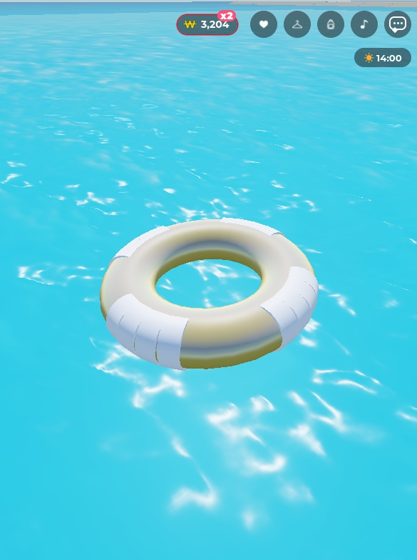 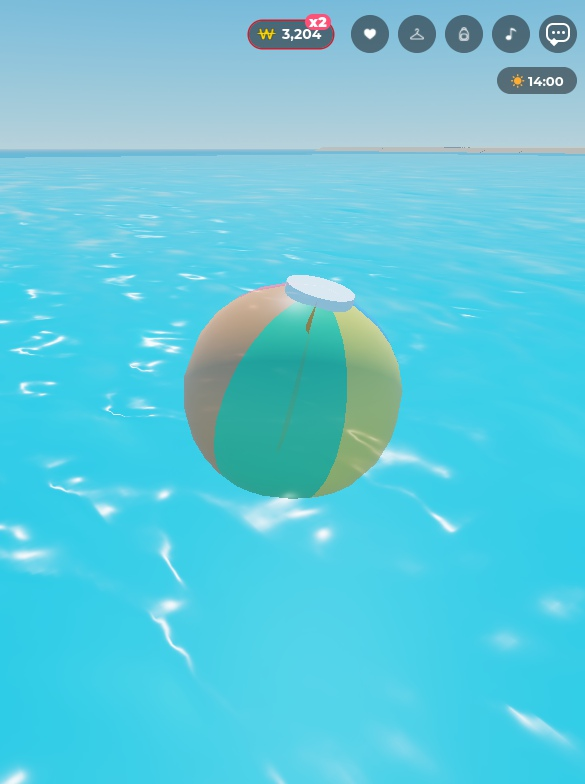

## D-1029 비치볼 잡고 던져서 사람 맞히기 (2026-11-08)
- 사용자: "비치볼 손에 잡고 던져서 사람 맞힐 수 있게 해"
- 바다의 비치볼 5개(D-1027)에 "비치볼 잡기"(E, 거리 9). 잡으면 물 위 공은 사라지고 손바닥 위에 공(도구 "비치볼", 0.7배). 화면을 누르면(클릭 / 터치) 누른 곳으로 던짐(속도 62 + 위로 9, 휘익 소리).
- 던진 공은 진짜 물리 공(서버, 가볍고 통통 튐, 물에 뜸). 빠르게(14 이상) 맞은 사람은 밀리며 1.3초 넘어졌다 일어남(그 사람 화면에서, 리모트 BeachBall "Hit"), 머리 위 "퐁!"은 모두에게 보임. 앉아 있거나 튜브 · 놀이기구에 탄 사람, 헤엄치는 사람은 "퐁!"만. 던진 사람은 안 맞음.
- 던진 공은 다시 잡을 수 있고, 15초 동안 아무도 안 잡으면 바다 제자리로. 들고 클럽에 들어가면(ClubInside) · 죽거나 나가면 바로 바다로(클럽 춤을 넘어뜨리지 않게). 가방 저장(BagService)에는 안 들어감.
- 코드: BeachBallService(서버) + BeachBallController(화면) + Remotes/BeachBall.
- 확인(Studio Play, 혼자 + 과녁 인형): 잡기 → 공 숨김 + 손에 공, 던지기 → 인형 맞고 "퐁!", 15초 뒤 바다 공 다시 보임 + 잡기 켜짐. "Hit"을 받은 화면은 FallingDown 1.3초 → 일어남. 처음엔 맞고 튕긴 공이 모래 위로 25칸 굴러가서 마찰을 높임. 진짜 두 사람 맞히기는 2인 테스트에서.

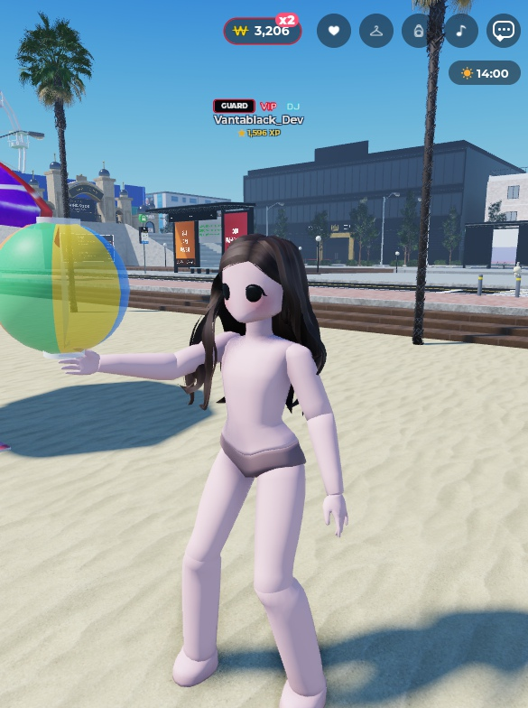
## D-1022 ATEEZ-BAD 2 가슴 튕김 = BAD의 가슴 튕김 (2026-11-08)
- 사용자: "BAD2에 넣은 안무 중 가슴튕기는안무 부분 찾아서 BAD에 있는 가슴 튕기는 안무로 수정".
- 찾기: BAD 2의 19번 조각(95469533767642, 137.25~148.37, 거울 연습 영상 클립 19)의 0.8~4.5초 = 한 팔을 가슴 앞에 가로로 들고 가슴 튕김, 손을 허리로(BAD 21번과 같은 동작, 같은 곡 시계).
- 수정: 그 구간에 BAD의 21번 조각(82346668311878)을 그대로 넣음(곡 137.25~141.25, `from = 0.75`로 박자 같음). 21번의 보정(가슴 튕김 pops D-856/D-895, 팔 자세, sharp)이 함께 나옴. 141.25부터 BAD 2의 19번을 4.0초부터 이어서.
- BAD는 오른팔, BAD 2(거울 영상)는 왼팔을 가슴 앞에 들어서, 들어갈 때 앞에 든 팔이 왼팔에서 오른팔로 바뀜.
- Play: 137.5~141.25 BAD 21 재생, 손 위치가 BAD와 같음, 큰 가슴 튕김 137.89 / 138.89 / 139.90(BAD와 같은 박자), 관절 최대 11°/프레임, 141.25 다시 19번으로 매끄럽게.

## D-1031 20분 지나면 의견 창 다시 (2026-11-09)
- 사용자: "20분 지나면 의견 묻는 창 다시 띄워"
- 예전(D-725)의 20분 한 번 묻기는 첫 안내 팁(GuideTips)에 있었고 D-850에서 팁과 함께 없어졌음. 이제 Feedback.lua가 접속 후 FeedbackConfig.NudgeMinutes(20)분이 지나면 💬 의견 보내기 창을 스스로 엶: 접속마다 한 번, 그 접속에서 이미 의견을 보냈으면 안 엶, 다른 창(Popups)이 열려 있으면 닫힐 때까지 기다림(Popups.anyOpen).
- 확인(Studio Play, NudgeMinutes를 잠시 0.15로): 9초 뒤 창이 열림 → 20으로 되돌림(git과 같음).
- 사용자(같은 날): "처음 접속했을 때 한 번만 띄우고 안 보내도 다음 접속 때 또 띄우지 마 / 그냥 끄기 누르면 오른쪽 상단에 있는 버튼 아래 텍스트 안내 문구 띄워 짧게 활동은 막지 말고"
- 바꿈: 한 사람에게 평생 한 번(저장: wallet.tips.feedbackAsk, GuideService TipSeen, 플레이어 속성 TipsSeen). 창이 열리는 순간 저장, 의견을 보내도 저장. D-725 때 예전 팁을 본 사람은 같은 키라 다시 안 물음. 첫 접속이 20분보다 짧으면 20분을 처음 채운 접속에서 한 번.
- X로 그냥 닫으면 💬 버튼 바로 아래에 "의견은 언제든 💬 버튼으로 보낼 수 있어요" 3.5초(터치 · 클릭을 받지 않음, Interactable false). 보낸 뒤 닫으면 안 뜸.
- 확인(Studio Play, 15초로): 창 열림 → X → 💬 아래 문구, 3.5초 뒤 사라짐. 20으로 되돌림.

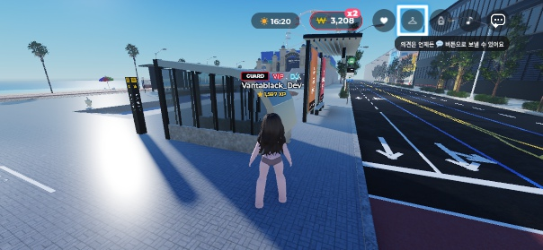

## D-1032 카탈로그 초기화 버튼, 리스폰은 원래 캐릭터로 (2026-11-09)
- 사용자: "카탈로그에 원래 본인 캐릭터로 돌아갈 수 있는 초기화 버튼 넣어 줘 / 리스폰하면 원래 캐릭터로 태어나게 해"
- 원래 캐릭터 = 캐릭터가 로블록스 아바타로 처음 불러와진 모습(ServerMain originalLook, CharacterAppearanceLoaded에서 우리 옷을 입히기 전에 잼).
- 카탈로그 위쪽 줄 < > 왼쪽에 "초기화"(UndoBar): TryOnItem "ResetLook" → 원래 캐릭터로. 다른 변경처럼 < 로 되돌릴 수 있음, 성공하면 "원래 캐릭터로 돌아왔어요. < 로 되돌릴 수 있어요."
- 리스폰: 마지막 착장(D-771)은 이제 접속했을 때만 입힘. 리스폰한 캐릭터는 로블록스 아바타 그대로, 저장된 마지막 착장도 원래 캐릭터로 바뀜(다음 접속도 원래 캐릭터).
- 확인(Studio Play): 셔츠 벗기 → 초기화 → 실제 아바타(GetHumanoidDescriptionFromUserId)와 셔츠 · 바지 · 머리 · 액세서리 같음. 빨간 모자 입고 LoadCharacter → 모자 없음(원래 캐릭터). 오류 0.

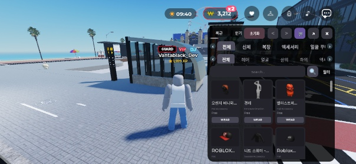

## D-1033 재생 중인 노래 창을 채팅창 아래로 (2026-11-09)
- 사용자: "재생중인 노래 창 채팅창 아래로 내려"
- DanceController layoutPanel: 노래 창(< 접기 · 재생바 포함)을 왼쪽, 로블록스 채팅창(TextChatService ChatWindowConfiguration) 바로 아래 6px에. 채팅창을 연 적이 없으면(크기 0) 열렸을 때 자리(상단 바 아래 12 + 89)를 기준으로. 채팅창 크기 · 위치가 바뀌면 다시 맞춤. 춤 창 · 같이 추기 · 플레이어 카드는 전처럼 노래 창 아래.
- 확인(Studio Play, 폰 가로 801 × 413): 채팅창 화면 y 70~159, 노래 창 164~194.

## D-1034 수육 = 사용자 3D 모델 접시(14점), 상점 그림도 새로 (2026-11-09)
- 사용자: "수육 먼저 넣어 봐. 바이트 14개야. 1~13은 먹을 때 젓가락에 3d에 있는 수육 오브젝트 들고 있게 하고 마지막 14 먹을 때는 14오브젝트 들고 먹게 해" / "상점에 ui에 뜨는 이미지도 바꾸고 싶어 … 니가 누끼 따서 넣어"
- 모델: 사용자의 Blender 파일 Gukbap_Suyuk.glb(docs/04_ART/models/에 사본) → Studio 3D 가져오기 → ServerStorage.ArtAssets.Foods.GukbapSuyuk. 가져오기가 조각마다 모델로 한 겹 감싸서(Bite1 안에 Cube.001) MeshPart를 Bite1..Bite14, Plate 이름으로 펴서 넣음.
- SnackService: CAKE_MODELS에 suyuk = GukbapSuyuk(조각 이름 Slice<n> 또는 Bite<n>, pieceWordOf). 테이블에 놓으면 모델 그대로(폭 2.8), 누를 때마다 Bite1부터 Bite14까지 차례로 하나씩 없어지고 그 조각이 젓가락 끝에(접시에서와 같은 크기), 다 먹으면 접시 치움. 손에 든 접시(놓기 전)도 모델. 모델이 없으면 예전 블록 조각.
- SnackConfig 수육 share 6 → 14, 이름 "수육 한 접시 (14점)", 메뉴 설명 · 상품 설명(MonetizationConfig) "14점". 대시보드 상품 설명도 바꾸려면 사용자가 Creator Dashboard에서.
- 상점 그림: 게임 안에서 초록 네온 바닥 위에 모델을 놓고 찍어 누끼(tools 없이 Python 크로마키, docs/04_ART/shop_photos/gukbap_suyuk14_cutout.png, 512px) → 업로드 rbxassetid://88864543431415 → SnackMenuArt.Photos.suyuk · Icons.suyuk. 업로드 직후엔 Roblox 검토 중이라 빈 칸(몇 분 뒤 보임).
- 확인(Studio Play): 접시 Bite 14개, Servings 14, 누른 순서 Bite1, Bite2 … Bite14, 14번째에 가운데 14번 오브젝트가 젓가락에, 다 먹으면 접시 없어짐. 오류 0.

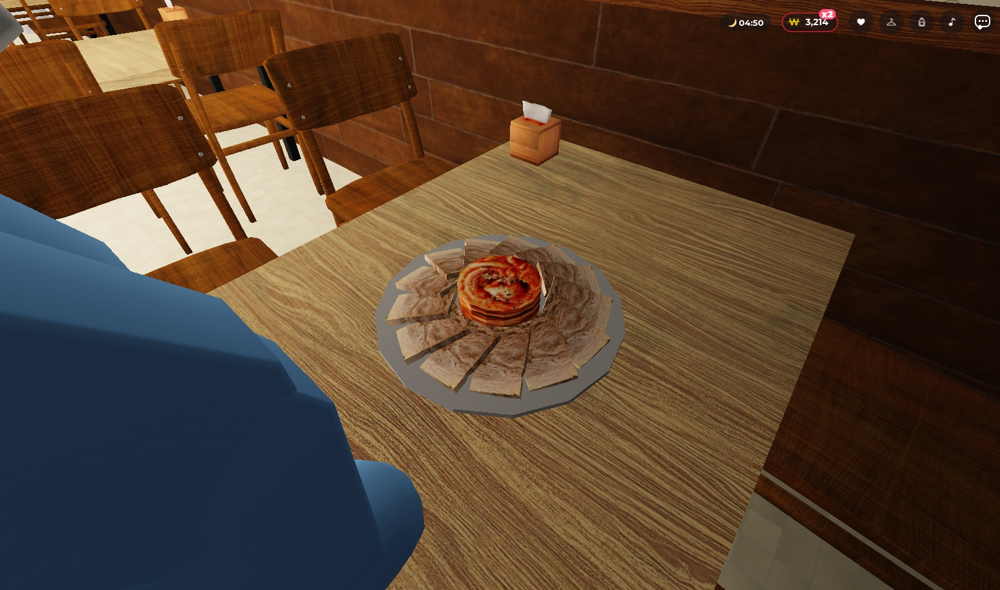 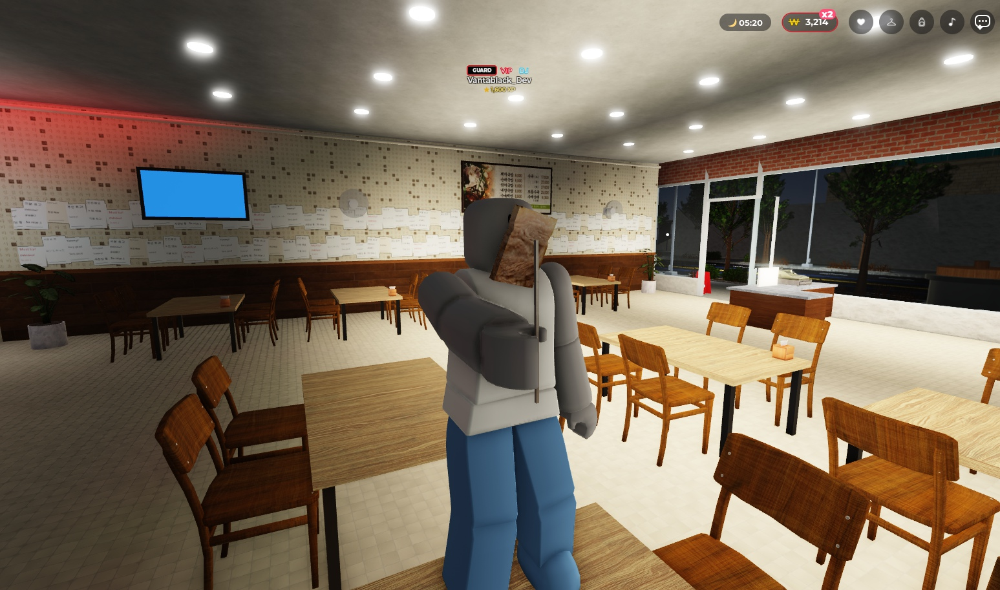 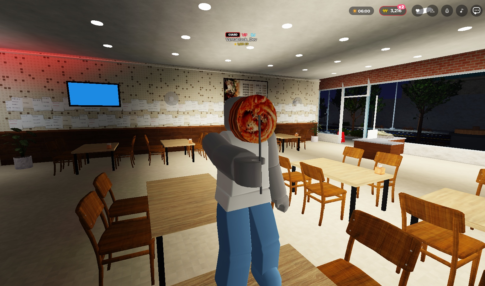

## D-1035 수육 조각은 가리킨 것을 집기 (2026-11-09)
- 사용자: "순서대로 말고 그릇 위에 있는 바이트 중에 마우스 올려서 선택되는 바이트를 먹게 해"
- SnackController: 모델 접시의 조각(Bite<n>)에 마우스를 올리면 그 조각이 밝게(Highlight, 노란 채움 + 흰 테두리) 보이고, 누르거나(폰은 터치) 한 그 조각을 TakePiece로 보냄. SnackService take(who, chosen): 그 접시의 조각이면 그것을, 아니면 전처럼 다음 순서 것을.
- 확인(Studio Play, 실제 마우스): Bite7 위에서 Bite7만 밝아짐 → 클릭 → 손에 Bite7, 접시에 1~6, 8~14 남음. 이어 가운데를 클릭 → Bite14. 오류 0.

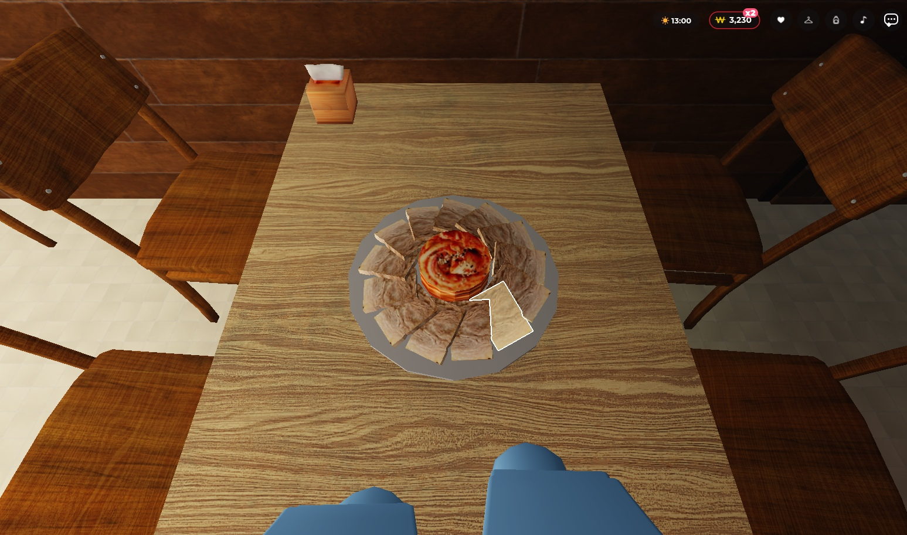

## D-1036 국밥 3종 = 사용자 3D 모델, 한 숟갈에 조각 하나 (2026-11-09)
- 사용자: Gukbap_Pork / Sundae / Beef.glb "스튜디오에도 올렸어 국밥도 업데이트" (원칙은 D-1034: 먹을 때마다 오브젝트 하나씩)
- 모델(docs/04_ART/models/에 사본): Studio 가져오기가 셋 다 이름 Scene → 조각 모양으로 구분해 ServerStorage.ArtAssets.Foods.GukbapBeefBites(Bite1~6: 고기 5 + 파), GukbapPorkBites(Bite1~7), GukbapSundaeBites(Bite1~9). 가져오기가 텍스처 없는 재질 색을 버려서(전부 회색) glb의 baseColorFactor 값을 크기로 맞춰 칠함: 뚝배기 36,18,7 / 국물 205,181,169 · 205,153,112 · 205,198,176 / 파 96,231,69 · 61,166,73 / 돼지 다대기 107,20,36. 빈 Scene 모델 2개(처음 빈 glb를 가져온 것)는 Workspace에 그대로.
- FoodShapes: ASSET_FOODS의 GukbapX 대신 "GukbapXBites"가 있으면 그것(조각 부품에 Bite = 번호 속성), EatMode "Bites", biteCount = 조각 수. SnackService bitesOf: 모델 국밥은 조각 수만큼(소고기 6, 돼지 7, 순대 9; 다른 음식은 그대로 3).
- 한 입(손에서) · 한 숟갈(테이블에서)마다 Bite1부터 하나씩 사라짐(showBitesLeft). 테이블에서는 숟가락에 그 조각이 작게(0.26) 국물 자리에 올라감. 테이블 쟁반 세트는 그대로, 쟁반 뚝배기만 빼고 그 자리에 사용자 모델. 다시 집기(꾹 누르기) · 재접속 가방도 먹은 만큼 빠진 채.
- 확인(Studio Play): 소고기 쟁반 놓기 → 숟갈 6번에 남은 조각 2..6, 3..6, … 6, 그릇 없어짐. 돼지 7 → 6, 순대 9 → 8. 오류 0. 새 메시 · 텍스처는 Roblox 처리 중("being generated")이라 잠시 회색일 수 있음.

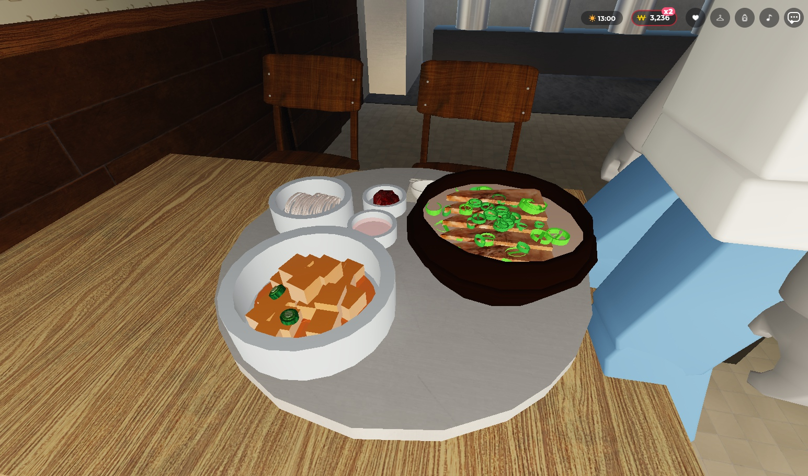 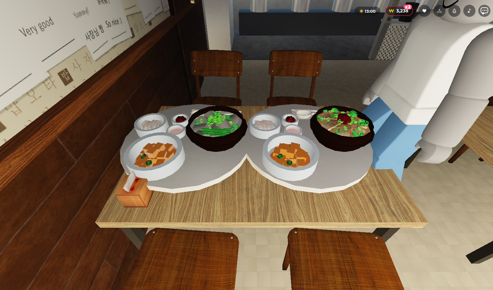

## D-1037 국밥 조각 골라 먹기 · 국밥만 놓기 · 테이블 위 물 · 먹는 팔 동작 (2026-11-09)
- 사용자: "국밥도 선택한 바이트 먹을 수 있게 구현. 테이블에 놓을 때 국밥만 올라가게 변경. 기존에 에셋 삭제. 물 테이블에 설치하면 못 먹음. 수정. 뭐 먹을 때 팔 굽혔다 폈다 존나 반복하는 거 고쳐."
- 국밥 조각: 먹은 조각을 순서가 아니라 번호 목록으로(도구 속성 BitesEaten ",3,1,"; 가방 저장에도 eaten). 테이블의 내 국밥 조각에 마우스를 올리면 밝게(PC), 누르면(폰은 터치) 그 조각을 떠먹음(Spoon에 조각 전달). 손에서 먹으면 남은 것 중 가장 낮은 번호. 먹은 조각은 숨기고 터치도 통과(CanQuery off).
- 테이블에는 국밥 그릇만(사용자 모델). Studio ServerStorage.ArtAssets.Foods에서 예전 에셋 삭제: GukbapTray(쟁반 세트, 118 부품), GukbapPork / GukbapSundae / GukbapBeef(예전 뚝배기). Workspace의 빈 Scene 모델 2개도 삭제. (코드는 쟁반이 있으면 예전 방식으로 놓는 길을 남겨 둠: 사용자 모델 국밥은 늘 그릇만.)
- 테이블 위 물(그리고 국밥 · 공깃밥 · 컵라면이 아닌 모든 음식 · 음료): 짧게 누르면 손으로 돌아와 바로 한 모금 / 한 입(전에는 눌러도 아무 일 없음, 꾹 누르기 = 가방으로는 그대로).
- 먹는 팔(EatMotionController): IK가 들고 있는 자세가 아니라 팔을 편 자세에서 시작해서 한 입마다 팔이 아래로 뚝 떨어졌다 올라갔고(손 머리 밑 1.15 → 2.44), 입에서는 위치 보정이 매 프레임 IK 지연을 쫓아 손이 위아래로 흔들렸음. 이제 IK는 처음부터 무게 1 · SmoothTime 0, 목표가 원래 손 자리에서 입까지 부드럽게 갔다 돌아옴, 보정은 입에 닿은 뒤 10프레임만.
- 확인(Studio Play): 소금빵 한 입 = 손 -1.15 → -0.64(입) 유지 → -1.15, 아래로 떨어짐 없음 · 흔들림 없음. 소고기국밥 테이블에 그릇만, 3번 조각 눌러 떠먹기 → 1,2,4,5,6 남음, 1번에 마우스 → 1번 밝게. 생수 테이블에 놓고 누르기 → 손에 들고 3 → 2. 오류 0.

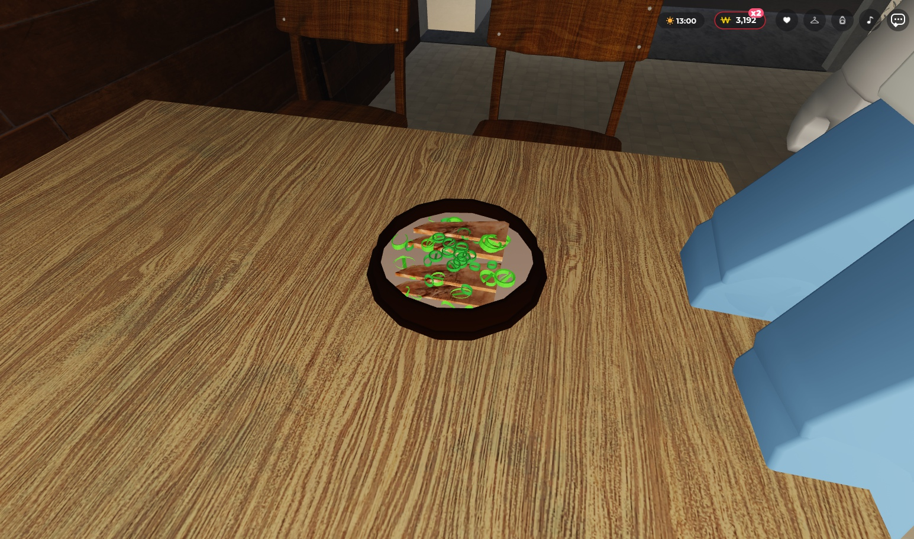

## D-1038 국밥 놓는 원 크기 · 버킷 시간 제한 없앰 · 국밥 누끼 · 먹을 때 고개 끄덕임 (2026-11-09)
- 사용자: "국밥 놓을 때 원 너무 크다. 국밥 크기에 맞춰. / 버켓 사람 있으면 안 사라지게 변경. 다 마실 경우에만 사라짐. / 국밥도 누끼 이미지 따서 ui에 넣고 나도 줘 / 먹을 때 고개를 약하게 숙였다 폈다 반복하는 모션 넣어"
- 놓는 원: 사용자 국밥 모델(쟁반 없이 그릇만, D-1037)은 그릇 크기(PlaceRadius 0.75~0.79, 전에는 쟁반 크기 2.55).
- 클럽 병 · 버킷: 테이블 위 시간 제한(1단계 10분 · 2단계 20분 · 3단계 30분 · VIP 1시간) 없앰. 마지막 잔을 따르면 사라지고, 주인이 서버를 나가고 3분 뒤에 사라짐(D-770 그대로).
- 국밥 누끼: 게임 안 자홍(마젠타) 네온 바닥 위에서 찍음(초록은 파와 같이 지워져서), 후처리 효과 끔, 크로마키 + 테두리 자홍 빼기 → docs/04_ART/shop_photos/gukbap_pork / sundae / beef_cutout.png(512px) → 업로드 133591259658865 / 111308312027162 / 85511957052010 → SnackMenuArt.Photos · Icons.
- 고개: 먹는 동안(손이 입에 있는 동안) 목에 LookAt IK(UpperTorso → Head), 앞 4칸 지점이 6° ~ 28° 아래로 0.7초마다 내려갔다 올라옴, 무게 0.9 × 팔 올라간 정도. Play에서 고개가 몸에 대해 약 12° 오르내림(처음 4°~16° · 0.8은 7°뿐이라 키움).
- 확인(Studio Play): 국밥 3종 PlaceRadius 0.79 / 0.75 / 0.75, 소금빵 한 입에 고개 끄덕임, 국밥집 주문 창에 새 그림 3장. 오류 0.

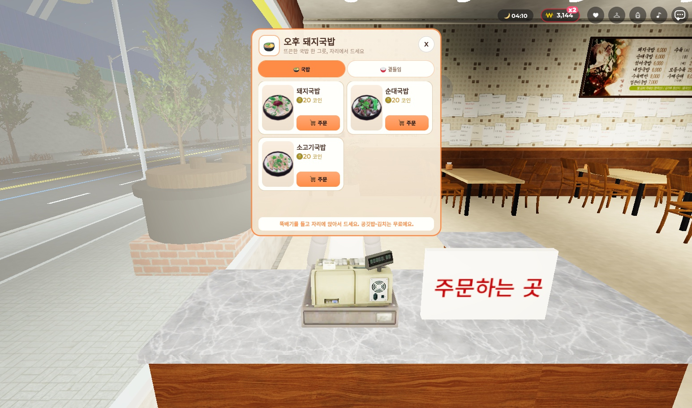

## D-1039 BAD 2 안무를 BAD로, BAD 2 곡 삭제 · 돼지 / 순대국밥 조각 다시 묶기 (2026-11-09)
- 사용자: "BAD2에 있는 안무 BAD로 옮겨. BAD에 있던 안무 삭제. BAD2 음원 삭제." / "돼지국밥이랑 순대국밥 바이트 수정했어" (Gukbap_Pork / Sundae.glb 다시 내보냄)
- ATEEZ-BAD(134942349436280, 3배 파일)에 ATEEZ-BAD 2의 안무 21줄(D-994 20조각 + D-1022 가슴 튕기기)을 그대로: 두 파일이 같은 곡 시간(D-975 / D-1014)이라 `at` 그대로. BAD의 예전 23조각 안무와 ATEEZ-BAD 2 곡 줄은 뺌(되살릴 줄은 docs/04_ART/CLUB_PLAYLIST.md 끝). 무대 카메라는 BAD가 그대로 씀(ClubCamera 별칭). ChoreoFixes 등 애니메이션 id로 붙은 값은 그대로 둠.
- Studio: ClubPlaylist에서 BAD 블록만 표시로 찾아 바꿈(안무 추가 세션의 Lemon Tang 줄 · 안무 D-1040은 그대로, 그 줄은 이 브랜치에 넣지 않음: feat/lemontang-choreo-1109).
- 국밥 조각: 새 glb는 모양은 같고 묶음만 바뀜 → 다시 가져오지 않고 Studio 모델을 같은 묶음으로(색 유지). 돼지 = 고기 Bite1~7 + Bite8 파(두 겹) + Bite9 다대기 = 9조각, 순대 = Bite1 초록 줄기 + Bite2~10 순대 + Bite11 파 = 11조각(그릇 Plate에는 뚝배기 · 국물만). 한 숟갈에 한 조각이라 돼지 9입 · 순대 11입 · 소고기 6입. glb 사본은 docs/04_ART/models/.
- 확인(Studio Play): 곡 76곡, ATEEZ-BAD 2 없음, ATEEZ-BAD 안무 21줄(첫 99917032910194 · 끝 138812417192850), BAD 33.1초에 29.83초 조각 73352408497618. 가방의 돼지 9 · 순대 11 · 소고기 6입. 오류 0.

## D-1045 노래 창을 채팅 입력창 아래로 (2026-11-09)
- 사용자(PC 화면, 노래 창이 채팅 입력칸 뒤에 겹침): "좀 더 내려야 할 듯.. 채팅창 크기는 고정인데 인식해서 알아서 내려가게 못 하나. 모바일 가로 버전 세로 버전 피씨 버전 다 다른데"
- D-1033은 채팅 내용 창(ChatWindowConfiguration)의 아래 끝만 봤음. 입력칸은 따로 있는 상자(ChatInputBarConfiguration)라 PC에서는 그 밑까지 내려와 있었음. 이제 두 상자의 실제 위치 · 크기를 읽어 더 아래쪽 + 6px에 노래 창을 둠(기기 · 방향마다 Roblox가 정하는 대로 따라감, 둘 중 하나가 바뀌면 다시 맞춤). 아직 한 번도 안 열렸으면 폰 가로 기준 자리(+ 입력칸 40).
- 확인(Studio Play, 1545 × 755): 채팅 내용 70~244, 입력칸 244~291, 노래 창 297부터.
## D-1030 NCT WISH-I SPY 1:18 휙 돌기 → 한 방향으로 고르게 (2026-11-09)
- 사용자: "ISPY 1:20 이 부근에 휙 도는 거 있는데 정확한 시간 모름 전후임 확인해 봐".
- 찾기: Play에서 곡 74~88초를 프레임마다 기록. 곡 77.75~78.2(재생 바 1:17.8~1:18.2)에 엉덩이가 73° → 138°로 돌다가 -35°로 되돌아감(0.25초에 170°, 841°/s). 다른 구간은 250°/s 이하.
- 원인: 15번 조각(135074521559748)이 도는 중간에서 시작함(첫 0.67초에 엉덩이 152° → 326°, 같은 방향). 14번(137433206050479)은 74°에서 같은 방향으로 돌며 끝남. 크로스페이드(blend 0.64) 중 두 방향 차이가 180°를 넘자 짧은 쪽으로 반대로 휙 돎.
- 수정: ClubChoreo.ChoreoFixes[135074521559748] `spin = { from = 0, to = 0.8, ease = "both", fromPrev = true, dir = 1 }`: 14번이 끝난 방향에서 같은 방향으로 0.8초 동안 한 바퀴의 약 3/4(260°)을 고르게 돎.
- Play: 74° → 153° → -175° → -83° → -26°로 한 방향, 최대 483°/s, 되돌아가는 회전 없음. 76~82초 SNAP / JUMP / TELEPORT 0.

## D-1044 aespa-Lemonade 17번 = 원래 연습 영상 클립 (2026-11-09)
- 사용자: "레모네이드 17번 원래 걸로 수정.. 115248452065042". 그 ID는 Catch Catch v2 17번 클립이라 물어봄 → 사용자: 레모네이드 원래 클립으로.
- 수정: 17번 = 132337331292488(D-970과 같이 at 137.92, blend 0.47, 보정 steady 0~8). D-1019의 손 애니메이션 123236589131931과 그 보정은 ClubChoreo에 남겨 둠(쓰지 않음).
- Play: 138.31부터 17번 재생, 146.58에 18번, 136.5~148초 SNAP / SPIN / JUMP / TELEPORT 0.
## D-1040 Hearts2Hearts-Lemon Tang 다시 넣고 안무 25조각 (2026-11-09)
- 사용자: "레몬탱 안무 추가" + 애니메이션 id 26개(D:\Roblox\영상\Hearts2Hearts_LemonTang_centercut\clips\LemonTang_ids_번호.txt = 클립 2~28, 1 · 15번 없음). 곡은 D-1016에서 뺀 곡이라 다시 넣을지 물었더니 "곡 다시 넣고 안무 추가".
- ClubPlaylist: D-1016 때 CLUB_PLAYLIST.md에 남긴 줄(soundId 97032815457241, 3배 파일 54초, lab 그대로)을 잠금 없이 aespa-Lemonade 바로 앞에 넣음 + choreo, autoChoreo.
- id 26개 모두 Vantablack_Dev 소유, 길이가 클립과 맞음.
- 시작 지점: 게임 PlaybackLoudness(×1000, 음원 위치 × 3) ↔ 연습 영상(9nZuuZRsDfo) 소리 → 60~90초 5창 모두 +0.00(0.51~0.70), 124~150초 +0.00(0.46~0.51). 처음 창은 +0.30이 나왔지만 그 녹음은 프레임이 끊겨 칸이 비어 있어서 뺌. `at` = 클립 시작.
- 음원은 161.87초에서 끝남(영상은 169초): 클립 28(168.45)은 안 넣음 → 25조각. 클립 1(0~8.53)은 업로드 없어서 8.53까지 기본 춤, 클립 15(92.0~96.23)도 없어서 14번(81)이 마지막 자세로 기다림.
- 이음새: choreo_check 방식으로 모든 이음새가 걸림(조각마다 멤버가 바뀜) → blend 0.5~1(짧은 조각은 길이의 절반까지), 마지막 조각 0.61.
- 미끄러짐(키프레임 발 계산) 13개 조각 → ChoreoSlideStill.
- Play 스캔(곡 전체): SPIN 5곳 → 9번(1:00.7, 블렌드 안에서 72° 갔다 240° 되돌기) spin fromPrev 0~1.2, 17번(1:48.9, 한 바퀴 도중 멈춤) fromPrev turns 1 0~1.4, 21번(2:07.6, 20번에서 이어지는 323°) fromPrev 0~0.9 + 2:20.5 12.55~13.8, 23번(2:28.1, 1.5초에 400°) 2.7~4.25. 다시 재서 최대 257~500°/s. SLIDE 1:20.0(12번) → ChoreoGlideStill 6.9~7.5, 다시 재서 없어짐. TELEPORT 2곳(1:09.6, 1:53.4)은 발이 이동의 1/3 넘게 딛는 이동이라 둠. SNAP / JUMP / SHAKE / JITTER 없음.
- 춤추는 중 몸 바꾸기(키 1.05, 폭 0.9, 비율 0.5, 체형 0.6): 105~118초 계속 춤, 17번 회전 같음(498°/s).
- 정면(D-1002 방식, tools/choreo/faceoffset): 16조각 faceOffset(-25~+11°). 3번 -25°는 프레임을 눈으로 봄(같은 멤버, 0.3~3.0초 정면). 4 · 16번 퍼짐 22~26°, 9 · 20 · 27번 정면 12프레임 미만, 6 · 10 · 13 · 22번 6° 미만이라 안 넣음. Play: 3번 정면 구간 엉덩이 -18~+11°(춤 흔들림), 14번 81~85초 -22~+8°. ChoreoHome 그대로.
- 번호: 처음 D-1039로 적었다가 관리 세션이 D-1039를 써서 D-1040으로 바꿈.

## D-1048 비치볼: 꾹 눌러 힘 모아 던지기 · 비치볼 물리 · 던지는 모션 · 퐁! 삭제 (2026-11-09)
- 사용자: "비치볼 꾹 누르고 있으면 누르고 있는만큼 멀리 힘있게 날아가게 해 줘. 포물선 그리면서 실제 비치볼 던졌을 때 보이는 물리적 액션과 모션 적용해. 다른 사람 맞았을 때 보이는 퐁! 글씨 삭제"
- 누르기 = Charge(머리 위에 이 화면만 보이는 힘 막대, 노랑 → 주황 → 빨강), 떼기 = Throw. 힘 = 누른 시간(서버 시계, 1.5초에 최대). 속도 18 → 100: 계산상 35°로 약 7칸 → 62칸(최고 16칸, 1.5초 비행).
- 비치볼처럼 날기: 가벼워서 공기가 붙잡음(항력 ∝ v², 떨어질 때 최대 55), 천천히 떨어짐(공만 중력 55, 세상 196.2는 VectorForce로 덜어냄), 뒤로 도는 회전(힘에 비례) + 약간 흔들림, 떨어지면 통통 튀고 굴러감. 방향은 누른 곳(수평) + 조준 높이에 25° 더(12°~60°).
- 모션(모든 화면, 캐릭터 속성 BallCharge / BallThrow / BallPower → IKControl): 누르는 동안 오른손이 어깨 뒤로(오래 누를수록 깊게, 상체도 뒤로 돌며 젖혀짐, 최대일 때 살짝 떨림) → 떼면 0.14초 동안 어깨 위를 지나 앞으로 휘두르고 그 끝에서 공이 손을 떠남(서버 0.12초 뒤 발사) → 팔로스루 후 팔이 내려옴.
- 맞은 사람: "퐁!" 글씨 없음. 밀려 넘어지는 힘이 공 속도에 비례.
- Play 수정: 팔 IK를 Position으로(Transform이면 손이 들고 있던 방향을 유지해서 팔이 막대처럼 뒤로 뻗었음), 감는 자리 = 머리 오른쪽 위 뒤(1.5, 2.4, 1.0), 팔꿈치는 옆으로 굽힘. 모래 위에서는 굴러가는 저항(초당 2.2) 추가(살짝 던진 공이 10칸 날아가 19칸 더 굴렀음).
- 확인(Studio Play, 1인): 0.1초 누름 = 9.9칸에 떨어져 16.7칸에서 멈춤, 0.75초 = 27.5칸 → 40.4칸, 1.6초(최대) = 54칸(1.5초 비행, 최고 +6.9). 손 위치: 감기 머리 위 뒤(0.8, 2.4, 1.1) → 0.17초 어깨 위 → 0.23초 앞(-2.0) → 0.6초 옆으로 내려옴. 스크립트 오류 0. 맞히기는 2인 테스트에서.

## D-1049 검색칸 · 제작자 이름칸에 × (2026-11-09)
- 사용자(필터 창 제작자 이름칸에 빨간 X를 그린 사진): "검색 필터에 엑스 넣어 줘. 검색어 바로 지울 수 있게."
- ClearButton.lua: 글이 있을 때만 칸 오른쪽 끝에 ×(글은 그 앞에서 끝남). 검색칸 × = 비우고 바로 다시 검색, 제작자 이름칸 × = 비우기(필터 적용 때 검색). Gotham에 ✕ 글자가 없어 네모로 나와서 ×(닫기 버튼과 같은 글자).
- 확인(Studio Play): 검색어 입력 → × 보임 → 누르면 빈 칸, × 사라짐.

## D-1050 최대화 카탈로그의 ⚙ · 옷장을 최소화와 같은 메뉴줄로 (2026-11-09)
- 사용자: "최대화 카탈로그에 있는 아바타 에디터 버튼이랑 저장 버튼 최소화에 있는 위치로 수정. 통일."
- 최대화도 위 메뉴줄 `최근 · 인기 · 즐겨찾기 · 착용 중 · ⚙ · 옷장`(미리보기 왼쪽 위 ⚙ ▣ 뺌). 최소화는 6개 중 4개만 보이고 ⚙ · 옷장이 스크롤 뒤에 숨어 있었음 → 두 화면 모두 6개가 다 보이게(⚙는 36px 아이콘). 좁은 폰 줄만 전처럼 스크롤.
- 사진: docs/06_LOG/images/2026-11-09/catalog_min_strip.jpg, catalog_max_strip.jpg

## D-1051 피부색 진하기 막대 (2026-11-09)
- 사용자: "스킨색 더 섬세하게 조절할 수 있게 수정. (동영상 참고)" (KOYA 편집기: 색 원 아래 고른 색의 진하기 막대)
- 팔레트 아래 막대: 왼쪽 = 고른 색의 진한 쪽(밝기 32%), 가운데 = 그 색, 오른쪽 = 연한 쪽(흰색 쪽 82%). 끄는 동안 미리보기의 몸 색이 바로 바뀜(다시 만들지 않고 BodyColors만). 색 원을 누르면 막대 가운데로.
- 서버(AvatarService ApplyEdit): 팔레트 밖 색도 받음(전엔 "That skin colour is not in the Roblox palette.").
- 확인(Studio Play): 막대를 끌자 미리보기 손 0.337 → 0.192, 적용 → 실제 캐릭터도 같은 색, "적용됨". 사진: skin_shade_bar.jpg

## D-1052 장신구 조정 · 피부색이 실제 캐릭터에도 끄는 대로 바로 (2026-11-09)
- 사용자(KOYA 영상): "버벅거림 없이 매끄럽게 실시간으로 아이템 위치 조절할 때 반영 잘 되는 점" 우리 카탈로그에도.
- 원인: 클라이언트에서는 실제 캐릭터의 HumanoidDescription:GetAppliedInstance()가 아무것도 못 찾아서, 슬라이더가 미리보기만 움직이고 실제 캐릭터는 헤어가 1개일 때만 따라옴(D-819). 측정: 모자 Y +0.73으로 끌어도 실제 캐릭터 0.176 그대로, 미리보기만 0.90.
- 이제 서버가 HairFit.apply 때 장신구마다 HairFitId(에셋 id) 속성을 붙이고, 클라이언트는 그 id로 실제 캐릭터의 장신구를 찾아 맞춤. 피부색도 끄는 대로 내 캐릭터의 BodyColors에(적용 전엔 내 화면만, 닫거나 취소하면 원래대로).
- 확인(Studio Play): 모자 Y를 끄는 동안 실제 캐릭터의 모자가 0.171 → 0.901로 프레임마다(2.1초 동안 73단계) 따라옴, 취소 → 0.171.
- 비교 · 더 할 것: docs/01_SYSTEMS/AVATAR_EDITOR_KOYA_COMPARE.md

## D-1053 컵라면: 사용자 모델, 뚜껑 → 온수기 → 10초 → 젓가락으로 세 입 (2026-11-09)
- 사용자: "컵라면 아이템 추가해 / 편의점 문 열고 라면 구매한 후에 구매한 라면 손에 들고 누르면 Bite1인 뚜껑 안 보이게 하고 Bite2 보이는 상태에서 온수기 클릭하면 다시 Bite1 뚜껑 덮은 그림이었다가 10초 지난 후에 라면 누르면 Bite1 지움. 이번에는 Bite2가 아니라 Soup 보이면서 김 올라옴. 세 번 먹는데 먹을 때마다 soup 조금씩 낮아짐. 먹는 모션은 젓가락으로 면가닥 집어서 먹는 거 구현해. 붉은색 선 여러가닥이 젓가락에 붙어서 입으로 가까워지면서 선 길어지는 모션."
- 모델: D:\Roblox\오후\3D 물\cupraman3.glb (Plate = 컵, Bite1 = 뚜껑, Bite2 = 마른 면, Soup = 국물) → ServerStorage.ArtAssets.Foods.CupRamen (사용자가 Studio 3D 가져오기로 넣음, 플레이스에만 있음). 없으면 예전 컵라면 모양 그대로.
- RamenCup.lua(새 모듈): 상태 closed(뚜껑 덮임) → 컵 누르기 → open(뚜껑 없음, 마른 면) → OH24 온수기(HotWaterTap / HotWater / HotWaterTray, 태그 HotWater) 누르기 → 물줄기 1.4초 → cooking(뚜껑 다시 덮임, 10초, 다 익으면 뚜껑 밑에서 김) → 컵 누르기 → ready(뚜껑 · 마른 면 없음, 국물 + 김, 젓가락 꽂힘) → 세 입. 순서가 틀리면 안내 문구(예: "라면이 익고 있어요. 7초만 기다려 주세요.").
- 먹기: 컵은 왼손, 오른손 젓가락(ChopTip이 입으로, EatMotionController EatPart) 끝에서 왼손 컵 국물까지 붉은 면 가닥 7줄(Beam): 팔이 올라가는 동안 길게 늘어나고, 입에 닿으면 아래 끝이 젓가락 끝으로 빨려 올라감. 한 입마다 국물이 컵 높이의 17%씩 내려가고 조금 좁아짐(젓가락도 같이). 세 입이면 끝.
- 테이블: 컵라면은 국 그릇처럼 숟가락으로 뜨지 않고, 누르면 손으로 돌아와 다음 단계.
- (같은 날, 사용자: 컵라면 4개, 이름 1 맵라면 · 2 참깨라멘 · 3 용암꼬꼬면 · 4 육개그) OH24 메뉴에 4가지(키 cupnoodle = 맵라면(예전 가방 호환), ramen_sesame, ramen_lava, ramen_yukgae, 각 💰 4, 세 입). 모델 ServerStorage.ArtAssets.Foods.CupRamen_Map / _Sesame / _Lava / _Yukgae(육개그 = 낮은 사발; 3D 가져오기가 부위마다 Model로 감싼 것을 Bite1 · Bite2 · Plate · Soup 이름의 파트로 풀어 넣음, 플레이스에만 있음). 산 뒤 안내: "눌러서 뚜껑 열기 → 온수기 눌러 물 붓기 → 10초 뒤에 눌러서 먹어요." glb 사본 docs/04_ART/models/CupRamen1..4.glb. 사진: cupramen_four.jpg(텍스처 4장), cupramen_hand.jpg.
- 2026-11-09 Vantablack_Dev 계정 "User is moderated"(이미지 업로드 403, 새 텍스처 안 보임) → 사용자가 걸린 그림(육개그)을 고쳐 다시 가져온 뒤 텍스처 보임. 다른 컵 그림에도 실제 회사 로고(농심)가 남아 있음.

## D-1055 바텐더 = 아랄, 불꽃 판매원 = 마노 (게임 옷장 코디), 둘 다 돌아다님 (2026-11-09)
- 사용자: "지금 카탈로그에 있는 \"아랄\", \"마노\" 아바타를 npc로 만들어 줘. 마노는 불꽃 판매원 npc로 쓰고 아랄은 바텐더로 사용해. 불꽃 판매원이랑 바텐더도 안내원처럼 주변 배회하는 것처럼 만들어 줘. 바텐더는 바 안에서만 왔다갔다 하고 불꽃판매원은 박자 타는 것처럼 고개 까딱거리면서 걸어다니게 해" / "게임 옷장에 저장해 둔 코디야"
- 코디: Vantablack_Dev의 게임 옷장(DataStore FashionGamePlayerData, u_11887382096)의 "아랄" · "마노" 스냅샷을 NpcLooks에 그대로 복사(snapshot JSON → HumanoidDescription: 몸 · 머리 · 셔츠 · 색 · 크기 · 장신구 12 / 11개). 옷장에서 코디를 바꿔도 NPC는 그대로(다시 복사해야 바뀜). 손에 든 것과 서 있는 동작은 예전 그대로(바텐더 병, 판매원 불꽃).
- 배회(NpcWander.lua, 안내원 GuideService와 같은 방식): 상자 안 아무 곳으로 걷고 2~5초 쉬기, 7칸 안에 사람이 오면 멈춰서 그쪽을 봄(주문 버튼은 몸에 붙어 따라다님). 상자는 BartenderSpot 기준: 바텐더 = 바 뒤 통로(월드 x 71.5~77.5, z -194~-165, 선반과 카운터 사이를 광선으로 잼), 판매원 = VIP 계단 홀 문 앞 바닥(x 120~136, z -268~-258).
- 고개 까딱(NpcNodController.client.lua, 태그 NodBeat): 모든 화면에서 목에 LookAt IK, 118 BPM(서버 시계라 모두 같은 박자), 박자마다 빠르게 숙이고 천천히 듦.
- 확인(Studio Play): 바텐더 (76.0,-174.9) → (76.7,-182.5), 판매원 (129.7,-262.4) → (134.2,-261.5) 상자 안에서 걸음. 판매원 머리 각도 -6° ~ 11°를 0.5초마다 반복. 스크립트 오류 0. 사진: npc_seller_mano.jpg, npc_bartender_aral.jpg.

## D-1057 OH24 문을 두 칸 남쪽으로, 다시 열림 · 포스터 자리 (2026-11-09)
- 사용자(사진, 문에 빨간 X, 오른쪽 두 칸에 빨간 네모): "편의점 문 옮겨 줘 문 있던 곳은 통창으로. 그리고 편의점 문 열어 줘. [신상품 도시락 출시] 적혀 있는 거 문 오른쪽에 두고, ATM/택배 접수는 옮겨지는 문 위치 왼쪽으로 배치. 이달의 행사 종이는 atm, 택배접수 위에 위치."
- tools/graybox/oh24_door_1109.lua = 레이아웃 체인 마지막 단계(club_vip_bar_1107 다음, 한 번만: OH24Store 속성 OH24Door1109). 동쪽 정면(x ≈ -55.9, 7.04칸 간격): 문 z 124.1~130.8 → 110.0~116.7(길에서 봐서 오른쪽 두 칸), 옛 문 칸은 유리 + 킥플레이트. polish_1030 7번의 "외출중" 쪽지 없애고 AutoDoor 태그 다시(자동문 열림). ATM · 택배 스티커 → 문 왼쪽 칸 아래(y 4.6~6.2), 이달의 행사 → 그 위, 신상품 도시락 → 문 오른쪽 칸.
- 확인(Studio Play): 캐릭터가 x -46 → -63 문을 지나 가게 안으로. 사진: oh24_door_before.jpg / oh24_door_after.jpg.

## D-1059 마노 · 아랄 걷는 모션 = 애니메이션 팩 (2026-11-09)
- 사용자: "마노 아랄한테 순서대로 애니메이션팩 적용해서 걷는 모션 다르게 해." (카탈로그 사진 순서: 무감정한 → 무감정한 학교 소년)
- 마노(불꽃 판매원) = "무감정한"(Nonchalant, 55Epaa, 번들 113981103573113): 걷기 76458754461389, 대기 103551093140086. 아랄(바텐더) = "무감정한 학교 소년"(Nonchalant School Boy, Benere & Chenere's UGC, 번들 198542201057320): 걷기 80970435798081, 대기 138428331917859. (팩 에셋을 InsertService로 열어 안의 Animation id를 읽음; NPC는 Animate 스크립트가 없어 NpcWander가 직접 재생.)
- 확인(Studio Play): 두 NPC 모두 자기 팩 걷기 · 대기가 재생됨(길이 1.0 ~ 4.0초 = 불러와짐).

## D-1061 애니메이션 팩 내용에서 뒤로 가기 (2026-11-09)
- 사용자: "애니메이션팩 눌러서 봤다가 뒤로 돌아가는 버튼 넣어 줘"
- 버튼(BackToPacksButton)은 있었지만 팩을 열 때 배치를 다시 하지 않아 결과 뒤 처음 자리에 숨어 있었음. 열 때와 돌아갈 때 updateCatalogLayout → 결과 위 "← 애니메이션 팩", 결과는 그만큼 아래로. (D-1058은 다른 세션 번호와 겹칠 수 있어 건너뜀)
- 확인(Studio Play): CONTENTS → 버튼 보임(결과 위) → 누르면 팩 30개 목록으로. 사진: catalog_pack_back.jpg.

## D-1063 OH24: 사용자가 옮긴 자리 · 냉동고 벽 가득 · 컵라면 누끼 · 컵라면 두 손 · 소리 (2026-11-09)
- 사용자: "스튜디오에서 벚꽃나무 추가하고 편의점 수정한 거 있어. 저장해." / "편의점 벽면에 냉동 선반 꽉 차게 확대해 줘" / "편의점 상점에 컵라면 만든 거 누끼 따서 넣기" / "라면에 김 올라오는 거 더 진하게 넣어 줘 잘 안 보임 / 라면 왼손에 들고 있고 오른손에 젓가락 들고 라면 먹는 모션으로 수정." / 소리: 뚜껑 75936211172606, 물 = 음수대 소리, 면 117267927001796(앞 1초 자름), 다 먹고 컵째 마실 때 국물 133241476322672, 국밥 133241476322672.
- 저장: prop_save → 바뀐 소품 없음(덮어쓰기 48개 그대로). 벚꽃나무 2그루("Cherry Blossom M")는 Workspace 바로 아래라 맵 다시 만들기와 상관없음, 숨은 스크립트 없음. 편의점은 사용자가 OH24Store를 통째로 (-4.0, +0.6, -6.9) 옮겨 둠 → tools/graybox/oh24_store_1109.lua(체인 마지막, oh24_door_1109 다음)가 다시 만들 때 같은 만큼 옮김(이미 그 자리면 그대로).
- 냉동고: 서쪽 안벽의 Cold* · 그 위 상품(ShelfRow) 122개를 북쪽 유리 ~ 남쪽 안벽(z 59.3 ~ 138.7), 천장 밑(21.2)까지 늘림(전엔 z 73 ~ 121, 높이 18.8). 같은 스크립트, 가게 부품에서 재서 하므로 가게 자리와 상관없음. 사진: oh24_freezer_full.jpg.
- 누끼: 컵라면 4개를 게임 안 자홍색 배경 앞에서 찍어 키잉(docs/04_ART/shop_photos/ramen_*_cutout.png) → SnackMenuArt.Icons(맵 113493189993075, 참깨 98643130769596, 용암 124866904655046, 육개그 113229406579037). OH24 목록 창은 색 네모 대신 그림(그림이 있는 상품만). 사진: ramen_cutouts.jpg.
- 컵라면(RamenCup): 다 익어 열면 컵은 왼손(손잡이 복사본을 왼손에 붙임, 몸 방향으로 똑바로), 오른손엔 젓가락만. 한 입마다 왼손 컵에서 젓가락까지 면 가닥. 세 입 뒤 네 번째 누르기 = 컵째 입으로(오른손, EatPart 없이 컵 끝이 입으로) + 국물 소리, 그다음 사라짐(Bites 4). 넣어 두거나 테이블에 놓으면 한 손 · 젓가락 꽂힌 모양으로. 김: 가장 진할 때 투명도 0.72 → 0.35, 양 7 → 22, 크기 0.55 → 0.75배, 뚜껑 김 3 → 8. 소리: 뚜껑(열 때 · 다 익어 열 때), 물 붓는 동안 9119158299(해변 음수대 FountainTap), 면 117267927001796를 1초부터, 국물 133241476322672. 국밥 먹는 소리도 133241476322672.
- 확인(Studio Play): 왼손 컵과 왼손 잡이점 거리 0.00, 한 입 도중 사진(ramen_bite_two_hands.jpg), 4 → 3 → 2 → 1 → 마시는 중 국물 소리 재생 · 왼손 컵 없음 → 사라짐.

## D-1065 삼각김밥 2종: 포장 뜯기 → 세 입 (2026-11-09)
- 사용자: "삼각김밥 추가. bibim: 전주비빔 삼각김밥 / chamchi: 참치마요 삼각김밥 / 구매 후 클릭하면 포장 비닐 뜯음 (Bite1) / 한 입 먹음 (Bite2) -> 3, 4 순서대로 먹음 / 처음 사서 클릭했을 때 포장 비닐 뜯는 소리: 75383018229679"
- OH24 메뉴: 참치마요 삼각김밥(키 samgak, 예전 가방 호환), 전주비빔 삼각김밥(samgak_bibim), 💰 3. 모델 = ServerStorage.ArtAssets.Foods.SamgakTunaBites / SamgakBibimBites(사용자가 3D 가져오기, Bite1 포장 + Bite2~4), 누워 있는 모델을 세워 듦. 첫 누르기 = Bite1 숨김 + 비닐 소리(먹는 동작 없음), 그다음 국밥처럼 남은 조각 중 가장 낮은 번호부터 한 입씩. glb 사본 docs/04_ART/models/SamgakTuna.glb / SamgakBibim.glb.
- 상태: 코드는 넣었고, 모델이 Studio에 들어오면 바로 쓰임(없으면 예전 모양).

- 2026-11-09 (2): 사용자가 glb 두 개를 가져옴 → Workspace의 Scene 둘을 포장 색으로 구분(파랑 = 참치, 빨강 = 비빔) 해 ServerStorage.ArtAssets.Foods.SamgakTunaBites / SamgakBibimBites로 옮김(Anchored, CanCollide/CanTouch/CastShadow 끔). 가져오기에서 빠진 색은 glb 재질 값으로: 김 (23, 0, 23), 속 참치 (255, 213, 157) / 비빔 (152, 50, 35). 손에서 거꾸로 서 있어 회전 90° → -90°(뾰족한 쪽 위, 글씨 바로). Play: 탭 1 = 포장 사라짐, 2·3 = 한 입씩, 4 = 다 먹음. 사진 samgak_bibim_held.jpg. 모델은 place에만 있음(Ctrl+S).

## D-1067 OH24 전광판: 테스트 후원 숨김 (2026-11-09)
- 사용자: "건물 전광판에 지금 뜨는 테스트로 한 기부자 지우고 광고 이미지만 띄워. 이후에 기부자 생기면 기부자 띄워."
- RecentSupport/list의 3개 = 사장님 Studio 테스트(2026-11-01, 11-04, 10 R$, "테스트"). 라이브 데이터 직접 지우기는 권한상 막혀서 코드로: 2026-11-05 00:00 KST 전 후원은 전광판에 안 띄움(RankingService.RECENT_FROM), Studio에서 한 후원은 라이브 목록에 저장 안 함. 후원이 없으면 광고만 돎(RankingBoards 원래 동작).

## D-1069 오른쪽 위 카탈로그 · 가방 · 음표 아이콘 굵고 하얗게 (2026-11-09)
- 사용자: "오른쪽 상단에 카탈로그, 가방, 음표 버튼 흐림. 의견 받는 버튼처럼 더 하얗게."
- 얇은 선 그림이라 💬(2px 흰 선) 옆에서 흐려 보였음 → TopIconBold.client.lua가 같은 그림을 위아래 좌우 1px씩 더 겹쳐 선을 굵게. 사진: topbar_icons_bold.jpg.

## D-1071 아바타 편집기: 축마다 − / 숫자 입력 / + (2026-11-09)
- 사용자(KOYA 비교 목록): "축마다 −/+ 미세 조정 버튼과 숫자 직접 입력"
- AvatarEditor.createSlider: 막대 오른쪽에 − [값] + (한 번에 한 칸 = step, 위치 0.01 / 회전 1° / 크기 0.01x). 값 칸은 TextBox: 숫자를 치면 step에 맞춰 반올림, 범위 안으로. % 줄은 105 → 1.05. Play에서 헤어 Y + 두 번 0.17 → 0.19, 회전 15 입력, 크기 1.2 입력 확인 후 원래대로.

## D-1073 카탈로그: 착용 중 4칸 · 아이템 ID 검색 (2026-11-09)
- 사용자: "입은 아이템을 액세서리 / 의상 / 애니메이션 / 몸 칸으로 나누고 카드마다 제거 버튼" / "아이템 ID 입력으로 바로 입기, 🕘 최근 기록"
- 착용 중: 💍 액세서리 → 👕 의상(레이어드 옷은 원래 순서 그대로라 끌어서 순서 바꾸기 그대로) → 🕺 애니메이션 → 🧍 몸(번들, 머리·몸 부위, 메이크업). 칸마다 제목 타일. 카드의 WORN 버튼 = 제거(원래 기능).
- 검색창에 5자리 이상 숫자 = 아이템 ID: 그 에셋(또는 번들) 카드 하나, 바로 입기. 입으면 최근에 남음(최근 = 원래 있는 🕘 기록). 안내 문구 "이름 또는 아이템 ID로 검색" (폰 "검색 · ID").
- 편집기 위 "캐릭터 재설정" = 이미 있는 초기화 버튼이라 그대로.
## D-1074 OH24: 데크 테이블 없앰 · 데크 높이 (2026-11-09)
- 사용자: "스튜디오에서 편의점 테이블 삭제하고 데크 높이 변경함 저장"
- Studio에서 본 상태: 데크 위 테이블 세트(DeckTable, 다리, 데크 의자와 다리, 데크 계단) 없음, 데크 윗면 2.2(가게 바닥 1.2보다 1.0 위), x -85.4..-60.4, z 59.5..89.1.
- `tools/graybox/oh24_store_1109.lua` 3단계로 같은 상태를 기록(속성 OH24Deck1109, 한 번만). 맵을 다시 만들어도 사용자가 고친 대로.
## D-1075 국밥 먹는 소리 앞 0.5초 자름 (2026-11-09)
- 사용자: "국밥 먹는 소리 앞에 0.5초 더 잘라"
- SnackService `GUKBAP_FROM = 0.5`: 국밥 소리(133241476322672)를 0.5초부터. 그릇 들고 먹을 때(Sip)와 숟가락으로 떠먹을 때 둘 다. 컵라면 국물 소리(같은 id, RamenCup)는 그대로.
## D-1076 먹는 모션: 다른 게임처럼 정해진 팔 자세, 고개 그대로 (2026-11-09)
- 사용자(화면 녹화): "음식 먹을 때 팔 모션 지저분해 다른 게임은 보통 어떻게 표현하는지 조사해서 그대로 구현해 고개 움직임도 지우고"
- 조사: 로블록스 게임은 보통 먹기 애니메이션 하나 — 음식은 손에 든 그대로, 어깨가 팔을 앞·안쪽으로, 팔꿈치가 접혀 손이 입 앞으로, 잠깐 멈췄다가 내려옴. 머리는 그대로(DevForum "How to move your hand when eating food", "How to Animate Food and Utensil").
- 예전(D-949 / D-1037 / D-1038): IKControl이 매 프레임 음식 끝을 입술에 맞추려고 손을 돌림 + 고개 끄덕임 → 손목 비틀림, 그릇이 얼굴 앞에서 세워짐, 고개 까딱.
- 지금 `EatMotionController`: 한 입 시작할 때 아바타 관절(어깨·팔꿈치·손목)로 자세 하나를 계산(관절 각도를 훑어서 가장 맞는 것)해 0.28초에 올리고, 먹는 동안 그대로, 0.28초에 내림. 큰 그릇(국밥, 컵라면, 1.2 이상)은 가운데가 턱 아래 입 앞, 위가 얼굴 쪽으로 조금; 작은 것(빵, 숟가락, 젓가락, 컵, 수육 EatPart)은 끝이 입술 앞. 팔꿈치는 아래·바깥, 손목은 될 수 있는 대로 덜 꺾음. 고개 끄덕임 없앰. 관절 = AnimationConstraint(요즘 아바타) 또는 Motor6D의 Transform을 애니메이션 다음(PreSimulation)에 씀. 클라이언트마다 모든 캐릭터에 같은 계산.
- Play 확인: 돼지국밥 그릇이 턱 아래 거의 수평, 소금빵 끝이 입에. 손 높이 0.80 → 1.66(멈춤) → 0.80, 떨림 없음. 스크립트 오류 없음.
## D-1077 카페 손님 주문 글씨 절반 (2026-11-09)
- 사용자(폰 사진): "카페 손님 주문 텍스트 크기 반으로 줄이기". CafeJobService 말풍선 34 → 17 높이, 글자 최대 15 → 8, 테두리 2 → 1.
## D-1078 편의점 창가 스툴: 앉는 자리 = 의자 위 (2026-11-09)
- 사용자: "편의점 의자 위치 바꿨더니 앉는 위치가 달라 의자 위치로 수정하고 테이블이랑 같이 있는 스툴 삭제한 부분에 앉는 블록 있으면 그거 삭제".
- 창가 스툴 3개의 앉는 블록(WindowStool Seat)이 의자 모델(ClubStool)보다 1.05 동쪽 → 의자 위로. 데크 스툴 자리에 남은 앉는 블록은 없었음. `oh24_store_1109.lua` 4단계(매번: 의자 위로, 의자 없는 블록은 삭제).
## D-1079 국밥 · 수육 1.5배 (2026-11-09)
- 사용자: "국밥 크기 1.5배 키우기 수육도 1.5배 키우기". 국밥 세 가지(kind bowl) FOOD_SCALE 위에 1.5배(손·테이블 모두, 놓는 원도), 수육 접시 SUYUK_PLATE_W 2.8 → 4.2(젓가락 한 점도 접시 크기 따라).
## D-1080 삼각김밥 포장 소리 1.5초 (2026-11-09)
- 사용자: "삼각김밥 처음에 포장 뜯을 때 소리 1.5초만 쓰기". 75383018229679를 1.5초 뒤 멈춤.
## D-1081 컵라면 물줄기 · 면 색 (2026-11-09)
- 사용자: "컵라면 물 받을 때 물줄기 더 두껍게 / 용감꼬꼬면이랑 맵라면만 라면 선 붉은색으로 하고 참깨라면이랑 육개그는 노란색". 물줄기 0.06 → 0.16, 면 가닥: 맵라면 · 용암꼬꼬면 빨강(그대로), 참깨라멘 · 육개그 노랑(235, 195, 95).
## D-1082 편의점 상점 = 국밥집과 같은 그림 창 (2026-11-09)
- 사용자: "삼각김밥 3D 아이템 상점 ui에 넣기 / ui 구성 국밥집이랑 ui 통일". SnackMenuArt.ShopTheme OH24 = "oh24"(청록, 탭 🍙 식사 / 🥤 간식·음료): 상품마다 실제 3D 미리보기(삼각김밥 두 가지 포함), 컵라면은 누끼 사진(Photos). 생수는 미리보기 키가 카페 물과 같아 컵으로 보일 수 있음(확인 필요).
## D-1083 편의점 계산기: 국밥집 크기, 계산대 위 (2026-11-09)
- 사용자: "편의점 계산기 국밥집 크기로 수정하고 편의점 계산대 위로 위치 수정". Register37이 계산대에서 서쪽 28(x -98.8), 크기 2/3 → 국밥집 것과 같은 크기(2.52 × 2.05 × 2.57)로 PosBase 위. `oh24_store_1109.lua` 5단계(매번).
## D-1084 앉는 자세: 돗자리 양반다리, 비치 의자 뒤로 (2026-11-09)
- 사용자: "돗자리에 앉으면 양반다리로 앉기. 비치 의자에 앉으면 상체 조금 더 뒤로 기울이기". 새 SeatPoseController: MatSeat = 허벅지 옆으로 55°, 앞으로 90°, 비틀기 90°, 무릎 -165°(Play에서 다리가 돗자리 위에 놓이게 맞춤); BeachChair = 허리 +28°(뒤로), 목 -12°. 관절 Transform을 애니메이션 다음에, 0.25초에 섞음. 모든 화면에서 모든 캐릭터.
## D-1085 포토월 사진 크게 보기 (2026-11-09)
- 사용자: "벽에 붙인 스티커 사진 클릭하면 해당 사진 크게 고화질로 볼 수 있게 하기". 벽 사진을 누르면 화면 86 % 크기로 같은 사진을 다시 그림(3D 컷이라 크게 그려도 선명). 바깥이나 ✕로 닫기. 사진 붙이는 중에는 누르기 버튼 꺼짐.
## D-1086 순위표 "?" = Studio 테스트 플레이어 (2026-11-09)
- 사용자: "물음표는 뭐야?" → 2인 테스트의 Player1 / Player2(UserId -1 / -2)가 공용 순위 저장소에 들어가 이름을 못 찾아 "?". 이제 0 이하 id는 보이지 않고 저장도 안 함(이미 저장된 값은 그대로, 지우려면 데이터 저장소 쓰기라 허락 필요).
## D-1087 재생 중 바: 처음부터 채팅창 아래 (2026-11-09)
- 사용자: "재생중인 바 처음에는 위에 있다가 채팅창 누르면 내려오는데 처음부터 내려간 위치에 고정. 모바일 피시 둘 다".
- 채팅창을 아직 안 열었으면 크기가 0이라 휴대폰 기준 추정값을 썼고, PC는 실제로 훨씬 아래(창 213.75 + 입력줄 47)라 처음 열 때 내려옴. 이제 접속 1초 뒤(로딩 화면 아래) 채팅창을 잠깐 열어 실제 아래 끝을 재고 닫음 + 기기별 추정값(PC / 휴대폰) + 한 번 내려가면 다시 안 올라감.
## D-1088 안내원 창 흑백 (2026-11-09)
- 사용자: "안내원 디자인 블랙 앤 화이트로 수정. 순위표처럼." GuideController: 검은 창(14, 14, 18) + 흰 테두리, 흰 글자, 질문 줄은 짙은 회색, 길 안내 버튼과 표지는 흰 바탕 검은 글자.
## D-1089 비치볼: 꾹 눌러 힘, 포물선 · 떨어질 자리 표시, 맞으면 튕김 (2026-11-09)
- 사용자: "비치볼 잡아서 던지는 거 모바일 버전에서 제대로 안 됨. 화면 꾹 누르면 던지는 강도 올라가는 바 보여지게 하기. 던질 곳 + 이런 총 쏠 때 보여주는 것처럼 던져질 곳 표시하기 ... 비치볼이니까 맞은 다음 튕기는 물리적 효과".
- 원인: 휴대폰에서 툴 Activated / Deactivated가 탭 한 번에 같이 와서 꾹 누르기가 안 됨.
- 다른 게임처럼(모바일 슈팅의 화면 가운데 조준점, 수류탄 던지기의 포물선 미리보기): 공을 들면 휴대폰은 화면 가운데 "+"(화면을 끌면 카메라와 조준이 같이 돎), PC는 마우스; 날아갈 포물선(점 22개)과 떨어질 자리 고리가 항상 보임. 버튼 · 이동 스틱이 아닌 곳을 꾹 누르면 화면 아래 힘 막대(1.5초에 가득, 힘 % / 최대!)가 차고 포물선이 같이 늘어남, 떼면 던짐. 입력은 UserInputService(툴은 ManualActivationOnly).
- 새 Shared/BeachBallConfig: 던지는 값과 비행 계산을 서버와 화면이 같이 씀 → 표시한 자리에 떨어짐(Play: 예측 -308.31, -200.82 / 실제 첫 바운드 -308.30, -200.91). 서버는 화면이 보여 준 힘을 씀(서버 시계 -0.25 ~ +0.15 안).
- 사람에게 맞으면 공이 그 사람 몸에서 반사(속도 60 % + 위로 8, 회전 반대): Play에서 더미에 맞고 반대로 튕겨 9 뒤에 떨어짐.
## D-1090 컵라면: 테이블에 둔 채 젓가락으로 (2026-11-09)
- 사용자: "컵라면 테이블 위에 두면 테이블에 있는 상태에서 젓가락으로 먹게 하고 들고 있을 땐 왼손에 들고 먹는 걸로 하기".
- 다 익은(ready) 컵라면을 테이블에 두고 누르면 컵은 그대로, 젓가락(그 라면 면 색: 빨강 / 참깨·육개그 노랑)으로 한 입, 컵 국물과 꽂힌 젓가락이 한 칸 내려감(RamenCup.tableBite), 소리는 손에서와 같은 면 소리. 익기 전(뚜껑, 물)과 마지막 국물 한 모금은 예전처럼 손으로 와서 컵째 마심. 손에 들면 왼손 컵 + 오른손 젓가락(D-1063 그대로).
- Play: 참깨라멘을 테이블에 두고 누름 → 젓가락 도구, 국물 8.54 → 8.34, 컵은 테이블에.
## D-1091 삼각김밥 포장지 검은색 (2026-11-09)
- 사용자: "삼각김밥 처음 포장지 금색띠랑 가운데 텍스트 들어간 네모칸 말고 다른 부분 검은색으로 수정. (3D 메테리얼에 투명 배경으로 넣었는데 원래 흰색으로 표현돼?)"
- 원인: glb의 포장지 그림(삼각김밥1 / 2)은 89 %가 투명이지만 재질이 불투명(alphaMode 없음 = OPAQUE)이라 가져올 때 투명이 버려지고, 투명 픽셀 속 색(흰색 255, 255, 255)이 그대로 보임.
- (나중에) 포장지 부품 색은 다시 흰색(1, 1, 1): 그림이 이제 불투명이라 색이 그대로 나오게.
## D-1092 Roblox 코디 불러오기: 페이지 하나 실패해도 받은 만큼 (2026-11-09)
- 사용자: "로블록스 코디 불러오는 거 몇 개까지 가능한지 정해져 있나. 너무 많으면 안 불러와져."
- 우리 코드는 최대 100개. Roblox는 목록을 페이지로 주는데 다음 페이지 하나가 실패하면(요청이 몰림 등) 전체가 실패해 코디가 많은 사람은 하나도 못 봤음. 이제 다음 페이지를 세 번까지(1초, 2초 쉬고) 다시 받고, 끝내 실패하면 그때까지 받은 것만 보여 줌(WardrobeView.readRobloxOutfits, MAX_ROBLOX_OUTFITS = 100).
## D-1093 재생 중 바: 화면 위쪽 가운데 (2026-11-09)
- 사용자: "재생중인 바 중앙 위로 올려". DanceController layoutPanel: < 버튼 · 노래 띠 · 스킵 수를 한 덩어리로 가운데, 상단 버튼 줄 바로 아래(TopBar.bottom() + 6). 휴대폰 · PC 같음. 채팅창 아래 두기(D-1033 / D-1087)와 채팅창을 잠깐 열어 재기는 없앰. Play(PC 1547 넓이): 띠 x 618..918(가운데 768).
## D-1094 오후네컷: 곧은 실내 벽 모두 사진 붙이기, 벽 눌러도 열림 (2026-11-09)
- 사용자: "오후네컷 실내벽 아랫면도 사진 붙일 수 있게 수정. 오후네컷 실내벽 직면인 곳은 모두 붙일 수 있게 해. e 사진 붙이기만 띄우지 말고".
- 전에는 곡선 벽 가운데 띠(SHOP2, 높이 8) 하나뿐. 새 `tools/graybox/ohucuts_walls_1109.lua`(체인 맨 마지막): 곧은 실내 벽 9면(스튜디오 북 · 서, 복도 북 · 남 · 동 끝, 방 칸막이 두 개의 양쪽)에 바닥 0.3 위부터 높이 15.7의 투명 사진 판(PhotoWall, Face Front = 방 쪽, 키 OHU_STUDIO_N 등 고정). 곡선 벽 · 문 위 짧은 조각은 제외.
- PhotoWallController: E 프롬프트 말고도 가까운(20 안) 사진 벽을 짧게 누르면/클릭하면 사진첩이 열림(손에 든 게 없을 때, 사진 붙이는 중 아닐 때).
- Play: 복도 북쪽 벽 아래쪽(높이 3)을 클릭 → 사진첩 열림.
## D-1095 Roblox 코디: 최근 저장한 것부터 (2026-11-09)
- 사용자: "로블록스 코디 최근에 저장한 순서대로 나오게 해". Roblox 목록에는 저장 날짜가 없지만 코디 id는 새로 만들수록 커짐 → id 큰 것부터(WardrobeView.readRobloxOutfits). Studio 테스트 계정은 목록을 못 읽어 라이브에서 확인 필요.
## D-1096 구역별 머문 시간 (Roblox 애널리틱스 커스텀 이벤트) (2026-11-09)
- 사용자: "사람들이 어느 장소에서 많이 머무르는지 알 수 있는 방법" → "둘 다 만들어 줘".
- 새 ZoneAnalyticsService: 1분마다 플레이어마다 `AnalyticsService:LogCustomEvent(player, "ZoneMinute", 1, { CustomField01 = 구역 })`. 구역: 클럽(ClubInside 또는 ClubConfig.isInClub) → 오후네컷 / OH24 편의점 / 국밥집 / 해변 카페 / 놀이공원 / 포켓 공원 / 광화문·한옥(땅 위 x·z 네모, 먼저 맞는 것) → 해변(x < -198) → 거리. 관전 중인 주인은 빼고, Studio에서는 보내지 않음(Roblox도 Studio 기록은 안 받음).
- 보는 곳: Creator Dashboard → 애널리틱스 → 커스텀 이벤트(이벤트가 들어와야 메뉴가 생김, 몇 시간~하루 늦음), 또는 사용자 지정 대시보드에 ZoneMinute 차트. 값 합계 = 그 구역의 플레이어·분.
## D-1097 주인 관전 모드 /관전 (2026-11-09)
- 사용자: "개발자 존재 숨기고 지켜볼 수 없음? 사람들 실시간으로 즐기는 거 보고 싶은데" → "둘 다 만들어 줘".
- 새 SpectateService: 채팅에 `/관전`(또는 `/spectate`, TextChatCommand라 채팅에 안 올라감) → 주인 캐릭터의 모든 부품 · 얼굴 · 액세서리 · 든 물건 투명, 이름표 · 역할 표 끔, 부딪힘 · 맞음(비치볼) · 클릭 없음, 순위표에서 잠깐 빠짐(RankingService.SetSpectating, 저장 안 함), 구역 기록에서 빠짐. 다시 `/관전`이면 원래대로. 둘러보기는 Roblox 자유 카메라(PC Shift + P, 게임 주인은 라이브 서버에서 쓸 수 있음). Roblox 기본 플레이어 목록의 이름은 숨길 수 없음. 주인(game.CreatorId)과 Studio만.
- Play: /관전 → 보이는 부품 0/19, 이름표 꺼짐; 다시 /관전 → 18/19(HumanoidRootPart는 원래 투명), 이름표 켜짐, 충돌 원래대로. 스크립트 오류 없음.
## D-1098 순위표: kr_ohu · arallll만 숨김 (2026-11-09)
- 사용자: "순위표에 있는 ? 이거 kr_ohu, arallll 이 둘만 감추고 다른 사람들은 보여 줘. 이 둘은 물음표로도 두지 말고 리셋해."
- 저장소를 읽어 보니: "?" 두 줄(608 XP)은 Studio 테스트 플레이어 -1 / -2(D-1086으로 게시 후 안 보임). kr_ohu(11886390086) · arallll(438214973)은 지금 상위 기록에 없음. 숨김 목록에는 'arrrrall'(오타, 11931560912)만 있었음.
- RankingService: EXCLUDED_NAMES에 arallll 추가, 세 계정의 id를 코드에 직접 적어 이름 조회가 실패해도 "?"로 안 나옴, 이 계정들(과 0 이하 id)은 순위 저장소에 쓰지 않음.
- 저장소의 기존 기록 삭제(RemoveAsync: 두 계정과 -1 / -2)는 자동 권한 검사에서 막혀 하지 않음 — 사용자 허락 필요.
## D-1099 테이블 컵라면도 면 가닥 (2026-11-09)
- 사용자: "컵라면 테이블에 두고 먹을 때도 면 길게 이어지는 거 넣어 줘".
- RamenCup: 면 가닥 만들기를 makeStrands(tip, soup, key, slurpAfter)로 나눠 손(strands, 0.95초)과 테이블(tableStrands)이 같이 씀. 테이블 한 입(SnackService spoonful): 젓가락의 면 뭉치에서 테이블 컵 국물까지 7가닥(라면 색), 입에 닿는 1.0초에 후루룩 올라감, 젓가락이 없어질 때 정리.
- Play: 맵라면을 창가 바에 두고 누름 → 가닥 7개, 컵에서 입 앞 젓가락까지 이어짐.
## D-1069 되돌림: 오른쪽 위 아이콘 원래대로 (2026-11-09)
- 사용자: "왼쪽 상단 버튼 아이콘 원래 상태로 복구. 카탈로그, 인벤토리, 춤 버튼". 굵게 겹쳐 그리던 TopIconBold.client.lua를 git과 Studio에서 지움 → 원래 얇은 아이콘.
## D-1101 음식 사면 XP (2026-11-09)
- 사용자: "음식 사 먹으면 xp 올라가는 시스템 추가. 몇씩 오르게 하는 게 좋을지 게임 시스템 분석해서 논리적으로 계산해서 제안할 것".
- 지금 XP = 접속 1분에 1(코인도 1분에 1). 그래서 코인 1 = 1분 놀이. 음식 XP를 가격의 절반으로 하면 코인을 전부 음식에 써도 XP가 시간 XP의 1.5배를 못 넘음 → 시간이 주된 기준으로 남고, 사 먹는 놀이에 덤. 공짜 메뉴는 0(물 · 공깃밥 · 보리차 연타 방지), Robux 메뉴는 10 고정(돈으로 레벨 순위를 사지 않게), 하루 최대 50(접속 50분어치).
- EconomyConfig.FoodXP { Rate 0.5, Min 1, Robux 10, DailyCap 50 }, EconomyService.AddFoodXP; SnackService가 결제될 때(직접 구매, 카페 알바생에게 주문, 코인 케이크, Robux 상품) 줌. 토스트 "⭐ +N XP · 이름". 클럽 음료(DrinkService)는 아직 안 줌.
- 결과 예: 생수 1 → 1, 삼각김밥 · 과자 3 → 2, 컵라면 4 → 2, 아메리카노 5 → 3, 라테 10 → 5, 아이스크림 15 → 8, 국밥 · 차 20 → 10, 코인 딸기 케이크 100 → 50(하루치), Robux 파르페 · 케이크 · 수육 → 10.
- Play(OH24): 생수 1910 → 1911, 삼각김밥 → 1913, 컵라면 → 1915.
- (번호: 다른 세션이 같은 날 D-1100을 써서 이 항목은 D-1101로 옮김)
## D-1102 클럽 음료도 XP (2026-11-09)
- 사용자: "클럽 음료도 XP 넣어 줘". DrinkService: 코인으로 산 병 = 낸 값(VIP는 할인된 값)의 절반, 최소 1; Robux 병 = 10; 공짜 물 = 0. 음식과 같은 하루 한도 50(FoodXP).
- 값: 사이다 · 콜라 1 → 1, 5코인 음료 → 3, 100코인 → 50, 150코인 → 50(한도). Play: 사이다 1916 → 1917, 콜라 → 1918.
## D-1103 XP는 먹을 때, 화면 글씨 없음 (2026-11-09)
- 사용자: "결제 되는 순간 +2xp 이러지 말고 먹을 때 경험치 오르게 해. 화면에 글씨 띄우지는 마."
- 결제 때는 XP를 음식에 붙이기만 함(도구 / 접시 / 테이블 병의 속성 FoodXP = D-1101 값). 한 입 · 한 모금 · 한 숟갈마다 남은 XP ÷ 남은 횟수(올림)를 먹는 사람에게 줌(EconomyService.EatXP). 접시에서 집은 조각 · 병에서 따른 잔은 제 몫을 가져감(SplitXP), 그래서 나눠 먹으면 먹은 사람이 받음. 알바생이 가져다 준 음료는 손님 컵에 붙음(CafeJobService). 하루 한도 50 그대로. 토스트 없음(AddFoodXP 삭제).
- Play(OH24 참치마요): 사고 나서 XP 1924 그대로, 컵에 FoodXP 2 → 둘째 입 1925, 셋째 입 1926, 화면에 XP 글씨 없음. 클럽 음료는 같은 코드(swig / 잔)로 바꿨고 체크섬 확인만 함(Play로 마셔 보지는 않음).
- (순위 리셋, 사용자 2026-11-09 "두 사람 리셋해") 공유 저장소에서 kr_ohu(11886390086)의 RankXP 40 · RankPlayMinutes 40 지움(RemoveAsync). arallll(438214973)은 어느 순위표에도 기록이 없었음. Arrrrall(11931560912, D-836 목록)의 RankXP 3 / 플레이 3도 지움(사용자 "Arrrrall도 지워"). Studio 테스트 계정 -1 / -2(608)도 남아 있지만 안 보임(D-1086).
## D-1104 OH24 전자레인지로 삼각김밥 데우기 (2026-11-09)
- 사용자: "삼각김밥 전자레인지에 5초 돌려서 먹는 기능 추가. 삼각김밥 들고 전자레인지 클릭하면 윙- 소리 나면서 전자레인지 앞에 검은색 네모 부분 주황색으로 변함. 5초 후 띵- 하면서 검은색으로 변하고 전자레인지 문 열리고 안에 삼각김밥 보임. 삼각김밥 클릭하면 인벤토리로 들어옴."
- Services/Microwave.lua: 서버가 켜질 때 Workspace의 "OhuMicrowave" 파트(둘: 레이아웃 것 + 사용자가 놓은 것)를 숨기고 MicrowaveRig로 다시 만듦: 속이 빈 상자 + 경첩 문(앞 그림 왼쪽 345px, SurfaceGui 이미지 자르기) + 조작판(오른쪽, 0:00 표시가 0:05 → 0:00으로 셈) + 안쪽 밝은 벽 · 유리 회전판. 그래이박스 스크립트는 그대로.
- 삼각김밥 들고 탭(SnackController "Microwave") → 손에서 빠져 안에 보임, 창 주황(ZOffset 1인 불빛 없는 SurfaceGui, 없으면 그림 밑에 깔려 안 보였음) + 주황 PointLight + 윙 소리(9056753632, 4.6 s 반복) → 5초 뒤 띵(106123953900389) + 창 검정 + 문 105° 열림 + 김 조금. 안의 삼각김밥 탭("MicrowaveTake") → 주인 가방으로, 문 닫힘. 다른 사람 것은 못 가져감, 90초 안 가져가면 주인 가방으로, 주인이 나가면 없어짐.
- Play: 0.5 s 0:05 / 주황 … 5.6 s 0:00 / 검정 / 문 열림, 꺼내면 가방에 들어오고 다시 데우기도 됨. 스샷 확인.
## D-1105 삼각김밥 포장 양손으로 뜯기 (2026-11-09)
- 사용자: "삼각김밥 처음에 포장 뜯을 때 양 손으로 뜯는 모션 추가".
- 첫 탭: SnackService가 캐릭터 속성 Unwrap을 올리고 1.3초 Busy. EatMotionController가 모든 클라이언트에서 양팔 6관절 자세 두 개를 풀어서(먹는 자세와 같은 방식, 더 거친 탐색): 0–0.3 s 두 손이 가슴 앞(머리에서 1.05 s 아래)에서 만남(오른손 삼각김밥, 왼손 위 모서리), 0.45–0.85 s 왼손이 옆 아래로 당김(포장 조각 복사본이 왼손에 붙어 따라감, 서버는 0.45 s에 진짜 포장을 숨김, 0.85–1.0 s 사라짐), 1.0–1.3 s 내려감. 뜯는 소리는 0.3 s부터.
- Play: 손 위치 기록(만남 L(-0.2, 0.3, -1.2) / R(0.2, -0.1, -1.4) → 당김 L(-1.0, -0.3, -1.0)), 포장 복사본 0.6–1.3 s, 스샷 확인.
## D-1106 "먹는 중이에요." 안 띄움 (2026-11-09)
- 사용자: "먹는 중이에요. 삭제". SnackService putDown / pickUp이 먹는 중일 때 아무 말 없이 무시.
## D-1107 채팅 명령어 /re · /sit (2026-11-09)
- 사용자: "로블록스에서 공식 지원하는 TextChatCommand 사용하여 /re(제자리 리스폰) /sit(앉기) 명령어 추가."
- Services/ChatCommandService.lua (ServerMain에서 SpectateService 다음에 시작): TextChatService.TextChatCommands에 RespawnCommand(/re, /리스폰)와 SitCommand(/sit, /앉기). 채팅에 메시지로 안 나감.
- /re: 서 있던 자리 · 보던 방향 그대로 LoadCharacter(앉아 있었으면 먼저 일어남), 3초에 한 번. 리스폰이라 D-1032대로 자기 로블록스 아바타로 나옴, 들고 있던 물건은 BagService(D-790)가 돌려줌.
- /sit: Humanoid.Sit = true(바닥에 앉음, 점프하면 일어남). 의자에 앉아 있거나 죽었으면 무시.
- Play: /sit → Sit true, 편의점 바닥에 앉은 스샷; /re → 새 캐릭터, 같은 x/z(-62.67, 109.06).
## D-1108 포토월: 붙이기는 사진 들고, 크게 보기는 빈손 (2026-11-09)
- 사용자: "폰은 터치하면 사진 붙이라고 뜨는데 ... 벽에 붙이기 안내창 뜨는 거 지우고 사진 손에 들고 벽 눌러야 붙일 수 있게 위치 잡을 수 있게 하고 빈손으로 사진 누르면 크게 보는 걸로 하자".
- PhotoBoothService.setupWall: "사진 붙이기" E 프롬프트 없앰(남은 것도 지움). PhotoWallController: 벽 탭으로 사진첩 창이 열리던 것(D-1094) 없앰. 인생네컷 사진(도구)을 든 채 벽이나 붙은 사진을 탭하면 그 자리에 미리보기 → 다시 짧게 탭하면 거기 붙음(폰은 손가락을 벽 위로 끌면 미리보기가 따라옴, 끄는 동안은 안 붙음), 취소 버튼 그대로. 빈손으로 붙은 사진 탭 = 크게 보기(D-1085). 다른 물건을 든 채면 아무 일 없음.
- 고친 버그: 서버가 막 켜졌을 때(새 서버 첫 사람, Studio 테스트 모두) 벽 사진을 저장소에서 다 읽기 전에 GetWall을 물어 벽이 끝까지 비어 있었음 → 비어 있으면 4 / 10 / 25초 뒤에 다시 물음.
- Play: 사진 30장 그려짐, 빈손 클릭 → 크게 보기, 사진 들고 클릭 → 미리보기 + 안내. 실제로 붙이는 건 공유 벽(실서버 저장소)에 써져서 Studio에서 안 함.
## D-1109 크게 본 사진 확대 · 축소 (2026-11-09)
- 사용자: "사진 클릭해서 크게 보고 컴퓨터는 휠 굴려서 모바일은 두 손가락으로 확대, 축소해서 더 크게 볼 수 있게 해."
- PhotoWallController 보기 창: 1–5배. PC 휠(ContextActionService로 받아서 게임 카메라는 안 움직임) = 마우스 자리를 중심으로, 폰 두 손가락(TouchPinch) = 두 손가락 가운데를 중심으로. 확대한 뒤엔 한 손가락 / 마우스로 끌어서 옮김. 1배에서 탭 = 닫기, 확대 중 탭 = 1배로. ✕는 오른쪽 위 구석(상단 바 아래)으로 옮김(사진이 커지면 가려서).
- Play: 탭으로 닫힘 · 휠 바인딩 해제 확인. MCP의 휠 입력은 게임에 안 들어가서(카메라도 안 움직임) 확대는 Studio에서 확인 못 함 → 사용자 확인.
## D-1110 크게 보기: ✕ 없앰, 하늘색 벽 사진도 (2026-11-09)
- 사용자: "사진 눌러서 크게 봤을 떄 오른쪽 상단에 끄는 버튼 없애. 하늘색 벽에 붙어 있는 사진들은 크게 보는 거 안 됨 확인해."
- ✕ 버튼 숨김(누르면 닫힘). 원인: 하늘색 벽감(SHOP, 19장)이 보이지 않는 복도 사진 패널(OHU_HALL_N) 3 stud 뒤에 있어서 모든 탭을 그 패널의 SurfaceGui가 먼저 받음. → 벽 사진의 탭 버튼을 없애고 월드 레이로 찾음: 화면에 보이는 첫 단단한 부품까지 가는 동안 지나는 모든 사진벽을 가까운 순서로, 그 자리의 가장 새 사진을 크게. 사진을 들었으면 단단한 벽에 가장 가까운 사진벽에 붙이기(SHOP 벽감에 제대로 붙음). 마우스 위치는 상단 바 아래 좌표라 ScreenPointToRay로 통일(전에는 PC에서 위치가 상단 바 높이만큼 어긋남).
- Play: 하늘색 벽감 사진 클릭 → 크게 보기, ✕ 안 보임.
## D-1111 모든 건물 문 위 19 stud까지 통과 (2026-11-09)
- 사용자: "키 큰 사람도 건물 안에 들어갈 수 있게 모든 건물들 문 윗공간에 벽은 그대로 두되 통과할 수 있도록 수정해. 양옆 벽은 유지." → 문 높이를 재 보고 물어봄(OH24 19, 클럽 17, 국밥 14, 비치카페 13, 오후네컷 11) → "오후네컷 막히더라 다 19로 맞추자."
- Services/DoorHeadroomService.lua (서버 시작 때, 레이아웃 스크립트는 그대로): 문마다 문 바닥 위 6–19 stud에서 시작하는 부품(인방, 간판띠, 위쪽 벽 등)을 모양은 그대로 두고 CanCollide false(속성 DoorHeadroom). 바닥 근처에서 시작하는 부품(문설주, 옆벽)은 그대로. 대상: AutoDoor 전부(오후네컷 문은 45°라 문짝 방향으로 상자를 잡음), 국밥집 DoorLeaf, 비치카페 StaffDoor, 오후네컷 부스 방 RoomFrontCollider + ArchRim. 39개.
- Play: 문 기둥 위로 레이(충돌만) → OH24 19.2, 오후네컷 20.6(천장), 클럽 · 비치카페 · 국밥 비어 있음 / 천장 21.
## D-1112 DJ 없을 때 전광판에 춤추는 사람 가끔 (2026-11-09)
- 사용자: "클럽 dj 뒤 전광판에 dj 없을 때는 춤추고 있는 플레이어 랜덤으로 띄우자. 계속 띄우지 말고 여기는 간헐적으로. 사이에 안 뜰 떄도 있음"
- ClubScreenService: 25–60초 쉬고, DJ가 없고 클럽 안에 춤추는 사람(캐릭터 속성 DanceKey)이 있으면 30 % 확률로 건너뛰고, 아니면 한 명을 골라(바로 전 사람은 빼고) 12–18초 ReplicatedStorage.FashionGame 속성 ClubWallShow = UserId. 그 사람이 클럽을 나가거나 DJ가 생기면 바로 끔. DJScreenController: DJ가 없을 때 ClubWallShow의 사람을 DJ와 같은 방식(허리 위, 실시간 자세)으로, 이름 앞에 💃.
- Play: (Studio는 내가 테스트 DJ라 ClubDJ를 잠깐 0으로) ClubWallShow = 나 → 전광판에 "💃 Vantablack_Dev" + 아바타. 고르는 주기는 시간이 길어 Studio에서 기다려 보지 않음.
## D-1113 전자레인지에서 삼각김밥 꺼내기 고침 (2026-11-09)
- 사용자: "전자레인지 다 돌아가고 삼각김밥 안 꺼내짐".
- 원인: SnackController의 rayAt이 상단 바 높이만큼 어긋난 레이(ViewportPointToRay)를 먼저 써서 탭이 작은 삼각김밥 대신 전자레인지 틀에 맞음 → 꺼내기 요청이 안 감. 고침: 두 레이(ScreenPointToRay / ViewportPointToRay)를 다 보고 삼각김밥을 먼저; 문 열린 전자레인지의 아무 부분을 탭해도 주인이면 꺼냄(Microwave.take가 Microwave 태그도 받음). 다른 삼각김밥을 든 채 탭해도 다 된 것부터 꺼냄.
- Play: 데운 뒤 빈손으로 전자레인지 윗판(삼각김밥 아님)을 마우스 클릭 → 가방으로 들어옴.
## D-1114 의견 보내기 창 블랙 앤 화이트 (2026-11-09)
- 사용자: "의견 보내기 ui도 블랙앤화이트". Feedback.lua 색을 안내원(D-1088)과 같게: 거의 검은 창 + 흰 테두리, 흰 글씨, 어두운 회색 칩 · 입력칸 · 받은 의견 카드, 흰 버튼(골라진 칩, 보내기, 🎁)은 검은 글씨. 스샷 확인.
## D-1115 편의점: 카운터 뒤 냉장고 그림, 휴게공간 스툴 자리 (2026-11-09)
- 사용자(Studio에서 편의점 안을 고치고 사진 5장): "카운터 뒤에 있는 블록에 편의점_진열장_1 이미지 두 개 붙여서 넣고 빨간색 칠해 놓은 블록에는 편의점_진열장_2 이미지 여러개 이어 붙여서 넣어 / 편의점 휴게공간에 스툴 위치 사진 위치로 변경. 앉았을 때 바라보는 방향도 테이블에 맞추기."
- 사용자가 놓은 블록은 Workspace 바로 아래: front(카운터 뒤, 20 x 10), cold 3개(빨간 칠 자리, 14 / 65 / 8 길이). 모두 Anchored false라 Play에서 떨어질 뻔해서 고정함.
- 진열장_1 = 음료 냉장고 사진(docs/04_ART/textures/props/oh24_shelf_1_fridge.jpg, 93988306265362)을 front의 매장 쪽 면에 Texture로 두 번(타일 10 x 10). 스샷 확인.
- 진열장_2 = 담배 진열장 사진이라 넣지 않음: OH24는 처음부터 담배 · 술 없음(D-311), 로블록스도 담배 묘사를 막음(올리면 심사에서 거절될 수도). 다른 진열장 그림(과자 · 라면 · 음료)으로 바꿀지 사용자에게 물어봄.
- 스툴: tools/graybox/oh24_store_1109.lua 6번(4번 앞): ClubStool 3개 + WindowStool 자리를 짧은 바(기계 쪽)에서 창가 긴 바 앞 데크로 (-71.5 / -81.5 / -91, z 65.6), 자리는 바 쪽(-Z)을 봄. 7번: front 블록 고정 + 냉장고 그림. 둘 다 매번 돌아도 같음. Studio에 적용, Play에서 앉으면 LookVector (0, 0, -1), 스샷 확인.
## D-1117 편의점 진열장 그림 자리 바로잡음 (2026-11-09)
- 사용자: "그게 편의점_진열장_2 이 사진이었는데. 지금 들어간 곳은 진열장_1 사진 넣어야지" → 냉장고 사진은 진열장_2: 카운터 뒤 블록에서 빼고 빨간 칠 블록(cold 3개)에 이어 붙임(블록 높이 그대로, 사진 비율로 들어가는 만큼: 65 벽 3장, 14 · 8 블록 1장). 진열장_1(카운터 뒤)은 담배 진열장이라 넣지 않음(D-311). 스샷 확인.
## D-1116 편의점 창가 스툴 4개, 같은 간격 (2026-11-09)
- 사용자: "스툴 네개로 하고 정렬". oh24_store_1109.lua 6번: 자리 4개 x -68 / -75.5 / -83 / -90.5(7.5 간격, 짧은 바 모서리를 비켜서), z 65.6, 모두 바 쪽을 봄. 3개뿐이면 첫 스툴과 그 자리를 복사해 넷째를 만듦. Studio에 적용(4개 이동), 스샷 확인.
## D-1119 OH24 전광판: 주인의 후원은 안 띄움 (2026-11-09)
- 사용자(실서버 폰 스샷): "건물 전광판에 내 캐릭터 뜨는 거 지우고 광고용 이미지만 띄워 이후 후원자는 기존 기획대로 띄워." RecentSupport 목록 3개가 모두 주인(Vantablack_Dev 11887382096)의 테스트 후원이었고 하나(2026-11-05)가 RECENT_FROM 뒤라 떠 있었음. RankingService: game.CreatorId의 후원은 전광판 목록에서 뺌 → 다른 후원이 없으면 광고만(D-783). 다른 사람의 후원은 그대로(D-777 순서). Play 스샷: 광고만. (D-1118은 노래 세션의 feat/murmur-clean-1109.)
## D-1120 안내원 질문 번호, 테두리 안 잘리게 (2026-11-09)
- 사용자: "안내원 각 질문 앞에 1 2 3 숫자 붙이고 각 질문 버튼의 제일 위 버튼의 윗부분 선 씹히고 각 버튼 왼쪽 선도 씹혀 조절." GuideController: "1. 클럽은 …" 번호, 목록 ScrollingFrame에 UIPadding 2(위 · 왼쪽 · 아래), 버튼 폭 -10. 스샷 확인.
## D-1121 스킵 투표 창 (2026-11-09)
- 사용자(다른 게임 스샷): "노래 스킵 누르면 사진처럼 재생중인 바 아래에 스킵 투표 받는 창 띄우자".
- ClubService: › 탭 = 30초 투표 시작(SKIP_ROUND), 예 / 아니요(payload "no"), 예가 skipVotesNeeded에 닿으면 바로 다음 곡, 시간이 다 되면 투표 지움. 속성 ClubSkipVotes(예/필요), ClubSkipNo, ClubSkipEnds, 플레이어 ClubSkipMine. 진행 중이 아닐 때 아니요는 무시. 예전의 "두 번 누르면 취소"는 예 / 아니요로 바뀜.
- ClubQuickBar: 재생 바 아래 어두운 카드 = 남은 시간 초록 막대, "투표 건너뛰기 — 28초", "6/17 예  0 아니요", 예(초록) / 아니요(빨강), 고른 쪽만 밝게. 클럽 안 · DJ 없을 때만. 토스트는 그 아래로.
- Play(StudioDJ 속성을 잠깐 끄고): 진행 없이 아니요 → 무시, 화면 스샷(참고 사진과 같은 모양), 혼자일 때 예 → 다음 곡(46 → 23), 투표 지워짐. StudioDJ 속성 되돌림.
## D-1126 오후네컷 움직임 영상 (2026-11-10)
- 사용자: "오후네컷에서 사진 찍은 거 공유하기로 외부로 공유하면 사진 찍을 때 움직임 동영상으로 남겨서 그거 저장할 수 있게 하자. 실제 인생네컷도 ... 찍기 몇 초 전 영상 다운받을 수 있거든. 몇 초 전 움직임들 카메라가 보는 뷰로. ... 10초 너무 긴가 5초? 7초?"
- 길이 5초(PhotoConfig.MotionClipSeconds): 로블록스 영상 캡처는 최대 30초 → 4컷 x (5초 + 멈춤 1초) = 24초. 7초면 32초라 잘리고, 촬영 간격(첫 컷 8초, 나머지 10초)이라 앞 컷의 플래시까지 들어감.
- PhotoMotionReel.lua(클라이언트): 촬영 중 부스 18 stud 안 사람들의 모든 부품 위치와 부스 카메라를 초당 15번 기록(최근 5.5초만 보관), 셔터마다 그 컷의 5초 + 그 순간의 모습 복사본(소품 포함)을 남김. 결과 화면 "🎬 영상 저장"(버튼 4개로): 고른 컷 순서대로 그 자리에서 복사본으로 다시 재생(부스 카메라 시점, 프레임 사이 부드럽게), 셔터에서 플래시 + 1초 멈춤, 진짜 캐릭터와 화면 UI는 이 사람 화면에서만 숨김. 재생하는 동안 CaptureService 영상 녹화 → 기기 갤러리 저장 창(거기서 공유). Studio에서는 녹화 없이 미리보기만.
- PhotoBoothController는 지역 변수 200개 한도에 가까워 모듈을 그 자리에서 require.
- Studio 반영(D-1125 사진 지표와 함께, 체크섬 일치). Play: 6초 춤추는 동안 기록 → 셔터 → 캐릭터를 옮긴 뒤 다시 재생: 복사본이 기록한 카메라 시점에서 그대로 춤춤, UI 숨김. 고침: 진짜 캐릭터의 이름표(BillboardGui)가 빈자리 위에 떠서 재생 중에는 이름표도 숨김. Studio에서 영상 녹화 시작이 실패 메시지 없이 끝남(실제 저장 · 공유는 폰에서 확인).
## D-1125 사진 지표 세 가지 (2026-11-10)
- 사용자: "빠진 사진 지표 지금 넣어" (GROWTH_DIRECTION.md §1: 1인당 촬영 횟수, 친구 동반 촬영률, 촬영 후 체류, 사진 다시 확인).
- Analytics: PhotoSaved(저장마다, 인원 1명 / 2명 / 3-4명, 사진 속에 로블록스 친구 있음 Friends / Solo, New / Back), AlbumOpen(저장 후 / 저장 전, New / Back, 1분 제한), AfterPhotoMins(나갈 때, 마지막 저장 뒤 분), PhotoBooth 퍼널 5 "다시 확인"(저장 뒤 처음 사진첩을 열 때, 그 부스 세션에 한 번). 사진첩 열기는 클라이언트 두 곳(가방 사진 탭, 부스 앨범 창)이 AnalyticsStep "AlbumOpen"으로 알림.
- 이벤트 이름 9개(한도 100). Studio 반영은 2인 테스트가 끝난 뒤.
## D-1124 분석 이벤트: 온보딩 · 첫 행동 · 실제 활동 · 반복 퍼널 · 코인 (2026-11-10)
- 사용자: 대시보드 "유입 경로" 화면의 rbx-instrument-analytics 스킬 진행 → 계획을 보여 줌 → 사용자가 검토 의견을 붙여 넣음(자유로운 첫 행동은 순차 퍼널에 넣지 말 것, 반복 퍼널에 세션 ID, 장소 입장과 실제 활동 구분, 첫 1~3분, 고정 상품 코드, 실패가 게임에 영향 없게).
- 검토대로 고친 설계를 넣음: Services/Analytics.lua 한 곳에서 보냄(pcall, Studio는 출력만). 온보딩은 1 접속 → 2 첫 상호작용만. 첫 행동 경로는 사용자 정의 FirstAction(행동 / 순서 / 걸린 시간). PlaceEnter와 Interact로 입장과 활동을 나눔(필드: 장소, New·Back, Solo·Friends). FirstInteractSecs, FirstSession 3분 / 10분. 반복 퍼널 PhotoBooth(부스 세션 ID) · ClubVisit(입장마다) · ClubShop(메뉴 열 때마다; 클라이언트 단계는 AnalyticsStep RemoteEvent, 1초 제한, 두 이름만). 코인: EconomyService.Spend(player, amount, sku)에 상품 코드, Earn / Gift / Refund / 오픈 선물 / 접속 코인(5분 묶음, 나갈 때 나머지) 기록, 잔액은 거래 뒤 값.
- 검토 의견 중 "Journey 분석"은 AnalyticsService에 따로 있는 API를 찾지 못해 사용자 정의 이벤트(FirstAction)로 대신함. 사진관 순서는 실제 코드 흐름대로(입장 → 촬영 → 컷·프레임 고름 → 저장). wallet.welcome은 이제 선물이 없어도 "와 본 적 있음"으로 씀(FirstVisit 속성).
- 정리: docs/01_SYSTEMS/ANALYTICS.md. Play(Studio 출력): PlaceEnter OH24 · 클럽, Economy Sink Snack_OH24_samgak / Drink_cider, Interact Buy / Eat / Dance, ClubVisit 1 → 2, ClubShop 1 → 2 → 3. 처음 온 사람 쪽(온보딩, FirstAction)과 사진관 퍼널은 Studio 계정이 재방문이라 실제 게임에서 확인.
## D-1123 편의점 카운터 뒤 진열장 그림 (2026-11-10)
- 사용자: "편의점 카운터 뒤에 파트에도 진열장 같은 이미지 넣어". 담배 대신(D-311) 직접 그린 진열장: 사탕 · 껌 상자, 초콜릿, 사탕 병, 젤리 · 과자 봉지, 걸어 둔 충전기 · 건전지 · 이어폰 · 상품권 카드, 선반 조명 · 가격표, 위에 OH24 색 간판 두 개(tools/art/oh24_counter_shelf.py → docs/04_ART/textures/props/oh24_shelf_counter.png, 88807195595964). Workspace.front 앞면에 한 장(2:1). oh24_store_1109.lua 7번에 넣음. Studio 적용, 스샷 확인. (노래 세션의 같은 번호는 머지 때 D-1128로 바꿈.)
## D-1122 가방 카드 테두리 안 잘리게 (2026-11-09)
- 사용자(폰 스샷): "가방도 선 씹힘 깔끔하게 수정". InventoryController scroller(소지품 · 사진 목록)에 UIPadding 위 · 왼쪽 · 아래 3, 오른쪽 8(스크롤바). 스샷 확인.
- 같이 물어봄: "로블록스 스타일에 있는 거 게임 속에서 불러올 수 있어?" → 앱의 스타일 탐색(Looks)은 엔진 / Open Cloud 지원이 없음(로그인 쿠키가 필요한 비공식 웹 API뿐이라 쓰지 않음). 대신 그 안의 아이템은 카탈로그 검색으로 하나씩, 또는 우리가 고른 추천 코디 세트를 만들 수 있다고 답함.

- 투명한 곳을 검은색(14, 14, 16)으로 채운 그림을 새로 올림: 비빔 133230144298972, 참치 116182874846347 → ServerStorage.ArtAssets.Foods.Samgak*Bites.Bite1 TextureID (장소에만 있음, 저장 필요). 참고: 참치 예전 그림 86893647001276은 계속 "content representation is being generated"(처리 안 끝남)였음.
## D-1042 무대 카메라: CRASH 새 음원에 별칭 (2026-11-09)
- 안무 추가 세션(D-1041): ALLDAY PROJECT-CRASH가 새 음원 86115718533153(fileSpeed 1.0499, 곡 시계는 옛 3배 파일 104827635407586과 같음)으로 바뀜. ClubCamera는 soundId 키라 새 음원에서 카메라가 안 나와서 `ClubCamera.Songs[86115718533153] = ClubCamera.Songs[104827635407586]` (D-944 컷 그대로, 영상 = 곡 + 35.8초). BAD(D-1014) / Pop Off(D-1023)와 같은 방식.

## D-1046 무대 카메라: Hearts2Hearts-Lemon Tang (2026-11-09)
- 사용자가 무대 영상을 보냄(내려받기 허락): MBC 음악중심 2026-06-27, youtube a8tzYxhBjOg (D:\Roblox\영상\LemonTang_stage\stage.mp4). 안무는 안무 추가 세션(D-1040, feat/lemontang-choreo-1109).
- 시작 지점: 원곡 mp3가 없어 연습 영상 소리(연습 = 곡 + 0.00) ↔ 무대 영상 → 모든 창 +10.00 → 영상 = 곡 + 10.0초.
- 컷 목록: shots_to_lua.py(D-944 방식) 86컷, 곡 끝 161.9초까지.
## D-1041 ALLDAY PROJECT-CRASH 새 음원에 안무 다시 (2026-11-09)
- 사용자: "Crash 안무 추가" + id 20개(D:\Roblox\영상\ALLDAYPROJECT_Crash_centercut\clips\Crash_ids.txt 그대로).
- CRASH는 D-1010에서 빠졌다가 46곡(D-1021)에서 새 음원 86115718533153(fileSpeed 1.0499, lab tempo 0.952)으로 안무 없이 다시 들어와 있었음.
- 2~20번 id는 예전 안무(D-918, 연습 영상 ljFL31qEn6M, `at` = 클립 시작 − 2.50)와 같음. 1번 80997055634037은 길이 1.23초라 클립 1(11.2초)이 아님(11/6 '앞 조각 복사본'으로 다시 올린 것) → 다시 올린 92063442221105(11.17초) 사용. 20개 모두 Vantablack_Dev 소유.
- 시작 지점: 게임 PlaybackLoudness(×20000, 음원 위치 × 1.0499) ↔ 연습 영상 소리 → 30~55초 +2.45~2.50(0.48~0.66), 130~155초 +2.45~2.50(0.37~0.68). 예전 음원과 같은 곡 시계라 D-918 목록(`at` · blend)을 그대로 다시 넣음.
- ClubChoreo에 남아 있던 CRASH 항목(미끄러짐 고정, 정면 각도 10조각)은 그대로 씀.
- Play 스캔(곡 전체, 새 음원): SPIN 1:49.4 636°/s(14번, 100° 휙 돌아감) → spin 5.55~6.0, 다시 재서 447°/s. 발이 이동의 1/5 이하로 딛는 미끄러짐 4곳(1:16.7, 1:21.8, 2:18.3, 2:31.1) → ChoreoGlideStill(10번 1.0~1.6, 11번 2.8~3.4, 17번 1.3~1.8, 18번 12.3~12.9), 다시 재서 없어짐. SNAP(0:04.3, 0:06.7, 1:52.7)은 여러 관절이 같은 프레임에 한꺼번에 나온 Studio 멈칫이라 다시 재니 안 나옴. 나머지 TELEPORT는 발이 같이 딛는 이동이라 둠.
- 춤추는 중 몸 바꾸기(키 1.05, 폭 0.9, 비율 0.5, 체형 0.6): 40~48초 6번 조각 계속.
- 무대 카메라: ClubCamera는 옛 음원 104827635407586 키만 있어서 새 음원에는 카메라가 없음(무대 카메라 세션에 알림).
## D-1047 NCT WISH-I SPY boost4 5 (2026-11-09)
- 사용자: "부스터4 5로 수정". I SPY 98124521559769에 boost4 5 추가(boost 10 / boost2 5 / boost3 5는 그대로). Play로 들어 보지는 않음.
## D-1054 고개 기울기를 영상만큼 (안무 12곡, 2026-11-09)
- 사용자: "안무 원본 영상에서 손목 꺾이는 거 모션 모두 찾아내서 적용해" → MediaPipe 손 모델(사용자 승인 다운로드)로 재 봤지만 연습 영상 속 손이 20~40px라 자동 측정 불가. 사용자 선택으로 Love 119 16클립을 사진(영상 손 + 캡처 손 방향 겹침)으로 직접 봄: 캡처가 손 방향을 대부분 따라가서 고칠 곳 없음 → 중단.
- 사용자: "그럼 고개 꺾임 확인해". 얼굴은 크게 보여서 YOLO 눈·어깨 점으로 0.2초마다 고개 기울기를 재고, 캡처 포즈를 같은 화면 각도로 계산해 비교(투영은 팔뚝 방향으로 검증, 중앙값 17°).
- 결과: 캡처가 영상보다 고개를 덜 기울임(예: Love 119 5번 6.6초 영상 32° / 캡처 12°, 레모네이드 6번 머리 넘기기 62° / 캡처 약 20°).
- 수정: ClubChoreo `ChoreoHeadTilt` 72조각 107구간(레모네이드 12, CRASH 11, BAD 2 1, 레몬탱 11, 갑자기 9, Pop Off 15, Pretty Girl 6, Love 119 7, Catch Catch 2(반전)). ChoreoController에 `bend` 보정(관절에 시간별 회전 더하기, 키 사이 부드럽게). 기준과 방법: CHOREOGRAPHY.md §20. Catch Catch v2 20번은 조각 끝 0.03초 전에 끝나는 구간이라 뺌. ANIMAL은 클립-ID 목록이 없어 이번에 안 함.
- Play: 레모네이드 6번 곡 39.8~40.2초 고개 16° → 29° → 15°, 0.4초 뒤 원래대로.

## D-1056 손목도 영상만큼 + 고개 6곡 더 (2026-11-09)
- 사용자: "ANIMAL도 해 / 손목도 하고 고개도 해 둘 다 했어야지 다시 해". 사용자가 ANIMAL 영상 위치를 알려 줌 → D-916 기록대로 클립은 `D:\Roblox\오후\영상\BOYNEXTDOOR_ANIMAL_centercut`. 같은 폴더에 체포하겠어, Genie, LOVE ATTACK, I SPY, REDRED 클립도 있어서 같이 함.
- 손목: 손이 크고 또렷한 프레임만(MediaPipe 손 모델, 15px 이상, 팔뚝의 0.3배 이상, 2프레임 이상 일치) 0.2초마다 손 대 팔뚝 화면 각도 → 캡처의 같은 각도와 비교(head_misses.lua `_G.wristMisses`). 영상 확인: 레몬탱 18번 0.25~0.75초 두 손 손바닥 젖힘(약 70~90°)을 캡처는 3° 안팎.
- 결과: `ChoreoWristBend` 42조각(레모네이드 4, BAD 2 5, 레몬탱 8, 갑자기 1, Genie 4, LOVE ATTACK 3, I SPY 3, REDRED 2, Pop Off 5, Pretty Girl 5, Love 119 2; CRASH · ANIMAL · 체포하겠어 · Catch Catch는 기준을 넘는 곳 없음). 고개 `ChoreoHeadTilt`에 6곡 57조각 추가(ANIMAL 7, 체포하겠어 15, Genie 13, LOVE ATTACK 9, I SPY 10, REDRED 5) → 고개 모두 129조각. 고개와 손목은 조각마다 한 `bend` 목록으로 합침.
- Play(레몬탱 18번 곡 105.3~107.6초, 보정 켬/끔 비교): 105.9초 오른손 -34° (끔 5°), 고개 35° (끔 11°), 프레임당 최대 손 8.6° / 고개 4.0°.
- 못 한 곡: Looks Can Kill(클립과 조각 순서가 다름), BAD 원본 클립(같은 안무를 BAD 2로 처리).
- 규칙(사용자 2026-11-09: "앞으로 안무 추가할 때 고개와 손목 움직임도 자세하게 조사하고 구현할 것"): 새 안무·안무 수정 때마다 고개와 손목을 함께 영상과 비교해서 넣는다. 절차는 CHOREOGRAPHY.md §20(필수).

## D-1058 레몬탱 · 레모네이드 안무 메모 반영 (2026-11-09)
- 사용자 메모(재생 바 시간). 박자: 레모네이드 연습 영상 소리 127.7 bpm(곡 박 = 68.31 + 0.4698k). 박에 맞춘 키는 Play에서 0.09~0.12초 늦게 나와 모두 0.09초 앞당김.
- 컨트롤러(바닥): 발만 0.05 묻힐 수 있고 나머지 부위는 바닥 0.03 위. 들어올림이 0.15 넘게 남으면 프레임마다 35%씩 빠짐(12%였음).
- 레몬탱
  - "처음에 왜 가만히 서 있어", "1:32~ 가만히 있음": 클립 1(0~8.5초, 뒤돌아 섰다가 돌아 포즈) · 클립 15(92.0~96.2초)는 애니메이션 업로드가 없음(D-1040) → 업로드 필요.
  - 1:22 버벅 / 이후 떨림: 13번 조각 = 클립 14는 센터컷이 멤버를 자주 놓친 클립(화면 전체 흐림). steady 24회 + calm. Play: 손·발·머리 되돌림 초당 1.5번(보정 전부 끔 15.5번).
  - 2:07 회전: 20번이 21번 시작 0.1초 전에 끝나 멈췄다가 휙(700°/s). 20번 마지막 0.4초를 0.52초로(slowOut), 21번 회전은 같은 속도(linear, 0~1.1초). Play: 126.6~128.2초 170~200°/s, 최대 380°/s.
  - 2:41: 무릎 꿇고 손목 앞으로 · 고개 오른쪽 갸웃(25번 1.45~1.85초에 들어가 곡 끝까지). Play: 고개 17° 오른쪽, 손가락 앞쪽 0.65/0.69(끔 0.15/0.35).
  - 1:58 · 2:16(레모네이드) · 2:24~25: 사용자가 따로 확인 · 피드백 예정이라 그대로.
- 레모네이드
  - 시작할 때 점프: 앞 곡(레몬탱)이 무릎 꿇고 끝나서 바닥 들어올림이 늦게 빠지며 엉덩이 4.08까지 솟음 → 위 컨트롤러 수정으로 3.87에 바로 자리.
  - 0:21 · 1:01 왼팔 ㄱ: 손목 한 박에 한 바퀴씩 두 바퀴(30°).
  - 0:55 끊김: 7번이 마지막 0.8초 거의 멈춰 있다가 8번이 들어옴 → 7번 마지막 움직임(6.6~7.5초)을 8번 시작(55.92)까지 느리게(warp), stop 55.92.
  - 1:10 · 1:57 · 2:49 손목 90도 반복: 박마다 손목을 팔뚝 축으로 80° 돌렸다 반 박에 돌아옴(2:49는 두 손).
  - 1:25 두 번째 팔 내리기: 11번 0.25~1.0초 왼쪽 팔꿈치 펴기 + 11번 blend 0.5(1이던 것). Play 86.4~86.8초 팔꿈치 0~5°(전 21~64°).
  - 1:42 회전: 다리가 일자로 굳어 있던 것 → 1:46의 교차 자세(Play 106.2초 값)로.
  - 2:19 누운 자세: 138.67 자세를 140.92까지 고정(다리 제외) + steady 16회 + 바닥 위. Play: 엉덩이 0.83 · 상체 0.45 그대로, 바닥 아래 부위 없음, 관절 프레임당 2~4°.
  - 2:22 다리 뻗고 돌리기: 0.5초 길게(warp, 이어지는 앉은 정지에서 시간 맞춤) + 허벅지 1.4배.
  - 3:05 고개: 박 184.82 숙임 → 185.29 턱 들기 → 185.76 원위치.

## D-1060 레몬탱 클립 1 · 15 업로드 넣기 (2026-11-09)
- 사용자: "레몬탱1 : 122848199967536, 레몬탱 15 : 98655639854740" (D-1058에서 업로드 요청). 둘 다 Vantablack_Dev, 길이 8.50 / 4.20초(클립 8.53 / 4.23초).
- ClubPlaylist: 1번 at 0(2번 blend 0.5), 15번 at 92.0 blend 0.6(14번 81과 16번 96.23 사이). 이제 처음 0~8.5초 뒤돌아 섰다가 돌아 포즈, 1:32~1:36도 춤.
- §19 정면: 1번 중앙값 -4°(6° 미만), 15번 퍼짐 30°(20° 초과) → faceOffset 안 넣음.
- §20 고개 · 손목: 1번 7.2~7.4초 영상 -19~-30° / 캡처 -4~-8° → 고개 -8~-12°(ChoreoHeadTilt). 15번은 그때 캡처가 정면이 아니라 비교 불가. 손목은 기준(2개 연속) 넘는 곳 없음.
- Play 스캔 SPIN 2곳: 1번 7.85초(센터컷이 다른 멤버로 바뀌며 캡처가 반대로 330° 돎, 실제 30°) → spin 7.5~8.2 turns 1. 15번 92.48(시작 140°/0.3초, blend 안) → fromPrev spin 0~0.9, 95.54(지나가는 사람에 가려진 3.5초) → 3.2~3.6, 3.6~4.2 고르게.
- Play: 0.3~10.5초 최대 409°/s(1.8초 뒤돌았다 앞으로 도는 실제 회전), 90.5~97.5초 최대 450°/s(전 1189), 관절 프레임당 최대 13~14°.

## D-1062 레모네이드 0:55 · 1:47 · 2:14~2:22 (2026-11-09)
- 사용자(사진 · 손그림 포함): 0:55 앞 동작 느리게 한 것 취소 + 뒤에 훅 내려가는 것 없애고 앞 동작을 그 자리까지 이어서 / 1:47도 0:21 손목 돌리기 / 2:14~2:16 서 있다가 무릎 굽혀 앉기 / 2:19 천장 보던 것 정면으로, 허벅지 쭉 · 종아리 뒤로 / 2:20 다리 더 쭉 / 2:22~ 다리 뻗고 돌 때 엉덩이 · 상체 고정.
- 0:55: 7번(99422937735141) warp 뺌(원래 속도), 8번은 from 0.9로 훅 내려가는 시작을 건너뛰고 56.82에 blend 0.4로 이어짐. Play 관절 프레임당 최대 10°.
- 1:47: 107439323698577 왼손 `bend` 6.19~7.73에 0:21과 같은 손목 돌리기(x/z ±30°).
- 2:14~2:16: 82680550952125 `pose` 6.35부터 1.9초에 걸쳐 쪼그려 앉기(엉덩이 100° · 무릎 140° · 발목 40° · 상체 35° 숙임 · 몸 2.35 아래). Play 엉덩이 높이 1.55, 발은 바닥.
- 2:19 · 2:20: 132337331292488 LowerTorso `bend` y -55°(0.7~2.75)로 정면, 다리 허벅지 0 · 종아리 -95°(뒤로), 2:20 무릎 0°. Play 가슴 정면 0.89, 발 높이 3.98.
- 2:22: 같은 조각 freeze(다리 빼고) 3.1~4.85 + still 3.3~4.85. 컨트롤러: freeze 동안 바닥 들어 올림(floorLift)의 가장 높은 값을 유지(풀리면 지움) → 엉덩이가 위아래로 출렁이지 않음. Play 141.2~142.8 엉덩이 1.94 그대로.

## D-1064 레몬탱 클립 19~24 교체 (2026-11-09)
- 사용자: "레몬탱 안무 ID 변경 19:128761870790634 20:108870214091189 21:93178194866716 22:92757942038731 23:110433660488854 24:87039448079710".
- ClubPlaylist: at 108 / 112 / 115 / 119 / 128.43 / 136(클립 시작), blend 0.3(19) · 0.6. 예전 19~24의 slowOut · spin은 새 클립에 맞지 않아 뺌.
- §19 정면: 19 · 23번 faceOffset -12°. §20 고개: 19 · 22 · 23 · 24번 ChoreoHeadTilt, 손목: 22번 왼손 x(3.6~4.4, 5.6~6.2).
- 19번 회전: 캡처가 1.0~1.2초에 150° 거꾸로 감김 → spin 0.3~1.8 turns 1 ease "out"(블렌드에서 이어 받아 한 바퀴, 끝에서 천천히). blend 0.8이면 그 동안 spin이 안 걸려서 0.3으로.
- Play: 104~144초 튐 · 휙 돌기 없음, 19번 한 바퀴 108.1~109.8 최대 587°/s(전 684~728). 105.96 · 106.86의 튐은 다시 재니 안 나옴(Studio 순간 멈춤).

## D-1066 freeze 중 들어 올림은 천천히 (2026-11-09)
- 모바일 2P 테스트(느린 창)에서 레모네이드 2:22 다리가 바닥에 닿는 순간 고정된 엉덩이가 한 프레임에 0.3칸 올라감(D-1062는 가장 높은 들어 올림을 바로 씀).
- ChoreoController: freeze 동안 유지하는 들어 올림이 초당 0.4칸까지만 오름(내려가지 않음 그대로).
- 2P 다시: P1 · P2 모두 141.3~142.8 프레임당 최대 0.007 / 0.009칸, 1.95 → 2.28로 천천히.

## D-1068 레모네이드 0:55 다시 올라오기 · 2:12~2:20 옆으로 앉기 (2026-11-10)
- 사용자(사진 3장): "0:55 … 내려가자마자 천천히 이어서 다시 올라오는 걸로" / "2:12 회전 멈추기 더 돌아가지 마. 이 상태에서 내려가면서 앉는 자세로" / "2:16 … 정면 아니고 측면으로. 앉은 다음 몸 전체가 흔들리는 거 잡아 주기 → 엉덩이 땅에 붙이고 사진(좌우 반전)처럼 앉아 있는 자세" / "2:20 상체 너무 누워 있는데 빨간 선 위치로 세워".
- 0:55: 8번 `slowIn = { 0.6, 0.82 }`, blend 1.0(at 56.82 그대로) → 56.0에 다 내려가자마자 1.3초 동안 천천히 올라옴(가슴 0.64 → 1.00), 57.42부터 원래 박자(58.0에 8번 1.99초, 전과 같음).
- 2:12: 16번(82680550952125) `spin { 4.35, 4.45, till 30 }` → 132.3부터 몸 방향 100°(옆) 그대로(전엔 134.8까지 정면으로 돌아감).
- 2:14~2:16: `pose` 6.35부터 반쯤 쪼그림(7.3초) → 옆으로 앉기(8.3초, 곡 135.95). 자세 = `M.LemonadeSideSit`(다리 둘 다 왼쪽으로 접기, 오른손 바닥, 왼손 무릎 쪽, 상체 오른쪽으로 기움; 다리 각도는 R15 관절 정기구학으로 찾음), 엉덩이 3.44 아래. 8.45초부터 `freeze` + `still` → 136.5~137.5 관절 변화 0.
- 2:18: 17번(132337331292488)은 같은 앉은 자세로 시작, `spin fromPrev` 0~0.8초 dir -1로 16번 방향에서 자기 방향(-38°)으로 돌며 누움(최대 589°/s).
- 2:19~2:20: 17번 UpperTorso `bend` z +45°(0.45~3.0) → 오른팔로 짚고 상체 세움(가슴 위 0.18 → 0.82).
- Play: 앉기 관절 프레임당 최대 6.7°, 화면 확인(images/2026-11-10).

## D-1100 업로드 곡 음색(low / mid / high) 정리: 새 값 8곡, 비교용 1·2 17곡, 2곡 삭제 (2026-11-09)
- 사용자가 업로드 43곡의 lab 리스트를 보냄 → 비교해 보니 음원 id · tempo · boost는 모두 같고 low / mid / high만 다름(지금은 모두 -34 / -20 / -34). 사용자가 비교표 캡처에 네모로 고를 값을 표시함.
- 새 값으로: K-DA-FIRESTARTER -5.5/-6/-31.5, 2 AND2BLE-French Kissing -5/-9.5/-29.5, 헤이즈-빈틈을 채워 준 너에게 -1.5/-10.5/-29, TAEYEON-만찬가 -4/-17/-26, Lee Mujin-Come Rest With Me -2/-14.5/-31.5, 그사람 -15.5/-7/-23, CAR, THE GARDEN-Stay -12.5/-6.5/-22, 이하이-손을 잡아줘요 -8.5/-5.5/-22.5.
- 둘 다 네모(비교용): 원래 줄 제목 앞에 "1 "(지금 값 -34/-20/-34), 바로 아래에 같은 줄을 "2 " 제목과 새 값으로 추가(안무 · fileSpeed 등 나머지 그대로): 머무르-꿈꾸던 어른이 되었나요 -7/-18/-29, NMIXX-Birthday Wish -6.5/-10.5/-30, kennytheking-morae -9.5/-18.5/-30.5, When We're Together -8/-18/-31, 송유진-I Miss You -8.5/-16.5/-29.5, URBAN ZAKAPA-거리 -5.5/-13.5/-31, 20 Years of Age-Your Season -16.5/-17/-25, 이민혁·보라미유-사랑일지도 몰라 -15.5/-5.5/-24.5, 정승환-푸르른 계절도 내겐 의미 없어요 -8.5/-3/-24, 나는 너라서 -11/-4/-21.5, YOHAN-Song for you -9/-5/-25.5, becoming a star -14.5/-5/-20.5, Light It Up -8.5/-4.5/-22, ALLDAY PROJECT-CRASH -9.5/-3.5/-14(안무 · 무대 카메라는 1 · 2 둘 다), Runaway Lights -4/-4.5/-20.5, Small Town Ghost -4/-3/-18.5, All On Me -3/-4/-18.5.
- 지금 값 그대로(16곡): K-DA-GIRLS, ROCK PAPER SCISSORS, ALLDAY PROJECT-NO LIMIT, 2 RESCENE-With, K-DA-NEVER GOING BACK, LUMIN-HIDE, Dam Da Dee, LUMIN-88, BIG Naughty-노스탈지아, 송하영-처음 그 자리에, Even if it's slightly off, Just Another Love Song, Lionel Richie-Can't Slow Down, Color Me Home, Secret Us, BIGBANG-BiiiG BiiiG.
- 삭제(선 그음): Run the Night 94663574971399, Adrian Macéus-Ask You Out 76084016769694.
- 곡 수 +17 −2. Play로 들어 보지는 않음.

## D-1127 1 · 2 비교 곡: 1 삭제, 2만 남기고 제목의 "2 " 삭제 (2026-11-09)
- (번호: 노래 세션에서 D-1101 / D-1122로 썼으나 OH24 세션 것과 겹쳐 머지 때 D-1127 / D-1128로 바꿈)
- 사용자: "1, 2 두 개 있는 노래들 모두 1삭제하고 2만 남겨 놓고 이름 앞에 2 삭제".
- D-1100의 비교용 17곡(머무르-꿈꾸던 어른이 되었나요, NMIXX-Birthday Wish, kennytheking-morae, When We're Together, 송유진-I Miss You, URBAN ZAKAPA-거리, 20 Years of Age-Your Season, 이민혁·보라미유-사랑일지도 몰라, 정승환-푸르른 계절도 내겐 의미 없어요, 나는 너라서, YOHAN-Song for you, becoming a star, Light It Up, ALLDAY PROJECT-CRASH, Runaway Lights, Small Town Ghost, All On Me): "1"(옛 음색 -34/-20/-34) 줄 삭제, "2"(새 음색) 줄만 남기고 제목 앞 "2 " 삭제. CRASH는 안무 20개 · 무대 카메라 그대로.
- 예전부터 있던 1 · 2 두 쌍도 같이: AND2BLE-French Kissing(1 = 옛 업로드 120866427099057 삭제, 남는 곡 = 88604783778178), RESCENE-With(1 = 옛 업로드 120039092597099 삭제, 남는 곡 = 112509101263761). 둘 다 1에 안무 · 무대 카메라 없음.
- 곡 수 91 → 72. Play로 들어 보지는 않음.

## D-1118 "2 머무르": 게임 안 실시간 음질 보정 3가지 비교용 곡 (2026-11-09)
- 사용자: "게임 안 실시간 3가지로 머무르 음원 아이디랑 설정값으로 2 붙여서 비교할 수 있게 머무르 노래에만 적용해 봐". (노이즈 감소 · WAV 저장은 게임 안에서 안 돼서 빼고, 저음 컷 · 목소리 EQ · 음량 보정 3가지.)
- 머무르-꿈꾸던 어른이 되었나요 바로 아래에 "2 머무르-꿈꾸던 어른이 되었나요"(같은 음원 95913746283492, 같은 lab) + `clean = { low = -4, mid = 3, high = 0, threshold = -18, ratio = 3, attack = 0.01, release = 0.2, makeup = 3 }`.
- DanceController: ClubMusic과 조인 곡 덱 두 개에 CleanEQ(EqualizerSoundEffect, Priority 9, LabEQ 다음) + CleanComp(CompressorSoundEffect, Priority -10, 맨 끝). 지금 곡에 `clean`이 있을 때만 켜고, 다른 곡이면 끔(syncPitch → applyClean).
- 저음 컷: 이 효과에는 진짜 고역 필터도 MidRange도 없음(MidRange는 EqualizerSoundEffect에 없는 속성) → 고정 low 밴드(약 400 Hz 아래) -4 dB. 목소리: mid 밴드 +3 dB.
- Play에서 PlaybackLoudness로 잼: EQ만 켜면 -2.9 dB → makeup 3 dB로 원곡과 맞춤(곡 처음 부분에서 보정 켬/끔 비교 -0.6 dB). 압축기는 이 곡 신호에서 거의 반응하지 않음(Threshold -18 ~ -80, Ratio 3 ~ 40에서도 평균 차이 1 dB 안쪽: LabEQ가 먼저 크게 깎아서 압축기에 들어가는 소리가 작음) → 사실상 makeup으로 음량만 맞춰 주는 상태. 귀로 들어 보고 필요하면 값을 조정.
- 귀로 들어 보지는 않음.

## D-1128 음색 변경 4곡 + "2 머무르" 삭제 (2026-11-09)
- 사용자: "저음 중음 고음 부스트2 순서 / 캐치캐치 -19.5 0 -10 부스트2 x2 / 소원을 말해봐 -28 -13.5 -4 부스트2 x2 / 레모네이드 -21 -0 -0.5 부스트2 x2 / 겟어기타 -3 -6.5 -28 / 머무르 2로 넣은 곡 삭제". "부스트2 x2" = boost2 2 (사용자 확인, 10 → 2).
- YENA-Catch Catch low -19.5 / mid 0 / high -10, boost2 2 (전: -40/-25/-40, boost2 10).
- 소녀시대-소원을 말해봐(Genie) -28 / -13.5 / -4, boost2 2 (전: -40/-25/-40, boost2 10).
- aespa-Lemonade -21 / 0 / -0.5, boost2 2 (전: -40/-25/-40, boost2 10).
- RIIZE-Get A Guitar -3 / -6.5 / -28 (전: -34/-20/-34), boost는 그대로.
- D-1118의 "2 머무르-꿈꾸던 어른이 되었나요" 곡 삭제(원곡 머무르는 그대로). Track.clean 코드(DanceController applyClean)는 남겨 둠: clean 있는 곡이 없으면 효과는 계속 꺼져 있음.
- Play로 들어 보지는 않음.
- (2026-11-10) 사용자: "겟어기타, 레모네이드 수정 전으로 복구" → RIIZE-Get A Guitar -34/-20/-34, aespa-Lemonade -40/-25/-40 boost2 10으로 되돌림. 남은 변경: Catch Catch, 소원을 말해봐.

## D-1129 편의점 새 상품: 빼쭉이, 메롱바, 수박아이스, 친구바 (2026-11-10)
- 사용자: "편의점 아이템 추가 / 스튜디오에 가져오기 했어" + oh24_bbabbaro / oh24_merona / oh24_subakbar / oh24_ssang.glb (D:\Roblox\오후\3D 물).
- 모델: Studio로 가져온 4개를 ServerStorage.ArtAssets.Foods의 BbabbaroBites / MeronaBites / SubakbarBites / SsangBites로 정리(원본은 Foods._Imports_oh24_1110). 그림 없는 조각은 glb 색(sRGB): 메롱바 (41, 231, 17), 친구바 초코 (90, 53, 19), 막대 (236, 203, 160); 그림 있는 조각은 흰색(그림 그대로). 막대가 +Z라 -90° 세워 막대가 아래, 막대 아래쪽을 잡음(FoodShapes 4번째 값 0.33).
- 빼쭉이(키 chocosnack, 예전 "초코 과자"): 처음 누르면 바깥 상자(사용자 Plate → Bite1)가 삼각김밥 포장처럼 양손으로 벗겨지고(wrapped), 막대 Bite1~8(→ Bite2~9)을 차례로 먹음. 열린 상자(Plate2 → Plate)는 마지막 막대까지 남고 다 먹으면 같이 사라짐.
- 메롱바(키 icebar, 예전 "아이스크림 바") / 수박아이스(icebar_subak): Plate(막대)는 안 먹고 Bite1~3만.
- 친구바(icebar_ssang, FriendBar.lua): 처음 누르면 둘로 나뉨. A(Bite1-1~1-3, Plate1)는 오른손, B(Bite2-x, Plate2)는 왼손에 들리고 근처 사람에게 "반쪽 받기(E)"가 뜸(내 화면에는 안 뜸). 받은 사람은 B를 손에 듦. XP(포인트)는 반씩(SplitXP). 반으로 나눌 때 반은 그대로, 1/4은 Bite1-1이 B에, 1/4은 Bite2-1이 A에 붙음. 각 반쪽은 위 조각부터 1-1 → 1-2 → 1-3 순서로 먹음. 아무도 안 받으면: A를 다 먹었을 때 B가 오른손으로, A를 가방 / 테이블에 넣으면 B는 가방으로. 가방 저장(재접속)도 반쪽 그대로(Half, PairMoved).
- "친구"는 Roblox 친구만이 아니라 근처 아무나 받을 수 있게 함(Studio 테스트 플레이어는 친구가 아니어서 확인도 못 하고, 모르는 사람끼리 나눠 먹는 것도 소통이라서). 친구만으로 바꾸려면 FriendBar 프롬프트에서 IsFriendsWith 검사 추가.
- 가격은 모두 3코인(예전 아이스크림 바 · 초코 과자와 같음).
- 같이 고친 것: 가방에서 다시 꺼낸 삼각김밥 · 빼쭉이는 포장을 이미 뜯었으면 다시 뜯지 않음(전에는 Wrapped가 다시 켜졌음).
- Play 확인(혼자): 네 가지 구매 · 손에 듦(사진 docs/06_LOG/images/2026-11-10/oh24_*.jpg), 친구바 나누기 → A 1·3·5 순서로 먹음 → 다 먹자 B가 오른손으로(XP 2 → 1 / 1), 빼쭉이 상자 벗기기 → 막대 한 개씩, 메롱바 한 입. 스크립트 오류 없음. 다른 사람이 B 받는 건 2인 테스트 전.

## D-1130 하단 칸(핫바)을 우리 것으로, 가방 폰 4열 · PC 8열 (2026-11-10)
- 사용자: "아래 아이템칸에서 드래그해서 수납 안 됨. 확인 후 수정. 가방에 아이템 갯수 제한 없음. 화면에 보이는 것보다 많으면 드래그로. 한 화면에 아이템 4열?로 보이도록 모바일에서 폰 기종에 따라 사이즈 달라져도 4개가 균일하게 정렬돼서 보이도록 퍼센트로 사이즈 결정. pc에서는 8개로 퍼센트로 사이즈 결정."
- 원인: 아래 칸은 Roblox 기본 핫바라 우리 🎒 가방 창으로 끌어 넣을 수 없음. Roblox 핫바를 끄고(SetCoreGuiEnabled Backpack false) 우리 핫바를 만듦(Hotbar.lua + HotbarController): 폰 4칸, PC 9칸(키 1~9). 칸 누르기 = 들기 / 넣기, 칸을 다른 칸으로 끌기 = 바꾸기, 칸을 열린 가방 창으로 끌기 = 가방에만(아래 칸에서 빠짐), 가방 카드를 아래 칸으로 끌기 = 그 칸에. 새 아이템은 빈 칸부터, 칸이 다 차면 가방에만. 폰에서 가방 카드는 0.3초 누르고 있으면 끌기(짧게 쓸면 목록이 스크롤).
- 가방: 카드 크기를 가로 비율로(폰 4열, PC 8열, 세로는 비율 88:100 고정), 개수 제한 없이 스크롤. PC는 창 폭 760. 아래 칸에 있는 아이템은 카드 왼쪽 위에 칸 번호.
- 같이 고침: 한 번도 손에 안 든 아이템의 그림이 비어 있던 것(가방에 있는 동안 부품이 용접 위치로 안 옮겨짐): 그림 만들 때 용접 위치로 맞춤.
- Play(PC): 하단 9칸에 그림, 칸 1 → 가방 끌기, 가방 친구바 → 칸 1 끌기 확인. 폰 화면은 2인 테스트 때.

## D-1131 빼쭉이는 막대 하나씩 다른 손으로, 친구바 갈라지는 소리 (2026-11-10)
- 사용자: "빼쭉이 bite는 하나씩 빼서 다른쪽 손에 들고 먹기 / 친구바 갈라질 때 소리 id: 77063346244597"
- 빼쭉이(stickOut, SnackHands.lua): 한 입마다 상자는 왼손으로 가고 오른손에는 다음 막대 하나만(아래쪽을 잡음), 먹는 동작이 그 막대를 입으로(EatPart). 먹고 나면 상자가 다시 오른손, 그 막대는 없어짐. Play 사진: bbabbaro_stick_out.jpg.
- 친구바: 나눌 때 77063346244597 재생(FriendBar.SplitSound).

## D-1132 오후네컷에서 나가면 포즈 풀림 (2026-11-10)
- 사용자: "사진 찍을 때 포즈 잡다가 나가기 눌러서 나오면 포즈 잡은 거 풀려야 함"
- PhotoBoothService release(부스에서 나오는 모든 경우: 나가기 · 저장 후 · 시간 끝): 춤 속성(DanceKey / Start / Speed / Pause / Joined) 지움. Play: 춤 + ⏸ 뒤 나가기 → 둘 다 없어짐.

## D-1133 쓰레기통 (2026-11-10)
- 사용자: "각 장소마다 쓰레기통 만들어서 아이템 버릴 수 있게 하기 / 쓰레기통 이름 Trashcan 으로 군데군데 배치해 놨음. / 버린 아이템은 1시간 보관하다가 사라짐. 그 안에 다른 사람이 쓰레기통 열어서 가지고 갈 수 있음. / 각 쓰레기통 칸은 개별임."
- Workspace의 "Trashcan" 5개(사용자 배치)에 "열기(E)". 창(검정 · 흰색): 위 = 그 통 안(누르면 가져감, 남은 시간), 아래 = 내 물건(누르면 버림). 통마다 따로(ReplicatedStorage.FashionGame.Trash.Can1..5), 버린 것은 1시간 뒤 사라짐(30초마다 확인), 통 하나에 최대 40개(넘치면 오래된 것부터).
- 버릴 수 있는 것(TrashConfig.canThrow): 음식 · 음료 · 접시 · 클럽 병 · 컵 · 스파클러. 패스로 받는 것(야광봉), 사진, 알바 주문, 먹는 중인 것은 안 됨.
- Play: 메롱바 버리기 → Can4에만 들어감(Can1 0) → 다시 가져옴(손에 듦). 사진: trash_window.jpg.

## D-1134 락커룸 복도 · 자동문 · 문틀 옮김 (2026-11-10)
- 사용자: "락커룸 층고 높였음. 높이면서 국밥집이랑 겹쳐서 겹치는 부분 사이즈 조절하면서 벽 위치 이동함. 클럽 내부에서 락커룸 들어가는 짧은 복도랑 자동문이랑 문 프레임 위치 수정해야 함."
- 사용자가 바꾼 것(Studio): 천장 y -3 → 10, 서쪽 벽 x 130 → 134(국밥집이 x 134.6까지), 조명 위로, 사물함 없앰, 문 위에 벽 하나(Workspace.Wall_S), ClubAnnex 묶음이 풀려 있었음.
- 고친 것: 복도 · 자동문 · 문틀 빛 · 안내판을 동쪽으로 5(x 137.5~151.5, 전 132.5~146.5: 새 서쪽 벽 안쪽), 남쪽 벽을 새 문 둘레로(문 위는 y -3~10, 사용자 Wall_S는 이걸로 바꿈), 클럽 복도 벽의 문 구멍도 옮김(옛 구멍 132.5~137.5 막음), 복도 천장은 옛 자리까지(위 거리에 구멍 안 나게), 서쪽 벽에 묻힌 화분 옮김, ClubAnnex로 다시 묶음(LockerRoom, VipStairHall, StreetDoorLight ×3, FoyerLED).
- tools/graybox/club_locker_1103.lua도 같게: LX0 135.6, PX0/PX1 137.5/151.5, 방 천장 RTOP 10(문 · 복도는 -3), 사물함 LOCKERS = false, 옛 구멍 막기(이미 벽이 있으면 안 함).
- Play: 클럽 복도에서 걸어서 자동문 지나 방 북쪽 벽(z -364)까지. 사진: locker_door_moved.jpg.
- (2026-11-10, 사용자 확인) 사물함은 일부러 지운 것: 스크립트도 LOCKERS = false 그대로.

## D-1135 편의점에서 클럽 캔 음료도 팔기 (2026-11-10)
- 사용자: "편의점 탄산음료, 클럽에서 파는 캔 음료 모두 넣기." → (물어봄) "편의점에서 팔기".
- OH24 메뉴 "🥫 캔 음료": 사이다 캔 · 콜라 캔(1코인), 오렌지 소다 캔 · 레몬에이드 캔 · 블루에이드 캔(5코인) = 클럽 바 1단계 캔과 같은 값. 클럽의 바로 그 캔(DrinkService.GiveBottle: 6잔, 누르면 캔째 마시기, 테이블에 놓고 같이 마시기)을 줌(SnackService.canGiver, ServerMain에서 연결). XP는 다른 음식처럼 값의 반(FoodXP). 메뉴 그림도 클럽 캔 모양(BottleShapes). 기존 "탄산음료 캔"은 그대로, 물은 생수가 있어서 뺌.
- Play: 오렌지 소다 캔 구매 → "캔 · 오렌지 소다 (6/6)" 손에 듦, 5코인, XP 3.

## D-1136 오후네컷 높이 맞추기 ▼ / ▲ / 🧍 일어서기 (2026-11-10)
- 사용자: "오후네컷 키 큰 캐릭터들 목 잘리니까 아래로 내려갈 수 있게 하자.. 무릎 꿇기 웃기니까 그냥 두고 / 명칭 뭐로 할까. 니가 생각해 보고 위 아래 화살표 넣어서 캐릭터 위치 변경할 수 있게 해. ... 누를 때마다 내려가게 수치 조절할 수 있게 하고. 한 번에 일어설 수 있는 버튼도 추가해야 함."
- 이름: "높이 맞추기" — 포즈 목록에 "▼ 내려가기", "▲ 올라가기", "🧍 일어서기"(허리 숙이기 · 키높이 발판은 그대로). 누를 때마다 PhotoConfig.HeightStep(0.5 stud, R15 아바타 키의 약 1/10) 만큼, -6 ~ +2(HeightMin / HeightMax, 조절은 PhotoConfig에서). 버튼에 지금 높이(예: "▼ 내려가기 (-1.5)"), 움직였거나 허리 숙이는 중이면 🧍 버튼이 분홍. 🧍 일어서기 = 높이 0 + 허리 숙이기 해제.
- 방법: 아바타 HipHeight(원래 값은 BoothHip0에 기억)를 바꿔 몸이 바닥 아래로 내려감. 사진은 루트 높이를 저장해서 그대로 찍힘. 부스에서 나가면(나가기 · 저장 · 시간 끝) 원래 키로.
- Play: ▼ 3번 → 루트 1.5 아래, 🧍 → 원래대로, ▼ 14번 → -6에서 멈춤, 나가기 → HipHeight 원래 값. 부스 카메라 사진: booth_lowered_2.jpg(-2).

## D-1137 코디 코드 (2026-11-10)
- 사용자: "우리 게임 안 코디 공유 구현됐는지 확인" → (없었음) "응 코드 공유 만들자".
- 옷장에 "🔗 코디 코드" 카드: 창에서 "코드 만들기" = 지금 입은 코디(옷장 저장과 같은 스냅샷)를 6자리 코드로(헷갈리는 I, O, 0, 1 없음, 코드 칸에서 선택해 복사 가능), "코드 6자리 + 입기" = 그 코디를 입음(옷장 입기처럼: 없는 아이템은 입어 보기, 못 입는 건 빼고 알려 줌). 모든 서버에서 통함(DataStore OutfitCodes_v1; Studio는 OutfitCodes_Studio_v1이라 테스트 코드가 섞이지 않음).
- 서버: OutfitCodeService(만들기 15초에 한 번, 입기 3초에 한 번), TryOnItem "ShareCode" / "WearCode"(입기는 되돌리기 기록에도 남음). 분석: Interact "OutfitCode".
- Play: 코드 C7RRUD 만들기, 바로 다시 → "14초 뒤", 없는 코드 → "없는 코드예요", 소문자로 쳐도 입음. 창 사진: outfit_code_window.jpg.

## D-1138 오후네컷 촬영 창 = 사진에 찍히는 범위 (2026-11-10)
- 사용자(폰 촬영 화면 스샷): "최종 사진 찍어서 프레임에 담기는 컷이랑 사진 찍을 때 저 네모 칸이랑 동일한지 비교해"
- 비교(Studio 폰 크기 801×413, 촬영 중 창 가장자리가 카메라 축에서 몇 도인지): 창 위 +20.4° / 아래 -34.7° / 좌우 ±35.3°, 사진 위아래 ±28° / 좌우 ±35.3°. 가로와 크기는 같았지만 창이 화면 가운데보다 아래(위에 상단 바)라서 창은 사진보다 약 7° 아래쪽을 보여 줬음: 사진에는 창보다 머리 위가 더 들어가고 발 쪽은 덜 들어감. 화면이 다른 폰에서는 차이도 다름.
- 고침(PhotoBoothController applyShootCamera): 창의 위아래 가장자리가 정확히 56° 벌어지게 확대를 구하고(이분법), 그 가운데가 부스 카메라 축을 보도록 카메라를 살짝 숙이고 돌림. 다시 잼: 창 ±28.00° / ±35.5°(사진 ±28° / ±35.3°). 사진 쪽은 그대로.
- (측정 메모: AbsolutePosition은 IgnoreGuiInset 화면에서도 상단 여백(58)을 뺀 값이라 처음엔 잘못 잼: 화면 좌표 = AbsolutePosition + GuiInset.)

## D-1139 오후네컷: 촬영 중 부스 의자 숨김, 키높이 발판 = 의자 모양 (2026-11-10)
- 사용자(폰 촬영 화면, 오른쪽 의자에 동그라미): "동그라미 속 발판 부스 안 공간에는 있지만 사진 찍기 시작하면 저 화면에서 안 보이게 해. 사진 찍을 때까지 기다리는 처음 10초에는 공간 다 보이지만 찍기 시작하면 안 보이게. 키높이 발판 버튼 누르면 올라오는 블록을 저 동그라미 속 발판 모양으로 수정"
- 부스의 의자 2개(StoolTop / StoolLeg / StoolRail): 기다리는 동안은 보이고, 촬영이 시작되면 이 화면에서 숨김(LocalTransparencyModifier, PhotoMotionReel.hideStools), 고르기 화면 · 나가기 때 다시 보임. 움직임 영상에서도 숨김. 사진(PhotoRender)에는 원래 안 그려졌음.
- 키높이 발판: 같은 모양의 의자로(BoothPose.stool: 검은 상판 0.25, 흰 금속 다리 4개, 옆 가로대 2개), 2.6 × 2.2 × 1.95, 상판만 밟힘. 사진에도 같은 의자로 그림.
- 고침: 고르기 화면이 먼저 열리면(Shots 이벤트) 촬영 끝 처리가 건너뛰어져 의자가 숨겨진 채였음 → 고르기 단계에서는 늘 다시 보이고 녹화도 멈춤.
- Play: 기다리는 중 의자 보임(0) → 촬영 중 숨김(1), 발판 = StoolTop 1 · Leg 4 · Rail 2. 사진: booth_step_stool.jpg.

## D-1140 먼 바다 색이 시간대마다 물과 같게 (2026-11-10)
- 사용자(새벽, 멀리서 본 해변): "화면 멀리 키우면 바다에 저런 거 보임 확인 후 삭제하거나 정돈"
- 원인: 먼 바다는 지형 물 바로 아래의 납작한 부품 띠(OpenSea.SeaSurface, 130개). 가까이는 지형 물이 덮고, 지형이 스트리밍되지 않은 먼 곳은 띠가 보임. 물은 시간대마다 아주 다르게 보이는데(측정: 0시 (6,61,86), 6시 (21,42,74), 12시 (72,183,221), 18시 (14,64,80)) 띠는 밝은 청록 한 가지라 그 경계가 톱니 가장자리의 사각형으로 보였음.
- 고침: SeaTint.client.lua가 시계에 따라 띠 색을 바꿈(시간대별 값은 Play에서 물과 띠를 나란히 재서 맞춤, 먼 띠일수록 22 % 어둡게). build_hongdae_layout의 기본 색도 짙은 파랑으로(30,70,150 → 22,58,120). 해 질 녘(18시)에는 띠가 물만큼 밝아지지 못해 조금 어두움.
- 사진: sea_noon_before/after.jpg, sea_night_before/after.jpg.

## D-1141 둥근 테이블에 음식 · 케이크 놓기 (2026-11-10)
- 사용자(해변 카페 라운지에서 케이크 들고 빨간 원): "케이크 사면 테이블에 놓는 거 안 됨. 확인하고 수정."
- 원인: 해변 카페의 둥근 테이블은 X축으로 서 있는 원기둥(두께 0.38, 지름 4.9). 놓기 판정(SnackController · SnackService)이 부품의 Y면을 윗면으로 보고 X 방향 반폭(0.19)과 비교해서, 이 테이블에서는 케이크뿐 아니라 모든 음식이 늘 빨강 / "가장자리".
- 고침: SnackConfig.onTable(테이블, 점, 반지름): 위를 향한 축을 윗면으로, 서 있는 원기둥은 원으로 재고, 윗면의 점을 돌려줌. 클라이언트 실루엣과 서버(케이크 접시 · 음식 둘 다) 같은 판정.
- Play: 해변 카페 둥근 테이블 한가운데 — 예전 판정 false, 새 판정 true, 케이크 PutDown → 테이블에 SharedPlate.

## D-1142 카페 아메리카노 HOT · ICE (2026-11-10)
- 사용자: "카페에 아메리카노 핫이랑 아이스로 올려 봐 / Plate Bite 구분해 놨어" (D:\Roblox\오후\3D 물\CAFE_AMERICANO.glb, CAFE_AMERICANO_ice.glb).
- 모델: ServerStorage.ArtAssets.Foods.AmericanoHot (Plate = 머그, Soup/Coffee = 크레마 표면, DropStuds 0.66), AmericanoIce (Plate = 유리잔 투명 0.6, Soup/Coffee = 커피, Soup/Ice = 얼음, DropStuds 1.7). 원본은 Foods._Imports_cafe_1110 (place 전용, Ctrl+S 필요).
- 코드: FoodShapes iceamericano / hotamericano + FoodShapes.Level (마실 때 Soup 부분만 DropStuds × 크기만큼 내려감, 잔은 그대로), SnackService COFFEE에 hotamericano, SnackConfig CAFE_ITEMS 에 "아메리카노 (HOT)" 5코인 추가 (아이스 아메리카노는 기존 항목이 새 모델을 씀).
- Play 확인: 두 잔 구매, 손에 듦, 3모금에 다 마심, 모금마다 커피 높이가 내려감. 위에서 보면 엄지가 머그 안쪽에 살짝 걸침 (정면에서는 안 보임).
## D-1143 핫 아메리카노 머그는 손잡이를 잡기 (2026-11-10)
- 사용자: "엄지 잡는 위치 고치고 머지해". 머그 한가운데를 잡아 위에서 보면 엄지가 잔 안에 들어갔음.
- FoodShapes ASSET_FOODS 5번째 값 = 아이템 전용 Grip. hotamericano = CFrame.new(-0.36, 0, 0) * 180° (손이 -X 쪽 손잡이를 잡고 잔은 바깥쪽). Play에서 90° / -90° / 180° 비교 후 180° 선택, 마시는 동작도 확인.
## D-1144 빼쭉이 상자는 왼손에 세워서 (2026-11-10)
- 사용자 (스크린샷: 먹을 때 상자가 오른팔 옆에 떠 있음): "빼뺴로 상자 반대쪽 손으로 들고 있게 해".
- 원인: SnackHands.pullStick 이 상자를 WeldConstraint 로 왼손에 붙였는데, WeldConstraint 는 서버에서 본 손 위치의 거리를 그대로 지킴. 서버의 손은 플레이어 화면의 손과 달라 상자가 왼손에서 약 4스터드 떨어짐.
- 고침: Weld (C0 = LeftGripAttachment 위치, C1 = tool.Grip)로 손에 고정, 왼팔은 내려가 있으니 90° 세워서 상자가 손에 똑바로 서게 함. 친구바 반쪽 (FriendBar.holdLeft)도 같은 방식으로 바꿈.
- Play 확인: 먹는 동안 상자가 왼손 위 (거리 0.2), 위쪽 = 손 위쪽; 친구바 반쪽도 왼손에 세워 들림.
## D-1145 핫 아메리카노 80 % 크기 (2026-11-10)
- 사용자: "아메리카노 핫 사이즈 80% 줄여" → 지금 크기의 80 %: FoodShapes hotamericano 0.85 → 0.68 (손에 든 머그 1.28 → 1.02 스터드), 손잡이 Grip -0.36 → -0.288. 커피 높이 DropStuds 는 크기에 맞춰 자동으로 줄어듦.
## D-1146 케이크 한 조각은 한입에 (2026-11-10)
- 사용자: "케이크는 한 조각 떼면 그냥 한입에 먹기". 케이크 접시에서 뗀 조각(item.cake 있는 것)도 수육 조각처럼 oneBite: 한 번 탭하면 다 먹음 (SnackService takePiece / BagRestore). Play 확인: 딸기 케이크 한 조각 Bites 1, 한 탭에 사라짐.

## D-1147 파르페는 숟가락, 허니브레드는 포크로 테이블에서 (2026-11-10)
- 사용자: "딸기파르페 먹을 때 크기 작아지지 말고 위에서부터 3등분해서 한 조각씩 사라지게 하기. 테이블에 놓고 숟가락으로 떠먹는 액션 / 허니카라멜 브레드 테이블에 놓고 포크로 찍어 먹는 액션".
- 파르페: ServerStorage.ArtAssets.Foods.StrawberryParfaitBites (place 전용) = 원래 모델의 층을 묶은 것: Bite1 웨이퍼 + 크림(맨 위), Bite2 딸기, Bite3 컵 안 과일층 + 소스, 유리 받침(Stem)은 남음. 손에서도 테이블에서도 위에서부터 한 조각씩 사라지고 크기는 그대로.
- FoodShapes.TableEat = { parfait = "spoon", honeybread = "fork" }: "<Name>Bites" 모델이 있으면 테이블에 놓은 것이 국밥처럼 탭마다 한 조각을 숟가락 / 포크로 떠서(찍어서) 입으로. 포크는 파트로 만듦 (손잡이, 머리, 날 4개).
- 허니브레드: 빵이 통 메시 하나라 지금은 임시로 HoneyBreadBites = Bite1 크림, Bite2 빵 (그릇은 남음). 빵을 조각으로 나눈 모델(Plate + Bite1..N)을 사용자가 주면 그것으로 바꿈.
- 빵을 Studio CSG(GeometryService:IntersectAsync)로 자르는 방법은 안 됨: 결과 MeshPart가 Play 화면에서 회색 상자로 보임 (2026-11-10 시험).

## D-1148 허니브레드는 그릇 아래를 잡기 (2026-11-10)
- 사용자: "허니카라멜브레드 아래 그릇 잡게 아이템 더 올려". FoodShapes honeybread 4번째 값 0.24: 손이 흰 그릇 밑을 받침 (Play 확인).

## D-1149 카페 진열장 v2: 통케이크 4종 (2026-11-10)
- 사용자: "진열장에 다른 케이크들도 넣어. 케이크 크기가 크니까 진열장도 키워."
- tools/graybox/cafe_case_1110.lua (레이아웃 체인 맨 끝): 칸 간격 1.75 → 2.2 (칸 윗면 4.78 / 6.98 / 9.18, 진열장 위 11.40), 유리·틀·윗판 같이. 조각 케이크 15개 + 빈티지 3개 대신 통케이크 4종 × 3단 (계산대 쪽부터 빈티지 레터링, 딸기 생크림, 티라미수, 바스크), 지름 2.5, 칸마다 조금씩 돌려 놓음.- (2인 테스트에서) 바꾸기 전에 가방에 저장된 케이크 조각은 3입으로 돌아왔음: BagRestore가 oneBite 조각에는 저장된 Bites를 쓰지 않게 고침 (다음 테스트부터 적용).

## D-1150 카페 음료 7종을 사용자 모델로 + 아이스 아메리카노 더 진하게 (2026-11-10)
- 사용자: "아메리카노 아이스 색 더 진하게 해 줘. 다른 커피도 등록해. 가져오기 했음." (D:\Roblox\오후\3D 물\CAFE_cafelatte / caramel / capuchino / earlgrey / strawbarry / frappuccino / blueremon .glb, Studio에 Scene 모델로 가져옴).
- ServerStorage.ArtAssets.Foods (place 전용): CafeLatte, CafeCaramel, CafeCappuccino, CafeEarlGrey, CafeStrawberry, CafeBlueLemonade, CafeFrappe. 원본은 Foods._Imports_cafe_1110.CAFE_*. 가져오기에서 빠진 재질 색을 다시 칠함: Glass (245,248,252) 투명 0.82 (0.6이면 음료 색이 뿌옇게 죽음), 텍스처 음료 Drink 흰색, 얼그레이 Drink (208,118,42) 0.12 + Tag / String + Ice, 블루레몬 Drink (40,150,230) 0.1 + Straw + Lemon + Ice. Ice는 DropStuds 1.6 (음료와 같이 내려감).
- 이미지: 프라푸치노 900×940, 딸기 800×800을 512×512로 줄여 다시 올림 (101590285318294, 114287806912438). 나머지는 이미 512 이하라 그대로.
- 코드: FoodShapes ASSET_FOODS latte / caramel / cappuccino / tea / smoothie / bluelemonade / frappe → Cafe* (크기는 유리 높이가 모두 같게 0.95..1.47), FoodShapes.Level에 7종 (Drink는 모금마다 위에서 잘리고 Ice는 내려감), NotEdible에 Tag / String / Lemon.
- 아이스 아메리카노: Foods.AmericanoIce Coffee (66,31,21) → (34,16,10).
- Play 확인 (낮 13시): 7종 구매, 손에 든 모습, 블루레몬 한 모금에 Drink 1.23 → 0.92, Ice 0.3 내려감.

## D-1151 진열장 1단 + 케이크 받침 (2026-11-10)
- 사용자: "케이크 플레이트는 진열장에 있는 케이크 올리는 용도로 써. 진열장 3층인데 1층만 두고 케이크 플레이트 위에 케이크 올려서 원래 크기로."
- Foods.CakeStand (CAFE_cake_plate glb.glb, 흰색 (250,250,248)). tools/graybox/cafe_case_1110.lua v3: 윗 칸 2개 삭제, 아래 칸 하나에 받침 4개 (지름 3.1) + 통케이크 4종을 테이블과 같은 크기 (지름 2.6, SnackService CAKE_R * 2 + 0.7)로, 유리 · 틀 · 윗판은 가장 높은 케이크 위 0.45까지 (진열장 위 7.59).
## D-1152 빨대 음료는 빨대로 마시기 (2026-11-10)
- 사용자 (스크린샷 3장: 블루레모네이드를 마실 때 잔이 옆으로 누워 귀 / 얼굴 옆으로 감): "블루레모네이드 마실 때 위치 수정해야겠다".
- 원인: EatMotionController가 손에서 가장 먼 꼭짓점(키 큰 잔의 바닥 모서리)을 입으로 보냄.
- 고침: 잔에 "Straw" 부품이 있는 Level 음료는 tool 속성 EatStraw (SnackService makeTool). EatMotionController는 빨대의 위 끝을 입술 앞으로, 잔은 거의 세운 채로 (wantUp (0, 1, 0.12)). Play 확인: 빨대가 입에 닿고 잔은 서 있음.

## D-1153 허니브레드 조각 모델: 누른 조각을 포크로 (2026-11-10)
- 사용자: "허니브레드 파일 보냄. 이것도 국밥처럼 클릭한 조각 먹게 해." (D:\Roblox\오후\3D 물\HoneyBread.glb, Studio에 가져옴).
- ServerStorage.ArtAssets.Foods.HoneyBreadBites (place 전용) = Plate (흰 접시) + Bite1..Bite9 (조각마다 Cream (254,252,249) + Bread (239,207,150): 파일의 재질 색을 sRGB로). D-1147의 임시 모델 (크림 → 빵 2조각)을 바꿈. 원본: Foods._Imports_cafe_1110.HoneyBread_glb_1110.
- 코드는 그대로: 테이블에서 누른 조각 (SnackController가 조각을 찾아 "Spoon"에 넘김, D-1037)을 포크로, 손에서는 Bite1부터. Play 확인: 테이블에서 모서리 조각 (3번)을 누르면 그 조각만 사라짐.
## D-1154 카페 빵 3종 조각 모델 + 테이블에서 누른 조각 손으로 (2026-11-10)
- 사용자: 소금빵 / 베이글 / 크루아상을 Bite1..3으로 나눈 파일 (D:\Roblox\오후\3D 물\CAFE_SaltBread.glb, CAFE_bagel.glb, CAFE_STRAWBERRY CROISSANT.glb → 이미지 1024를 512로 줄인 CAFE_STRAWBERRY CROISSANT_512.glb), "가져오기 했음. 테이블에서 누른 조각 먹게도 해".
- 소금빵 원본은 Studio에서 꺼내 줌: EditableMesh로 정점 / UV / 면을 읽어 압축 (localhost 전송은 Studio Assistant가 막음) → D:\Roblox\오후\3D 물\export_SaltBread.glb (2,978면, 이미지 docs/04_ART/textures/props/saltbread_color.png를 512로). 베이글 (Creator Store 에셋)은 권한이 없어 못 꺼냄 → 사용자가 새로 만듦.
- ServerStorage.ArtAssets.Foods (place 전용): SaltBreadBites, BagelBites, CroissantBites = Bite1..3 (부품 이름 Bread, 색 흰색: 가져오기의 회색 기본색이 이미지를 어둡게 함). 원본은 Foods._Imports_cafe_1110.*_glb_1110. 손에서는 크기 그대로 Bite1부터 한 조각씩 (EatMode Bites).
- FoodShapes.TableEat saltbread / bagel / croissant = "hand": 테이블에서 누른 조각을 숟가락 / 포크 없이 손으로 (보이지 않는 손잡이에 그 조각을 테이블에 있던 크기 그대로), 입으로.
- Play 확인: 세 빵 모두 Bites 3, 베이글을 테이블에 놓고 2번 조각을 누르면 그 조각을 손에 들고 먹음. 크루아상은 아직 회색 임시 모양으로 보임 (Roblox가 새 메시 / 이미지를 처리하는 중으로 보임: Studio에서는 UV 4,116개, 이미지 512 정상. 소금빵도 처음엔 회색이었다가 나옴). 따로 올린 512 이미지 88369617984548 도 있음.
## D-1155 테이블 음식은 누구나 한 입씩 (뺏어 먹기) (2026-11-10)
- 사용자: "테이블에 두면 다른 사람들도 먹을 수 있게 해. 빼앗기고 빼앗아먹는 재미 넣자."
- 테이블에서 먹는 음식 (PlacedFood의 Soup: 국밥 · 공깃밥 · 컵라면, 파르페 숟가락, 허니브레드 포크, 빵 3종 손으로)은 근처(14 스터드)에 있는 누구나 탭해서 한 조각 / 한 숟갈 먹음 (SnackService nearPlaced, SnackController: 남의 음식도 조각 하이라이트 + 탭). 길게 눌러 가방에 되돌리기는 주인만. 손으로 되돌아가는 음료 · 과자는 계속 주인만.
- 뺏어 먹으면 둘 다 알림 (ClubNotify Toast): 주인 "😋 OO님이 내 소금빵을 한 입 뺏어 먹었어요!", 먹은 사람 "😋 OO님의 소금빵을 한 입 뺏어 먹었어요!" (을 / 를은 받침으로). 그 한 입의 XP는 먹은 사람에게. Analytics "StealBite".
- 2인 모바일 테스트 통과 (2026-11-10): P1이 소금빵을 테이블에 놓고 P2가 2번 조각을 손으로 뺏어 먹음, P2의 길게 눌러 가져가기는 막힘, P1 화면에서도 2번 조각이 사라지고 P1은 남은 2조각째로 가방에 되돌림, 오류 없음.
- 그 뒤 사용자: "뺏어 먹을 때 뜨는 문구 삭제해" → 알림 (toast, withEul) 삭제, 뺏어 먹기는 그대로.
## D-1156 최적화: 멀리 있는 화면과 매 프레임 스크립트 줄이기 (2026-11-10)
- 사용자: "게임 최적화" (2인 테스트에서 "렉 심하니까").
- 측정 (Studio 혼자 Play, 스폰, ScriptProfilerService 4초): 클라이언트 스크립트 0.599초 / 4초 (PC에서 프레임당 약 2.5ms, 중급 폰 약 10ms로 추정). PlayerGui SurfaceGui 안 ViewportFrame 173개 중 169개가 매 프레임 그려지고 있었음: 사진 벽 2개 (사진 120장, 150 떨어짐), 클럽 LED 기둥 24면 + DJ 화면 (지하), 버스 광고 12 (340까지). 맵은 그대로 (파트 15,600, 예산 25,000).
- 고침:
  - SurfaceGuiDistance (새 LocalScript): 화면마다 MaxDistance (사진 벽 80, 거울 70, LED 기둥 130, DJ 화면 150, DJ 데스크 110, 버스 광고 100, 랭킹판 200, OH24 LED 띠 260). 클럽 화면은 클럽 안 (ClubConfig.isInClub, 0.5초마다, 속성 InClubLocal)이면 거리 무제한 (홀이 끝에서 끝까지 약 210).
  - PhotoRender: 사진 속 무릎 꿇은 인물 자세를 80 안 화면만 매 프레임.
  - DJScreenController: 밖에서는 150 안에서만 (320이었음), 못 찾으면 1초마다만 다시 찾기 (매 프레임이었음).
  - ClubLightsController: 밖에서는 150 안에서만 (260이었음), 클럽 안이면 전부.
  - ParkRidesController: 튜브 · 오리 · 그네 · 스프링 160 안에서만 (450이었음), 관람차 · 회전목마는 450 그대로.
  - RankingBoards: 흐르는 글자 효과는 260 안 판만.
- 결과 (같은 자리): 스크립트 0.599 → 0.228초 / 4초 (약 62% 감소), 그려지는 ViewportFrame 169 → 3. 클럽 안 가장 먼 곳 (LED 벽에서 179)에서도 DJ 화면 · 데스크 · LED 기둥 24면 모두 그려짐.
- 기록: docs/05_TECH/PERFORMANCE.md §13.
## D-1157 오후네컷 둥근 의자 앉는 자리 · 편의점 창가 바 기계와 스툴 (2026-11-10)
- 사용자: "편의점 온수기 위치랑 전자레인지 위치 다시 인식. 의자 공중에 떠 있음 확인하고 의자 위치 좀더 안쪽으로 수정." / "오후네컷 안에 둥근 의자 사이즈 줄였어 그 위에 앉는 블록도 맞춰서 수정."
- 오후네컷 둥근 벤치: 사용자가 0.84배로 줄인 크기를 빌드 스크립트에 반영 (반지름 8.4 / 11.2 → 7.05 / 9.4, 높이 2.4 → 2.02). 앉는 블록 16개를 반지름 8.53, 높이 3.91로 (16개 모두 벤치 윗면 위).
- 편의점: 온수기 · 온수 꼭지 · 받침 · 전자레인지가 Workspace 바로 아래에 복사본으로 있던 것을 OH24Store 안으로 옮기고, 짧은 창가 바 기준 자리에 -90° 돌려 놓음 (이름으로 찾는 기능은 그대로 동작). 긴 바 스툴 4개는 데크 위 0.89 떠 있던 것을 레이캐스트로 바닥에 붙이고 바 안쪽 (x -68 / -73.5 / -79 / -84.5, z 71.4)으로.
- 맵 체인 마지막 단계: tools/graybox/oh24_bar_1110.lua (LAYOUT.md 3-20).

## D-1158 마시는 소리 · 캔 따기 · 캔은 테이블에도 (2026-11-10)
- 사용자 소리: 물/캔 2245190929, 라면 국물 133347729618467, 커피 종류 102811247160851, 아메리카노 핫 97803848511203, 캔 처음 열 때 111959113939767 ("이건 모션도 넣어야 함"). "캔 음료 테이블에 둘 수 있게 수정. 버켓은 클럽 안에서만."
- SnackService SIP_SOUND: 물 · 탄산(편의점) = 2245190929, 아이스 아메리카노 · 라떼 · 카라멜 · 카푸치노 · 프라페 = 102811247160851, 핫 아메리카노 = 97803848511203. RamenCup 국물 = 133347729618467.
- 캔 따기: 사서 처음 누르면 마시지 않고 두 손으로 따는 동작 (삼각김밥 포장 뜯기 "Unwrap" 재사용) + 0.35초 뒤 따는 소리, 1.3초. 편의점 탄산(soda)과 클럽 캔(DrinkService 1단계) 모두. 클럽 캔 마시는 소리도 2245190929.
- 클럽 캔(1단계)은 카페 · 국밥집 · 편의점 테이블에도 놓기 (SnackService putDown, SnackController heldAny). 놓은 캔을 주인이 누르면 손으로 돌아와 한 모금 (DrinkService.Swig). 버킷(2 · 3단계)은 클럽 테이블에만 (그대로).

## D-1159 먹을 때 입 움직임 · 모든 음식 하관 쪽으로 (2026-11-10)
- 사용자: "뭐 먹을 때 위치 모두 체크해서 얼굴 하관 부근으로 가지고 가도록 수정. 뭐 먹을 때 입 움직이는 거 구현"
- 입: 움직이는 얼굴(FaceControls, 다이내믹 헤드)이면 음식이 입에 있는 동안 JawDrop이 씹듯이 움직이고 (13 rad/s), 팔이 내려가면 닫힘. 옛날 머리는 턱이 없음.
- 측정 (Play, 53개 전부 손에 들고 Eating, 머리 크기 기준 입 = 머리 중심 -0.25): 41개는 입 0.15 안. 벗어난 것과 고친 것:
  - 한옥 음료 5종 · 바나나우유: 빨대 컵인데 빨대 규칙이 모델 음료에만 → 0.35-0.5 떨어짐 (턱 아래 / 볼). Straw 파트가 있으면 모두 빨대 끝을 입술로, 키 큰 컵은 손이 낮고 가운데로 와야 해서 빨대 음료만 IK 범위 넓힘 (어깨 -20°, 안쪽 80°) → 0.06.
  - 크루아상 · 소금빵: 길어서 "큰 접시"로 처리돼 목 앞 → 손에 든 빵은 끝을 입으로 (HAND_FOOD) → 0.16.
  - 케이크 · 허니브레드 (접시): 목 높이 → 목표 0.25 위, 옆으로 0.3 → 0.08, 기울기보다 위치 우선 → 턱 (-0.5).
  - 국밥 그릇 3종: 손에 들면 턱 아래 (-0.7) 그대로 (테이블에서 숟가락으로 먹는 음식, 팔 길이 한계).

## D-1160 친구바 나누는 소리 바로 (2026-11-10)
- 사용자: "친구바 처음 클릭했을 때 나는 소리 타이밍 느림 누르자마자 들리게"
- 원인: 처음 누를 때 서버가 다른 반쪽을 만든 다음에야 새 Sound를 만들어 틀었음 (불러오는 시간까지 늦음).
- 고침: 친구바를 만들 때부터 손잡이에 SplitSound를 넣어 두고 (모든 화면에 미리 불러옴), 누르면 가장 먼저 그 소리를 틂. 반쪽 복사본에서는 지움. Play 측정: 누르고 0.05초 뒤 소리 시작.

## D-1161 한 입 조각은 입에 닿을 때 바로 사라짐 (2026-11-10)
- 사용자: "음식 한 입 먹을 때마다 조각 사라지는 거 클릭하자마자 사라져야 함. 먹는 소리 다 들리고 나중에 사라짐 현재는."
- 손에 든 음식: 조각을 지우고 크기를 줄이는 일(visualCut)을 소리가 끝난 뒤(1.7초)에서 팔이 입에 닿는 0.25초로 옮김. Play 측정: 딸기크림크루아상 조각이 0.30초에 사라짐. 컵라면 · 빼쭉이처럼 한 입 동안 부품을 바꾸는 것은 원래 순서 그대로.
- 테이블에서 먹기: 숟가락 · 포크 · 손 위 조각(BitePiece / Soup)이 입에 닿는 순간 사라짐 (예전에는 숟가락이 내려간 뒤).

## D-1162 국밥 먹는 소리 133347729618467 (2026-11-10)
- 사용자: "국밥 먹는 소리 수정: 133347729618467". GUKBAP_CLIPS를 바꾸고 처음부터 틂 (예전 소리는 0.5초부터).
- 크루아상 이름을 "딸기크림크루아상"으로 (사용자 요청).

## D-1163 빨대 끝이 입술에 (2026-11-10)
- 사용자: "빨대 있는 딸기스무디, 자바칩프라푸치노, 블루 레몬에이드는 빨대가 입에 닿아야 함."
- 원인: 스무디 · 프라푸치노는 빨대가 컵 메시 안에 있어 빨대로 알아보지 못했고, 레몬에이드 빨대는 기울어 상자 끝이 실제 끝이 아니었음. 목표도 머리 상자 앞면(얼굴보다 앞)이었음.
- 고침: 메시 꼭짓점에서 빨대 끝을 읽어 세 모델(ServerStorage.ArtAssets.Foods.CafeStrawberry / CafeFrappe / CafeBlueLemonade, Plate 안)에 보이지 않는 StrawTip 파트를 둠 (place에만 있음, 저장 필요). EatMotionController는 StrawTip이 있으면 그 점을, 목표는 얼굴 앞 (FaceFrontAttachment + 0.04)으로. 빨대 음료는 위치를 기울기보다 3배 중요하게. 다른 음식을 들고 바로 마시면 이전 자세를 쓰던 것도 고침 (손에 든 것이 바뀌면 다시 계산).
- Play 측정: 입술에서 레몬에이드 0.03, 스무디 0.02-0.04, 프라푸치노 0.02 stud.

## D-1164 가방 · 아래 칸 끌어서 순서 바꾸기 (2026-11-10)
- 사용자: "내 가방 눌러서 나오는 아이템들이랑 화면 아래 네 칸으로 보이는 아이템이랑 드래그해서 위치 바꿀 수 있어야 함"
- 가방: 카드를 다른 카드 위에 놓으면 그 자리로 (Hotbar.bagSort / moveInBag, 이 화면에서만 기억). 가방 카드는 가방 안에서 옮겨도 아래 칸 자리는 그대로, 아래 칸에서 가방 카드 위에 놓으면 가방으로 들어가며 그 자리에.
- 아래 칸끼리는 원래대로 서로 바꿈, 가방 카드를 칸에 놓으면 그 칸으로.
- 놓은 자리는 GetGuiObjectsAtPosition으로 찾음: Studio 테스트에서 상단바 높이를 손으로 더한 계산이 가방 카드를 못 찾았음.

## D-1165 아이템이 모두 가방에 있으면 아래 칸 숨김 (2026-11-10)
- 사용자: "홈 화면에 아이템칸 가방에 아이템 다 넣으면 안 뜨게 해."
- 아래 칸은 칸에 무언가 있을 때만 보임. 가방이 열려 있거나 카드를 끄는 중에는 보여서 다시 꺼낼 수 있음. Play: 9칸을 모두 가방에 넣고 가방을 닫으니 숨겨짐.
## D-1070 캐치캐치 2:06 반복 동작 · 마지막 자세 손목 (2026-11-10)
- 사용자: "캐치캐치 2:06부터 버벅거림. 바로 전 동작이랑 같은 안무일 거임. 원본 확인 후 동작 반복으로 매끄럽게 수정. 마지막 자세 잡을 때 손목 안쪽으로 꺾기 손등에 얼굴 올리는 것처럼".
- 원본(v2 13 클립, 곡 121~128.6): 같은 동작을 2.4초 간격으로 두 번(손 얼굴 옆 4.05 / 6.45, 무릎 굽혀 흔들기 4.8 / 7.2). 앞 멤버가 두 번 다 가려서(3.75~3.9, 6.15~6.3) 두 번째에 캡처가 튐: Play 127.3~127.7 관절 23°/프레임, 되돌림 7번.
- 73949956743570 `warp`: 5.95초(곡 126.95, 두 번이 가장 비슷한 곳, 키프레임 비교 15°)부터 첫 번째(3.6~5.42초)를 다시 재생, 이음새 `steady`. Play: 127.25~127.75 최대 7~10°, 되돌림 0, 이음새 3°.
- 마지막 자세(v2 20, 127455820218376, 곡 179.0~): 턱 아래 왼손의 손가락이 위를 향하던 것 → 손목 안쪽으로 70°(`bend` LeftHand z +70, 8.9~9.3초에 들어감). Play: 손가락이 턱 아래 가로(1.00, 0, 0), 손등이 위(0.99), 손등 윗면이 턱 높이.
- `bend`는 mirror 곡에서도 게임에 보이는 손 이름 그대로 적용됨(RightHand로 적었더니 오른손에 걸림).
- (2026-11-10) 사용자: "캐치캐치 설정값 수정 전으로 바꾸기" → YENA-Catch Catch -40/-25/-40 boost2 10으로 되돌림. 남은 변경: 소원을 말해봐.

## D-1166 테스트 계정 ahchimsae에게 DJ 권한 (2026-11-10)
- 사용자: "특정 유저한테 DJ 권한 줄 수 있어? 테스트하는데 개발자로 하면 사람들 부담스러울 것 같아서" / "ahchimsae 한테 dj 권한 줘"
- DjService: 게임 주인처럼 라이브 서버에 들어오면 DJ 시간을 받는 목록(GRANTED)을 추가, ahchimsae (UserId 11350809588). 사람을 더하거나 빼려면 그 목록만 고침. Studio 테스트에서는 그대로 StudioDJ 속성 사용.

## D-1185 "E 디제잉하기" 버튼은 처음 산 사람에게만 (2026-11-10)
- 사용자: "디제잉하기 창 삭제 / ㄴ-> 디제이권 사면 안내 첫 구매자한테만 보여 주기" (질문에 답: 지울 것 = 턴테이블 앞 "E 디제잉하기" 버튼, 첫 구매자에게만 = 그 버튼 안내)
- ServerMain DJ 상품: DJ권을 처음 사면(wallet.tips.djFirst 없음) 플레이어 속성 DJFirstGuide를 켜고 기록. 두 번째부터는 끔.
- ClubMusicController: "E 디제잉하기" 버튼은 DJ이면서 DJFirstGuide인 사람에게만 보임(그 DJ 시간 동안). 다른 DJ는 턴테이블 14 stud 안에서 클럽 🎵 버튼을 누르면 디제잉이 시작됨(예전 E 버튼과 같은 동작), 멀리서 누르면 원래처럼 창만 열림.
- 처음이 아닌 구매자의 시작 알림: "지금부터 N분 동안 DJ예요! DJ 턴테이블 앞에서 🎵 버튼을 눌러 디제잉하세요." FAQ 문구도 같이 바꿈.
- 게임 주인 · 권한 받은 계정(D-1166)은 사지 않으니 E 버튼이 안 보이고 🎵 버튼으로 시작.

## D-1187 ahchimsae DJ 권한 영구 (2026-11-10)
- 사용자: "ahchimsae한테 dj 권 영구로 줘. 테스트하다가 일시정지 사라져버림"
- ClubConfig.DJGranted (ahchimsae 11350809588): 라이브 서버에서 재생바 ⏸ · 구간 이동을 게임 주인처럼 항상 쓸 수 있음(DJ 시간과 상관없이, ClubConfig.canSeek).
- DjService: 권한 계정은 들어올 때 DJ 시간을 받고(D-1166), DJ 부스가 비어 있으면(DJ도 대기자도 없음) 2초마다 확인해서 DJ 시간을 다시 받음 → 테스트 중 끊기지 않음. 산 사람이 있으면 그 사람이 먼저.
- 목록은 DjService와 클라이언트 재생바가 같이 씀(DjService의 GRANTED는 이 목록을 가리킴).
## D-1189 물 부은 컵라면은 테이블에서 뚜껑 열기 (2026-11-10)
- 사용자: "컵라면 물 받은 후 테이블에 놓은 상태로 클릭하면 테이블에 놓인 상태에서 뚜껑 열리게 해"
- 예전: 물 부은 컵라면(cooking)을 테이블에서 누르면 손으로 돌아와 손에서 뚜껑이 열렸음.
- 이제: 테이블에 둔 채로 뚜껑이 열림(RamenCup.openOnTable): 국물 + 김, 젓가락, 뚜껑 소리. 10초가 안 됐으면 "라면이 익고 있어요. N초만 기다려 주세요."만. 그다음 누르면 원래대로 테이블에서 젓가락으로 먹음(D-1090).
- Studio Play 확인: 사기 → 뚜껑 열기 → 온수기 → 테이블 → 일찍 누르면 남은 초 안내 → 10초 뒤 누르면 테이블 위에서 열림(뚜껑 숨김, 국물·젓가락 보임, 손에는 없음) → 한 번 더 누르면 테이블에서 한 입(Bites 4 → 3).
(D-1250..D-1259 below: numbers spaced out from the choreography sessions, which reached D-1190.)
## D-1250 편의점 캔 음료 메뉴 사진 (2026-11-10)
- 사용자: "편의점 판매 상품 사진 없는 거 사진 추가" (스크린샷: 캔 음료 칸이 비어 있음)
- 원인: 메뉴 3D 미리보기(FoodPreviews)를 만들 때 손잡이를 잠깐 멀리 옮겼다가 되돌리는데, 클럽 캔 모양은 Workspace 밖에서 WeldConstraint로 붙어 있어 같이 움직이지 않고 4,000 stud 떨어진 곳에 남았음 → 카드가 빈칸.
- 고침: 캔 미리보기는 처음부터 제자리에 고정(StaticPreview), 손잡이 이동에서 뺌.
## D-1251 편의점 "탄산음료 캔" 삭제 (2026-11-10)
- 사용자: "편의점 탄산음료캔 삭제." SnackConfig OH24 메뉴에서 soda 삭제(캔 음료 5종은 그대로).
## D-1252 캔 1.3배 · 이름에서 (6/6) 삭제 (2026-11-10)
- 사용자: "캔음료 사이즈 1.3배 키우기. 캔음료 마셔도 아래 (6/6) 안 줄어듬. 아예 삭제하든가."
- DrinkService: 손에 드는 캔(1단계) 크기 1.3배. 캔 이름은 "캔 · 블루에이드"처럼 잔 수 없이(버킷은 그대로).
## D-1253 편의점 스툴 테이블에서 조금 떨어지게 (2026-11-10)
- 사용자: "편의점 의자 테이블에서 아주 약간만 떨어트리기" oh24_bar_1110.lua: 긴 바 앞 가장자리 + 0.4 → + 0.9.
## D-1254 국밥에서 김 (2026-11-10)
- 사용자: "국밥에서 김 올라오게 하기" SnackService: 국밥(kind bowl) 맨 위에 김(컵라면과 같은 모양, 조금 옅게). 테이블에 놓아도 같이.
## D-1255 국밥집 테이블 0.4 높게 (2026-11-10)
- 사용자: "국밥 집 테이블 아주 약간만 높이기 작은 캐릭터도 있으니까" 새 맵 단계 tools/graybox/gukbap_table_1110.lua (LAYOUT.md 3-22): 테이블 9개 위판 +0.4, 다리 늘이고 휴지통 같이 올림. 한 번만(Raised1110).
## D-1256 포토월 안내 문구 삭제 (2026-11-10)
- 사용자: "포토월 안내 문구 삭제" 사진을 붙일 때 "포토월을 눌러 붙일 자리를 고르세요" 줄을 없애고 취소 버튼만 그 자리에.
## D-1257 빨대 없는 음료는 컵 가장자리를 아랫입술로 (2026-11-10)
- 사용자: "빨대 있는 음료 잘 마시고 있음 없는 음료 마시는 위치 얼굴 하부로 수정 (모든 캐릭터 체형)" (스크린샷: 카라멜 마끼아또가 눈을 가림)
- SnackService가 컵 · 병 음료에 Drink 속성. EatMotionController: 빨대 없는 음료(Drink 또는 클럽 캔 Bottle)는 컵 맨 위 가운데를 아랫입술 앞(머리 높이의 0.32 아래, 얼굴 앞면에서 컵 반지름만큼 앞)으로, 컵 위쪽을 얼굴 쪽으로 기울여(0.8 / 0.6) 마시기. 머리 크기와 얼굴 위치(FaceFrontAttachment)로 계산해서 체형마다 맞음. 빨대 음료처럼 팔 범위 넓힘.
## D-1258 락커룸 조명이 바닥까지 (2026-11-10)
- 사용자: "락커룸 층고 높이면서 조명 빛이 아래는 안 닿아 아래까지 닿게 수정" club_locker_1103.lua: 천장 조명판 SurfaceLight 범위 24 → 40, 밝기 2.2 → 2.6 (D-1134 뒤 방 높이 약 34).
## D-1259 락커룸 복도 바닥 조명선 정리 (2026-11-10)
- 사용자: "락커룸 복도 변경되면서 조명선 위치 어긋남 정리" 클럽 복도 남쪽 바닥선(CorridorNeon_W, z -289.9)이 예전 통로 동쪽(x 146.45)에서 시작해 새 문(x 137.5~151.5)을 가로질렀음 → club_locker_1103.lua가 x 151.44(통로 동쪽 선과 만나는 곳)부터 시작하게 자름. 다시 돌려도 같음.
## D-1260 팝업 바깥을 누르면 닫힘 (2026-11-10)
- 사용자: "가방 열린 상태에서 모든 팝업이 있는 상태에서 팝업 외 바깥 공간 누르면 꺼지게"
- Popups.lua: 팝업(가방, 상점, DJ 창 등 Popups.opened로 여는 창)이 열려 있을 때, 화면에 그려진 UI가 없는 곳(게임 화면)을 짧게 누르면(0.4초 안, 12픽셀 안) 그 창이 닫힘. 끌기, 카메라 돌리기, 길게 누르기, 가방 카드 끌기는 닫지 않음.
- (D-1259 보충) 복도 남쪽 바닥선의 서쪽 조각(x 65.5~132.5)도 예전 통로 서쪽에서 끝났음 → 새 통로 서쪽 선(x 137.56)까지 이어 붙임.
## D-1262 마시는/먹는 팔은 매 프레임 머리를 따라감 (2026-11-10)
- 사용자: "빨대 있는 음료 잘 마시고 있음 없는 음료 마시는 위치 얼굴 하부로 수정 (모든 캐릭터 체형)". D-1257 뒤에도 Play에서 카라멜 마끼아또가 가슴 높이에 머묾.
- 원인 (Play 측정): 대기/춤 애니메이션으로 머리가 상체에 대해 0.5초 안에 0.2 스터드, 18° 움직임. 팔 자세를 한 입 시작 때 한 번만 계산해서 컵이 턱/뺨으로 빗나감. 클럽 캔은 서버가 마시는 순간 손 안에서 35° 기울여(SIP_TILT) 더 빗나감.
- 수정: EatMotionController solve의 목표점을 aim()으로 분리, Pose.again이 팔이 올라가 있는 동안 매 프레임 지금 머리 위치와 지금 tool.Grip으로 한 번 더 미세 탐색(243회). 모든 먹기/마시기에 적용.
- 측정 (컵 입구 가운데 ↔ 입술 아래 목표점): 물 0.01, 아이스/핫 아메리카노 0.00-0.02, 카라멜 마끼아또 0.02, 클럽 캔(실제 Swig 경로) 0.02-0.04; 체형 키 0.8 · 머리 1.3 / 키 1.05 / 기본 모두 0.02. 보리차는 빨대가 있어 빨대 경로.
## D-1265 락커룸 눈부심: 천장 낮추고 벽 아래 조명선 (2026-11-10)
- 사용자 (스크린샷): "락커룸 너무 눈부셔 조명 다시 올리고 아래 스탠드 조명 설치할까 조명선 넣을까 해결 방법" → 추천안(천장 밝기 낮춤 + 벽 아래 조명선 + 벽 베이지)으로 하라고 함.
- club_locker_1103: 천장 SurfaceLight Brightness 2.6 → 0.9, Range 40 → 36 (바닥까지만), 천장 패널 색 (255,252,245) → (226,222,214) 블룸 줄임. 벽·천장 흰색 (246,244,240) → 따뜻한 베이지 (226,220,211). 네 벽 아래(바닥 위 0.35~0.5)에 따뜻한 네온 조명선 WallLine 5개, 각각 방 쪽 면에 SurfaceLight (Range 16, Brightness 1.4) 하나씩. 남쪽 벽은 출입구를 비움. 스탠드 조명은 동선과 폰 성능 때문에 안 씀.
(D-1166 is the DJ grant on feat/dj-grant-1110; D-1167..D-1179 left for the choreography sessions, which share numbers: the 오후네컷 batch below starts at D-1180.)
## D-1180 오후네컷 영상은 공유해야 저장 (2026-11-10)
- 사용자: "영상 저장 > 다 보고 난 뒤에 공유하기 보여 주면서 공유하기로만 저장할 수 있다고 알려주기. 공유해야 저장되게 해 지금 걍 저장되네"
- PhotoMotionReel: 녹화가 끝나도 바로 갤러리에 저장하지 않음(PromptSaveCapturesToGallery 삭제). 영상을 끝까지 다 보고 나면 "🎬 영상은 공유하기로만 저장할 수 있어요. 공유 화면에서 저장을 골라 주세요." 안내와 함께 공유 화면(CaptureService:PromptShareCapture, Content.fromObject)을 띄움. 공유를 안 하면 "공유하지 않아서 영상이 저장되지 않았어요" 안내.
## D-1181 키높이 발판은 사진에 안 보이게 (2026-11-10)
- 사용자: "다 찍은 사진에 키높이 발판 보임. 안 보이게 해."
- PhotoRender: 저장된 사진에 발판(entry.s, D-1139의 의자 모양)을 더 이상 그리지 않음. 사람은 발판 높이에 그대로 있음.
- 촬영 화면: 부스 의자 숨기기(Reel.hideStools)가 BoothStep 안의 의자 부품까지 숨기고, 촬영 중에 새로 놓은 발판도 바로 숨김(DescendantAdded).
## D-1182 포즈 창은 옆으로 넘기기 (2026-11-10)
- 사용자: "포즈 지금 아래로 드래그인데 옆으로 드래그로 변경"
- PhotoBoothController: 포즈 목록이 가로로 스크롤(ScrollingDirection X, AutomaticCanvasSize X). 버튼은 한 줄을 위에서 아래로 채운 다음 오른쪽 줄로(FillDirection Vertical). 줄 수는 창 높이에 맞춰, 한 화면에 두 줄씩 보이게 layoutShoot에서 계산.
## D-1183 오후네컷 표정 8가지 (2026-11-10)
- 사용자: "표정 추가"
- 포즈 창의 높이 맞추기 버튼 다음에: 😊 미소, 😁 활짝, 😉 윙크, 😮 놀람, 😆 눈웃음, 🐡 볼빵빵, 😤 뾰로통, 😌 눈감기. 누르면 분홍(켜짐), 한 번 더 누르면 꺼짐.
- 서버 동작 "Face" → 캐릭터 속성 BoothFace. BoothPoseController가 매 프레임 애니메이션 다음에 머리의 FaceControls 값을 넣음(무드 애니메이션이 얼굴을 덮어쓰므로). 사진 데이터 entry.f에 저장, PhotoRender가 사진 속 사람에게도 적용. 부스를 나가면 지움.
- 움직이는 얼굴(다이내믹 헤드)만 됨. 옛날 머리는 "움직이는 얼굴에서만 표정이 바뀌어요" 안내.
- Studio 확인: 활짝(이 보이는 웃음), 윙크, 눈웃음이 보임. 메롱은 혀가 없는 머리가 많아(시험한 머리도 없음) 눈웃음으로 바꿈.
## D-1184 오후네컷 간판 글꼴 · 연핑크 (2026-11-10)
- 사용자: "간판 폰트 다른 걸로 후보 줘. 색상 연핑크로 변경" → 후보 8개(docs/04_ART/references/ohucuts_sign_fonts.png) 중 8번 강원교육튼튼.
- 간판 3개(정면 ◎ 오후네컷, 북쪽·남쪽 ◎ OHU4cuts)는 글꼴이 없는 3D 획 글자였음 → 같은 자리·길이의 이미지판으로 교체: 연핑크 #FFB6CE, 진한 핑크 테두리로 입체감, 배경 투명. 이미지 86726202724660 (오후네컷), 78065484134233 (OHU4cuts).
- 맵 체인 마지막 단계 tools/graybox/ohucuts_sign_1110.lua (LAYOUT.md 3-21). 예전 3D 글자는 ServerStorage.ParkedOhuSigns에 보관. 여러 번 돌려도 같음.
## D-1261 오후네컷 간판 두께 (2026-11-10)
- 사용자: "오후네컷 간판 입체감 줘. 기존의 두께 있는 텍스트로. 폰트는 지금 걸로."
- ohucuts_sign_1110.lua: 간판마다 앞면(연핑크 #FFB6CE) 1장 + 같은 글자 모양의 진한 핑크(#E280A0) 10장을 벽에서 앞면까지 0.4(예전 채널 글자 깊이) 사이에 겹쳐 세움 → 옆에서 보면 글자 두께가 보임. 글꼴은 강원교육튼튼 그대로. 이미지: 오후네컷 앞 110718121919044 · 옆 115487475276629, OHU4cuts 앞 126504515176604 · 옆 75321385896933.
## D-1266 오후네컷 영상: 공유하기로만 저장 안내 카드 (2026-11-10)
- 사용자: "오후네컷 동영상 전체 화면으로 보여 주지 말고 팝업으로 보여 줘" → 팝업으로 만들어 봄 → "그냥 기존 걸로 두자 전체 화면으로 공유하기 해야 저장된다는 것만 안내 제대로 하자". 팝업은 되돌림(전체 화면 그대로).
- PhotoMotionReel.play: 접속 후 처음 🎬 영상 저장을 누르면 녹화 전에 안내 카드: "1. 영상을 끝까지 봐 주세요. 2. 끝나면 공유 화면이 떠요. 3. 공유 화면에서 저장을 눌러야 영상이 내 기기에 저장돼요. (공유하지 않고 닫으면 저장되지 않아요)" + "확인, 영상 보기" 버튼(30초 지나면 그냥 시작). 녹화 전이라 영상에는 안 들어감. 다시보기 뒤 안내 토스트는 7초 (공유 화면 앞뒤로 읽을 수 있게, PhotoBoothController toast 길이 인자).
- 같이 고침: 다시보기 중 키높이 발판 숨기기(D-1139)가 stoolBooth를 함수 아래에서 선언해 비어 있었음 → 선언을 play 위로.
- Play: 안내 카드 캡처 docs/06_LOG/images/2026-11-10/booth_video_guide_D-1266.jpg, 버튼 누르면 전체 화면 다시보기.
## D-1264 아래 아이템창 접기 ▼ / ▲ (2026-11-10)
- 사용자: "홈 화면에 보이는 가운데 아래에 있는 아이템창 아래로 내려서 숨길 수 있는 버튼 만들어 줘 ▼ ▲".
- HotbarController: 아이템창 위 가운데 작은 탭(46x20). ▼를 누르면 아이템창이 화면 아래로 내려가고(0.22초) 탭만 맨 아래에 ▲로 남음, ▲를 누르면 다시 올라옴. 가방이 열려 있거나 카드를 끄는 동안은 놓을 곳이 있어야 해서 접혀 있어도 올라옴. PC 숫자키 1..9는 접혀 있어도 그대로.
- (2026-11-10) 사용자: "캐치캐치 저음 -20으로 수정" → YENA-Catch Catch low -20 (mid -25, high -40, boost2 10 그대로).
- (2026-11-10) 사용자: "캐치캐치 중음 -15 고음 -30" → YENA-Catch Catch -20 / -15 / -30 (boost2 10 그대로).
- (2026-11-10) 사용자: "캐치캐치 중음 -25" → YENA-Catch Catch -20 / -25 / -30 (boost2 10 그대로).
- (2026-11-10) 사용자: "캐치캐치 저음 -30" → YENA-Catch Catch -30 / -25 / -30 (boost2 10 그대로).
## D-1263 CRASH 고개 · 손목 보정 (2026-11-10)
- 사용자: "CRASH 고개 손목 확인해". CHOREOGRAPHY.md §20 + D-1192 손목 도구. 고개는 D-1054의 11조각 그대로, 손목은 D-1056 때 기준을 넘는 곳이 없었음.
- 영상: 20개 클립 모두 `hand_moves.py`(MediaPipe 손, 0.05초)로 손목 꺾임을 뽑고(손 모델 값만, |꺾임| 25~95°, 0.2초 간격), 1번 클립(새 업로드 92063442221105, D-1041)은 `head_video.py`로 고개도 잼. `_G.wristMisses` / `_G.headMisses`(head_misses.lua)로 캡처와 비교.
- 후보는 프레임 사진으로 눈으로 확인: 3번 왼손(주머니 속), 19번 왼손(두 손 모아 가려짐)은 뺌. 반짝 · 돌리기로 잡힌 곳(20~31초, 팔을 크게 돌리는 동작)은 손목이 아니라 팔 회전이라 안 넣음.
- 넣은 것(ClubChoreo, 키는 0.09초 앞당김):
  - `ChoreoHeadTilt` 1번 조각: 노래 3.0~4.0초 고개 -9 → -21°.
  - `ChoreoWristBend` 3번 오른손(22.3초, 얼굴 옆 손바닥), 5번 오른손(35.1초 X자 팔 z 29, 37.5~38.5초 머리 옆 손바닥 뒤로 x -40), 12 · 13번 오른손(93.9~94.6초 들어 올린 갈고리 손), 15번 왼손(117.4~118.3초 얼굴 앞 팔, 손 꺾기).
- 캡처 손목 + 보정 합은 73° 안(규칙 D-1190 약 70°): 12 · 13번은 캡처가 이미 56~57°라 25 / 22로 줄임.
- Play 확인(혼자, 손 대 팔뚝 화면 각도, 보정 전 = 캡처 값):
  - 5번 37.6~38.5초: 캡처 6~10° → 게임 -40 ~ -53°(영상 -60 ~ -90°). 손목 관절 56~65°, 프레임당 5° 안.
  - 12 · 13번 93.8~94.1초: 캡처 31° → 게임 44~52°(영상 +76 ~ +97°). 이음새 94.3초 59° → 62°, 튐 없음. 94.6~94.9초 77°는 캡처 자체.
  - 3번 22.3~22.4초: 캡처 8~9° → 게임 39~43°(영상 37~40°).
  - 15번 117.4~117.5초: 게임 -36 ~ -42°(영상 -36 ~ -43°), 118.0~118.2초 -18 ~ -22°(영상 -29 ~ -39°).
  - 4번 왼손(30.6~31.2초, 가리키는 손 아래로 꺾임, 영상 +40 ~ +60°)은 x -40을 넣었더니 게임에서 -20°로 반대쪽 → 뺌.
- 새로 안 것(규칙): 손목 보정을 넣은 뒤에는 Play에서 손 대 팔뚝 화면 각도(루트 기준 (-X, -Y) 투영)를 영상 값과 비교한다. wristMisses의 방향이 게임에서 반대로 나올 수 있음(CRASH 4번). 팔을 크게 돌리는 안무에서 hand_moves의 반짝 · 돌리기는 대부분 팔 회전이라 눈으로 확인한다.
## D-1072 안무 요청서 + 수정 기록 분석 + 가림 검사 (2026-11-10)
- 사용자: "안무 추가할 때 말해야 할 거 정리한 거 줘 / 안무 편집하면서 했던 수정 작업들 원인 파악과 해결 방법 분석했던 거랑 아직 분석 못한 부분도 마저 자세하게 분석해 / 발 위치 연결되게 떨림 보정 고개손목 움직임 미세한 것까지 캐치 이런 거 더 있을 거임."
- docs/01_SYSTEMS/CHOREO_REVIEW.md: 1부 요청서(사용자가 줄 것, 붙여 넣을 지시, 필수 검사 15개), 2부 D-840~D-1070 약 60건을 시간 · 이음새/회전 · 발/이동 · 떨림/끊김 · 놓친 동작 · 함정으로 묶은 원인 → 해결 → 상태(자동 / 검사 / 눈) 표, 3부 사용자가 말해야 찾던 유형 9개의 원인과 찾는 법.
- 새 도구 tools/choreo/occlusion_scan.py(centercut 추적에서 센터가 45%↑ 겹침 · 관절 신뢰도 0.45↓ · 옷 색이 바뀐 구간). Catch Catch v2 13번 3.93~4.73 / 5.57~6.03(D-1070 튄 곳 바로 앞), 10번 0~9.84(D-1018 멈춘 조각)를 잡음. 16곡 결과 docs/06_LOG/occlusion_1110.txt(의심 구간, Play 확인 전).
- CHOREOGRAPHY.md §21에 연결.
## D-1168 BAD 0:55 · 2:05 · 2:29, 소원을 말해봐 손목 반짝반짝 · 2:54 · 3:30 · 끝 (2026-11-10)
- 사용자(BAD): "55 측면으로 무릎 굽히고 앞으로 걸어가는 모션. (오리처럼 고개도 움직이면 좋음) 얼굴은 정면 화면 봐야 함 / 2:5 팔 움찔 / 2:29 왼쪽팔 위아래로 움직이는 동작인데 더 위로 올렸다가 더 아래로 내리기".
- 사용자(소원을 말해봐): 1:11 오른팔 손목 한 방향 돌리기, 1:13 반짝반짝, 1:15 왼팔 손 돌리기, 1:35 왜 가만히, 2:50 왼팔 반짝반짝(반 바퀴 돌리고 복구 = 앞으로 반짝반짝), 2:54 상체 앞뒤 더 크게, 3:18~3:25 손 반짝반짝, 3:30 멈추는 팔 · 튀는 프레임 삭제 가능, 3:44? 무릎 꿇고 한 번 들썩.
- 새 도우미(ClubChoreo): `wristCircles`(손목 원 그리기), `wristTwinkle`(반짝반짝: 손 축으로 ±60°), `wristFlip`(앞으로 반짝반짝: 반 바퀴 돌리고 복구), `duckWalk`(무릎 굽혀 제자리 걸음 + 고개 끄덕 + 얼굴 정면).
- BAD 9번(86108317246080) 2.0~4.95초(곡 55~57.9): 캡처는 옆(-60°)으로 서 있기만 함 → `duckWalk` 한 박자(0.5초)에 한 걸음, 엉덩이 0.8 내림, 고개 60° 정면(가슴 24° + 목 36°). Play: 발 번갈아 0.5 들림, 얼굴 0~8°, 관절 프레임당 3°. 앞으로 이동(동선)은 넣지 않음(사용자 확인 필요).
- BAD 18번(127427471547985): 2:05.8 두 손이 0.06초에 바깥으로 0.6 튀었다 돌아옴 → 팔 `steady`. Play: 튐 없이 한 번에 흔들림.
- BAD 21번(138812417192850): 왼팔 올림 149.4 / 151.9 → 어깨 1.35 / 1.5배(`amp`), 올리기 전후 팔을 엉덩이 뒤로 22°(`bend`). Play: 손 최고점 2.15 → 2.31, 1.13 → 1.49, 뒤로 0.2 → 0.8~1.3.
- 소원 7번(107809363798601): 오른팔 뻗음 70.5~71.2 오른손 원, 양팔 73.1~73.75 반짝반짝, 왼팔 74.4~75.05 왼손 원(Play에서 손목 x/z · y가 영상 박자처럼 돎).
- 소원 21번(130670560182985): 왼손 머리 옆(173.05~173.95, 영상 클립 21 1.75~2.75) 앞으로 반짝반짝, 상체 `bend`(앞 22° · 옆 12° · 뒤 22° 더). Play: 앞 27 → 49°, 옆 21 → 33°, 뒤 6 → 30°.
- 소원 22 · 23 · 24번: 198.8~205.8 두 손 반짝반짝.
- 소원 26번(127828014236660): 3:30 앞 조각 끝 자세에 0.94초 섞기로 팔이 멈춤 → from 0.2(앞 조각 끝과 21°로 가장 비슷), blend 0.35, slowIn {0.3, 0.24}. Play: 멈춤 0.5 → 0.1초. 끝: 마지막 조각이 곡 216.2(재생바 3:36)에 끝나 0.3초에 벌떡 일어남 → slowOut {0.4, 11}로 노래 끝까지 무릎 꿇기 + `steady` · `still`. Play: 214~227 엉덩이 2.03~2.12.
- 1:35 가만히: 곡 88.8~93.3(재생바 1:29~1:33)에 8번 조각이 멈춤. 원본 영상에서도 뒤돌아 허리에 손 얹고 서 있는 구간이라 그대로 둠(사용자 확인 필요).
## D-1186 BAD 0:55 이동 · 소원 1:35 골반 · LOVE119 시작 · 1:01, 팔이 몸 · 팔을 통과하지 않게 (2026-11-10)
- 사용자: "몸이 보는 옆쪽으로 이동", "골반 움직이게해", LOVE119 "시작할 때 가만히 서 있는데 캐릭터 전체가 사선으로 서 있어 똑바로 일자로 서 있게 해", "1:01 왼쪽 다리 드는 안무일 때 상체가 왼쪽으로 잠깐 기울어짐 상체 고정", "팔이 몸통 통과하는 거 방지할 수 있나 캐릭터 체형마다 달라서 … 다 맞춰서 몸통 통과 못 하게 … 팔끼리 교차되는 것도 수정 … 손바닥이랑 손바닥 만나면 … 부딪혀서 멈춰 있지".
- 새 옵션 `walk = { from, to, dist }`(ChoreoController moveAlong): 그 구간에 엉덩이가 보는 쪽으로 dist 스터드 고르게 이동. BAD 9번 2.1~4.85초 2.5스터드. Play: 엉덩이 방향(0.86, −0.49)으로 2.8스터드.
- 소원 8번(97769840770691) 6.95~11.45초(곡 88.8~93.3): 골반 좌우 기울기 ±7° · 비틀기 ±6°를 한 박자(0.508초)마다(`bend` LowerTorso). Play: 기울기 4~15°로 박자마다.
- LOVE119 1번: 첫 자세에서 상체 7° · 두 발 18° 엇갈림 → `pose` 다리 곧게 + `upright` + `torsoUp`, 그대로 hold. Play: 기울기 0°, 두 발 나란히, 방향 −1°. 11 · 12번(1:01): `torsoUp` → 상체 기울기 18° → 6°.
- 새 모듈 ChoreoBodyGuard(모든 안무 · 모든 플레이어, ChoreoController 맨 끝): 이 아바타의 관절 · 부위 크기로 팔을 따라가 팔꿈치 · 아래팔 가운데 · 손이 UpperTorso / LowerTorso(팔 두께만큼 키움) 안이면 가장 가까운 바깥(자기 쪽 옆 · 앞 · 뒤)으로 어깨를 그만큼만 돌림, 두 아래팔 · 손이 서로 통과하면 반씩 밀어 맞닿고 멈추게. 들어갈 때 0.35, 나올 때 0.15씩, 한 프레임 최대 2.5°, 방향이 뒤집히지 않게(처음엔 손이 0.9스터드 튀었음). Studio 스위치 FashionGame `ChoreoBodyGuardOff`.
- Play(켬 / 끔): Catch Catch 140.5~143.5 몸통 안 프레임 8/176(최대 0.11) / 142/176(0.38), 손 프레임당 최대 0.26 / 0.27, 튐 0 / 0. BAD 136.5~141.5 3/300 / 69/301, 0.23 / 0.20, 튐 0 / 0.
- (D-1186 이어서) 입 모양: 새 모듈 ChoreoMouth(ChoreoController에서 BodyGuard 다음): 곡의 `vocals = { { from, to } }`(곡 초) 안에서만, 1.3초 칸 중 6할쯤, 초당 약 5번 JawDrop 0.08~0.5(다이내믹 헤드 FaceControls만, 일반 머리는 그대로). 노래 시계로 정해서 모든 화면이 같음. `vocals`가 없는 곡은 안 움직임 → 보컬 구간 찾는 모델(내려받기 필요)은 사용자 허락 뒤. Studio 시험 스위치 FashionGame `MouthTest`. Play: vocals 없음 0.00, 시험 켬 0.05~0.31(쉬는 칸 포함).
- (D-1186 이어서) CHOREO_REVIEW.md 4부: 3부 유형 도구 — tools/choreo/video_moves.py(영상 0.2초마다 손목 높이 · 팔꿈치 · 무릎 · 기울기 · 움직임 · 바닥 · 얼굴, --beats 박), tools/choreo/capture_moves.lua(Play Server: `_G.captureMoves` STALL · ARM · BEND · LEAN · FLOOR · FACE · BEAT, `_G.uploadCheck`, `_G.repeatScan`). Catch Catch v2 13번 시험: 2:06 깨졌던 원래 캡처(ARM 125.8~126.2, BEND 125.6~126.6)를 잡음.
- (D-1186 이어서) 사용자: "몸통 교차 같은 경우 원본 비교해서 원본에서 팔 엑스자로 할 경우 팔 교차하지 말고 팔을 앞뒤로 해서 교차하게 해야 함". ChoreoBodyGuard: 두 아래팔이 가운데에서 X자로 만나면(두 선분의 10~95 % 지점) 가슴 앞뒤 축으로 나눠 이미 앞에 있던 팔을 더 앞으로 · 다른 팔을 뒤로(0.5초 동안 같은 순서 유지), 끝끼리 만나면(손바닥끼리) 맞닿고 멈춤. 몸통 밖 · 팔끼리 미는 힘을 더해서 한 번에(가장 큰 것만 쓰면 몸통에서 빠져나온 두 팔이 부딪혔음), 한 프레임 최대 4°. Play Catch Catch 2:19(팔짱): 꺼짐 = 아래팔이 상의 속으로, 켜짐 = 몸 앞에서 앞뒤로 겹친 X(images/2026-11-10/bodyguard_off_cc219.jpg / bodyguard_on_cc219.jpg), 몸통 안 프레임 125 → 50, 튐 0~2.
- (D-1186 이어서) 입 모양 보컬 구간: 사용자 허락으로 YAMNet(MediaPipe 소리 분류, 4.1 MB, tools/choreo/centercut/models/yamnet.tflite) 받음 + tools/choreo/vocals.py. 결과: K-POP 믹스에서는 노래 점수가 거의 0(Catch Catch 188프레임 중 최대 4 %, 가운데 소리만 뽑아도 최대 20 % 한 번) → 쓸 수 없음. 보컬 분리 모델이 필요(사용자 확인 대기).
## D-1188 캐치캐치 0:48 · 2:19 · 2:25 · 끝, 레몬탱 0:44 · 1:00 · 1:22~1:30 · 1:45 · 1:48 · 1:56 · 2:25 · 끝 (2026-11-10)
- 사용자 목록(재생바 시간) 그대로. 새 옵션 `level = { from, to, ease }`(ChoreoController): 그 구간 엉덩이 높이(바닥 들어올림 포함)가 느린 평균을 따라감(최대 0.3 아래).
- 캐치캐치 0:48(7번 74567972410299): 두 팔 벌릴 때 손이 어깨 아래(−1.8) → 어깨 2배 `amp` + 위에서 30° 더 벌림, 1:50과 같은 흐름. Play: 왼손 −0.3 → +1.4, 오른손 −0.3 → +0.6.
- 캐치캐치 2:19(v2 16): 팔짱 낀 동안(141.4~142.5) 두 손목 안쪽으로 45°.
- 캐치캐치 2:25(v2 17): 가슴 튕김 · 팔 · 2:28 자세 한 박자(0.435초) 늦게. Play: 튕김 149.20 / 150.03 / 150.47.
- 캐치캐치 끝: 왼손 손목 −70°(밖으로, 꽃받침).
- 레몬탱 0:44(7번): 두 손 얼굴 앞(43.8~45.3) 손목 밖으로 40° + 반 바퀴 반짝반짝.
- 레몬탱 1:00(8 · 9번): `level`. Play: 엉덩이 오르내림 0.63 → 0.37스터드(남은 것은 발 디딜 때).
- 레몬탱 1:22~1:30(13번 88699205496882): 캡처는 오른손만 턱, 왼손은 아래 → `pose`로 차례대로 오른손 꽃받침 → 왼손 꽃받침(오른팔 각도 거울) → 고개 갸웃 → 두 팔 바깥으로 호 그리며 내림 → 왼손 앞으로 → 오른손 앞으로 더 높이 → 왼손 더 높이, 뻗을 때마다 손목 안으로 40° 갔다 옴; 1:30 두 손 얼굴 앞 손목 밖으로 + 반짝반짝. Play: 82.4 오른손 턱 → 83.2 왼손 턱 → 85.6 두 팔 바깥 아래 → 86.8 왼손 앞 → 88.0 오른손 위 → 88.8 왼손 더 위.
- 레몬탱 1:45(17번): 왼팔 뻗을 때(105.6 / 106.5 / 107.4) 손목 밖, 접을 때 안, 오른손 같은 식.
- 레몬탱 1:48(19번): 회전 중 0.9스터드 밀림 → `still`. Play: 108.7부터 이동 0.
- 레몬탱 1:56(21번): 몸 왼쪽 30°(LowerTorso `bend`) + 왼팔 팔꿈치 90° 접고 옆에서 앞으로 호. Play: 방향 0 → 31°.
- 레몬탱 2:25(23번): 옆으로 든 오른손(144.3~145.1) 좌우로 흔들기(x ±45°).
- 레몬탱 끝(25번): 손목 앞으로(x −35) → 밖으로(왼 −60 / 오른 +60) 꽃받침.
- 규칙 저장: 메모리 choreo-lessons(원인 → 해결 목록, 손목 용어), 안무 추가 세션에 같은 내용 전달.
## D-1190 레모네이드 손목 목록 · 1:41 팔 순서 · 2:16~2:22 앉기 → 정면 → 무릎 꿇기 (2026-11-10)
- 사용자 목록(재생바 시간, 사진 10장) 그대로. 새 옵션: 손목 도우미 `wristCircles` / `wristTwinkle` / `wristFlip`, freeze `easeOut`(놓을 때만 더 천천히, ChoreoController).
- 손목: 0:45 뻗은 오른팔 손목 안으로 + 좌우(6번), 0:50~52 손목 돌리기 · 0:53 밖으로(25°: 캡처가 이미 60° 꺾여 45°면 106°) · 0:56 안으로 털기(7번), 1:00 한 바퀴(8번), 1:20 두 손 안 · 1:25 왼손 밖 + 손가락 머리 쪽 → 바깥(10번), 1:30 밖(11번), 1:55 반짝반짝 · 2:07 안(15번), 2:27 밖(18번), 2:38 팔 휘저을 때 안밖(19번), 2:43 인사하듯 좌우(20번), 2:49 · 2:57 80° → 120°, 한 박자 → 반 박자(21번).
- 1:41(13번): 두 팔 위로(손등 마주) → <ㅇ>(손이 머리 위에서 만남, 높이 3.0) → 왼팔만 옆으로 손목 위아래 → 두 팔 내리고 옆으로 → 오른팔 ㄴ(머리 위) + 손목 꺾기, 왼팔 몸 앞 → 왼팔 옆으로 손바닥 흔들기 → 원래 안무. 첫 계산은 손이 머리 속(높이 1.9)이라 위팔 160° · 아래팔 55°로 고침. 오른팔 올리기 0.25초(프레임당 0.8스터드) → 0.6초.
- 2:16~17(16번): 앉기 느리게(9.6 = 137.25까지), 엉덩이 자리 고정한 채 옆(100°) → 정면 천천히(LowerTorso `bend`), 인어공주 자세 멈춤 짧게. Play: 136.2 81° → 137.8 0°.
- 2:18 · 2:20 · 2:22(17번): 내려갈 때 무릎 붙임, 왼다리 찰 때 오른다리도 고정(오른발 −3.0, −5.1 그대로), 다리 뻗고 도는 부분(warp · 두 번째 freeze · amp) 삭제 → 무릎 꿇기(140.9~) → 엉덩이 살짝 들고 오른다리 옆으로 쭉(143.9~146.0, 오른발 x 4.0~4.7) → 18번 회전. 누운 자세 놓기 0.3초에 골반 35° · 오른발 2.7스터드 휙 → easeOut 0.9: 0.6초에 걸쳐.
- Play 검사 133~148.5: 골반 · 머리 튐 없음(왼발 0.6~0.8은 2:20 다리 차기).
## D-1192 BAD · 소원 · 러브119 · 캐치캐치 · 레몬탱 · 레모네이드 · 네온 목록, 영상 손목 분석 도구 (2026-11-10)
- 도구: tools/choreo/hand_moves.py (MediaPipe 손 모델, 사용자 승인으로 설치 + Demucs). 영상에서 손바닥 뒤집힘(반짝 · 돌리기) · 흔들기 · 꺾기 · 팔 뻗기를 0.05초마다 잡아 노래 시간으로 출력. 소원 1:06~1:16에서 게임 팔 위치와 맞음. `python -P -E`로 실행(-I는 사용자 패키지를 못 찾음).
- 소원을 말해봐: 예전 목록은 폰 시간 × 0.948 = 노래(1:11→1:08, 1:35→1:30, 2:54→2:45, 3:18→3:08). D-1168 손목을 게임 팔 위치로 옮김: 1:08 오른손 · 1:09~10 양손 · 1:11 왼손 돌리기 반복, 3:08 오른손 · 3:10 양손 · 3:12 왼손 반짝반짝, 2:43 두 손목 반 박자마다 안밖, 2:45 상체 원 크게(앞 30° → 53°) + 오른팔 움찔 정리, 173초의 엉뚱한 반짝 · 상체 삭제. 1:30 골반: 발 고정(±0.2), 골반 기울기 + 허벅지 · 상체 반대로. 1:42 10번 2초 일찍 느리게(slowIn), 2:22 이음새 멈춤 0.3 → 0.1초.
- BAD: 1:58 앞으로 68° 확 돌던 포즈 건너뛰고 1:59 포즈로(stop + from + slowIn), 2:24 1.3초 멈춤 → 0.2초(warp).
- 러브119 1:01: 다리 1초 계단식 → 0.6초 한 번에(blend 0.4 + steady).
- 캐치캐치: 플레이바 × 1.02 = 노래, 2:26 = 148.9 첫 튕김; 그 전 148.2 작은 튕김 막음(freeze). 2:55 오른손 지그재그 ±0.8 → ±0.3 이하(steady 24).
- 레몬탱: 1:01 회전 되돌아감 없이 한 방향 + 오른팔 정리, 1:22 사진 순서(양팔 들기 단계 추가, Play 82.0~89.6 순서 확인), 1:30 반짝 대신 살짝 밖 + 좌우, 1:48 한 바퀴 고르게(fromPrev + turns 1), 1:55 오른팔 두 번 → 한 번(freeze).
- 레모네이드(레몬탱 목록에 있던 1:42~1:47, 사용자 확인): 팔 1초에 걸쳐 들기 + 손목 안, 회전 대신 앞으로 걷기, <ㅇ> 더 굽힘, 1:46 왼팔 앞으로 + 손목 안, 1:47 양팔 앞 ㄴ + 왼손목 돌리기.
- 네온 1:10: 지그재그(53 → −30 → +21 → −62°) → 한 방향, 왼발 1 → 2.4스터드 높이.
## D-1194 소원 손목 한 바퀴 슬로우 · 2:43 삭제, 캐치캐치 가슴 튕김 · 2:55 · 1:22 냥냥펀치 · 1:49, 네온 0:10 (2026-11-10)
- 소원: 1:08 · 1:11 · 3:08 · 3:12 = 팔 뻗은 동안 손목 한 바퀴 천천히(1.0~1.5초), 1:09 두 바퀴 천천히(0.58초씩), 3:10 반짝은 그대로, 2:43 손목 안밖 삭제(2:45 상체 원은 유지).
- 캐치캐치: 가슴 튕김 0.5초 늦게(149.7 / 150.6 / 151.0) + 한 번 더(151.4), 2:28 자세는 그 뒤; 2:55 오른팔 접힘 → 곡 끝까지 고정; 1:22(그림) 냥냥펀치 오른 → 왼 → 오른 → 왼 한 칸씩 위로(손 높이 1.8 → 3.0, 팔뚝은 앞으로 세움: 처음엔 주먹이 머리 뒤로 감) → 앞모습 양팔 굽혀 들기 → 내림; 1:49 양손 튐(3스터드 0.2초) 고정 + 회전 한 방향(−33 → −4°).
- 네온: D-1192의 1:10 수정 되돌림(사용자: 0:10이었음). 0:10 돌려차기 회전 앞뒤 흔들림 없이 한 바퀴(10.0~11.6), 발 높이 2.2 → 5.5스터드(엉덩이 높이).
- D-1192 커밋의 git 파일에 잘라내기 찌꺼기 2곳(괄호 −5, 문법 오류)이 있었음(Studio는 정상): 고침. tools/choreo/lua_balance.py로 커밋 전 괄호 검사, Studio 패치 뒤 loadstring 검사.
## D-1196 냥냥펀치 · 1:49는 레몬탱(캐치캐치 되돌림), 네온 0:10 끝 (2026-11-10)
- 사용자: "냥냥펀치 레몬탱이야. 방금 캐치캐치 작업한 거 복구해." D-1194의 캐치캐치 1:22(냥냥펀치) · 1:49(고정 + 회전)를 원래대로(D-974 / D-989 / D-981).
- 레몬탱 1:22(그림): 뻗는 동작 3번을 냥냥펀치로(팔꿈치 굽혀 팔뚝 세움, 손목 안으로), 왼 → 오른 → 왼 한 칸씩 위로(손 높이 1.7 → 2.2 → 2.7), 이어서 앞모습 양팔 굽혀 머리 옆(89.2~89.6) → 1:30 얼굴 앞 손으로.
- 레몬탱 1:49: 회전 중 상체가 기울어 머리가 0.1초에 1스터드 원을 그림 → `upright` + `torsoUp`. Play: 머리 한 프레임 최대 0.4 → 0.08.
- 네온 0:10 끝: 발차기 · 회전 · 제자리 고정이 11.4 / 11.6 / 11.8에 따로 풀려 골반이 0.3초에 0.9 떨어짐 → steady 24 + level. Play: 골반 1초에 걸쳐 내려옴.
## D-1198 레모네이드 2:15~2:22, 레몬탱 1:22~1:27 순서 (2026-11-10)
- 레모네이드 16: 2:15 서서 회전할 때 정면까지 다 돎(Play 135.0~135.9, 100 → 0°), 2:16 반쯤 앉아 멈추던 키 삭제 → 바로 앉기(136.4~137.3), 앉아서 도는 것 없음, 다리는 무릎 붙이고 종아리 뒤로(인어 꼬기 없음). 17 시작도 같은 다리로, 골반이 앉은 높이에서 누운 높이로(들림 0.9 → 0.3).
- 17: 2:20 왼다리 각도(사진 화살표) = 위 · 앞으로(골반 기준 앞 3.8, 위 2.1), 2:22 오른다리만 앞으로 곧게(앞 4.3).
- 레몬탱 13(1:22~1:27): 왼손 얼굴 → 오른손 얼굴 → 왼손 얼굴 → 양팔 옆으로 펼치기 → 내리기(Play 83.3 / 84.2 / 85.1 / 85.7~86.0 / 86.6), 고개 갸웃 · 들어 올릴 때 손목은 빠짐, 이어서 냥냥펀치(D-1196).
## D-1200 레모네이드 2:14~2:21 다시, 레몬탱 1:22~1:27 = 0:27 안무 (2026-11-10)
- 레모네이드 16: 2:14 방향 고정(134.0~135.0) 없앰 → 2:14부터 회전(6.4~7.9).
- 17: 캡처가 2:18에 등을 대고 눕는 동작(예전 55° 비틀기는 이걸 정면으로 돌린 것)을 쓰지 않고, 16의 무릎 꿇은 자세에서 무릎 그대로 옆으로 앉기(LemonadeSideSit 다리, 골반 세움) → 상체만 오른쪽으로 45° 기울임(Play: 골반 위쪽 1.0, 머리 옆 1.6 · 아래 1.3). 2:20 왼다리 옆으로 곧게 세움(골반 위 3.7), 앉기 · 차기 · 내리기를 한 창에(두 창 사이에서 발이 바닥 아래로 처졌음). 2:21 왼다리 꿇은 채, 오른다리 앞으로 쭉 + 엉덩이 바닥(−4.3), 이어서 오른다리 오른쪽으로 벌리며 18 회전.
- 레몬탱: 13을 82.0에서 멈추고 6(70997868814427, 0:27 안무)을 from 0.03으로 82.0~87.0에 재생, 87.0부터 13을 from 6.0(냥냥펀치)으로 이어감(ClubPlaylist).
## D-1202 레모네이드 2:14 · 2:17→2:19, 레몬탱 1:22 이음새 (2026-11-10)
- 레모네이드 2:14: `still`이 6.4에 시작하며 한 프레임에 몸이 0.45 밀림(134.13) → still을 4.45부터. 2:17 → 2:19: 옆으로 앉기 + 상체 기울이기를 0.7초 → 1.3초에 걸쳐, freeze는 1.4부터. Play: 133~140 머리 · 골반 튐 없음(남은 건 2:20 다리 차기).
- 레몬탱 1:22: 13이 82.0에 빠지는 동안 13의 팔 키(1.7부터)가 팔을 반대로 당겨 오른손 · 왼발이 튐(82.6~82.76, 원래 0:27 자리엔 없음) → 13의 pose 창을 5.9부터, 6(0:27 안무) 첫 1초 steady 16, blend 0.8. Play: 81~83.6 튐 없음(83.4 오른손은 원래 안무).

## D-1268 오후네컷 촬영 화면 배치: 소품 왼쪽, 포즈·표정 오른쪽, 허리 숙이기·키높이 발판 아래 줄 (2026-11-11)
- 사용자: "포즈랑 소품 팝업 위치 바꾸기. 모바일 작동시 왼쪽 하단에 움직이는 버튼 공간 때문에 포즈 선택하기 어려움. 허리 숙이기/키높이 발판 팝업 밖으로 꺼내기. 정면 보기 / 멈춤 앞에 정렬. 포즈랑 표정 나누기. 오른쪽 상단에 포즈 하단에 표정." (새 디자인 D-1267은 되돌리고 원래 UI에.)
- PhotoBoothController: 소품 창 왼쪽, 포즈 창 오른쪽 위, 새 표정 창(Faces) 오른쪽 아래(포즈 60 % / 표정 나머지, 폰에서는 점프 버튼 위까지). 표정 버튼은 표정 창으로. 허리 숙이기 · 키높이 발판은 포즈 창에서 꺼내 사진 아래 한 줄로: 허리 숙이기 · 키높이 발판 · 정면 보기 · 멈춤 (폭이 좁으면 글자 줄임). 기능(켜면 분홍)은 그대로.
- 같이 고침: 오후네컷을 닫을 때 카메라가 부스 카메라(Scriptable)로 남아 있던 경우(테스트에서 한 번), 닫으면 항상 플레이어 카메라로.
- Play(PC): 배치 캡처 docs/06_LOG/images/2026-11-11/booth_layout_D-1268.jpg, 허리 숙이기 · 키높이 발판 켜짐, 윙크 표정. 폰 배치는 모바일 2인 테스트에서.

## D-1269 오후네컷: 포즈 세로 스크롤, 소품 창 크기, 키높이 발판 보이게 (2026-11-11)
- 사용자: "소품 창 소품 개수에 맞춰서 사이즈 줄이기 / 포즈 드래그 세로로 수정 / 키높이 발판 누르면 부스에 있는 발판 밟고 올라가는 걸로 보이게 해. 사진 결과물에는 안 보이게. / 가운데 카메라 프레임 모서리만 표시한 거 UI 수정 전에 거 맞아? ... 실제 사진 결과물과 카메라 표시 부분이랑 동일하게 나오는지 다시 테스트."
- 포즈 목록: 다시 아래로 스크롤, 한 줄에 2개 (D-1182 옆으로 스크롤 되돌림). 소품 창: 버튼 줄 수만큼 높이 (6개 = 3줄).
- 키높이 발판: 촬영 중 화면에서 발판(BoothStep 안의 의자 모양)을 숨기지 않음(PhotoMotionReel.hideStool, 부스의 다른 의자 2개는 그대로 숨김), 서버는 0.25초 동안 발판 위로 올라가게(PivotTo 6단계). 사진(PhotoRender, D-1181)에는 그리지 않음, 컷 캡처(captureCut)와 영상(재생 중)에서는 숨김.
- 카메라 창: 모서리 표시(VIEWFINDER_CORNER 115103629010894)는 2026-10-26부터 같은 원래 UI. Play 측정(PC 1547x801): 창 위/아래 ±28.00°(ScreenPointToRay, AbsolutePosition은 위쪽 바 아래 기준), 사진 ±28.00°; 좌우 ±35.5° 대 사진 ±35.33°. 같아서 고칠 것 없음.
- Play: 소품 창 3줄, 포즈 세로, 발판 위에 선 모습 docs/06_LOG/images/2026-11-11/booth_step_D-1269.jpg, 사진에는 발판 없음 booth_step_photos_D-1269.jpg.

## D-1270 쓰레기통: 들고 누르면 바로 버리기, 창에는 안에 든 것만 (2026-11-11)
- 사용자: "아이템 들고 쓰레기통 누르면 버리기 / 쓰레기통 안에 텍스트 지우고 쓰레기통 안에 있는 아이템만 보이게 해. 버릴 수 있는 물건 보이는 거 삭제."
- TrashController: 버릴 수 있는 물건(TrashConfig.canThrow)을 든 채 열기 = 바로 Throw(창 안 열림). 빈손으로 열면 창: 제목 · 안내 줄 · "내 물건" 목록 · 남은 시간 없이 쓰레기통 안 물건 카드만(누르면 가져가기 그대로).
- Play: 생수 들고 열기 → 손에서 없어지고 쓰레기통에 1개, 빈손 열기 → 생수 카드 하나만 (trash_window_D-1270.jpg). 테스트한 생수는 다시 꺼냄.

## D-1271 편의점 메뉴 캔 그림 가운데 · 크게 (2026-11-11)
- 사용자: "편의점 판매 UI에 캔음료 정중앙 배치. 사이즈 더 키우기 다른 제품들처럼."
- 원인: 캔 미리보기 모델의 안 보이는 Handle(1.8 높이)이 프레임 계산에 들어가 캔(0.63)이 아래쪽에 작게. NeonShopUI bottleView / drinkCard: 보이는 부품만으로 범위를 잡음 → 캔이 칸 가운데에 바나나우유처럼 가득 (oh24_cans_D-1271.jpg).

## D-1272 다 마시면 "다 마셨어요!" 문구 없음 (2026-11-11)
- 사용자: "캔음료 먹고 다 마셨어요 문구 삭제 / 다른 음식에도 있으면 삭제".
- DrinkService swig: 마지막 한 모금에 도구만 없애고 문구는 보내지 않음(TableTapController toast는 빈 문구를 띄우지 않음). src 전체에 "다 마셨/다 먹었" 문구는 이것 하나뿐이었음.

## D-1273 모든 상점: 사면 창이 바로 닫힘 (2026-11-11)
- 사용자: "모든 상점에서 구매하면 팝업창 바로 사라지게 해."
- 그림 메뉴(ShopMenuUI): 코인 구매 성공 시 hide. 목록 상점(SnackController): 1.2초 뒤 → 바로 hide, Studio 테스트 구매 성공 시 hideAll. 클럽(ClubShopController): closeShops()로 음료 메뉴 · 아이템 창을 닫음(주문 · 코인 주문 성공, Robux 결제 창을 띄우기 전, Studio 테스트 구매 성공). 코인 창(CoinShopController): 구매 버튼을 누르면 먼저 닫음.
- Play: OH24 카운터 앞에서 주문 → 창 Visible false, 가방에 들어옴. 멀리서 누르면 "카운터 가까이에서 주문해 주세요."로 창 그대로(실패는 닫지 않음).

## D-1274 핫바 그림이 누워 보이던 것 (2026-11-11)
- 사용자(폰 사진): "누워서 보이는 아이템들 있어 이러다가 다른 거 사거나 행동하면 수정됨".
- 원인: Hotbar.look이 도구를 손에 든 순간의 월드 방향 그대로 복제해서 찍음(흔드는 손의 컵이 옆으로 누움). 이제 복제한 뒤 모든 부품을 Handle 기준 좌표로 옮겨서 항상 똑바로.

## D-1275 비치볼: 폰에서는 화면 오른쪽만 힘 모으기 (2026-11-11)
- 사용자: "비치볼 잡고 던질 때 모바일 버전에서 왼쪽 이동키 부분 제외하고 오른쪽 누르면 파워 충전. 공 들고 돌아다닐 수 있게 왼쪽은 비워."
- BeachBallController InputBegan: 터치가 화면 왼쪽 절반이면 무시(Roblox 다이내믹 이동 스틱 자리). 마우스는 그대로.

## D-1276 바닷물 쪽 야자수 2그루 삭제 (2026-11-11)
- 사용자: "해변에 바닷물쪽에 있는 야자수 나무 삭제".
- build_hongdae_layout.lua 해변 야자수 루프: foot.X < -250(물가 x -265, z 138 · z -10)이면 심지 않음. Studio Hongdae_Layout의 PalmTreeP4 2개 삭제(나머지 12그루 x -209..-236은 그대로). 장소 저장(Ctrl+S) 필요.

## D-1277 비치의자: 캔버스에 기대 눕게 (2026-11-11)
- 사용자: "비치의자에 앉으면 의자에 기대앉는 것처럼 몸 뒤로 기울어지게 수정".
- SeatPoseController BeachChair: 허리 +28° → +46°, 목 -12° → -22°(의자 등받이 살대가 수평에서 48°). 스토어 의자 모델(BeachChair) 안의 "Seat"에 앉아도 같은 자세.
- Play: 상체 x 각 33° → 51°, 등이 줄무늬 캔버스에 닿음(옆에서 찍음).

## D-1278 작은 카탈로그(세로 폰): 더 넓고 짧게, 오른쪽 가운데 조금 아래 (2026-11-11)
- 사용자: "최소화 카탈로그는 너무 좁고 길어. 위에 초기화 버튼이랑 옆에 버튼 더 있는 거 알 수 있을 정도까지는 너비 넓히고 세로 길이를 줄여서 오른쪽 중앙에서 살짝 아래에 위치."
- CatalogController updateCatalogLayout, 폰 세로(Y > X)일 때: 너비 = 화면 74 %(최소 250), 높이 = 46 %(최소 300), 창 가운데 = 화면 높이 56 %. 초기화 < > 🛒 ↗ X 옆에 바로가기가 140 px도 안 남으면 바로가기를 다음 줄에 전체 너비로. 가로 폰 · 태블릿 · PC는 그대로.
- 계산(390×780): 288×358, 초기화가 창 안(x 59..112). PC Play에서 카탈로그 모양 변화 없음 확인. 폰 화면은 사용자 확인 필요.

## D-1279 큰 카탈로그가 두 줄째로 내려간 시간 · 코인과 겹치던 것 (2026-11-11)
- 사용자: "모바일 세로버전시 카탈로그 최대화랑 상단에 자리 없어서 아래로 내려온 시간 금액 표시랑 겹침. 수정."
- 카탈로그 위치는 이미 TopBar.bottom() 아래였지만, 상단 줄이 카탈로그를 배치한 뒤에 두 줄로 바뀌면(화면 회전, 버튼이 생기고 사라짐) 다시 배치하지 않았음. TopBar.BottomChanged에 updateCatalogLayout을 연결.

## D-1280 영상: 공유를 안 눌러도 저장된다고 안내 (2026-11-11)
- 사용자(폰): "동영상 나중에 공유 안 눌러도 저장됨".
- Roblox 녹화(CaptureService:StartVideoCaptureAsync)는 다 끝나면 Roblox가 알아서 남김: D-1180의 "공유해야 저장" 방식은 막을 수 없었음. PhotoMotionReel 안내 카드: "다 보면 영상이 자동으로 저장돼요 (공유를 누르지 않아도 돼요) / 친구에게 보내고 싶으면 끝나고 뜨는 공유 화면". 끝 문구: "영상이 저장됐어요! 친구에게 보내려면 공유 화면을 쓰세요.", 공유를 닫으면 "영상은 저장돼 있어요. (공유는 하지 않았어요)".

## D-1283 오후네컷 화면: 세로 폰 배치 (2026-11-11)
- 사용자(세로 폰 사진, 포즈 · 소품 창이 좁은 창 양옆에 끼고 정면 보기 · 멈춤이 창을 덮음): "ui 모바일 세로/가로 버전에서도 유동적으로 바뀌도록 수정."
- PhotoBoothController, 세로(Y > X, 너비 < 700): 촬영 = 카메라 창이 위에 전체 너비(4:3), 그 아래 허리 숙이기 · 키높이 발판 · 정면 보기 · 멈춤 한 줄, 그 아래 소품(왼쪽 절반) | 포즈 + 표정(오른쪽 절반), 점프 버튼 위 160 px에서 멈춤. 사진 고르기 2 × 4, 프레임 3개씩, 앨범 2개씩, 흐름 상자는 전체 너비 · 높이 62 %. 가로 폰 · PC는 그대로.
- Play(뷰포트를 400 × 790으로 계산하게 임시로 바꿔서): 촬영 화면 · 사진 고르기 화면 확인 후 원래대로 되돌림(Studio 소스 = 파일).

## D-1282 사진 다 찍고 위의 흰 띠 = 부스 천장 (2026-11-11)
- 사용자(가로 폰 사진, 사진 고르기 화면 위가 하얀 띠): "사진 다 찍고 위에 흰색 부분 무엇인지 확인 후 안 보이게 수정."
- 정체: 부스의 Ceiling 부품(242,228,200). 폰에서는 촬영 창이 화면 아래쪽이라 부스 카메라가 위로 들림(applyShootCamera, 측정 LookVector.Y +0.136 = 위 8°), 끝나고 플레이어 카메라가 그 기울기 그대로 이어져서 천장이 보였음.
- restoreCamera: 카메라를 머리 옆 같은 쪽 6..12 스터드, 2.5 위에서 머리를 보게 둠(조금 아래로). Play(가로 폰 844 × 390 계산): 사진 고르기 때 Custom, LookVector.Y -0.204(아래 12°), 화면 위쪽은 벽.
## D-1281 곡 제목 순서: 가수-노래제목 → 노래제목-가수 (2026-11-11)
- 사용자: "음원 현재 가수-노래제목으로 되어 있는데 노래제목-가수로 변경".
- ClubPlaylist의 곡 제목만 바꿈(첫 "-" 앞 = 가수; K-DA는 이름에 "-"가 있어 따로): 예) ATEEZ-BAD → BAD-ATEEZ, RESCENE-LOVE-ATTACK → LOVE-ATTACK-RESCENE, K-DA-GIRLS → GIRLS-K-DA. 가수가 없는 곡(K-Pop Party / K-pop Cute Crush / K-Pop Uprising, ROCK PAPER SCISSORS, 그사람 등)은 그대로. 46곡.
- 제목은 화면 표시용으로만 쓰임(안무 · 무대 카메라 · 락은 soundId / 목록 순서): 다른 코드는 그대로. 코드 주석과 문서 속 옛 제목은 그대로 둠.

## D-1284 비치볼: 던질 때 슉 소리 없음, 튕길 때마다 통 소리 (2026-11-11)
- 사용자: "비치볼 던질 때 슉 소리 빼고 비치볼이 바닥에 닿을 때 통통 튕기는 소리 나게 해 줘 / 반동으로 몇 번 더 튕기면서 멈출 때도 소리 나야 함", 소리 4458219865 (사용자 지정).
- BeachBallController: 던질 때 whoosh 뺌. 모든 화면에서 던진 공(ThrownBeachBall)의 속도(AssemblyLinearVelocity, 서버가 보내는 값: 위치는 화면보다 드물게 바뀌어 거짓 착지가 생겼음)를 보고, 떨어지다가 올라가거나 멈추면 그 공에서 BounceSound(4458219865). 크기 = 그 낙하의 가장 빠른 속도(1.5..40 → 0.12..0.8), 작은 반동일수록 조금 높게.
- BeachBallService: 공 탄성 0.6, ElasticityWeight 1 → 100(모래와 반반 섞여 한 번만 톡 튀었음).
- Play(모래 위, 힘 0.8): 4번 튕김, 소리 1.60 s 0.63 · 2.17 s 0.35 · 2.70 s 0.21 · 3.27 s 0.17, 오류 0.
## D-1286 새 곡 3곡: Dragon-RESCENE, SHOCK-TREASURE, 백화요란-RESCENE (2026-11-11)
- 사용자 요청(음원 테스트 세션의 lab 값, 매니저 세션 전달). 셋 다 x1 업로드, 안무 없음, 목록 끝(BiiiG BiiiG 다음)에 추가. 제목은 D-1281 순서(노래제목-가수).
- Dragon-RESCENE 82349082640186: 209.555 s(Studio에서 잼), fileSpeed 1.0498, tempo 0.953 (× = 1.000), boost 10 / boost2 5 / boost3 2, EQ 0/0/0. 곡 3:40.
- SHOCK-TREASURE 94024099429072: 160.832 s, fileSpeed 1.0446, tempo 0.957 (× = 1.000), boost 10 / 5 / 2, EQ 0/0/0. 곡 2:48.
- 백화요란-RESCENE 74619423082896: 200.975 s, fileSpeed 1.0499, tempo 0.952 (× = 0.999), boost 10 / 5 / 2, EQ -4.5/-1/-10.5. 곡 3:31.
- boost4는 셋 다 1이라 뺌. Play로 들어 보지는 않음.

## D-1287 카페 알바: 손님이 음료 받을 때 소리 4개 중 무작위 (2026-11-11)
- 사용자: "카페 알바할 때 커피 주면 손님이 내는 소리 아래 4개 사용 랜덤으로 90708954020888 109524186690054 103423496956787 100906437230897".
- CafeJobService SOUNDS.thanks = 네 소리 목록(볼륨 0.45 그대로), playAt이 목록이면 매번 하나를 무작위로 고름. 전에는 "ooh" 104374771321764 하나. 지금처럼 NPC 손님이 받을 때만(플레이어 손님은 사람이라 소리 없음).
## D-1288 cortis_ian에게도 DJ 권한 (2026-11-11)
- 사용자: "cortis_ian 한테도 dj 줘".
- ClubConfig.DJGranted에 cortis_ian(UserId 11584919561, Players:GetUserIdFromNameAsync로 확인) 추가: 라이브 서버에서 ahchimsae처럼 플레이 바 ⏸ / 탐색 항상, DJ 부스가 비면 DJ 시간(DjService, D-1187).
## D-1289 불꽃 판매원: 홀 입구에서 1층 테이블 쪽으로 (2026-11-11)
- 사용자: "불꽃판매원 캐릭터 1층 테이블 있는 벽 안쪽으로 조금 이동 너무 입구에 있어서 들어갈 때마다 놀람".
- ClubConfig.ItemSellerOffset (-92, 0, -52) → (-88, 0, -78): 월드 약 (128, -270) → (154, -266), 북쪽 벽을 따라 동쪽(1층 테이블 쪽)으로 26 스터드. VIP 계단 홀 문은 x 96..124. NpcLooks.ItemSeller.wander도 함께 옮김(월드 x 146..162, z -270..-260, 그 자리 빈 곳 확인).
- Play: 판매원 x 147..158 사이를 걸음, 구매 프롬프트 켜짐, 오류 0.
## D-1290 비치볼 폰: 가운데 + 버튼으로 게이지 왕복 후 던지기 (2026-11-11)
- 사용자: "비치볼 잡고 오른쪽도 비워 두고 중앙에 + 모양 한번 클릭하면 게이지 올랐다가 내렸다가 천천히 왔다갔다 하고 클릭하는 순간 찬 게이지만큼 던져지는 것으로."
- BeachBallController(폰): 화면 어디를 눌러도 힘을 모으지 않음(D-1275의 오른쪽 절반도 뺌), 가운데 "+"가 버튼(64 px 둥근 판). 한 번 누르면 게이지가 1.2초 올라가고 1.2초 내려가기를 반복(BeachBallConfig.GAUGE_PERIOD 2.4, gauge()), 다시 누르면 그때 게이지만큼 던짐. PC는 그대로(누르고 있다 떼기).
- BeachBallService: "Charge"가 "Gauge"로 오면 서버도 같은 왕복 게이지로 힘을 셈(화면 값과 맞춰 보는 D-1089 범위 그대로).
- Play(PC에서 + 버튼을 보이게 해서): 게이지 0.02 → 0.93 → 0.02 → 0.94 왕복, 37 %에서 누름 → 서버 BallPower 0.36으로 던져짐, 오류 0.
## D-1291 DJ는 자기 DJ 시간에 낮에도 클럽에 들어감, cortis_ian DJ 권한 뺌 (2026-11-11)
- 사용자: "DJ 자기 시간대에는 낮에도 들어갈 수 있게 해 줘 / cortis_ian은 dj 빼".
- ClubAccessService nightSweep: 낮에 들어온 사람을 내보내지 않는 조건에 DjService.IsDJ(player)(지금 DJ 시간인 사람) 추가(가드 패스와 같은 자리). AutoDoorController: 밤에만 열리는 클럽 문이 지금 DJ(FashionGame 속성 ClubDJ, ClubDJUntil 전)에게도 열림. DJ 시간이 끝나도 안에 있으면 그대로(원래 규칙: 안에 있는 사람은 낮이 와도 머무름).
- ClubConfig.DJGranted에서 cortis_ian(11584919561) 뺌 (D-1288 취소). 남은 권한: 게임 주인, ahchimsae.
- Play(ClockOverride 12, 가드 패스 끔, Studio DJ = 나): 문 앞 x 38 → 걸어서 x 65, ClubInside true, 밖으로 안 내보냄, 오류 0.
## D-1294 저사양 기기에서 다른 사람 안무가 빙빙 돌고 쓰러지던 것 (2026-11-11)
- 사용자(저사양 폰 녹화): "사양 낮은 휴대폰으로 하니까 다른 사람 춤 이상하게 보임. 노트북도 8년 됐는데 처음에는 멀쩡하게 보이다가 다른 사람들 춤 점점 버벅거리더니 이상하게 보임. 춤 제대로 안 주고 빙빙 돌아." 영상: 다른 두 사람이 바닥에 눕고 기울고 돎, 내 캐릭터는 정상.
- 원인(추정, 코드로 확인): ChoreoController PreSimulation이 모든 춤추는 사람 관절에 보정(faceOffset으로 엉덩이 돌리기, frontLock, 바닥 들어올림, freeze…)을 Animator가 이번 프레임에 쓴 값 위에 더함. 느린 기기는 Roblox가 다른 사람 애니메이션을 프레임마다 건너뛰어서(쓰로틀), 그 프레임에는 지난 프레임 결과 위에 보정이 또 더해져 회전이 매 프레임 쌓임 → 빙빙 돌다 넘어짐. 처음엔 괜찮다가 기기가 무거워질수록 심해지는 것과 맞음.
- 수정: PostSimulation에서 관절 값을 적어 두고, 다음 PreSimulation 시작에 그 값 그대로면(Animator가 안 씀) Animator가 마지막으로 쓴 원래 포즈로 되돌린 뒤 보정(startFromAnimator). 빠른 기기는 매 프레임 Animator가 쓰므로 그대로.
- Play(혼자, Lemon Tang 안무): 엉덩이 회전 -7..32° 정상 범위, 오류 0. 쓰로틀은 Studio에서 재현 못 함: 저사양 폰 / 오래된 노트북에서 확인 필요. D-1292 / D-1293은 안무 세션이 써서 1294.

## D-1296 네온 2:30~2:31 · 3:32 팔, 체포하겠어 0:36 · 0:38, ChoreoFixes `guardOff` (2026-11-11)
- 네온 2:31 · 3:32: 왼손이 가슴 앞 가까이 지날 때 ChoreoBodyGuard가 팔을 0.9스터드 밀었다 놓아서 튐 · 되돌아감(가드를 끄면 고르게 움직임: Studio 속성 ChoreoBodyGuardOff로 비교). 새 옵션 `guardOff = { from, to, side }`(ChoreoController → ChoreoBodyGuard.apply의 `off`, 미는 힘이 서서히 0으로): 9번 2.0~5.0, 마지막 조각 1.6~3.8 왼팔. Play: 150.6~153.4, 211.6~214.0 왼손 되돌아감 0.
- 체포하겠어 0:36: 7번이 숙였다 올라올 때(37.2~38.3) 머리 · 가슴 흔들림(지나간 길이 3배) → steady 24. Play: 길 ≈ 이동. 0:38: 8번 이음새(38.7~38.9)에서 멈칫 → slowIn { 0.4, 0.4 } + blend 0.5. Play: 0.15초 움직임 최소 0.59 → 1.42.

## D-1297 갑자기 2:23 왼팔 · 2:35 어깨 위 오른손 (2026-11-11)
- 둘 다 ChoreoBodyGuard: 손이 가슴 앞 / 반대쪽 어깨 위에 있어 가드가 팔을 밀었다 놓음(가드 켜면 142.57~142.79에 3번, 155.25~155.61에 4번 되돌아감, 끄면 0). `guardOff`: 20번(118835663786601) 1.5~2.5 왼팔, 21번(123714434236489) 5.0~6.6 오른팔. Play: 둘 다 되돌아감 0.

## D-1303 팔 밀어내기 보정 튐 전체 해결 + 전 곡 검사 도구 (2026-11-11)
- 사용자: "네온 체포하겠어 갑자기 수정한 내용 정리해서 기억해 놓고 다른 안무에도 같은 경우 있는지 찾아서 수정하고 앞으로 추가하는 안무에도 적용해서 알아서 먼저 확인해".
- 전 곡 검사 도구 tools/choreo/guard_scan.lua(Studio Play, Client): GUARD(보정이 0.7초 안에 밀었다 놓음) · STALL(이음새 0.15초 멈춤) · SHAKE(머리가 3번 이상 되돌며 떨림)를 곡 시간과 함께 기록. 보정 세기를 캐릭터 속성 GuardL / GuardR로 내보냄(Studio, FashionGame 속성 GuardLog).
- 예전 보정으로 3곡만 돌려도 GUARD가 BAD 29 · 소원 20 · Get A Guitar 21곳: 손이 몸통 경계에서 프레임마다 들락거려 밀기 · 놓기가 반복됨. ChoreoBodyGuard 수정: 최근 0.3초 중 가장 센 힘을 유지하고 천천히 놓음(0.15 → 0.06). Studio에서 Workspace 속성 GuardOld로 예전 방식과 비교 가능.
- BAD 20~60초(1배속) 비교: 짧은 밀기 17 → 0, 손 되돌아감 54 → 16, 팔이 몸통 안에 든 프레임 211 → 87(보정 끄면 1070).
- 새 보정으로 전 곡(20곡, 2배속) 검사: GUARD 7 · STALL 2 · SHAKE 1 → 1배속 재확인: 실제는 네온 1:56 · I SPY 0:42 오른손(한 번 되돌아감, 보정 끄면 0) → `guardOff`. CRASH 1:09는 보정 꺼도 같음(원래 동작). STALL(레모네이드 0:16, 갑자기 2:04)은 조각 중간의 박자 멈춤, SHAKE(CRASH 1:21)는 한 번만 되돌아감: 그대로.

## D-1293 백화요란-RESCENE 안무 22조각 + 고개 · 손목 (2026-11-11)
- 사용자: "백화요란 안무 추가" + id 23개(`D:\Roblox\영상\RESCENE_Baekhwayoran_centercut\clips\Baekhwayoran_ids_번호.txt`), "원본 동영상과 비교하면서 고개와 손목 움직임 세세한 부분까지 적용할 것".
- id: 23개 모두 Vantablack_Dev. **20번 122185615780064는 19번과 키프레임이 똑같은 복사본**(8.90초, 클립 20은 11.46초) → 빼고 그 자리(노래 178.96~190.42초)는 기본 춤. 다시 올려 주면 `{ at = 178.96 }`. 나머지 22개는 길이 = 클립 길이(±0.06초).
- 시간: 연습 영상 agdcTDnESIw는 노래 49.33초부터 끝까지(원곡 mp3와 소리 비교, 10초 구간마다 +49.30~49.35). 게임 소리(74619423082896, fileSpeed 1.0499)도 61~86초 · 186~210초 모두 mp3와 0.05초 안 → `at` = 클립 시작 + 49.33. 노래 0~49초는 기본 춤.
- 이음새(choreo_check): 조각마다 센터 멤버가 바뀌어 21곳 모두 큼 → 제안 blend 0.40~1.
- 미끄러짐(slide_check) 12조각 18곳 + motion_scan DRIFT 7곳 → ChoreoSlideStill. 회전: 6번 1:35.6 · 13번 2:27.2 LURCH(한 키에 65~89°) → `spin`, 18번 시작 SEAM 77° → `spin fromPrev dir 1`.
- Play 스캔(49~210초): SLIDE 1:03.0 · 2:52.5, SHAKE 1:09.5, TELEPORT 1:20.1 · 1:47.6(가림) · 3:24.4 → still / AutoSteady. 다시 재서: 0.3초 이동 1:47.6 2.1 → 0.82, 3:24.4 1.1 → 0.62, 1:03 0.22, 2:52 0.45, 1:20은 발이 같이 걸음(이동 1.5, 발 1.1). 회전 최대 469°/s(18번 이음새), 6번 285°/s, 13번 293°/s.
- 정면(faceoffset): 10조각(1 +7, 2 +9, 3 −7, 12 +9, 13 +7, 15 −34, 16 +13, 18 +10, 19 +9, 23 +19). 15 · 23은 프레임 사진으로 정면 확인.
- 고개(head_video → headMisses): 7조각(5, 6, 10, 11, 17, 22, 23). 7번은 센터가 가려진 구간(1.7~3.6초)이라 뺌.
- 손목(hand_moves.py 22클립 → wristMisses): 후보 14조각 중
  - 캡처 손목 + 보정 합 72° 넘는 6번 왼손 뺌, 14번 왼손 2.8초는 20으로 줄임.
  - 가려진 구간(6번 9초, 7번 3초)과 효과 없는 곳(13번 왼손, 23번) 뺌.
  - Play 확인(D-1263, 손 대 팔뚝 화면 각도): 캡처 → 게임(영상) 6번 3~13 → −10~−28(−34~−68), 8번 9~17 → 19~22(32~54), 10번 7~15 → 32~34(58~62), 12번 −4~15 → 11~29(36~40) · −8~−23 → −33~−54(−37~−56), 13번 1.6초 51 → 75(77), 14번 1.3초 1 → −34(−49), 16번 −7 → −54~−62(−59~−78), 19번 −13 → −35(−45), 22번 12~16 → 37~52(53~58).
  - 반대로 가거나 읽을 수 없던 2번 왼손, 13번 오른손 0초, 14번 왼손 0.2초, 14번 오른손은 뺌 → 손목 11조각.
- 몸 바꾸기(노래 100.5~102.5초, 팔 · 다리 · 몸통 0, 키 1.05): 엉덩이 · 허리 0.1° 안, 어깨 · 손목 1~5°.
- 남은 것(고치지 않음, 사용자 확인 필요): 영상은 의자를 쓰는 안무(9번 1:50.7~1:54.1 의자에 기대 앉기, 15번 2:36~2:37 의자에 앉기)인데 클럽에는 의자가 없어 캡처 자세 그대로. capture_moves의 ARM / FACE 차이(예: 14번 2:31.9~2:33.3 손을 턱에, 22번 3:23~3:24 손 높이)는 2D 측정이라 눈으로 확인 필요.
- BEAT: 캡처 강세 113개, 박에서 중앙값 +0.04초.

## D-1298 SHOCK-TREASURE 안무 20조각 + fileSpeed 바로잡기 (2026-11-11)
- 사용자: "shock" + id 22개(`D:\Roblox\영상\TREASURE_Shock_centercut\clips\Shock_ids_번호.txt`, 무대 직캠 LReqXEEBIKI).
- id: 22개 모두 Vantablack_Dev. **9번 118620524863725는 8번과 키프레임이 똑같은 복사본**(2.90초, 클립 9는 10.28초) → 빼고 그 자리(노래 65.10~75.38초)는 기본 춤. 다시 올려 주면 `{ at = 65.10 }`. 22번은 노래가 끝난 뒤(노래 172.6~183.8초, 곡은 168초)라 안 넣음. 나머지 20개는 길이 = 클립 길이(±0.08초).
- 시간: 직캠 소리를 원곡 mp3와 3초 구간마다 비교 → 노래 = 영상 − 2.10초(3~162초). 영상 171초 뒤는 곡이 끝난 뒤 현장 소리. `at` = 클립 시작 − 2.10, 1번 `from = 2.10`.
- **fileSpeed 1.0446 → 1.0499**: Play에서 게임 소리가 mp3보다 13초 0.05 · 85초 0.40 · 148초 0.72초 늦음(0.51 % 느림). 다른 x1 업로드와 같은 1.0499로 바꾸니 142~150초에서 mp3와 −0.05초.
- 이음새(choreo_check) 19곳 blend 0.26~1. 미끄러짐(slide_check + DRIFT) 17조각 → ChoreoSlideStill(직캠 캡처는 많이 미끄러짐). 회전: 14번 2:00.1 LURCH(한 키에 152°, 반 바퀴) → `spin`, 15번 시작 SEAM 110° → `spin fromPrev dir −1`.
- Play 스캔(0.5~167.5초): SPIN · SNAP · SLIDE 0, TELEPORT 11곳(0:29.9 · 0:43.1 · 0:51.7~0:58.9 4곳 · 1:56.4~2:00.8 4곳 · 2:42.5, 0.3초에 1~2.4스터드, 발은 1/3) → still. 다시 재서 TELEPORT 0, 회전 최대 433°/s(15번 이음새), 359°/s(14번 반 바퀴).
- 정면(faceoffset) 6조각: 3 −39(프레임 사진으로 정면 확인), 5 +11, 12 +21, 14 −14, 15 +12, 21 −12.
- 고개(head_video → headMisses) 2조각: 2번 2.7~3.3초, 17번 2.7~3.3초. 11번 후보는 가려진 구간 옆이라 뺌.
- 손목: 직캠이라 손이 너무 작게 찍혀 MediaPipe 손 모델이 거의 못 잡음(연속 2샘플 1곳, 15번 팔짱이라 믿을 수 없음) → 손목 보정 없음. 정면 연습 영상이 있으면 다시 잴 수 있음.
- capture_moves: BEAT 강세 64개, 박에서 중앙값 −0.05초. ARM · FACE · LEAN 차이가 많이 나오지만 직캠 각도의 2D 측정이라 고치지 않음(눈으로 확인 필요: 예 11번 1:29.7~1:31.7, 17번 2:17~2:19).
- 몸 바꾸기(노래 102.5~104.5초): 엉덩이 · 허리 0.1~1.2°, 어깨 0.1~5.2°.
## D-1300 백화요란 20번 다시 올림 (2026-11-11)
- 사용자: "백화요란 20: 101271170738014". Vantablack_Dev, 11.43초(클립 20은 11.46초), 다른 조각과 키프레임 다름. `{ at = 178.96, blend = 0.57 }`, 다음 21번은 이제 20번에서 이어지므로 `blend = 0.36`(choreo_check: 19→20 관절 51°, 20→21 방향 22°). Play 확인 · 고개 · 손목은 SHOCK 9번 · With와 같이(D-1306 참고).

## D-1301 SHOCK 9번 다시 올림 (2026-11-11)
- 사용자: "shock 9: 87672486893566". Vantablack_Dev, 10.20초(클립 9는 10.28초), 다른 조각과 키프레임 다름. `{ at = 65.10, blend = 0.50 }`(choreo_check: 8→9 높이 0.36, 관절 45°; 9→10은 차이 작음).

## D-1306 With-RESCENE 안무 25조각 + 고개 · 손목, 백화요란 20 · SHOCK 9 Play 확인 (2026-11-11)
- 사용자: "with 안무 추가" + id 25개(`D:\Roblox\영상\RESCENE_With_centercut\clips\With_ids_번호.txt`, 영상 8bYlHgMGrGU), "원본 동영상과 비교하면서 고개와 손목 움직임 세세한 부분까지".
- id: 25개 모두 Vantablack_Dev, 길이 = 클립 길이(±0.06초), 복사본 없음.
- 시간: 영상 소리를 원곡 mp3와 3초 구간마다 비교 → 노래 = 영상 − 0.05초. `at` = 클립 시작 − 0.05. Play에서 게임 소리는 mp3와 16초 −0.05 · 169초 −0.20초(0.1 %, 그대로 둠).
- 이음새(choreo_check) 24곳 blend 0.42~1. 미끄러짐(slide_check + DRIFT) 20조각 → ChoreoSlideStill(백화요란 20 · SHOCK 9 것도 여기). 회전: 3 · 5 · 21번 시작 SEAM(126~152°) → `spin fromPrev`, 9번 0:50.1 LURCH(한 키 94°, 한 바퀴) → `spin`, 16번 1:48.6 606°/s(빠른 진짜 회전) → `spin` 4.8~6.2초로 고르게.
- 정면(faceoffset) 10조각: 4 −7, 5 −19, 8 +8, 11 −16, 12 −23, 13 +24, 16 +18, 21 −8, 22 −13, 25 +16(5 · 13은 프레임 사진으로 정면 확인).
- 고개(head_video → headMisses): With 12조각 16구간 + 백화요란 20 1구간. 가려진 구간(With 20 3초, 백화요란 20 5초)은 뺌.
- 손목(hand_moves → wristMisses): 8조각(4 · 5 · 13 · 16 · 17 · 18 · 21). 캡처 손목 + 보정 ≤ 72°(21번은 줄임). 가려진 구간(7 · 14 · 24)과 노래 끝 뒤(25)는 뺌. Play 확인(손 대 팔뚝 화면 각도, 캡처 → 게임(영상)): 4번 −26 → −42/−55(−60/−67), 4번 7초 +14 → −19(−59), 5번 0 → +35(+39), 13번 −18 → 0(+30), 16번 +14 → −20(−50), 17번 −34 → +9(+82), 18번 −28 → +9(+35), 21번 −30 → −61(−70~−94). 모두 영상 쪽.
- guard_scan(D-1303 규칙) 세 곡: GUARD 3곳(With 0:31.8, 백화요란 1:03.2 · 2:17.0, 1배속에서 보정 켬 6.3 / 9.1 / 11.8° · 끔 5.3 / 7.5 / 8.1° 어깨 한 프레임) → `guardOff`; SHAKE With 2:36.2 → `steady` 24; STALL SHOCK 1:05.0(9번 이음새) → 9번 `slowIn { 0.4, 0.4 }`. 다시 재서 다섯 곳 모두 사라짐. 새로 7~9°짜리 작은 GUARD(With 0:49.3 R 0.12 · 2:34.9 L 0.15, 백화요란 1:01.0 · SHOCK 1:02.0은 건너뛴 직후)는 그대로.
- Play 스캔: TELEPORT 1:20.4 · 3:02.0(1.0~1.1스터드) → still, 다시 재서 0. 회전 500°/s 넘는 프레임 0.
- 몸 바꾸기(노래 15.5~16.5초): 엉덩이 · 허리 0.1~1.4°, 어깨 · 손목 0.9~5.7°.

## D-1295 무대 카메라: 백화요란-RESCENE (2026-11-11)
- 사용자가 무대 영상을 보냄(MBC 쇼! 음악중심 2026-11-07, youtube C7vNpNTv7fQ). 안무 D-1292(feat/baekhwa-choreo-1111)와 같은 노래 시간.
- 영상 = 노래 + 11.25초: 원곡 mp3(re8HXvsK3xM) 소리를 무대 소리에 맞춤(mp3_loudness.py + align_wide.py), 10초 창마다 +11.20..+11.25, 기울기 0.
- 컷 93개(cuts.py) → shots.py(YOLO 자세) → shots_to_lua.py 1 11.25 211.0, 110샷. 10.25초 크레인 샷은 와이드에서 얼굴 클로즈업까지 6배 줌이라 `to = close`를 손으로 넣음.
- ClubCamera.Songs[74619423082896] (노래 끝 211.0초 = length 200.975 × fileSpeed 1.0499).

## D-1302 무대 카메라: SHOCK-TREASURE (2026-11-11)
- 사용자가 무대 영상을 보냄(MBC 쇼! 음악중심 2026-11-07, youtube BtqYIHuCriM). 안무 D-1298(feat/shock-choreo-1111, fileSpeed 1.0499)과 같은 노래 시간.
- 영상 = 노래 + 9.50초: 원곡 mp3(rp7Q7_m_B-8) 소리를 무대 소리에 맞춤, 10초 창 대부분 +9.50(40·50초 창은 한 박 옆 +11.4가 1등이라 버림).
- 컷 54개 → shots_to_lua.py 1 9.5 168.86, 77샷. 노래 끝 168.86초 = length 160.832 × fileSpeed 1.0499.
- ClubCamera.Songs[94024099429072].
## D-1299 빵을 테이블에 놓으면 흰 접시 위에 (2026-11-11)
- 사용자: "빵 사서 테이블에 놓으면 접시 위에 놓는 걸로 구현".
- SnackService putDown: kind "bread"(소금빵, 베이글, 딸기크림크루아상, 약과, 인절미 토스트)를 놓을 때 아래에 흰 원형 접시(Plate, 높이 0.12, 빵 크기 + 0.3 반지름)와 조금 작은 안쪽 면(PlateWell, 테두리가 보이게)을 깔고 빵을 그 위로 올림. 다른 음식과의 간격 계산(Radius)도 접시 크기로. 허니카라멜브레드는 모델에 접시가 이미 있어서 그대로.
- Play(해변 카페, 소금빵): 접시 1.80 지름 위에 빵, 길게 눌러 다시 가방으로(접시도 같이 사라짐), 오류 0.
## D-1314 해변 카페 빵 진열대 채우기, 새 허니브레드 (2026-11-11)
- 사용자(진열대 사진 + CAFE_HoneyBread.glb): "빵 진열대 내가 배치해 놓은 것처럼 다른 트레이에도 빵 배치하고 벽쪽에 있는 블록 위에도 트레이랑 빵 배치해. 허니브레드 파일 수정했고 스튜디오에 새로 올렸어 교체해".
- place만(git 아님, Ctrl+S 필요): Workspace.BakeryDisplay. MainTable = 본 진열대(BakeryTable x -245.7)의 빈 트레이 9개를 사용자가 놓은 패턴으로(허니브레드 2, 딸기크림크루아상 2, 베이글 3, 소금빵 2×3; 끝 트레이는 소금빵), WallTable = 벽 쪽 BakeryTable(x -210.7)에 트레이 14개를 본 진열대 그대로 옮겨 놓고 같은 빵. 부품 401. BreadSamples의 옛 허니브레드도 새 것으로.
- ServerStorage.ArtAssets.Foods.HoneyBreadBites = 새 모델(Workspace.HoneyBread, Bite1..9, 접시 없음); 옛 것은 _Imports_cafe_1110.HoneyBreadBites_old_1111로.
- 새 허니브레드는 접시가 없어서 테이블에 놓을 때 빵처럼 흰 접시 위에(SnackService, D-1299 규칙에 honeybread 추가).
- Play: 진열대 두 곳(bakery_main_D-1314.jpg, bakery_wall_D-1314.jpg), 손에 든 모습, 테이블 위 접시(2.25 지름), 오류 0.
- (같은 날, 사용자 사진: "빵 재질 거칠기 올려서 광택 사라지게 해") place만: 빵 MeshPart(SmoothPlastic, 반짝임) → 텍스처 있는 소금빵 · 베이글 · 크루아상 = Fabric, 텍스처 없는 허니브레드(빵 · 크림) = Plastic(Fabric은 천 무늬가 보여서). ArtAssets.Foods의 *Bites(손에 드는 / 테이블에 놓는 빵)와 진열대 · 샘플 모두. bread_matte_D-1314.jpg.
## D-1315 카페 트레이: 빵은 트레이 위에, 음료는 트레이 컵 자리로, 포크로 빵 먹기 (2026-11-11)
- 사용자(카페 사진: 트레이 위 크루아상 + 아이스 아메리카노 2잔 + 포크, CAFE_trey.glb): "빵 구매해서 테이블 위에 놓으면 이 트레이 위에 놓는 걸로 해 줘 / 주문하면 쟁반처럼 사용하는 용도 / 위에 포크 놓고 집어서 빵 먹을 수 있게 하고 / 음료 구매하면 트레이 위에 놓을 수 있게".
- 트레이 에셋: 사용자가 올린 CAFE_trey(Workspace.Scene.Plane_Node.Plane) → ServerStorage.ArtAssets.Foods.CafeTray (place만, Ctrl+S).
- SnackService CafeTrays: 카페 테이블(CafeTable)에 빵(kind bread, 허니브레드)을 놓으면 그 자리에 트레이(3.9 × 3.1, 둥근 카페 테이블 4.9에 들어감)를 깔고 빵은 가운데, 앞쪽에 포크(TrayFork)를 눕혀 둠. 같은 사람의 음료(카페 컵, 클럽 캔)를 트레이 가까이(5 스터드) 놓으면 트레이의 오른쪽 · 왼쪽 컵 자리로. 다른 음식 · 다른 사람 트레이와 겹침 검사, 트레이 위 물건이 다 없어지면 트레이도 사라짐. 트레이 위 빵은 흰 접시 없이(D-1299 접시는 트레이가 아닐 때만).
- 빵 먹기: FoodShapes.TableEat 소금빵 · 베이글 · 크루아상 "hand" → "fork"(허니브레드와 같이). 빵을 누르면 트레이의 포크가 사라지고 손에 포크로 한 조각, 끝나면 포크가 트레이로 돌아옴.
- Play(해변 카페 둥근 테이블): 베이글 + 라떼 + 아이스 아메리카노가 트레이 가운데 · 양옆에(cafe_tray_D-1315.jpg), 포크로 한 입(cafe_tray_fork_D-1315.jpg), 다 집어 가면 트레이 사라짐, 오류 0.## D-1317 허니브레드: 사용자의 텍스처 모델로 모두 교체 + 상점 사진 (2026-11-11)
- 사용자(Blender 렌더 사진: 구운 식빵 + 카라멜 뿌린 크림): "허니브레드 두 번째 사진처럼 생겨야 함", 다시 올린 HoneyBread-pice.glb(Bite1..9, 조각마다 UV + 텍스처 rbxassetid://110609992387350). 처음 가져온 CAFE_HoneyBread는 UV가 빠져 텍스처를 못 입혔음.
- place만(Ctrl+S): ArtAssets.Foods.HoneyBreadBites / HoneyBread = 새 모델(Plastic, 흰색 = 텍스처 그대로). 옛 것은 _Imports_cafe_1110의 *_old2_1111, 가져온 원본 두 개는 HoneyBread_textured_import_1111. 진열대(MainTable 4 · WallTable 6), BreadSamples, Workspace.HoneyBread 12개를 같은 자리 · 방향 · 크기로 바꿈.
- 상점 사진: 게임 안에서 마젠타 위에 찍어 누끼(docs/04_ART/shop_photos/honeybread_cutout.png) → rbxassetid://110742985046819, SnackMenuArt.Icons + Photos.honeybread(그린 아이콘 136759119745135 대신).
- Play: 진열대(honeybread_display_D-1317.jpg), 손에 든 모습(honeybread_held_D-1317.jpg), 오류 0.
## D-1305 한옥 마을 안쪽 = 경복궁 블록아웃 (2026-11-11)
- 사용자(경복궁 관람코스 안내도 사진, docs/04_ART/references/gyeongbokgung_map.webp): "첨부하는 사진 보고 한옥 마을 내부 블록아웃으로 건축해".
- 한옥 마을 안은 담장(북 z 49, 서 x 52, 광화문 쪽 대각선)으로 둘러싸인 빈 땅(약 650 × 650)이었음. 안내도의 축(광화문 → 위)을 광화문에서 남동쪽 대각선으로 놓음: 들어가며 오른쪽 = 동궁·소주방·자경전·민속박물관, 왼쪽 = 경회루·수정전·고궁박물관.
- tools/graybox/build_palace_blockout.lua: Workspace.Hongdae_Layout.PalaceBlockout만 새로 지음(혼자 돌려도 됨). 잔디 바닥, 동·남쪽 궁궐 담장, ① 앞마당 · 흥례문 · 영제교 · 근정문, ② 근정전(2단 월대, 2층 지붕, 행각, 품계석, 어도), ③ 사정전, ④ 강녕전 · 교태전 · 아미산, ⑤ 흠경각 · 함원전, ⑥ 자경전, ⑦ 동궁, ⑧ 함화당 · 집경당, ⑨ 향원정 · 건청궁, ⑩ 집옥재, ⑪ 태원전, ⑫ 경회루(연못, 섬, 돌기둥 24, 다리 3), ⑬ 수정전, ⑭ 소주방, 두 박물관과 5층탑, 길, 나무. 장소마다 번호 이름표(BillboardGui). 부품 442개(구역 상한 1,500).
- 사진: docs/06_LOG/images/2026-11-11/palace_blockout_D-1305.jpg. 맵 경계벽 때문에 아직 걸어 들어갈 수 없음(열지는 사용자가 정함). 장소 저장(Ctrl+S) 필요.

## D-1313 한옥 마을(경복궁): 이름표 삭제, 지붕 = 광화문 기와 (2026-11-11)
- 사용자: "한옥 마을에 장소마다 이름 표시한 거 삭제하고 한옥 건물 지붕 광화문 지붕에 쓴 에셋 재활용해서 기와 표현해".
- tools/graybox/build_palace_blockout.lua: 장소 이름표(BillboardGui) 전부 삭제.
- 지붕(전각, 문, 행각, 경회루, 향원정)을 광화문 지붕(build_hongdae_layout palaceRoof)과 같은 방식으로: 우진각 몸체(CSG), 용마루에서 처마까지 1 stud마다 RoofTileRow(기와 마디, 수막새, 암막새), 녹색 처마 + RoofRafters 서까래, 흰 용마루 + 기와 단 + 취두, 흰 내림마루. 행각은 몸체 · 기와 · 용마루만.
- 기와 줄과 서까래는 지붕마다 40 / 60개씩 하나로 합침(광화문처럼). 부품 1,163개(구역 상한 1,500). Studio 빌드 약 6.5분.
- 2층 전각(흥례문, 근정전): 아래 지붕을 위층 둘레 치마로 두고 위층을 그 위로.
- 사진: docs/06_LOG/images/2026-11-11/palace_giwa_D-1313_1.jpg, _2.jpg. 장소 저장(Ctrl+S) 필요.
## D-1310 쓰레기통에 무작위 쓰레기 (2026-11-11)
- 사용자: "쓰레기통에 랜덤으로 구겨진 영수증이랑 빈플라스틱컵, 담배꽁초 같은 아이템 넣어 줘".
- 담배꽁초는 넣지 않음(담배 · 술 없음, 콘텐츠 규칙) → 구겨진 휴지, 빈 과자 봉지로 대신.
- TrashConfig.Junk(구겨진 영수증, 빈 플라스틱 컵, 구겨진 휴지, 빈 과자 봉지), JunkStart 1..3, JunkMax 3, JunkEvery 600 s. TrashService: 쓰레기통마다 처음에 1~3개 무작위, 10분마다 반반 확률로 하나 더(3개까지), 단순 부품으로 만든 Tool(속성 Junk), 꺼내 들고 다시 버릴 수 있음(canThrow), 1시간 뒤 사라짐(원래 규칙).
- Play: 쓰레기통 5개에 11개, 창에 그림 · 이름 보임, 오류 0 (trash_junk_D-1310.jpg). D-1306은 안무 세션(With)이 써서 1310.

## D-1311 쓰레기통: 카드에 이름 없음, 주우면 서버 전체 알림 (2026-11-11)
- 사용자: "쓰레기통에 아이템 이름 지우고 아이템 클릭해서 자기 인벤토리로 옮기면 서버 전체에 "ㅇㅇㅇ님이 쓰레기통에서 "ㅇㅇㅇㅇ"를 주웠습니다. 띄워. 폰트 크기는 캐릭터 위 vip gard dj 폰트 크기로 화면 중앙 상단에 흰색 폰트에 검은색 그림자 깔아서".
- TrashController: 쓰레기통 창 카드에서 이름 줄을 빼고 그림이 카드를 채움(0.8).
- TrashService: Take가 성공하면 RemoteEvent Remotes.TrashNotice로 모두에게 (DisplayName, 아이템 이름)을 보냄.
- TrashController: 화면 가운데 위(TopBar.bottom() + 6)에 한 줄 16 px, 흰 글씨 13 (이름표 VIP / GUARD / DJ 줄 높이 13과 같게), GothamSSm Bold, 검은 그림자 1 px. 이모지는 빼고 이름만, 받침이 있으면 "을", 없으면 "를"(도넛을, 커피를). 최대 3줄, 4초 뒤 사라짐.
- Play: "Vantablack_Dev님이 쓰레기통에서 "도넛"을 주웠습니다." / ""커피"를", 창 카드 3개 이름 0.

## D-1312 쓰레기통 알림 검은 외곽선, 후원 배너 13 (2026-11-11)
- 사용자: "검은색 외곽선도 넣어 잘 안 보임 / 후원한 사람에 대한 문구 띄울 때도 폰트 크기 13px로 수정".
- TrashController: 알림 흰 글씨에 검은 외곽선(TextStroke, 그림자는 그대로), 사라질 때 같이 흐려짐.
- BannerController: 후원 배너(○○님이 N R$ 기부하셨습니다 / 한마디) 두 줄 다 13. 콜드 스파크 · DJ 불꽃 배너는 20 그대로.
- Play: 서버에서 두 이벤트를 쏴서 화면 확인.
## D-1316 놀이공원 안내도대로 구성 · 배치, 관람차 · 회전목마 · 그네 옮김 (2026-11-11)
- 사용자(놀이시설 안내도 사진): "사진 보고 놀이공원 구성 및 배치 작업해 / 기존에 기능 구현해 놓은 관람차, 그네, 회전목마 잘 이동해야 함".
- 부지(담 안, 16 올린 땅): x -147..-53, z -282..-524, 정문은 남쪽 가운데. 안내도를 정문(왼쪽 아래) = 남쪽, 안내도 왼쪽 → 오른쪽 = 남 → 북, 위 = 서, 아래 = 동으로 깔았음.
- tools/graybox/park_layout_1111.lua (체인 맨 끝, LAYOUT.md 3-23): 작동하는 놀이기구를 부품 · 받침 · 라벨째 옮김(정해진 자리로: 다시 돌려도 이동 0) — 관람차 북쪽 끝(중심 -98, -462, 31 북쪽), 6 회전목마 서쪽 가운데(-123, -420), 그네 세트(18 파도그네 자리) 그 북쪽(-131, -450). 놀이터(스프링 · 미끄럼틀 · 바닥), 꽃 터널, 포토존은 그대로(동쪽 가운데).
- 나머지 안내도 시설은 블록아웃(Hongdae_Layout.ParkBlockout, 부품 162): 1 평화열차(서쪽 담 선로 · 역 · 기관차), 2 슈퍼바이킹, 3 점퍼보트, 4 범퍼카, 5 뮤직익스프레스, 7 회전컵, 8 모험여행, 9 미니바이킹, 10 물보트, 11 하늘차(서쪽 담 높은 레일), 13 번개열차(관람차 발치 낮은 코스터, 바퀴 아래 8 이하), 14 유레카, 20 도깨비집, 22 아기기차 + 21 오토바이, 23 소방차, 24 점핑스타, 매점 · 안내소 · 화장실, 길.
- Play: 관람차 칸이 새 중심 둘레를 돎(거리 52 유지), 회전목마 말이 새 중심(-123, -420) 둘레를 돎(반지름 11), 그네 축 새 자리, 오류 0(park_layout_D-1316.jpg, park_layout_north_D-1316.jpg). 놀이공원은 아직 공사 가림막 · 정문 막음 그대로.
## D-1318 한옥 마을: 주택 한옥 사진을 참고해 다시 입힘 (2026-11-12)
- 사용자(주택 한옥 사진 5장 docs/04_ART/references/hanok_village_ref_1..5.jpg): "한옥마을 참고해서 수정".
- tools/graybox/build_palace_blockout.lua (Workspace.Hongdae_Layout.PalaceBlockout, 혼자 다시 돌려도 됨):
  - 건물 몸체(전각, 행각, 2층 몸체): 붉은 단청 상자 → 나무 기둥 + 흰 회벽 칸 Texture(긴 면 = 창살 두 짝 문, 짧은 면 = 회벽 + 작은 창살창, 8스터드 한 칸). 이미지: hanok_bay_door 140331785432338, hanok_bay_wall 121401885831849 (tools/art/hanok_textures.py).
  - 기단: 화강석(Granite), 앞쪽에 돌계단 두 단(0.75 / 1.5). 집 크기 전각(높이 ≤ 9, 1단 기단, 문 아님)엔 앞에 나무 툇마루, 폭 20 이상이면 계단 양옆에 석등 두 개.
  - 처마 밑: 초록 단청 서까래 → 나무색 서까래, 크림색 서까래 끝.
  - 담: 궁궐 벽돌담 → 돌담 Texture(hanok_stonewall 139325252321598) + 기와 갓, 마당: 박석 → 마사토(Sand).
  - 나무: 둥근 공 → 기울어진 붉은 소나무 줄기 + 납작한 솔잎 덩어리 두 개(SpecialMesh 구).
  - 새로: 자선당 마당의 바위 · 소나무 · 꽃 정원(07c_Garden), 소주방 옆 장독대(14b_Jangdokdae, 옹기 15개).
  - 부품 1,495개(구역 한도 1,500 안: 석등은 폭 28 이상 큰 건물 앞에만), 옹기는 Plastic(덜 반짝). Play 사진: hanok_hall / hanok_jangdokdae / hanok_overview_D-1318.jpg.
## D-1319 빵 진열대 아래 조명 (2026-11-12)
- 사용자(진열대 사진): "빵 진열대 밑에 조명 넣어 줘".
- tools/graybox/bakery_underlight.lua (place만, Workspace.BakeryDisplay.UnderLights, 혼자 돌려도 됨): 해변 카페 BakeryTable 두 개의 바닥 쪽 네 면에 따뜻한 LED 줄(Neon 255,190,120)과 Attachment PointLight 36개(밝기 0.6, 범위 3, 그림자 없음). SurfaceLight는 바닥까지 안 닿았고 더 밝게 하면 방 전체가 노래져서 이 값으로.
- 사진: bakery_underlight_D-1319.jpg (밤 20시).
- 한옥 마을 정면 항공샷(D-1318): 높이 400, 화각 20(바로 위에서, 광화문이 아래), 12장을 tools/art/aerial_stitch.py로 이어 붙임 → hanok_aerial_D-1318.jpg. 높이 500 넘으면 Studio가 부품을 안 그려서 한 장으로 못 찍음.
## D-1320 빵 진열대 나무 트레이 밑 조명 (2026-11-12)
- 사용자: "진열대 나무 트레이 밑에 조명 넣어".
- tools/graybox/bakery_underlight.lua 뒷부분 (place만, Workspace.BakeryDisplay.TrayLights): 두 진열대의 나무 트레이 21개(사용자 트레이 MeshPart "Cube") 밑마다 사방 0.15 넓은 따뜻한 Neon 판 + PointLight 1개(밝기 0.5, 범위 3.5) → 트레이 발치에 빛 테두리. 사진 bakery_traylight_D-1320.jpg.
## D-1322 포토월: 벽이 없는 자리(아치 홈 · 틈)에 사진이 떠 있던 것 (2026-11-12)
- 사용자(라이브 폰 사진 photowall_floating_before_D-1322.jpg): "사진이 벽에 안 붙고 공중에 붙어".
- 원인: 오후네컷 홀 북쪽 벽(OHU_HALL_N)의 사진 판은 벽 전체를 덮는 평면인데, 그 벽에는 모자 · 인형 · 거울이 들어간 아치 홈과 사진 홈(깊이 3.1)이 있음. 홈 위에 붙인 사진은 공중에 떠 보임. 홀 남쪽 벽(OHU_HALL_S)도 아치 홈 몇 군데.
- 새 Shared/PhotoWallFit: backed(wall, u, v, 반폭, 반높이) = 사진 가운데 + 네 모서리 근처에서 판 면 0.6 안쪽에 실제 면이 있는지(레이), photoSize(layout).
- PhotoBoothService: 그런 자리는 붙이기 거절("벽이 없는 자리예요. 벽 위에 붙여 주세요.", 사진은 앨범에 남음). 서버 시작 때 이미 붙은 사진이 그런 자리면 같은 벽 · 같은 높이에서 가장 가까운 벽 자리로 옮기고(settleFloating) 클라이언트에 WallReset; 라이브 서버에서만 저장(Studio 테스트는 라이브 저장소를 안 바꿈).
- PhotoWallController: 붙일 자리 미리보기가 벽 없는 곳이면 빨간색, 눌러도 안 붙고 안내. 여전히 떠 있는 사진은 안 그림(8초마다 다시 시도).
- Studio Play: 옮겨진 사진 1장, 포토월 30장 모두 그려짐, 오류 0.

## D-1321 백화요란 0~49초 의자 안무 + 의자 (2026-11-12)
- 사용자: "109161757598338, 118163879610034, 104244800567694, 71730365125654, 133453398801454, 83394388681438 백화요란 0~50초 앞부분 안무 추가 / 의자 안무는 백화요란 안무에만 의자 추가해서 영상처럼 의자 사용해서 추는 걸로 구현해".
- 영상 RESCENE_Baekhwayoran_front(_mirror), 클립 1~6 = 영상 1.25..49.67 s. 원곡 mp3와 소리 맞춤: 노래 = 영상 - 0.33 (3·12·22·42 s 창 모두 같음). 업로드 길이 4.80 / 10.03 / 3.70 / 10.53 / 8.13 / 10.97 = 클립 1~6 순서.
- ClubPlaylist 백화요란: 6조각 at 0.92 / 5.78 / 15.85 / 19.57 / 30.15 / 38.33, 기존 첫 조각(49.33)에 blend 0.4. 2번 조각 slowIn { 0.4, 0.4 } + blend 0.5 (5.74 이음새 STALL).
- 의자: 트랙 `chair = { to = 49.33, drop = 1.85 }`. ChoreoChair(클라이언트)가 위치를 정하고 ChoreoChairService(서버)가 검은 의자(좌석 · 등받이 · 금속 다리 4)를 만들어 모두에게 보임. 안무를 따라 추는 동안, 노래 49.33초 전까지만. 멈추거나 나가거나 리스폰하면 사라짐.
  - 좌석 높이: 캡처 첫 앉기에서 엉덩이가 1.91 내려감. 애니메이터가 아바타 크기만큼 키워서(큰 Rthro: 2.47) 아바타마다 루트 관절 높이 ÷ 키프레임으로 배율을 재고, 첫 앉기 전(1.75 s)에 한 번 다시 맞춤.
  - 위치: 캡처가 선 자리에서 바로 앉아서, 좌석 앞 가장자리를 선 다리 바로 뒤(LowerTorso 깊이 × 0.3)에 둠. 엉덩이가 좌석 앞쪽에 앉음.
- Play(큰 Rthro 아바타): 엉덩이가 좌석을 뚫는 프레임 0. 정강이가 좌석 앞 가장자리를 0.3~0.7 지나는 순간(14.7~16.7, 21.3~22.0 s, 다리 굽힐 때). guard_scan: GUARD 41.98 / 42.05 (peak 0.12, 기준선) 남음, STALL 0, SHAKE 0.
- 2P 테스트(기본 체형 2명): 의자가 두 클라이언트 모두에게 2개씩 보임. 그런데 엉덩이가 좌석에 0.36(첫 앉기) / 0.57(7 s) 파묻힘 → 고침:
  - 배율을 관절 값 대신 엉덩이가 실제로 내려간 거리 ÷ 키프레임으로 잼.
  - drop 1.85 → 2.05 (첫 앉기 1.91, 두 번째 2.19의 중간).
  - ChoreoChair.sit (ChoreoController PreSimulation 끝): 엉덩이가 좌석 위에서 좌석보다 내려가면 최대 0.6까지 받쳐 줌. 좌석 가장자리 0.4 stud에서 서서히, 0.1 s로 부드럽게(처음엔 한 프레임 0.61 튐).
  - Play(Rthro): 좌석 위 최저 틈 -0.03 / -0.16(앞 가장자리에서 미끄러질 때) / +0.36, 12 stud/s 넘는 엉덩이 튐 0.
- 사진: docs/06_LOG/images/2026-11-12/baekhwa_chair_D-1321.jpg.
## D-1323 한옥 마을 안 빈 땅 채움 (2026-11-12)
- 사용자(위에서 본 사진, 광화문 뒤 갈색 빈 삼각형): "비어 있는 곳 땅 구현". Studio를 다시 열었을 때 PalaceBlockout(D-1305/D-1318 한옥 마을 블록아웃)이 place에서 없어져 있었고, 사용자가 "땅만 채우기"를 고름(건물은 다시 짓지 않음).
- 원인: Hongdae_Layout.Ground 판들이 광화문 앞마당 자리(x 47..277, z 68..387)를 비워 두고 앞마당은 지형 잔디(y 0)로 채워져 있는데, 대각선 궁궐 담 안쪽은 블록아웃 잔디가 덮던 곳이라 블록아웃이 없어지자 바닥이 없음(허공).
- tools/graybox/hanok_ground_fill.lua: 그 사각형 안에서 아래에 아무것도 없는 4스터드 기둥마다 지형 Grass(y -4..0)를 채움(2,317칸 + 광장 돌 틈 1칸). 이미 뭐가 있는 곳은 안 건드려서 몇 번 돌려도 됨. 사진 hanok_ground_fill_D-1323.jpg.
