# Work Log

이 문서는 날짜별 작업 내용, 실제 확인 결과, 미완료 항목을 기록한다.  
코드 변경 이력은 `CHANGELOG.md`, 오류 추적은 `ISSUES.md`, 남은 작업은 `TODO.md`와 함께 관리한다.

---

## 2026-10-15 — Catalog / Avatar 작업

### 진행한 작업
- `feature/catalog-api-expansion` 브랜치에서 카탈로그 검색 및 아바타 아이템 표시 동작을 점검했다.
- 애니메이션 팩(Animations Bundle) 검색 결과가 표시되도록 관련 동작을 정리했다.
- 번들 썸네일 주소를 `BundleThumbnail` 형식으로 수정했다.
- 개별 애니메이션 카테고리 검색 결과가 없을 때 애니메이션 팩을 대신 표시하던 fallback을 제거했다. 개별 애니메이션과 애니메이션 팩을 서로 다른 아이템 유형으로 정확히 표시하기 위한 변경이다.
- 카탈로그/아바타 시스템 문서와 오류·할 일 기록을 정리했다.
- 메이크업 아이템 착용 실패, 개별 애니메이션 검색 결과, UIBlox 경고를 각각 별도 확인 항목으로 구분했다.

### 테스트 및 확인 결과
- [x] 대기, 걷기, 달리기, 점프, 낙하, 오르기 등 애니메이션 카테고리 선택 동작 확인.
- [x] 애니메이션 팩 검색 결과와 썸네일 표시 정상 확인.
- [x] 개별 애니메이션 카테고리에서 애니메이션 팩을 개별 애니메이션인 것처럼 섞어 보여 주지 않도록 처리.
- [ ] 메이크업 아이템 착용/해제는 서버의 타입 처리 경로를 확인하고 Studio에서 재검증해야 한다.
- [ ] 개별 애니메이션 유형의 검색 결과가 0개인 동작은 현재 검색 API의 반환 특성과 구분해, 사용자에게 혼동이 없도록 안내/카테고리 정책을 확정해야 한다.
- [ ] UIBlox `FoundationProvider not found` 경고는 실제 게임 UI에 문제가 있는 경우에만 추가 조사한다.

### 다음 작업
1. 메이크업 타입별 착용 및 제거 경로를 점검하고 Studio에서 검증한다.
2. 개별 애니메이션 카테고리가 지원되지 않거나 결과가 없는 경우의 UX를 결정한다. 애니메이션 팩은 별도 카테고리로 유지한다.
3. 착용 → 동일 아이템 다시 클릭 → 제거 → 카드/아바타 상태 동기화의 전체 흐름을 회귀 테스트한다.
4. 사용자가 제공한 두 레퍼런스 영상을 모두 확인한 뒤, 공통 UX와 차이점을 비교해 기획서 수정안을 확정한다. 두 영상의 비교는 두 번째 영상 수신 후 진행한다.

### 관련 기록
- `docs/06_LOG/CHANGELOG.md`
- `docs/06_LOG/ISSUES.md`
- `docs/06_LOG/TODO.md`
- `docs/01_SYSTEMS/CATALOG.md`

## 2026-10-15 — Catalog panel layout, first coding pass

### Implemented in code
- Updated `CatalogController.client.lua` so the catalog panel docks to the right at roughly 34% viewport width on desktop, with a maximum width to avoid covering the whole world.
- Added an expand/collapse-width button for desktop (default narrow panel; expanded panel around 72% width).
- Added viewport-responsive layout updates for search, category/sort controls, price/off-sale controls, results grid, status, and pagination.
- On narrow screens (viewport width below 720 px), the catalog uses the full available screen instead of retaining desktop proportions.
- Kept existing catalog search, category selection, filters, wear/remove handlers, and pagination logic unchanged.

### Validation status
- [ ] Open in Roblox Studio and confirm desktop right-side width and that the avatar/world remain visible.
- [ ] Test expand/collapse and resize the Studio/game viewport while the catalog is open.
- [ ] Test a narrow/mobile emulator viewport and confirm no controls are clipped or overlapping.
- [ ] Regression-test search, category menu, sort menu, price/off-sale filters, pagination, wear, and remove.
- Note: code was committed through the GitHub file API; Roblox Studio runtime testing has not been performed here.

## 2026-10-15 — Catalog sizing revision and current-worn-items plan

### User validation of previous pass
- [x] Desktop catalog appeared on the right while the avatar/world remained visible.
- [x] Expand/collapse worked.
- [x] Resizing the Studio window updated the layout.
- [x] Mobile emulator showed search, filters, and item cards without clipping.
- [x] Search, category, sort, price filter, and pagination still worked.
- [x] Wear and remove still worked.

### Implemented in code
- Compact desktop panel width reduced to about two-thirds of its prior default width; panel height is about two-thirds of viewport height and remains right-docked.
- Compact mobile view now floats at the bottom-right at about half viewport width × half viewport height (approximately one-quarter of screen area); expanding restores the full-screen mobile browsing view.
- Price/off-sale controls are hidden only in compact mobile mode and return when expanded.
- Item card grid and card contents reduced by about 20% to retain readable names and usable tap targets. A literal one-fifth-size card would make controls too small to use, so the change uses a 20% reduction instead.
- Added a dedicated current-worn-items panel/window to the planning documents.

### Validation status
- [ ] Run the six existing checks again after this sizing revision; previous success does not establish that this new layout has passed Studio validation.

## 2026-10-15 — User validation and compact toolbar / avatar preview revision

### Confirmed by user
- [x] The previous catalog sizing revision works without issues.
- [x] PC right-side placement, expand/collapse, viewport resizing, mobile controls, search/category/sort/price filters/pagination, and wear/remove all worked in the prior revision.

### Code changes committed for next review
- Compact catalog places search, category, and sort controls in a single toolbar row; the separate Search button is hidden only in compact mode, and Enter submits the query.
- Results begin much higher in compact mode so item cards are visible instead of being pushed below the fold.
- Card dimensions now vary by viewport/state: compact mobile 96×144, compact desktop 120×174, expanded 132×192. Card contents are scaled separately.
- Expanding the catalog now uses full-screen layout on PC and mobile. A dedicated current-avatar preview window uses a ViewportFrame clone of the player's current character, refreshes after wear/remove and character respawn, and can be closed independently.
- In expanded PC mode, the item grid is shifted right to reserve a left preview column. In expanded mobile mode, the preview sits above the item grid.

### Validation status for this revision
- [ ] Re-open catalog and confirm cards appear in compact PC/mobile windows.
- [ ] Confirm search, category, and sort fit in the compact toolbar and Enter searches correctly.
- [ ] Confirm item card content is legible at mobile/PC compact sizes.
- [ ] Expand on PC/mobile and confirm the avatar preview shows the current outfit while item cards remain visible.
- [ ] Re-test wear/remove and verify the preview refreshes after each confirmed change.
- This new revision has been committed to the feature branch but has not yet been Studio-tested.

## 2026-10-15 — Compact card visibility and expanded avatar preview follow-up

### User feedback
- The prior revision's six functional/layout checks were reported as working.
- In the current compact catalog, the item-card area was not visible.
- Search, category (ALL), and sort should share one toolbar row so results can begin immediately below it.
- Compact item cards should be smaller; card dimensions are separate for compact mobile and compact PC.
- Expanded mobile must show the avatar's current outfit in a separate preview window. Expanded PC should use the same full-screen catalog + current-avatar preview pattern.

### Code changes committed for review
- Compact results now begin at y=82 with the result viewport extending to the pagination area; compact status and secondary filters are hidden to free vertical space. Bundle back navigation remains available when bundle contents are open.
- Compact mobile cards are 76×114; compact PC cards are 100×146; expanded mobile cards are 112×164; expanded PC cards are 132×192. This confirms card sizing is device/state-specific, not one shared size.
- Expanded mode remains full-screen on both PC and mobile. Mobile controls are placed above the preview; the preview is positioned below the controls and the results grid starts below the preview. PC reserves a left-side preview column.
- The preview remains a ViewportFrame clone of the current character and refreshes after confirmed wear/remove and character respawn.

### Validation status
- [ ] Studio-test compact PC/mobile to verify cards are visible and usable.
- [ ] Studio-test expanded PC/mobile to verify the current-avatar preview is visible and does not cover controls or item cards.
- [ ] Re-test search, category, sort, price/off-sale filters, pagination, wear and remove after these layout changes.

## 2026-10-16 — Expanded catalog layout foundation

### User-approved layout
- Full-screen expanded catalog with a fixed left avatar preview column at roughly 25% width and right catalog at roughly 75%.
- Avatar Editor and Wardrobe icon entry points at the top-left of preview; Current Outfit below preview as a horizontally scrollable row, newest worn first.
- Right side: navigation strip (Recent, Popular, Recommended, Favorites, Currently Worn), fixed Search and Filter controls, second quick-category row, then independently scrolling results.
- Hide Min/Max/Off Sale in the default toolbar and place them in Filter.
- Single-line item names at twice the previous label size, truncated with ellipsis; desktop hover tooltip should reveal full names.
- Replace NEXT button with incremental loading after the initial 30 results.

### Code committed
- Expanded preview is reserved to the left 25% and results are offset into the right 75% area.
- Added transparent icon-only Avatar Editor and Wardrobe entry points (currently explanatory placeholder actions; feature panels are not implemented yet).
- Adjusted preview camera to face the avatar from the front.
- Enlarged card item-name labels to 20px and disabled wrapping with end truncation.
- Hid page label/NEXT controls and connected results scrolling to next-page requests.

### Known incomplete work / validation
- Current Outfit horizontal strip/order, preview drag rotation, toolbar navigation strip, quick category row, Filter panel, and hover tooltip still need implementation.
- Infinite-scroll append/reset behavior requires Studio validation; this revision has not been run in Roblox Studio.

## 2026-10-16 — PDF-driven catalog UI pass (isolated branch)
- Kept the baseline catalog controller unchanged and made UI changes only in `workbench/catalog-ui-redesign/working-copy/CatalogController.client.lua`.
- Added top-left catalog launcher placement, translucent black backgrounds, fixed 25/75 expanded preview/results layout, fixed search/filter controls, horizontally scrolling discovery buttons and top-level categories with arrows/drag.
- Retained existing Config.CategoryGroups and category selection logic; selecting a new category/search resets results to the top.
- Added filter panel for creator name, price range and unavailable items; Limited sales type is visibly disabled pending API verification.
- Added Current Outfit horizontal item strip with individual remove actions and session-level newest-first ordering for newly worn items.
- Added placeholder actions for Avatar Editor and Wardrobe, plus desktop full-name hover tooltip.
- Not tested in Roblox Studio. Static review only. Recent/Favorites/Popular remain placeholders, Wardrobe persistence and transform editing are not implemented, and CreatorName support must be confirmed in the running client.

## 2026-10-18 — Avatar state contract and Roblox API research

### Source and API review
- Reviewed the current branch's CatalogController.client.lua and AvatarService.lua plus Catalog, Avatar, Outfit/Wardrobe, quick-navigation, TODO, status, and workbench documentation.
- Confirmed the current CatalogController compact card sizes in source: phone 76×114, other compact viewports 100×146. Expanded card width is computed as clamp(floor((rightWidth - 36) / 6), 88, 148), with height floor(width × 1.45). These are source values, not Studio-tested layout results.
- Roblox Creator Hub documents Humanoid:GetAppliedDescription() as returning a copy of the HumanoidDescription currently applied to the Humanoid. HumanoidDescription supports reading/writing accessories, classic clothing, body parts/scales/colors, animations and emotes; GetAccessories(true)/SetAccessories support rigid and layered accessory metadata.
- AccessoryDescription Position/Rotation/Scale are documented for rigid accessories only. Do not apply that promise to layered clothing or makeup without separate API evidence.
- CatalogSearchParams exposes SortAggregation; CatalogSortAggregation includes PastMonth and AllTime. The documented aggregation applies to MostFavorited and Bestselling. Product decision is MostFavorited + PastMonth, with explicit AllTime fallback if the runtime request fails or yields invalid behavior.
- DataStoreService is the platform persistence service. Feature persistence remains a design requirement until server-side read/write and rejoin tests are implemented.

### Decisions documented
- Added the shared avatar state and persistence contract and a dedicated player data schema document.
- Updated API research table, Catalog navigation/layout policy, Wearing partial-implementation status, quick navigation behavior, Outfit/Avatar Editor integration, and workbench Rojo isolation clarification.
- Chosen action concurrency policy: first request wins; while an avatar mutation is active, reject subsequent requests instead of queuing them.
- Recent is session-only successful wear history; Favorites and SavedOutfits must persist. SavedOutfits are game-only and limited to 50 per user initially (정정 2026-10-19: 이 기록의 초기 20개 표기는 오기이며 확정 한도는 50개). Outfit preview is rendered from saved appearance data.
- Avatar Editor values are draft until Apply succeeds. Cancel/close discards draft; Outfit restore and respawn discard unapplied changes. Respawn returns to the default Roblox avatar; temporary in-game wear is not auto-restored.
- R6/R15 switching is a game-wide avatar policy change, not an editor-level per-player toggle.

### Validation status
- Evidence level: official API docs reviewed and project source statically reviewed.
- No Roblox Studio session was run in this work. DataStore persistence, Popular query aggregation, every item-type wear/remove, partial restore, avatar preview rendering, and PC/mobile interaction remain unverified.

## 2026-10-18 — Static repository/documentation audit

### Scope inspected
- Read the repository tree for `catalog-ui-redesign`, the project/roadmap/vision/core-loop/design-principles docs, Club and other system plans, world concept and art-direction docs, API/state/persistence docs, logs, active catalog source, server entry point, avatar service, catalog config, and workbench README.
- Distinguished active `src/` code from `workbench/catalog-ui-redesign/working-copy/` and its baseline.
- Added `docs/06_LOG/DOC_CODE_AUDIT_2026-10-18.md` and `docs/00_PROJECT/DEVELOPMENT_ORDER.md` as central references for findings and dependency order.
- Expanded per-space planning documents for Beach, Cafe/City View, Park/Playground, City Street, Club spatial layout and Fashion Week Backstage; added a separate unresolved art exploration note.

### Source findings (static inspection only)
- Active catalog has search/filter/pagination, item cards, client wear/remove requests and a ViewportFrame preview structure.
- Server exposes Wear, Remove and GetCurrent routes; CatalogSearch RemoteFunction states that search runs on the client.
- Avatar service has classic clothing, accessory, animation, emote and makeup branches, and reads GetAppliedDescription after applying. Full requested-change verification was not found.
- Recent/Popular/Favorites and Wardrobe/Avatar Editor are placeholders in active source; Wearing is partial.
- Active request/state structures use numeric asset IDs and do not preserve typed Asset/Bundle identity end-to-end.
- `IncludeOffSale` is assigned from the user toggle and then overwritten with a category value in the inspected search function.
- No per-player server-side action gate or DataStore-backed SavedOutfits/Favorites implementation was found in the inspected active paths.
- The inspected source tree did not contain dedicated gameplay implementation modules for the documented world interactions.

### Validation limits
- This was a static GitHub inspection. No Roblox Studio runtime, published multi-client, live DataStore or mobile-emulator tests were run during this audit.
- Historical user confirmation for an earlier UI revision does not verify the current source or isolated workbench copy.
- No game source code was changed as part of this audit. Documentation changes only.

### Next action
Follow `docs/00_PROJECT/DEVELOPMENT_ORDER.md`, starting with P0 Catalog correctness and typed server-authoritative state before persistence or world expansion.

## 2026-10-19 — Studio-only code backup and workflow change
- Connected Roblox Studio MCP; read the scripts actually running in Studio.
- Found ChatGPT-era changes that were never pushed (FashionData remote, PlayerDataService, AppearanceCodec, AvatarService edit API, UI tweaks). Restored all six files, verified byte length + djb2 hash against Studio, pushed to `backup/studio-2026-10-19`.
- Confirmed the 1392 error cause in the real Studio code: forward reference to `refreshWornItems` (ISSUE-CATALOG-006).
- Listed conflicts with decisions (10 vs 50 outfits, persisted recents, SwitchRig, transform bounds, SetAsync) in `STUDIO_ONLY_CODE_AUDIT_2026-10-19.md`.
- New workflow: Claude edits → Rojo sync → Claude tests via Studio MCP → user approves → push.
- No game code changed on `catalog-ui-redesign`.

## 2026-10-19 — Catalog 1392 fix + Studio UI changes (option A)
- Brought the Studio-only client UI changes (text/transparency, preview inside main frame, "옷장" discovery button, round arrows, hidden scrollbars) and CatalogConfig bundle/off-sale/popular-sort settings into `fix/catalog-1392`.
- Removed client references to FashionData/AppearanceCodec and unused browse-mode locals so the client does not wait on server code that is not merged yet.
- Fixed ISSUE-CATALOG-006: forward-declared `refreshWornItems` and `searchCatalog`; wrapped wear/remove handlers so `actionBusy` is always released.
- Static scan found no other local function called before its definition.
- Studio play test (phone emulator, inputs via GUI selection + Enter): open catalog, expand, card WEAR (hat 417457461) → outfit-panel "× 해제" (the old 1392 path) → card WEAR → card REMOVE, filter Apply → search. All succeeded, no script errors; server logs show matching wear/remove.
- Test caveat: Studio server still ran the Studio-only server code; its Wear/Remove/GetCurrent paths match GitHub.
- Found: in expanded mode the "옷장" button overflows the discovery bar and is hidden behind the expand/close buttons (placement decision pending).

## 2026-10-19 — Catalog UI pass, shoes, layer order, preview orbit
- Read every note in `image/카탈로그 UI 20261017 14.jpg` and the KOYA layer video (frame-by-frame crops of the panel).
- Implemented (branch `feat/catalog-ui-1019`): right-anchored C button (TopbarInset) that also toggles close; expanded window below the top bar with equal margins and two 80% rounded boxes; circular arrows; text-width category chips; filter popup per reference with Sort moved inside; phone compact = 1/4 width; ⚙ in the minimized strip; preview drag-orbit + wheel zoom; Shoes bundle wear/remove as a pair; layer-order drag in the expanded worn strip; per-player server action gate; IncludeOffSale fix; subcategory scroll kept; glyphs that the font cannot render (⛶ ⌕ ☰ ▾) replaced.
- Studio play test (phone emulator 705×338, inputs via GUI selection + Enter): no script errors; compact/expanded/filter/sort screenshots match the reference; Shoes: WEAR → both shoes on, strip shows L/R separately, remove left only → right stays, card WEAR→WORN→remove both. Server SetLayerOrder verified on the real character (WrapLayer.Order changed; incomplete list rejected).
- Not verifiable in the emulator (mouse input does not reach the game): the drag gestures (layer drag, preview orbit). Needs the user's mouse/touch check.
- Studio was synced to match the repo exactly (hash-verified); Studio-only PlayerDataService/AppearanceCodec/FashionData were removed from the place (they remain on `backup/studio-2026-10-19`).

## 2026-10-19 — Discovery modes, favourites, Avatar Editor (feat/catalog-editor-1019)
- Official API research in Studio: GetAvatarRules (refinement types/bounds, scales, palettes), AccessoryDescription transforms survive GetAccessories/SetAccessories, client ApplyDescriptionAsync works on a client-created clone (D-024 option A), MakeupDescription.Order semantics, Shoes/animations are bundle-only (individual assets off-sale), GetBatchItemDetails, Popular PastMonth works, DataStore blocked in Studio (API access off).
- Implemented: phone minimized 2/5 width; half-size arrow circles; worn order (D-029) in strip and 착용 중; 착용 중 shows only worn items; layer drag in both views via a shared ReorderDrag module; Recent/Popular/Favorites/Wearing modes; favourites with DataStore (UpdateAsync, session fallback); empty-state messages; Wear verification (AUDIT-003); Avatar Editor (accessory adjust, body scales, skin palette, makeup order) with draft/preview/Apply/Cancel/close-confirm.
- Studio play test (phone emulator; GUI selection + Enter): 착용 중 19 cards in the right order, no extra items after scrolling; favourite double-tap → ★ + toast + Favorites list; Popular 30 results; Recent records a wear and keeps the item after removal; editor opens from the minimized ⚙ and the preview ⚙; accessory cards (face = adjustable, hair = 조정 불가) and 9 sliders with current values; skin chip → only the preview clone changes, Apply visible; close with changes → confirm → 버리기 restores; skin chip → 적용 → live character colours changed. Server ApplyEdit clamps out-of-range values to the official bounds and rejects non-palette colours. Test changes were reverted.
- Not verifiable here (mouse input does not reach the emulator): slider dragging, makeup drag (no makeup worn during the test), layer drag in the 착용 중 grid. Studio 3D view stopped rendering in screen captures during this session, so the preview image itself was checked through data, not pictures.

## 2026-10-19 — Fixes, Wardrobe, animation preview (feat/catalog-fixes-1019b)

### Done
- Preview: vertical drag inverted; viewport extended to the top with ⚙/▣ stacked inside; outer boxes corner 15.
- Avatar Editor: live accessory preview (ResetAsync on the clone); uniform size slider.
- 착용 중 grid layer drag fixed (ISSUE-CATALOG-009).
- Animation/emote WEAR plays once on the preview (D-036).
- Text ×1.5 in chips/discovery/SEARCH/필터; phone expanded uses compact card size; reopen resets to 전체/전체 (D-035).
- Wardrobe (Stage 2): save card + name prompt, outfit cards (snapshot preview, name, date, 입기, two-tap delete), restore with skipped-item report, 50 cap, DataStore with confirmed writes (D-032–D-034).

### Studio checks
- [x] Snapshot round-trip on the server is exact, including a Face accessory moved +0.1 Y and scaled 1.1.
- [x] Partial restore: an invalid accessory id is skipped (skipped=1) and the other 4 accessories are applied.
- [x] Remotes: empty/31-char names rejected; trim; duplicate names allowed; restore puts removed sunglasses back; unknown id rejected; delete and repeat delete.
- [x] UI (phone emulator): ▣ opens Wardrobe; save prompt; save → card added (one save card); 입기 restores; toast shown.
- [x] UI: 착용 중 grid touch drag reorders the grid and the server order.
- [x] UI: 복장 → close → reopen shows 전체/전체.
- [x] Animation lookup: idle/emote/mood packages resolve to clips; emote plays once on the clone after preload; mood clip does not load (facial).
- [ ] Outfit card previews visually (ISSUE-WARDROBE-001).
- [ ] Mouse-only checks on PC: preview vertical drag direction, live editor preview, size slider.
- [ ] DataStore persistence across rejoin: needs a published place with Studio API access on.

## 2026-10-20 — Editor axis guide, per-axis reset, catalog toggles

### Done
- Filter popup closes on an outside press; ⚙ toggles the editor; catalog reopens minimized.
- Avatar Editor axis guide on the preview (D-037), axis-coloured sliders, per-axis 🔄 reset.

### Studio checks (PC play, real mouse)
- [x] Filter: inside press keeps it open, outside press closes it.
- [x] Editor: selecting the sunglasses draws three rings, axis lines and x/y/z labels on the preview; Position Y +0.11 moves the preview glasses by +0.11 and the guide follows.
- [x] Per-axis reset: X=+0.11, Y reset → X stays +0.11, Y 0.
- [x] ⚙ with changes → confirm dialog → 버리기 → catalog view, guide removed.
- [x] Close while maximized → reopen → minimized (647×393).
- [x] Outfit card preview renders (ISSUE-WARDROBE-001 resolved).
- [x] Preview vertical drag: dragging down raises the camera above the head.

## 2026-10-20 — QA pass (catalog → wardrobe), reference video analysis, layout proposal

### Done
- Played the catalog and Wardrobe as a player and fixed what broke (ISSUE-QA-001–006, D-039–D-042).
- Analysed the user's club reference video (MASS, 9:14) — every chat line read: `docs/03_CONTENT/REFERENCE_MASS_CLUB_ANALYSIS.md`.
- Studied mass/zoning/circulation diagram methods and wrote the Main Social layout proposal with 3 options and a recommendation: `docs/02_WORLDS/MAIN_SOCIAL_LAYOUT_PROPOSAL.md`, diagrams in `docs/04_ART/diagrams/`.

### Studio checks (PC play, real mouse + remotes)
- [x] 31/37 categories wear/remove before fixes; body/head now wear as bundles; 얼굴 shows 준비 중.
- [x] Typed bad payloads rejected; 51st outfit rejected; v2 snapshot rejected; 50 outfits ≈ 63 KB.
- [x] Rename via UI; rapid category clicks; respawn worn-list sync; toasts on failure.
- [ ] DataStore persistence across rejoin (needs Studio API access on a published place).

### Waiting for user
- Approve layout option C (D-044) and the club no-alcohol/no-private-space proposal (D-043).

## 2026-10-20 (afternoon) — Persistence test, Main Social graybox, art direction

### Done
- DataStore persistence tested with Studio API access on (user turned it on): outfit save → stop → play → outfit present and restorable; favourites were lost on close → fixed (ISSUE-DATA-001) → favourite present after rejoin. Test data removed.
- Graybox of layout C built in Studio (235 parts, 7 zones incl. Hanok Village) from `tools/graybox/build_main_social_graybox.lua`; walk times and sightlines measured (layout doc §9).
- Art direction recorded (D-046) with a moodboard of references.

### Checks
- [x] All destinations reachable by pathfinding; spawn → club 14.2 s, cafe 15.8 s, park 16.5 s, rooftop 16.6 s, hanok 17.3 s, beach 18.2 s.
- [x] Landmarks visible from spawn (club ahead; dome/wheel need a turn).
- [ ] Visual walk-through (screen capture is white this session — ISSUE-STUDIO-001).

## 2026-10-20 (afternoon 2) — Club MVP (Stage 4) first pass

### Studio checks (PC play, real mouse/keyboard)
- [x] 💃 opens the panel; tab switch; dance card starts the dance; tempo + ×3 → 1.3x; X closes.
- [x] All 31 dance clips load; the server sees the Action track (others will see it).
- [x] Tempo clamp (9 → 2.0); unknown dance ignored; 8 rapid starts → last one wins; Stop.
- [x] W key while dancing stops the dance; one-shot dance ends by itself.
- [x] 앉기 prompt (E) seats the player and ends the dance; Space stands up.
- [x] Music: dance floor and red carpet 0.55, plaza/spawn/cafe 0; NOW PLAYING banner only near the club.
- [x] Wear/remove a hat while dancing keeps the dance; respawn resets the panel and dancing works again.
- [ ] 같이 추기 with 2 players (ISSUE-CLUB-001); mobile layout; beat lights visually (screen capture shows UI only).

## 2026-10-20 (evening) — VIP/DJ/drinks, underground club, 인생네컷 plan

### Studio checks (PC play, real keyboard/mouse unless noted)
- [x] Spawn → club door 14.8 s, → dance floor 26.7 s (pathfinding); walking up the entrance stairs and the VIP stairs.
- [x] VIP: blocked at the gate + purchase window; teleport onto the balcony is moved back out; test purchase → passes the gate.
- [x] DJ: entering the booth without time → moved out + window; test purchase → DJ 30:00, booth access; 지금/다음/건너뛰기; bad index rejected.
- [x] Bartender menu (free first, paid below), cola order, 3-bottle limit, paid drink only via purchase, 환타 test purchase → bottle.
- [x] Place with 친구만 → label; pour (E) → cup; click → cup to mouth + gulp sound → cup gone.
- [ ] Two players: 같이 추기, friends-only pouring, DJ queue, requests while a DJ plays.
- [ ] Real purchase windows (needs product IDs).

## 2026-10-20 (night) — 같이 추기 follow link, tap a player, mobile panel, map rev3 (`feat/club-sync-mobile-1020`)

### Done
- Read the MIDNIGHT PLAZA reference video (2:28–2:35): tap a player → card → 동기화 → "Synced!" → persistent "tap to unsync" card. Built our version (CLUB.md §15).
- Dances keep going while walking/jumping; 💃 only inside the club; 🎵 only for the DJ; DJ purchase → booth.
- 같이 추기 follows the leader's every dance/tempo change; tempo touch → own dance.
- Mobile dance list fixed (ISSUE-CLUB-005).
- Map rev3: distances pulled in (LAYOUT table), rooftop on the club roof.
- Rojo plugin was not connected → scripts written into Studio via MCP with the exact file contents (ISSUE-STUDIO-002).

### Studio checks
- [x] Phone (Galaxy A06 705×338): spawn shows only C; in the club 💃 shows; panel lists 5 rows + scroll; banner full text; sync pill and player card fit.
- [x] Phone: start 셔플 1.2x → jump → still dancing; walk 30 studs → still dancing.
- [x] Leaving the club: dance ends after the grace, 💃 and panel hidden, Start outside rejected.
- [x] DJ test purchase: 🎵 hidden before → shown after; moved behind the booth (75, -218).
- [x] Rooftop: elevator pad → roof, 💃 visible, dancing works.
- [x] PC (1366×768, real clicks): 💃 opens the panel, 셔플, tempo + ×2 → 1.2x, 같이 추기 tab with empty-list text.
- [x] Pathfinding: club door 11.1 s, dance floor 22.3 s, rooftop pad 11.3 s, cafe 10.9 s, beach 13.1 s, park 12.7 s, hanok 14.5 s.
- [ ] Two players (ISSUE-CLUB-001): follow on change, tempo → own dance, tap a player, chain/loop, DJ queue → booth.
- [ ] Real taps on a phone (simulator does not pass MCP clicks).

## 2026-10-20 (late night) — 2-player club test, DJ guests, LED pillars, 인생네컷 P1 (`feat/club-dj-guests-photobooth`)

### Done
- Two-player test of 같이 추기 in the user's Studio server + 2 clients (CLUB.md §15.1): all checks pass.
- DJ: extension only with an empty queue; DJ zone for the DJ and invited guests (🎵 👥 초대, player card).
- 해제 → stop and wait; 치우기 returns a bottle with the cups left; LED pillars with club-goers' portraits; rooftop music 30 %.
- 인생네컷 photo booth P1 + group shooting (PHOTO_BOOTH.md §10) and 📷 album.
- Rojo was not running after the Studio restart; it was started again, and the scripts Studio did not have yet were written in through MCP (all script lengths match the files).

### Studio checks
- [x] Booth: E → setup window → 들어가기 → shoot screen (포즈/소품/촬영 n/8) → props + poses on the stage → 8 shots → pick 4 (order badges, preview) → 파스텔 핑크 → 저장 "1/30" → 사진첩 1/30.
- [x] Every saved cell: camera centred on the avatar, stored pose playing (ray-cast + track check; capture shows no 3D, ISSUE-PHOTO-001).
- [x] Bottle 6→4 → 치우기 → "병 · 콜라 (4잔)" → placed again with 4.
- [x] Music hall 0.55 / rooftop 0.165; Leave → dance stops; LED pillars show the club-goer + name.
- [ ] Two players: DJ invite/guest access, queue blocks extension, group photo (친구와/모두와), album copies for both.
- [ ] Phone: shoot screen and pick screen layout, capture-to-gallery on a device.

## 2026-10-20 (night) — 인생네컷 fixes, coins, club rev3 (branch feat/photobooth-club2)
- Photo booth: barrier (server guard + local wall), auto-exit after save, 나가기 at the bottom, "이미 촬영 중" fixed (released on save), pose stops after shooting, ⏸/▶ pause, pick/frame/result/album as centred boxes, 10 free album slots, album tap → photo item, photo wall paste (PhotoWallController), frame prices + gloss/glitter styles.
- Coins: EconomyConfig/EconomyService, wallet in PlayerDataService, 🪙 pill, coin drink at the bar, ECONOMY.md.
- HUD: 🏠 spawn button next to C.
- DJ: OK/NO turn window (DjService.Pass), DJ console click opens the music window, 💡 lights toggle (ClubLights), lasers + rotating LED pillars (ClubLightsController, ClubScreenService now only picks who is shown).
- Graybox script rewritten: zones 04–09 are a snapshot of the Studio map (compacted by the other session), 02_Club rebuilt (D-065).
- Synced to Studio by paste (hashes OK) and built the club; server started clean. Not play-tested (ISSUE-PHOTO-002).

## 2026-10-21 — Play test of the photobooth-club2 batch (server + 2 players, then 1 player)

### Setup
- Continued on `feat/photobooth-club2` (made by another session from the old base; it had the code via a Studio snapshot but not this session's docs). Restored those docs from `fb478f3`: CLUB §15–16, DJ §2.1–2.2, PHOTO_BOOTH §10 (the 2026-10-20 P1 section), layout §11, D-057–D-063, log entries; my mobile issue renumbered ISSUE-CLUB-006.
- Studio already had the batch and the two-floor club (saved place). Only ClubLightsController (CLUB-005 fix) and the Atomic streaming mode were missing → applied. Rojo plugin still not connected; changed files were written in via MCP and lengths compared with the files.

### Checks (✔ pass)
- 인생네컷 (2 players, 모두와): join, barrier, ⏸ freeze (▶ 계속), last shot → poses/props stop, pick box, frame box (저장 inside), coin frame refused at 30, Frame Pack frame, save → +15 / +10 group coins and moved outside, WHITE → 나가기 → PINK, 친구와 refuses non-friends, album box 0/10, album → inventory, photo wall post (left/right OK), 🏠.
- Club: audio red carpet 0 / stairs 0.066 / corridor 0.248 / hall 0.55 / rooftop 0.165; VIP gate + pass window; DJ buy → OK window → booth; queue blocks extension; guest invite; console click → music window; lights off/on; 32 laser beams; LED pillars 4 × 16 screens (after fix); table/VIP/bar seats; 친구만 pour refused; 같이 추기; DJ queue → OK/NO, NO passes the turn.
- 1 player after fixes: Studio test coins → pink frame bought (520 → 320), re-buy "이미 가지고 있는", 300-coin 환타 bottle, 💰 pill.

### Fixed
- Coin icon 🪙 rendered as a box → 💰 (EconomyConfig.Icon and UI strings).
- A pick/frame screen could stay open after its session ended → closes when the booth no longer lists you, unless a save is running.
- Studio-only test helper `StudioGrantCoins` (EconomyService.StudioGrant refuses outside Studio).

### Open
- Phone layout of the new boxes, real 캡처 저장 on a device, 5-minute dance bonus, album slot purchase, real-friend allowed case.

## 2026-10-21 (2) — Props fix, 📸 capture button, Fashion Week Backstage, performance note

### Done
- **Props were invisible** (user screenshot): pieces were left ~94 studs away by WeldConstraints → classic Welds + lift above hair (ISSUE-PHOTO-003). Verified: crown on top of the hair, sunglasses on the face.
- Shooting screen hides other menus (catalog etc.) and restores them after.
- 📸 capture button (CameraController): 사진 / 동영상(30초) via CaptureService + Roblox save prompt; album button → 🖼. Menu placement fixed (was covering the top bar).
- **Fashion Week Backstage** placed between the club and 인생네컷 by measured walks (D-066), built in Studio (87 parts, no overlaps), path to the loop, future runway plot.
- PERFORMANCE.md: map is 921 parts; the heavy parts are avatars and the phone pick screen; rules for the park rides.
- Cafe part-time job written up as a proposal (CAFE.md, D-068), not built.

### Checks
- [x] Props on the live avatar (3 props, 0 pieces away from the head), hidden menus during shooting.
- [x] 📸 menu opens under the top bar; 사진 runs without errors (Studio shows no Roblox save prompt — check on a device).
- [x] Backstage: walk 13.1 s from spawn, sign visible from spawn.
- [ ] 🎥 video on a real device; prop buttons highlight after server-side changes (only refresh on tap).

## 2026-10-22 — Photo booth fixes, club rev4, live LED pillars, PARK rides, planning docs

### Done
- Photo booth: straight front camera (level, FOV 40); props in saved cuts welded to the body (ISSUE-PHOTO-004); photo wall draws the cuts (ISSUE-PHOTO-005).
- Club rev4 from the user's 1F/2F plans (D-069): VIP wall in the corridor (red glass + neon VIP, purchase/pass-through as before), VIP stair behind it, hall door in the middle of the corridor, 2F VIP U only, table zone south-west, DJ deck turned 180°, chevron neon stairs.
- LED pillars: two, floor to ceiling, 2× thick, live avatar copying the player's current pose (D-070).
- PARK: ferris wheel, carousel, 4 swings, 3 spring riders, slide (D-071) — graybox + ParkConfig/ParkRideService/ParkRidesController.
- Docs: CAFE §8–9 (3 cafes, 알바 on hold), DEVELOPMENT_ORDER, PROP_SHOP.md (new), CITY_STREET §7, VISION (OHU), ECONOMY v2 (doc only), PARK §8, CLUB §17, PHOTO_BOOTH §11, PERFORMANCE §5, D-068 update, D-069–D-074.
- Studio sync without Rojo: a local HTTP server in the scratchpad + `HttpService:GetAsync` + `ScriptEditorService:UpdateSourceAsync` (HttpEnabled switched on only during the call).

### Checks (Studio, 1 player)
- [x] VIP wall + stair + corridor door (screenshot), pillars live avatar dancing (screenshot).
- [x] Saved cut with crown + sunglasses in place; wall shows 4 cuts.
- [x] Ferris wheel board at the bottom, ride up, leave refused away from the bottom; carousel board/leave; swing +/− (4/5); spring rider; slide → 야호.
- [ ] Two players; phone layout; economy v2 code; VIP pass purchase through the new wall on a real server.

## 2026-10-22 (2) — Fixes + beach, cafe, hanok village, XP

### Done
- GitHub push works from this machine now (user signed in once through Git Credential Manager in the Terminal tab).
- Fixes: park E key + V view toggle (ISSUE-PARK-003), club rebuilt in place (ISSUE-CLUB-008), pillar 30 s random rotation.
- XP name tags (D-078). Beach: terrain sea + swimming, tubes, ducks, parasols, palms, ice cream truck (D-075). Shared cafe/snack system + ocean-view cafe (D-076). Hanok village (D-077).
- Studio sync tools: `zones.ps1` builds only the chosen graybox zones; HTTP sync as before.

### Checks (Studio, 1 player)
- [x] XP tag (0 → 3 after 3 min), VIP wall → stair → 2F walk (with pass), swimming state in the sea, tube ride with E, ice cream purchase (22 → 7 coins) and eating, cafe order → sit on a window stool → drink, hanok village and cafe screenshots.
- [ ] Two-player pillar test with different outfits (needs a new 2-player session).

## 2026-10-22 (3) — Photo booth host picking + copies, live front pillars, ride fixes

### Done
- Photo booth: host-only picking with live watching, copies step (D-079).
- Pillars: front-facing live copy, scrolling around, negative-id fix (D-080, ISSUE-CLUB-009).
- Rides every frame, V back to 3rd person, 🏠 leaves rides (D-081, ISSUE-PARK-004).

### Checks (Studio, 1 player)
- [x] Solo booth: pick 4 → frame → "몇 장 저장할까요?" → 2 copies saved (album 2, −20 coins, +15 award).
- [x] Pillar shows my face (front) live while dancing.
- [x] Ferris wheel: board, V → LockFirstPerson, V → Classic; 🏠 → spawn, seat cleared.
- [ ] 2 players: watching the host pick live; pillars alternating between the two players (needs a new 2-player session).

### 2-player test (2026-10-22, server + Player1/Player2, different outfits)
- [x] Pillars: both clients show both players live from the front (north: Player2 pink outfit, south: Player1 overalls).
- [ ] 30 s swap: the random order could repeat the same assignment; ClubScreenService now rotates through a shuffled order (two players always swap). Needs a restarted 2-player session to confirm.
- [x] Booth: Player1 (host) picks, Player2 watches live (numbers, preview, frame colour), title fixed in the frame step; both get the copies window; Player1 saved 1 (free), Player2 saved 2 (−20 coins).

### Mobile 2-player test (2026-10-22)
See ISSUE-MOBILE-001: 7 layout fixes, synced to Studio. The running test session still has the old client code; restart to see the fixes.
- [x] Real phone (user): catalog C, 🖼 album, 📸 menu OK.

## 2026-10-22 (4) — 야호 voice, toolbox cherry trees, mobile 2-player rides
- 야호 audio 130278670102424 on the slide landing (needs a restarted test to hear it).
- Hanok cherry trees → Falling Blossom Cherry Tree (ServerStorage asset, no scripts).
- [x] Mobile 2P: ferris wheel same gondola (seats match on both screens), two swings with speed control, buttons on phone layout.

## 2026-10-22 (5) — Merge, coins, product list, movable buildings, Hongdae layout v1
- Merged `feat/photobooth-club2` into `catalog-ui-redesign` (fast-forward, 408f7f1). New branch `feat/coins-layout-1022`.
- Coins 1/min, XP locked (D-083). Table owner sign. PRODUCTS.md + MonetizationConfig SKUs (D-085). Movable graybox buildings + export tool (D-084). Hongdae layout v1 diagram (D-086).
- [ ] Studio: sync these scripts and rebuild zones to stamp BuiltPivot (Studio was disconnected), then test a moved building surviving a rebuild.

## 2026-10-22 (6) — 모바일 2인 전체 회귀 테스트 (v7b 배치)
서버 + Player1·Player2 (둘 다 터치/휴대폰 화면). 결과: **게임 코드 오류 없음.**
- 통과: 첫 스폰(1번 출구 앞), 코인 분당 증가·XP 숫자 없음, 낮밤(클라이언트 1분=하루), 지하철 계단 아래 승강장 → 출구 선택 → 다른 출구 계단 아래 도착 → 걸어 올라오기, 버스 1→2·2→3·1→4, 클럽 입장(입구→계단→복도→댄스 플로어), VIP 구역(패스 없음 → 새 출구로 이동 + 구매 창), DJ 테스트 구매, LED 기둥 24개, 테이블 병 + 구매자 이름표(다른 사람에게도 보임), 다른 사람 병에서 따르기, 춤 + 같이 추기, 인생네컷 2인(열기·참여·8컷 촬영 동기화·호스트만 고르기 안내·사진첩 저장 2명·포토월 붙이기), 해변 카페·한옥 카페·아이스크림(코인 차감·먹기), 앉기 프롬프트 260개, 편의점 자동문(다른 플레이어 접근 시에도 열림), 옥상 엘리베이터 위/아래, 광화문 통과, 놀이공원 정문·회전목마 2인 동시·관람차·그네·스프링·튜브, 카탈로그/아바타 편집 서버 응답.
- 발견·수정: 자동차 2종(G80 Sport·G70)의 텍스처 4개가 "승인되지 않은 에셋" 경고 → 해당 텍스처 제거(58곳).
- 참고: Studio 플러그인 "InventoryKeeper" 오류(게임 코드 아님), 203785492 경고(기존). 백그라운드 테스트 창은 느려서 긴 명령이 시간 초과될 수 있음(게임 문제 아님).

## 2026-10-22 (7) — DJ 디제잉하기 · 조명 색 · DJ 모션 (모바일 2인 테스트 통과)
- Player2(휴대폰 705×338): DJ 구매 → 턴테이블 "디제잉하기" → 2단 음악 창(곡 목록 223×194, 11곡), 조명 색 버튼, 디제잉 시작(IK 3개). 🎵 버튼 없음.
- Player1 화면: Player2의 DJ 모션(IK, 왼손-머리 0.8) 보임, 마젠타 선택 → 레이저·LED 벽 마젠타, 곡 변경 반영. Player2가 자리를 벗어나면 모션 해제 + 창 닫힘.
- 비DJ는 DJ 구역 안의 턴테이블에 접근 불가(구역에서 밖으로 + 구매 창) — 기존 동작.
- 재부팅 후 Studio는 `108570975325527_AutoRecovery_0.rbxl`(자동 복구 파일)로 열려 있음: 내용은 최신(임시 배치·자동차 9대·산·스크립트 길이 일치). 이 파일은 게시된 플레이스와 연결되지 않아 DataStore 경고와 Roblox 기본 UI(TopBar·PlayerList) 오류가 남 — 원래 파일로 다시 저장 + 게시 필요.
## 2026-10-22 (8) — 팝업 위치 · 전광판 착장 반영 · DJ 엉덩이 높이 (D-097)
- 팝업(카탈로그·앨범·음악·카메라·댄스·포토부스·포토월)이 상단 버튼 줄 아래에서 시작: `TopBar.bottom()`.
- 원통 전광판 2개 모두 같은 플레이어(30초마다 다음 사람).
- 원통 전광판·DJ 전광판: 보이는 캐릭터의 옷/액세서리가 바뀌면 0.4초 뒤 복제본 다시 만듦.
- DJ 리프트: 엉덩이(윗다리 위쪽) 높이 = 턴테이블 상판 높이, 최대 8.
- Studio 동기화·컴파일 확인 완료. [ ] 모바일 2인 테스트(사용자 재시작 필요).
## 2026-10-22 (9) — 팝업 하나만 (D-098)
- `Popups.lua` 추가: 새 창이 열리면 이전 창이 닫힘. 카탈로그·사진첩·댄스·음악/DJ·📸 메뉴·플레이어 카드·포토월·포토부스 설정/결과·스낵·지하철/버스·클럽 상점 창.
- Studio 동기화·컴파일 확인. [ ] 모바일 2인 테스트.
## 2026-10-22 (10) — 모바일 2인 테스트 + 카페 알바 (D-099)
- 테스트(Player2 휴대폰 705×338): 카탈로그 → 📸 → 사진첩 → 카탈로그 전환 때 이전 팝업 닫힘. 팝업 위쪽 64 > 버튼 아래 51. 카탈로그 열린 채 디제잉하기 → 카탈로그 닫히고 디제잉·음악 창만. DJ 엉덩이 높이 = 턴테이블 상판(-16.30) 일치, 리프트 2.25. 원통 전광판 2개 모두 같은 사람. 모자 착용/벗기 → DJ 전광판·원통 24칸 모두 1.5초 안에 반영.
- 카페 알바 시스템 구현(CAFE.md §9). Studio 동기화·컴파일 확인. [ ] 2인 테스트(재시작 필요).- 알바 2인 테스트 피드백: NPC = 알바생 친구 모습(없으면 기본), 알바 중 주문하기 숨김, 카운터 "음료 만들기" 프롬프트 추가. 목록의 [만들기]는 ☕ 알바 중 버튼을 눌러야 보였음(4건 확인).- 알바 피드백 2 반영 + Studio 1인 플레이 테스트 통과: 작업대에서 시작·만들기, 주문하기 숨김, 앉기 꺼짐, 2층·창가 끝(-288,100)에서도 근무 유지, NPC 서빙 +4, 말풍선 1초 뒤 사라짐, 빈 컵이 좌석 앞 바에 놓이고 정리 +2, 음료를 창가 바에 놓기(높이 6.93 = 바 위) → 알바생 정리 프롬프트 켜짐. 바(MezzBar/WindowBar)도 테이블로 인식하도록 수정.- 알바 수정 3: 친구 NPC 이름 숨김, 남은 음료는 손님이 카페를 떠난 뒤에만 정리. 1인 테스트: 카페 안 Clearable=false → 카페 밖 true.- 알바 모바일 2인 테스트 통과 (Player1 666×374 알바생, Player2 705×338 손님): 작업대에서 알바 시작(앉기 상태 꺼짐, 카페 좌석 85개 앉기 버튼 꺼짐), Player2 주문 → 주문 목록에 올라감, 말풍선은 본인·알바생에게만(Player2 화면에서 NPC 말풍선 꺼짐, 알바생 화면 켜짐), 만들기 → 손님 테두리 + 서빙하기 → Player2가 음료 받음 +4, 창가 바에 놓기 → 손님이 카페 안이면 정리 버튼 꺼짐·정리 안 됨 → 손님이 떠나면 켜짐 → 정리 +2. 알바생이 아닌 Player2는 앉기 정상.
## 2026-10-22 (11) — 알바 XP, 병합
- 알바 XP 저장(D-100): 1인 플레이 테스트에서 서빙 → `JobXP_cafe` 1, 주문 목록 "오늘 💰 4 / 60 · 알바 XP 1".
- 문서: CHANGELOG, ECONOMY §8, DJ_SYSTEM, CLUB, DATA_SCHEMA, DEVELOPMENT_ORDER, CLAUDE.md 갱신.
- `feat/dj-console-1022` → `catalog-ui-redesign` 병합(사용자 승인).
## 2026-10-22 (12) — 드레스코드 이벤트 기획서
- `docs/01_SYSTEMS/CLUB_DRESS_CODE.md` 작성(D-101): 시즌 기간, 색 지정, 이름·설명 색 단어 판정, 가드 1명씩 검사·인사/입뺀·3 스터드 튕김, 클럽 안 30초 경고, VIP·DJ 예외, 1코인 랜덤 색 아이템 뽑기·다시 뽑기, 보상 없음. 가드는 사용자가 게임 완성 후 직접 제작.
## 2026-10-22 (13) — 상품 등록 목록, 아트 방향
- PRODUCTS.md §7: Creator Dashboard 등록 목록(패스 2, 개발자 상품 3, 환타 → 오렌지 소다).
- 아트 방향 결정(D-102): 사용자 레퍼런스 기반 사실적 구현. 지금까지 받은 사진·동영상을 `docs/04_ART/references/`에 모으고 `REFERENCES.md`에 공간별 정리.
## 2026-10-22 (14) — 거리 실사화 (D-103)
- 사용자 피드백: 낮/밤 비교는 필요 없음(24시간 순환), 게임 전체에 실제 에셋 적용.
- Creator Store에서 신호등·가로등·버스 정류장·전봇대·외벽 텍스처·아스팔트 재질을 골라 `street_dress.lua`로 전체 거리에 적용, Play 캡처로 확인(`docs/04_ART/street_dress_v1.png`). 에셋의 스크립트는 모두 제거.
- Studio 저장 필요: ServerStorage.ArtAssets, MaterialService(OHU_Asphalt/OHU_Concrete), Workspace.StreetDress는 장소 파일에만 있음.
## 2026-10-22 (15) — 거리 v7c (D-104)
- hongdae_v1_temp.lua(v7c) + street_dress.lua 다시 실행, Play 캡처로 확인: 넓은 인도와 뒤로 물린 인생네컷, 흙 화단·관목·가로수, 정차금지지대, 해변 계단. 가로수 98, 관목 392, 가로등 35, 전봇대 61. 스폰·지하철 출구 패드 위치 확인.
- 성능 주의: 풀 덤불(투명 판 4장씩)과 나무 메시가 많음 → 모바일 2인 테스트에서 프레임 확인 필요.
- Studio 저장 필요(ServerStorage.ArtAssets에 나무·관목·풀 추가).- 소품 손으로 고치기(D-105): 폴더 구조 + PropId/PropBase + prop_save.lua. 테스트: 나무 1개 3 이동·가로등 1개 삭제 → 저장 → 전체 재생성 후에도 유지, 그 뒤 clear로 원래대로.- 화단 v2(사용자 지정): 관목 에셋(Shrub)만, 크게(0.30~0.35배), 나무 양옆 2개씩 한 줄, 회전 각각 다르게. 풀 덤불 삭제(성능에도 유리). 사용자 손 편집 2건(x26 z-170 화단의 나무·관목 삭제) 저장 후 재생성.- 관목 더 크게(0.38~0.43배). 버그 수정: 소품 등록표(PropRegistry)가 예전 배치의 이름표를 남겨 prop_save가 없어진 풀·관목 690개를 "사용자가 지움"으로 잘못 기록 → 스크립트가 실행될 때마다 자기 등록표를 새로 만들게 고침, 잘못된 기록 삭제(실제 손 편집 2건만 유지).
## 2026-10-22 (16) — 지하철 출입구 · 버스 정류장 · 표지판 클릭 (D-106)
- Play 테스트: 출구 모양 확인, 정류장 표지판 클릭 → "어느 정류장으로" 창(정류장 4개) → 고층 빌딩가로 이동 성공. 관목 0.44배 + 1.1 묻힘.
- 참고: MCP 마우스 좌표는 상단바(58) 아래 기준 → 3D 클릭은 WorldToViewportPoint의 y에서 58을 빼야 맞음.- 거리 단면(D-107): 도로|화단|자전거 도로|인도, 격자 보도블록, 인도 노란 선 삭제, 정류장 표지판 1/2·연석 옆. Play 캡처 확인(docs/04_ART/street_section_v1.png). 손 편집 2건 유지.- D-108: 표지판 다듬기, 해변 3단 계단, 볼라드 111·야자수 40을 손 편집 소품으로, 실사 부채야자. Play 캡처(docs/04_ART/beach_sign_v2.png). 성능: 야자수 1그루 = 메시 68개 → 모바일 테스트 때 확인.- 표지판 아이콘 62% 크기(전체가 보이게), 원판-판 간격, 자전거 도로를 화단 바로 옆(28~32)으로, 가로등은 화단 사이 틈(72 간격), 전봇대·전선 제거(street_dress UTILITY_POLES = false).
## 2026-10-23 — 이동 경계 (D-109)
- 사용자가 v7c 배치도에 그린 빨간 선 = 이동 가능 영역 → 투명 벽 20개. Play 테스트: 남쪽 도로 끝 z 297.5에서 멈춤(벽 299), 동쪽 도로 x 175.5에서 멈춤(벽 177).
- 경계 밖 전경: 한옥 쪽 기와 돌담, 남쪽·북쪽 간판 가건물 11동, 남쪽 도로 연장, 해변·산책로·야자수 남북 연장. 캡처: docs/04_ART/boundary_v1.png.- 경계 2차(D-110): 해변도로 z -300에서 막힘 확인(-298.5에서 멈춤), 한옥 담 연장, 남쪽 길 연장·가건물, 클럽 옆·해변도로 가건물(총 24동), 계단 끝까지. 캡처 docs/04_ART/boundary_v2.png.
## 2026-10-23 (2) — 정식 맵, 마무리
- v7c 배치를 정식 맵으로(D-111): `tools/graybox/build_hongdae_layout.lua`(구 hongdae_v1_temp.lua), 폴더 이름 Hongdae_Layout, street_dress / prop_save 참조 갱신, 빌드 순서 문서화(tools/graybox/LAYOUT.md). 손 편집 기록 prop_overrides.json(나무 1·관목 1 삭제).
- Studio: 사용자가 Play 중이라 정식 이름으로 다시 빌드하지 못함 → 다음 세션 시작 때 Edit 모드에서 prop_save → build_hongdae_layout → street_dress 실행(내용은 지금과 같고 폴더 이름만 바뀜).
## 2026-10-23 (3) — 사거리 노면표시 (D-112)
- ROAD_MARKINGS.md 기준으로 build_hongdae_layout.lua bigRoad 수정: 우측통행(진입 차로·화살표·정지선·차 방향), 횡단보도 폭 12, 정지선 1.2(횡단보도에서 6), 진로변경제한 실선 40, 화살표 반복, 횡단보도 예고 ◇, 안전지대 테이퍼, 좌회전 유도선(교차로 중심 안쪽 곡선, 마주 오는 좌회전과 안 겹침).
- Studio: prop_save(손 편집 2건 유지) → 옛 폴더 Hongdae_v1_Temp를 정식 이름 Hongdae_Layout으로 바꾼 뒤 다시 빌드 → street_dress. Play 위에서 본 캡처: docs/04_ART/road_markings_v1.jpg.
- 남은 일: 모바일 2인 테스트(프레임, 경계 벽), 병합 여부 확인, Studio 저장.
- 사용자 질문(빨간 동그라미): 직진·좌회전 화살표의 좌회전 가지가 머리 없이 떨어져 그려져 있었음 → 몸통에서 갈라져 왼쪽으로 꺾이는 가지 + 화살촉으로 수정.
- 가로수 기준 조사·적용(D-113, STREET_TREES.md): 간격 17.3, 연석에서 1m, 화단 폭 4.4, 첫 나무 횡단보도 끝 4m, 가로등은 화단 틈(나무에서 3m). 나무 135·화단 136·가로등 43. 손 편집 2건은 새 이름표로 옮겨 유지. 캡처 docs/04_ART/street_trees_v1.jpg.
## 2026-10-23 (4) — 맵 전체 법규, 오후네컷 건물 (D-114, D-115)
- 사용자 질문(신호등 기둥 동그라미): 위치는 기준대로(건너편 우측, 정지선에서 27.5m). 문제는 에셋 밑의 황토색 블록 → 철판 받침으로 교체.
- 작은 도로·해변도로·T자 교차로 노면표시, 산책로 야자수 간격, 가로등 위치. 캡처 docs/04_ART/seafront_markings_v1.jpg.
- 해변 규정 조사 → BEACH_RULES.md(시설·건축물은 보고만).
- 오후네컷 건물: 사진대로 3층 모퉁이 건물 + 기단·계단, 간판 오후네컷/OHU4cuts. Play 확인: 모서리·서쪽에서 걸어 들어가기, 부스 2개 프롬프트, 포토 월. 캡처 photo_booth_building_v1.jpg / _side_v1.jpg.
- 수정하며 고친 것: SurfaceGui 기본 FixedSize라 간판 글자가 찌그러짐 → PixelsPerStud.
## 2026-10-23 (5) — 3차 수정 (D-116)
- 도로 색 통일(해변도로 포함), T자 교차로 인도 모서리 라운드, 옆길 입구 오목 라운드(CSG), 해변도로 횡단보도를 교차로 바로 옆으로.
- 차: 연석 옆 주차, 검정·회색 계열. G70 에셋에 같은 차가 두 대 겹쳐 있던 것 제거(사용자 캡처의 "겹친 차").
- 가로수 간격 8m(법 기준 최대)로 줄임. 사용자 손 편집(나무·관목 삭제 1건씩)은 가장 가까운 새 위치로 옮김.
- 신호등 받침: 기둥 바로 아래 진회색 철제 커버(높이 1) → 기둥 고리가 떠 보이던 문제 해결.
- 오후네컷: 사선 계단, 캡슐 창 벽 뚫기 + 투명 유리, 입체 채널 간판(흰 앞면·연회색 옆면, 그림자 자연스럽게). 캡처 photo_booth_building_v2.jpg, photo_booth_sign_3d.jpg, photo_booth_pill_windows.jpg.
- 차로 폭 3.0m 미리보기만(임시 스크립트, 적용 안 함): lane_width_compare_top.jpg / _street.jpg. 공식 맵은 원래대로 다시 빌드.
- 후보 이미지(감시탑·세족장·탈의/샤워 건물·가로수): candidates_beach_trees.png, 사용자 선택 대기.
## 2026-10-23 (6) — 자전거횡단도, 해변 시설, 자작나무 (D-117)
- 자전거도로 색 조사: 기본은 포장재 고유색, 교차·접속 구간만 암적색 → 인도 자전거 도로는 회색 유지, 사거리 횡단보도 바깥쪽에 붉은 자전거횡단도 + 인도 쪽 붉은 연결, 해변도로 T자 교차로에 횡단보도 + 자전거횡단도(사용자 사진). 캡처 bike_crossings_crossroads.jpg / bike_crossings_seafront.jpg.
- 가로수: 자작나무 묶음 6종 섞어서(크기·방향 다르게). 손 편집 2건 새 위치로(Tree@27,-173, Shrub@27,-176).
- 해변: 인도 야자수 삭제(모래 위 야자수 유지), 세족장(화강석 계단·수도꼭지·스티커·깃발) + 음수대, 표지판 2개(내용은 비움), 짚 파라솔 쉼터 22곳. 캡처 foot_wash_v1.jpg, straw_parasol_v1.jpg.
- 오후네컷: 천장 높임, 간판 한 칸 아래 + 두께 1.0. 캡처 photo_booth_building_v3.jpg.
- 게임 시간 오후 2시 고정(DayNightConfig.FixedClockTime), Studio에 스크립트 반영함.
## 2026-10-23 (7) — 포토부스 실내, 검은 클럽 (D-118)
- 포토부스 실내: 사용자 사진 하나하나 반영(타일 벽, 민트 아치 + 커튼 + PHOTO 01/02, 기계, 소품 선반, 액세서리 벽, 파란 라이트박스, 분홍 안내문, 전구 거울). 기계 앞면은 CameraPoint 뒤라 사진에 안 찍힘. 포토월이 클럽 벽에 묻혀 있던 것 발견 → 앞으로 꺼냄.
- 간판: 네모칸째 문 위로 내림, 글자 두께 0.8.
- 클럽: 검정 외관(KING CLUB 사진). 해변 의자 원래대로. 인도 위 붉은 자전거 도로 삭제. 자작나무 기둥 갈색.
- 캡처: photo_booth_interior_west/booths.jpg, photo_machine.jpg, club_black_facade.jpg, photo_booth_building_v4.jpg, birch_brown_bike_lane.jpg.
## 2026-10-23 (8) — 신호등·횡단보도 간격·벽돌·벤치·레드카펫 (D-119)
- 신호등: 받침 블록 제거 + 신호등 전체 1 내림. 횡단보도: 시행규칙 제11조(100m/200m)로 해변도로 중간 횡단보도 4개 삭제(-250, -100, 180, 260), T자 교차로 + z -400만.
- 오후네컷: 간판 위 흰 띠 제거(벽돌을 간판 바로 위부터, 위층은 겉벽만). 산책로 벤치 2인석. 클럽 레드카펫·로프 삭제.
- 클럽 포토월은 기능 없는 그레이박스 자리(흰 벽 + 주황 원판 + 이름표)임을 확인.
- 캡처: photo_booth_building_v5.jpg, signal_pole_lowered.jpg, seafront_crosswalks_v3.jpg, promenade_bench_v2.jpg, club_front_no_carpet.jpg.
## 2026-10-23 (9) — OH24 편의점 (D-120)
- 레퍼런스 9장 보고 외관 + 실내 전체 새로 만듦. 상품 목록 모듈(OH24Products) + 상품별 이미지 칸, 진열대 높이에 맞춰 상품 크기 자동 조절.
- 버그 수정: 냉장고 몸체가 꽉 찬 상자라 안의 음료가 가려짐 → 뒤판·위·아래만 남김. 라이트 박스 Neon 번짐 → 일반 재질 + 화면 빛.
- 캡처: oh24_front.jpg, oh24_interior.jpg, oh24_counter.jpg. 성능(부품 1,826 / GUI 758) 모바일 확인 필요.
## 2026-10-23 (10) — OH24 v2 (D-121)
- 편의점 확장, 도로 쪽 세 면 통유리 + 간판, 계산대 물건 방향 반대로. 캡처 oh24_v2_corner / interior / counter.jpg. 부품 2,702 / GUI 1,230 → 모바일 확인 필요.
## 2026-10-23 (11) — OH24 v3 (D-122)
- 원래 장소 '오후'(108570975325527)로 다시 열린 Studio에서 재빌드. 서쪽 벽 일반 벽 + 계산대 이동, 상품 간격 넓힘. 캡처 oh24_v3_interior / counter.jpg.
## 2026-10-23 (12) — 2인 전체 기능 테스트 + 성능 계산
- 통과: 아바타 착용/제거·코디 저장·코인, 지하철 출구 이동, 아이스크림 구매, 포토부스 2인 촬영→고르기→저장(둘 다 사진첩 1장), 클럽 춤·같이 추기·신청곡·LED 기둥·무료 음료, 대관람차·그네·튜브, 카페 알바(시작→만들기→서빙→종료, 4코인), 자동문 2곳, 시간 14시 고정, DJ 프롬프트 → 결제 창.
- 안 된 것/참고: 코디·사진 저장은 Studio API 접근 꺼져 있어 이번 접속에만 유지. 버스 표지판은 마우스 클릭이라 MCP로 직접 못 누름(예전 테스트 통과). 플러그인 InventoryKeeper 오류는 게임 아님.
- 성능: PERFORMANCE.md §6.

## 2026-10-23 (13) — 2인 테스트 (오후네컷 3부스, 기와 담장 이후)
- 통과: 포토부스 2인 (SKY ROOM: 열기→같이 찍기→8컷→4장 고르기→둘 다 저장, 아치 밖으로 나감), 식혜 구매, 지하철 출구 이동, 대관람차 타기/내리기, 카페 알바 시작/종료(작업대 옆), 클럽 신청곡, 거울(두 사람 모두 비침), 오후네컷 한쪽 자동문 열림(5.8)→걸어 들어감, 광화문 가운데 아치로 마을 안까지 걸어감, 시간 14시 고정, 코디/카탈로그 원격 응답.
- 오류 없음 (콘솔엔 플러그인 InventoryKeeper, 에셋 203785492, Studio 데이터스토어 차단만).
- 참고: 관람차 Leave를 원격으로 직접 부르면 앉은 상태가 남음(클라이언트 컨트롤러를 건너뛴 테스트 탓, 실제 내리기 버튼은 일어남). 클라이언트 메모리 약 1.37 GB(Studio 포함).

## 2026-10-23 (14) — 오후네컷 실내 완성, 한옥 마을 광화문, 기와, 거리 정리 (D-129 ~ D-150)

### 진행한 작업
- **오후네컷 실내**
  - 부스 3개(PINK / WHITE / SKY ROOM)를 같은 크기로 나눴습니다. 바닥 높이를 로비에 맞추고, 아치 문을 2/3 폭으로 줄였습니다.
  - 부스 위에 LED 박스 간판(ROOM 이름, MAKE UP)을 은은하게 빛나게 달았습니다.
  - 벽을 밝은 파스텔 핑크로 바꿨습니다. 소품 아치 진열, 캡슐창과 화장대를 같은 간격으로 놓고, 포토월은 가운데에 맞췄습니다.
  - 진짜처럼 비치는 거울을 만들었습니다(MirrorController). 전신 거울은 벽 안에 넣었고, 화장대 거울 안쪽에는 전구를 달았습니다.
  - 입구: 양옆을 통창으로 바꾸고 프레임을 흰색으로 했습니다. 한쪽으로 열리는 자동문과 PUSH 버튼을 달고, 데크는 유리 앞까지만 깔았습니다.
- **한옥 마을**
  - 담장을 궁궐 돌담으로 바꿨습니다. 돌 무늬가 바닥까지 내려오고, 밤에는 아래에서 조명이 비춥니다(NightWash, 바닥에 붙은 조명 선).
  - 기와 모듈을 만들어 담장 위에 반복해서 얹었습니다(D-143). 기와는 AI 후보 4개를 만들어 비교한 뒤, 고른 2번을 반듯한 모양으로 다듬었습니다.
  - 광화문:
    - 홍예 아치 3개와 기단 돌 이음선, 회문·살창 띠를 넣었습니다.
    - 위아래 층은 초록 박스에 사진에서 잘라 낸 공포·단청 무늬를 입혔습니다.
    - 지붕은 우진각으로 만들고 기와를 처마에서 마루까지 깔았습니다. 용마루 기와, 추녀마루와 잡상, 서까래도 달았습니다.
    - 담장이 광화문 옆면 정중앙에 닿도록 광화문을 옮겼습니다.
  - 앞마당: 돌바닥과 잔디밭을 깔고, 잔디는 지형 잔디로 심었습니다. 돌난간(화강석)을 세우고, 받침돌 위에 AI로 만든 해태 2개를 올렸습니다.
  - 남쪽 담장을 한 번 꺾었습니다. 마을 안쪽 옛 후문과 마을 뒤 산은 지웠습니다.
- **거리**
  - 신호등을 기둥까지 모두 지웠습니다.
  - 3번 출구를 해변 쪽을 보게 옮기고, 광장 모서리에 맞춰 놓았습니다.
  - 지하철 출구 앞 화단을 지우고, 사거리 모서리 연석을 직선 쪽까지 이었습니다.
  - OH24 간판 띠를 로고 옆까지 늘렸습니다.
  - 처음 스폰 위치를 북서쪽 광장(-78, -78)으로 옮기고, 스폰 발판은 숨겼습니다.

### 확인한 결과
- 2인 테스트를 통과했습니다(2026-10-23 (13)).
- 이후 수정한 것들은 매번 Play 모드 화면으로 확인했습니다: 광화문 아치 통과, 3번 출구 도착 방향, 밤 조명.

### 남은 일
- 광화문 무늬 이미지(84193721600355, 112062659381290)가 로블록스 검토를 통과했는지 확인해야 합니다.
- 모바일 2인 테스트로 기와·거울·해태가 얼마나 무거운지 확인해야 합니다.
- `feat/art-realistic-1022`를 `catalog-ui-redesign`에 병합하려면 사용자 승인이 필요합니다.

### 사진으로 보는 변화 (2026-10-23 작업 전 → 후)

| 무엇 | 전 | 후 |
|---|---|---|
| 오후네컷 실내 | 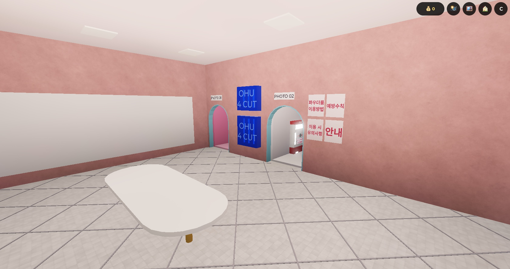 | 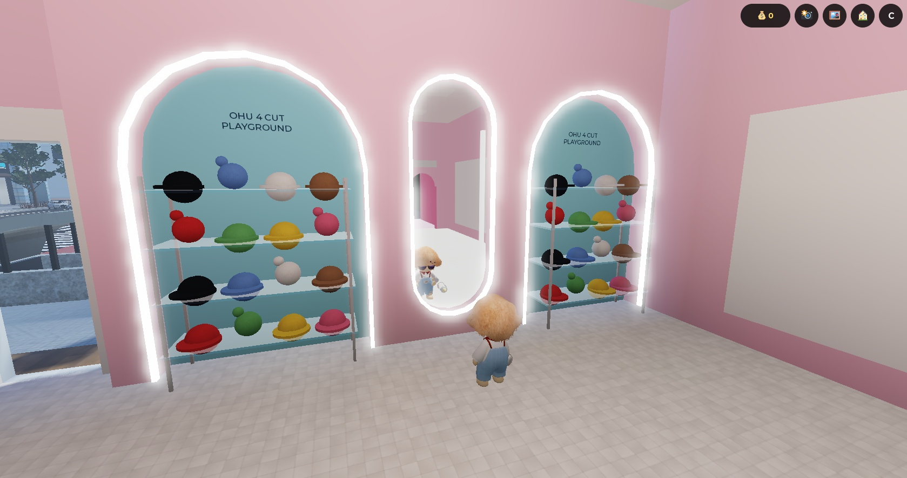 |
| 광화문 | 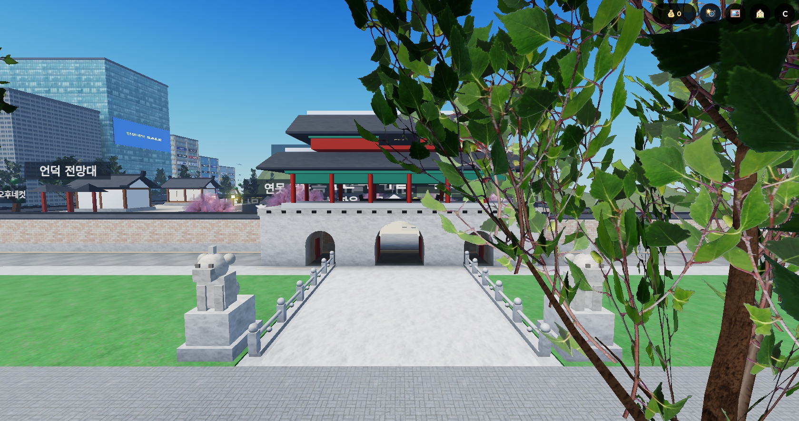 | 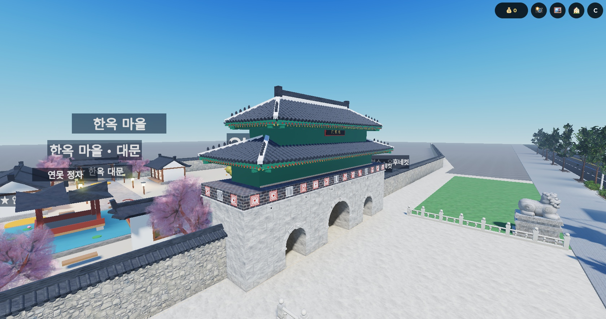 |
| 지하철 출입구 기둥 | 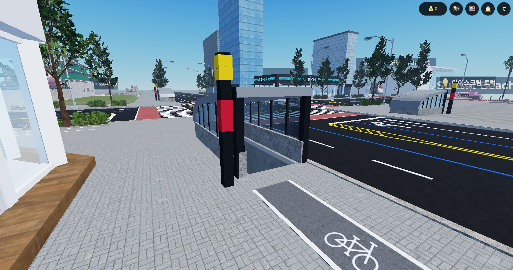 | 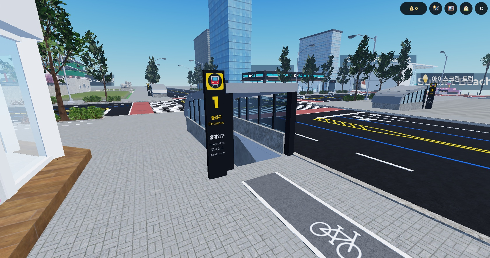 |

- 새로 정한 스폰 위치에서 보이는 첫 화면: 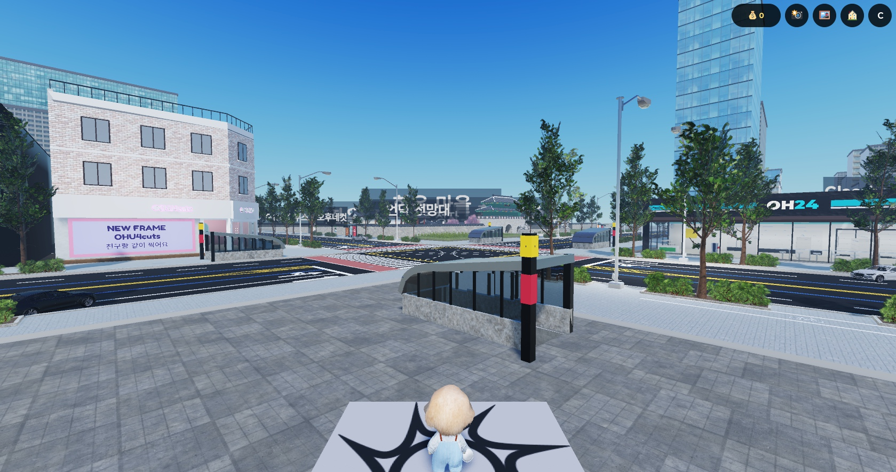
- 밤의 돌담 조명: 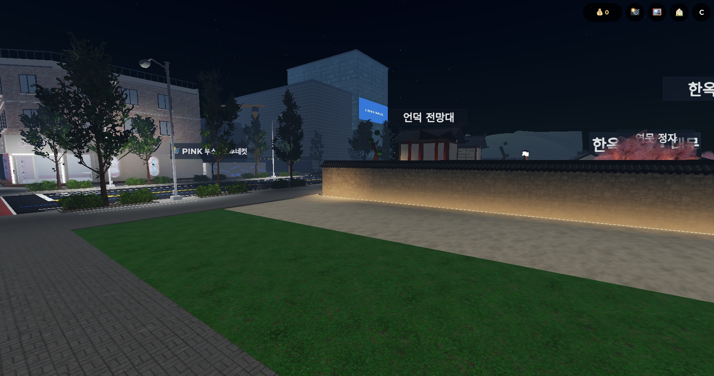

### 추가 (D-151)
- 지하철 출입구 기둥을 서울 역 표지처럼 바꿨습니다(검은 기둥, 앞뒤 두 면).
  - 위에서부터 지하철 아이콘, 번호, 출입구, Entrance, 홍대입구, Hongik Univ., 弘大入口, ホンデイック 순서입니다.
- 출입구가 번쩍거리던 문제는 여러 곳에서 면이 같은 평면에 겹쳐서 생겼습니다. 다음처럼 고쳤습니다.
  - 구덩이 벽 윗면이 인도 바닥과 같은 높이라서, 바닥보다 조금 낮췄습니다.
  - 옆 받침돌이 뒤 받침돌·앞 검은 프레임과 겹쳐서, 옆 받침돌을 짧게 줄였습니다.
  - 지붕 판끼리 겹친 면이 같아서, 판마다 폭과 두께를 조금씩 다르게 했습니다.

### 추가 (D-152)
- 출입구 기둥 아이콘을 한 가지 색으로 바꾸고, 역 이름을 출구마다 다르게 넣었습니다(1 클럽, 2 한옥 마을, 3 놀이공원, 4 해변).
- '광안리 해변'은 모두 '해변'으로 바꿨습니다.

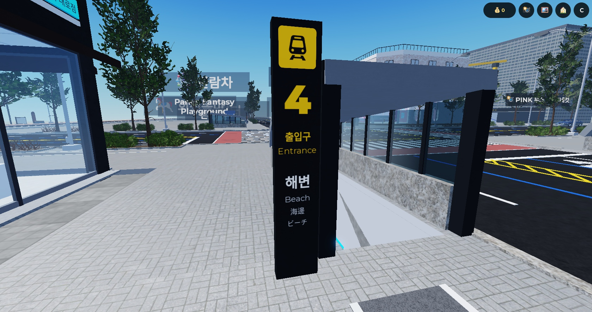

### 추가 (D-153)
- 출입구 기둥을 사진처럼 바꿨습니다. 윗면이 정사각형인 가는 기둥이고, 네 면 모두 같은 내용입니다.
  - 한글 역 이름은 세로로 씁니다.
  - '출입구'와 외국어 표기는 아주 작게 넣었습니다.

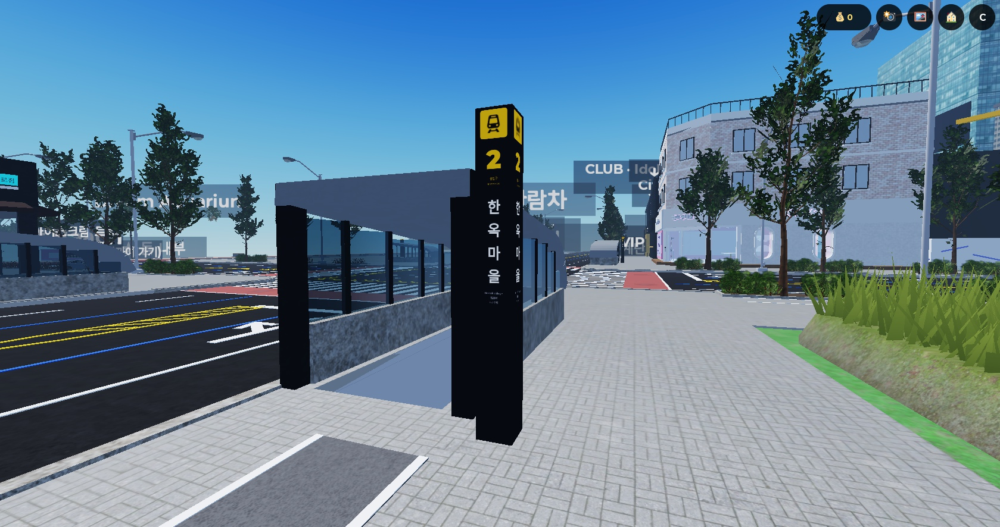

### 추가 (D-154)
- 광화문 앞 잔디가 볼록하게 솟아 보이던 것을 고쳤습니다.
  - 로블록스 지형은 높이가 4스터드 단위로만 맞춰져서, 원하는 높이에 잔디를 놓을 수 없었습니다.
  - 그래서 잔디밭 자리를 파서 화단으로 만들고, 잔디가 땅에서 자란 것처럼 보이게 했습니다.
- 출입구 기둥을 도로 쪽으로 옮겼습니다.

| 잔디 전 | 잔디 후 |
|---|---|
| 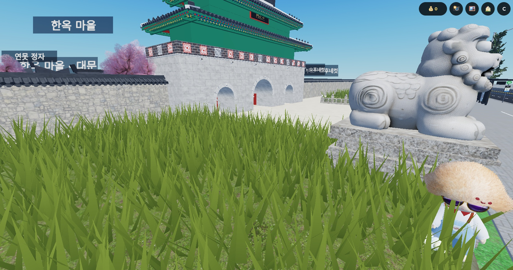 | 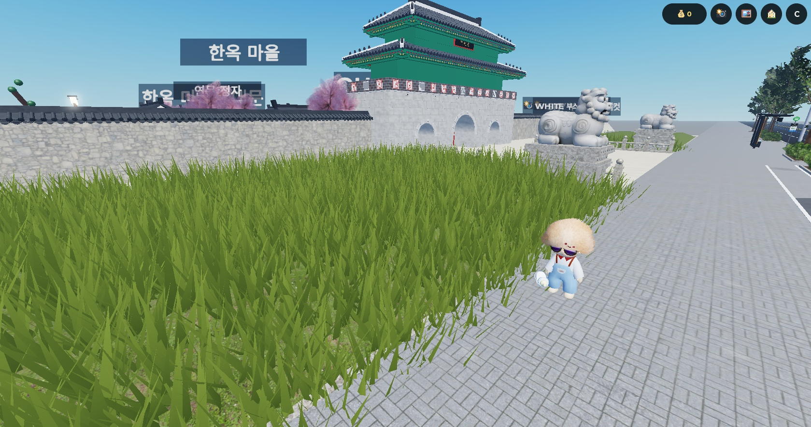 |

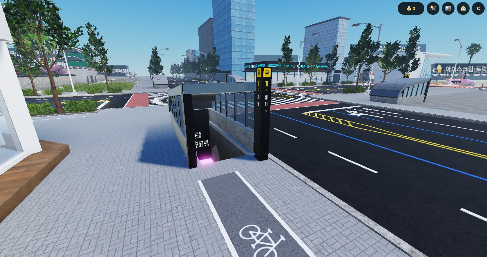

### 추가 (D-155)
- 지하철 계단 안쪽 벽이 번쩍이던 원인은 벽 안쪽 면이 주변 바닥·인도의 잘린 면과 같은 위치에 겹쳐 있던 것입니다.
  - 벽 안쪽 면을 아주 조금 안으로 당겨서 겹치지 않게 했습니다.
- 출입구 기둥을 입구 앞쪽으로 한 걸음 떨어뜨렸습니다.

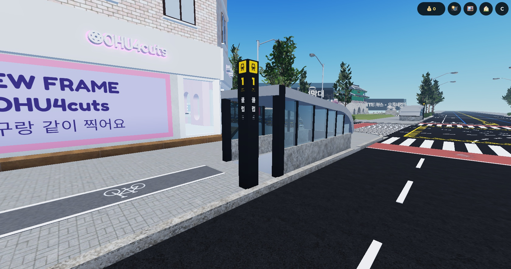

### 추가 (D-156) — 인도 연석(프레임) 정리
- **번쩍거린 이유**
  - 연석 바깥 면이 인도 옆면과 정확히 같은 자리에 있었습니다.
  - 연석끼리 이음새에서 서로 겹쳐 있었습니다.
- **끊긴 이유**: 인도 조각의 긴 변에만 연석을 놓아서, 짧은 끝이 도로에 닿는 곳(1번 출구 옆 등)에는 연석이 없었습니다.
- **고친 방법**
  - 모든 인도 조각의 네 변을 0.5 간격으로 검사해서, 도로에 닿는 곳에만 연석을 깔았습니다.
  - 한 줄에 놓이는 연석은 하나로 합치고, 인도 바깥으로 0.02 내밀었습니다.
- **확인**: 맵 전체에서 겹치는 연석 0개, 도로 쪽 빈 곳 0곳입니다.
- 출입구 기둥을 입구에서 한 걸음 더 떨어뜨렸습니다(7.2).

| 전 | 후 |
|---|---|
| 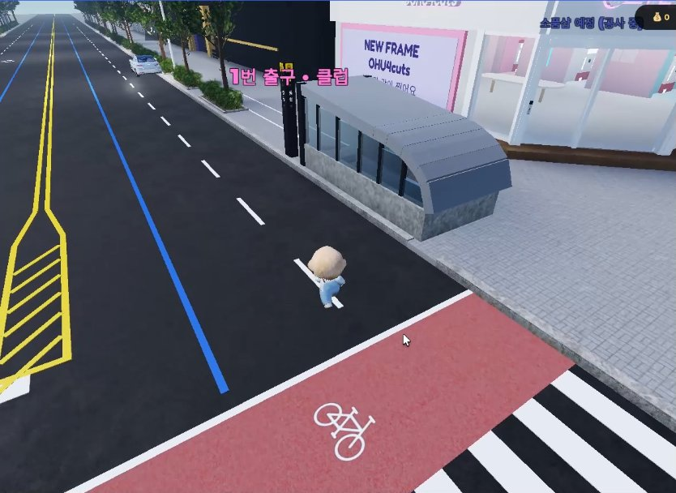 | 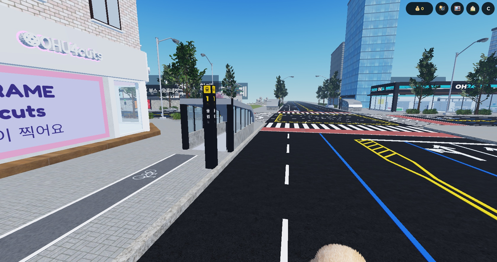 |

## 2026-10-24 — 해변 사거리 정리 (D-157)
- 해변 T자 교차로를 가로지르던 빨간 띠를 지웠습니다.
- 인도 모서리 둥글기를 1/4로 줄였습니다(반지름 8 → 2). 곡선 부분 무늬가 따로 보이던 것이 거의 사라졌습니다.

| 전 | 후 |
|---|---|
| 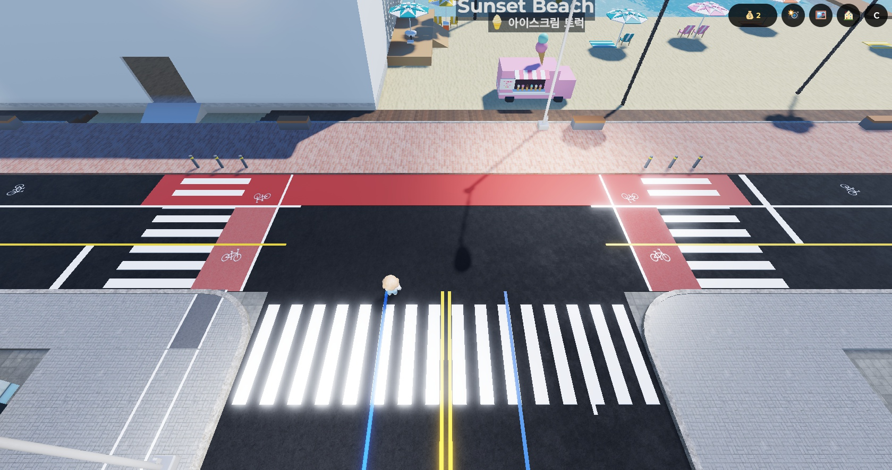 |  |

### 추가 (D-158)
- 인도 둥근 모서리를 조각 3개로 다시 만들던 방식을 바꿨습니다. 원래 인도 한 장의 모서리를 그대로 깎아 내서, 무늬 이음새가 없어졌습니다.
- 해변 T자 교차로 가운데를 법규에 맞췄습니다(도로교통법 시행규칙 별표 6).
  - 교차로 안에는 중앙선을 긋지 않습니다(지금도 그렇습니다).
  - 좌회전 유도선(흰 점선) 2개를 넣었습니다.
  - 정차금지지대는 넣지 않았습니다. 막히는 교차로에 쓰는 표시이기 때문입니다.

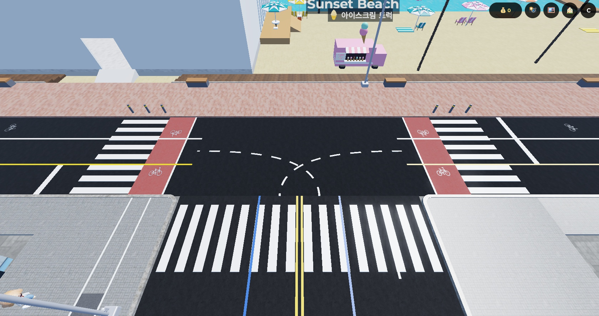

### 추가 (D-159)
- 자전거 횡단도마다 자전거 표시를 하나씩만 남겼습니다.
- 해변 도로 자전거길 표시를 하나 걸러 하나씩 지웠습니다.
- 교차로 앞에서 차선이 끊기는 것은 법규대로라 그대로 두었습니다. 교차로 안에는 유도선 말고는 선을 긋지 않습니다.

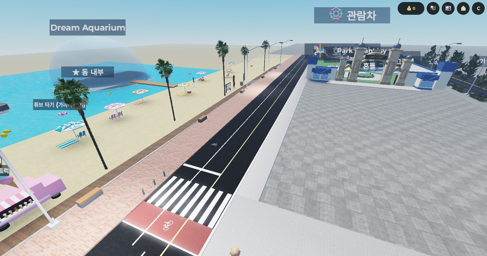

## 2026-10-24 (2) — 모바일 2인 테스트, 병합
- 광화문 무늬를 사용자가 준 밝은 단청 띠 이미지로 바꿨습니다(D-160).
- 모바일 2인 테스트(서버 + 2명, 폰 화면, 터치 켬)를 했습니다.
  - 통과: 포토부스 열기·같이 찍기·나가기, 지하철 1번에서 3번 이동, 광화문 아치 통과, 거울 작동, 오류 없음.
  - 규모: 서버 파트 15,110(10-23의 14,154에서 +956), 유니온 800, SurfaceGui·Billboard 1,448. 클라이언트가 받은 파트 13,109, 그래픽 메모리 약 188MB.
  - FPS는 Studio가 뒤쪽 테스트 창을 15로 묶어서 잴 수 없었습니다(게임 성능과 무관).
- 사용자 승인에 따라 `feat/art-realistic-1022`를 `catalog-ui-redesign`에 병합했습니다(fast-forward).

## 2026-10-24 (3) — 놀이공원 담장 (D-161, `feat/park-wall-1024`)
- 놀이공원 둘레 벽을 정문 탑과 같은 디자인으로 바꿨습니다.
  - 아래에 어두운 사암 받침, 그 위에 사암 블록 벽(블록 이음선 텍스처), 위에 띠 장식과 계단식 갓돌을 올렸습니다.
  - 돔과 조형물은 넣지 않았습니다.
- 네 모서리의 파란 지붕 탑을 같은 사암 기둥으로 바꿨습니다.

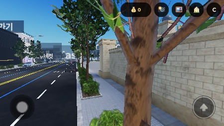

### 추가 (D-162)
- 매표소와 안내소를 정문과 같은 디자인으로 바꿨습니다.
  - 사암 블록 벽에 철제 틀 아치 창, 어두운 간판 띠에 금색 글씨를 넣었습니다.
  - 지붕은 작은 회색 돔과 금색 첨탑입니다.

| 전 | 후 |
|---|---|
| 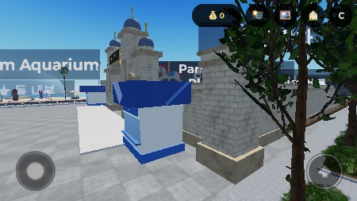 | 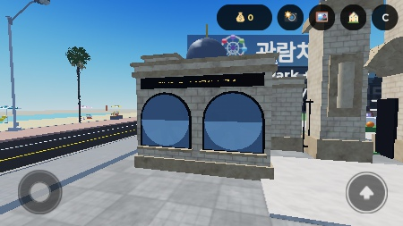 |

### 추가 (D-163)
- 정문 아치가 기둥과 만나는 곳의 빈틈을 없앴습니다.
  - 아치 끝을 기둥 안까지 넣었습니다.
  - 아치 두께를 기둥 너비 안으로 줄였습니다.
- 담장 모서리 기둥에 정문 탑과 같은 돔과 금색 첨탑을 올렸습니다.
- 안내소 창 아래로 삐져나오던 반원을 없앴습니다.
  - 아치 창을 작은 창 2개로 나눴습니다.
  - 겹쳐서 번쩍이던 면을 정리했습니다.

| 정문 전 | 정문 후 |
|---|---|
| 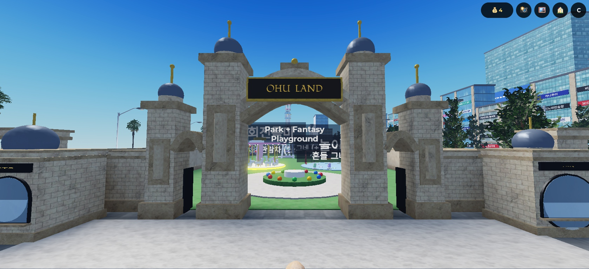 | 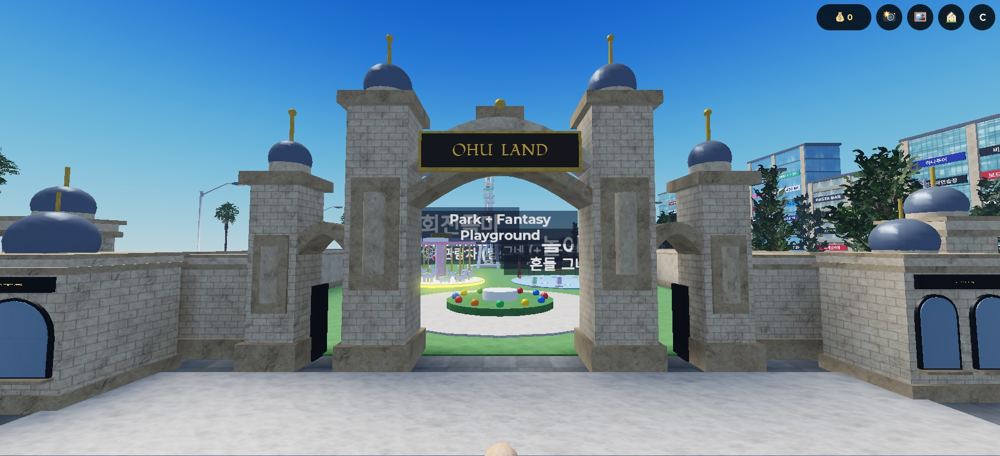 |

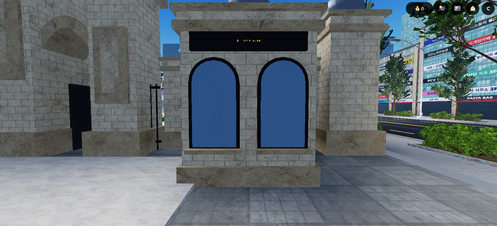

### 추가 (D-164)
- 매표소와 안내소의 창을 각각 가운데 아치 창 하나로 줄였습니다.

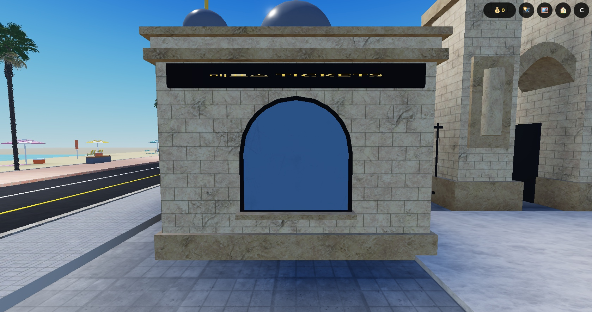

### 추가 (D-165)
- 사용자 그림에 맞춰 매표소와 안내소를 정문 앞 광장 가운데(z -200)로 옮겼습니다.
- 매표소는 왼쪽(x -127), 안내소는 오른쪽(x -59)에 있고, 창은 둘 다 가운데 길 쪽을 봅니다.
- `booth()`가 이제 중심, 바라보는 방향, 폭, 깊이를 받아서 어느 방향으로든 세울 수 있습니다.

| 전 | 후 |
|---|---|
|  | 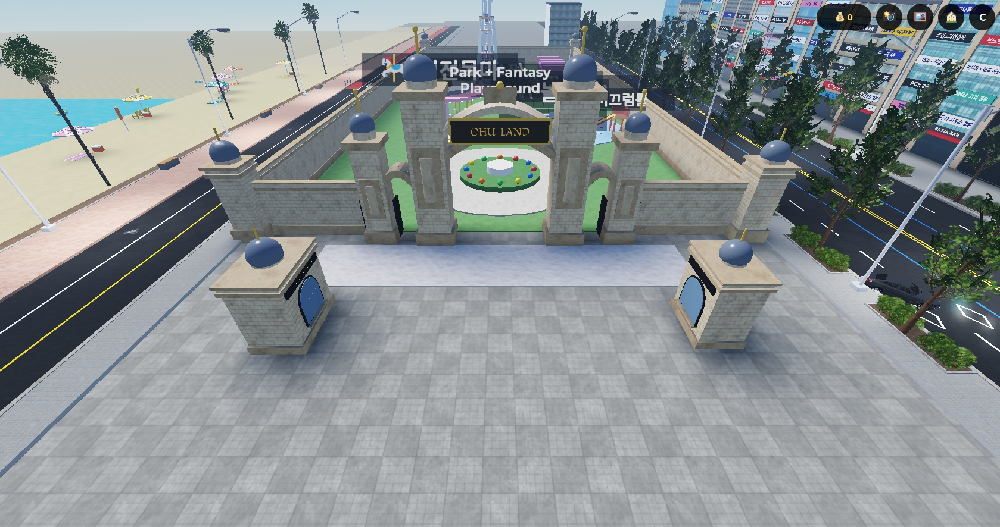 |

### 추가 (D-166) — 놀이공원 공사 중으로 닫기
- 게임을 먼저 공개하고 공원 안은 나중에 만들기로 해서, 실제 놀이공원 공사 현장처럼 닫았습니다. 참고 사진: `docs/04_ART/references/park_closed_*.webp`.
- 정문 철문 세 곳(가운데 아치, 양옆 통로)을 닫고, 가운데에 쇠사슬과 자물쇠를 달았습니다. 정문 전체에 보이지 않는 벽을 세워서 들어갈 수 없습니다.
- 정문 바로 안쪽에 남색 가림막을 세웠습니다. 가운데 큰 판에는 OHU LAND / COMING SOON / 더 신나는 놀이공원으로 곧 찾아올게요!가, 나머지 판에는 ★ OHU LAND / 공사 중 · UNDER CONSTRUCTION이 적혀 있고, 뒤에는 철제 기둥과 버팀대가 있습니다.
- 가운데 아치 앞에 바퀴 달린 검은 메쉬 공사 펜스, Please Pardon Our PROGRESS 안내판, 출입 금지 표지, SOMETHING NEW COMING SOON! 기둥 표지판을 세웠습니다.
- 매표소와 안내소 창 아래쪽에 CLOSED / 운영 준비 중 / OPENING SOON 안내문을 붙였습니다.
- 공원 안 놀이기구 이름표는 닫혀 있는 동안 꺼 두었습니다(되돌리면 다시 켜집니다).

| 정문 | 매표소 |
|---|---|
| 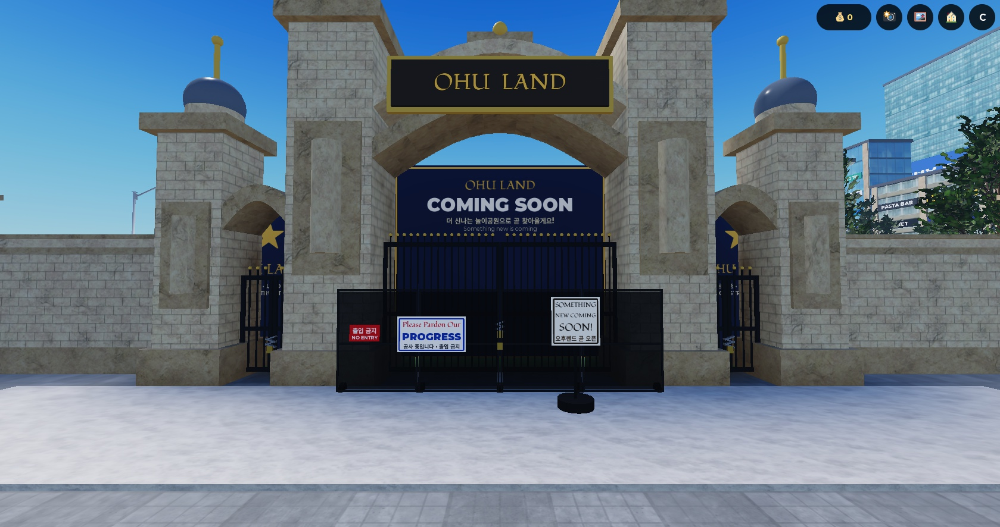 | 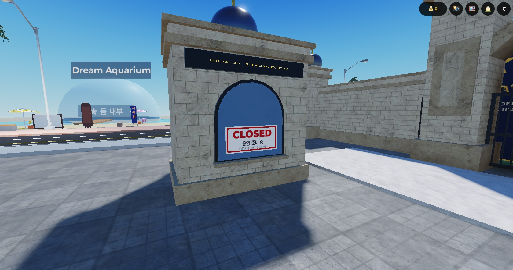 |

### 추가 (D-167..D-169) — 부스 입체 간판, 끝없는 바다, 휘어진 해변, 담 연장
- **매표소·안내소 (D-167):**
  - 실제 놀이공원처럼 매표소는 광장에서 창이 도로(남쪽)를 보고, 안내소는 정문 오른쪽 탑 바로 옆에서 창이 가운데 길을 봅니다.
  - 깨져 보이던 작은 간판 글씨를 지우고, 처마 부분에 입체 글자 "매표소" / "안내소"를 달았습니다(흰 글자 + 분홍 네온 테두리, 밤에는 글자도 빛남).
  - 창 아래 턱은 얇은 판으로 바꾸고 조금 더 앞으로 냈습니다.
- **바다 (D-168):** 바다가 끊겨 보인 이유는 지형 물이 플레이어 근처만 불러와지기 때문이었습니다(스트리밍). 항상 보이는 넓은 바다 면을 수평선까지 깔았고, 해안에서 멀어질수록 조금씩 짙어집니다. 아쿠아리움 돔 둘레는 팔각형으로 비워 돔 안은 그대로입니다.
- **해변 (D-168):** 북쪽에서 해변이 원을 그리며 서쪽으로 휘어 바다를 감싸고, 끝에는 숲이 덮인 곶과 바위가 있습니다(참고: `docs/04_ART/references/beach_curve_ref_*`). 해변 뒤에는 풀밭과 숲(둥근 나무)이 이어집니다.
- **놀이공원 담 (D-169):** 흰선대로 공원 북서쪽 모서리에서 북쪽 도로를 가로질러 해변 가장자리까지, 다시 해변을 따라 북쪽 끝까지 같은 담과 기둥을 세웠습니다. 담 안쪽(옛 도로)은 공원 땅(풀밭)입니다.

| 전 | 후 |
|---|---|
| 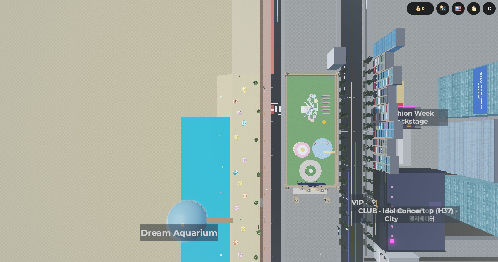 | 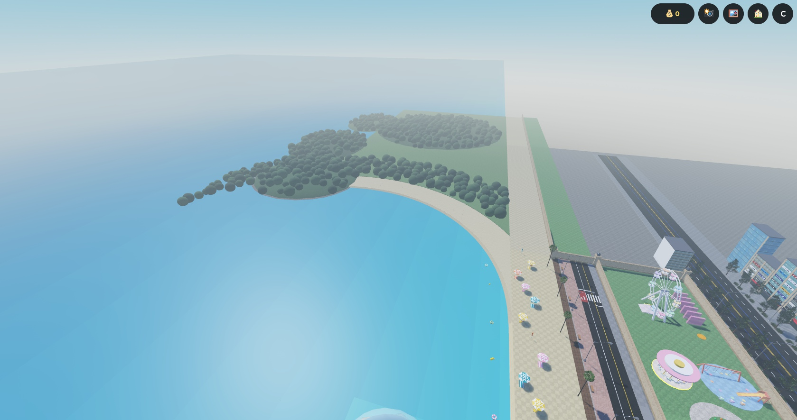 |
|  | 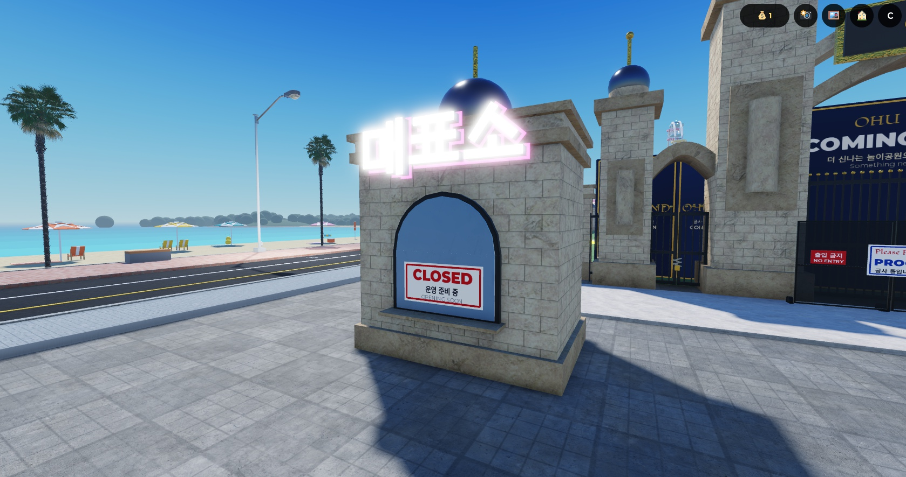 |

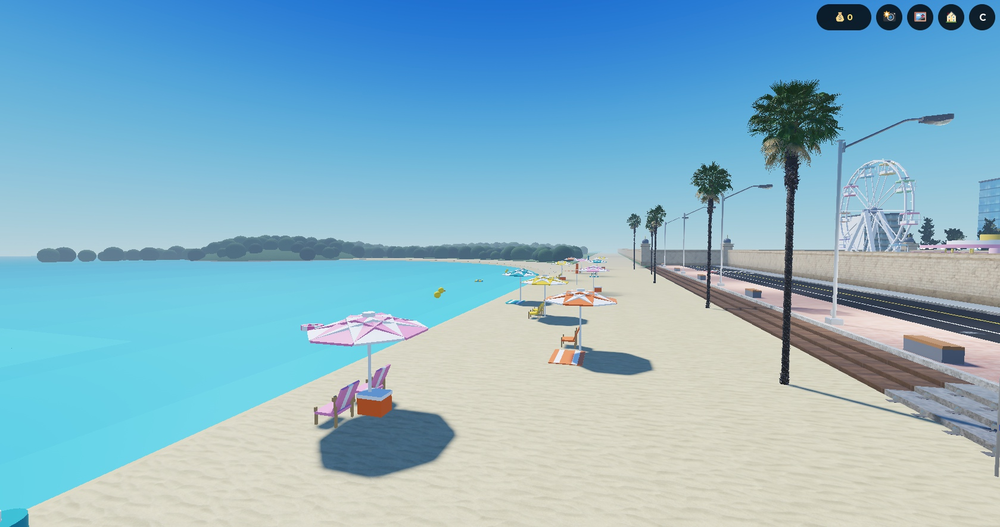
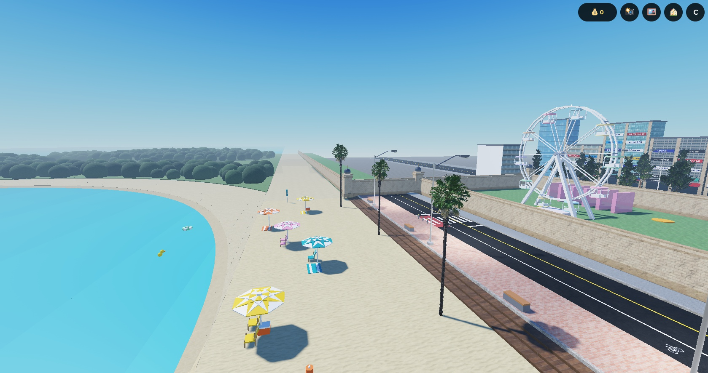
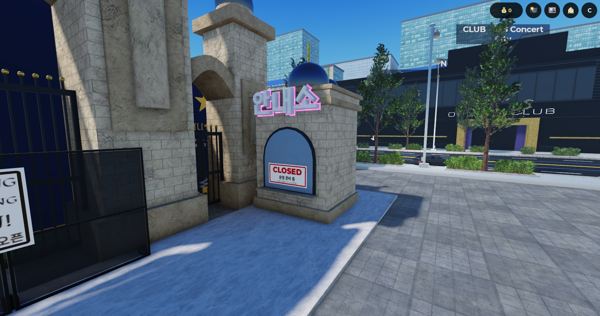

### 추가 (D-170..D-173) — 사용자 수정 요청 반영
- **부스 (D-170):** 매표소·안내소를 처음 그림 위치(광장 양쪽, 창이 가운데 길 쪽)로 되돌렸습니다. 입체 글자를 건물 윤곽 안에 들어오게 줄이고(높이 1.8), 분홍 테두리를 지우고, 두께를 2/3로 줄였습니다.
- **정문 (D-171):** OHU LAND 간판이 뒤 아치를 따라 휘어집니다(조각 14개, 글자마다 곡선 방향으로 기울임). 앞의 검은 메쉬 펜스와 안내판은 지웠습니다(닫힌 철문과 가림막은 그대로).
- **해변 (D-172):** 곡선 해변의 나무·언덕·풀밭을 지우고, 흰 선 모양대로 모래톱만 남겼습니다. 바다 부품 수가 약 1,300개에서 약 540개로 줄었습니다.
- **도로 (D-173):** 해변 도로가 빨간 선(z -392)에서 U턴 회차로로 끝납니다. 지름 24(승용차 회전 지름 약 12 m), 중앙선은 회차 구간 앞에서 끝나고, 상행 차로에 유턴 노면표시, 오른쪽 인도에 파란 원형 유턴 지시표지를 세웠습니다. 회차로 크기를 정한 법 조항은 찾지 못해 일반 값을 썼습니다. 그 북쪽은 산책로 포장이고, -400 횡단보도는 도로와 함께 없앴습니다.
- **나무 계단 (D-173):** z -400부터 공원 담까지 계단이 서쪽으로 휘면서 점점 좁아지게 이어집니다(폭 7.5 → 2.5).

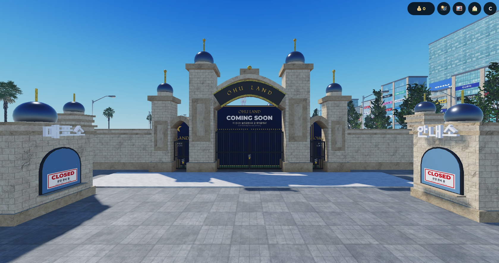
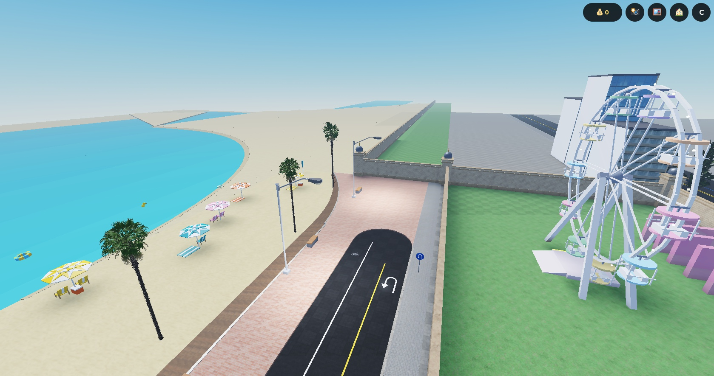
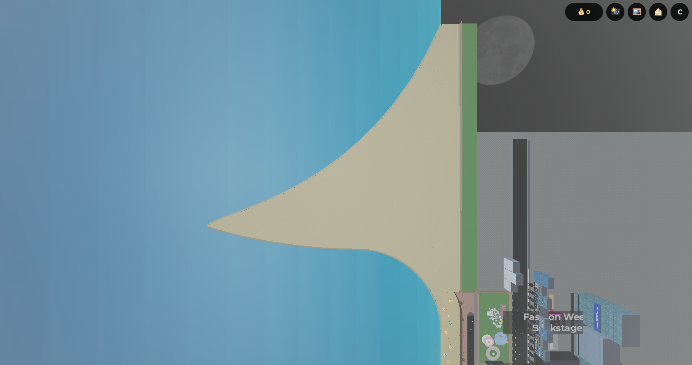

### 추가 (D-174) — 부스 담 옆으로, 창 안으로, 큰 돔 / 큰 정문 간판 / 산책로 연장
- 매표소·안내소를 정문 양쪽 담 앞(흰 박스 자리)으로 옮기고 창이 남쪽을 봅니다.
- 창은 벽 안으로 0.6 들어가고(벽을 CSG로 파냄), 검은 철 테두리만 앞으로 나옵니다. 창 턱은 파인 자리 바닥부터 앞으로 나옵니다.
- 지붕 돔과 받침을 부스 크기에 맞춰 키웠습니다(모서리 기둥과 같은 비율).
- OHU LAND 간판을 탑과 탑 사이 전체 폭, 높이 6.4로 키웠고, 위 장식은 그만큼 올렸습니다.
- 붉은 산책로와 좁은 계단이 담 모서리에서 끊기지 않고 공원 담을 따라 북쪽 끝까지 이어집니다. 곡선 계단 위에 있던 야자수는 모래 위로 옮겼습니다.

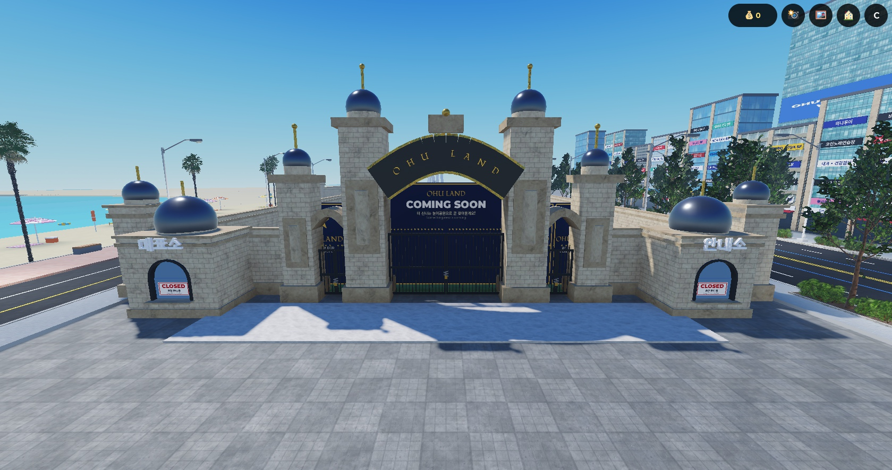
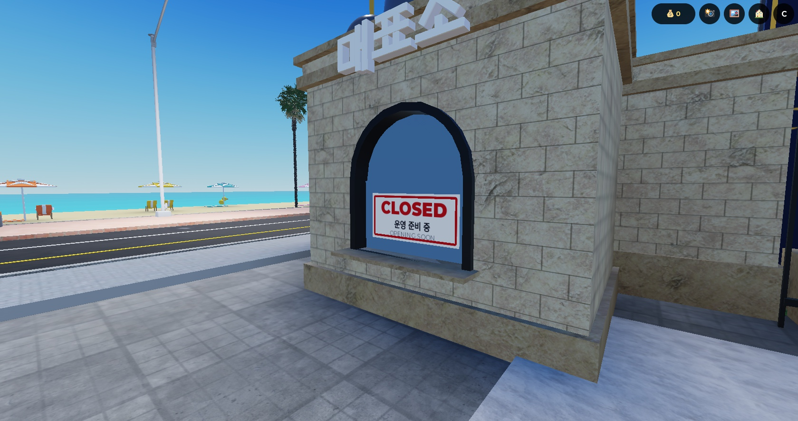
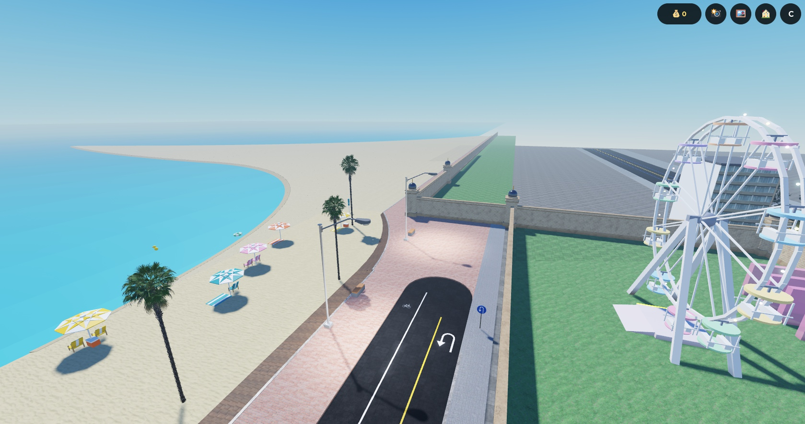

### 추가 (D-175..D-177) — 창 턱 번쩍임, 간판 원래대로, 아쿠아리움 삭제, 도시 공원, 클럽 외관
- 부스 창 턱 윗면을 파인 바닥·테두리보다 0.06 높여 번쩍임을 없앴습니다.
- OHU LAND 간판은 키우기 전(D-171) 크기로 되돌렸습니다.
- **Dream Aquarium 삭제 (D-175):** 돔, 바닥, 다리, 포토스팟, 이름표를 숨기고 그 자리를 바닷물로 채웠습니다. 바다 면의 팔각형 구멍도 없앴습니다.
- **도시 속 작은 공원 (D-176):** 놀이공원 앞 공터에 정문 축을 따라 화강석 산책길, 분수 광장(2단 분수), 동서 산책길, 연석 두른 잔디밭 4곳, 자작나무와 관목, 꽃 띠, 벤치 12개, 낮은 공원등 12개(밤에 켜짐)를 만들었습니다. 3번 출구 입구 앞은 비워 두었습니다.
- **클럽 외관 (D-177):** 금색 띠를 지우고, 줄무늬를 그 높이(1층 위, 간판 아래)로 내려 30도로 기운 입체 루버 날개와 세로 지지대로 만들었습니다. 루버는 외관 끝까지, 오후네컷 쪽 모서리를 돌아서까지 이어집니다. 맨 위층 창은 외관 끝에서 끝까지 이어지고, 간판 띠도 건물 끝선까지 늘였습니다.

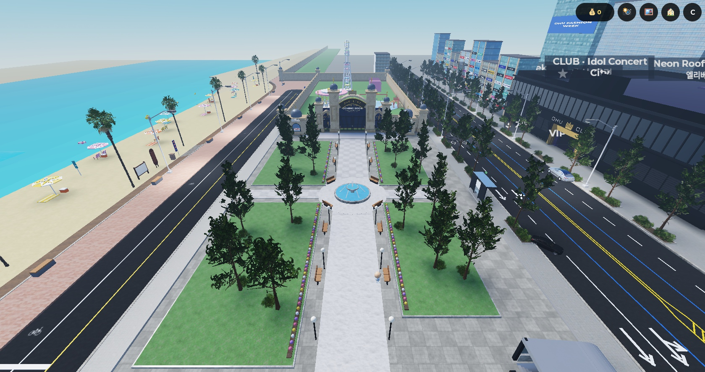
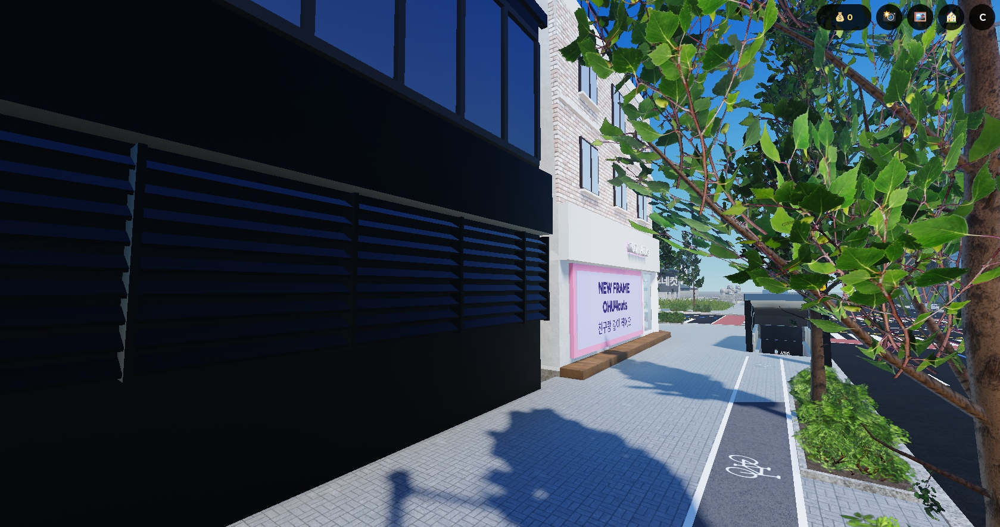

### 추가 (D-178) — 클럽 끝 정리, 오후네컷 북쪽 벽·난간, 해변 카페
- 클럽 외관 북쪽 끝에 검은 마감 기둥을 세워 간판·루버·창 끝을 가리고, 위 띠가 옆 건물로 튀어나가지 않게 했습니다.
- 오후네컷: 클럽 쪽(북쪽) 벽에 흰 벽돌을 붙이고, 옥상 북쪽에도 난간벽과 철 난간을 세웠습니다. 옥상 바닥을 난간벽 바깥면에서 0.05 안으로 넣어 번쩍임을 없앴습니다.
- 해변 카페(`build_main_social_graybox.lua` 04 구역): 층고 30 → 38, 1층 위 높이 13 → 17(2층 바닥), 2층 높이 약 20. 계단은 높이에 맞춰 늘렸습니다. 입구 경사로 대신 건물 폭 전체에 인도까지 이어지는 입구 데크를 깔고, 남쪽 테라스도 인도까지 늘렸습니다. 메자닌 끝을 벽 안으로 넣어 외벽 번쩍임을 없앴고, 카페 앞 나무 계단은 데크 때문에 자동으로 끊깁니다. 입구 앞 가로등은 지웠습니다.

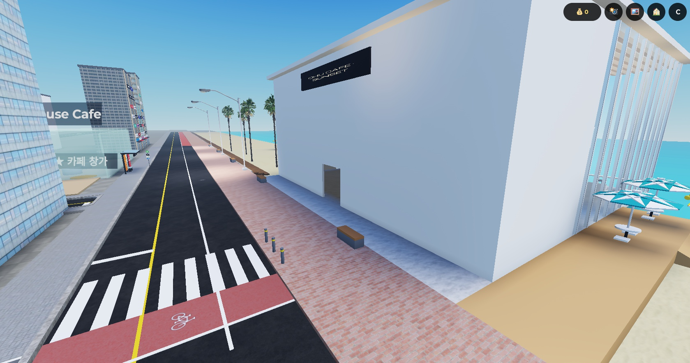
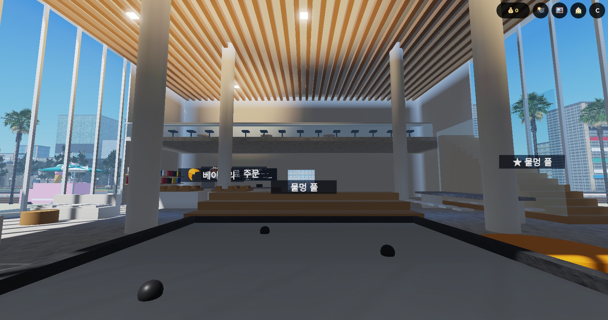
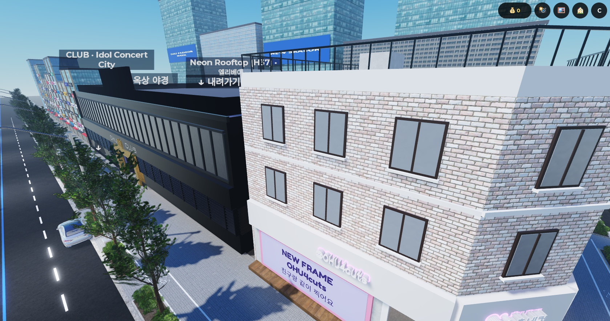

### 추가 — 물멍 풀에 물 채우기
- 해변 카페 물멍 풀: 밝은 돌 바닥 위에 반투명 청록 물을 테두리 바로 아래까지 채웠습니다(돌은 반쯤 잠김).

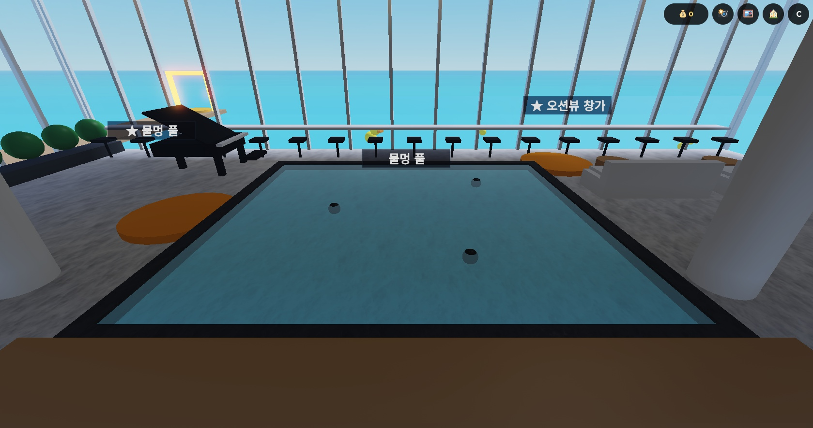

### 추가 (D-179) — 물멍 풀 수중 조명·분수·물결, 카페 조명
- 참고 사진: `docs/04_ART/references/cafe_water_channel_*.jpg`, `cafe_mezzanine_lounge.jpg`.
- 물멍 풀: 검은 돌 바닥과 어두운 물, 가운데 줄에 수중 조명 4개(위로 비추는 스포트라이트)와 물이 솟는 작은 분수, 앞쪽에 검은 돌 블록 2개.
- 새 스크립트 `WaterJetController.client.lua`(태그 WaterJet): 분수가 출렁이고, 약 1초마다 동그란 물결이 퍼지며 사라집니다(플레이어 140 이내에서만).
- 카페 조명: 풀 위 천장에 길게 빛나는 천장 패널, 높은 천장의 따뜻한 스포트라이트 6개, 2층 아래 1층 천장 다운라이트 15개(전에는 없음), 소파 옆 종이 스탠드 6개.

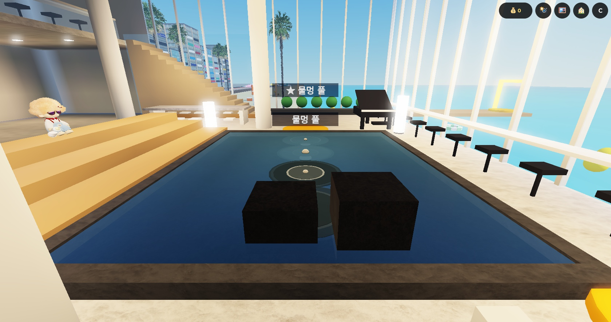
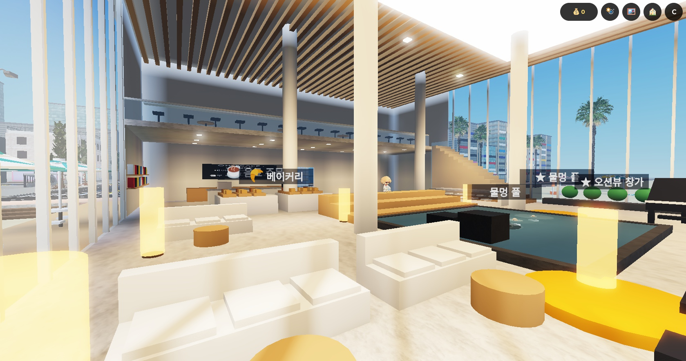

### 추가 (D-180) — 카페 입구 옆 테이크아웃 커피 창
- 참고 사진: `docs/04_ART/references/cafe_walkup_window_1.jpg`, `_2.jpg`.
- 해변 카페 도로 쪽 벽, 문 남쪽(z 32..48)에 창을 뚫고 나무 창틀, 바깥 나무 카운터 선반과 받침, 컵과 작은 화분, 입구 데크 위 나무 바 스툴 3개, 양옆 검은 벽등, 창 위 COFFEE 글자, 벽 위로 분홍 꽃이 핀 덩굴, 큰 화분 선인장과 문 옆 화분 나무, 창 안쪽 ORDER HERE 걸이 판, 안쪽 뒤 카운터 위 펜던트 조명 2개와 병 선반을 넣었습니다.
- 다시 짓는 도중 Studio 연결이 끊겨 사진 확인을 못 했습니다(다음에 Studio를 다시 열고 다시 지은 뒤 확인).

### 추가 (D-181) — 해변 카페 정리
- 외벽: 간판을 문 위로 내리고, 꽃 덩굴을 지우고, 커피 창 틀을 흰색으로 바꿨습니다. 카페 앞 산책로 벤치(카페 구간 전체)를 지웠습니다.
- 메뉴판을 커피 창 양옆 두 개(COFFEE / DRINKS)로 옮기고, 컵 선반을 창 위 벽에 붙였습니다.
- 물멍 풀: 노란 원판(포토스팟)·종이 스탠드·검은 블록을 지우고, 물을 바다와 같은 지형 물로 채웠습니다. 물결 고리는 연한 빛 고리로 바꿨습니다.
- 계단 유리 난간을 계단 경사를 따라 2층 난간 높이(3.4)로 맞추고 손잡이를 달았습니다.
- 천장: 큰 조명 패널을 천장 정중앙에 90도 돌려(바다 쪽에서 도로 쪽까지 길게) 놓고, 스포트 조명 12개를 양옆 두 줄로 같은 간격 정렬(2층 위 천장 포함).

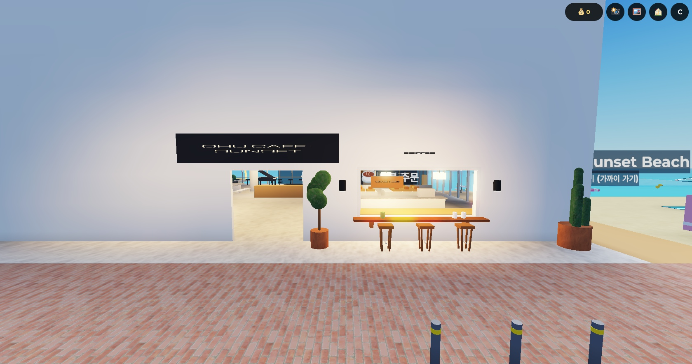

### 추가 (D-182) — 해변 카페 다듬기
- 카운터 펜던트 조명을 주문 카운터와 뒤 카운터 사이 가운데 줄로 옮겼습니다.
- 계단 유리 난간: 첫 계단부터 2층 난간까지 이어지고, 양 끝에 네모 기둥을 세워 모서리를 깔끔하게 했습니다. 2층 난간도 계단 난간 선까지 늘렸습니다.
- 천장 작은 조명 두 줄을 바깥쪽(중심에서 ±33)으로 옮겼습니다.
- 통창: 프레임을 약 12 간격으로 절반 줄이고 고르게 나눴습니다. 모서리에는 바닥 끝선에 맞춘 기둥 하나만 둡니다(바다 쪽, 남쪽·북쪽 통창 모두).
- 물멍 풀: 수중 조명·분수·물결을 지우고, 테이블 옆 호박색 원통 조명 4개를 물속에 한 줄로 세웠습니다. WaterJetController 스크립트는 지웠습니다.
- 외벽: COFFEE 글자, 검은 벽등 2개, 선인장 화분, 화분 나무, 떠 있던 '석양 포토 스팟' 이름표를 지웠습니다.

### 추가 — 계단 유리 끝, 풀 조명 높이
- 계단 유리 난간을 끝이 수직인 평행사변형(쐐기 4개)으로 바꿔, 아래 기둥 옆으로 튀어나오던 부분과 빈 틈을 없앴습니다.
- 물멍 풀 조명 높이를 5 → 2로 낮추고, 풀 밖 종이 스탠드 2개를 지웠습니다.

- 물멍 풀 조명을 높이 0.9로 더 낮췄습니다(물 위로 살짝만 보임).

### 추가 (D-183) — 카페 쪽으로 꺾이는 나무 계단
- 해변 산책로의 나무 계단이 카페 건물에 닿으면 꺾여서, 카페 남쪽 테라스 가장자리를 따라 바다 끝까지 이어집니다(화강석 턱 + 나무 3단). 테라스(데크)도 바다 쪽 끝까지 늘렸고, 옛 테라스 경사로는 지웠습니다.
- 물멍 풀 조명을 높이 1.4로 조금 올렸습니다.

- 카페 남쪽 데크를 계단 맨 윗단과 같은 짙은 나무로 바꿔(사이 회색 턱 삭제) 계단 윗면이 넓어진 모습이 되게 했고, 인도 쪽 회색 턱은 카페 앞에서도 끊기지 않고 이어집니다.

### 추가 (D-184) — 카페 카운터, 스태프존
- 참고 사진 `docs/04_ART/references/cafe_counter_ref.webp`대로 카운터를 다시 만들었습니다: 풀 쪽을 보는 긴 흰 카운터(대리석 상판), 가운데 불 켜진 빵·케이크 진열장, 포스기 2대와 팁 병, 줄 서는 기둥과 줄, 흰 뒤 카운터(알바 작업대, 이름 BackCounter 그대로)에 에스프레소 머신·그라인더 2세트와 병 선반, 뒷벽 위 검은 메뉴판 5개와 ORDER & PICK UP 글씨.
- 계단 뒤(2층 아래 북쪽)는 흰 벽으로 막은 스태프존으로, 닫힌 STAFF ONLY 문만 있고 들어갈 수 없습니다.

- 카페 안 둥근 기둥 4개를 지웠습니다.

### 추가 (D-185) — 카페 데크·계단 모양, 바다 물결
- 데크를 계단 맨 윗단과 같은 높이로 낮추고(한 칸 올라가던 턱 없음), 계단 2·3단은 해변 끝(x -268)까지만, 모서리에서 산책로 계단과 L자로 이어지게 다시 만들었습니다. 바다 위로 나간 데크 아래에는 나무 기둥을 넣었습니다. 테라스 테이블·파라솔도 데크 높이에 맞췄습니다.
- 바다 물결이 안 보이던 이유: 바다 색 면(OpenSea)이 물 표면 바로 0.4 아래에 있어 지형 물이 평평한 색으로만 보였습니다. 물멍 풀 때문은 아닙니다. 색 면을 물 표면 4 아래(-7)로 내려, 가까이는 진짜 물결이 보이고 멀리는 바다가 수평선까지 이어집니다.

- 카페 스태프존: 계단 쪽 벽은 그대로 두고(계단까지 이어 틈 없앰) 가로 벽을 안쪽(z 91.4)으로 옮겼습니다. STAFF ONLY 문은 카운터 뒤 벽 남쪽 끝으로 옮기고(뒤 카운터·병 선반은 그만큼 줄임), 카운터 위 펜던트 조명은 지웠습니다.

### 추가 (D-186) — 카페를 두르는 계단식 데크
- 데크(계단 윗단 높이)와 아래 계단 2단이 카페 남쪽, 바다 쪽(서쪽), 북쪽을 빙 둘러 이어지고, 양쪽 끝에서 산책로 계단과 꺾여 만납니다. 바다 위 부분은 모두 기둥으로 받쳤고, 기둥 윗면을 데크 아래 0.05로 내려 번쩍임을 없앴습니다.
- 인도 쪽 화강석 턱이 두 겹으로 겹쳐 번쩍이던 부분 정리(카페 앞 구간만 레이아웃이, 모서리는 카페가 담당).
- 석양 피어를 데크 북쪽으로 옮기고(z 136) 떠 있던 '석양 피어' 이름표를 지웠습니다.

### 추가 (D-187) — 카페 단상 데크
- 카페 남·북쪽 데크를 계단 없는 평평한 높은 단상으로 바꾸고, 해변 위(x -268까지)만 남겼습니다. 바다 위 데크·기둥·서쪽 데크는 지웠습니다. 산책로 계단은 꺾여서 단상에 닿고 끝납니다(양쪽 동일).
- 카페 입구 앞 바닥도 같은 나무 데크로 바꿨습니다.

- 카페 입구 데크를 단상과 같은 높이로 내려 단차를 없앴고(바 스툴도 같이 내림), 건물 아래 회색 띠를 흰 받침으로 덮어 건물 색으로 통일했습니다. 데크 위 파라솔·테이블과 석양 피어(다리, 포토 스팟, 포토 프레임)를 지웠습니다.

### 추가 (D-188) — 도시 공원 v2 (사용자 조경 그림)
- 참고: `docs/04_ART/references/pocket_park_sketch.webp`. 놀이공원 앞 공터 전체를 포장하고, 가운데 3단 원형 단(앉는 턱과 조형물), 북서쪽 곡선 나무 데크와 곡선 소파, 동쪽 3단 곡선 나무 좌석, 남동쪽 S자 나무 데크 길, 서쪽 라탄 의자 4개, 흰 파라솔 테이블 2개, 남서쪽 넓은 계단, 가장자리 화단(둥근 관목·자작나무), 공원등 7개(밤에 켜짐)로 다시 만들었습니다.

- 카페 남쪽 데크 바로 옆 해변 파라솔 묶음(z -2)을 지웠습니다.

- 도시 공원 가운데 원형 광장을 볼록한 언덕으로: 포장 원판 8겹(각 0.35 높고 반지름 4씩 작게, 가운데 2.8), 그 위의 단·데크·의자·조명은 그 자리 높이만큼 올렸습니다(화단은 그대로).

- 도시 공원 언덕을 계단식에서 매끈한 곡면으로 다시 만들었습니다: 높이 1.6의 화강석 테두리 받침 위에 쐐기 삼각형 728개로 만든 부드러운 돔(가운데 4.2), 가장자리 네 곳에 올라가는 3단 계단. 남동쪽 S자 데크 길의 바깥 부분과 옛 남서쪽 넓은 계단은 지웠습니다.

- 도시 공원 1차 배치: 정문 옆 화단 2개를 지우고, 동쪽(도로 쪽) 가장자리는 나무 한 줄(사각 나무 구덩이 9개), 서쪽(해변 도로 쪽) 가장자리는 나무 11그루와 관목 70개를 빽빽하게 심은 긴 화단으로 바꿨습니다. 서쪽 계단은 화단과 겹쳐 지웠습니다(계단 3곳).

### 추가 (D-190) — 도시 공원 원형 광장을 아래로 (선큰)
- 볼록한 언덕을 지우고, 원형 광장을 3단으로 낮췄습니다: 반지름 44 안은 -0.8, 34 안은 -1.6, 20 안(가운데 원형 단)은 -2.4. 원마다 한 단씩 내려갑니다. 놀이공원 정문 쪽에서 축을 따라 내려가는 폭 16 계단(0.2씩 4단)을 만들었습니다. 바닥 포장과 단은 CSG로 둥글게 잘랐고, 땅(Ground)에도 그만큼 구멍(HOLES)을 냈습니다.

- 정문 쪽 계단: 칸 깊이를 4.5 → 2.25로 반, 높이를 0.2 → 0.4로 올려 2단짜리 진짜 계단으로 바꿨습니다(앞쪽 긴 경사 구간은 다시 평평한 포장).

- 원형 광장을 더 깊게(-2.5 / -3.3 / -4.1) 파고, 정문 쪽 계단을 0.5씩 5칸으로 바꿨습니다.

- 정문 쪽 계단/길 폭을 정문 가운데 아치 기둥 사이(x -103.5..-82.5)에 맞추고, 5칸 계단을 정문 바로 앞(z -196부터)으로 옮긴 뒤 원형 광장까지는 평평한 길로 이었습니다. 길에 걸리던 공원등 2개는 옆으로 옮겼습니다.

### 추가 (D-192) — 공원 계단·길 충돌 수정 (걸어서 검증)
- 원인: 포장과 원형 단은 CSG(UnionOperation)로 둥글게 잘랐는데, CSG의 충돌은 구멍까지 채운 껍데기 모양이라 계단·길·아래 단 위에 투명한 바닥이 남아 있었습니다. 스크립트로는 CollisionFidelity를 바꿀 수 없어서, CSG 파트는 충돌을 끄고 1.5 폭 투명 상자 361개로 실제 모양대로 충돌을 다시 만들었습니다.
- 길과 원 사이에 남던 포장 자투리를 지웠습니다(길을 원 안까지 6 더 늘림).
- 검증: 캐릭터를 걸려서 정문 앞(0.08) → 계단 중간(-0.96) → 길(-2.48) → 원 안(-3.3) → 다시 정문 앞(0.08)까지 오르내림 확인, 길 양끝과 원 경계도 걸어서 확인했습니다.

- 도시 공원: 원통형 라탄 의자 4개를 지우고 그 자리(서쪽)에 동쪽과 같은 3단 나무 계단식 의자를 놓았습니다. 계단식 의자의 네모 방석은 보이지 않게, E 앉기 버튼은 없앴고(PromptSeat 태그 제거), 걸어 올라가면 앉는 기능은 그대로입니다(캐릭터로 확인).

- 서쪽 계단식 의자 위치 정정: 사용자 빨간 박스(곡선 소파 바깥, 바깥 원 안쪽 띠, 반지름 34.6~42.4, 145~245도)로 옮겼습니다. 사용자 사진과 같은 방향(정문 오른쪽, 해변 도로 위)에서 찍어 비교했고, 걸어가서 앉는 것도 확인했습니다.

- 계단/길 폭 정정: 사용자 주황 선은 정문 큰 기둥 두 개의 바깥 면(x -110.5..-75.5, 폭 35)이었습니다(전에는 아치 안쪽 폭 21로 잘못 맞춤). 사진 속 정문 철문 폭 대비 선 위치 비율로 계산해 확인했습니다. 계단·길·충돌·잘라낸 포장을 모두 같이 넓히고, 공원등 2개를 바깥으로 옮겼습니다. 왼쪽·가운데·오른쪽 세 줄을 걸어서 오르내림 확인.

### 추가 (D-193) — 계단식 의자 앉기 정리
- 앉는 자리(Seat)를 단 앞쪽 끝, 나무 윗면보다 0.2 아래로 내려 엉덩이가 나무에 닿고 다리가 아래 단으로 내려옵니다(엉덩이-나무 틈 -0.06 측정).
- 자리가 나무 속에 묻히면 발이 닿지 않아 앉기가 안 되므로, `TouchSeat` 태그를 새로 만들었습니다(ClubService): 자리 위 보이지 않는 구역에 닿으면 앉고, 일어난 뒤 1.5초는 다시 앉히지 않습니다. E 버튼은 없습니다.
- 서쪽 계단식 의자를 각 단마다 정문 길 서쪽 끝선(x -110.5)까지 늘렸습니다(빨간 선).
- 검증: 서쪽 3단 끝자리, 동쪽 첫·중간·끝 자리에 걸어가서 앉기 확인.

### 추가 (D-194) — 공원 서쪽 위 나무 데크
- 사용자 빨간 윤곽대로 서쪽 나무 화단, 정문 길, 원형 광장 사이에 계단식 의자와 같은 나무로 한 단(0.9) 올린 데크를 만들었습니다(x -141..-110.5, z -198부터 원까지, 원 쪽 가장자리는 원을 따라 곡선, 쐐기 삼각형 40개). 데크 위 파라솔 세트와 공원등 2개는 데크 높이로 올렸습니다.
- 걸어서 확인: 포장(0.08)에서 데크(0.97)로 올라가고 다시 내려오기, 데크 위 이동.

- 서쪽 계단식 의자 맨 윗칸을 원 가장자리(반지름 44.3)까지 넓혀 데크와의 틈을 없앴습니다(곡선 40조각). 틈이던 띠를 6곳 x 2줄 레이캐스트로 확인했고, 캐릭터가 데크(0.98)와 윗칸(0.20) 사이를 오갈 수 있습니다.

- 서쪽 계단식 의자 각 단의 끝을 정문 길 끝선(x -110.5)에 일자로 맞췄습니다(끝 4도는 쐐기 삼각형으로 채움, 선 바깥 0.1에 나무가 없는 것을 레이캐스트로 확인). 데크 아래 길 쪽 회색 벽면에 데크와 같은 나무를 입혔습니다.

### 추가 (D-195) — 계단식 의자 앉는 구역
- 서쪽 계단식 의자: 사용자 빨간 박스 세 곳(각도 151~182, 189.5~208.5, 218~230.5)에만 앉는 자리를 2칸 간격(나란히 앉기)으로 촘촘히 넣었습니다(58자리). 박스 바깥은 앉지 않고 걸어 다닐 수 있습니다. 박스 위치는 원 둘레 5도 표식 사진과 사용자 사진 속 앉은 캐릭터 위치로 맞췄습니다.
- 동쪽 계단식 의자도 2칸 간격으로 바뀌었습니다(전체 구역, 64자리).
- 검증: 박스 안 걸어가면 앉음, 통로(186도, 240도)로 걸어 올라가면 앉지 않음, 자리 간격 2.00.
- 사진은 앉는 자리를 빨간 표시로 보이게 한 확인용입니다(게임에서는 안 보임).

### 추가 (D-196) — 동쪽 계단식 의자 옮김
- 가운데 단 옆 동쪽 계단식 의자(X)를 지우고, 사용자 빨간 박스대로 바깥 원 띠(반지름 34.6~44.3)에 서쪽과 같은 3단 계단식 의자를 만들었습니다: 정문 길 동쪽 끝선(x -75.5)에 일자로 맞춘 끝, 2칸 간격 자리(38자리), 길 쪽 통로와 가운데 통로 하나. 걸리던 공원등 하나는 원 바깥으로 옮겼습니다.
- 검증: 자리 구역에서 앉음, 길 쪽 통로와 가운데 통로로 걸어 올라가면 앉지 않고 위 포장(0.08)까지 올라감, 끝선 0.1 바깥에는 나무 없음.

### 추가 (D-198) — 원형 광장 두 단으로
- 위 단(-2.5)을 가운데 원 경계(반지름 20)까지 넓히고 가운데 단(-3.3 링)을 없앴습니다. 옛 링 파트·충돌 줄은 남기지 않고 다시 만들었습니다(단 파트 2개: 위 단 CSG 링, 가운데 원). 가운데 원은 위 단보다 한 단(0.8) 낮은 -3.3입니다(그대로 -4.1이면 1.6 턱이라 걸어 오를 수 없음).
- 계단식 의자 끝면이 정문 길 잘린 면과 같은 평면이라 번쩍이던 것: 끝면을 0.03 의자 쪽으로 물렸습니다(양쪽).
- 검증: 길 → 위 단 → 반지름 34 지점(턱 없음) → 가운데 원(-3.3) → 다시 위 단까지 걸어서 이동.

- 곡선 나무 데크와 흰 소파를 원형 광장 안에서 빼서, 사용자 표시대로 남서쪽 서쪽 화단 옆 바닥(x -140..-133, z -89..-55)으로 옮겼습니다. 소파는 공원 안쪽(동쪽)을 봅니다. 걸어서 데크에 올라가고(0.98) 내려오기, 소파에 앉기 확인.

### 추가 (D-199) — 남쪽 길과 계단 두 개
- 사용자 그림대로 원형 광장 위 단(-2.5)을 남쪽으로 길(x -102..-75)로 이어, 원과 만나는 두 모서리를 반지름 6 곡선으로 둥글렸습니다. 길 끝(z -63..-54)에 바닥으로 올라가는 계단(0.5씩 4단), 동쪽 계단식 의자 끝 옆 원 가장자리에 동쪽에서 내려오는 계단(z -122.4..-114, 4단+이어지는 단)을 만들었습니다.
- 바닥 포장은 상자·원기둥으로만 잘라(삼각형 조각으로 자르니 얇은 포장 조각이 벽처럼 남았음) 남는 조각 없이 정리했고, 길 바닥은 원 안쪽과 겹치지 않는 한 덩어리입니다. 충돌 줄, 땅 구멍(HOLES), 물건 높이(domeH)도 함께 맞췄습니다.
- 숨겨 둔 시작 지점(SpawnLocation, -78,-78)이 새 길 안에 떠서 길을 막아 (-62,-70)으로 옮겼습니다.
- 검증: 남쪽 바닥 → 계단 → 길 → 양쪽 둥근 모서리 → 원 → 다시 바닥, 동쪽 바닥 → 동쪽 계단 → 원 → 다시 바닥 걸어서 확인.

- 서쪽 계단식 의자 남쪽 끝: 의자 뒤 높은 땅을 옆으로 빼서, 높은 땅 가장자리가 맨 아래 칸 앞 모서리에서 시작해 부드러운 곡선으로 남쪽 길 서쪽 끝선(x -102)까지 이어지게 했습니다(한 덩어리, 아래 단과 공유면 없음, 실제 모양 충돌 줄). 그 자리의 길 서쪽 둥근 모서리는 없앴습니다. 새 땅 위와 옆 낮은 바닥을 걸어서 확인했습니다.

- 고침: 새 높은 땅이 '광장 안 물건을 낮은 바닥 높이로 내리기' 처리에 걸려 2.5 내려가 땅속에 묻혀 있었습니다(위에서 선만 보이고 캐릭터는 충돌 줄 위에 떠 있었음). 그 처리에서 빼서 -2.6~0.08로 보이게 했습니다. 남쪽 길 옆 파라솔 테이블을 지웠습니다.

### 추가 (D-200) — 동쪽도 서쪽처럼
- 사용자 선택(의자를 계단 삼아 내려가기): 동쪽 흰 계단을 지우고(인도 침범 해소), 동쪽 계단식 의자 3칸을 남쪽 가로선 z -114까지 늘려 끝을 일자로 맞췄습니다. 높은 땅을 의자 맨 아래 칸 앞 모서리에서 곡선으로 남쪽 길 동쪽 끝선(x -75)까지 이어(서쪽과 같은 방식), 길 동쪽 둥근 모서리는 없앴습니다. tiers()가 양 끝 모두 x 또는 z 선에 맞출 수 있게 바꿨고, 높은 땅은 같은 함수로 양쪽에 만듭니다.
- 검증: 원 바닥 → 늘린 의자 칸 → 바닥 → 다시 원 바닥, 높은 땅 위 걷기, 앉는 구역 밖이라 앉지 않음.

### 추가 (D-201) — 공원 동쪽 풀숲
- 공원과 동쪽 인도 사이 비어 있던 땅(x -46.8..-35.5)에 사용자 참고 그림처럼 풀숲 화단 두 개를 만들었습니다: 둥근 관목, 잎이 많은 관목(Shrub), 장식용 풀 무더기, 작은 꽃, 자작나무. 버스 정류장 바로 남쪽(z -124..-114)은 인도에서 공원으로 들어오는 통로로 비워 두었고(정류장 뒷벽이 막아 정류장 앞은 통로로 쓸 수 없음), 3번 출구 앞에서 끝납니다. 통로를 걸어서 확인했습니다.

### 추가 (D-202) — 공원 옆 인도 넓히기 (풀숲 취소)
- 빈 땅은 인도 자리였습니다: 다른 큰길 인도는 도로 축에서 47(폭 23)인데, 이 북쪽 길 서쪽만 34(폭 10)로 좁게 남아 있었습니다(북쪽 놀이공원 담 x -38 때문). 풀숲 화단(D-201)을 지우고, 공원 구간(z -225..-54.2)에 인도를 x -47까지 넓혀 다른 인도와 같은 폭 23으로 맞췄습니다. 3번 출구 계단 구멍과 놀이공원 담 모서리 기둥 앞에서 멈춥니다. 놀이공원 담 옆(그 북쪽)은 담 때문에 좁은 그대로입니다.

### 추가 (D-203) — 놀이공원 벽 인도 침범 수정
- 놀이공원 동쪽 벽과 모서리 기둥이 인도(x -47) 위에 서 있었습니다. 노란 박스 부분(정문 양옆 민짜 벽)을 4씩 줄이고 정문·안내소·공원 쪽 정문 계단/길/계단식 의자/데크를 4 서쪽으로 옮겼습니다. 동쪽 벽은 x -51.3, 기둥 장식 끝은 x -47.6으로 인도 밖입니다.
- 벽이 안쪽으로 들어와서 놀이터(그네·미끄럼틀)를 10 서쪽으로, 미끄럼틀은 5 더 옮겨 벽을 뚫지 않게 했습니다. 벽 받침과 인도 사이에 생긴 맨땅 틈은 인도와 같은 바닥으로 채웠습니다.
- 검증: 인도를 따라 놀이공원 옆을 끝까지 걸음(높이 0.6 그대로, 막힘 없음), 정문 계단 내려가기·올라오기(가운데·서쪽 끝), 정문 앞 길 동서로 걷기.

### 추가 (D-204) — 공원 윗땅을 인도 높이로, 3번 출구 올리기
- 공원 전체를 0.52 올려 맨 윗땅이 인도(0.6)와 같은 높이가 됐습니다(아래 단·계단·데크는 그 높이 차 그대로). 윗땅 바닥은 인도와 같은 보도블록 무늬입니다. 공원 바닥은 놀이공원 담 아래까지 이어지고(정문 앞 광장 판 삭제), 동쪽 인도 옆 가로수 화단 줄은 지웠습니다.
- 3번 출구가 땅(0)에 있어 인도보다 0.6 낮았습니다: 다른 출구처럼 인도 높이로 올렸습니다. 공원 바닥이 출구 구멍의 윗계단을 덮고 있어서(안에서 올려다보면 계단 끝에 돌덩이) 바닥과 충돌 판에서 구멍을 뚫었습니다.
- 숨겨진 스폰 윗면도 바닥과 같은 높이로 맞췄습니다(0.92 튀어나와 있었음).
- 검증: 인도→공원 동서로 걷기(높이 0.6 그대로), 정문 계단 내려가기, 남쪽 길과 계단 올라가 인도까지, 동쪽 계단식 의자로 내려가기, 3번 출구 계단 내려가기 모두 통과.

### 추가 (D-205) — 공원 계단·아랫바닥 무늬, 서쪽 긴 화단 삭제, 가운데 원 더 낮추기
- 정문 계단, 남쪽 계단, 내려간 바닥(바깥 고리, 남쪽 길, 가운데 원) 모두 인도와 같은 보도블록 무늬로 바꿨습니다.
- 서쪽 가장자리를 따라 길게 있던 화단(관목·자작나무)을 지웠습니다.
- 빨간 체크한 가운데 원을 0.5 더 낮췄습니다. 1.3 단차는 걸어서 못 올라와서(점프만 가능) 원 가장자리 안쪽에 폭 1.2 계단 고리를 넣어 0.65씩 두 번 오르내립니다. 원 안으로 들어갔다 걸어서 나오는 것 확인.

### 추가 (D-206) — 분수 자리 구덩이, 아랫바닥 흰 회색, 나무 이음새, 파라솔 삭제
- 계단 고리를 없애고 조형물 받침 둘레 원을 지하로 깊게(바깥 고리보다 4.5 아래) 내렸습니다. 나중에 물이 떨어지는 분수를 만들 자리입니다. 조형물 받침은 그 높이 그대로 돌기둥 위에 섭니다.
- 계단부터 한 단 아래 땅(정문 계단·길, 바깥 고리, 남쪽 길·계단)은 흰색에 가까운 회색 콘크리트, 무늬 없음.
- 공원 윗바닥과 높은 땅의 옆벽(민무늬였던 면)에도 보도블록 무늬.
- 정문 길 양쪽에서 계단식 의자 끝과 데크/벽 사이에 공원 바닥 모서리가 회색으로 보였습니다: 나무 판으로 덮었습니다.
- 데크 위 파라솔 의자 삭제.

### 추가 (D-207) — 클럽 내부 대리석, 벽 번쩍거림, 2층 별 천장 삭제
- 클럽 안 벽과 바닥(홀 바닥, 바깥 벽 안쪽, 입구·복도 벽, VIP 2층 바닥)을 엘리베이터 복도의 검은 대리석으로 바꿨습니다.
- 복도 벽(체크)과 댄스홀 뒤쪽 벽 번쩍거림: 바깥 건물이 아니라 땅(Ground)의 옆면이 클럽 벽 안쪽 면과 같은 자리에 있었습니다. 땅에 뚫린 클럽 구멍 가장자리를 벽 두께 가운데로 옮겼습니다.
- 2층 라운지 위 2층 모양 판(별 조명 천장)을 삭제했습니다.

## 2026-10-24 (4) — 모바일 2인 전체 기능 테스트 + 성능 검토
- 서버 + 2명, 폰 화면(터치 켬)에서 테스트했습니다.
  - 통과: 지하철(3번 발판 → 선택창 → 1번 출구), 포토부스 2인(입장·8컷 촬영·고르기·다른 사람에게 실시간 표시·장수·저장·나가기, 사진첩 1장), 클럽(춤·같이 추기·음악·레이저, VIP 패스 없으면 되돌림/있으면 2층, DJ 구매→디제잉하기→리프트·폰 좌우 창, 물 주문·테이블에 놓기), 루프탑 엘리베이터, OH24 자동문, 해변 카페 주문, 카페 알바(NPC 손님 주문→만들기→서빙 +4코인), 바다 수영, 튜브 타기·내리기, 공사 중 놀이공원 정문 차단, 공원 계단식 의자 자동 앉기, 카탈로그 열기, 🏠 버튼, 코인 1분 1개.
  - 자동 확인 못 함: 버스 정류장 표지판 클릭(폰 에뮬레이션에서 MCP 클릭이 안 들어감), 📸 실제 저장/동영상(기기 필요).
  - 게임 스크립트 오류 없음. 콘솔 오류는 Studio 플러그인 "Inventory Keeper"(cloud_122749408129236)가 테스트 세션에서 낸 것(게임에는 없음).
  - 알게 된 점: VIP 문에 닿았을 때 뜬 패스 구매 창이 그 자리를 떠나도 열려 있음(취소를 눌러야 닫힘).
- 성능 수치와 앞으로의 위험·예산은 docs/05_TECH/PERFORMANCE.md §9.

| 포토부스 촬영 | 장수 고르기 | 클럽 같이 추기 | DJ (폰) | 카탈로그 |
|---|---|---|---|---|
|  |  |  |  |  |

### 추가 (D-208) — 성능 최적화 1차, VIP 구매 창
- 가짜 건물 간판: 간판마다 파트+SurfaceGui이던 것을 건물마다 투명판 1장에 그렸습니다(84장).
- 오후네컷 입체 간판: 획마다 파트 3개(1,482)를 간판마다 글자 1덩어리 + 후광 1덩어리로 합쳤습니다(색 유지).
- 작은 장식·바닥 표시·투명 파트는 그림자 끔, 태그 없는 고정 장식은 터치 판정 끔.
- 결과(Edit 모드 측정): 파트 17,180 → 14,628, SurfaceGui·Billboard 1,460 → 534, 그림자 12,775 → 6,217, 터치 13,991 → 2,137.
- VIP/DJ 문에서 뜬 테스트 구매 창은 14스터드 벗어나면 닫힙니다(혼자 플레이로 확인).
- 사진 비교는 Studio 창 4개(2인 테스트 실행 중)로 캡처가 시간 초과되어 다음 테스트 때 찍습니다.

### 추가 (D-209) — 광화문 이음줄·기와 줄, 공원 충돌 줄 합치기 (전후 비교)
- 광화문: 돌 이음줄 368개 → 7덩어리, 기와 줄 268개 → 9덩어리. 광화문 전체 1,144 → 524파트.
- 공원: 보이지 않는 충돌 줄 352 → 231(이웃 줄의 가장자리가 0.25 안이면 하나로, 안쪽 가장자리 유지). 공원 1,031 → 814.
- 같은 카메라 위치에서 전후 촬영(전: 2인 테스트 클라이언트, 후: 다시 빌드 후 플레이). 충돌 줄은 비교용으로 화면에서만 빨갛게 칠함.
- 덩어리는 처음 불러오는 몇 초 동안 이음줄이 흐리게 보였다가 정상으로 돌아옴(정밀 렌더 설정).
- 걷기 확인: 정문 계단, 원형 고리, 남쪽 길·계단, 동쪽·서쪽·북쪽 윗바닥 모두 높이 그대로.

| | 전 | 후 |
|---|---|---|
| 광화문 벽 |  |  |
| 광화문 지붕 |  |  |
| 공원 |  |  |
| 공원 충돌 줄(빨강) |  |  |

### 추가 (D-210) — 놀이공원 서쪽 벽 밑 맨땅 정리
- 해변 도로 쪽 인도(x -150까지)와 공원 벽 받침(-148.25) 사이 1.75 폭 맨땅을 인도와 같은 보도블록으로 채웠습니다(동쪽과 같은 방식).
- 그 자리는 기존 맵 경계 투명벽(x -151) 안쪽이라 사람이 들어가 걷는 곳은 아니고, 보이는 땅만 정리됩니다.

### 추가 (D-211) — 자작나무 줄기 가볍게
- 줄기·가지에 붙어 있던 나무껍질 이미지(메시마다 색·요철 2장)를 빼고 기본 나무 재질 갈색으로 바꿨습니다. 잎은 그대로.
- 고화질 표면 562 → 152, 쓰는 이미지 약 37장 → 1장. 폰 메모리 차이는 다음 모바일 2인 테스트에서 같은 조건으로 잽니다.

| 전 | 후 |
|---|---|
|  |  |

### 추가 (D-212) — 줄기 세로 결 시도 후 되돌림
- 세로 결 커스텀 재질을 입혀 봤지만 사용자 판단으로 이전(D-211, 기본 나무 재질)이 나아서 되돌렸습니다. 커스텀 재질은 Studio에서도 지웠습니다.

## 2026-10-25 — 클럽 엘리베이터 칸 (D-213, `feat/park-wall-1024`)
- 엘리베이터 칸 양옆이 클럽 대리석 벽 그대로였습니다. 기본 금속 재질 블록(이미지 없음, 그림 한 장보다 가벼움)으로 양옆과 문 쪽 안벽을 회색 철판으로 덮고, 뒤쪽 손잡이와 문 옆 버튼판(불 들어온 버튼 1개)을 달았습니다. 파트 9개.
- 발판 밟으면 루프탑 이동 그대로 확인.

| 복도에서 | 안에서 |
|---|---|
|  |  |

### 추가 (D-214) — 엘리베이터 글자판 삭제, 호출 버튼
- 문 위 "▲ ROOFTOP" 글자판을 지우고, 문 오른쪽 벽에 호출 버튼판(▲ 불 켜짐, ▼)을 블록으로 달았습니다.

### 추가 (D-215) — 해변 카페 입구 이동 시도 후 되돌림
- 입구를 남쪽 끝으로 옮겼다가 사용자 요청으로 원래 위치(벽 가운데)로 되돌렸습니다. 간판·STAFF ONLY 문도 원래대로.

### 추가 (D-216) — 해변 카페 테이크아웃 창 삭제, 상아색 대리석 바닥
- 입구 옆 테이크아웃 창을 막아 벽만 남기고, 창틀·바깥 선반·컵·의자 3개·ORDER HERE 판·안쪽 컵 선반을 지웠습니다.
- 1층·2층 바닥을 상아색 대리석으로 바꿨습니다(기본 대리석 재질).

| 길 쪽 벽 | 바닥 |
|---|---|
|  |  |

### 추가 (D-217) — 카페 스태프 문 삭제, 카운터를 왼쪽 벽에 붙임
- STAFF ONLY 문과 표지판을 지웠습니다.
- 주문 카운터와 뒤 카운터(알바 시작 작업대)를 왼쪽(남쪽) 벽에 붙이고, 오른쪽 입구(z 56..66)를 가리지 않게 z 55.7에서 끊었습니다. 에스프레소 기계는 카운터 안으로 옮겼습니다.
- 확인: 카운터 안쪽 통로로 걸어 들어가 알바 시작 정상.

### 추가 (D-218) — 빵 진열장 유리, 방향 반대로
- 진열장의 검은 받침·양끝 틀·윗판을 하늘색 유리로 바꾸고, 180도 돌려 빛나는 선반이 매장 쪽으로 보이게 했습니다(유리판은 직원 쪽).

### 추가 (D-219) — 지하철 4번 출구 해변 방향, 편의점 서쪽으로
- 4번 출구를 3번처럼 모서리 광장 안쪽(편의점 앞)으로 옮기고, 해변(서쪽)을 바라보게 올라오도록 했습니다. 원래 자리는 인도로 채웠습니다.
- OH24 편의점 건물 전체를 가건물 쪽으로 4 옮겼습니다(가건물과 1.2 간격). 동쪽 인도가 넓어졌습니다.
- 확인: 4번 출구 발판 → 선택창, 계단 올라와 서쪽으로 걸어 나감, 횡단보도에서 편의점 동쪽 인도 걷기.

### 추가 (D-220) — 편의점 건물 남쪽(빨간 선)까지 이동
- 편의점을 빨간 선(유리온실 카페 테라스 앞)까지 18 옮겼습니다. 사이에 있던 해변 쪽 작은 도로(z 98)는 건물이 덮게 되어 없앴고, 건물 앞·옆·뒤는 인도로 채웠습니다. 4번 출구 앞 인도가 넓어졌습니다.
- 걷기 확인: 편의점 문으로 들어가기, 옛 도로 자리, 건물 뒤 인도.

| 전 | 후 |
|---|---|
|  |  |

### 추가 (D-221) — 해변 카페 1층 배치 v2 (사용자 배치도 1차 구현)
- 사용자 배치도대로: 창가 바(의자 12개), 길쭉한 물멍 풀(조명 4개 일렬), 1인 의자 4개 원형 테이블 3세트, 베이커리 테이블 서쪽으로, 계단식 4단 라운지(동쪽으로 1→4단, 단마다 벤치+테이블 3세트, 줄 사이 통로), 피아노 북서쪽 구석, 직원 공간 앞벽 + STAFF ONLY 문.
- 소파 3세트, 긴 대리석 테이블, 풀 옆 나무 계단 좌석, 북쪽 화분 삭제.
- 확인: 라운지 통로로 1단→4단 걸어 올라감.

| 위에서 | 라운지 | 직원 문 |
|---|---|---|
|  |  |  |

### 추가 (D-222) — 피아노 3단 단상
- 유리 모서리에 3단 대리석 단상(한 단 0.8)을 만들고 피아노와 의자를 맨 위에 올렸습니다. 걸어 올라가 피아노 의자에 앉는 것 확인.

### 추가 (D-223) — 피아노 바다 쪽, 단상 계단 반, 가건물 편의점과 선 맞춤
- 피아노를 바다 쪽으로 3 옮기고 단상 계단 깊이를 반으로 줄였습니다. 올라가 앉기 확인.
- 편의점 서쪽 노래방 가건물을 남쪽으로 12 옮겨 편의점 뒷선(z 104)에 맞췄습니다. 비게 된 땅과 건물 사이 틈은 인도로 채웠습니다.

| 피아노 | 가건물·편의점 (위에서) |
|---|---|
|  |  |

### 추가 (D-224) — 피아노 구석으로 더
- 피아노를 단상 위 유리 구석 쪽으로 6 더 옮겼습니다.

### 추가 (D-225) — 피아노 북쪽 유리와 간격 맞춤
- 바다 쪽 유리와 띄운 만큼(2.6) 북쪽 유리에서도 띄웠습니다. 의자에 앉기 확인.

### 추가 (D-226) — 바다 고무오리 파스텔, 클럽 배치도
- 고무오리 후보 12개 중 가장 가벼운 4번(덩어리 1개, 이미지 없음)을 골라 파스텔 분홍·노랑으로 번갈아 칠해 바다에 띄웠습니다(사용자 사진 참고). 원본은 ServerStorage.ArtAssets.PastelDuck(플레이스 저장 필요).
- 클럽 1층·2층 배치도 그림: docs/01_SYSTEMS/images/club_plan_1F.png, club_plan_2F.png.

### 추가 (D-227) — 고무오리 1/8, 카페 1·2층 배치도
- 바다 고무오리를 1/8 크기로 줄였습니다(작게 줄이면 위치가 원점으로 튀는 문제를 고침).
- 해변 카페 현재 1층·2층 배치도 그림: docs/02_WORLDS/images/beach_cafe_1F_plan.png, beach_cafe_2F_plan.png.

### 추가 (D-228) — 고무오리가 바다 위에 떠서 밀림
- 오리가 공중에 떠 있던 이유: 실제 바다 수면은 y -4인데 오리 기준 높이는 -2.4였고, 작게 줄인 오리가 기준점에서 3.2만큼 떨어져 있어서 흔들릴 때 위아래로 크게 출렁였습니다.
- 이제 오리는 실제 수면(레이캐스트) 위에 앉고, 원래 떠다니던 길 쪽으로 파도처럼 천천히 끌려갑니다. 사람이 2.4 안으로 다가가면 밀려나고, 그 사람이 움직이던 속도만큼 같이 밀려 갑니다. 모래에 닿으면 바다 쪽으로 되돌아갑니다. 각 플레이어 화면에서 따로 계산합니다(통신 없음).
- 테스트: 수면 높이 -3.8~-3.9로 물 위에 떠 있음, 캐릭터가 지나가자 앞으로 6 밀리고 계속 흘러감.

| 전 | 후 |
|---|---|
|  |  |

### 추가 (D-229) — 해변 카페 1층 배치 v3 (사용자 수정 배치도대로)
- 베이커리: 카운터가 있던 자리에 긴 테이블 2개(8×33).
- 주문 카운터: 직원 공간 바로 앞에 가로로(진열장 왼쪽, 계산대 오른쪽). 손님은 입구 쪽에서 주문. 메뉴판·ORDER & PICK UP 간판은 카운터 뒤 직원 벽 위로. 줄 서기 기둥 삭제.
- 알바 작업대: 메자닌 아래 북쪽 벽을 따라.
- 2층 계단: 직원 벽을 따라 일자로(16단) 올라가서 북쪽 유리 앞 계단참에서 메자닌으로. 라운지 쪽에 유리 난간.
- 계단식 라운지: 서쪽으로 옮기고 북쪽 유리까지 늘려 4줄.
- 피아노 단상: 구석 전체가 윗단, 바다 쪽 블록과 동쪽에서 올라가는 2계단.
- 테스트: 캐릭터로 계단→계단참→메자닌, 피아노 계단→단상, 카운터 앞까지 걸어서 확인.
- 남은 문제: 알바 작업대 공간이 직원 벽·계단참·외벽에 막혀 들어갈 수 없음(사용자에게 확인 중).

| 사용자 배치도 | 새 배치도 |
|---|---|
|  |  |

### 추가 (D-230) — 카운터 뒤 벽 삭제, 카운터 앞으로, 베이커리 간격, 임시 스폰
- 카운터 뒤 STAFF ONLY 문과 벽 삭제, 위쪽 띠만 남겨 메뉴판·ORDER & PICK UP 간판을 붙임. 카운터를 손님 쪽으로 4 옮김.
- 베이커리 테이블을 원두 선반 벽에서 더 띄움(간격 3 → 6.6).
- 임시: 카페 내부 작업 동안 스폰을 카페 입구 안쪽으로(build_hongdae_layout.lua `CAFE_WORK_SPAWN = true`, 작업 끝나면 false).

### 추가 (D-231) — 카운터 정리, 작업대까지 길 열기
- 위쪽 띠는 메뉴판 높이만큼만 남기고(메뉴판·간판 2 올림), 카운터 앞면과 선을 맞춰 바깥으로.
- 카운터 뒤 직원 공간 안쪽 벽 삭제: 카운터 뒤에서 알바 작업대까지 이어짐.
- 계산대 1개만, 진열장을 계산대 옆으로 옮김. 카운터 계단 쪽 끝을 잘라 5칸 통로.
- 걸어서 확인: 입구 → 통로 → 카운터 뒤 → 작업대.

### 추가 (D-232) — 카운터·띠를 계단 벽 끝에 맞춤, 오른쪽 기둥 벽, 뒤쪽 나무면 정리
- 카운터와 위쪽 띠를 계단 옆 벽 끝(z 70)에 맞춰 바깥으로. 계단 쪽 끝에만 띠에서 바닥까지 내려오는 벽.
- 카운터 진열장 옆 남는 부분 잘라 진열장과 선 맞춤.
- 카운터 뒤에 보이던 계단참 나무 면: 계단 옆 벽을 북쪽 벽까지 늘려 흰 벽으로 정리.
- 걸어서 확인: 입구 → 통로 → 작업대, 계단 → 계단참 → 메자닌.

### 추가 (D-233) — 해변 카페 층고 1/4씩 높임
- 1층 17 → 21, 2층 21 → 26, 건물 전체 높이 38 → 47.
- 계단은 한 칸 1 높이 그대로 20칸(조금 가파름). 카운터 위 띠·메뉴판은 메자닌 밑에 붙어 그대로.
- 걸어서 확인: 계단 → 메자닌, 통로 → 작업대.

### 추가 (D-234) — 물멍 풀 가장자리 정리, 의자 앉기 버튼 삭제
- 물을 바닥보다 0.6 아래로 내리고 바닥 밑 막힌 수조 안에서 더 넓게 채움. 지형 물의 울퉁불퉁한 가장자리는 바닥과 검은 프레임 밑에 숨음. 테두리는 검은색, 물 쪽으로 0.3 덮음.
- 모든 의자의 E 앉기 버튼 삭제. 걸어 들어가면 자동으로 앉음(카페 의자로 확인). 알바 중에는 앉지 않음.

| 전 | 후 |
|---|---|
|  |  |

### 추가 (D-235) — 카페 외관 석재 + 빛나는 좁은 유리창, 바닥 타일
- 사용자 참고 사진: docs/04_ART/references/cafe_exterior_glow_slits.jpg, cafe_floor_tile.jpg.
- 바깥 벽·지붕 테두리를 따뜻한 석회암 색으로(안쪽은 크림색 그대로). 아주 좁은 유리창 24줄을 엇갈린 격자로: 낮엔 옅은 유리, 밤엔 따뜻하게 빛남.
- 바닥 대리석 삭제: 옅은 큰 타일(4칸마다 줄눈), 1층·메자닌·피아노 단상.

| 전 | 밤 |
|---|---|
|  |  |

### 추가 (D-236) — 카페 배치도대로 인테리어, 물멍 번쩍임, 흰 계단, 2층 난간, 테이블 소품
- 물멍 풀을 동쪽으로 옮기고 짧게(조명 3개), 1인 테이블도 같이 이동, 창가 바 짧게(의자 9개).
- 화분: 남서쪽 유리 구석, 창가 바 끝, 피아노 단상과 라운지 사이 긴 화단, 2층 난간 바 끝.
- 2층: 둥근 테이블 → 도로 쪽 벽을 따라 긴 대리석 테이블 3개(의자 6개씩).
- 물멍 번쩍임: 물 속 조명 받침 원판이 수조 바닥과 겹쳐 있었음 → 삭제.
- 계단·계단참 흰색. 유리 난간 1.8 높이고 위 흰 손잡이·기둥 삭제.
- 2층 난간 바: 노트북+커피, 영수증+진동벨+커피, 휴대폰+커피, 책.
- 걸어서 확인: 계단 → 메자닌.

### 추가 (D-237) — 둥근 의자, 라운지 소파, 창가 바 끝 자르기
- 에셋 대신 기본 파트로 직접 만듦(이미지 없음, 숨은 스크립트 걱정 없음).
- 바 의자·2층 의자: 둥근 쿠션. 1인 테이블 의자: 둥근 쿠션 + 말린 등받이. 라운지: 푹신한 2인 소파(쿠션 2개, 둥근 등받이 윗부분, 둥근 팔걸이).
- 창가 바 남쪽 끝을 구석 화분 뒤까지 자르고 첫 의자 삭제.
- 확인: 걸어 들어가면 의자·소파에 앉음.

### 추가 (D-238) — 물멍 찰방 소리, 피아노 연주, 의자, 알바 작업대·STAFF ONLY 문·창고
- 물멍 풀 안에서 점프 착지하면 첨벙, 걸으면 찰방찰방(모든 플레이어 소리 들림).
- 피아노: 건반 섬세하게(흰 21·검은 15), 의자 다리 4개. 의자에 앉으면 건반 창이 뜨고 눌러서 연주, 다른 사람에게도 들림. PC는 Z~M·Q~U(흰), S D G H J·2 3 5 6 7(검은).
- 물멍 옆 의자: 검은 다리 삭제, 둥근 원통 하나로 바닥까지. 테이블·의자를 물멍 쪽으로.
- 알바 작업대를 카운터 뒤로 옮기고 뒤에 벽, 메뉴판은 그 벽 위쪽. 벽 오른쪽에 진짜 밀어서 여닫히는 STAFF ONLY 문, 안쪽은 선반 있는 창고.
- 확인: 문 72°까지 열렸다 닫힘, 피아노 창·소리, 첨벙·찰방 소리.

### 추가 (D-239) — 카페 문·작업대 자리 바꿈, 의자 등받이 삭제, 클럽 확장·벽·계단 빛
- 카페: STAFF ONLY 문을 계단 쪽으로, 알바 작업대는 오른쪽. 물멍 옆 의자 등받이 원통 삭제.
- 클럽(다른 클럽 후기: 비좁음): 동쪽 골목길 삭제하고 그만큼(19) 건물 확장. DJ존·전광판·댄스플로어·LED 기둥·레이저를 넓어진 홀 가운데로, 북쪽 VIP 라운지·1층 테이블은 새 벽에 맞춤.
- 클럽 내부 벽: 무늬 없는 거의 검정 그레이(바닥은 대리석 그대로). 입구 계단 흰 빛 반으로.

### 추가 (D-240) — 클럽 1층·2층 배치도대로
- 1층: 둥근 테이블 삭제 → 벽에서 나온 계단식 단상 6개(2단, 핑크 라인) 위에 서서 쓰는 음료 테이블. 단상 사이 댄스 봉 4개(둥근 크롬 받침), "봉 잡고 돌기" 누르면 봉을 잡고 천천히 빙그르르 돎(점프하면 놓음). 바를 ㄱ자로. 댄스 플로어 형광 삭제.
- 2층: 양쪽 벽에 VIP 부스 4개씩(짙은 그레이 U 소파, 검은 테이블에 흰 테두리), 부스 사이 벽 조명. VIP 계단 쪽 끝은 비워 둠.

### 모바일 2인 테스트 (2026-10-25 저녁) + 수정 (D-241)
- 통과: 피아노(P1 폰 건반 → P2도 소리 들림), 물멍 걸음 찰방(P2에게 들림), STAFF ONLY 문(P2 화면에서 79°까지 열렸다 닫힘), 알바 시작, 클럽 입구 계단→복도→홀, 계단식 단상 오르기, 댄스 봉(P2 화면에서 P1이 봉 둘레 1.7에서 돎), VIP 패스(테스트 구매)→VIP 계단→2층, VIP 부스 옆 좌석 앉기, DJ 구매→DJ 자리 이동(옮긴 DJ존), 옥상 엘리베이터, 고무오리 밀기.
- 문제 → 수정: 동쪽 맵 경계 벽이 x 177에서 넓힌 클럽을 가로막음 → x 191로. VIP 부스 테이블이 커서 안쪽 좌석으로 못 들어감 → 테이블 작게. P2에게 P1 점프 착지 첨벙 안 들림 → 세로 속도로도 판단.
- 확인 못 함: P2 창이 백그라운드라 자주 응답 없음(주문 창 확인 못 함). 수정 3가지는 다음 2인 테스트에서 확인.

### 모바일 2인 재테스트 (D-241 확인)
- 통과: 경계 벽 수정 후 동쪽 VIP 부스까지 감, 작아진 테이블 옆 통로로 안쪽 소파 앉기(x 185.6), P2에게 P1 점프 착지 첨벙 들림, P2 카페 음료 주문 창(Menu) 열림.
- 메뉴 안 버튼 확인은 P2 창(백그라운드) 응답 지연으로 못 함.

### 추가 (D-242) — 클럽 기둥·봉·LED, 바닥, 카페 2층 의자, 해변 정류장
- 클럽: 2층 받치는 기둥 삭제, 봉춤 봉을 그 자리로(2층 바닥까지). 2층 난간 위 LED 선을 바닥 끝으로 내리고 레몬빛 흰색. 바닥 무늬 없는 짙은 그레이 + 바닥 가장자리 붉은 LED. LED 기둥 크게. 입구 계단 빛 조금 더 밝게. 바 의자 검정.
- 카페 2층 의자: 원통 하나로 바닥까지.
- 해변 버스 정류장: 노래방 건물 앞(북쪽)으로.

### 추가 (D-243) — 클럽 무빙 라이트(영상 속 조명)
- DJ존 앞 천장 트러스에 무빙헤드 5개: 둥근 헤드가 돌아가며 넓고 부드러운 컬러 빔을 댄스 홀에 쓸고, 바닥에 핑크·시안·초록·보라 빛 웅덩이. DJ 조명 색/끄기 따라감. 각 화면에서만 계산(서버 부담 없음).

### 추가 (D-244) — 스폰 클럽 앞, 클럽 VIP 바닥·조명·LED·봉 단상, 레이저 삭제
- 시작 스폰: 클럽 입구 앞 인도.
- VIP 바닥 반투명, 2층 부스 사이 조명 높게, 1층 바닥 테두리 선을 레몬빛 흰색으로, 입구 계단~복도 테두리에 같은 LED 선, 봉 단상 높게(2.2), 천장 레이저 조명 삭제.

### 추가 (D-245) — 무빙라이트·레이저 자리 바꿈, 봉 2단 단상, LED 봉, 바 LED
- VIP 바닥 불투명 복구. 봉 단상 2단(넓게) + 계단 테두리 LED, 봉 1개 LED(핑크). 바 하늘색 LED를 상판 바로 아래로, ㄱ자 꺾인 부분까지.
- 무빙라이트를 옛 레이저 트러스 2개 자리로(4개씩), 레이저는 DJ 무대 앞 트러스로: 더 가늘고 빠르게, 영상처럼 흰 보랏빛.

### 추가 (D-246) — 조명 부드럽게, DJ 조명 속도
- 빔은 블러가 안 돼서 레이저·무빙라이트마다 넓고 흐린 빛을 한 겹 더 씌워 가장자리를 흐리게, 가운데 선도 더 투명하게.
- DJ 창 조명 색 옆 ⚡ 버튼: x0.5 → x1 → x1.5 → x2 조명 속도(DJ 바뀌면 x1).

### 추가 (D-247) — 블러 복구, 조명 속도 x5까지
- 레이저·무빙라이트 흐린 빛 겹 삭제(D-245 모습으로). DJ ⚡ 버튼 x0.5 → x1 → x1.5 → x2 → x3 → x4 → x5.

### 추가 (D-248) — 빛 경계 부드럽게(그라데이션 텍스처), 레이저 위로
- 참고 게임처럼: 가운데 흰색 → 양옆 투명 그라데이션 이미지를 빔 텍스처로(무빙라이트·레이저). 이미지 docs/04_ART/textures/beam_soft.png.
- 레이저: DJ 무대 앞 가장자리에서 천장 쪽으로 쏨(레이저 트러스 삭제).

### 추가 (D-249) — 그라데이션 방향 수정
- 빔 텍스처는 이미지 가로가 빛의 폭, 세로가 길이 방향. 첫 이미지는 세로로 흐려서 길이 방향으로 흐려졌음 → 가로로 흐린 이미지로 바꿔 빛 양옆 경계가 흐리게. 밝기는 원래대로.

### 추가 (D-250) — 레이저 DJ존 뒤 벽 위, 속도는 레이저만, 무빙라이트 범위 넓게
- 레이저 블록 6개를 촘촘하게 DJ존 뒤 벽 위쪽에. DJ 속도 버튼은 레이저만(색은 둘 다). 무빙라이트가 무대 가운데 줄·양쪽 벽까지 닿게 넓게 돌고 바닥 빛도 크게.

### 추가 (D-251) — 레이저 아래로, 봉 메탈, LED 선 삭제, VIP 네온 사인
- 레이저: 뒤 벽 위에서 댄스 플로어로 내려 쏨. 봉·단상 전부 메탈(LED 봉 원래대로). 입구 계단 양옆·로비·계단 아래 LED와 댄스홀 입구 바닥 LED 삭제.
- VIP 부스 벽마다 네온 사인: 금색 왕관 + 핑크 VIP + 테이블에 병 놓은 사람 닉네임(없으면 빈칸), 뒤에 붉은 빛.

### 추가 (D-252) — 클럽 LED 선·아치, 봉 단상 한 칸, 광택 타일 바닥, 레이저 2층 난간으로
- 로비 바닥 테두리 LED, 2층 난간 아래 LED 한 줄 더, 1층 단상 테이블 선을 벽까지 아치로. 봉 단상 넓은 원 한 칸(2 높이). 바닥 광택 그레이 타일. 레이저 전광판 바로 위에서 2층 난간 쪽으로, 끝으로 갈수록 더 흐리게.

### 추가 (D-253) — 큰 타일, 아치+닉네임, 봉 단상, 벽 LED 바
- 바닥 타일 3x3 크기(12칸)로. 1층 테이블 아치 높이고 안에 테이블 주인 닉네임 네온. 봉 단상 작게(7)·높게(3). 빈 벽에 세로 LED 바(차례로 켜지는 체이스, DJ 색 따라감).

### 추가 (D-254) — 바닥 타일 1/3(4칸)

### 추가 (D-255) — 클럽 입구 계단 복도(영상대로)
- 철판(다이아몬드) 계단, 벽 전체 붉은 바탕+그래피티, 계단 끝 빨간 벽돌 벽에 큰 네온 하트, 벽 따라 보라 네온, 은은한 붉은 조명. 흰 계단 끝선·▼ 표시 삭제.

### 추가 (D-256) — 입구 계단 원래대로
- 계단 디자인은 D-254로 복구. 그래피티 이미지만 보관(docs/04_ART/textures/graffiti.png, rbxassetid://77520103793675).

### 추가 (D-257) — 입구 계단 벽면에 그래피티만
- 구조·색·조명 그대로, 계단 쪽 벽면에 그래피티 이미지만.

### 추가 (D-258) — 문 밖에서 보이는 벽: 화살표 + OHU CLUB 그래피티
- 밖에서 보이는 로비 정면 벽 낙서 삭제, 왼쪽(계단 방향) 화살표와 OHU CLUB 그래피티 글씨만.

### 추가 (D-259) — 그래피티: 통로 비우기, 끊김 없이
- 계단 아래 복도 통로(사람이 지나가는 빈 공간)에 그래피티가 떠 있던 것 삭제, 통로 위·옆 벽에만.
- 글씨가 이미지 가장자리에 닿지 않게 새로 그리고 벽마다 이미지가 딱 맞게 반복돼 글씨가 잘리지 않음. 화살표+OHU CLUB은 그대로.

### 추가 (D-260) — D-259 되돌림(그래피티 D-258 상태로)

### 추가 (D-261) — 그래피티 한 칸 더, 통로 입구 비우기
- 홀 쪽 벽 그래피티를 화살표 앞까지 한 칸 더. 계단 아래 복도로 들어가는 통로(사람이 지나가는 빈 곳)에는 그래피티 없이 위쪽 벽에만, 무늬는 이어지게.

### 복구 — D-262 로비 벽 목업 취소(사용자 요청), D-261 상태로 되돌림

### 추가 (D-262) — 레이저 입구 쪽 바닥까지 오르내림, 봉 단상 LED 삭제·봉 두껍게

### 추가 (D-263) — 댄스홀 입구 LED 막대 삭제, VIP 간판 목업대로

### 기획 (D-264, D-265) — 클럽은 밤에만 입장(CLUB.md §20), DJ 이용권 가격 재계산(DJ_SYSTEM.md §6: 💰100 / 25 R$ 제안). VIP는 한 번 사면 영구(게임 패스 299 R$).

### 추가 (D-266) — 레이저 엇갈림 / 파도 타기 오르내림

### 기획 (D-267) — 클럽 밤 입장 세부: 밤 10분 유지, DJ 이용권은 클럽 안에서만 구매·예약, 낮에 차례가 오면 기존 차례 안내창으로 DJ 존에 데려옴(CLUB.md §20).

### 기획 (D-268, D-269) — DJ는 Robux만, 클럽 상점 가격 기획
- 다른 클럽 게임 상점(머니 팩, Guest/CREW/VIP/GUARD 패스, 야광봉·폭죽·머니건, VIP 할인가, 후원 단계)과 실제 클럽 스파클러 버킷 사진을 보고 `docs/01_SYSTEMS/CLUB_SHOP_PRICING.md` 작성. 레퍼런스는 `docs/04_ART/references/club_shop_refs_2026-10-25.webp`, `club_sparkler_bucket_2026-10-25.webp`.

### 기획 (D-270) — 가격 테스트 값 확정, 음료 목록 교체, 코인 x2 패스·후원 순위 추가 (CLUB_SHOP_PRICING.md §4·§5·§10·§11)

### 기획 (D-271) — 음료 v2 이름·모양, 콜드 스파크·후원 전체 배너, 순위 3종과 바깥 위치, 버스 광고판 구매 제안 (CLUB_SHOP_PRICING.md §4, §13)

### 기획 (D-272) — 💰5 음료, 1시간 코인 부스트 25 R$, 버스 광고 8자리, VIP 전용 음료 설명. 상품 전체 목록을 PRODUCTS.md §9에 정리, MONETIZATION.md에 연결.

### 기획 (D-273, D-274) — VIP 전용 음료 조사(온어락소다·올리팝·팝피) → 골목 공방 소다 59 R$(VIP만), 2단계 쨍팝 추가

### 구현 (D-275) — 클럽 음료 3단계 + VIP 할인 (코드)
- 1단계 무료/💰1/💰5, 2단계 💰 또는 R$(VIP 코인 20% 할인), 3단계 R$(VIP가 별도 상품), VIP 전용 골목 공방 소다(비VIP 🔒), 맛·캔 색 고르기(쨍팝 3색, 골목 공방 소다 4맛).
- Studio 1인 확인: 주문·코인 차감·VIP 할인·테스트 구매·맛 병·테이블 놓기 통과. 모바일 2인 테스트는 다음.

### 배치도 (2026-10-25 저녁) — Studio 부품으로 다시 그림 (클럽 1층·2층, 해변 카페 1층·2층)

### 구현 (D-276) — 불꽃·전체 배너·후원
- 2인 테스트(휴대폰): 음료 구매·VIP 할인·맛 병·테이블 놓기 통과. 휴대폰에서 음료 메뉴가 좁아 이름이 안 보이고 상단 버튼에 가려짐 → 상단 버튼 아래 380 폭으로 수정. Player2 창에서 프롬프트가 하나도 안 떠서 "다른 사람 병에서 따르기"는 확인 못 함(Player1은 정상).
- 테이블 스파클러(사진처럼 위로 솟는 불꽃), 스파클러 버킷(캔 3개 · 모두 마시기), 무대 콜드 스파크(분수 5곳 · 2분 쿨다운), 전체 배너(콜드 스파크 · 후원), 💝 후원 창, 한마디 입력(필터).

### 모바일 2인 테스트 (D-276) — 통과
- Player2가 Player1의 병에서 컵 따르기(이번엔 Player2 프롬프트 정상), Player1 콜드 스파크 → Player2 화면 배너 + 분수 5곳, 쿨다운 중 Player2 구매 → '대기 1번째' 안내 → 2분 뒤 Player2 콜드 스파크가 터지고 Player1 화면에 배너, Player1 스파클러 버킷 → Player2 캔 마시기(18 → 17), Player2 후원 50 R$ → Player1 화면 배너.

### 구현 (D-277) — 후원·큰손·플레이 시간 순위 표시

### 구현 (D-278) — 코인 x2 패스 · 1시간 부스트

### 구현 (D-279) — 버스 정류장 광고판 구매

### 수정 (D-280) — 오늘의 큰손 전광판을 OH24 지붕 블록으로, 아바타가 블록을 돌며 흘러감

### 구현 (D-281) — 오늘의 큰손 · 버스 광고 좋아요/싫어요
- 규칙 확인(가짜 투표자 테스트): 싫어요 4 + 좋아요 1 → 보임, 싫어요 5 → 가려짐, 좋아요 5가 되면 다시 보임, 다시 찍으면 0부터, 내 사진 투표 불가.

### 수정 (D-282) — OH24 위 가건물 + 모서리 전광판 (참고 사진대로)

### 수정 (D-283) — 클럽 댄스봉 단상 위치 변경 + 1개 추가 (사용자 배치도대로)

### 수정 (D-284) — 댄스봉 기둥을 2층 천장까지

### 수정 (D-285) — OH24 가건물 전체 크기, ㄷ자 전광판, 노래방 건물 낮춤

### 수정 (D-286) — 전광판을 가건물 상단으로 (편의점과 띄움)

### 수정 (D-287) — 전광판을 아래 남은 공간의 절반까지 내림

### 수정 (D-288) — 로비 OHU CLUB 화살표 간판 반 크기, 안쪽으로

### 수정 (D-289) — 계단 아래 복도 출입구 테두리 조명

### 수정 (D-290) — 엘리베이터 앞 조명 삭제, 바닥 민무늬 통일, 옆 벽 그래피티 삭제

### 수정 (D-291) — 엘리베이터 복도 바닥 조명 이어서

### 수정 (D-292) — 클럽 복도 층고 통일, 댄스홀 문 높게, 문 바닥 조명 삭제, 문 기둥 안쪽 면만 빛

### 수정 (D-293) — VIP 문 천장까지, VIP 글자 삭제, 댄스홀 문 기둥 바깥 면은 벽 색

### 수정 (D-294) — 전광판 실시간 후원, 로비 간판 HERE, 댄스홀 문 기둥 아래 조명

### 수정 (D-295) — VIP 간판 목업대로, VIP 테이블 아래 은은한 빛, 댄스봉 계단식 단상
- 걷기 확인: 6방향에서 걸어 올라가 단상 위(발 높이 F+3) 도착.

### 수정 (D-296) — VIP 글자·닉네임 흰색 + 뒤 빛, 로고 레몬색 + 노란 빛, 양 옆 벽 파도 조명 선

### 수정 (D-297) — VIP 간판 로고·VIP·아이디 빛을 빨강으로

### 수정 (D-298) — VIP·아이디에 네온처럼 번지는 빨간 빛 (외곽선 → 블룸)

### 수정 (D-299) — 1층 양옆 벽 파도 조명, 계단 아래 복도 벽 그래피티

### 추가 (D-300) — 클럽 앞 웨이팅 줄 서는 곳 (울타리 두 줄)

### 수정 (D-301) — DJ 조명/레이저 따로 켜고 끄기, 레이저 옆 속도 버튼, 전광판 버튼은 시간 연장 옆

### 수정 (D-302) — 해변 카페 입구 앞 단상 (바닥 색)

### 수정 (D-303) — 카페 피아노 단상 가운데로, 사선 배치

### 수정 (D-304) — 피아노 180° 회전, 의자를 계단 쪽으로

### 수정 (D-305) — 피아노를 빨간 선까지 옮김

### 수정 (D-306) — 카페 둘레 나무 단상

- 흰 단을 삭제하고, 동쪽 입구 데크와 남·북 테라스를 카페 바닥 높이(+0.6)로 올렸어요. 한 덩어리 나무 단상이 되었고 재질은 해변 계단과 같아요.
- 걸어서 확인: 인도 → 데크 → 남 테라스 → 해변 계단, 북쪽도 모두 OK.

### 수정 (D-307) — 각진 야자수가 다시 나타난 문제

- 카페 때문에 해변 구역만 다시 지을 때, 그래이박스의 각진 야자수 14그루와 옛 아쿠아리움 돔이 함께 되살아났어요.
- 원래 자리(숨김 폴더)로 다시 넣고, 중복 사본 20개를 지웠어요.
- `tools/graybox/park_beach_hidden.lua`를 추가했어요. 해변 구역만 다시 지은 뒤 실행하면 같은 일이 생기지 않아요.
- 카페 화분 후보를 줄 세워 찍어 두었어요.

### 수정 (D-308) — 카페 남쪽 외벽 확장, 사실적인 화분과 풀

- 통창 한 칸과 그 프레임을 지우고, 돌벽을 빨간 선 위치까지 늘렸어요. 이제 계단이 밖에서 보이지 않아요.
- 화분 3개를 6번 후보(검은 다리 위 흰 화분)로 바꿨어요.
- 긴 화단은 흰 박스를 그대로 두고 흙을 깐 뒤 G1 풀 12덤불을 심었어요.

## 2026-10-26

### 수정 (D-309) — 카페 2층 바 위 빨간 책 삭제

- 스크립트와 Studio 양쪽에서 삭제했어요.

### 모바일 2인 테스트 (Player1 801×413 가로 / Player2 1179×819, 둘 다 터치)

통과 (2인 모두)
- 코인
  - 1단계(무료·💰1·💰5)와 2단계 코인 구매에서 코인이 정확히 빠졌어요.
  - 맛 선택(쨍팝 핑크)이 적용됐어요.
  - 병 3개 제한, 잘못된 요청 거절, 3단계는 코인 불가가 모두 정상이에요.
  - VIP 20% 할인(100 → 80)과 x2 부스트(코인 2배, 59:00 표시)가 됐어요.
- 병: 테이블에 놓기, 공개 범위(나만 → P2 거절, 모든 사람 → P2가 컵 받음, 6 → 5잔), 테이블 가득 참 처리가 정상이에요.
- 불꽃
  - 테이블 스파클러가 됐고, 버킷은 캔 18개를 P2도 마실 수 있었어요(18 → 17). 버킷은 10분 뒤 사라져요.
  - 콜드스파크는 5줄기가 나오고, 2분 쿨다운 표시(메뉴 "53초")와 두 번째 구매 대기열(2분 뒤 발사)이 됐어요.
- 배너·후원: P2 화면에 콜드스파크·후원 배너와 메시지가 떴어요.
- 순위
  - 공원 안내판 3개, 클럽 띠, OH24 ㄷ자 실시간 후원 카드가 흘렀어요(아바타, R$, 👍👎).
  - 플레이 시간과 큰손(이름만)도 정상이에요.
- 버스 광고: 구매, 포즈(아이돌), 남의 광고 포즈 거절, P2 좋아요, 같은 자리 대기열이 됐어요.
- DJ
  - 구매 → OK → 부스 이동 → 디제잉하기가 됐어요.
  - 레이저 OFF는 P2 화면에서도 레이저 12줄이 꺼졌어요.
  - 속도 x3과 잘못된 값 거절, 조명, 색, 전광판, 건너뛰기가 됐어요.
  - P2(DJ 아님)의 요청은 거절됐어요.
- 댄스봉 단상 5개: 여러 방향에서 올라갔어요(자동 점프를 꺼도 경사로로 올라감).
- 피아노(새 위치): 앉으면 건반이 뜨고, P1이 친 음이 P2에게 전달됐어요.
- 메뉴(상단바 아래), 코인 창, 💝 창이 휴대폰 화면 안에 들어왔어요.

고친 것: ISSUES.md의 ISSUE-2P-001 ~ 007(DJ 패널 버튼, 피아노 일어나기, 버스 광고 깜빡임, 후원 투표 내 표, 큰손 투표 id, 병 라벨 겹침, 배너 가림). Studio에 반영했어요. 다시 확인하려면 2인 테스트를 껐다 켜야 해요.

### 모바일 2인 재테스트 — 버그 7개 수정 확인

- DJ 패널: 가장 작은 휴대폰(705×338)에서도 모든 버튼이 패널 안에 들어와요.
- 피아노: "일어나기" 버튼이 Jump 방식으로는 안 일어나서 Sit 해제 방식으로 바꿨어요.
- 버스 광고: 가까이서 봐도 깜빡임이 없어요.
- 투표: 후원 투표와 "내 표"가 되고, 큰손 투표(음수 테스트 id)도 돼요.
- 병 이름표: 1.8 / 2.7 / 3.6 높이로 쌓여요.
- 배너: 💝 창보다 위에 그려져요(ZIndex 5 > 1).

### 피아노 "일어나기" 최종 확인 (2인, 둘 다 705×338)
- 버튼을 누르면 일어나고 건반이 닫혀요. 이 화면 크기에서는 점프 버튼이 건반에 완전히 가려져서 이 버튼이 꼭 필요해요.
- 콘솔에 게임 코드 오류는 없었어요.

## 2026-10-26 (2) — 크리에이터 계정으로 이전

- 새 계정 kr_ohu, 경험 10773060623, 플레이스 121328617525011에 저장한 .rbxl을 게시했어요.
- 맵(Graybox 5,247 / Hongdae 22,180개), 스크립트 71개, ArtAssets 27개가 모두 정상이에요.
- 에셋 1,100여 개의 주인을 확인했어요. 예전 계정(cortis_ian)이 올린 이미지 6개가 새 게임에서 안 불러와졌어요. 원본 파일로 다시 올리고, 코드와 플레이스의 138곳을 새 ID로 바꿨어요(D-313). 새 이미지 6개는 모두 불러와지는 걸 확인했어요.
- 남은 것: AI 해태(메시와 텍스처)는 예전 계정이 새 경험에 공유해 줘야 해요.
- 포토부스 가격(PhotoConfig)과 빔 텍스처(ClubLightsController)를 Studio에 반영했어요. 스크립트 68개가 저장소와 모두 같아요.

### 국밥집 "오후 돼지국밥" (D-314)

- 위치: 클럽 북쪽 첫 필지(후보 A). 클럽 문에서 같은 인도를 따라 걸어가요. 이동 경계를 그 필지만 뒤로 밀었어요.
- 외관(노포 스타일):
  - 2층은 붉은 벽돌에 알루미늄 창이에요.
  - 1층은 흰 박스 간판(빨간 글씨 + 24시)과 "국밥" 세로 간판이에요.
  - 유리에 빨간 메뉴 글씨, 열린 미닫이문이 있어요.
  - 문 앞에는 김 나는 가마솥, 실외기, "24시간 영업" 입간판이 있어요.
- 실내:
  - 형광등과 나무 판넬 벽이에요.
  - 스테인리스 테이블 6개에 빨간 의자 24개(앉기 됨), 김치·깍두기 단지, 정수기, SINCE 1985 포스터가 있어요.
  - 주방 카운터에는 큰 냄비, 뚝배기, 메뉴판이 있어요.
- 밤 간판: 처음에는 네온으로 했더니 빛이 번져서 글씨가 안 보였어요. 빛의 영향을 받지 않는 글씨 + 조명 방식으로 바꿨어요.
- 걸어서 확인: 클럽 앞 → 인도 → 문 → 안쪽까지 턱 없이 들어가요(바닥 0.6). 주방 카운터에서 막히고, 의자에 앉기도 돼요.
- 주문과 먹기 기능은 편의점·카페와 함께 다음에 만들어요.

### 해태 다시 만들기 (진행 중)
- 새 계정에서 AI 메시로 다시 만들기로 했어요(예전 계정 메시는 비공개). 참고 사진: docs/04_ART/references/haetae_ref_01..09.
- 첫 시도 4번은 실패했어요: 글자 수 초과, 검토(모더레이션) 실패, 이미지 가져오기 실패, 그리고 Studio 연결 끊김으로 기다리다 중단.

### 해태를 직접 조각해서 다시 만듦 (D-315)

- AI 메시를 여러 번 시도했지만 계속 앉은 중국 사자 모양이 나왔어요. 그래서 사진을 분석해서 부위별로 직접 조각했어요.
- 자세: 몸은 받침대를 따라 옆으로 길게 엎드려 있고(앞쪽이 가운데 길 쪽), 고개만 90° 돌려 길(거리)을 봐요. 사진과 같은 구도예요.
- 부위: 굵은 앞다리와 큰 발가락, 접힌 뒷다리, 엉덩이 원판 소용돌이, 가슴 소용돌이, 등에 붙은 곱슬 꼬리, 목 갈기, 넓은 얼굴(튀어나온 눈, 찡그린 눈썹, 넓은 코, 이빨 보이는 웃는 입, 갈기 두 줄, 정수리 혹, 수염)이에요.
- 비늘 무늬는 직접 그린 이미지를 새 계정으로 올렸어요. 나머지는 받침대와 같은 화강암 재질이에요.
- 받침대는 몸 방향을 따라 90° 돌렸어요.

### 해태를 Meshy 모델로 교체 (D-316)

- 사용자가 Meshy로 만든 모델(CC0)이 원본 삼각형 181,606개라 18,000개로 줄였어요. 좌우 반전본도 함께 만들었어요.
- 받침 판 포함 길이를 우리 받침대에 맞추고, 머리는 가운데 길 쪽, 얼굴은 거리 쪽을 보게 놓았어요. 재질은 화강암이에요.
- 무게: 한 쌍이 MeshPart 2개(삼각형 3.6만)예요. 조각 버전(파트 260개)보다 가벼워요.

### 카페·편의점·국밥집 주문하고 먹기 (D-317)

- 카페: 무료 / 💰10 / 💰20 / Robux(파르페, 홀케이크 3종)예요.
- 편의점: "계산하기"로 생수, 아이스크림 바, 과자, 우유, 캔음료, 삼각김밥, 컵라면을 사요.
- 국밥집: 물·공깃밥 무료, 국밥 3종 💰20, 수육 R$19예요.
- 손에 드는 모양을 종류마다 만들었어요. 클릭(터치)하면 한 입씩 먹고, 다 먹으면 사라져요. 국밥은 6입, 컵라면은 5입이에요.
- 케이크와 수육은 같은 층의 가까운 테이블에 놓여요. 누구나 "한 조각/점 먹기"로 가져가고, 남은 개수가 표시돼요. 10분 뒤 사라져요.
- 확인(Play): 코인 차감, 손에 2개 제한, Robux 상품 거절(결제창으로), 먹기 3번에 사라짐, 수육 6 → 5, 케이크가 2층이 아닌 같은 층 테이블에 놓임, 메뉴 구간 표시와 스크롤.
- 고친 것: 둥근 음식(뚝배기)이 손에서 옆으로 누워 있던 것, 케이크가 바로 위 2층 테이블에 놓이던 것.

### 홀케이크 조각 방식 + 계정 이전 후 첫 모바일 2인 테스트 (D-318)

- 케이크: 6조각 메시가 모여 둥근 케이크가 돼요. 한 조각을 가져가면 그 자리에 단면(스펀지·크림 층)이 보여요. 빈티지 레터링 케이크는 체리, 크림, 레터링이 올라가고 4가지 색이 랜덤이에요.
- 문제 1: 처음에는 조각들이 별 모양으로 놓였어요. 가져온 메시가 좌우로 뒤집혀 들어와서, 조각을 180° 돌려 해결했어요.
- 문제 2: 새 플레이스는 협업 편집(팀 만들기)이 켜져 있어서 코드 수정이 초안으로만 남고 테스트에 적용되지 않았어요. 사용자가 협업 편집을 껐어요.
- 2인 테스트 결과(P1 733×391, P2 677×338) 모두 통과:
  - 음식: 국밥과 공깃밥 구매, P1의 수육 접시에서 P2가 한 점을 가져가 두 입에 다 먹음(6 → 5), 편의점 구매와 손 2개 제한, 계산하기 메뉴.
  - 케이크: 빈티지 Robux 구매 → 테이블에 6조각, P2가 한 조각을 가져가면 단면이 보이고 레터링이 사라짐.
  - 클럽: 코인 음료, 병 놓기, P2가 따르기, 스파클러 버킷, 콜드스파크와 후원 배너가 P2 화면에 표시, x2 부스트(배율 2), DJ 구매와 레이저 끄기, 버스 광고 구매와 포즈, 순위(후원, 실시간 후원자).
  - 새 계정 에셋: 해태 메시 2개가 P2 기기에서도 불러와짐, 포토부스 가격(💰10, 50, 100)이 반영됨.
- 조각 180° 수정과 케이크 크기 0.95는 Studio에 반영했어요. 다음 테스트에서 한 번 더 보면 돼요.

### 새 계정(Vantablack_Dev) 모바일 2인 테스트 (D-319)

- 3D 모델 3개(해태 2개, 케이크 조각)를 새 계정으로 다시 가져와 보관함에 정리하고, 해태를 다시 세웠어요. 스크립트 68개가 모두 최신 코드와 같아요.
- 2인 테스트 결과(P1·P2 모두 677×338 휴대폰 화면) 모두 통과:
  - 케이크: 빈티지 케이크가 테이블에 6조각으로 놓이고, P2가 한 조각을 가져가면 단면이 보여요(크기와 체리 수정도 확인). 딸기 케이크는 💰100으로 사서 테이블에 놓기까지 돼요.
  - 국밥과 편의점 구매(손 2개 제한), P1의 수육에서 P2가 한 점을 가져가요.
  - 클럽: 음료, 병 따르기(P2), 스파클러, 콜드스파크와 후원 배너가 P2 화면에 떠요.
  - 코인 x2 패스(배율 2), DJ와 레이저, 버스 광고, 순위도 정상이에요.
  - 해태 한 쌍(새 메시)이 P2 기기에서 보여요.

### 클럽 밤 입장 (D-320)

- 낮에 클럽에 들어오면 문 앞 인도로 돌려보내요. 입구로 걸어 들어와도, 텔레포트로 들어와도 똑같아요.
- 밤(18~06시)에 들어온 사람은 해가 떠도 계속 있을 수 있고, 나가는 건 언제나 자유예요. DJ 차례로 이동할 때는 낮에도 들어갈 수 있어요.
- 문 위 표지판: "🌙 클럽은 밤에 열려요 · 오픈까지 약 n분"
- 지금은 시계가 14시로 고정돼 있어서 꺼져 있어요. 게임을 완성하고 고정을 풀면 자동으로 켜져요.

### 해변 표지판 (D-321)

- 사진(광안리 종합안내도, 서프보드 표지판)을 보고 해변 표지판 두 개의 내용을 그려 넣고 크기를 키웠어요.
- 종합안내도: 우리 해변 지도(수영 구역 부표, 카페, 튜브 대여, 아이스크림 트럭, 발 씻는 곳, 지하철 4번 출구, 오후네컷), 범례, 개장 기간, 금지 아이콘 6개, 바다 이용 수칙을 넣었어요.
- 서프보드: "바다 이용 수칙" 5줄과 다리 그림을 넣었어요.

### 폰 메모리 줄이기 (D-322)

- 스트리밍 설정(사용자가 해 둠)이 켜진 상태에서 무게를 쟀어요(PERFORMANCE.md 10절).
- 실시간 화면(거울·LED 기둥·DJ 화면·버스 광고)은 이미 가까이 있을 때만 그려지고 있어서 그대로 뒀어요.
- 편의점 진열대 99줄의 글자 1,286개를 상품 종류별 그림 13장(반복 무늬)으로 바꿨어요. 주차된 차 계기판 글자 152개도 지웠어요. 화면 글자 메모리 114 → 약 90MB.
- 주차된 차 9대가 3D 모델 메모리 76MB 중 33MB였어요. 바깥에서 광선을 쏴서 한 번도 안 보이는 부품(차 한 종류에 35개 정도)만 지웠어요. 3D 모델 메모리 76 → 66MB. 원본은 ServerStorage.Cars_Full에 보관해요.

| | 전 | 후 |
|---|---|---|
| G80 |  |  |
| G70 |  |  |

### 클럽 테이블 버켓 예시 (D-323)

- 사용자 사진을 보고 단계별 버켓 예시 5개를 클럽 1층 받침대에 놓았어요(왼쪽부터 1단계 병, 2단계 은색 얼음 버켓, 3단계 빛나는 버켓, VIP 금색 LED 배, 골목 공방 소다 전용).
- 병은 술병 모양이 아니라 탄산음료 병으로 만들었어요.
- 아직 실제 주문에는 연결하지 않았어요(사용자 확인 후).

| 1~3단계 | VIP · 공방 소다 |
|---|---|
|  |  |

### 임시 버켓 연결, 상품 ID, 클럽 대리석 미리보기 (D-324)

- 버켓 디자인은 기획에 넣고(CLUB.md 21절), 지금 모양을 임시로 실제 주문에 연결했어요. 물 → 병, 진저 브루 → 은색 버켓, VIP → 금색 배.
- 대시보드 상품 ID 40개를 코드에 넣었어요.
- 받침대 무늬(어두운 대리석)를 클럽 바닥과 테이블에 입혀 봤어요(미리보기).

### 국밥집 의자, 클럽 1층 테이블 LED, 회색 타일 (D-325)

- 국밥집 의자에 앉으면 누워 버리던 문제를 고쳤어요(의자 판이 옆으로 돌아가 있었음). 이제 똑바로 테이블을 보고 앉아요.
- 클럽 1층 둥근 테이블에 2층 VIP 테이블처럼 흰 테두리와 아래 LED 빛을 넣었어요.
- 클럽 바닥은 원래 회색 타일로 되돌렸어요(테이블은 대리석 그대로).

| 전 | 후 |
|---|---|
|  |  |

| 1층 테이블 | 회색 타일 바닥 |
|---|---|
|  |  |

### 휴대폰 테스트 수정 묶음 (D-326)

- 클럽: 바닥·테이블·받침대 대리석, 분홍 아치 안쪽 벽도 대리석.
- 클럽 앞 버스 정류장을 순위판 자리로, 순위판 3개는 3번 출구 앞에 나란히(앞뒤 모두 보임).
- 오후네컷 간판을 포스터 왼쪽 끝에 맞춤. 한옥 앞 정류장을 가로등까지 왼쪽으로. 한옥 마을 남쪽 빈 땅에 가짜 건물 6채.
- 해변 남쪽 끝 붉은 자전거 도로 삭제. 음수대 키 높이고 안내판 올림, 수도꼭지 누르면 물줄기+소리. 세족장 맨 아래 수도꼭지 삭제, 밟으면 발 씻는 소리. 물멍 풀 찰박 소리 고침.
- 음식은 세 번에 나눠 위에서부터 줄어들고, 음식마다 먹는 소리(음료 꿀꺽, 국밥·라면 숟가락, 과자·빵 바삭, 케이크·아이스크림 부드럽게, 수육 고기).
- 카페 알바 창이 휴대폰 이동 버튼을 가리지 않게 줄임.

| 클럽 아치 | 순위판 | 정류장 |
|---|---|---|
|  |  |  |

| 오후네컷 간판 | 한옥 정류장·가짜 건물 | 음수대 | 먹기(두 번 먹은 뒤) |
|---|---|---|---|
|  |  |  |  |

### 오후네컷 휴대폰 촬영 (D-327)

- 촬영 중에는 포즈 목록이 화면 위쪽 절반까지만 나오고(스크롤), 왼쪽 아래 이동 버튼이 사진 화면 위에 보여요.
- 컷을 찍는 순간마다 실제 장면을 캡처해 두고, 결과 화면의 '📸 캡처 저장'을 누르면 고른 컷들을 한꺼번에 갤러리에 저장해요(검은 사진 문제 해결 방법).

### 오후네컷 촬영 화면 v2 (D-328)

- 이동 버튼이 안 보이던 원인: 촬영 화면이 다른 화면을 모두 끄면서 이동 버튼 화면도 같이 껐음. 이제 이동 버튼은 그대로 둬요.
- 검은 배경 삭제, 나가기는 위쪽 촬영 표시 옆 X 버튼, 포즈·소품 창은 위쪽 양옆의 작은 창, 팁은 사진 틀 안 아래쪽. 아래 양쪽 모서리가 비어서 이동·점프 버튼이 보여요.

| 사용자 시안 | 적용 |
|---|---|
|  |  |

### 오후네컷 촬영 화면 v3 (D-329)

- 사진 틀을 카메라 뷰파인더처럼: 둥근 흰 모서리 4개, 가운데 십자, 깜빡이는 ● REC.
- 포즈·소품 창 배경을 촬영 안내창과 같은 연분홍으로.
- 팁 위에 '🙂 정면 보기' 버튼: 누르면 그 자리에서 카메라 쪽으로 돌아섬(뒤돌아 있어도).
- 키 큰 캐릭터 머리 잘림: 화각 40→48, 카메라 0.8 높임.
- 촬영 중 사진첩 버튼은 X 옆으로.

### 오후네컷 넓히기와 촬영 화면 다듬기 (D-330)

- 건물을 공사장 쪽으로 6칸 늘리고 공사장은 옆으로 옮겼어요. 부스 폭 16 → 21.5.
- 부스마다 모든 면(바닥·벽·천장·배경·입구 쪽 벽)을 한 색으로: 화이트는 전부 흰색, 스카이는 하늘색, 핑크는 같은 핑크.
- 결과 사진 양옆 회색 벽 삭제(사진 그리는 쪽 배경을 넓힘).
- 포즈·소품 버튼 연하늘색 + 진한 글씨, X는 배경 없는 흰 선, 촬영 중 사진첩 버튼 숨김.
- 캡처 저장 두 번째 사진이 검던 문제: 마지막 컷 캡처 때 사진 고르기 화면이 찍혔음 → 캡처 순간 모든 화면을 끄고 부스 카메라로 찍어요.
- 포토월: 터치 위치 계산이 위쪽 메뉴 띠 높이만큼 어긋나 있었어요(정해진 칸은 원래 없음). 누른 곳에 붙어요.
- 스폰을 오후네컷 앞 인도로.

| 전 | 후 |
|---|---|
|  |  |
|  |  |

### 부스 버튼 위치, 포토월 (D-331)

- '사진 찍기' 버튼이 발판에 붙어 있고 거리가 길어서 옆 부스 버튼이 보였어요. 이제 각 부스 안 기계 화면에 붙어 있고, 벽 너머 부스 버튼은 안 보여요.
- 포토월: PC에서 E → 사진 고르기 → 클릭까지 해서 클릭한 자리에 붙는 것 확인. 멀리 갔다 오면 사진이 사라지던 문제(스트리밍)와, 서버가 바뀌면 사진이 없어지던 문제(데이터 저장)를 고쳤어요. 저장은 실제 게임에서만 확인 가능.

| 부스 기계 | 포토월(PC 클릭) |
|---|---|
|  |  |

### 사진 찍기 버튼을 기계에 (D-332)

- 세 부스 모두 '사진 찍기' 버튼이 부스 안 기계 앞면에 붙어요. 기계가 각 부스 소속이 됐고, 옆 부스 버튼은 벽에 가려 안 떠요.

전(사용자 화면): 

### 클럽 엘리베이터 소리 (D-333)

- 발판을 밟으면 문 닫히는 소리 → 1.2초 뒤 이동 → 도착하면 '띵' + 문 열리는 소리. 중간에 내리면 이동 취소.

### 튜브, 음식 내려놓기, 댄스 창, 클럽 테이블 메뉴, 정류장 화단, 계단 아래 LED (D-334)

- 튜브: 물속에서 몸이 떠밀려 고리 밖에 앉던 문제 → 타는 동안 자리에 고정. 고리 한가운데에 앉아요.
- 국밥 등 손에 든 음식: 카페·국밥집·편의점 테이블 가까이에서 '테이블에 놓기', 다시 '다시 들기'(먹던 만큼 그대로).
- 댄스 창을 왼쪽 끝에 붙임(휴대폰은 이동 버튼 위까지만).
- 클럽 테이블: 버튼 하나('🍾 테이블')만 보이고, 누르면 병 놓기·불꽃·컵에 따르기·치우기 메뉴가 열려요.
- 클럽 앞 정류장 앞 화단 2개(나무·관목 포함) 삭제.
- 클럽 계단 아래 바닥 두 모서리에만 LED.

| 테이블 메뉴 | 국밥 내려놓기 | 튜브 | 계단 아래 LED |
|---|---|---|---|
|  |  |  |  |
### 튜브 타고 움직이기 (D-335)

- 휴대폰에서 튜브가 캐릭터와 따로 떠 있던 원인: 튜브 부품이 늦게 불러와질 때 "기준점"만 움직여서 고리가 최대 10칸 어긋났어요. 이제 부품을 하나하나 직접 맞춰 놓아요.
- 타는 중에 이동 조이스틱(PC는 WASD)으로 바다 위를 움직일 수 있어요. 모래 위로는 못 나가고, 다른 사람 화면에도 보여요. 내리면 그 자리에서 다시 둥둥 떠다녀요.

| 전(사용자 화면) | 후 |
|---|---|
|  |  |

### 클럽 테이블 터치 방식 (D-336)

- 테이블 근처에서 뜨던 버튼·창 모두 없앴어요.
- 병을 손에 들고 테이블을 누르면 올라가요. 버킷 음료는 테이블 가운데에 버킷 하나, 1단계 음료는 가장자리 자리마다.
- 버킷을 누르면 컵이 손에 생겨요. 버킷 위에 남은 잔 수 "5/6"이 작게 보여요. 올린 버킷은 다시 가져갈 수 없어요.
- 1단계 병: 내 병을 누르면 다시 손에 들고, 들고 아무 데나 누르면 병째 마셔요(컵 없음).
- 불꽃: 바텐더 옆 '불꽃 판매원'에게 사서 들고, 테이블 위 병(버킷)을 누르면 30초 불꽃. 스파클러 버킷 세트도 들고 테이블을 누르면 올라가요. 무대 콜드 스파크도 이 판매원에게서 사요.

| 버킷 → 컵 | 스파클러 | 1단계 병 |
|---|---|---|
|  |  |  |

### 해변 카페 자동문·창틀·라운지 (D-337)

- 정문에 유리 자동문(양쪽으로 벽 속에 들어감)과 PUSH 버튼 그림(안·밖).
- 바다 쪽 창틀을 더 가늘게.
- 라운지 단 높이를 1 → 2로, 통로마다 반 칸 계단을 둬서 걸어 올라갈 수 있어요(직접 걸어서 확인).

| 자동문 | 라운지 전(사용자 화면) | 라운지 후 |
|---|---|---|
|  |  |  |

### 빵·국밥 먹기 (D-338)

- 빵은 한 입마다 한쪽 끝부터 3분의 1씩 줄어요.
- 국밥을 테이블에 놓으면 '떠먹기'만 나와요. 숟가락으로 떠서 입으로, 국물이 한 단계씩 내려가고 다 먹으면 그릇이 사라져요. 다시 들 수는 없고, 두고 가면 5분 뒤 사라져요.

### 클럽 문·HERE·봉·조명·어디서나 춤 (D-339)

- 클럽 입구에 검은 문 두 짝: 가까이 가면 열리고 멀어지면 닫혀요.
- HERE 화살표를 연하게, 댄스 봉을 검정으로.
- 캐릭터가 하얗게 빛나던 원인은 움직이는 조명(스포트라이트) 밝기 14 → 5로 낮춤.
- 춤은 클럽 밖에서도 출 수 있어요(💃 버튼 항상). 클럽 밖에서는 춤추는 사람에게만 음악이 들려요.

| 닫힘 | 열림 | 조명 전(사용자 화면) |
|---|---|---|
|  |  |  |

### 거리·모래 소리·안내판·효과음 목록 (D-340)

- 광화문 앞 화단 3개(나무·관목 포함)와 자동차, 정류장 앞 가로등 삭제.
- 자전거 도로를 정류장 지붕 밑만 비우고 이어 그림.
- 편의점 옆 노래방 건물 앞면을 편의점 앞줄에 맞춤.
- 해변 모래 위에서 걷거나 뛰면 모래 밟는 소리(임시 소리).
- 해변 안내판 지도를 실제 배치로 다시 그림(북쪽 위, 해변 카페와 발 씻는 곳 위치 바로잡음, 현재 위치 표시).
- 효과음 목록: `docs/04_ART/SOUNDS.md` (바꿀 ID 칸에 적어 주면 넣어요).

| 광화문 전 | 광화문 후 | 노래방 건물 전 | 노래방 건물 후 |
|---|---|---|---|
|  |  |  |  |

| 안내판 전 | 안내판 지도 v2 |
|---|---|
|  |  |
### 공개 범위 다시 (D-341)

- 병을 들고 테이블을 누르면 '누가 마실 수 있게 할까요?' 창이 떠요(모든 사람 / 친구만 / 나만). 고른 사람만 버킷을 눌러 컵을 받을 수 있어요.

### 모바일 2인 테스트 (D-342)

- 통과: P1이 튜브 타고 움직이면 P2 화면에서도 고리 안(오차 0.1칸 이내) / 공개 범위 창이 폰 화면에 맞음 / '나만' 버킷은 P2가 누르면 거절(주인 이름 안내), P1은 컵 받음(6/6→5/6) / P2가 켠 불꽃이 P1 화면에 보임 / 클럽 문은 누가 가까이 가든 모두의 화면에서 열림 / P1 모래 발소리를 P2도 들음.
- 고침: 서버가 클럽 밖 춤을 아직 막고 있었어요 → 어디서나 춤, 같이 추기는 가까이 있으면. 휴대폰 화면에서 조명 받으면 아직 형광색 → 스포트라이트 밝기 5 → 2.5.
- 휴대폰 모드 창에는 도구로 터치를 넣을 수 없어서, 테이블 터치는 터치했을 때와 같은 신호로 시험했어요. 실제 손가락 터치는 폰에서 확인 필요.

| P2가 본 P1 튜브 | 폰 공개 범위 창 | P1이 본 P2 불꽃 | 조명 전 | 조명 후 |
|---|---|---|---|---|
|  |  |  |  |  |

### 모바일 2인 재테스트: 클럽 밖 춤 (D-342)

- 통과: OH24 앞에서 P1이 춤 → 계속 춤(끊기지 않음), P1 음악 0.33, 바로 옆(5.8칸) P2는 0. P2가 '같이 추기' 하자 둘이 같이 추고 P2에게도 음악 0.33.

### 시간 흐름 · 클럽 낮에는 닫힘 · 안내 글자 삭제 (D-343, D-344)

- 시계를 풀어서 시간이 흘러요(실제 서버 하루 20분). 밤 18시~6시에만 클럽에 들어갈 수 있어요.
- 낮에는 클럽 문이 닫혀 있고 문 위에 '클럽은 밤에 열려요 · 오픈까지 약 n분'. 안에 있던 사람이 나올 때는 열려요.
- 맵에 떠 있던 장소·기능 안내 글자를 모두 지웠어요(다시 지어도 안 생겨요).

### 클럽 앞 되돌아간 것 복구 (D-345)

- 원인: 클럽 구역만 다시 지어서, 거리 레이아웃 단계가 고쳐 둔 것(레드카펫·로프·포토월 치움, 엘리베이터 안으로, 입구 오른쪽 벽 열기)이 사라졌어요. 맵 빌드 전체를 순서대로 다시 돌려서 복구.
- 댄스봉 계단식 받침대도 검정.
- 확인: 클럽에서 계단 올라 거리까지 걸어 나가기 됨 / VIP 계단 막은 VIP 패스 없는 사람을 막고 결제창을 띄움(사용자 계정은 패스를 갖고 있어서 그냥 지나감).

| 전(사용자 화면) | 후 |
|---|---|
|  |  |

## 2026-10-27

### NPC 부하 시험 (D-346)

- 레이어드 옷을 입은 NPC 50명, 90명을 클럽 홀에서 춤추게 하고 한 프레임 시간을 쟀어요(PERFORMANCE.md §11).
- 결과: 한 방 50명은 중급 폰 약 30fps 선, 90명은 약 20fps로 끊길 것으로 예상. 서버는 여유.

| 50명 | 90명 |
|---|---|
|  |  |

### 층고 올리기·클럽 문·폰 테이블·불꽃·전체 지도 (D-347)

- 층고: 클럽(1층 21, VIP 38, 홀 60)이 카페(1층 20, 2층 26, 트인 곳 47)보다 높아요. 편의점 14→21, 국밥집 12→21, 오후네컷 19→21. 한옥은 그대로.
- 클럽 문: 밤에는 계속 열림, 낮에는 닫힘(안에서 나오는 사람만 열림).
- 폰에서 병 테이블에 놓기: 손에 든 병을 누르는 경로도 추가.
- 불꽃 아이템 안 생김: Studio에서는 저장소가 막혀 구매가 처리 대기로 남던 문제 → Studio에서도 지급.

| 편의점 | 국밥집 | 오후네컷 |
|---|---|---|
|  |  |  |

전체 지도: 

### 문 높이·카페 층고·지하철 입구 확인 (D-348)

- 키 11.1(보통의 약 2배) 캐릭터로 편의점·국밥집·오후네컷·해변 카페 문 통과, 지하철 1번 입구 계단 내려갔다 올라오기 통과.
- 카페 2층 계단 걸어서 올라가기 통과.
- Studio가 한 번에 빌드하다 멈춰서 반쯤 지어진 채 저장됐지만, 빌드를 단계별로 다시 돌려 복구.

| 지하철 입구 | 해변 카페 |
|---|---|
|  |  |

### 레이아웃 v8 — 사용자 지도 11가지 변경 (D-349..D-353)

작업 전 되돌리기 장치: git 태그 `backup/pre-layout-v8`, 플레이스 안 `ServerStorage.MapBackup_pre_layout_v8`(tools/graybox/map_backup.lua "restore"), Roblox 버전 기록.

- 클럽 북쪽으로 24 이동, 입구·나가는 자리 z -210.
- 오후네컷: 동쪽 공사장 자리까지(x 180), 북쪽 -115까지. 사진 부스 3개는 그대로, 새 동쪽 홀(전용 자동문, 네컷 갤러리 벽, 소파, 원형 테이블).
- 국밥집: 클럽 폭만큼(x 48..193), 테이블 32개, 문 가운데, 주방 안쪽.
- 편의점: 노래방 자리 + 남쪽(옛 글래스하우스 카페 자리)까지, 진열대 2줄, 취식 공간 테이블 20개.
- 가짜 건물: 북쪽·동쪽·남쪽 긴 블록 3개에 간판 이미지(직접 그린 홍대 건물 앞면 8종). 동쪽 타워·골목·노래방 타워·공사장 삭제.
- 광화문 3배, 난간·잔디·해치 위치 맞춤.
- 해변 카페 2배(평면 1.9배, 높이 그대로), 남쪽으로 이동. 가구 크기는 그대로, 물멍 풀 물도 같이 이동.
- 버스 정류장 2배(벤치 2개), 놀이공원 담 북쪽 도로 따라 끝까지.

확인(혼자 Play): 가게 주문 버튼·테이블 모두 있음, 풀에 물, 자동문 6개, 보통 키·2.2배 키로 모든 문 통과(오후네컷 동쪽 홀 벽 충돌 수정), 카페 2층 계단, 클럽 밤 입장·낮 내보내기, 버스 내리는 자리, 건물 안 소품 없음. 파트 16,164개(한도 25,000).

| 요청 지도 | 수정 후(위에서) |
|---|---|
|  |  |

| 해변 카페 | 카페 안 | 광화문 3배 |
|---|---|---|
|  |  |  |

| 오후네컷 + 동쪽 블록 | 오후네컷 동쪽 홀 | 클럽 앞 북쪽 도로 |
|---|---|---|
|  |  |  |

| 편의점 + 남쪽 블록 | 편의점 안 |
|---|---|
|  |  |
2인 테스트(2026-10-27, PC 화면 2인: 폰 화면 흉내는 꺼져 있었음): 두 사람 모두 카페·편의점(취식 공간까지)·국밥집·오후네컷 정문/동쪽 홀 문 통과, 한 사람이 문 앞에 서면 다른 사람 화면에서도 카페 문이 열림, 지하철 1→4→1번 출구 이동, 클럽 밤 입장·안쪽 이동·밖으로 나가기 통과.

### v8 보완 — 광화문 사선·돌담 곡선·편의점 인도 (D-354)

- 광화문 30° 돌려 사거리 바라보게, 마을 북서쪽 모퉁이. 난간·잔디·해치도 방향 맞춤. 한옥 마을 안은 일단 비움.
- 돌담: 광화문 양 끝에서 빨간 선처럼 완만한 곡선(베지어)으로 북쪽 담·남쪽 돌담길에 이음.
- 편의점: 해변 도로 쪽 인도 23(큰길과 같게), 편의점은 그만큼 좁게(높이 그대로). 위 전광판 건물은 편의점 지붕 전체 크기.
- 버스 표지판 2배, 관람차 2배, 국밥집 2층 17.5로.
- 가짜 건물 이미지 8장 사용자에게 전달(docs/04_ART/facades/, 640×960).
- 확인: 광화문 아치 안쪽 중간까지 걸어감, 편의점 문·서쪽 인도, 주문 버튼, 해치 2개 새 자리.

| 광화문 사선 + 돌담 곡선 | 편의점 서쪽 인도 |
|---|---|
|  |  |